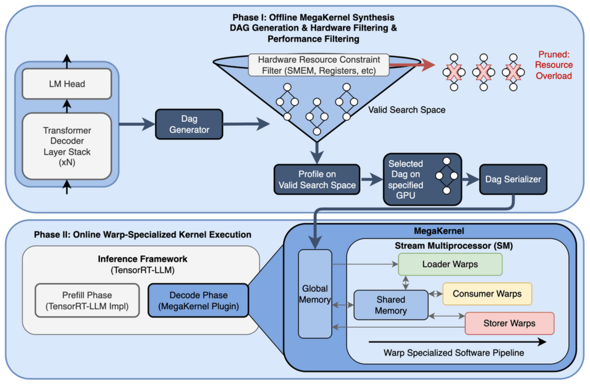
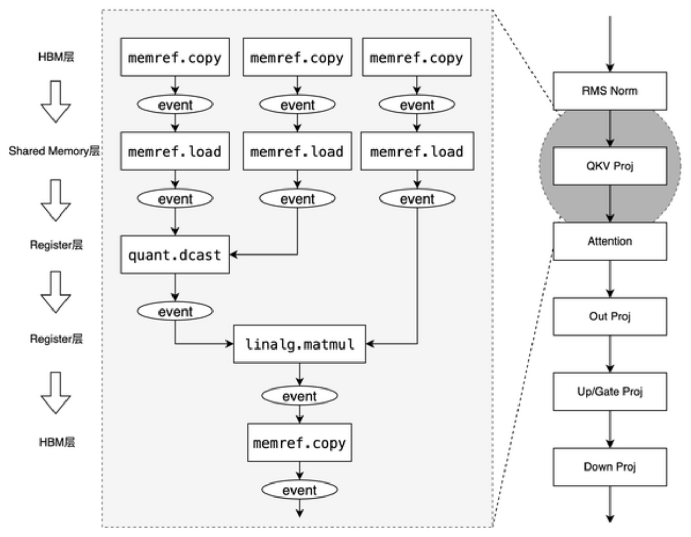
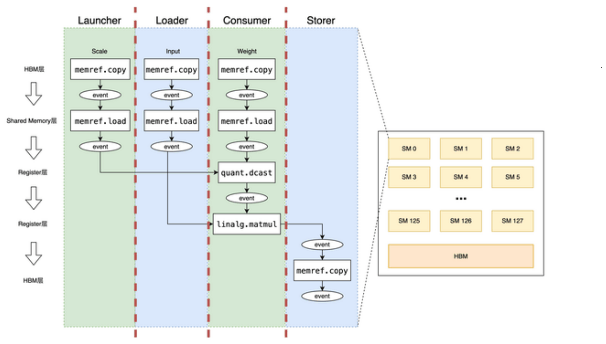
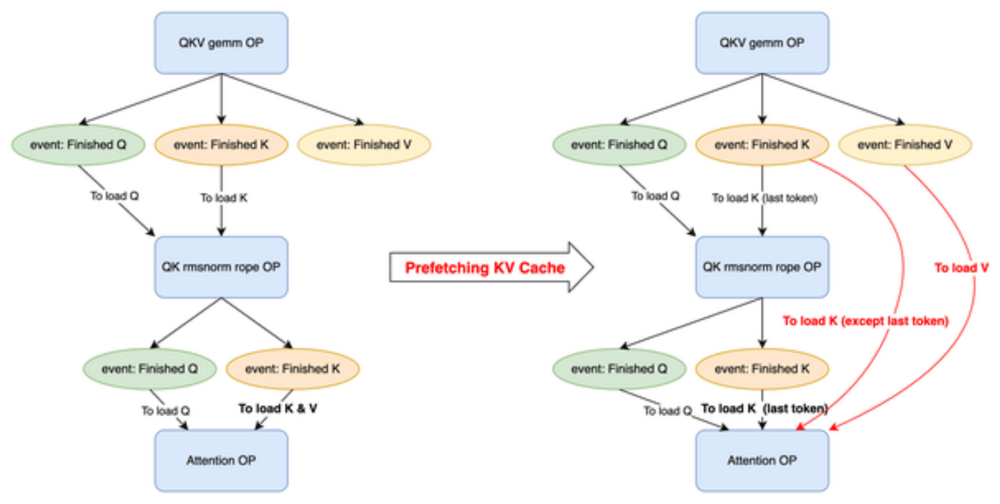
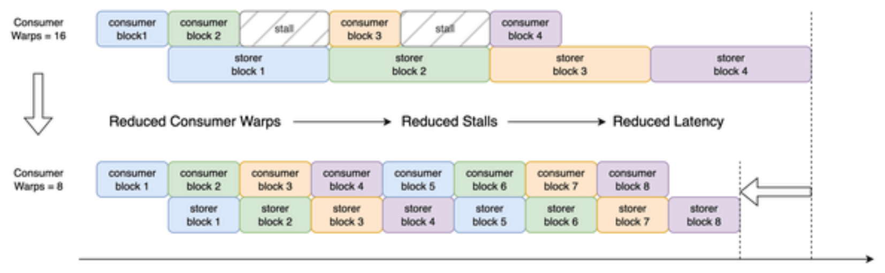
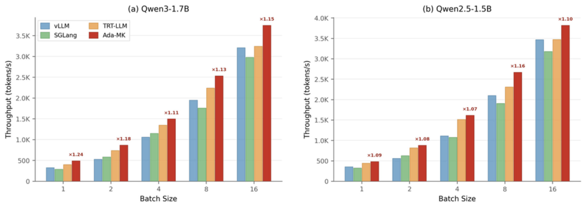
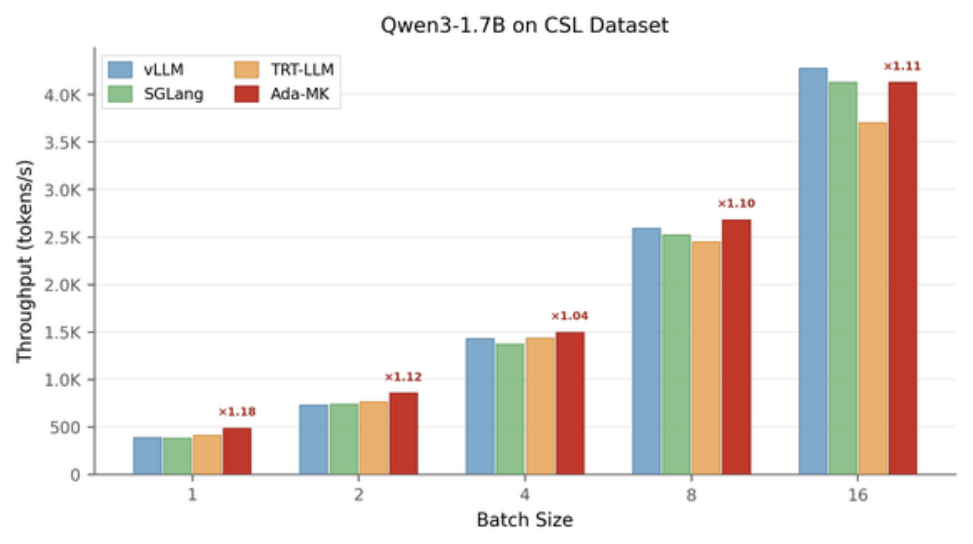
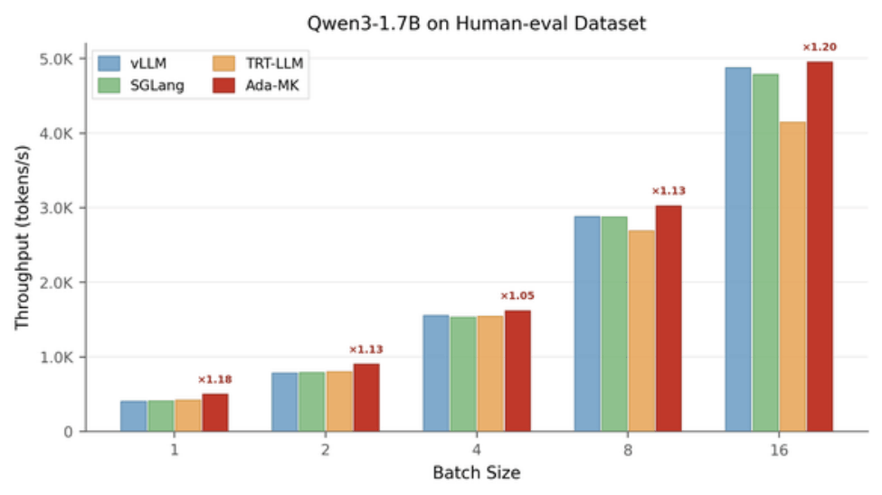

# 论文中文解读：《Ada-MK: Adaptive MegaKernel Optimization via Automated DAG-based Search for LLM Inference》

> **基本信息**：Wenxin Dong、Mingqing Hu、Guanghui Yu、Qiang Fu、Peng Xu、Hui Xu、Yue Xing、Xuewu Jiao、Shuanglong Li、Lin Liu，Baidu Inc.（北京）；arXiv:2605.11581v1 [cs.CL]，2026 年 5 月 12 日（本地 PDF 即 v1，共 9 页）；论文原文 [官方页面](https://arxiv.org/abs/2605.11581)。
>
> **本文的读法**：图 1–8 取自论文 PDF 的原图（它们在 PDF 里本来就是 143–180 ppi 的位图，放大后文字略糊，这是原图的清晰度），表 1–3 逐格转录成中文表；页码指 `paper.pdf` 的页码。图 6–8 的柱子上只有“×倍数”标签、没有吞吐数值，本文按像素标定从柱高读出的数值都写“约”（读数误差约 ±20 tokens/s），并已和原文正文给出的百分数互相核对。凡是解读者自己的推算、推断或判断，文中都明确写成“解读者……”，以便和论文原话区分。

## 一、一句话结论

**问题**：百度商业广告这类在线推理要求端到端时延严格落在毫秒级。LLM 的 decode 每生成一个 token 都要启动大量 kernel；论文对 TensorRT-LLM 上的 Qwen2.5-1.5B 做 Nsight Systems profile，kernel 启动开销约占端到端时间的 14.6%（1,655,550 次启动，约 3.3 s）。MegaKernel 把整段计算融合进一个常驻 kernel，用共享内存和寄存器在算子之间传数据，从而省掉启动开销和算子间的 HBM 往返。但已有的 MegaKernel 方案不适合 NVIDIA Ada（L20）：Stanford 的 MegaKernel 绑定 Hopper/Blackwell 的 TMA 与大共享内存、只支持少数模型；Mirage MPK 按论文的说法在运行时有 if-else 分支，会拖慢指令发射。

**做法**：Ada-MK 由三部分组成。

1. **自适应共享内存管理**：从硬件规格、模型结构、动态负载三个维度给共享内存“分页”建模（公式 1、2），用 K 维细粒度切分把峰值共享内存需求降低 50%，并跨算子复用页（page）。
2. **基于 MLIR 的细粒度 DAG 自动搜索**：把算子降到接近 PTX 指令粒度的数据搬运与计算节点，按读后写（RAW）数据依赖和共享内存页的资源依赖建 DAG，离线搜索 warp 角色分配、流水线级数与页面安排，再把最优执行路径写死（固化）进 kernel 代码，运行时没有动态决策分支。
3. **异构混合推理引擎**：MegaKernel 作为 TensorRT-LLM 的 plugin，prefill 保留 TRT-LLM 原生算子，decode 切到 MegaKernel。

**结果**：单张 NVIDIA L20，Qwen3-1.7B 与 Qwen2.5-1.5B（均 GPTQ-W4A16），离线批量推理，指标是生成吞吐 tokens/s。输入 64、输出 12 个 token 的固定负载下，Ada-MK 相对 vanilla TRT-LLM：Qwen3-1.7B 各 batch 都提升 10% 以上，batch=1 最高 +23.6%；Qwen2.5-1.5B 为 +6.7%–15.6%。真实数据集 CSL、Human-eval（只测了 Qwen3-1.7B）上相对 TRT-LLM 提升 4.0%–19.5%。相对 vLLM、SGLang：小 batch 优势很大（Qwen3-1.7B 固定负载 batch=1/2 时对 vLLM +50.2%/+64.5%，对 SGLang +71.9%/+49.3%），batch 变大、上下文变长后优势收窄，CSL batch=16 时反而被 vLLM 超过 3.5%。

**证据边界**：只有一张 L20、两个 1.5B–1.7B 的 4-bit 小模型、离线批量的吞吐数据；没有消融实验，也没有任何实验对比 Stanford MegaKernel 或 MPK；“共享内存峰值降 50%”“decode 比 Stanford MegaKernel 快约 30%”这类数字在论文里没有对应的测量；“首次工业部署”只是作者的陈述。详见第八、九节。

## 二、背景与动机

### 2.1 要解决的问题：毫秒级 decode 里的 kernel 启动与 HBM 往返

论文的应用场景是百度的商业在线广告系统：LLM 要在实时推理里把端到端时延严格控制在毫秒级，业务要求时延“确定地”落在 1–5 ms（论文没有说明这个 1–5 ms 指每个 token 还是整个请求）。论文指出两个主要瓶颈：

- **频繁的全局显存访问**：传统流水线里相邻 kernel 只能通过 HBM 交换中间结果；
- **kernel 启动开销**：decode 每个 token 都要启动大量 kernel。论文给出的唯一量化依据是：用 Nsight Systems 对 TensorRT-LLM 上的 Qwen2.5-1.5B 做 profile，启动开销约占端到端推理时间的 14.6%（1,655,550 次启动，约 3.3 s）。论文没有给出这次 profile 的 GPU、batch、序列长度与统计的 token 数（因此无法由 1,655,550 次反推“每个 token 数千次启动”），也没说明 3.3 s 是 CPU 侧启动 API 的累计耗时还是 GPU 上的空泡。

**解读者核算**：由 3.3 s 与 14.6% 可反推这次 profile 的总时长约 $3.3 / 0.146 \approx 22.6$ s，平均每次启动约 2 µs。如果这 14.6% 被完全消除、且不引入新开销，端到端最多快 $1/(1-0.146) \approx 1.17$ 倍。这一点对读第七节很重要：Qwen3-1.7B 在 batch=1 的实测加速是 ×1.24（图 6a），已经高于这个“只省启动开销”的上界，说明增益里还有别的来源（HBM 往返、流水线重叠、W4A16 专用 kernel 与 TRT-LLM 原生路径的实现差异等），而论文没有把这些来源拆开。另外 14.6% 是 Qwen2.5-1.5B 的数，换成 Qwen3-1.7B 或别的负载不一定相同。

### 2.2 MegaKernel 是什么

MegaKernel 把一整段计算（这里是 Transformer decoder 的各层加 LM Head）融合进**一个常驻（persistent）kernel**：只启动一次，之后 kernel 内部自己完成所有算子的调度，中间结果留在共享内存和寄存器里。论文引用 Hazy Research 的 Llama-1B megakernel [9]，把它的机制概括为三点：

- **Persistent Kernel（常驻 kernel）**：单次启动、持续计算，消除算子切换开销；
- **Warp Specialization（warp 特化）**：把同一个 SM（streaming multiprocessor，流多处理器）里的 warp 划分成不同角色，构成生产者–消费者流水线；
- **TMA 与异步 I/O**：TMA（Tensor Memory Accelerator，Hopper 起才有的异步张量搬运硬件）和其他异步拷贝让数据搬运与计算重叠。

论文对 Stanford MegaKernel 的描述（第 2.2 节）是：它基于 Tiny-Llama 与 FlashAttention 原语，把 SM 的资源拆成五种异构角色，靠异步协作与 semaphore（信号量）同步，把计算、访存、指令分发解耦成深流水线；实现大量借鉴 NVIDIA CUTLASS 的 warp-specialized GEMM 设计。这五种角色在后文反复出现：

| 角色 | 论文中的职责描述 |
| --- | --- |
| Loader | 异步预取（第 4.2.2 节具体写成预取权重） |
| Consumer | 张量计算（第 4.2.2 节具体写成：输入加载、反量化、MMA 计算） |
| Storer | 异步写回（第 4.2.2 节：结果写回同步） |
| Controller | 指令分发协调 |
| Launcher | 第 2.2 节写“资源释放管理”；第 4.2.2 节写“元数据与页面调度” |

此外，Stanford MegaKernel 的共享内存按**页**（page）管理：算子 A 用完的页可以释放给算子 B 使用（第 4.1.2 节说原版实现了这种跨算子的页复用）。

### 2.3 为什么 Ada（L20）上难

目标部署环境是 NVIDIA Ada 架构的 L20（compute capability 8.9，48 GB GDDR6，显存带宽 864 GB/s）。论文列出三重约束：

1. **没有 TMA**：Ada 硬件上没有 TMA，只能用 PTX 汇编和手写的软件流水线去模拟异步数据搬运；
2. **共享内存更小**：论文写 Ada 的片上共享内存只有 H100 的一半（128 KB 对 227 KB，引自 NVIDIA 白皮书 [19]），这大幅压缩了流水线级数与 tile 尺寸的选择空间。论文给出的后果是：Ada 上可实现的流水线级数从理论最优的 4 级降到只有 2 级，流水线占空比（duty cycle）损失超过 30%；
3. **时延确定性要求**：业务要求端到端时延严格落在 1–5 ms。

相比之下，Hopper/Blackwell 既有 TMA 又有 227 KB 共享内存，MegaKernel 的部署要直接得多。

**解读者提示**：论文拿“128 KB”对比“227 KB”，口径没有说明。128 KB 看起来是 Ada 每个 SM 的 L1/共享内存合计容量；CUDA 编程指南规格表里，CC 8.9 单个 thread block 能用的 shared memory 上限低于这个数（约 99 KB，请以官方表为准），而 227 KB 对应 H100 的每 block 上限。论文没有交代实际使用的 $\mathrm{SMem}_{\max}$ 是多少。

### 2.4 现有方案的缺口

论文对已有工作的评价集中在两处：

- **Stanford MegaKernel [9]**：性能很强，但代码库深度绑定 Hopper/Blackwell 的汇编级优化，tile 尺寸针对特定模型（如 Llama-1B）写死，不支持 Qwen 等常用模型，也只支持低负载的 decode 阶段，不支持长序列、大 batch 的 prefill；移植到 Ada 的成本极高。
- **Mirage MPK [1, 27]**：靠自动调优提升易用性（tGraph 多级流水抽象，自动搜索 tiling 与存储分配），但论文称它的 **Managed Pointer** 机制会根据共享内存页的状态在运行时产生 if-else 分支，降低指令发射效率，在超低时延场景下达不到手工调优算子的水平；遇到不规则 tile 和复杂算子链时，自动搜索也难以在合理时间内收敛到全局最优。

更广的相关工作被论文按“从局部到全局融合”归类：传统 kernel fusion（仍靠全局显存交换中间数据）、CUDA Graph（减少启动开销，但无法做算子间深度融合）、Triton 与 Hidet（编译期融合，但仍是“一个算子一个 kernel”）、MCFuser、Neptune、Magneto、FlashAttention 系列（单算子的极致融合），以及 OLLIE、Korch、PET、TASO 这类张量程序优化工作；论文的判断是它们都没有解决 MegaKernel 级别的全局算子融合。

**解读者核对**：仓库里的 MPK 论文（[`../mirage_persistent_kernel/论文中文解读.md`](../mirage_persistent_kernel/论文中文解读.md)，v2）全文检索不到“Managed Pointer”一词，也没有讨论按页状态做运行时分支。Ada-MK 的这条批评可能针对 MPK 的开源代码实现；Ada-MK 没有给出代码位置，也没有做 MPK 对比实验，所以这条批评在本文可用的材料里无法核实。

## 三、总体架构（图 1）

Ada-MK 分成紧耦合的两个阶段：**离线 MegaKernel 综合（Phase I）**与**在线 warp 特化执行（Phase II）**。



*图 1（原文 Figure 1，第 3 页）：Ada-MK 总体架构，上半是离线综合，下半是在线执行。*

**图中文字翻译与读法**：

- **上半 Phase I: Offline MegaKernel Synthesis（离线 MegaKernel 综合；副标题 DAG Generation & Hardware Filtering & Performance Filtering，即 DAG 生成、硬件过滤、性能过滤）**：左边蓝框是被分析的模型结构 Transformer Decoder Layer Stack (xN)（N 层 Transformer decoder 堆叠）加 LM Head，箭头自下而上。它进入 Dag Generator（DAG 生成器），产生一批候选 DAG。漏斗里的 Hardware Resource Constraint Filter (SMEM, Registers, etc)（硬件资源约束过滤器，检查共享内存、寄存器等）把超出资源预算的 DAG 剔除，即右边三个打叉的小 DAG，旁注 Pruned: Resource Overload（因资源超载被剪掉）；漏斗里留下的是 Valid Search Space（有效搜索空间）。随后 Profile on Valid Search Space（在有效搜索空间上做 profile）→ Selected Dag on specified GPU（为指定 GPU 选出的 DAG）→ Dag Serializer（DAG 序列化器），产物交给下半部分的运行时。
- **下半 Phase II: Online Warp-Specialized Kernel Execution（在线 warp 特化的 kernel 执行）**：左边 Inference Framework (TensorRT-LLM)（推理框架）里并排两块：Prefill Phase (TensorRT-LLM Impl)（prefill 阶段，用 TRT-LLM 自己的实现）和 Decode Phase (MegaKernel Plugin)（decode 阶段，用 MegaKernel 插件）。后者放大成右边的 MegaKernel：Global Memory（全局显存）与 Shared Memory（共享内存）之间双向搬运；在 Stream Multiprocessor (SM) 里，Loader Warps（加载 warp）、Consumer Warps（消费/计算 warp）、Storer Warps（写回 warp）围绕共享内存协作，底部箭头 Warp Specialized Software Pipeline（warp 特化的软件流水线）。
- **读图结论**：Ada-MK 把“找最优执行方式”全放在离线阶段（生成候选、按硬件资源剪枝、在剩余空间里 profile 选优、序列化），线上只执行已固化的结果，并且只替换 TRT-LLM 的 decode 部分。图里只画了 Loader/Consumer/Storer 三类 warp，图题与正文说的 Controller、Launcher 没有画出。

论文对两个阶段的文字说明如下。

**Phase I（离线综合）**：

1. 把 Transformer Decoder 与 LM Head 的逻辑结构解析成细粒度 DAG；
2. 硬件资源过滤器评估共享内存容量、寄存器上限等约束，直接剪掉会超出资源预算的分支；
3. 在剩下的可行搜索空间里做 profile，找出目标 GPU 上最优的 DAG 执行轨迹（trace）；
4. 把这条轨迹序列化，供运行时调用。

**Phase II（在线执行）**：序列化后的 MegaKernel 以 plugin 的形式嵌入 TensorRT-LLM，Prefill 用 TRT-LLM 原生算子，Decode 用 MegaKernel 引擎，两者无缝切换。在每个 SM 内部，MegaKernel 构造 warp 特化的软件流水线：计算资源在空间上划分给 Loader、Consumer、Storer、Controller、Launcher 等 warp 组，它们共享 SM 资源、通过共享内存协作，尽量让访存延迟与计算重叠。

## 四、优化一：资源受限下的自适应共享内存管理（论文第 4.1 节）

这一节回答“共享内存只有这么多，怎么还能搭出够深的流水线”。论文的办法是先把共享内存的分配写成可计算的模型，再用 K 维切分和页复用把需求压下去。

### 4.1 三维参数感知的资源建模

论文从三个维度给共享内存分配建模：

| 维度 | 取什么信息 | 影响下面公式里的哪些量（解读者按公式整理） |
| --- | --- | --- |
| 硬件规格 | 每个 SM 最多可用的共享内存等 | $\mathrm{SMem}_{\max}$、每级固定开销、页大小 |
| 模型结构 | 权重、量化 scale 等共享数据占用的共享内存 | $N_{\text{page,weight}}$、$N_{\text{page,scale}}$ |
| 动态负载 | 激活占用随 batch size 变化 | $N_{\text{page,act}}$ |

**硬件规格感知**：先从 GPU 规格取每个 SM 最大可用的共享内存，把它分成三部分：指令流水线缓冲（instruction pipeline buffers）、同步元数据（synchronization metadata）、计算中间缓冲（computation intermediate buffers），然后算出最多能划出多少页（公式 1，原文第 3 页）：

$$
N_{\text{page}} = \frac{\mathrm{SMem}_{\max} - N_{\text{stage}} \times \left(\mathrm{Instr}_{\text{buf}} + \mathrm{Semaphores} + \mathrm{Scratch}\right)}{\mathrm{Size}_{\text{page}}}
$$

- $\mathrm{SMem}_{\max}$：每个 SM 最多可用的共享内存；
- $N_{\text{stage}}$：流水线级数（pipeline depth）；
- $\mathrm{Instr}_{\text{buf}}$、$\mathrm{Semaphores}$、$\mathrm{Scratch}$：分别对应上面的指令流水线缓冲、同步元数据（信号量）、计算中间缓冲；公式把这三项之和乘以 $N_{\text{stage}}$，即每一级流水线各占一份；
- $\mathrm{Size}_{\text{page}}$：一页的大小；
- $N_{\text{page}}$：能划出的页数。

**模型结构与动态负载感知**：不同模型要算权重、量化 scale 等共享数据占的页数；激活占的页数随 batch size 变化。流水线深度 $N_{\text{stage}}$ 随之自适应调整：资源受限的设备上强制满足容量约束，资源宽裕的设备上加深流水线以提高吞吐（公式 2，原文第 3 页）：

$$
N_{\text{stage}} = \frac{N_{\text{page,total}} - N_{\text{page,weight}} - N_{\text{page,scale}} - N_{\text{page,act}}}{N_{\text{page,per stage}}}
$$

- $N_{\text{page,total}}$：总页数（解读者按上下文理解为公式 1 的 $N_{\text{page}}$）；
- $N_{\text{page,weight}}$、$N_{\text{page,scale}}$：权重、量化 scale 等共享数据占用的页数；
- $N_{\text{page,act}}$：激活占用的页数；
- $N_{\text{page,per stage}}$：每一级流水线占用的页数。

公式 2 的读法：先从总页数里扣掉常驻的权重、scale 和激活，剩下的页按“每一级流水线要多少页”切分，得到能支撑的流水线深度。

**解读者说明**：

- 两个公式互相引用：公式 1 的页数要用 $N_{\text{stage}}$，公式 2 的 $N_{\text{stage}}$ 又要用总页数。论文没有说怎么求解；常规做法是枚举或迭代 $N_{\text{stage}}$ 直到两式自洽，但这只是推断。
- 论文没有给出 $\mathrm{Instr}_{\text{buf}}$、$\mathrm{Semaphores}$、$\mathrm{Scratch}$、$\mathrm{Size}_{\text{page}}$ 的任何具体数值，所以公式只能当作建模思路，不能直接复算。
- 量级核算：论文的数字之间大体自洽。第 4.3.2 节说每次迭代需要的共享内存从 64 KB 压到 32 KB、页占用从 4 降到 2，由此可推出一页约 16 KB（解读者推算）。在 128 KB 容量下，若忽略固定开销与常驻数据，每级 64 KB 只放得下 2 级，每级 32 KB 则可放 4 级，正是论文说的“级数从 2 增到 4”。这只是上界式的量级说明；如第 2.3 节所说，真实可用容量可能小于 128 KB。

### 4.2 K 维细粒度切分

GEMM 沿 K 维（归约维）做累加。论文受“分段计算”思路启发，把 K 维的 tile **减半**：每次循环迭代只装载当前子块所需的那一半权重子 tile，于是权重在共享内存里的峰值占用降低 50%（摘要、第 4.1.1 节、第 6 节结论都用这个数）。解读者推断：这样做的代价是循环迭代次数翻倍、同步更频繁（部分和跨迭代累加是 K 维分段计算的常规做法）；论文没有讨论这个代价，也没有给出 tile 尺寸和数据类型，所以“50%”是由“tile 减半”直接得出的，论文里没有对应的实测。

### 4.3 共享内存页复用

Stanford MegaKernel 已经实现了跨算子的页复用（算子 A 释放的页给算子 B 用）。Ada-MK 进一步优化这个策略，运行时由自动分析决定在哪些位置复用页（分析方法见第五节）。论文给出两种复用：

- **激活—权重页复用**：激活从共享内存装进寄存器后，它占的共享内存就可以回收，重新分给 Loader 存放权重。这样 Loader 与 Consumer 之间可用的流水线级数变多，能更好地隐藏访存延迟、提高指令级并行；
- **激活—输出页复用**：算出的输出通常要先在共享内存里缓冲、再写回全局显存。MMA 的计算依赖寄存器，激活拷进寄存器后其占用的共享内存即可释放，转给 MMA 结果的存放使用。

两种复用的共同点是：激活一旦进了寄存器，它原来的页就空出来了；这些空出的页再被用来存放权重（Loader 装载）或 MMA 的结果。

## 五、优化二：基于 MLIR 的细粒度 DAG 自动搜索（论文第 4.2 节）

### 5.1 DAG 的形式化

为了精确刻画 MegaKernel 内部的执行逻辑，论文定义了一个有向无环图（DAG）框架：

- **节点**分两类：数据迁移（Global→Shared→Register 各级传输）与计算执行（MMA、反量化、epilogue），粒度对齐到 PTX 指令；
- **边**分两类：**数据依赖**（生产者—消费者关系，后继必须等前驱完成）和**资源依赖**（对有限共享内存页的竞争，页不够时后续的 load 必须停顿）。

这样一个只含数据依赖的传统 DAG 被扩展成同时带有资源约束的图，搜索时既要满足数据先后，也要满足页容量。

### 5.2 Step 1：MLIR 细粒度分解（表 1）

算子级的依赖表示把并行机会藏起来了：一个“QKV 投影”在图里只是一个黑盒节点，看不出里面的权重加载可以和别的计算重叠。论文借助 Torch-MLIR 的多层变换架构，深入分析 MLIR dialect 并逐层降级（lowering），再受 Relax 的可组合编译思路启发，把粗粒度的算子黑盒分解成 PTX 级的细粒度依赖轨迹，为 MegaKernel 的静态指令调度与资源管理提供精确的拓扑信息。

表 1 是高层 MLIR 算子到低层原语的映射，也是后面 DAG 节点的“字典”：

**表 1：MLIR 高层算子到低层原语的映射**（“物理语义”说明该原语在 GPU 上做什么，“硬件资源”是它占用的部件；TC = Tensor Core，SMem = 共享内存，Regs = 寄存器，ALU = 算术单元，HBM = 显存）

| MLIR 高层 (MLIR High) | MLIR 低层 (MLIR Low) | 物理语义 (Physical Semantics) | 硬件资源 (HW Res.) |
| --- | --- | --- | --- |
| `memref.copy` | `nvgpu.device_async_copy` | Global→Shared：异步预取 | HBM、SMem |
| `memref.load` | `nvgpu.ldmatrix` | Shared→Reg：warp 级加载 | SMem、Regs |
| `quant.dcast` | `custom.dequant` | 反量化：INT4→FP16 | ALU、Regs |
| `linalg.matmul` | `nvgpu.mma.sync` | Tensor Core：16×8×16 MMA | TC |
| `linalg.generic` | `arith.addf` | Epilogue：bias/激活融合 | ALU、Regs |
| `memref.copy` | `vector.transfer_write` | Reg→HBM：异步写回 | HBM、Regs |

原文表 1，第 4 页。读法：

- 同一个高层 `memref.copy` 按数据方向降到不同的低层原语：Global→Shared 方向是异步拷贝，Reg→HBM 方向是向量写回；
- 一条 GPU 数据通路因此被拆成 “异步拷进共享内存 → `ldmatrix` 装进寄存器 → 反量化 → MMA → epilogue → 写回”这几类节点，每类节点占用的硬件部件不同，这正是后面做重叠与资源分配的依据；
- 解读者补充：`nvgpu.device_async_copy` 对应 Ampere 起就有的 `cp.async` 异步拷贝，这就是 Ada 在没有 TMA 的情况下做“异步预取”的手段；`quant.dcast` 属于 MLIR 的 quant dialect，`custom.dequant`（INT4→FP16）是论文自定义的原语。

### 5.3 Step 2：构造逻辑依赖（图 2）

分解之后，要在指令序列里找出“谁读了谁写的数据”，建出生产者到消费者的 DAG。论文用 MLIR 的 `AliasAnalysis` API 加一张 `lastWriters`（最近写入者）映射表：顺序遍历指令序列，在 Write 操作处记录“这块内存的最近写入者是谁”，在 Read 操作处用别名分析判断它读的内存是否与某个已记录的写入重叠，重叠就连一条读后写（RAW）边。

下面是解读者按正文文字重构的示意代码，不是论文给出的原文算法：

```text
lastWriters = {}                               # 内存对象 -> 最近一次写入它的操作
for op in 指令序列（程序顺序）:
    for r in op 读取的内存:
        for (mem, writer) in lastWriters:
            if 别名分析(r, mem) 可能重叠:
                加边 writer -> op              # RAW：生产者 -> 消费者
    for w in op 写入的内存:
        lastWriters[w] = op
```



*图 2（原文 Figure 2，第 4 页）：由 MLIR 别名分析构造细粒度依赖 DAG：Write 确定生产者，Read 处做别名分析确定内存重叠，从而建立 RAW 边。*

**图中文字翻译与读法**：

- **右侧竖列**是一层 Transformer decoder 的算子链：RMS Norm → QKV Proj → Attention → Out Proj → Up/Gate Proj → Down Proj。其中 QKV Proj 被灰色圆圈圈出，两条虚线把它“放大”到左边的灰色虚线框，说明左边的 DAG 是 QKV 投影内部的细粒度结构。
- **左边 DAG 的最左侧竖标**：HBM层 → Shared Memory层 → Register层 → Register层 → HBM层（“层”即存储层级），空心箭头表示数据沿存储层级向下流动，再回到 HBM。
- **DAG 本体**：三条并行的输入链，每条都是 `memref.copy`（HBM→共享内存）→ event → `memref.load`（共享内存→寄存器）→ event。第一、二条链汇入 `quant.dcast`（反量化，图中第二条链从侧面接入），其输出经 event 与第三条链一起进入 `linalg.matmul`；matmul 经 event 到 `memref.copy`（写回 HBM）→ event。图中椭圆 event 表示节点之间的完成事件，即同步边。
- 解读者对应关系：图 2 没有标出三条链各自搬运什么；对照图 3 的标注，可以理解为 weight（权重，进反量化）、scale（量化缩放，进反量化）、input（输入激活，直接进 matmul）。
- **读图结论**：图把“一个 GEMM 算子”拆成了 9 个操作节点（3 个 `memref.copy`、3 个 `memref.load`、`quant.dcast`、`linalg.matmul`、1 个写回的 `memref.copy`）和 9 个 event，每个节点的依赖只指向真正需要它的后继。例如第三条链（输入激活）的加载与第一、二条链（权重、scale）的加载互相独立，可以并行，这是算子级黑盒图看不到的并行机会。

注意：RAW 边只表示“数据先后”；论文在第 4.2.3 节还提到页复用要满足 WAR（先读后写）约束，即旧数据最后一次被读完，页才能被新数据覆盖。

### 5.4 Step 3：调度与资源候选集的生成

**角色拆分（DAG-to-Role Mapping）**：系统把 DAG 节点分配给四种角色（图 3），并探索原子节点在不同角色间的映射方案：

- **Launcher**：元数据与页面调度；
- **Loader**：异步权重预取；
- **Consumer**：输入加载、反量化与 MMA 计算；
- **Storer**：结果写回同步。

核心策略有两条：**负载均衡**（避免把 ALU 密集的任务堆在同一个角色上，把轻量的 I/O 或预处理逻辑迁到 Loader，最大化硬件发射槽的利用率）和**tiling 参数空间**（同时遍历多种 Block/Warp tile 划分比例，寻找理论上的峰值算力）。



*图 3（原文 Figure 3，第 5 页）：DAG 节点被分配给四种流水线角色，并做负载均衡与 tiling 参数探索。*

**图中文字翻译与读法**：

- **左侧四列**依次是 Launcher、Loader、Consumer、Storer 四种角色，列之间的红色虚线是角色边界；最左侧的竖标仍是 HBM层 → Shared Memory层 → Register层 → Register层 → HBM层。
- **Launcher 列（标注 Scale，缩放因子）**：`memref.copy` → event → `memref.load` → event，其输出连到 Consumer 列的 `quant.dcast`。
- **Loader 列（标注 Input，输入）**：同样的 copy → event → load → event 链，其输出连到 Consumer 列的 `linalg.matmul`。
- **Consumer 列（标注 Weight，权重）**：copy → event → load → event，然后是 `quant.dcast` → event → `linalg.matmul`。
- **Storer 列**：matmul 的输出经 event → `memref.copy`（写回）→ event。
- **右侧小图**：三列方框，上面两行是 SM 0–SM 5，中间一行省略号，下面一行是 SM 125、SM 126、SM 127，底部一条 HBM。解读者理解：表示这套角色分配在每个 SM 上各执行一份、共同读写 HBM；图里 SM 编号到 127 应理解为示意，论文没有给出 L20 的 SM 数。
- **读图结论**：同一份 DAG 的节点被分给不同 warp 角色并行推进，跨角色的依赖由 event 承担。
- **图文不一致**：正文说 Loader 预取权重、Consumer 负责输入加载，而图 3 把 Input 标在 Loader 列、Weight 标在 Consumer 列，两者相反；论文没有解释（见第九节）。

**共享内存受限的调度策略**：共享内存的分配直接决定流水线会不会发生结构性停顿（structural stall）。论文定义了三种页状态：Empty（空）、Locked（锁定）、Ready（就绪），用它们识别 Loader 与 Consumer 之间的状态冲突、量化结构性停顿，并计算流水线占空比。论文没有定义状态转移；解读者的理解是：页空闲（Empty）→ Loader 发起异步拷贝时被占住（Locked）→ 数据到位（Ready）→ Consumer 用完后释放回 Empty。候选集通过下面四种手段被剪枝或改写：

- **早期异步预取（early asynchronous prefetching）**：把预取步长从 $N+1$ 增加到 $N+2$（解读者理解为：计算第 $N$ 次迭代时，Loader 已经在装第 $N+2$ 次迭代的权重，原来只提前一次），用更多共享内存换取权重搬运与计算的完全重叠。论文引用 TileLink [34] 说明 tile 为中心的原语可以在分布式场景里重叠计算与通信，Ada-MK 是在单个 SM 的软件流水线内应用类似的重叠思想；
- **间隙填充（gap filling）**：把不在关键路径上的指令插进同步原语留下的空闲发射槽；
- **地址置换（address permutation）**：把逻辑页重映射到物理地址偏移，通过交错复用减少 bank conflict。论文引用 Hexcute [28]（约束求解）与 Axe [10]（跨层级内存映射的统一布局抽象）作参考；
- **角色再平衡（role rebalancing）**：把轻量任务（如反量化）转给空闲的 Loader 角色，加快页的周转。

### 5.5 Step 4：静态轨迹搜索与执行路径固化

**启发式离线搜索**：在由逻辑依赖和物理约束围成的空间里，通过离线 profile 模拟多种页面排布和角色映射，锁定理论占空比最高的执行轨迹。论文强调它与两类搜索方法不同：Ansor [31] 用分层搜索空间加进化搜索，Pruner [22] 用“先草拟再验证”（Draft-then-Verify）加速搜索；Ada-MK 的 DAG 级搜索直接作用在 PTX 级依赖图上，能抓到更细粒度的并行机会，并处理传统 MegaKernel 处理不了的复杂不规则依赖。

**执行路径固化（path solidification）**：MPK 等框架在运行时引入 if-else 分支，造成指令发射延迟和流水线气泡。Ada-MK 的做法是把搜索得到的最优执行路径直接序列化进 kernel 代码。这使系统从“在线自适应”转向“离线规划”，不需要在运行时探测资源状态，也去掉了动态决策带来的指令开销。论文的总结是：这一节在离线阶段完成了对物理最优执行轨迹的穷举搜索与锁定，是“离线搜索、在线复用”，用编译期的搜索成本换运行时的确定性。

**解读者说明**：

- 论文既说“启发式搜索”又说“穷举搜索”，并且没有交代搜索空间有多大、评估了多少候选、搜索耗时多少，也没有说明“理论占空比”如何计算（是由页状态模型推出，还是 profile 实测）。占空比在论文里没有公式，按上下文理解为流水线里关键计算单元处于忙碌状态的时间占比。
- 固化的是“节点到角色的映射、页面安排、指令顺序”这类调度决策；序列长度这类运行期变量（decode 时 KV 长度每步都在变）如何与静态路径配合，论文没有说明。
- 论文也没有说明每个 batch size 是否单独搜索、单独生成一份 MegaKernel（公式 2 里激活占页随 batch 变化，暗示可能要分别搜索，但这是推断）。

### 5.6 综合效果：约 30% 的来源（论文第 4.2.3 节）

论文称：细粒度 DAG 自动搜索机制相对原版 Stanford MegaKernel，decode 阶段约有 30% 的性能提升，收益来自两个方面。注意这个“约 30%”在论文里没有对应的实验设置和图表，第七节的实验也没有 Stanford MegaKernel 这个基线，应视为作者的陈述。

**来源一：系统性地消除伪依赖**。原版 MegaKernel 因静态编译策略引入了隐式的串行化屏障，妨碍指令级并行。通过在数据流相关性（RAW/WAR）约束下做细粒度 DAG 依赖追踪，实现两类解耦：

- **异步预取与逻辑解耦**：DAG 分析确认 RMS Norm 的权重与 QKV 计算指令之间没有数据流依赖，所以它们的加载时刻可以提前到物理页被释放的那一刻，用异步传输隐藏 HBM 访问延迟。同样，attention 算子里 V cache 与 K cache 的历史部分的加载，也被提前到与前面计算重叠的流水线窗口里，使历史 KV cache 的传输离开关键路径（图 4）。
- **伪依赖消除与流式归约**：在 SwiGLU 这类双路门控激活结构里，传统实现要等 Up、Gate 两路 GEMM 都做完才触发 Reduce，形成粗粒度的同步屏障。细粒度 DAG 把 Reduce 的启动条件绑定到对应输入分量的就绪，于是 Up 路的 Reduce 可以与 Gate 路的 GEMM 并行进行，实现跨路径的流式归约。



*图 4（原文 Figure 4，第 6 页）：异步预取把 RMS Norm 加载和 KV-Cache 加载同 QKV 计算解耦（图里画出的是 KV Cache 预取这一半）。*

**图中文字翻译与读法**：

- **左图（预取之前）**：QKV gemm OP（QKV 矩阵乘算子）完成后发出三个事件 event: Finished Q / Finished K / Finished V（Q、K、V 算完）；Q、K 事件经 To load Q、To load K（触发加载 Q、K）进入 QK rmsnorm rope OP（对 Q、K 做 RMSNorm 与 RoPE 的算子，对应 Qwen3 的 QK-Norm，见 [`../qwen_3/论文中文解读.md`](../qwen_3/论文中文解读.md)）；它再发出新的 event: Finished Q / Finished K，Attention OP 要等到这两个事件，才开始 To load Q 与 To load K & V（加载 Q，以及 K 和 V）。也就是说 K、V（含全部 KV cache 历史）的加载排在 QK norm/RoPE 之后，位于关键路径上。
- **中间大箭头 Prefetching KV Cache**：表示“预取 KV Cache”这一改写。
- **右图（预取之后）**：QKV gemm 之后，进入 QK rmsnorm rope OP 的 K 只有 To load K (last token)（最新 token 的 K，它确实需要做 norm/RoPE）。红色曲线从 Finished K、Finished V 事件直接连到 Attention OP：To load K (except last token)（除最新 token 之外的历史 K）和 To load V（V），二者不再等 QK norm/RoPE 完成。Attention OP 前面保留的是 To load Q 与 To load K (last token)。
- **读图结论**：历史 K/V 早已在 cache 里，加载与 norm/RoPE 没有数据依赖，所以可以提前、与前面的计算重叠，把这部分访存从关键路径上拿掉。图里没有画 RMS Norm 权重的预取，那一点只出现在图题和正文里。

**来源二：自动调优出最优流水线配置**。warp 角色分配与共享内存页调度的静态配置，无法适应不同算子之间的吞吐差异。通过离线 profile 驱动的自动调优，在两个维度上收敛：

- **warp 分配精调**：Consumer warp 数从 16 降到 8（图 5），使单个 GEMM 的输出规模变小，并让 Storer 的跨 block Reduce 延迟与 Consumer 的计算延迟对齐，缓解各角色之间的吞吐失配；此外把流水线级数从 2 增加到 4，进一步缓冲各角色延迟差异造成的气泡、抑制流水线停顿。
- **页原位复用优化**：自动调优结合环形页分配（circular page allocation），动态识别哪些共享内存页槽可以提前释放，在 WAR 约束下对权重页和激活页做分时复用，提高有限共享内存的利用率。



*图 5（原文 Figure 5，第 6 页）：warp 分配精调：Consumer warp 从 16 减到 8、流水线级数从 2 增到 4，使各角色延迟对齐、减少流水线停顿。*

**图中文字翻译与读法**：

- **上半 Consumer Warps = 16（Consumer warp 数为 16）**：时间轴向右。上一行是 Consumer：consumer block 1、consumer block 2，随后是斜线填充的 stall（停顿），再是 consumer block 3、又一个 stall、consumer block 4；下一行是 Storer：storer block 1 到 4，每块占用的时间都很长。解读者的理解：stall 出现在 Storer 的上一块还没处理完、Consumer 无法继续的位置。
- **中间**：空心箭头向下，旁边的文字 Reduced Consumer Warps → Reduced Stalls → Reduced Latency，即减少 Consumer warp → 减少停顿 → 降低时延。
- **下半 Consumer Warps = 8（Consumer warp 数为 8）**：Consumer 与 Storer 各被切成 8 块（consumer block 1–8、storer block 1–8），逐块首尾相接，没有 stall；两条竖虚线之间的向左箭头标出整体结束时间比 16 warp 的方案更早。
- **读图结论**：这是定性示意图，没有时间刻度，也不是实测时间线。它要表达的机制是：Consumer warp 少了，每个 GEMM 块的输出变小，Storer 的跨块 Reduce 延迟能和 Consumer 的计算延迟对齐，角色之间吞吐匹配、停顿减少。图里只画了 warp 数的变化；“流水线级数 2→4”只出现在图题与正文中。论文没有给出 warp 数取其他值（如 4、12）时的结果，所以 16→8 是否最优不能从论文判断。

两个维度叠加，论文认为 Ada 这种资源受限架构上的 MegaKernel 流水线效率得到系统性提高，靠的是依赖解耦与自动调优的协同。

## 六、优化三：工业部署与端到端优化（论文第 4.3 节）

### 6.1 嵌入 TensorRT-LLM 的异构混合推理引擎

MegaKernel 在 decode 阶段优势明显，但在 prefill 阶段落后于成熟的 TRT-LLM 的大规模并行计算效率。论文给出三个深层原因：

1. **decode 受 IO 限制**：每步只生成一个 token，计算量很小，瓶颈在访存（权重加上 KV cache 的加载）；MegaKernel 的算子间并行能把计算与 I/O 深度重叠，收益显著；
2. **prefill 受算力限制**：长序列、大批量的计算会把 GPU 算力吃满，MegaKernel 重叠 I/O 与计算带来的收益递减；
3. **kernel 启动开销的差异**：decode 每个 token 要启动数千个 kernel（开销约 14.6%），而 prefill 只做一次前向，启动开销可以忽略，MegaKernel 的核心优势发挥不出来。

此外，生产环境里围绕 TRT-LLM 积累了大量业务能力（如前缀树约束解码、生成—判别一体化），完全替换 TRT-LLM 引擎的工程迁移成本过高。因此论文通过 Plugin 机制把 MegaKernel 深度嵌入 TRT-LLM 的执行拓扑，构成取两者之长的异构混合引擎：

- **分层算子替换**：保留 TRT-LLM 对外围逻辑（Embedding、KV Cache 管理）的成熟实现，只把核心的 Transformer Block 换成自定义的 MegaKernel plugin，修改范围最小；
- **按阶段自适应执行**：Prefill 阶段保留 TRT-LLM 原生的融合算子，发挥其对大批量 token 的高并行度；Decode 阶段自动切到 MegaKernel 引擎，用全链路 kernel 融合消除启动开销与访存瓶颈；
- **业务能力零成本复用**：前缀树约束解码、生成—判别一体化等业务逻辑无需为 MegaKernel 二次开发，直接复用 TRT-LLM 已有实现。

论文把它称为 MegaKernel 大规模工业部署的可行路径。解读者注意：论文没有测量 prefill 与 decode 切换的开销，没有说明 MegaKernel 如何读写由 TRT-LLM 管理的 KV cache（布局、是否分页），也没有演示约束解码等业务逻辑与 MegaKernel decode 的接口；这些“零成本复用”的说法只有论述，没有数据。

### 6.2 MegaKernel 的量化实现

在自适应共享内存管理的基础上，论文进一步把量化优化并入 MegaKernel [17]。目的有二：量化压缩权重体积，缓解 Ada 共享内存容量瓶颈、让流水线级数更多；Ada 上的推理负载仍受显存带宽限制，量化直接降低访存压力、提升吞吐。实现包括三部分：

- **TensorCore 感知的权重重排（weight reorder）**：受 QServe [17] 启发，离线重排权重，使每个线程在推理时能高效访问。运行时 Consumer 通过 `LDMATRIX` 指令直接装载已按 Tensor Core 访问模式对齐的量化权重，不需要把反量化后的权重写回共享内存，也避免了运行时的布局转换开销。Tilus [5] 为任意位宽低精度数据的布局优化提供参考；
- **K 维多级流水计算**：K 维切分与量化结合后，每次迭代所需的共享内存从 64 KB 压缩到 32 KB，页占用从 4 降到 2；腾出的容量用来增加流水线级数，进一步加深计算与访存的重叠；
- **小 batch 的 padding I/O 优化**：小 batch 下 Tensor Core 指令要求固定的 tile 尺寸（表 1 里是 16×8×16 的 MMA），有效数据不足时要 padding，造成大量冗余。论文用向量级的细粒度加载加显式寄存器重组，绕开传统的 tile 级 `ldmatrix` 机制，消除 HBM 与寄存器之间无效 padding 数据的冗余 I/O。这一优化借鉴了 Tilus [5] 的自动向量化与指令选择策略，以及 AWQ [16] 的激活感知权重量化加速思想。解读者举例：batch=1 时 m16n8k16 的 16 行里只有 1 行是有效数据，其余 15 行是 padding（论文没有具体说明矩阵如何映射到 MMA 的 M、N 维）。

## 七、实验（论文第 5 节）

### 7.1 研究问题

论文把实验组织成四个问题，聚焦在不同输入输出长度、batch size、任务负载下的吞吐：

1. MegaKernel 能否在低时延、小 batch 推理场景里显著提高 TensorRT-LLM 的吞吐？
2. 序列长度从固定的短序列扩展到真实任务数据集后，MegaKernel 的收益还在吗？
3. 在较大的 batch size 下，Ada-MK 相对 vLLM、SGLang 这类高吞吐框架是否仍有优势？
4. MegaKernel 的性能收益在不同模型版本上是否一致？

### 7.2 实验设置

**对比框架**（表 2）。

**表 2：被比较的推理框架**（所有框架都在离线批量模式下评测，每个框架在独立的 Docker 容器里运行）

| 框架 | 版本 | 说明 |
| --- | --- | --- |
| vLLM [13] | v0.19.0 | 高吞吐 LLM 推理，带高效的 KV Cache 管理 |
| SGLang [33] | v0.5.10 | 结构化生成与高性能服务 |
| TRT-LLM [21] | v1.1.0rc5 | NVIDIA 原生推理（基线） |
| Ada-MK | — | TRT-LLM + MegaKernel（本文方法） |

原文表 2，第 7 页。读法：Ada-MK 是在 TRT-LLM 上加 MegaKernel plugin（prefill 仍走 TRT-LLM 原生算子），所以它与“TRT-LLM”这一行是同一个宿主引擎，二者之差就是 decode 路径换成 MegaKernel（包括其中的 W4A16 实现）带来的差别。

**模型与量化**（表 3）。

**表 3：模型配置**

| 模型 | 参数量 | 量化 |
| --- | --- | --- |
| Qwen3-1.7B [24] | 1.7B | GPTQ-W4A16 [8] |
| Qwen2.5-1.5B [23] | 1.5B | GPTQ-W4A16 [8] |

原文表 3，第 7 页。读法：GPTQ-W4A16 即权重用 GPTQ 做 4-bit 后训练量化、激活保持 16-bit（论文没说是 FP16 还是 BF16）。论文特别说明两个模型的参数量不同（1.7B 对 1.5B），跨模型对比是为了验证同一量化下优化的通用性，并不能排除参数量差异对绝对性能的影响。

**负载**：

1. **固定短序列**：输入 64 个 token、输出 12 个 token（记作 in64/out12），评估低时延、短输出生成任务下各框架的吞吐；
2. **真实数据集**：CSL 与 Human-eval，上下文长度主要分布在约 200–1000 token，评估中长输入下的性能稳定性。论文没有交代 CSL 的全称与来源，也没有给出这两个数据集上的输出长度。

所有实验的 batch size 取 1、2、4、8、16；指标是生成吞吐（tokens/s），越大越好。

**运行模式**：所有框架都用**离线批量**（offline batch）模式，即一次性同时提交固定的一批请求，收集完所有生成结果后计算吞吐。论文的理由是这样能精确控制并发度、排除在线调度器差异对吞吐测量的干扰，适合以算子执行效率为中心的横向比较。

**硬件与软件环境**（解读者整理自论文第 5.2.4 节，不是原文表格）：

| 项目 | 论文给出的配置 |
| --- | --- |
| CPU | Intel Xeon Platinum 8558（96 核 / 192 线程） |
| 内存 | 1 TB DDR5 |
| GPU | 单张 NVIDIA L20：48 GB GDDR6，显存带宽 864 GB/s，Compute Capability 8.9 |
| 系统与软件 | Linux 内核 5.10.0，GPU 驱动 535.161.07，CUDA 12.2 |
| 运行方式 | 每个框架在独立的 Docker 容器里运行；每次实验独占一张 GPU，避免多任务资源争用 |

### 7.3 固定短序列实验（图 6）

这组实验回答第 1、4 个问题：短输入短输出（in64/out12）下，Ada-MK 在两个模型、五个 batch size 上相对三个基线表现如何。



*图 6（原文 Figure 6，第 8 页）：固定短序列（input=64，output=12）上的端到端吞吐对比：(a) Qwen3-1.7B，(b) Qwen2.5-1.5B，均为 GPTQ-W4A16，单张 L20，离线批量。*

**图中文字翻译与读法**：

- **坐标与图例**：两个子图，(a) Qwen3-1.7B、(b) Qwen2.5-1.5B。横轴 Batch Size（batch size：1、2、4、8、16），纵轴 Throughput (tokens/s)（吞吐，单位 tokens/s；(a) 刻度到 3.5K，(b) 到 4.0K）。每个 batch size 一组四根柱：蓝色 vLLM、绿色 SGLang、橙色 TRT-LLM（vanilla TensorRT-LLM）、红色 Ada-MK（本文）。
- **红柱上方的“×1.xx”标签**：Ada-MK 相对 vanilla TRT-LLM 的加速比（图题说明）。(a) 自 batch=1 到 16 依次为 ×1.24、×1.18、×1.11、×1.13、×1.15；(b) 依次为 ×1.09、×1.08、×1.07、×1.16、×1.10。
- **读图结论**：两个模型、所有 batch size 上，红柱（Ada-MK）都是最高的一根。

图上没有吞吐数值，下面两张读数表是解读者按坐标刻度标定、从柱高读出的近似值（单位 tokens/s，误差约 ±20，四舍五入到 10）；算加速比请用图上的标注，不要用表里的数相除。

**图 6(a) 读数：Qwen3-1.7B，GPTQ-W4A16，in64/out12，单张 L20，离线批量，吞吐（tokens/s，越大越好）**

| batch size | vLLM | SGLang | TRT-LLM | Ada-MK | 图上标注：Ada-MK ÷ TRT-LLM |
| ---: | ---: | ---: | ---: | ---: | --- |
| 1 | 约 330 | 约 300 | 约 400 | 约 490 | ×1.24 |
| 2 | 约 530 | 约 590 | 约 750 | 约 860 | ×1.18 |
| 4 | 约 1,070 | 约 1,150 | 约 1,350 | 约 1,500 | ×1.11 |
| 8 | 约 1,950 | 约 1,760 | 约 2,240 | 约 2,530 | ×1.13 |
| 16 | 约 3,210 | 约 2,980 | 约 3,250 | 约 3,740 | ×1.15 |

**图 6(b) 读数：Qwen2.5-1.5B，GPTQ-W4A16，in64/out12，单张 L20，离线批量，吞吐（tokens/s，越大越好）**

| batch size | vLLM | SGLang | TRT-LLM | Ada-MK | 图上标注：Ada-MK ÷ TRT-LLM |
| ---: | ---: | ---: | ---: | ---: | --- |
| 1 | 约 360 | 约 330 | 约 450 | 约 480 | ×1.09 |
| 2 | 约 560 | 约 630 | 约 820 | 约 880 | ×1.08 |
| 4 | 约 1,120 | 约 1,080 | 约 1,520 | 约 1,610 | ×1.07 |
| 8 | 约 2,110 | 约 1,910 | 约 2,310 | 约 2,670 | ×1.16 |
| 16 | 约 3,470 | 约 3,180 | 约 3,470 | 约 3,810 | ×1.10 |

读法与核对：

- **相对 TRT-LLM**：Qwen3-1.7B 的标注在 ×1.11–×1.24 之间，最大在 batch=1，最小在 batch=4，并不单调；Qwen2.5-1.5B 在 ×1.07–×1.16 之间，最大在 batch=8，batch=1 只有 ×1.09。论文正文写 Qwen3 “各 batch 都 >10%，batch=1 为 23.6%”、Qwen2.5 “稳定提升 6.7%–15.6%”，与标注一致（×1.24 对应 23.6%，×1.07 对应 6.7%，×1.16 对应 15.6%）。图题说“最显著的增益在小 batch”，对 Qwen3-1.7B 成立，对 Qwen2.5-1.5B 相对 TRT-LLM 并不成立（最大增益在 batch=8）。
- **相对 vLLM、SGLang**：正文第 5.5.2 节写“对 vLLM 提升 50.2% 与 64.5%，对 SGLang 提升 71.9% 与 49.3%”（Qwen3-1.7B，in64/out12，BS=1/2）。解读者对照图 6(a) 的柱高，这四个数依次对应 batch=1 的 vLLM、batch=2 的 vLLM、batch=1 的 SGLang、batch=2 的 SGLang：读数约为 +52%、+62%、+67%、+47%，偏差在读数误差之内。摘要里的“50.2%”是 batch=1 的数，batch=2 对 vLLM 的优势（64.5%）还要更大。
- **优势随 batch 收窄**：按读数，Ada-MK 相对 vLLM 的领先在 batch=1–2 最大（Qwen3-1.7B 约 +52%、+62%，Qwen2.5-1.5B 约 +33%、+57%），之后逐步缩小，到 batch=16 只剩约 17%（Qwen3-1.7B）与约 10%（Qwen2.5-1.5B）。
- **基线之间**：固定短序列下，TRT-LLM 是三个基线里最强的（batch=16 时与 vLLM 持平），SGLang 多数 batch 最弱。
- **解读者推算**：如果吞吐按“输出 token 数 ÷ 总耗时”计算（论文只写 generation throughput，没有给公式），Ada-MK 在 Qwen3-1.7B、batch=1 时约 490 tokens/s，意味着 12 个输出 token 总共约 24 ms（含 64 token 的 prefill），折合约 2 ms/token。论文没有说明业务要求的“1–5 ms”是按哪种口径，也没有报告时延指标，所以这个推算只能说明量级。

### 7.4 真实数据集实验（图 7、图 8）

这组实验回答第 2、3 个问题：输入变成约 200–1000 token 的真实数据后，收益是否还在，以及大 batch 下相对 vLLM、SGLang 是否还领先。注意这两个数据集上只测了 Qwen3-1.7B。

**CSL 数据集**（图 7）：



*图 7（原文 Figure 7，第 8 页）：CSL 数据集上的端到端吞吐对比（Qwen3-1.7B，GPTQ-W4A16，单张 L20，离线批量）。*

**图中文字翻译与读法**：

- **标题与坐标**：Qwen3-1.7B on CSL Dataset（Qwen3-1.7B 在 CSL 数据集上）；横轴 Batch Size（1、2、4、8、16），纵轴 Throughput (tokens/s)（刻度到 4.0K）；四色柱与图 6 相同（蓝 vLLM、绿 SGLang、橙 TRT-LLM、红 Ada-MK）；红柱上方的 ×1.18、×1.12、×1.04、×1.10、×1.11 是 Ada-MK 相对 TRT-LLM 的加速比（按图 6 的约定理解）。
- **读图结论**：batch=1 到 8，红柱最高；batch=16 时蓝柱（vLLM）最高，红柱与绿柱（SGLang）几乎一样高。

**图 7 读数：Qwen3-1.7B，GPTQ-W4A16，CSL 数据集，单张 L20，离线批量，吞吐（tokens/s，越大越好）**

| batch size | vLLM | SGLang | TRT-LLM | Ada-MK | 图上标注：Ada-MK ÷ TRT-LLM |
| ---: | ---: | ---: | ---: | ---: | --- |
| 1 | 约 400 | 约 400 | 约 410 | 约 490 | ×1.18 |
| 2 | 约 730 | 约 750 | 约 770 | 约 860 | ×1.12 |
| 4 | 约 1,430 | 约 1,380 | 约 1,440 | 约 1,500 | ×1.04 |
| 8 | 约 2,590 | 约 2,520 | 约 2,450 | 约 2,680 | ×1.10 |
| 16 | 约 4,270 | 约 4,130 | 约 3,710 | 约 4,130 | ×1.11 |

论文正文（第 5.4.1 节）：batch=1 到 8 Ada-MK 吞吐最高；batch=16 时 vLLM 最高，Ada-MK 落后 vLLM 3.5%，与 SGLang 基本持平。读数核对：batch=16 时 Ada-MK 的读数比 vLLM 低约 3%–4%，与正文的 3.5% 吻合；与 SGLang 的读数几乎相同。论文把原因归结为 batch 与序列变长后，vLLM/SGLang 在请求调度、KV Cache 管理或并行扩展上的优势开始显现，但没有给出证据，这是推测。

**Human-eval 数据集**（图 8）：



*图 8（原文 Figure 8，第 8 页）：Human-eval 数据集上的端到端吞吐对比（Qwen3-1.7B，GPTQ-W4A16，单张 L20，离线批量）。*

**图中文字翻译与读法**：

- **标题与坐标**：Qwen3-1.7B on Human-eval Dataset；横轴 Batch Size（1、2、4、8、16），纵轴 Throughput (tokens/s)（刻度到 5.0K）；四色柱同上；红柱上方的 ×1.18、×1.13、×1.05、×1.13、×1.20 是 Ada-MK 相对 TRT-LLM 的加速比。
- **读图结论**：五个 batch size 上红柱都最高，包括 batch=16；此时它只比蓝柱（vLLM）、绿柱（SGLang）高一点，比橙柱（TRT-LLM）高出 ×1.20。

**图 8 读数：Qwen3-1.7B，GPTQ-W4A16，Human-eval 数据集，单张 L20，离线批量，吞吐（tokens/s，越大越好）**

| batch size | vLLM | SGLang | TRT-LLM | Ada-MK | 图上标注：Ada-MK ÷ TRT-LLM |
| ---: | ---: | ---: | ---: | ---: | --- |
| 1 | 约 410 | 约 410 | 约 430 | 约 500 | ×1.18 |
| 2 | 约 790 | 约 790 | 约 800 | 约 900 | ×1.13 |
| 4 | 约 1,560 | 约 1,540 | 约 1,540 | 约 1,620 | ×1.05 |
| 8 | 约 2,880 | 约 2,870 | 约 2,690 | 约 3,020 | ×1.13 |
| 16 | 约 4,870 | 约 4,790 | 约 4,150 | 约 4,950 | ×1.20 |

论文正文（第 5.4.2 节）：Ada-MK 在 Human-eval 上即使 batch=16 也保持最高吞吐，对 vLLM、SGLang 的优势缩小到 1.6% 与 3.5%，但对 vanilla TRT-LLM 仍有 19.5% 的显著提升。读数核对：$4950/4870 \approx 1.016$、$4950/4790 \approx 1.034$、$4950/4150 \approx 1.19$，与正文吻合。

**解读者观察**（来自读数，不是论文结论）：两个数据集上，batch≥8 时 TRT-LLM 都是四个框架里最低的（例如 CSL batch=16，TRT-LLM 约 3,710，对比其余三者约 4,130–4,270）。Ada-MK 在 batch=16 对 TRT-LLM 的增益（×1.11、×1.20）反而大于 batch=4（×1.04、×1.05），而“省启动开销”的逻辑预期 batch 增大后收益变小；所以 batch=16 的增益可能有一部分来自补上 TRT-LLM 自身在该设置下的短板，而不全是 MegaKernel 的启动开销节省。论文没有分析这一点。

### 7.5 综合分析与结论

论文第 5.5 节把结果归纳为四点：

1. **相对 TensorRT-LLM 的稳定增益**：所有测试场景与 batch size 上都是正收益。固定短序列最高 23.6%，真实数据集场景下保持在 4.0%–19.5%，说明优化并不局限于某种输入模式或某个模型配置。核对：4.0% 对应图 7 的 ×1.04，19.5% 对应图 8 的 batch=16。
2. **小 batch、短序列收益最大**：batch=1/2 时优势最明显；Qwen3-1.7B 的 in64/out12 下对 vLLM 提升 50.2%、64.5%，对 SGLang 提升 71.9%、49.3%。论文据此认为 MegaKernel 有效降低了小 batch 推理中的 kernel 调度与执行开销，特别适合低时延在线推理、交互式请求和短文本生成。
3. **大 batch、长序列下优势收窄**：batch 与输入序列增大后，对 vLLM/SGLang 的优势逐渐缩小；CSL batch=16 时 vLLM 最高，Ada-MK 落后 3.5%。论文的解读是：高并发、长上下文场景里，仅靠算子/kernel 级融合优化可能不足以弥补系统级调度与内存管理的差异。
4. **跨模型一致性**：固定短序列下两个模型的所有 batch size 都是 Ada-MK 最高，说明收益可以推广到规模相近、量化相同的不同模型版本。

论文的整体结论：MegaKernel 显著提升了 TRT-LLM 在 GPTQ-W4A16 量化模型上的推理吞吐，在短序列、小 batch 场景最突出；与 vLLM、SGLang 相比，在固定短序列场景全面领先，在 CSL、Human-eval 的低到中 batch 保持稳定优势，在高 batch、中长序列场景优势收窄，有时 vLLM/SGLang 的系统级扩展性更好。

四个研究问题与证据的对应（解读者整理）：

| 研究问题 | 论文的回答 | 证据 | 解读者评价 |
| --- | --- | --- | --- |
| 1. 小 batch 低时延场景能否显著提升 TRT-LLM 吞吐 | 能 | 图 6：batch=1 时 Qwen3 ×1.24、Qwen2.5 ×1.09 | 成立，但幅度因模型差别很大；只有吞吐，没有时延 |
| 2. 真实数据集上收益是否保持 | 保持 | 图 7、8：×1.04–×1.20 | 成立；仅 Qwen3-1.7B，输出长度与数据集细节未交代 |
| 3. 大 batch 下对 vLLM/SGLang 是否仍有优势 | 部分保持 | 图 7：batch=16 落后 vLLM 3.5%；图 8：领先 1.6%/3.5% | 优势随 batch 收窄；batch≥8 时 TRT-LLM 自身偏低，Ada-MK 相对它的增益大体只是把成绩拉回到与 vLLM/SGLang 相当的水平 |
| 4. 不同模型版本上是否一致 | 一致 | 仅图 6（固定短序列）的两个模型 | 证据只覆盖固定短序列；两个模型规模相近、同样 W4A16，不能外推到大模型或别的精度 |

## 八、局限、证据边界与常见误读

### 8.1 论文的证据边界

- **范围窄**：只有一张 Ada 架构的 L20；两个 1.5B–1.7B 的 GPTQ-W4A16 模型；没有 Hopper/Blackwell、多卡、BF16/FP8 等配置。论文自己把更大模型和 Blackwell 留作未来工作。
- **没有消融**：K 维切分、页复用、DAG 搜索、路径固化、量化 I/O 优化、prefill/decode 混合，各自贡献多大，论文里没有任何实验分离，只有“整体系统对基线”的对比。
- **缺少关键对比**：没有对 Stanford MegaKernel 或 MPK 做实验。论文的核心论点“编译期固化路径优于运行时分支”因此没有直接证据；“约 30%”“共享内存峰值降 50%”这两个数在论文里也没有对应的测量。
- **指标单一**：只报告离线批量吞吐（tokens/s），没有 TTFT、TPOT、尾延迟，也没有精度或数值一致性评估。论文引言说“端到端时延降低 10%–50%”、结论说“端到端时延显著改善”，但实验测的是吞吐，且实测范围并不是 10%–50%：相对 TRT-LLM 是 +4.0%–23.6%，相对 vLLM/SGLang 论文给出的数字从 −3.5% 到 +71.9%。离线批量吞吐不等价于在线 SLO。
- **固定负载的输出只有 12 个 token**：64 token 的 prefill 在总时间里很可能占相当比例（论文没有拆分），而 Ada-MK 的 prefill 走的是 TRT-LLM 原生路径；所以图 6 的加速比不能直接当作“decode 每 token 的加速”。
- **基线与统计细节缺失**：vLLM、SGLang、TRT-LLM 的运行配置（W4A16 用了哪种 kernel、是否开 CUDA Graph、in-flight batching、chunked prefill、最大并发等）没有披露；图上没有误差线，也没说每个点跑了几次。
- **“工业部署”无数据**：“首次在商业在线广告系统中大规模工业部署 MegaKernel”是作者的陈述，没有公开的流量、SLO 或长期运行数据。
- **泛化依赖“配置固定”假设**：摘要的核心观察是“固定部署配置下，MegaKernel 的最优执行路径是唯一确定的、运行时决策可以完全提前到编译期”。一旦模型、量化、batch 范围或硬件变化，是否要重新搜索、搜索要多久，论文没有给出数据。

### 8.2 常见误读

- **“Ada-MK 比 vLLM 快 50%”**：只对 Qwen3-1.7B、W4A16、in64/out12、batch=1、单张 L20、离线批量吞吐成立；batch=16 时在 CSL 上反而落后 vLLM 3.5%。
- **“固化路径就等于没有动态调度、总是更好”**：这只在配置稳定、运行期变量有界时才可能成立；论文没有讨论 MoE 路由、continuous batching 的请求变化或不规则 shape 对静态路径的影响，也没有与动态方案的对比实验。
- **“MegaKernel 可以替代 TensorRT-LLM”**：论文反而选择把 MegaKernel 嵌进 TRT-LLM，只替换 decode 的核心 Transformer 部分，prefill、Embedding、KV Cache 管理与业务逻辑仍由 TRT-LLM 承担。
- **“decode 比 Stanford MegaKernel 快 30%”**：论文只在第 4.2.3 节写了一句，没有实验、设置或图表，不应当当作实测结论。
- **“23.6% 是 TRT-LLM 的普遍收益”**：它是 Qwen3-1.7B、W4A16、batch=1、in64/out12 这一点；其余点从 ×1.04 到 ×1.20 不等。
- **“K 维切分把共享内存降 50% 就等于性能提升 50%”**：50% 是峰值共享内存需求，不是性能；它的作用是腾出页来加深流水线。

## 九、论文内部的不一致与待核对点

### 9.1 论文内部的不一致或说法冲突

| 位置 | 现象 | 解读者判断 |
| --- | --- | --- |
| 摘要、第 1 节、第 4.3.1 节 | 14.6% 启动开销：摘要说 decode 阶段，第 1 节说 TRT-LLM 上 Qwen2.5-1.5B 的端到端，第 4.3.1 节说 decode 每 token 数千次启动；profile 的负载未交代 | 只能当作“某次 profile 的量级” |
| 第 1 节末、第 6 节 | 引言称相对 vLLM、SGLang、TRT-LLM 端到端时延降低 10%–50%，结论称端到端时延显著改善；实验测的是吞吐，相对 TRT-LLM 为 +4.0%–23.6%，相对 vLLM/SGLang 为 −3.5% 到 +71.9% | 把“时延”理解为“吞吐”；范围以第七节为准 |
| 第 4.2.3 节 | decode 比 Stanford MegaKernel 快约 30%，无实验设置与图表 | 视为未经验证的作者陈述 |
| 第 4.1.1 节与第 4.3.2 节 | 同一对数字（64 KB→32 KB、页占用 4→2）一处归于 K 维切分（降 50%），一处归于“K 切分加量化”；没有 tile 尺寸与数据类型 | 两项的贡献无法分离 |
| 第 4.2.2 节正文与图 3 | 正文：Loader 预取权重、Consumer 做输入加载、反量化与 MMA；图 3：Loader 列标 Input、Consumer 列标 Weight、Launcher 列标 Scale | 标注与正文相反，需作者澄清 |
| 第 4.2.2 节、第 4.3.2 节 | 角色再平衡建议把反量化转给 Loader；而量化实现里 Consumer 经 `ldmatrix` 装量化权重后在寄存器内反量化（表 1、图 3 也把反量化放在 Consumer） | 最终搜索结果里反量化在哪个角色，论文没说 |
| 第 4.2.2 节、第 4.2.3 节 | “启发式搜索”与“穷举搜索”并存；占空比无公式；搜索空间、耗时、候选数均未给 | 无法复现搜索过程 |
| 图 1 与图题、第 3 节 | 图 1 只画 Loader/Consumer/Storer，图题与正文说有 5 类角色；Launcher 的职责在第 2.2 节是“资源释放管理”，在第 4.2.2 节是“元数据与页面调度” | 角色定义不统一 |
| 第 3 节、图 1 与第 4.3.1 节 | 第 3 节与图 1 把 Decoder 与 LM Head 都放进 DAG；第 4.3.1 节只说替换“核心 Transformer Block” | LM Head 是否在 plugin 内表述不一 |
| 图 6 图题 | “最显著的增益在小 batch”，对 Qwen2.5-1.5B 相对 TRT-LLM 不成立（×1.09@BS=1，×1.16@BS=8） | 该说法只适用于 Qwen3-1.7B，或是相对 vLLM/SGLang 而言 |
| 摘要与第 5.5.2 节 | 摘要写对 vLLM 提升 50.2%，第 5.5.2 节说 batch=1/2 分别为 50.2%、64.5% | 摘要的数是 batch=1，最大值是 batch=2 的 64.5% |

### 9.2 论文未交代、需要自行核对的信息

- **MPK 的批评**：论文称 MPK 的 Managed Pointer 引入基于页状态的运行时 if-else 分支。本仓库中的 MPK 论文（v2）没有出现该词，也没有这样的讨论，可能指 MPK 的开源代码，请以代码为准。
- **128 KB 的口径**：见第 2.3 节的提示，建议核对 CUDA 编程指南中 CC 8.9 与 CC 9.0 的 shared memory 规格。
- **CUDA 12.2 与框架版本**：表 2 的框架版本都比较新，而主机环境写的是 CUDA 12.2、驱动 535.161.07；每个框架在独立容器里，容器内的 CUDA 版本论文没有列出，复现时需要核对兼容性。

## 十、复现检查

- 固定三个框架的版本与容器：TRT-LLM v1.1.0rc5、vLLM v0.19.0、SGLang v0.5.10，单张 L20，驱动 535.161.07；记录容器内的 CUDA 与 PyTorch 版本。
- 明确基线配置：GPTQ-W4A16 实际调用的 kernel、是否开启 CUDA Graph、in-flight batching、chunked prefill、最大并发与 KV cache 配置，三个基线要对齐。
- 明确吞吐的定义：是否含 prefill、是否排除 warmup、每个点重复几次；另外报告 TTFT、TPOT、P99，因为业务关心的是时延。
- 固定负载 in64/out12 要同时给出 prefill 与 decode 的耗时拆分，才能判断 MegaKernel 对 decode 本身的加速。
- 数据集：CSL、Human-eval 的来源与预处理、实际输出长度、采样设置。
- 搜索与生成：每个 batch size 是否各生成一份 MegaKernel；离线搜索与编译耗时；模型、batch、序列长度变化时何时重新生成。
- 正确性：与 TRT-LLM 做逐 token 的贪心解码比对，并评估 W4A16 的数值误差；论文没有这类数据。
- 补做论文缺的对比：在同一张 L20 上移植 Stanford MegaKernel 或运行 MPK，才能验证“固化路径优于运行时分支”；并做关键组件的消融（K 切分、页复用、路径固化、量化 I/O）。
- 扩展范围：其他 Ada 卡、更大模型、BF16/FP8 精度，验证“配置固定”假设之外的稳健性。

## 十一、与本仓库相关论文的关系

- **Mirage Persistent Kernel**（[`../mirage_persistent_kernel/论文中文解读.md`](../mirage_persistent_kernel/论文中文解读.md)）：同样把推理编译成一个常驻 mega-kernel，用 tGraph 与事件驱动的 worker/scheduler 运行时，并为多个 batch size 生成多个特化 tGraph。MPK 的评测在 A100/H100/B200、bf16、prompt 64、输出 1024 个 token；Ada-MK 沿用 prompt 64，但输出只有 12 个 token、在 L20 上跑 W4A16，所以两篇的数字不能直接比较。取舍上二者相反：MPK 保留运行时调度以应对动态负载，Ada-MK 把调度决策尽量在编译期固化。
- **Event Tensor**（[`../event_tensor/论文中文解读.md`](../event_tensor/论文中文解读.md)）：另一类 megakernel 编译思路，提供静态（编译期把任务排进各 SM 的队列）与动态（设备侧调度器 push/pop）两种调度。Ada-MK 固化的是单个 SM 内部的流水线路径（角色映射、页面安排、指令顺序），粒度与 Event Tensor 在 SM 之间做静态任务排布不同，但“编译期固化以避免运行时调度开销”的取舍相近。
- **FlashAttention**（[`../flash_attention/论文中文解读.md`](../flash_attention/论文中文解读.md)）：论文把它作为“单算子极致融合”的代表，MegaKernel 则是把融合扩展到整层乃至整个模型。
- **Ansor**（[`../ansor/论文中文解读.md`](../ansor/论文中文解读.md)）、**Hidet**（[`../hidet/论文中文解读.md`](../hidet/论文中文解读.md)）、**TASO**（[`../taso/论文中文解读.md`](../taso/论文中文解读.md)）、**Korch**（[`../korch/论文中文解读.md`](../korch/论文中文解读.md)）、**TensorIR**（[`../tensorir/论文中文解读.md`](../tensorir/论文中文解读.md)）：论文相关工作里提到的搜索与张量程序优化工作，可作为 Ada-MK 搜索方法的对照。
- **MLIR**（[`../mlir/论文中文解读.md`](../mlir/论文中文解读.md)）：Ada-MK 的 DAG 构造依赖 MLIR 的 dialect、lowering 与 AliasAnalysis。
- **Qwen3**（[`../qwen_3/论文中文解读.md`](../qwen_3/论文中文解读.md)）与 **TensorRT-LLM 架构**（[`../tensorrt_llm_architecture/论文中文解读.md`](../tensorrt_llm_architecture/论文中文解读.md)）：分别是被测模型之一和 Ada-MK 所嵌入的宿主框架。

## 原文证据导航

- [原论文 PDF](paper.pdf)
- [原文提取文本](paper.txt)
- [论文概要](论文概要.md)
- 图表页码：图 1 第 3 页；表 1、图 2 第 4 页；图 3 第 5 页；图 4、图 5 第 6 页；表 2、表 3 第 7 页；图 6、图 7、图 8 第 8 页；结论与参考文献第 9 页。
