# 论文中文解读：《Train Short, Test Long: Attention with Linear Biases Enables Input Length Extrapolation》

> **基本信息**：Ofir Press（University of Washington / Facebook AI Research）、Noah A. Smith（University of Washington / Allen Institute for AI）、Mike Lewis（Facebook AI Research），ICLR 2022，arXiv:2108.12409；论文原文 [官方页面](https://arxiv.org/abs/2108.12409)；官方代码与模型见论文脚注 1：[attention_with_linear_biases](https://github.com/ofirpress/attention_with_linear_biases)。
>
> **本文的读法**：图均为从论文 PDF 裁下的原图，表为逐格核对后的中文转录（数字与原文一致，表头译成中文，模型名、数据集名保持英文）；原文表 2–4 行数很多，同时附原表截图和关键行摘录。每张图后有中文图题、图例与坐标轴翻译和读图结论。凡是“论文的原话/实验结果”与“笔者的推导或解释”会分开标明，因此不必再翻英文版。

## 一、一句话结论

训练时的序列长度记为 $L$。如果推理时给模型比 $L$ 更长的输入（这叫**外推**，extrapolation），用正弦位置编码（sinusoidal）的 Transformer 语言模型几乎立刻崩溃。作者提出 ALiBi（Attention with Linear Biases）：**完全不给词向量加位置向量**，只在每个 attention 头的 query–key 分数上减去一个与距离成正比的惩罚 $m\cdot(i-j)$，其中斜率 $m$ 是每个头固定的、按几何级数排布、不参与训练的常数。

主要证据：

- 在 WikiText-103 上，只在 512 个 token 上训练的 ALiBi 模型，外推到 3072 个 token 时的困惑度（18.40）优于直接在 3072 个 token 上训练的正弦模型（18.67），而训练速度快 1.84 倍；
- 在 1.3B 参数、461 GB 数据的设置上，用 1024 个 token 训练的 ALiBi 模型在 2048 个 token 上评估，困惑度与用 2048 个 token 训练的正弦模型相当（8.92 对 9.01），训练快约 11%、显存少约 11%；
- 与正弦模型相比，ALiBi 不增加参数、几乎不增加运行时间，显存只多 0–0.7%。

重要的限定（来自论文附录 B）：超过训练长度之后困惑度的下降，主要来自缓解“early token curse”（每段序列开头的 token 看到的上文太少），而不一定是模型真的用上了更长的上下文。

## 二、问题与背景

### 2.1 什么是外推，为什么它有价值

构建 Transformer 语言模型时，训练序列长度 $L$ 是一个重要的设计选择。更长的上下文能改善预测，但更长的序列训练更贵（附录图 7，见下文图 A7：训练速度随 $L$ 增大而下降）。RNN 语言模型过去就是在较短序列上训练、默认能泛化到更长上下文的；Transformer 原论文也猜测它“可能”外推到比训练更长的序列。

论文把**外推**定义为：当验证时的输入 token 数增加到超过训练时的 token 数后，模型仍然能继续表现良好。记训练子序列长度为 $L$，验证子序列长度为 $L_{\text{valid}}$，外推就是 $L_{\text{valid}}>L$ 的情形。

论文还提到：能在短序列上训练、又能处理长序列，意味着训练更省钱；在把训练样例作为上下文喂给语言模型的场景（in-context learning）里能放入更多样例；也能生成更长的输出。

从结构上看，Transformer 的各个组件对输入长度本来是“无感”的：词嵌入查表、前馈层、输出 softmax 层都是逐 token 独立计算，注意力层的参数也与长度无关（因果 mask 本来就要处理长度可变的输入）。因此外推能力的差别只能来自**位置信息是怎样注入的**。这是论文的核心论点：外推能力强烈依赖位置表示方法。

### 2.2 评估时怎么切序列：nonoverlapping 与 sliding window

阅读所有结果之前，必须先弄懂论文的两种评估方式，因为附录分析完全依赖它们。

在语言模型上算困惑度时，一次前向传播里可以同时算出很多位置的预测，靠“因果 mask”保证每个位置的预测只受它左边 token 的影响。一个长度为 $L$ 的子序列包含 $L$ 个预测，平均每个预测能看到 $\frac{L+1}{2}$ 个左侧 token。

- **Nonoverlapping（不重叠）评估**：把长序列切成互不重叠、长度为 $L_{\text{valid}}$ 的子序列，各自独立评估。便宜，是论文默认的做法（除非特别说明，所有困惑度都用它）。
- **Sliding window（滑动窗口）评估**：选一个步长 $S\in[1,L-1]$，窗口每次向前移动 $S$ 个 token；每次前向重新编码上一窗口的 $L-S$ 个 token，只输出 $S$ 个新 token。优点是第一个窗口之后的每个输出至少有 $L-S$ 个上文；代价是每个 token 被重复编码多次，慢得多。$S=1$ 时每步输出一个 token，每个预测都拥有模型能处理的最长上文，也最慢。不重叠评估可以看作步长等于 $L$ 的滑动窗口。
- **Early token curse（早期 token 诅咒）**：把评估集切成子序列后，每个子序列开头的预测只能看到很少的上文（它真正的上文在上一个子序列的末尾），困惑度因此被拉高。滑动窗口可以缓解，但很慢。

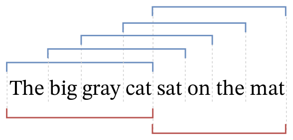

*图 A10（原文 Figure 10，第 23 页）：对 8 个词的句子 “The big gray cat sat on the mat”，用 $L_{\text{valid}}=4$ 的模型做滑动窗口评估（上方蓝色括号）与不重叠评估（下方红色括号）。*

**图中文字翻译与读法**：

- **蓝色括号（上）**：滑动窗口评估，每个括号覆盖 4 个词，每次右移 1 个词，共 5 次前向传播；
- **红色括号（下）**：不重叠评估，两个互不重叠的 4 词窗口，只需 2 次前向传播；
- **读图结论**：不重叠评估快得多（2 次对 5 次），但滑动窗口让每个预测拥有更多上文。以词 “sat” 为例：不重叠评估中它是第二个红色窗口的第一个词，窗口内没有任何上文（它真正的上文 “The big gray cat” 在上一个窗口里）；滑动窗口评估中它出现在窗口 “big gray cat sat” 的末尾，有 3 个词的上文。这就是 early token curse 的来源。

### 2.3 已有的位置方法

论文比较了三种位置方法，并把 ALiBi 的设计动机建立在它们之上。（原文还指出，学习式绝对位置嵌入——例如 GPT-3、Jurassic-1 使用的方式——没有办法编码大于 $L$ 的位置，因此根本没有外推能力，脚注 4。）

1. **正弦位置嵌入（sinusoidal）**：Vaswani 等人（2017）提出的固定、不学习的向量，加到第一层的词向量上。背景知识：$\mathrm{PE}(p,2k)=\sin\big(p/10000^{2k/d}\big)$，$\mathrm{PE}(p,2k+1)=\cos\big(p/10000^{2k/d}\big)$（$p$ 为位置，$k$ 为维度编号），不同维度用不同的波长。从公式看它对任意位置都有定义，所以“技术上应该能外推”，但论文第一次系统测量发现：它只能多出几十个 token。
2. **旋转位置嵌入（rotary，RoPE）**：Su 等人（2021），因 GPT-J 而流行。不在最底层加向量，而是在**每一个** attention 层中把 key 和 query 乘上正弦（旋转）嵌入；也**不给 value 加位置信息**。因此每层 attention 的输出里没有显式的位置信息。作者怀疑“位置信息与 value 分开”可能对外推有利，ALiBi 的设计从中得到启发。论文用 RoFormer_pytorch 的实现，并在脚注 5 说明：事后得知该代码可以优化到只比正弦慢 2%，所以图 2 中旋转方法偏慢有实现因素，这种优化不会改变外推表现。RoPE 的机制见 [RoPE 解读](../rope/论文中文解读.md)。
3. **T5 bias**：T5 模型（Raffel 等，2020）使用的相对位置方法。不给词向量加位置，而是在每个 query–key 分数上加一个**只依赖二者距离的、可学习的、共享的偏置**：距离为 0（同一个 token）的所有 (query, key) 对共享一个偏置，距离为 1 的共享另一个偏置，依此类推；到某个距离之后，多个不同距离共享同一个偏置（这可能对外推有利）。它也在每一层注入位置信息、不改 value。T5 原文只是提出“可能外推”，没有实验；这篇论文首次证明 T5 bias 确实能让语言模型外推——但代价是训练至少慢一倍。

用一张表对比（“论文测到的外推”列取自论文第 2 节正文）：

| 方法 | 位置信息注入位置 | 是否进入 value | 是否有可学习的位置参数 | 论文测到的外推（WikiText-103） | 训练速度（原文表 1，$L=512$） |
|---|---|---|---|---|---|
| 正弦 | 仅输入层，加到词向量 | 是（随词向量进入 Q/K/V） | 无（固定向量） | $L=512$ 时多约 20 个 token 内有改善，20 到 50 个持平，之后变差；$L=1024$ 时最多多 50 个 token 内有改善 | 28.5k 词/秒 |
| 学习式绝对位置 | 仅输入层 | 是 | 有 | 无法编码大于 $L$ 的位置，无外推能力 | 未测 |
| Rotary | 每层 Q、K | 否 | 无 | $L=512$ 时多 200 个 token 内有改善；$L=1024$ 时多 100 个 | 20.0k 词/秒 |
| T5 bias | 每层 attention 分数 | 否 | 有（按距离的偏置） | $L=512$ 时多 600 个 token 内有改善；$L=1024$ 时多 800 个 | 14.4k 词/秒 |
| ALiBi | 每层 attention 分数 | 否 | 无（固定斜率） | WikiText-103 上至少到约 $3L$ 仍在改善；$L=512$ 的模型到 12k 以上仍保持强表现 | 28.3k 词/秒 |

“是否进入 value”一列是根据论文对 rotary 的论述归纳的：位置向量加在输入层时会随词向量一起进入 Q、K、V，而 rotary、T5 bias、ALiBi 只作用在 Q、K（分数）上。

## 三、方法：ALiBi

### 3.1 公式

标准的因果 attention：对一个 head 中第 $i$ 个 query $q_i\in\mathbb{R}^{1\times d}$（$1\le i\le L$，$d$ 为 head 维度），因果 mask 只允许它看前 $i$ 个 key，记 $K\in\mathbb{R}^{i\times d}$，注意力权重为

$$
\mathrm{softmax}\big(q_iK^\top\big).
$$

ALiBi 不在任何地方加位置嵌入；唯一的改动是在 query–key 点积之后加一个静态、不学习的偏置：

$$
\mathrm{softmax}\big(q_iK^\top+m\cdot[-(i-1),\ \dots,\ -2,\ -1,\ 0]\big),
$$

其中标量 $m$ 是**每个 head 各自固定的斜率**，在训练前就定好。方括号里的向量对应第 $1,2,\dots,i$ 个 key：第 $j$ 个 key 得到的偏置是 $-m(i-j)$，即距离 $i-j$ 越大，惩罚越大；最近的 key（就是 query 自己，$j=i$）偏置为 0。

论文脚注 9、10 说明了两个细节：为简化，公式略去了 Q/K/V/输出投影、dropout 和缩放因子；并且 **ALiBi 的偏置不乘 $\sqrt{d_k}$ 缩放因子**。把这两点补回去，第 $h$ 个 head 的完整分数写成

$$
a^{(h)}_{ij}=\mathrm{softmax}_{j\le i}\Big(\frac{q_ik_j^\top}{\sqrt d}-m_h\,(i-j)\Big).
$$

softmax 之后其余计算（与 value 相乘等）完全不变。

### 3.2 一个可以手算的例子

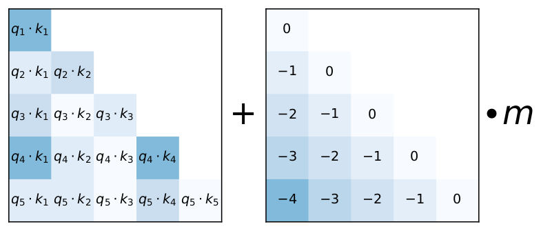

*图 3（原文 Figure 3，第 5 页）：左，未加偏置的 attention 分数矩阵 $q_i\cdot k_j$（下三角）；右，距离偏置矩阵，乘以 head 专属的标量 $m$ 后逐元素相加。*

**图中文字翻译与读法**：

- **左矩阵**：5 个 query（行）对 5 个 key（列）的点积 $q_i\cdot k_j$，只有下三角（$j\le i$）有值，因为因果 mask 遮掉了未来的 key；不同深浅的蓝色表示分数大小，仅作示意；
- **右矩阵**：偏置，对角线为 0，向左逐格变成 $-1,-2,-3,-4$（即 $-(i-j)$），最后乘以右边的 $\bullet m$；
- **图题要点**：$m$ 是 head 专属的标量，在训练中被设定而不被学习；论文的 $m$ 取值方案可推广到多个文本领域、模型和训练预算；使用 ALiBi 时网络底部不加位置嵌入。

笔者补充一个数值例子（非论文数字）。取 $m=\tfrac12$（8 个 head 中斜率最大的那个），序列只有 5 个 token，则偏置矩阵 $m\cdot(-(i-j))$ 为（空白为被因果 mask 遮住的位置）：

$$
\begin{bmatrix}
0 & & & & \\
-0.5 & 0 & & & \\
-1 & -0.5 & 0 & & \\
-1.5 & -1 & -0.5 & 0 & \\
-2 & -1.5 & -1 & -0.5 & 0
\end{bmatrix}
$$

假设第 5 个 query 对 5 个 key 的内容分数 $q_5\cdot k_j/\sqrt d$ 完全相同，那么 softmax 只剩下偏置在起作用，权重正比于 $\big[e^{-2},e^{-1.5},e^{-1},e^{-0.5},e^{0}\big]\approx[0.135,0.223,0.368,0.607,1]$，归一化后约为 $[0.058,\,0.096,\,0.158,\,0.260,\,0.429]$：离得越近权重越大，并且相邻两个 key 的权重之比恒为 $e^{0.5}\approx1.65$。这就是 ALiBi 带来的“近因偏置”（inductive bias towards recency）。内容分数不同时，偏置只是在 logit 上加了一项，所以足够高的内容分数仍可以抵消距离惩罚，远处的 token 并非完全不可见。

### 3.3 斜率怎么定

斜率 $m$ 是**固定的几何数列**，不训练：

- 8 个 head 的模型：$\frac1{2^1},\frac1{2^2},\dots,\frac1{2^8}$，即 $0.5,\,0.25,\,0.125,\,\dots,\,0.0039$；
- 16 个 head 的模型：把上面 8 个斜率“相邻两个取几何平均”插值，得到以 $\frac1{\sqrt2}$ 为首项、公比也是 $\frac1{\sqrt2}$ 的几何数列：$\frac1{2^{0.5}},\frac1{2^{1}},\frac1{2^{1.5}},\dots,\frac1{2^{8}}$；
- 一般地，$n$ 个 head 时，斜率是以 $2^{-8/n}$ 为首项、**同一个值为公比**的几何数列，即第 $h$ 个 head 的斜率为

$$
m_h=2^{-8h/n},\qquad h=1,\dots,n.
$$

（笔者核对：$n=8$ 时 $2^{-h}$，$n=16$ 时 $2^{-h/2}$，与论文给出的两个例子一致；无论 $n$ 是多少，最平缓的 head 斜率总是 $2^{-8}=1/256$。）

论文对斜率的几点说明：

- **刻意不调参**：这组斜率在 WikiText-103 上选定，之后原封不动用到 Toronto BookCorpus 和 1.3B 的 CC100+RoBERTa 实验，没有重调。作者类比正弦编码——Vaswani 等人也是一次性设定波长几何级数的起止点，之后在不同模型、不同数据上复用。
- **试过可训练的斜率**，外推效果不好，而且训练速度慢 3%。
- **手动探索了约十组斜率**，得到的经验：效果最好的斜率集合落在 $(0,1)$ 区间内，并且越接近 0 越密集；方法对斜率选择也比较稳健，甚至从指数分布里随机采样有时也行（但方差大）。
- **不同 head 以不同速率增加惩罚**，所以有的 head 近乎只看近邻，有的 head 能保持较长的视野。

笔者的推导（非论文数字）：偏置给注意力权重乘上因子 $e^{-m\Delta}$（$\Delta=i-j$ 为距离），所以惩罚的“特征距离”是 $1/m$。最陡的 head（$m=1/2$）每隔约 2 个 token 权重就乘以 $e^{-1}\approx0.37$，距离 10 时只剩 $e^{-5}\approx0.0067$；最平缓的 head（$m=1/256$）特征距离是 256 个 token，距离 1024 时因子为 $e^{-4}\approx0.018$，距离 3072 时为 $e^{-12}\approx6\times10^{-6}$，仍然非零。一个多尺度的“视野”集合就是这样由斜率的几何分布造出来的。

### 3.4 等价写法与实现成本

**softmax 的行平移不变性**（笔者补充的数学事实）：第 $i$ 行所有 logit 同时加上同一个常数，softmax 结果不变。因此

$$
\mathrm{softmax}_{j\le i}\Big(s_{ij}-m(i-j)\Big)=\mathrm{softmax}_{j\le i}\Big(s_{ij}+m\,j\Big),
$$

这是因为两者只差一个与 $j$ 无关的常数 $-m\,i$。也就是说，ALiBi 在数学上等价于给第 $j$ 个 key 的分数加一个与 key 位置成正比的线性项 $m\,j$。把它理解成“相对距离惩罚”更直观，因为每个 query 只关心各 key 的分数之差，而差值只与距离有关。

**实现**：因果语言模型本来就要在 softmax 之前给 $QK^\top$ 加一个 mask 矩阵（未来位置为 $-\infty$）。ALiBi 只是把线性偏置也加进这个矩阵，不新增任何运算，所以**没有运行时间代价**。显存上，原来的 mask 大小是 $L\times L$（各 head 共用），现在每个 head 斜率不同，变成 $n\times L\times L$（$n$ 为 head 数），在论文实验里最多多出 100 MB。但因为 ALiBi 允许用短得多的序列训练，整体能省下数 GB 显存。

下面是笔者写的示意代码（非论文原文），说明偏置张量的形状与用法：

```python
import math
import torch

def alibi_bias(n_heads: int, L: int) -> torch.Tensor:
    # 论文的一般公式：第 h 个 head 的斜率 m_h = 2 ** (-8 * h / n)，h = 1..n
    slopes = torch.tensor([2 ** (-8 * h / n_heads) for h in range(1, n_heads + 1)])
    pos = torch.arange(L)
    dist = (pos[:, None] - pos[None, :]).clamp(min=0)   # i - j；j > i 的位置记 0，随后会被因果 mask 盖掉
    bias = -slopes[:, None, None] * dist                # 形状 [n_heads, L, L]
    causal = torch.full((L, L), float("-inf")).triu(1)  # 未来位置为 -inf
    return bias + causal

# scores = q @ k.transpose(-1, -2) / math.sqrt(d) + alibi_bias(n_heads, L)
# 注意：偏置不除以 sqrt(d)；网络底部不再加任何位置嵌入
```

### 3.5 设计选择与论文的假设

- **位置信息加在每一层的 query–key 分数上，不加在 value 上**。论文的理由是一个假设（hypothesize）：与 T5 bias、rotary 一样，这些性质可能对外推有利。它不是被证明的定理。
- **加法而不是乘法**。相关工作一节提到：作者做过（未展示的）实验，把 attention 分数乘上距离函数（而不是像 ALiBi 一样相加）会降低性能。
- **用线性函数**：偏置对距离是线性的，所以对任何新长度都直接可算；线性偏置经过 softmax 后变成指数衰减的权重（见 3.3）。
- 笔者对“为什么能外推”的解释（非论文结论）：训练中没有任何与具体位置绑定的可学习参数，位置只通过一个对距离单调的固定函数进入，所以序列变长时不会出现模型没见过的“新位置模式”，只是出现更大的距离和更重的惩罚。

## 四、实验设置

### 4.1 WikiText-103 设置

- **数据**：WikiText-103（Merity 等，2016），训练集约 1.03 亿个 token，来自英文维基百科（约半个 GB）；
- **模型**：Baevski & Auli（2018）的 Transformer 语言模型（论文选它是因为它在近期语言建模发展中很有代表性）：16 层、维度 1024、8 个 head、前馈内层维度 4096，输入嵌入与 softmax 矩阵绑定（tie）；参数量 247M（原文表 6、7）；
- **控制变量**：除位置方法和训练子序列长度外，其他超参数都不改，包括随机种子和训练轮数（205 个 epoch）；
- **测速**：单张 V100（原文表 1），Figure 1 的 T5 在 32 GB 的 GPU 上会显存溢出（OOM）。

### 4.2 后续两组实验

- **Toronto BookCorpus**（附录 A.3）：约 7 亿个 token（2.9 GB），沿用 Khandelwal 等（2020）的划分和分词（BERT 的 2.9 万词表 BPE）；因为词表比 WikiText-103 小得多，把 adaptive 词嵌入与 softmax 换成绑定的词嵌入/softmax 矩阵；斜率沿用 WikiText-103 的设定。作者强调，整个研发过程中在这个领域**只跑了一组实验**。
- **CC100+RoBERTa**（第 4.2 节，附录 A.4）：RoBERTa 训练语料（Toronto Book Corpus、英文维基百科、CC-News、OpenWebText、Stories，共 161 GB）加上 CC-100 的英文部分（300 GB），共 461 GB；验证集 649K 个 token。模型 25 层、16 个 head、维度 2048、前馈隐层 8192，共 1.3B 参数；训练一个 epoch，即 50k 次更新，使用 128 块 V100。

## 五、实验结果

### 5.1 现有方法不能高效外推（第 2 节，图 1 与表 2–4）

先看第 2 节对三个已有方法的测量。在 WikiText-103 上，分别训练 $L=512$、$L=1024$、$L=3072$ 的模型，然后把验证集切成长度 $L_{\text{valid}}=L+k$ 的子序列评估，$k$ 最大到 15000 多。

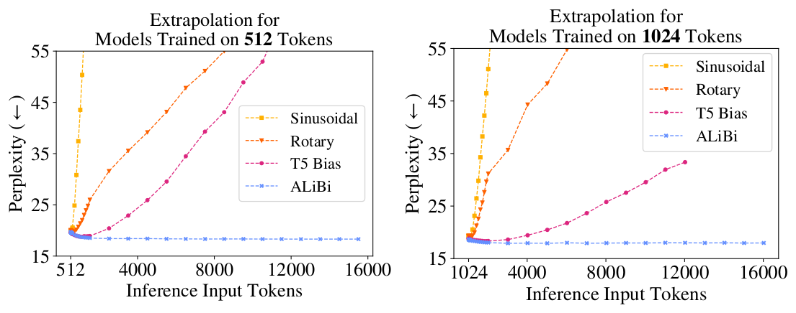

*图 1（原文 Figure 1，第 2 页）：当（验证集的）输入序列变长时，现有位置方法（正弦、rotary、T5）的困惑度恶化，而 ALiBi 不会。*

**图中文字翻译与读法**：

- **左图 Extrapolation for Models Trained on 512 Tokens（在 512 个 token 上训练的模型的外推）**：横轴 Inference Input Tokens（推理输入 token 数，512 到约 16000），纵轴 Perplexity（困惑度，越低越好，坐标范围 15–55）。图例：Sinusoidal（正弦，橙黄色方块虚线）、Rotary（橙红色倒三角）、T5 Bias（品红色圆点）、ALiBi（蓝色叉号）。
- **右图 Extrapolation for Models Trained on 1024 Tokens（在 1024 个 token 上训练的模型的外推）**：同上，横轴从 1024 开始。
- **图题补充**：模型在 WikiText-103 上用 $L=512$（左）或 $L=1024$（右）训练；T5 在作者的 32 GB GPU 上显存溢出（所以曲线在约 12000 个 token 处终止）；精确数字见原文表 2、3。

**读图结论**：正弦模型一超过训练长度很快陡升到纵轴上限之外；rotary 退化较慢但仍持续变差；T5 bias 是三个基线里最好的，但在更长输入上也明显变差并最终溢出；ALiBi 的曲线几乎是一条水平线，在整个测试范围内保持在 18 左右。注意：纵轴被截断在 55，所以正弦、rotary 曲线的真实数值要看下面的表。

下面三张原文表给出图 1 背后的完整数据。三张表格式相同：每个方法有两列——PPL（困惑度，越低越好）和 WPS（推理速度，词/秒，GPU、batch size 为 1，越高越好）；OOM 表示显存溢出；Inputs 是推理时的输入长度 $L_{\text{valid}}$；论文用粗体标出每个模型的最佳困惑度。

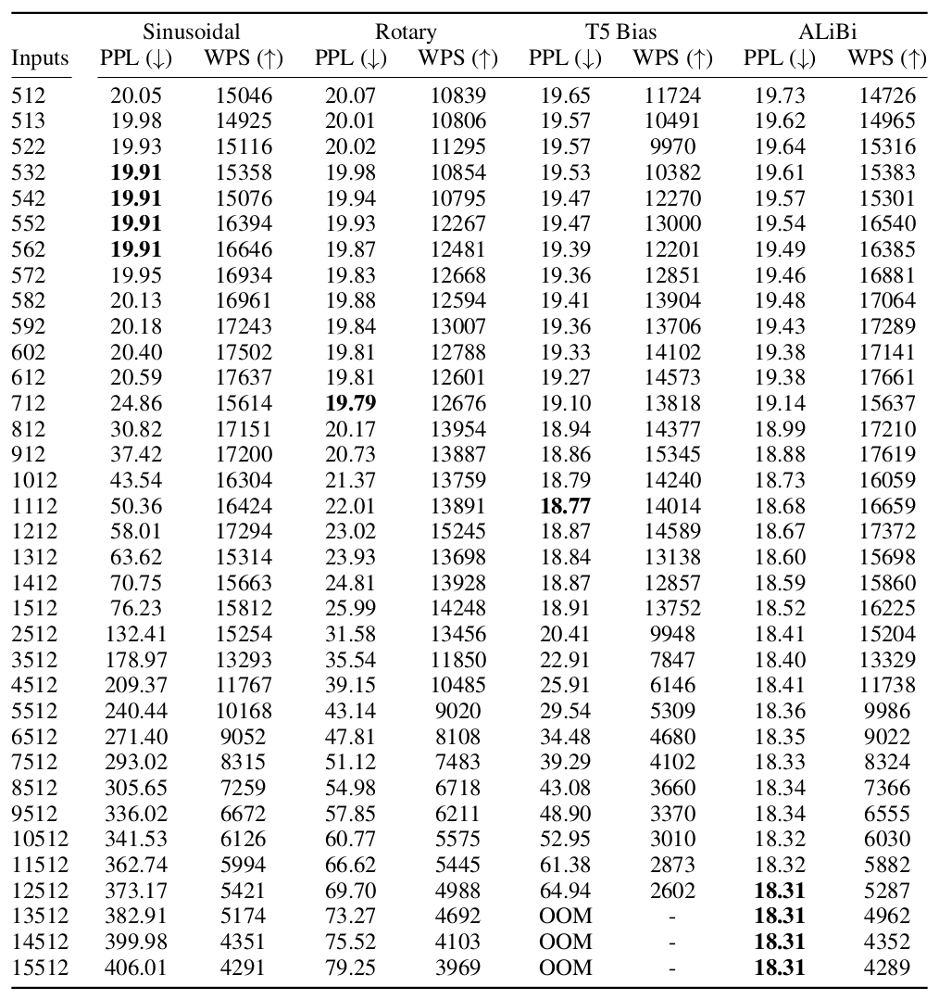

*原文表 2（第 16 页）：训练长度 $L=512$ 的四个模型在不同 $L_{\text{valid}}$ 下的验证集困惑度（PPL）与推理速度（WPS）。*

关键行摘录（只列 PPL；列名依次为正弦 / Rotary / T5 bias / ALiBi）：

| $L_{\text{valid}}$（Inputs） | 正弦 | Rotary | T5 bias | ALiBi |
|---:|---:|---:|---:|---:|
| 512（无外推） | 20.05 | 20.07 | 19.65 | 19.73 |
| 532 | 19.91 | 19.98 | 19.53 | 19.61 |
| 712 | 24.86 | 19.79 | 19.10 | 19.14 |
| 1012 | 43.54 | 21.37 | 18.79 | 18.73 |
| 1112 | 50.36 | 22.01 | 18.77 | 18.68 |
| 1512 | 76.23 | 25.99 | 18.91 | 18.52 |
| 2512 | 132.41 | 31.58 | 20.41 | 18.41 |
| 3512 | 178.97 | 35.54 | 22.91 | 18.40 |
| 6512 | 271.40 | 47.81 | 34.48 | 18.35 |
| 12512 | 373.17 | 69.70 | 64.94 | 18.31 |
| 15512 | 406.01 | 79.25 | OOM | 18.31 |

读法（原文表 2，第 16 页）：正弦模型的最优点在 $L_{\text{valid}}=532$ 到 562（19.91，仅比 512 处好 0.14），到 1012 就升到 43.54；rotary 在 712 达到最优（19.79）；T5 bias 在 1112 最优（18.77），到 2512 恶化到 20.41、12512 时 64.94，13512 起显存溢出；ALiBi 单调变好并在 12512 以后稳定在 18.31（粗体）。

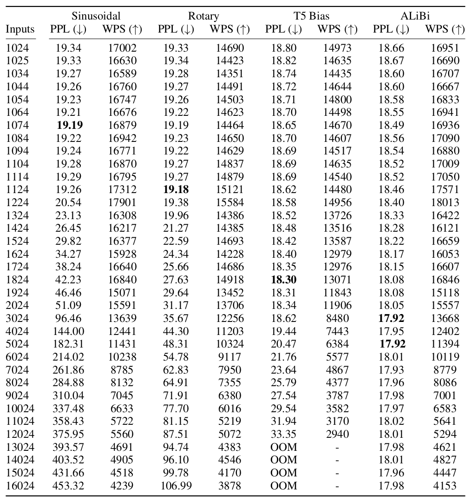

*原文表 3（第 17 页）：训练长度 $L=1024$ 的模型。*

| $L_{\text{valid}}$（Inputs） | 正弦 | Rotary | T5 bias | ALiBi |
|---:|---:|---:|---:|---:|
| 1024（无外推） | 19.34 | 19.33 | 18.80 | 18.66 |
| 1074 | 19.19 | 19.19 | 18.65 | 18.49 |
| 1124 | 19.26 | 19.18 | 18.62 | 18.46 |
| 1824 | 42.23 | 27.63 | 18.30 | 18.08 |
| 2024 | 51.09 | 31.17 | 18.34 | 18.05 |
| 3024 | 96.46 | 35.67 | 18.62 | 17.92 |
| 5024 | 182.31 | 48.31 | 20.47 | 17.92 |
| 8024 | 284.88 | 64.91 | 25.79 | 17.96 |
| 12024 | 375.95 | 87.51 | 33.35 | 18.01 |
| 13024 | 393.57 | 94.74 | OOM | 17.98 |
| 16024 | 453.32 | 106.99 | OOM | 17.98 |

读法（原文表 3，第 17 页）：正弦模型在 1074 处最优（19.19，约多 50 个 token），rotary 在 1124 最优（19.18，约多 100 个），T5 bias 在 1824 最优（18.30，多约 800 个），ALiBi 的最优 17.92 出现在 3024 与 5024，之后基本平坦（17.93–18.02）。

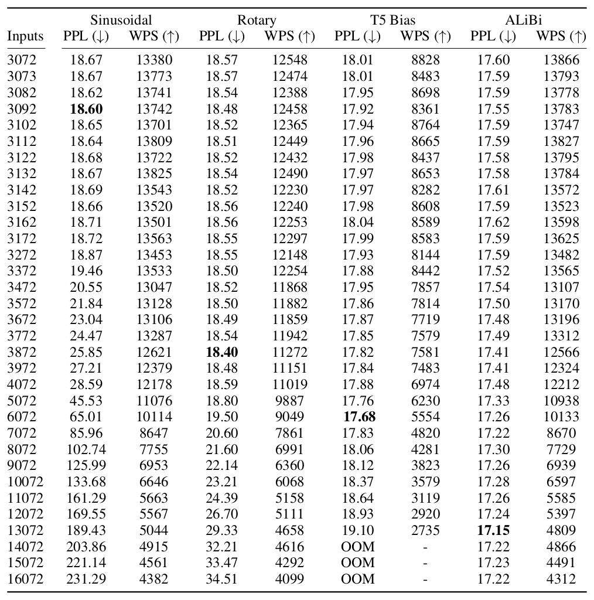

*原文表 4（第 18 页）：训练长度 $L=3072$ 的模型。*

| $L_{\text{valid}}$（Inputs） | 正弦 | Rotary | T5 bias | ALiBi |
|---:|---:|---:|---:|---:|
| 3072（无外推） | 18.67 | 18.57 | 18.01 | 17.60 |
| 3092 | 18.60 | 18.48 | 17.92 | 17.55 |
| 3872 | 25.85 | 18.40 | 17.82 | 17.41 |
| 4072 | 28.59 | 18.59 | 17.88 | 17.48 |
| 6072 | 65.01 | 19.50 | 17.68 | 17.26 |
| 9072 | 125.99 | 22.14 | 18.12 | 17.26 |
| 13072 | 189.43 | 29.33 | 19.10 | 17.15 |
| 16072 | 231.29 | 34.51 | OOM | 17.22 |

读法（原文表 4，第 18 页）：趋势与 $L=512$、$1024$ 时相同；正弦在 3092 处最优（18.60），rotary 在 3872 处最优（18.40），T5 bias 在 6072 处最优（17.68），ALiBi 的最优 17.15 出现在 13072（约为训练长度的 4.3 倍），16072 处为 17.22。

综合表 2–4 与论文正文的文字，每个模型“还能随输入变长而改善”的区间是：正弦模型 $L=512$ 时多 20 个 token 改善、20 到 50 个 token 持平，之后变差，$L=1024$ 时到 $L+50$；rotary 是 $L=512$ 时 $k=200$、$L=1024$ 时 $k=100$；T5 bias 是 $k=600$（$L=512$）和 $k=800$（$L=1024$）；ALiBi 在 WikiText-103 上则至少持续到约 $3L$，$L=512$ 的模型甚至在 $L_{\text{valid}}$ 超过 12k 时仍在微弱改善（表 2：18.41 到 18.31）。

### 5.2 速度与显存：T5 bias 贵，ALiBi 几乎免费（图 2、表 1）

外推的价值在于“用短序列训练省钱”。如果外推本身要付出更慢的训练代价，收益就抵消了。图 2 与表 1 衡量这一点。

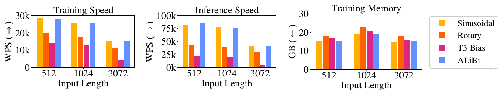

*图 2（原文 Figure 2，第 3 页）：批量训练与批量推理下四种位置方法的速度与显存对比。*

**图中文字翻译与读法**：

- **左图 Training Speed（训练速度）**：纵轴 WPS（words per second，每秒处理的词数，越高越好），横轴 Input Length（输入长度：512、1024、3072）；
- **中图 Inference Speed（推理速度）**：同样的纵轴 WPS 与横轴；
- **右图 Training Memory（训练显存）**：纵轴 GB（越低越好）；
- **图例**：Sinusoidal（黄）、Rotary（橙）、T5 Bias（粉红）、ALiBi（蓝）；
- **图题补充**：ALiBi 与正弦的速度差异在训练时不超过 1%、推理时不超过 3%，在作者的硬件上不显著；ALiBi 在输入长度 1024 和 3072 的训练里多用 100 MB 显存；所有方法在 3072 时显存反而比 1024 时低，因为作者把 batch 拆成了多次更新。精确数字见原文表 1。

**读图结论**：ALiBi 的柱子与正弦几乎一样高；rotary 和 T5 bias 在速度上明显更低，尤其 T5 bias 在 3072 上训练速度只有 4.3k WPS。

训练与推理速度（词/秒，越高越好）以及训练显存（GB，越低越好），WikiText-103，单张 V100，批量训练与批量推理：

| 位置方法 | 训练长度 | 训练速度 | 推理速度（Eval） | 训练显存 |
|---|---:|---:|---:|---:|
| 正弦 | 512 | 28.5k | 82.1k | 15.3 GB |
| 正弦 | 1024 | 26.0k | 77.8k | 19.2 GB |
| 正弦 | 3072 | 15.3k | 42.4k | 15.1 GB |
| Rotary | 512 | 20.0k | 43.4k | 17.8 GB |
| Rotary | 1024 | 17.7k | 39.4k | 22.8 GB |
| Rotary | 3072 | 11.5k | 29.5k | 17.8 GB |
| T5 bias | 512 | 14.4k | 21.8k | 16.9 GB |
| T5 bias | 1024 | 13.0k | 20.2k | 20.9 GB |
| T5 bias | 3072 | 4.3k | 4.9k | 15.9 GB |
| ALiBi | 512 | 28.3k | 85.8k | 15.3 GB |
| ALiBi | 1024 | 25.8k | 76.4k | 19.3 GB |
| ALiBi | 3072 | 15.5k | 42.2k | 15.2 GB |

（原文表 1，第 15 页。）读法：ALiBi 的显存比同长度正弦模型多 0、0.1、0.1 GB，即 0–0.7%，这就是摘要里“negligible (0–0.7%) memory increase”的出处；T5 bias 在 $L=3072$ 时训练速度只有正弦的约 28%。论文脚注 8 提醒：Narang 等（2021）在 TPU 上用 TensorFlow 测得 T5 bias 只比正弦慢 8.7%，所以 T5 bias 的开销取决于硬件与框架；本文用的是 GPU 上的 PyTorch Fairseq。

此外，论文第 2 节正文与表 1 有一处数字对不上：正文写“$L=1024$ 的正弦模型速度是 28.5k WPS”，而表 1 中 28.5k 对应的是 $L=512$ 的正弦模型（$L=1024$ 为 26.0k）。这是原文自身的小不一致，结论不受影响（T5 bias 在 $L=512$ 上的 14.4k 仍远低于 26.0k），所以“T5 bias 在 512 上训练、外推到 1024，并不比直接在 1024 上训练正弦模型更省时间”这一论点成立。

附录图 7 补充了“为什么要在短序列上训练”：

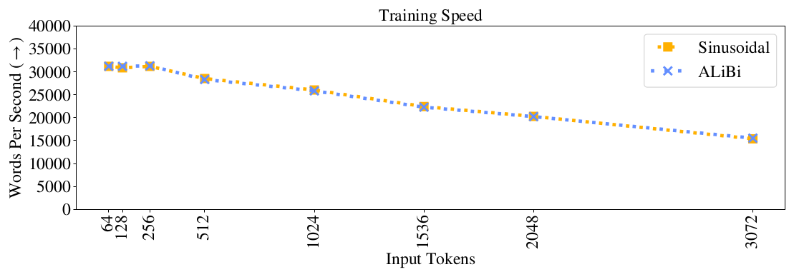

*图 A7（原文 Figure 7，第 15 页）：训练速度（每秒词数）随训练输入子序列长度 $L$ 的变化。*

**图中文字翻译与读法**：

- **图标题 Training Speed（训练速度）**：横轴 Input Tokens（输入 token 数，64、128、256、512、1024、1536、2048、3072，非等间距），纵轴 Words Per Second（每秒词数，0–40000）；图例 Sinusoidal（黄色方块）、ALiBi（蓝色叉号）；
- **读图结论**：两条线重合；速度随 $L$ 变长单调下降，从 $L$ 很短时约 3 万（从图上读出的近似值）降到 $L=3072$ 时约 1.5 万（表 1：15.3k 与 15.5k）。这就是“训短测长”能省训练时间的直接原因。

### 5.3 WikiText-103：ALiBi 外推并超过更长的正弦模型（图 4、表 5–7）

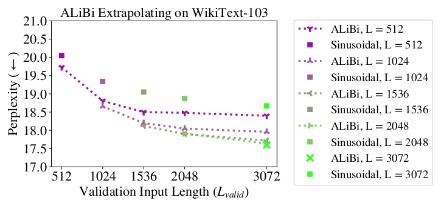

*图 4（原文 Figure 4，第 6 页）：ALiBi 模型在 WikiText-103 验证集上，训练长度和评估长度各不相同；正弦基线只在 $L_{\text{valid}}=L$ 处评估。*

**图中文字翻译与读法**：

- **标题 ALiBi Extrapolating on WikiText-103**：ALiBi 在 WikiText-103 上的外推；横轴 Validation Input Length（验证输入长度 $L_{\text{valid}}$：512、1024、1536、2048、3072），纵轴 Perplexity（困惑度，越低越好，17.0–21.0）；
- **图例**：ALiBi, L = 512、1024、1536、2048、3072（带标记的点线，颜色由紫到绿）；Sinusoidal, L = 512 等（同色实心方块，只出现在 $L_{\text{valid}}=L$ 处）；
- **图题要点**：所有 ALiBi 模型都优于同样的正弦模型，即使它们用更少的 token 训练。

**读图结论**：每个方块（正弦）都位于同一横坐标 ALiBi 点线的上方；每条 ALiBi 线随 $L_{\text{valid}}$ 增大而下降（外推）。例如 $L=512$ 的 ALiBi 线（最上方紫色）外推到 3072 时低于 $L=3072$ 的正弦方块。

完整数字在附录表 5：

ALiBi 在 WikiText-103 验证集上的困惑度（越低越好）；行为训练长度、列为评估长度 $L_{\text{valid}}$；“-”表示未评估（评估长度小于训练长度）；带星号的行（正弦、rotary、T5 bias）只在 $L_{\text{valid}}=L$ 处评估（即不测外推）；粗体为该列最佳：

| 训练长度 | 64 | 128 | 256 | 512 | 1024 | 1536 | 2048 | 3072 |
|---|---:|---:|---:|---:|---:|---:|---:|---:|
| ALiBi，64 | 28.46 | 24.70 | 22.88 | 22.09 | 21.73 | 21.63 | 21.59 | 21.53 |
| ALiBi，128 | - | 23.98 | 21.70 | 20.67 | 20.36 | 20.29 | 20.31 | 20.28 |
| ALiBi，256 | - | - | **21.29** | 19.89 | 19.29 | 19.13 | 19.10 | 19.03 |
| ALiBi，512 | - | - | - | 19.73 | 18.81 | 18.50 | 18.48 | 18.40 |
| ALiBi，1024 | - | - | - | - | **18.66** | 18.20 | 18.05 | 17.96 |
| ALiBi，1536 | - | - | - | - | - | **18.12** | 17.90 | 17.72 |
| ALiBi，2048 | - | - | - | - | - | - | **17.91** | 17.64 |
| ALiBi，3072 | - | - | - | - | - | - | - | **17.60** |
| 正弦\* | **28.03** | **23.81** | 21.45 | 20.05 | 19.34 | 19.05 | 18.87 | 18.67 |
| Rotary\* | - | - | - | 20.07 | 19.33 | - | - | 18.57 |
| T5 bias\* | - | - | - | **19.65** | 18.80 | - | - | 18.01 |

（原文表 5，第 19 页。）读法：

1. **对角线**（$L_{\text{valid}}=L$，没有外推）：从 $L=256$ 起，ALiBi 都优于同长度的正弦模型，例如 $L=1024$ 时 18.66 对 19.34，$L=3072$ 时 17.60 对 18.67（论文指出正弦模型在 $L=3072$ 的标准差为 0.24，ALiBi 领先超过 1 个点）；只有极短的 $L=64$、$128$ 时正弦略好（28.03 对 28.46；23.81 对 23.98）。在 $L=1024$ 和 $3072$ 时 ALiBi 还优于 rotary 和 T5 bias（$L=512$ 时 T5 bias 的 19.65 略好于 ALiBi 的 19.73）。
2. **向右看**（外推）：每一行都随评估长度单调变好。$L=512$ 的模型：19.73、18.81、18.50、18.48、18.40，最终 18.40 优于 $L=3072$ 的正弦模型（18.67），论文称这一差距在统计上显著，而且 $L=512$ 的模型训练速度快 1.84 倍；$L=512$ 到 $2048$ 的全部 ALiBi 模型外推到 3072 都优于 $L=3072$ 的正弦基线。
3. **训长训短的差距依然存在**：$L=512$ 外推到 3072 得到 18.40，比直接用 $L=3072$ 训练的 ALiBi（17.60）差 0.80，所以外推不等于训长。

**速度与困惑度的权衡**（附录 A.2，图 A8）：

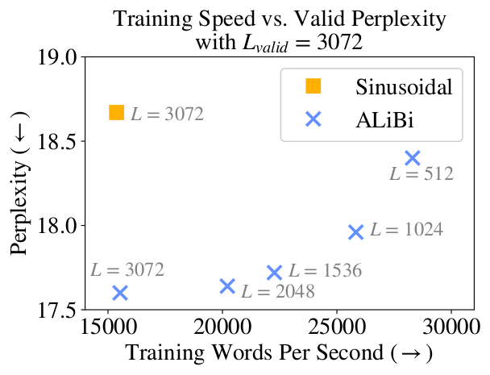

*图 A8（原文 Figure 8，第 19 页）：训练速度与验证困惑度（$L_{\text{valid}}=3072$）的散点图，对比不同训练长度的 ALiBi 模型和 $L=3072$ 的正弦模型。*

**图中文字翻译与读法**：

- **标题 Training Speed vs. Valid Perplexity with $L_{\text{valid}}=3072$**；横轴 Training Words Per Second（训练每秒词数，越右越快），纵轴 Perplexity（越低越好，17.5–19.0）；
- **图例**：Sinusoidal（黄色方块，只有 $L=3072$ 一个点）、ALiBi（蓝色叉号，标注 $L=512,1024,1536,2048,3072$）；
- **读图结论**：ALiBi 的各点纵坐标约为 18.40（$L=512$）、17.96（$L=1024$）、17.72（$L=1536$）、17.64（$L=2048$）、17.60（$L=3072$），数值取自表 5；横坐标 28.3k、25.8k、15.5k 来自表 1，$L=1536$、$2048$ 的横坐标（约 2.2 万、2.0 万）是从图上读出的近似值；正弦 $L=3072$ 在约 15.3k、18.67。所有 $512\le L<3072$ 的 ALiBi 模型都比正弦 $L=3072$ 更快、困惑度更低；$L=3072$ 的 ALiBi 与正弦一样快，但困惑度低一个点以上（18.67−17.60=1.07）。论文还指出：训练 $L=3072$ 的正弦模型需要超过 16 GB 的 GPU 显存来装下大的 attention 矩阵，而 $L=512$ 的 ALiBi 用小得多的显存就能训练。

**测试集与最强结果的对比**（附录表 6、7）：

WikiText-103 测试困惑度与运行时间；速度为每秒词数（越高越好）；Param. 为参数量；$L$ 为训练长度；困惑度越低越好：

| 模型 | 参数量 | 训练速度 | 推理速度 | 验证集困惑度 | 测试集困惑度 |
|---|---:|---:|---:|---:|---:|
| 正弦，$L=3072$ | 247M | 15.3k | 13.6k | 18.67 | 19.38 |
| Rotary，$L=3072$ | 247M | 11.5k | 12.2k | 18.57 | 19.28 |
| T5 bias，$L=3072$ | 247M | 4.3k | 7.3k | 18.01 | 18.73 |
| ALiBi，$L=512$，$L_{\text{valid}}=3072$ | 247M | 28.3k | 13.6k | 18.40 | 19.08 |
| ALiBi，$L=3072$，$L_{\text{valid}}=3072$ | 247M | 15.5k | 13.6k | 17.60 | 18.30 |

（原文表 6，第 20 页。）读法：验证集上的结论迁移到测试集；$L=512$ 的 ALiBi 训练速度是 $L=3072$ 正弦的约 1.85 倍（28.3k 对 15.3k），测试困惑度还更好（19.08 对 19.38）。

下表（原文表 7）使用滑动窗口评估（步长 $S=512$，沿用 Baevski & Auli 2018、Khandelwal 等 2020、Press 等 2021），并与其他公开结果比较；表中正弦行是作者用 Baevski & Auli 的模型自己训练和推理的结果：

| 模型 | 参数量 | 验证集 | 测试集 |
|---|---:|---:|---:|
| Adaptive Inputs（Baevski & Auli, 2018） | 247M | 17.97 | 18.70 |
| Transformer-XL（Dai 等, 2019） | 257M | - | 18.3 |
| Shortformer（Press 等, 2021） | 247M | 17.47 | 18.15 |
| Sandwich Transformer（Press 等, 2020） | 247M | - | 17.96 |
| Staged Training（Press 等, 2021） | 247M | - | 17.56 |
| Compressive Transformer（Rae 等, 2020） | 329M | - | 17.1 |
| Routing Transformer（Roy 等, 2020） | - | - | 15.8 |
| kNN-LM（Khandelwal 等, 2020） | 247M | 15.81 | 15.79 |
| 正弦，$L=3072$ | 247M | 17.95 | 18.67 |
| Rotary，$L=3072$ | 247M | 17.98 | 18.72 |
| T5 bias，$L=3072$ | 247M | 17.37 | 18.12 |
| ALiBi，$L=512$，$L_{\text{valid}}=3072$ | 247M | 18.30 | 19.01 |
| ALiBi，$L=3072$，$L_{\text{valid}}=3072$ | 247M | 16.97 | 17.66 |

（原文表 7，第 20 页。）读法：$L=3072$ 的 ALiBi 测试困惑度 17.66，优于 Transformer-XL（18.3）、Sandwich（17.96）、Shortformer（18.15），与 Staged Training（17.56）相近，但不如 Routing Transformer（15.8）和 kNN-LM（15.79）。论文指出这两种方法与 ALiBi 是正交的，推测与 ALiBi 结合可能带来更大提升。注意表中 Compressive Transformer 的 17.1 也优于 ALiBi，且它有 329M 参数，不能和 247M 的模型直接等价比较。

### 5.4 Toronto BookCorpus：同一组斜率，不调参（附录 A.3）

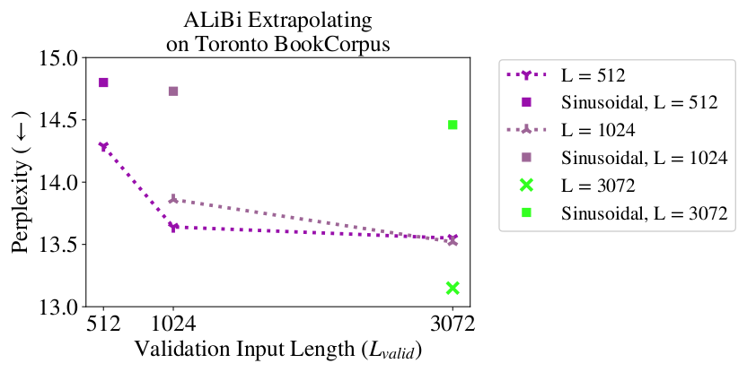

*图 A9（原文 Figure 9，第 21 页）：ALiBi 模型在 Toronto BookCorpus 上以不同输入长度评估。*

**图中文字翻译与读法**：

- **标题 ALiBi Extrapolating on Toronto BookCorpus**；横轴 Validation Input Length（512、1024、3072），纵轴 Perplexity（13.0–15.0，越低越好）；
- **图例**：L = 512、1024、3072（ALiBi，带标记的点线），Sinusoidal, L = 512、1024、3072（同色方块，仅在 $L_{\text{valid}}=L$ 处）；
- **读图结论**：所有 ALiBi 点都低于对应的正弦方块；$L=512$ 的 ALiBi 外推到 3072 后（13.55）低于 $L=3072$ 的正弦模型（14.46），尽管斜率并没有为这个领域调过。

附录表 8 给出验证集困惑度（行为训练长度，列为评估长度 $L_{\text{valid}}$；带星号的正弦行只在 $L_{\text{valid}}=L$ 处评估）：

| 训练长度 | 512 | 1024 | 3072 |
|---|---:|---:|---:|
| 512 | 14.29 | 13.64 | 13.55 |
| 1024 | - | 13.86 | 13.52 |
| 3072 | - | - | 13.15 |
| 正弦\* | 14.80 | 14.73 | 14.46 |

（原文表 8，第 21 页。）

附录表 9：Toronto BookCorpus 上的验证集与测试集困惑度（不重叠评估）：

| 模型 | 参数量 | 验证集 | 测试集 |
|---|---:|---:|---:|
| 正弦，$L=3072$ | 247M | 14.46 | 11.67 |
| ALiBi，$L_{\text{train}}=512$，$L_{\text{valid}}=3072$ | 247M | 13.55 | 10.98 |
| ALiBi，$L_{\text{train}}=3072$，$L_{\text{valid}}=3072$ | 247M | **13.15** | **10.73** |

（原文表 9，第 21 页。）

附录表 10：同一数据集上采用滑动窗口评估（步长 $S=512$，沿用 Baevski & Auli 2018、Khandelwal 等 2020、Press 等 2020/2021）的验证集与测试集困惑度，并列出公开基线：

| 模型 | 参数量 | 验证集 | 测试集 |
|---|---:|---:|---:|
| kNN-LM（Khandelwal 等, 2020） | 247M | 14.20 | 10.89 |
| Shortformer（Press 等, 2021） | 247M | 13.40 | 10.88 |
| Sandwich（Press 等, 2020） | 247M | - | 10.83 |
| Staged Training（Press 等, 2021） | 247M | 12.80 | 10.48 |
| 正弦，$L=3072$ | 247M | 14.06 | 11.40 |
| ALiBi，$L_{\text{train}}=512$，$L_{\text{valid}}=3072$ | 247M | 13.76 | 11.11 |
| ALiBi，$L_{\text{train}}=3072$，$L_{\text{valid}}=3072$ | 247M | 12.70 | 10.40 |

（原文表 10，第 22 页；“-”表示原文未报告。）读法：与 WikiText-103 一致——ALiBi 在相同训练长度下优于正弦，并且训练得更短仍然更好（表 9：10.98 对 11.67）。在滑动窗口评估下，$L=3072$ 的 ALiBi（测试 10.40）优于表中列出的所有公开基线（含 Staged Training 的 10.48），$L=512$ 外推到 3072 的版本（11.11）则不如这些基线。

### 5.5 CC100+RoBERTa：1.3B 参数的大设置（第 4.2 节、附录 A.4）

在小数据集上 ALiBi 全面领先；这一节检验它在更大的模型、更大的数据、更长的训练下是否还成立。比较方式是：让正弦基线与 ALiBi 训练同样长的墙钟时间（GPU 小时），所以更快的 ALiBi 模型完成的更新次数更多。

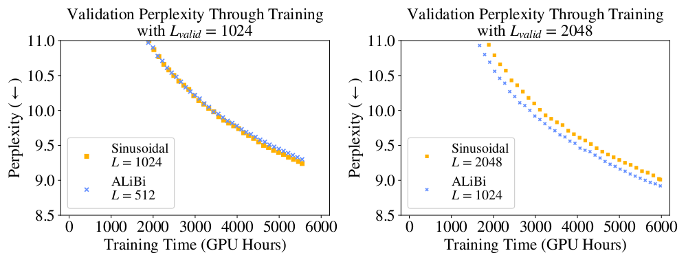

*图 5（原文 Figure 5，第 8 页）：左，在 512 个 token 上训练、在 1024 上评估的 ALiBi 模型对在 1024 上训练的正弦基线；右，在 1024 上训练、在 2048 上评估的 ALiBi 模型对在 2048 上训练的正弦基线。*

**图中文字翻译与读法**：

- **左图 Validation Perplexity Through Training with $L_{\text{valid}}=1024$（训练过程中的验证困惑度，评估长度 1024）**：横轴 Training Time (GPU Hours)（训练时间，GPU 小时，0–6000），纵轴 Perplexity（8.5–11.0）；图例 Sinusoidal $L=1024$（橙黄色方块）与 ALiBi $L=512$（蓝色叉号）；
- **右图 …with $L_{\text{valid}}=2048$**：图例 Sinusoidal $L=2048$ 与 ALiBi $L=1024$；
- **图题补充**：尽管 ALiBi 模型在更短序列上训练、显存少 6%–11%，仍取得很强的结果；表 11 给出显存与训练结束时的困惑度。

**读图结论**：左图两条曲线几乎重合（ALiBi 用的序列只有基线的一半长）；右图 ALiBi 曲线在整个训练过程中始终在正弦曲线下方。论文用五个均匀分布的训练时刻估算，$L=1024$ 的 ALiBi 模型平均比正弦模型快约 11% 达到同一困惑度。

附录表 11：与同样训练时间的正弦模型对比（Hours 为训练时长，图 5 的横轴标为 GPU Hours，故此处按 GPU 小时理解；Updates 为完成的更新次数；显存与困惑度越低越好；粗体为原文标出的最佳）：

| 模型 | 显存 | 更新次数 | GPU 小时 | 验证集困惑度（$L_{\text{valid}}=1024$） | 验证集困惑度（$L_{\text{valid}}=2048$） |
|---|---:|---:|---:|---:|---:|
| 正弦，$L_{\text{train}}=1024$ | 26.2 GB | 46.7k | 5.5k | **9.24** | - |
| ALiBi，$L_{\text{train}}=512$ | **24.6 GB** | 50.0k | 5.5k | 9.30 | - |
| 正弦，$L_{\text{train}}=2048$ | 29.3 GB | 44.2k | 5.9k | - | 9.01 |
| ALiBi，$L_{\text{train}}=1024$ | **26.2 GB** | 50.0k | 5.9k | - | **8.92** |

（原文表 11，第 22 页。）读法：对 $L_{\text{valid}}=1024$，ALiBi（$L=512$）只落后 0.06（9.30 对 9.24），同时少用 1.6 GB 显存（24.6 对 26.2，约 6%），多完成约 7% 的更新；对 $L_{\text{valid}}=2048$，ALiBi（$L=1024$）反而好 0.09（8.92 对 9.01），少用 3.1 GB 显存（26.2 对 29.3，约 11%）。这就是摘要中“与长序列正弦模型相同的困惑度，训练快 11%、显存少 11%”的数字来源。论文还指出，省下的显存可以用来堆叠更多层以进一步提升性能，但为了保持实验简单，作者没有这样做。

正弦基线与 ALiBi 在“相同更新次数（50k）”下的对比（表 12），含没有外推和外推两种情形：

| 模型 | 显存 | 更新次数 | GPU 小时 | $L_{\text{valid}}=512$ | $L_{\text{valid}}=1024$ | $L_{\text{valid}}=2048$ |
|---|---:|---:|---:|---:|---:|---:|
| 正弦，$L_{\text{train}}=512$ | 24.6 GB | 50.0k | 5.5k | 9.71 | 37.05 | 105.42 |
| ALiBi，$L_{\text{train}}=512$ | 24.6 GB | 50.0k | 5.5k | 9.79 | 9.30 | 9.54 |
| 正弦，$L_{\text{train}}=1024$ | 26.2 GB | 50.0k | 5.9k | - | 9.15 | 48.85 |
| ALiBi，$L_{\text{train}}=1024$ | 26.2 GB | 50.0k | 5.9k | - | 9.16 | 8.92 |
| 正弦，$L_{\text{train}}=2048$ | 29.3 GB | 50.0k | 6.7k | - | - | 8.83 |
| ALiBi，$L_{\text{train}}=2048$ | 29.4 GB | 50.0k | 6.7k | - | - | 8.84 |

（原文表 12，第 22 页。）读法：不外推时（对角线），ALiBi 与正弦几乎持平（9.79 对 9.71；9.16 对 9.15；8.84 对 8.83）。这与小数据集上“ALiBi 即使不外推也持续优于其他位置方法”不同——作者认为这说明 ALiBi 的归纳偏置在低资源语言建模上带来额外好处，在大数据、大模型上则主要体现为外推能力和效率。外推时（非对角线）正弦模型立刻崩溃（$L_{\text{train}}=512$ 评估 2048 时 105.42），ALiBi 则保持在 9.30、9.54。

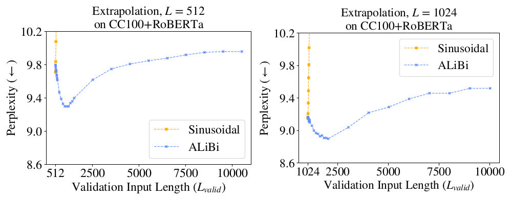

*图 6（原文 Figure 6，第 8 页）：在 CC100+RoBERTa 语料上训练 50k 次更新（1 个 epoch）后，$L=512$ 和 $L=1024$ 的 ALiBi 与正弦模型在验证集上的外推。*

**图中文字翻译与读法**：

- **左图 Extrapolation, $L=512$ on CC100+RoBERTa**；右图 $L=1024$：横轴 Validation Input Length（512 到约 10000；右图 1024 到 10000），纵轴 Perplexity（8.6–10.2，越低越好）；图例 Sinusoidal（橙黄色，几乎垂直上升出图）、ALiBi（蓝色）；
- **图题补充**：ALiBi 在约 $2L$ 处取得最佳结果，但直到 10000 个 token 仍保持强表现；
- **读图结论**：ALiBi 曲线先下降到最低点再缓慢上升。论文正文给出的最低点：$L=512$ 的模型在 $L_{\text{valid}}=1012$ 处达到最佳 9.3（$L_{\text{valid}}=512$ 时为 9.79）；$L=1024$ 的模型在 2024 处达到最佳 8.9（1024 时为 9.16）。此后缓慢回升：在 10000 个 token 附近，左图约为 9.96，右图约为 9.52（均为从图上读出的近似值），已略高于各自 $L_{\text{valid}}=L$ 处的值，但与正弦模型的崩溃相比仍然非常平稳。正弦模型只多给一个 token 就开始变差。

论文对“最低点在约 $2L$”的可能解释（论文自己的假设，未经验证）：训练时子序列最长为 $L$，$L_{\text{valid}}=2L$ 时评估的预测里有一半所处的子序列长度不超过训练中见过的长度；$L_{\text{valid}}>2L$ 时，处于训练中见过长度的预测不到一半，可能因此变差。附录 B 的分析则指出，ALiBi 相比正弦的优势主要来自更好地避开 early token curse。

### 5.6 训练速度、显存与外推效果的汇总

| 结论 | 数字（含来源） |
|---|---|
| ALiBi 相对正弦的开销 | 训练速度相差在 1% 内、推理速度在 3% 内（图 2）；显存多 0–0.7%（表 1）；无新增参数 |
| WikiText-103：短训长测 | $L=512$ 外推到 3072，验证 18.40、测试 19.08，优于 $L=3072$ 的正弦（18.67 / 19.38），训练快 1.84 倍（表 5、表 6） |
| WikiText-103：$L=3072$ | 验证 17.60，对正弦低 1.07（表 5） |
| BookCorpus | $L=512$ 外推到 3072：13.55，优于 $L=3072$ 正弦的 14.46（表 8） |
| 1.3B，$L=1024\to2048$ | 8.92 对 9.01，显存少 3.1 GB，约 11% 更快达到同一困惑度（表 11） |
| 外推最佳区间 | CC100+RoBERTa 上最佳点约在 $2L$；WikiText-103 上 ALiBi 至少到约 $3L$ 仍在改善，$L=512$ 的模型到 12k 以上仍保持（表 2、图 6） |

## 六、分析：ALiBi 的外推收益为什么出现（附录 B）

读到这里会产生一个关键问题：ALiBi 外推后困惑度下降，到底是模型“用上了更长的上下文”，还是仅仅因为评估方式的副作用？论文提出两个可能的解释：

1. **更长的上下文使预测更准**：例如 WikiText-103 的文章平均长度约 3600 个 token，$L=512$ 的模型外推到 $L_{\text{valid}}=3072$ 后若更好，可能是它发现了跨越 512 个 token 以上的模式；
2. **early token curse 被缓解**：不重叠评估时，序列越长，开头那些“上文很少”的预测占比越低。例如 $L_{\text{valid}}=1000$ 时有 10% 的预测只有 100 个 token 或更少的上文；$L_{\text{valid}}=2000$ 时这个比例只有 5%（100 是论文任选的一个“较短历史”的阈值，脚注 13）。所以仅仅因为能处理更长的序列，模型就能显著减轻 early token curse。

为区分二者，作者对 $L=512,1024,3072$ 的 ALiBi 和正弦模型用**滑动窗口评估、步长 $S=1$** 重新评估验证集：这时每个预测都有模型能处理的最大上文，early token curse 被基本消除。

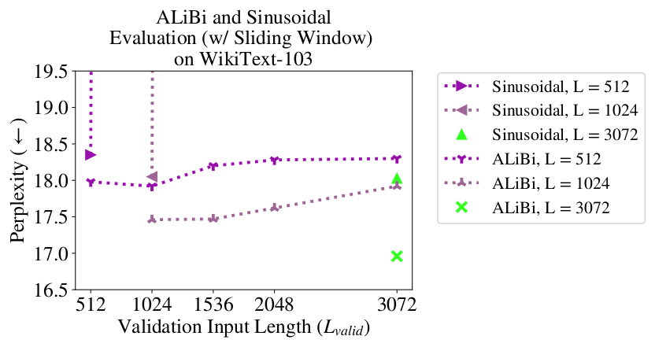

*图 A11（原文 Figure 11，第 24 页）：ALiBi 与正弦模型在 WikiText-103 上用滑动窗口（步长 $S=1$）在不同输入长度下评估。*

**图中文字翻译与读法**：

- **标题 ALiBi and Sinusoidal Evaluation (w/ Sliding Window) on WikiText-103（滑动窗口评估下的 ALiBi 与正弦）**；横轴 Validation Input Length（512–3072），纵轴 Perplexity（16.5–19.5，越低越好）；
- **图例**：Sinusoidal, L = 512 / 1024 / 3072（正弦，三个训练长度）；ALiBi, L = 512 / 1024 / 3072；
- **图题要点**：与图 4（不重叠评估）里每个模型随 $L_{\text{valid}}$ 增大而改善不同，这里的性能基本持平；这可能意味着 ALiBi 在 $L_{\text{valid}}>L$ 时变好并非因为用了更长的上下文，而是因为更少的 token 遭遇 early token curse；正弦模型在 $L_{\text{valid}}>L$ 时即使用滑动窗口也会困惑度爆炸（图中其曲线冲出上边界）。

对应的三张附录表（滑动窗口评估，步长 $S=1$，WikiText-103 验证集，行为训练长度、列为评估长度）：

正弦模型（原文表 13，第 25 页）：

| 训练长度 | 512 | 1024 | 1536 | 2048 | 3072 |
|---|---:|---:|---:|---:|---:|
| 512 | 18.35 | 204.42 | 264.74 | 306.19 | 360.12 |
| 1024 | - | 18.05 | 206.55 | 302.6 | 393.71 |
| 3072 | - | - | - | - | 18.03 |

T5 bias 模型（原文表 14，第 25 页）：

| 训练长度 | 512 | 1024 | 1536 | 2048 | 3072 |
|---|---:|---:|---:|---:|---:|
| 512 | 17.92 | 18.51 | 20.36 | 22.62 | 30.77 |
| 1024 | - | 17.65 | 17.87 | 18.51 | 20.66 |
| 3072 | - | - | - | - | 17.41 |

ALiBi 模型（原文表 15，第 25 页）：

| 训练长度 | 512 | 1024 | 1536 | 2048 | 3072 |
|---|---:|---:|---:|---:|---:|
| 512 | 17.98 | 17.92 | 18.2 | 18.28 | 18.3 |
| 1024 | - | 17.46 | 17.47 | 17.62 | 17.92 |
| 3072 | - | - | - | - | 16.96 |

读法：

- 正弦模型在滑动窗口下依然爆炸：$L=512$ 的模型到 1024 就升到 204.42，到 3072 为 360.12；
- T5 bias 在滑动窗口下仍随评估长度变差：$L=512$ 的模型从 17.92 升到 30.77，$L=1024$ 的模型从 17.65 升到 20.66（论文正文称其“相对平稳”，但从这两行数字看上升相当明显）；
- ALiBi 基本持平（$L=512$ 的模型 17.98 到 18.3；$L=1024$ 的模型 17.46 到 17.92，略有上升），没有因更长上下文而变好，但也没有崩溃。

**论文的结论**：这些结果让作者认为，不重叠评估下外推带来的困惑度改善是由解释 2（缓解 early token curse）造成的，而不是解释 1。作者也坦率指出，这意味着当 $L_{\text{valid}}>L$ 时，ALiBi 可能并没有在利用比训练时更长的上下文，这是一个值得未来研究的方向。同时，这并不降低 ALiBi 的价值：$L_{\text{valid}}=L$ 时它已经优于或不逊于正弦等方法，而且更简单、没有可学习位置参数；在 $L_{\text{valid}}>L$ 时，即使没有用到更长上下文，它也比其他可选方案（便宜但效果差的不重叠评估，或效果更好但极慢的滑动窗口）更划算。

## 七、相关工作（论文第 5 节的要点）

- Wennberg & Henter（2021，同期工作）也提出给 attention 分数加距离的偏置，但用的是带多个可训练参数的径向基函数，没有研究外推，实验是文本分类而非语言建模；DA-Transformer（Wu 等, 2021）把分数乘以一个按 head 学习的距离函数，只做文本分类；作者自己试过“乘”而不是“加”，性能下降；
- Transformer-XL（Dai 等, 2019）用缓存让推理时能看到更多 token，但只报告输出长度受限于 $L$ 的结果，且其相对位置方法很慢；Longformer（Beltagy 等, 2020）需要在更长序列上部分训练，而 ALiBi 不需要；
- 在 Transformer 语言模型上尚无前人系统研究外推，但在机器翻译、人工数据集上的序列到序列模型、算术任务、强化学习、图像/语音识别和蛋白质结构预测（AlphaFold）等任务上已有相关探索。

## 八、局限、证据边界与常见误读

**论文自己承认或其数据直接显示的局限**：

1. **外推收益不一定来自长上下文**：附录 B 显示，滑动窗口评估下 ALiBi 随 $L_{\text{valid}}$ 增大并不变好，只是保持平稳；$L=512$ 外推到 3072（18.40）仍不如直接训练 $L=3072$（17.60）。
2. **最佳点约在 $2L$**：CC100+RoBERTa 上 $L=512$ 最佳点约在 1012，$L=1024$ 约在 2024；之后缓慢回升。“10000 个 token 仍然强”指的是困惑度没有崩溃，不是还在继续改善。
3. **大数据、大模型下，非外推场景没有优势**：表 12 中 ALiBi 与正弦在同一长度上基本持平。
4. **评估只用困惑度**：论文的证据全部是语言建模困惑度，没有下游任务评估，模型规模最大 1.3B。
5. **偏置仍是 $O(L^2)$ 的 attention**：ALiBi 不减少计算，也不降低每步读取 KV 的成本；节省来自可以用更短的序列训练。
6. **斜率是在 WikiText-103 上选的**：论文展示了它在 Books、CC100+RoBERTa 上无需重调，但没有证明对所有领域最优。

**常见误读**：

- “ALiBi 能外推到任意长度”：论文在 15000 多个 token 内测试，只能说在这个范围内困惑度不崩溃；
- “线性偏置意味着注意力权重随距离线性下降”：偏置作用在 logit 上，权重经 softmax 后随距离指数衰减；
- “ALiBi 一定比旋转位置编码好”：论文比较的是它自己实现的 rotary，且脚注 5 说明其速度还有优化空间；两者在后续大模型中的使用情况是论文之外的话题。

## 九、复现检查清单

- 偏置只在 $j\le i$ 的位置按 $-m_h(i-j)$ 计算，未来位置仍需独立的因果 mask（$-\infty$）；
- 不要对偏置乘 $1/\sqrt d$；网络底部不再加任何位置嵌入；不要把位置信息加到 value 上；
- 斜率按 $m_h=2^{-8h/n}$（$h=1,\dots,n$）生成，不要训练；$n$ 不是 8 或 16 时，论文只给出这个一般公式，具体实现细节应以官方代码为准；
- 带 KV cache 的增量解码时，新 query 的位置要按其在整个序列中的绝对下标计算，距离才是 $i-j$；
- 比较外推时同时报告 $L$ 与 $L_{\text{valid}}$、是否滑动窗口、步长 $S$；做滑动窗口 $S=1$ 的对照才能判断是否真的用到了长上下文；
- 与基线比较时保持随机种子、训练轮数和其他超参数一致（论文在 WikiText-103 上固定了 205 个 epoch）。

## 十、与后续论文的关系

ALiBi 与 [RoPE](../rope/论文中文解读.md) 是两类相对位置信号的代表：ALiBi 在 logit 上加固定的距离偏置，RoPE 在 Q、K 上做旋转。论文的外推比较中，rotary 是中间档：优于正弦、劣于 T5 bias 和 ALiBi。后来采用 ALiBi 的大模型（如 BLOOM、MPT）属于论文之外的背景信息。

## 原文证据导航

- [原论文 PDF](paper.pdf)
- [原文提取文本](paper.txt)
- [论文概要](论文概要.md)
