# 论文中文解读：《Alpa: Automating Inter- and Intra-Operator Parallelism for Distributed Deep Learning》

> **基本信息**：Lianmin Zheng、Zhuohan Li、Hao Zhang（前三位为共同第一作者）、Yonghao Zhuang、Zhifeng Chen、Yanping Huang、Yida Wang、Yuanzhong Xu、Danyang Zhuo、Eric P. Xing、Joseph E. Gonzalez、Ion Stoica（UC Berkeley、Amazon Web Services、Google、上海交通大学、MBZUAI 与 CMU、Duke University），arXiv:2201.12023（本文依据 2022 年 6 月的 v3）；论文原文 [官方页面](https://arxiv.org/abs/2201.12023)；开源代码 [alpa-projects/alpa](https://github.com/alpa-projects/alpa)。
>
> **本文的读法**：图为从 PDF 中按图裁出的原图，表为逐格核对后的中文转录（数字与原文一致，表头翻译为中文）。每张图后有中文图题、图例和坐标轴翻译与读图结论，因此不必再翻英文版。从柱状图上量出来的数值一律写“约”，并说明是读图近似；原文正文给出的数字优先。公式沿用原文记号，符号首次出现时给出含义。标明“说明性示例”的小例子是为了讲清算法而编的，不是原文内容。

## 一、一句话结论

训练超大模型要同时组合数据并行、算子（张量）并行和流水线并行。手工选配需要很强的机器学习与系统功底，而此前的自动并行系统只覆盖其中一种模型并行。Alpa 换了一个看问题的角度：把并行分成**算子内并行**（intra-operator，切分单个算子的张量轴）和**算子间并行**（inter-operator，把模型切成 stage 做流水线）两层，并让这两层分别对应集群里“机器内高带宽、机器间低带宽”的层次结构。

- 层内：把“给定 stage 在给定 device mesh 上怎么切分张量”写成整数线性规划（ILP），用现成求解器求最优；
- 层间：用动态规划（DP）决定怎样把模型切成 stage、怎样把集群切成 device mesh，并反复向层内 pass 查询每个 stage-mesh 组合的延迟；
- 运行时：为每个 mesh 生成各自的静态指令（MPMD 风格），并处理相邻 stage 之间跨 mesh 的通信。

在 8 台 AWS p3.16xlarge（共 64 块 V100 16 GB）上，Alpa 在 GPT-3 上与手工调优的 Megatron-LM 基本持平，在 GShard MoE 上相对 DeepSpeed 于 2 个节点、4 个节点分别快 3.5 倍和 9.7 倍，在没有手工方案可用的 Wide-ResNet 上于 32 块 GPU 时达到约 80% 的线性扩展。

## 二、背景与动机

### 2.1 数据流图与一次训练迭代

主流框架把深度学习计算表示为数据流图：边是多维张量，节点是算子（operator，简称 op，例如矩阵乘 matmul），算子把输入张量变换为输出张量。训练一次迭代包括三步：把一个 batch 的数据前向（forward）通过计算图算出损失；反向（backward）求出参数的更新量；用权重更新（weight update）算子把更新量应用到参数上。开发者只定义数据流图，执行引擎负责优化并在设备上执行。当模型或数据太大、单个设备无法在合理时间内完成训练时，就需要把计算并行到多个设备上。

### 2.2 前置知识：集合通信与流水线调度

后文的通信代价都以下面这些原语表示（定义为通用常识，不是原文逐字内容）：

| 原语 | 含义 | 在本文中的出现位置 |
|---|---|---|
| all-reduce | 每个设备各有一份同形状张量，对它们求和，结果每个设备都得到完整的求和结果 | 数据并行的梯度同步；切分了归约轴后聚合部分和（表 3） |
| all-gather | 每个设备持有张量的一片，收集后每个设备都得到完整张量 | 把切分的张量恢复成复制（表 2） |
| reduce-scatter | 先求和再切片，每个设备只得到求和结果的一片 | 与 all-gather 合起来等价于 all-reduce（后述 post-ILP 优化） |
| all-to-all | 每个设备把自己的数据切成若干份分别发给其他设备，同时接收各设备发来的一份 | 改变张量被切分的那根轴（表 2） |
| send/recv | 两个设备之间的点对点通信 | 流水线相邻 stage 之间传递 activation |

流水线调度方面，GPipe 先做完所有 microbatch 的前向再做反向；PipeDream 使用异步训练；synchronous 1F1B（一次前向一次反向交替）保持同步一致性，流水线总延迟与 GPipe 相同，但峰值显存更低。Alpa 全文采用 synchronous 1F1B。

### 2.3 传统视角：数据、算子、流水线并行与它们的手工组合

原文第 2.1 节先回顾常见分类。

- **数据并行（data parallelism）**：训练数据切分到各 worker，模型复制；每个 worker 在自己那份数据上算参数更新量，权重更新前与其他 worker 同步，使所有 worker 看到一致的参数。
- **算子并行（operator parallelism）**：模型太大、一个设备放不下时的模型并行方案。沿**非 batch 轴**切分某个具体算子（例如图 2b 的 matmul），在多个设备上并行算这个算子的各个部分。因为输入张量被联合切分，设备算自己那一份时需要的输入可能不在本地，要通过通信取回。当张量被均匀切分（即 SPMD 风格）时，所有设备遵循相同的集合通信模式：all-reduce、all-gather、all-to-all。
- **流水线并行（pipeline parallelism）**：不切分算子，而是把模型图里的不同算子组（stage）放到不同 worker；同时把训练 batch 切成多个 microbatch，让前向和反向在各 worker 上流水执行（图 2d）。与算子并行不同，流水线在 worker 之间传递前向、反向过程中的中间 activation，使用点对点通信。
- **手工组合（3D parallelism）**：目前最先进的系统（如 Megatron-LM）为 Transformer 语言模型手工设计组合方案：假设模型由相同的 Transformer 层重复堆叠，每个流水线 stage 分配同样多的层，并对所有层统一使用手工设计的算子并行与数据并行配置。它需要很强的专业知识，也不能泛化到其他模型或其他集群配置（原文 §8.1 的实验会验证）。
- **自动组合为什么难**：各种并行的配置、它们之间的相互依赖、以及它们对模型与集群的依赖，构成了一个难以处理的空间。例如：与算子并行结合后，每多加一个数据并行副本就需要分配一整组设备（不是单个设备）作为 worker，并求出这组设备内部的最优算子并行配置；再加入流水线并行后，最优的流水线方案又取决于每个 stage 的数据/算子并行选择以及设备怎么分给各 stage。因此此前的自动化探索最多只把数据并行与一种模型并行方式结合，错过了很多性能机会。

### 2.4 Alpa 的新视角：算子内并行与算子间并行

Alpa 不再按“数据 / 算子 / 流水线”分类，而是按**是否切分算子**把现有方法重新分成两个正交的类别。

- **算子内并行（intra-operator parallelism）**：算子作用在多维张量上，沿某些维度切分张量，把切出的子计算分给多个设备同时执行。数据并行本身就属于算子内并行（沿 batch 维切分输入和 matmul，权重复制）；权重很大时切分权重，就是 Megatron-LM 采用的算子并行；还可以切分权重更新阶段的算子，得到 weight update sharding，也就是 ZeRO 技术（通常被看作数据并行的一种优化）。切分之后，算子的切分与合并处需要集合通信，所以算子内并行的显著特点是**设备间通信量大**。
- **算子间并行（inter-operator parallelism）**：不切分算子，而是把图中不同的算子分给不同设备执行。流水线并行是它的一个特例（脚注 2：device placement 也属于算子间并行，但它不用多个 microbatch 填满流水线，因此设备空闲更多）。设备之间只在 stage 之间通信，通常是点对点；通信量远小于算子内并行的集合通信。但由于 stage 之间的数据依赖，无论怎样调度，前向和反向期间总有一些设备处于空闲。

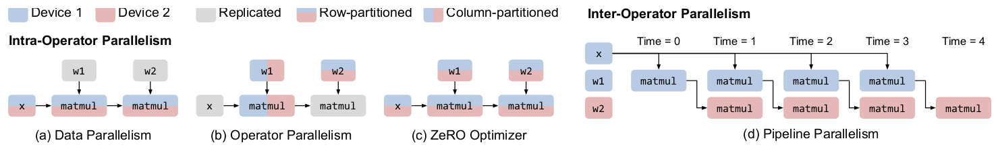

*图 2（原文 Figure 2，第 3 页）：训练一个两层多层感知机（MLP）时常见的并行技术，只画了前向。*

**图中文字翻译与读法**：

- **图例**：Device 1（设备 1，蓝）、Device 2（设备 2，红）、Replicated（复制，灰）、Row-partitioned（按行切分，上蓝下红）、Column-partitioned（按列切分，左蓝右红）。图中 x 是输入数据，w1、w2 是两个权重矩阵，matmul 是矩阵乘。
- **左侧 Intra-Operator Parallelism（算子内并行）三个子图**：（a）Data Parallelism（数据并行）：x 按行（batch 维）切分，w1、w2 复制，两个 matmul 都按行切分，每个设备算一半数据；（b）Operator Parallelism（算子并行）：x 复制，w1 按列切分、第一个 matmul 的输出按列切分，w2 按行切分，第二个 matmul 的结果在两个设备上为完整的复制（需要对部分和聚合）；（c）ZeRO Optimizer（ZeRO 优化器）：x 按行切分，w1、w2 也被切分存放（图中为按行切分），matmul 仍按行切分，即数据并行的计算加上被切分的权重（及其更新）。
- **右侧 Inter-Operator Parallelism（算子间并行）子图（d）Pipeline Parallelism（流水线并行）**：x 与 w1 在设备 1，w2 在设备 2。横轴是时间 Time = 0 到 4：设备 1 依次对 4 个 microbatch 做第一个 matmul（Time 0 到 3），设备 2 落后一拍依次做第二个 matmul（Time 1 到 4）。Time 0 时设备 2 空闲、Time 4 时设备 1 空闲，这就是流水线的“气泡”（bubble）。
- **读图结论**：(a)(b)(c) 三种做法都在切分张量，属于同一类（算子内）；(d) 没有切分任何算子，只是把不同算子放到不同设备上并让多个 microbatch 流水，属于另一类（算子间）。

### 2.5 为什么要分成两层来做

两类并行恰好对应集群的层次结构：集群里距离近的设备（例如同一台机器内的 GPU）带宽高，距离远的设备（跨机器）带宽低。Alpa 据此把算子内并行映射到高带宽连接的设备上，把算子间并行安排在带宽较低的远距离设备之间。此外，分层让每一层都可以作为独立的、可处理的子问题近似最优求解。原文也明确说，联合出来的执行计划**不保证全局最优**，但经验上在多种大模型训练中表现很强。

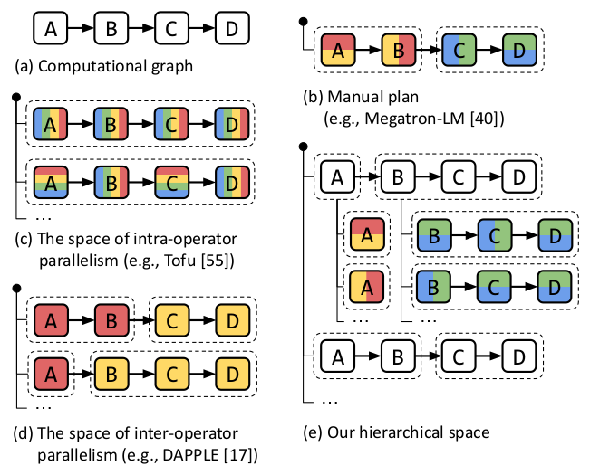

*图 1（原文 Figure 1，第 2 页）：对（a）所示计算图生成并行计划。不同颜色表示不同设备，虚线框表示流水线 stage。*

**图中文字翻译与读法**：

- **(a) Computational graph（计算图）**：A→B→C→D 四个算子串联。
- **(b) Manual plan（手工方案，如 Megatron-LM）**：人手工把 A、B 放进一个 stage、C、D 放进另一个 stage，每个 stage 里的张量切分方式（颜色）也由人设定。
- **(c) The space of intra-operator parallelism（算子内并行的搜索空间，如 Tofu）**：整张图只有一个 stage（一个虚线框），搜索的是每个算子沿哪些轴切分到多个设备（彩色条纹是不同设备各持一片）；省略号表示还有更多候选。
- **(d) The space of inter-operator parallelism（算子间并行的搜索空间，如 DAPPLE）**：每个算子整体放在一个设备上（单色），搜索的是在哪里切 stage（例如 A B | C D，或 A | B C D）以及每个 stage 用哪个设备。
- **(e) Our hierarchical space（Alpa 的分层空间）**：左侧的竖线引出一棵两级的树：第一级列出 stage 划分方案（例如 A | B C D，或 A B | C D，图中以不同的虚线分段表示）；第二级在每个 stage 下列出该 stage 的算子内并行方案（stage 内的彩色切分，不同颜色代表不同设备）。
- **读图结论**：此前的自动方法只在 (c) 或 (d) 其中一种空间里搜索，手工方案 (b) 只是 (e) 中的一个点；Alpa 的 (e) 同时覆盖二者。

## 三、系统总览

### 3.1 三个编译 pass 与运行时

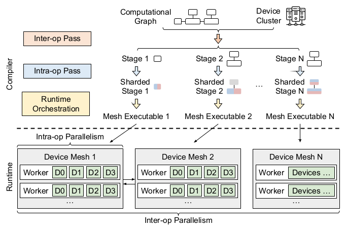

*图 3（原文 Figure 3，第 4 页）：编译 pass 与运行时架构。“sharded stage”是被 intra-op pass 标注了 sharding spec 的 stage。*

**图中文字翻译与读法**：

- **上半 Compiler（编译器）**：输入是 Computational Graph（计算图）和 Device Cluster（设备集群）。左侧三个色块是三个 pass：Inter-op Pass（算子间 pass，橙）、Intra-op Pass（算子内 pass，蓝）、Runtime Orchestration（运行时编排，黄）。Inter-op pass 把图切成 Stage 1…Stage N；Intra-op pass 为每个 stage 生成带 sharding 标注的 Sharded Stage 1…N；Runtime Orchestration 把它们编译成 Mesh Executable 1…N（每个 mesh 一个可执行文件）。
- **下半 Runtime（运行时）**：Device Mesh 1…N，每个 mesh 由若干 Worker 组成，每个 worker 管理若干设备（D0 到 D3）。同一个 mesh 内部是 Intra-op Parallelism（算子内并行，SPMD），mesh 之间是 Inter-op Parallelism（算子间并行，mesh 1 与 mesh 2 之间的箭头表示 stage 间通信）。
- **读图结论**：Alpa 的编译产物是“每个 mesh 一份 SPMD 可执行文件 + mesh 之间的流水线编排”。

数据流向如下。输入是一个 Jax 中间表示（IR）形式的模型描述和集群配置。

1. **inter-op pass**：把 IR 切成若干 stage，把设备集群切成若干 device mesh，用 DP 算法把 stage 分配给 mesh，并对每个 stage-mesh 配对调用 intra-op pass，查询这一分配的执行代价。
2. **intra-op pass**：在给定的 stage 与 mesh 上，用 ILP 最小化该 stage 的执行代价，得到 stage 的算子内并行计划，并把代价返回给 inter-op pass。
3. 通过反复查询每种 stage-mesh 分配的代价，inter-op pass 的 DP 最小化流水线总延迟，得到最优的 stage 与 mesh 切分。
4. **runtime orchestration pass**：按给定的流水线调度，把每个 stage 编译成其所在 mesh 上的并行可执行文件，处理相邻 stage 之间的跨 mesh 通信，然后为每个 mesh 生成静态指令并启动所有 mesh 的执行。

因为 inter-op pass 依赖 intra-op pass 的结果，原文的讲解顺序是：先 intra-op，再 inter-op，最后 runtime 编排。本文也沿用这个顺序。

### 3.2 用户接口

*图 4（原文 Figure 4，第 4 页，代码，下面为转录）：Alpa 的 Jax API 示例。开发者只需用 Python 装饰器 `@parallelize` 标注需要并行化的函数，程序其余部分保持不变。*

```python
# Put @parallelize decorator on top of the Jax functions
@parallelize
def train_step(state, batch):
    def loss_func(params):
        out = state.forward(params, batch["x"])
        return jax.numpy.mean((out - batch["y"]) ** 2)
    grads = grad(loss_func)(state.params)
    new_state = state.apply_gradient(grads)
    return new_state

# A typical training loop
state = create_train_state()
for batch in data_loader:
    state = train_step(state, batch)
```

第一次调用 `train_step()` 时，Alpa 会追踪整个函数得到模型 IR，触发编译，并把函数换成并行版本。

## 四、算子内并行 pass

### 4.1 设计选择：SPMD 风格

Alpa 在一个 device mesh 内采用 SPMD 风格的算子内并行（GShard、GSPMD 使用的风格）：把算子均匀切分到各设备，并让所有设备执行相同的指令。理由是同一个 mesh 内的设备算力相同。SPMD 风格大幅缩小了算子内并行计划的空间，同时又能方便地统一表达数据并行、ZeRO、Megatron-LM 的算子并行及其组合，而这些组合并没有被 Tofu、FlexFlow 等已有自动算子并行系统完整覆盖。此外，不同于采用随机搜索（FlexFlow）或假设线性图（Tofu）的系统，Alpa 把问题形式化为 ILP，并能高效求解含数万个算子的计算图。

### 4.2 搜索空间：为什么要为每个算子选“并行算法”

给定计算图里的一个算子，在 device mesh 上有多种可选的并行算法。例如矩阵乘 $C_{ij}=\sum_k A_{ik}B_{kj}$ 对应一个三层 for 循环，可以并行 $i$ 循环、$j$ 循环、$k$ 循环或它们的组合。不同选择的计算与通信代价不同，对输入张量的布局要求不同，产生的输出张量布局也不同。如果某个输入张量不满足该算法要求的布局，就要做布局转换，带来额外通信。intra-op pass 的目标是**为每个算子选定一种并行算法，使整张图的执行时间最小**。

### 4.3 设备网格与 sharding spec

**设备网格（device mesh）**：一组物理设备的二维逻辑视图，网格内每个设备算力相同。设备沿网格的第一维和第二维通信时，带宽可以不同；假设沿同一维的不同设备组具有相同的通信性能。同一组物理设备可以有多种逻辑视图，例如 2 个节点、每节点 8 块 GPU（共 16 个设备），可以看作 $2\times8$、$1\times16$、$4\times4$、$8\times2$ 或 $16\times1$ 的网格。物理设备与逻辑网格视图的对应关系由 inter-op pass 来优化（见第五节）。本节固定一种视图。

**sharding spec**：用来定义张量的布局。对 $N$ 维张量，spec 写作 $X_0X_1\cdots X_{N-1}$，其中 $X_i\in\{S,R\}$：$X_i=S$ 表示第 $i$ 根轴被切分（partitioned），否则表示该轴被复制（replicated）。对二维张量（矩阵）：$SR$ 表示按行切分，$RS$ 表示按列切分，$SS$ 表示行列都切分，$RR$ 表示完全复制。

确定哪些张量轴被切分后，还要把被切分的轴映射到网格的轴上。本文只考虑二维网格，因此被切分的张量轴可以对应网格的第 0 轴、第 1 轴，或者同时对应两根轴，用 $S$ 的上标表示：$S^0$ 沿网格第 0 轴切分，$S^1$ 沿网格第 1 轴切分，$S^{01}$ 沿两根网格轴切分。例如 $S^0R$ 表示张量按行切成两份，第一份复制在设备 0 和设备 1 上，第二份复制在设备 2 和设备 3 上。

下表列出 $2\times2$ 网格上二维张量的所有 spec。设备网格为 [[设备 0, 设备 1], [设备 2, 设备 3]]，$A$ 是 $(N,M)$ 的张量，各格用 Numpy 切片语法写出每个设备持有的分片。

**表 1：二维张量在 $2\times2$ 设备网格上的 sharding spec**

| Spec | 设备 0 | 设备 1 | 设备 2 | 设备 3 |
|---|---|---|---|---|
| $RR$ | $A[0:N,0:M]$ | $A[0:N,0:M]$ | $A[0:N,0:M]$ | $A[0:N,0:M]$ |
| $S^0S^1$ | $A[0:\frac{N}{2},0:\frac{M}{2}]$ | $A[0:\frac{N}{2},\frac{M}{2}:M]$ | $A[\frac{N}{2}:N,0:\frac{M}{2}]$ | $A[\frac{N}{2}:N,\frac{M}{2}:M]$ |
| $S^1S^0$ | $A[0:\frac{N}{2},0:\frac{M}{2}]$ | $A[\frac{N}{2}:N,0:\frac{M}{2}]$ | $A[0:\frac{N}{2},\frac{M}{2}:M]$ | $A[\frac{N}{2}:N,\frac{M}{2}:M]$ |
| $S^0R$ | $A[0:\frac{N}{2},0:M]$ | $A[0:\frac{N}{2},0:M]$ | $A[\frac{N}{2}:N,0:M]$ | $A[\frac{N}{2}:N,0:M]$ |
| $S^1R$ | $A[0:\frac{N}{2},0:M]$ | $A[\frac{N}{2}:N,0:M]$ | $A[0:\frac{N}{2},0:M]$ | $A[\frac{N}{2}:N,0:M]$ |
| $RS^0$ | $A[0:N,0:\frac{M}{2}]$ | $A[0:N,0:\frac{M}{2}]$ | $A[0:N,\frac{M}{2}:M]$ | $A[0:N,\frac{M}{2}:M]$ |
| $RS^1$ | $A[0:N,0:\frac{M}{2}]$ | $A[0:N,\frac{M}{2}:M]$ | $A[0:N,0:\frac{M}{2}]$ | $A[0:N,\frac{M}{2}:M]$ |
| $S^{01}R$ | $A[0:\frac{N}{4},0:M]$ | $A[\frac{N}{4}:\frac{N}{2},0:M]$ | $A[\frac{N}{2}:\frac{3N}{4},0:M]$ | $A[\frac{3N}{4}:N,0:M]$ |
| $RS^{01}$ | $A[0:N,0:\frac{M}{4}]$ | $A[0:N,\frac{M}{4}:\frac{M}{2}]$ | $A[0:N,\frac{M}{2}:\frac{3M}{4}]$ | $A[0:N,\frac{3M}{4}:M]$ |

（原文表 1，第 5 页。）读法：网格第 0 轴对应“设备所在的网格行”（设备 0、1 为第 0 行，设备 2、3 为第 1 行），第 1 轴对应“网格列”。因此 $S^0R$ 里设备 0 和设备 1 持有相同的上半部分；$S^1R$ 里设备 0 和设备 2 持有相同的上半部分；$S^1S^0$ 与 $S^0S^1$ 的区别在于行、列分别由哪根网格轴来切分。$S^{01}$ 表示把一根张量轴同时切给全部 4 个设备，所以每个设备只持有 $1/4$。

### 4.4 重分片（resharding）

当某个算子的输入张量不满足该算子所选并行算法要求的 sharding spec 时，就需要做布局转换，也就是 resharding，它可能需要跨设备通信。下表给出几种典型情形，其中 $\text{all-gather}(x,i)$ 表示沿网格第 $i$ 根轴对 $x$ 字节做 all-gather，$M$ 为张量的字节数，$(n_0,n_1)$ 为网格形状。

**表 2：几种重分片情形与通信代价**

| # | 源 spec | 目标 spec | 通信代价 |
|---|---|---|---|
| 1 | $RR$ | $S^0S^1$ | $0$ |
| 2 | $S^0R$ | $RR$ | $\text{all-gather}(M,0)$ |
| 3 | $S^0S^1$ | $S^0R$ | $\text{all-gather}(\frac{M}{n_0},1)$ |
| 4 | $S^0R$ | $RS^0$ | $\text{all-to-all}(\frac{M}{n_0},0)$ |
| 5 | $S^0S^1$ | $S^{01}R$ | $\text{all-to-all}(\frac{M}{n_0\cdot n_1},1)$ |

（原文表 2，第 5 页。）读法：

- 把完全复制的张量转成任意切分的布局（情形 1）不需要通信，每个设备在本地切片即可；
- 把切分的张量恢复成复制（情形 2、3）用 all-gather；
- 交换被切分的那根张量轴（情形 4，行切分改为列切分）用 all-to-all。

### 4.5 一个算子的并行算法（以 batched matmul 为例）

有了上面的定义，就可以枚举一个算子的并行算法。以 batched matmul $C_{b,i,j}=\sum_k A_{b,i,k}B_{b,k,j}$ 在二维网格上为例，下表列出几种并行算法。三维张量的 spec 有三个字母，依次对应该张量的三根轴：$C_{b,i,j}$ 的是 $b,i,j$，$A_{b,i,k}$ 的是 $b,i,k$，$B_{b,k,j}$ 的是 $b,k,j$。$\text{all-reduce}(x,i)$ 表示沿网格第 $i$ 根轴对 $x$ 字节做 all-reduce；注意在表 3 中 $M$ 指的是**输出张量**的字节数，而表 2 中 $M$ 是被重分片的那个张量的字节数。

**表 3：batched matmul 的几种并行算法**

| # | 并行映射 | 输出 spec | 输入 specs | 通信代价 |
|---|---|---|---|---|
| 1 | $i\to0,\ j\to1$ | $RS^0S^1$ | $RS^0R,\ RRS^1$ | $0$ |
| 2 | $i\to0,\ k\to1$ | $RS^0R$ | $RS^0S^1,\ RS^1R$ | $\text{all-reduce}(\frac{M}{n_0},1)$ |
| 3 | $j\to0,\ k\to1$ | $RRS^0$ | $RRS^1,\ RS^1S^0$ | $\text{all-reduce}(\frac{M}{n_0},1)$ |
| 4 | $b\to0,\ i\to1$ | $S^0S^1R$ | $S^0S^1R,\ S^0RR$ | $0$ |
| 5 | $b\to0,\ k\to1$ | $S^0RR$ | $S^0RS^1,\ S^0S^1R$ | $\text{all-reduce}(\frac{M}{n_0},1)$ |
| 6 | $i\to\{0,1\}$ | $RS^{01}R$ | $RS^{01}R,\ RRR$ | $0$ |
| 7 | $k\to\{0,1\}$ | $RRR$ | $RRS^{01},\ RS^{01}R$ | $\text{all-reduce}(M,\{0,1\})$ |

（原文表 3，第 6 页。）如何读这张表：

- “并行映射 $i\to0,\ j\to1$”表示把循环 $i$ 映射到网格第 0 轴、循环 $j$ 映射到网格第 1 轴。
- 算法 1：输出 $C$ 的 spec 为 $RS^0S^1$。左操作数 $A_{b,i,k}$ 只有 $i$ 被并行，所以它的 spec 写成 $RS^0R$；右操作数 $B_{b,k,j}$ 只有 $j$ 被并行，写成 $RRS^1$。此时每个设备本地就有算自己输出块所需的全部输入块，所以**通信代价为 0**。
- 算法 2：并行了归约循环 $k$。每个设备只在自己那份 $k$ 上求和，得到的只是部分和，所以必须沿网格第 1 轴做 all-reduce 聚合；输出分片大小是 $M/n_0$，因此代价为 $\text{all-reduce}(M/n_0,1)$。
- 算法 7：$k$ 同时映射到两根网格轴，所有 $n_0n_1$ 个设备各持有输出的部分和，需要对整个输出做 $\{0,1\}$ 两根轴上的 all-reduce，代价为 $\text{all-reduce}(M,\{0,1\})$。
- 规律：并行化非归约轴（$b$、$i$、$j$）通常无需通信（算法 1、4、6）；并行化归约轴 $k$ 要用 all-reduce 聚合部分和（算法 2、3、5、7）。不同算法要求的输入布局、产生的输出布局都不同，所以某个算子选哪种算法是否划算，取决于它的上游和下游怎么选。这正是需要对整张图做联合优化（ILP）的原因。

对卷积、归约等其他基本算子，可以按其数学表达式做类似分析，列出可能的并行算法。intra-op pass 里模型图用 XLA 的 HLO 格式表示，它把常见深度学习算子归纳成不到 80 个基本算子，因此可以手工枚举每个基本算子的并行算法。

### 4.6 ILP 形式化

整张计算图 $G=(V,E)$ 的总执行代价，等于所有节点 $v\in V$ 上的计算代价与通信代价之和，再加上所有边 $e\in E$ 上的重分片代价。Alpa 把代价最小化写成 ILP，并用现成求解器求最优解（原文参考文献 [18] 为 CBC 用户手册，即 COIN-OR CBC 求解器）。

符号定义：

- 节点 $v$ 有 $k_v$ 种可选的并行算法；
- $c_v\in\mathbb{R}^{k_v}$ 是**通信代价向量**，$c_{vi}$ 是第 $i$ 种算法的通信代价；
- $d_v\in\mathbb{R}^{k_v}$ 是**计算代价向量**；
- $s_v\in\{0,1\}^{k_v}$ 是 one-hot **决策向量**，$s_{vi}=1$ 表示节点 $v$ 选了第 $i$ 种算法；
- 对边 $(v,u)$，**重分片代价矩阵** $R_{vu}\in\mathbb{R}^{k_v\times k_u}$，其元素 $R_{vuij}$ 是从 $v$ 的第 $i$ 种算法的输出布局，转换到 $u$ 的第 $j$ 种算法所要求的输入布局的代价。

优化目标为：

$$
\min_{s}\ \sum_{v\in V} s_v^{\top}\,(c_v+d_v)\;+\;\sum_{(v,u)\in E} s_v^{\top} R_{vu}\, s_u .
$$

第一项是各节点自身的计算与通信代价，第二项是各条边上的重分片代价。在这个问题里 $s$ 是变量，其余都是常数。

**线性化**：式中 $s_v^{\top}R_{vu}s_u$ 是二次项，不能直接交给 ILP 求解器。原文引用 0-1 二次规划的线性化方法，引入新的决策向量 $e_{vu}\in\{0,1\}^{k_v\cdot k_u}$ 来表示 $v$ 与 $u$ 之间的重分片决策。原文只写到这一步；常规的线性化写法是：让 $e_{vu}$ 的第 $(i,j)$ 个分量为 1 当且仅当 $v$ 选第 $i$ 种、$u$ 选第 $j$ 种，二次项就变成 $e_{vu}$ 与 $R_{vu}$ 展平向量的内积，并加上一致性约束：对每个 $i$，$\sum_j e_{vu,ij}=s_{vi}$；对每个 $j$，$\sum_i e_{vu,ij}=s_{uj}$。（这两条约束是常规写法，不是原文逐条给出的。）

**说明性示例（非原文）**：设计算图里有两个相连的 matmul，$v\to u$。$v$ 有两种算法 $v_1$（表 3 的 #1，通信 0，输出 $RS^0S^1$）和 $v_2$（表 3 的 #2，需要 all-reduce，输出 $RS^0R$）。$u$ 有两种算法，$u_1$ 要求输入 spec 为 $RS^0R$，$u_2$ 要求输入 spec 为 $RS^0S^1$。重分片代价：$v_1\to u_1$ 需要沿网格第 1 轴做 all-gather，记作 $r>0$；其余三种组合只需本地切片或无需转换，代价为 0。于是 $R_{vu}$ 的四个元素中只有 $R_{11}=r$ 非零，其余 $R_{12}=R_{21}=R_{22}=0$。“每个节点各自选通信最小的算法”会选 $v_1$ 和 $u_1$（假设 $u_1$ 自身通信为 0），却在边上付出 $r$；ILP 会同时比较 $r$、$v_2$ 的 all-reduce 代价、$u_2$ 的 all-reduce 代价等所有组合，选全局总和最小者。这就是为什么要对整张图联合求解。

### 4.7 代价估计、图简化与 post-ILP 优化

- **代价估计**：虽然可以通过 profiling 得到精确的 $c_v$、$d_v$、$R_{vu}$，为简单起见，Alpa 用估算的方式。通信代价 $c_v$ 和 $R_{vu}$：算出通信的字节数，除以对应网格维度的带宽；计算代价 $d_v$：**全部设为 0**（与 Tofu 动机相同）。理由是：（1）对 matmul 这类重算子，Alpa 不允许重复计算，所有并行算法都把工作均匀分给全部设备，因此同一算子的各种并行算法算术复杂度相同；（2）对 element-wise 这类轻算子，允许重复计算，但其计算代价可以忽略。
- **图简化**：把计算上不重要的算子（如 element-wise、transpose、reduction）并入它的某个操作数，并从该操作数传播 sharding spec，这样大幅减少图中节点数，也就是 ILP 的规模。具体做法是对图做广度优先搜索得到每个节点的深度，把节点并入**最深的**操作数。
- **post-ILP 通信优化**：ILP 确定并行计划后，再做一组通信优化，例如在可行时把 all-reduce 替换成 reduce-scatter 加 all-gather：两者通信量相同，但拆开后可以让权重更新等计算只在被切分的那一份上做，减少被复制的张量和对应的重复计算。这相当于实现了 weight update sharding（即 ZeRO 优化器）的效果。

## 五、算子间并行 pass

目标：把模型和设备集群切成若干 stage-mesh 配对，使整个计算图的端到端流水线执行延迟最小。已有工作考虑的是简化问题，例如假设每个 stage 的设备是预先分配好的、所有 stage 使用固定的数据或算子并行方案。Alpa 去掉了这些假设：联合考虑设备 mesh 的分配，以及每个 stage 上可变的算子内并行方案。

### 5.1 问题定义与流水线延迟

假设计算图按拓扑序排成算子序列 $o_1,\dots,o_K$，算子 $o_k$ 的输入来自 $o_1,\dots,o_{k-1}$。（脚注 3：直接采用用户在模型 IR 中定义算子的顺序，以输入算子为起点。这样能利用用户程序固有的局部性：图中联系紧密的节点更可能被切进同一个 stage。）把算子切成 $S$ 个 stage $s_1,\dots,s_S$，每个 stage $s_i$ 包含算子 $(o_{l_i},\dots,o_{r_i})$，并把 $s_i$ 分配给一个大小为 $n_i\times m_i$ 的子网格（submesh）。这些 submesh 都是从 $N\times M$ 的集群网格（cluster mesh，$N$ 个节点、每节点 $M$ 个设备）中切出来的。

令 $t_i=t_{\text{intra}}(s_i,\mathrm{Mesh}(n_i,m_i))$ 表示 stage $s_i$ 在 $n_i\times m_i$ 子网格上的执行延迟，它由 ILP 最小化后由 intra-op pass 报告。设流水线有 $B$ 个不同的输入 microbatch，则整张图的总最小延迟为（Eq. 2）：

$$
T^{*}=\min_{s_1,\dots,s_S;\,(n_1,m_1),\dots,(n_S,m_S)}\Big\{\sum_{i=1}^{S} t_i+(B-1)\cdot\max_{1\le j\le S} t_j\Big\}.
$$

总延迟由两项组成：第一项是所有 stage 延迟之和，可理解为第一个 microbatch 穿过整条流水线的延迟；第二项是其余 $B-1$ 个 microbatch 的流水执行时间，受最慢的那个 stage 约束。脚注 4 指出这个公式适用于 GPipe 和 synchronous 1F1B 调度，其他调度可能需要不同的公式。

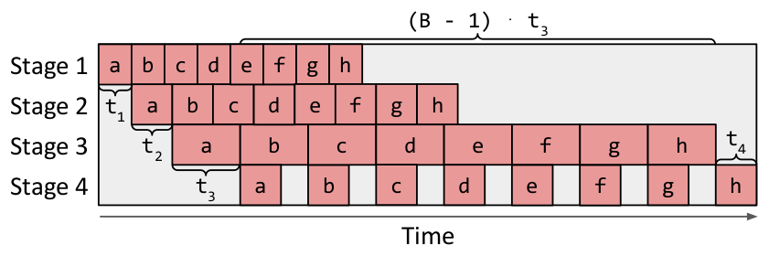

*图 5（原文 Figure 5，第 7 页）：流水线总延迟由两部分决定：所有 stage 的延迟之和（$t_1+t_2+t_3+t_4$）与最慢 stage 的延迟（$(B-1)\cdot t_3$）。*

**图中文字翻译与读法**：

- 纵轴是 Stage 1 到 Stage 4 四个流水线 stage，横轴 Time 是时间；a 到 h 是 8 个 microbatch（即 $B=8$）。每个红色方块表示一个 microbatch 在某个 stage 上的一次执行，方块长度就是该 stage 的延迟 $t_i$。
- Stage 3 的方块最长，是最慢的 stage。图中的小括号 $t_1,t_2,t_3,t_4$ 分别标出各 stage 里一个方块的长度，即该 stage 处理一个 microbatch 的延迟；图上方的括号 $(B-1)\cdot t_3$ 跨过最慢的 Stage 3 的 $B-1=7$ 个方块：流水线进入稳态后，后续的 microbatch 每隔一个 $t_3$ 完成一个。
- Stage 4 的方块之间有空隙：它比 Stage 3 快，要等上游的输出。
- **读图结论**：$B$ 很大时，总延迟主要由最慢的 stage 决定，所以 stage 划分要追求各 stage 延迟均衡。

**说明性示例（非原文）**：取 $S=4$、$B=8$。若 stage 延迟为 $(1,1,3,1)$，则 $T=6+7\times3=27$；若重新划分使其均衡为 $(1.5,1.5,1.5,1.5)$（总和同为 6），则 $T=6+7\times1.5=16.5$。当 $B=1$ 时 $T=\sum t_i$，流水线没有任何收益。

Eq. 2 的优化还带两个附加约束：

1. 前向图中的算子要与它对应的反向算子放在同一个 submesh 上。因为反向传播通常要用到前向传播里用过的张量，这样能减少把前向产物传给反向所需的通信。$t_{\text{intra}}$ 采用前向与反向延迟之和，使 Eq. 2 反映包含前向与反向的总延迟。
2. 切出来的 submesh $(n_1,m_1),\dots,(n_S,m_S)$ 必须**完全覆盖** $N\times M$ 的集群网格，不浪费任何计算设备。

### 5.2 submesh 形状的简化与覆盖定理

为保证 submesh 恰好覆盖集群网格，Alpa 把可用的 submesh 形状限制为两类：

1. 一维 submesh：$(1,1),(1,2),(1,4),\dots,(1,2^m)$，其中 $M=2^m$；
2. 二维 submesh：$(2,M),(3,M),\dots,(N,M)$，即完全用满集群网格第二维（在 GPU 集群上，就是用满一台物理机器上的所有设备）。

附录 A 证明：只要满足 $\sum_i n_i\cdot m_i=N\cdot M$，用这些形状总能恰好覆盖整个 $N\times M$ 网格（定理见下）。因此只需保证总设备数相加为 $N\cdot M$，即 $\sum_{i=1}^{S}n_i\cdot m_i=N\cdot M$。

**为什么这样简化是合理的**：这种简化适用于大多数云上的深度学习配置：AWS 的 GPU 实例有 1、2、4 或 8 块 GPU；GCP 的 TPU 实例有 8、32、128、256 或 512 块 TPU。被排除的形状是 $n>1$ 且 $m<M$ 的 $(n,m)$；原文观察到它们的结果更差，因为形状为 $(n',M)$ 且 $n'\cdot M=n\cdot m$ 的替代 submesh 有更多可以高带宽通信的设备。

**从 DP 结果到物理设备**：把物理设备分配给 DP 求出的 submesh 时，按“先分配大的 submesh，再分配小的”的顺序枚举；多个 stage 形状相同时，尽量把相邻的流水线 stage 放得更近以降低通信延迟。

**定理 1（附录 A，被选 submesh 形状可以覆盖集群网格）与证明思路**：设 submesh 形状列表 $(n_1,m_1),\dots,(n_S,m_S)$ 满足 $\sum_i n_i\cdot m_i=N\cdot M$，且每个 $(n_i,m_i)$ 要么（1）$n_i=1$ 且 $m_i=2^{p_i}$ 是 2 的幂，要么（2）$m_i=M$，其中 $M=2^m$，则这些 submesh 总能覆盖整个 $(N,M)$ 网格。证明：

1. 先把第二类 submesh（$m_i=M$）放进网格，它们占满第二维。剩下的问题是用形状为 $(1,2^{p_1}),\dots,(1,2^{p_S})$ 的 submesh 去覆盖 $(N,M)$ 网格，其中 $p_i\in\{0,1,\dots,m-1\}$ 且 $2^{p_1}+\cdots+2^{p_S}=N\cdot2^m$（原文 Eq. 7）；
2. 对 $m$ 做归纳。$m=1$ 时所有 $p_i=0$，全是 $(1,1)$，显然能覆盖；
3. 假设对 $m=1,\dots,k-1$ 成立。当 $m=k$ 时，$p_i=0$ 的 submesh 个数必须是偶数（否则等式左边是奇数，右边总是偶数）。把它们两两配成 $(1,2)$ 的 submesh 后所有 $p_i>0$，再把所有 $p_i$ 和 $m$ 减 1，就化为 $m=k-1$ 的情形。归纳完成。

### 5.3 DP 公式

要求解 Eq. 2 中的 $T^{*}$，Alpa 设计了一个 DP 算法。基本思路：**先枚举第二项里的 $t_{\max}=\max_j t_j$，对每个给定的 $t_{\max}$ 去最小化第一项 $t_{\text{total}}(t_{\max})=\sum_i t_i$**。

定义函数 $F(s,k,d;t_{\max})$：把算子 $o_k$ 到 $o_K$ 切成 $s$ 个 stage、放到 $d$ 个设备上，并保证**每个 stage 的延迟都不超过 $t_{\max}$** 时的最小总延迟。初值 $F(0,K+1,0;t_{\max})=0$（没有 stage、没有剩余算子、没有设备）。记

$$
\tau=t_{\text{intra}}\big((o_k,\dots,o_i),\mathrm{Mesh}(n_s,m_s),s\big),
$$

则最优子结构为（Eq. 3）：

$$
F(s,k,d;t_{\max})=\min_{k\le i\le K,\ n_s\cdot m_s\le d}\Big\{\tau+F\big(s-1,\ i+1,\ d-n_s\cdot m_s;\ t_{\max}\big)\Big\},\qquad \text{且要求 }\tau\le t_{\max}.
$$

含义：枚举当前（第一个）stage 包含的算子区间 $o_k,\dots,o_i$，以及给它分配的 submesh 形状 $(n_s,m_s)$（占用 $n_s\cdot m_s\le d$ 个设备）；这个 stage 的延迟 $\tau$ 不能超过 $t_{\max}$；剩下的 $o_{i+1},\dots,o_K$ 切成 $s-1$ 个 stage、放到剩余的 $d-n_s\cdot m_s$ 个设备上，递归求解。

最优总延迟为（Eq. 4）：

$$
T^{*}(t_{\max})=\min_{s}\big\{F(s,\,0,\,N\cdot M;\,t_{\max})\big\}+(B-1)\cdot t_{\max}.
$$

即在所有 stage 个数 $s$ 中取最小的 $F$（用满全部 $N\cdot M$ 个设备、覆盖所有算子），再加上 $(B-1)\cdot t_{\max}$。（原文 Eq. 4 与 Algorithm 1 把“从第一个算子开始”记为下标 $k=0$，而前文算子编号从 1 开始；这里的下标起点在原文中不统一，应理解为从第一个算子起。）最终 $T^{*}=\min_{t_{\max}}T^{*}(t_{\max})$。直观上，真正的最优方案的最大 stage 延迟总会等于被枚举的某个 $t_{\max}$ 值；取到别的 $t_{\max}$ 时，第二项是对真实瓶颈的高估，所以在所有 $t_{\max}$ 上取最小就恰好得到 $T^{*}$。

**$t_{\text{intra}}$ 是怎么得到的**：$t_{\text{intra}}((o_k,\dots,o_i),\mathrm{Mesh}(n_s,m_s),s)$ 是在 $\mathrm{Mesh}(n_s,m_s)$ 上执行子图 $(o_k,\dots,o_i)$ 时能达到的最低延迟，由 intra-op pass 确定；参数 $s$ 表示该 stage 及其后续共 $s$ 个 stage（原文措辞为 with $s$ subsequent stages，按 $F$ 的定义 $s$ 包含当前这个 stage）。注意 $\mathrm{Mesh}(n_s,m_s)$ 是一组物理设备，所以要枚举所有满足 $n_l\cdot m_l=n_s\cdot m_s$ 的**逻辑**网格形状 $(n_l,m_l)$。对每个选择：

1. 以该子图、逻辑网格 $(n_l,m_l)$ 和其他 intra-op 选项为输入，查询 intra-op pass，得到一个算子内并行计划；
2. 按该计划并连同所有其他底层编译器优化（如 fusion、内存规划）把子图编译成可执行文件，以便精确 profiling；
3. 对可执行文件做 profile，得到 stage 延迟 $t_l$、运行该 stage 在每个设备上所需的内存 $\mathrm{mem}_{\text{stage}}$，以及保存中间 activation 所需的内存 $\mathrm{mem}_{\text{act}}$；
4. 按所选流水线调度检查内存是否放得下。对 1F1B 调度，要求（Eq. 5）：

$$
\mathrm{mem}_{\text{stage}}+s\cdot\mathrm{mem}_{\text{act}}\le \mathrm{mem}_{\text{device}}.
$$

这个式子可以这样理解（本文的解释）：1F1B 下越靠前的 stage 越要同时保留更多个 microbatch 的 activation，所以 $s$ 越大，对 activation 内存的要求越高。$s$ 因此只通过内存可行性影响 $t_{\text{intra}}$。

最后在所有放得下的逻辑网格形状里选择使 $t_l$ 最小者；如果没有一个放得下，就令 $t_{\text{intra}}=\infty$。

与相关算法的区别：这个 DP 建立在 TeraPipe 的算法之上。TeraPipe 假设所有流水线 stage 相同，目标是找到把输入 token 分批成不同大小 micro-batch 的最优方式；Alpa 则是把计算图的算子分组成不同的流水线 stage，同时假设输入 micro-batch 大小相同；此外 Alpa 还在 DP 里为每个流水线 stage 优化 mesh 形状。

### 5.4 复杂度与两个实用优化

**复杂度**：对固定的 $t_{\max}$，DP 的计算量为 $O(K^3NM(N+\log M))$。$t_{\max}$ 最多有 $O(K^2(N+\log M))$ 种取值（来自 $t_{\text{intra}}((o_i,\dots,o_j),\mathrm{Mesh}(n_s,m_s))$，$i,j=1,\dots,K$，以及所有 submesh 选择）。因此总复杂度为 $O(K^5NM(N+\log M)^2)$。对超过一万个算子的大计算图，这个复杂度不可行，因此原文引入两个实用优化。

**优化 1：early pruning（提前剪枝）**。与 TeraPipe 类似：从小到大枚举 $t_{\max}$；当 $B\cdot t_{\max}$ 已经大于当前最优的 $T^{*}$ 时，立即停止枚举，因为更大的 $t_{\max}$ 不可能再给出更好的解。此外，只有当 $t_{\max}$ 比上一个评估过的 $t_{\max}$ 至少大 $\varepsilon$ 时才评估它。这样 DP 找到的解与全局最优之间的差距至多为 $B\cdot\varepsilon$。原文经验性地取 $\varepsilon=10^{-6}$ 秒，并发现在所有评估设置下，输出的解都与真正最优解（$\varepsilon=0$）相同。

**优化 2：operator clustering（算子聚类）**。计算图里有很多算子计算量不大（例如 ReLU），它们的具体放置对总执行时间影响很小。Alpa 另用一个 DP 算法把相邻算子聚成**层**（layer）以缩小 Eq. 2 要处理的图。把算子 $(o_1,\dots,o_K)$ 聚类成一串层 $(l_1,\dots,l_L)$，其中 $L\ll K$（脚注 5：聚类并不严格还原模型定义里带机器学习语义的层）。该算法要合并两类算子：（1）计算量小但拉长了计算图的算子；（2）如果放到不同 device mesh 上会造成大量通信的相邻算子。

定义 $G(k,r)$：把算子 $(o_1,\dots,o_k)$ 聚成 $r$ 层时，“单层接收的最大数据量”的最小值。它的最优子结构为（Eq. 6）：

$$
G(k,r)=\min_{1\le i\le k}\Big\{\max\{G(i-1,r-1),\,C(i,k)\}\Big\},\qquad \text{且要求 }\mathrm{FLOP}(o_i,\dots,o_k)\le\frac{(1+\delta)\,\mathrm{FLOP}_{\text{total}}}{L}.
$$

其中 $C(i,k)$ 是算子 $(o_i,\dots,o_k)$ 从 $(o_1,\dots,o_{i-1})$ 接收的输入总大小，$\mathrm{FLOP}_{\text{total}}=\mathrm{FLOP}(o_1,\dots,o_K)$ 是整张计算图的总 FLOP。约束保证每个聚类后的层的 FLOP 不超过每层平均 FLOP 的 $1+\delta$ 倍，同时最小化通信量；对通信量相同的解，选结构最均匀的，也就是同时最小化各层 FLOP 的方差。该 DP 的计算量为 $O(K^2L)$。$L$ 是算法的超参数，实际中根据设备数和图中重算子的数量选一个较小的值，原文发现不同的 $L$ 对最终性能没有显著影响（原文未给出 $\delta$ 与 $L$ 的具体取值）。

### 5.5 Algorithm 1 逐行解读

Algorithm 1 总结了 inter-op pass 的工作流程，以及它与 intra-op pass 的交互。下面是中文伪代码（行号同原文）。

```text
输入：模型图 G，集群 C，形状 (N, M)
输出：最小流水线执行延迟 T*

// 预处理图
4:  (o_1..o_K) ← Flatten(G)                      把图展平成按拓扑序的算子序列
5:  (l_1..l_L) ← OperatorClustering(o_1..o_K)    算子聚类成 L 层 (Eq. 6)

// 运行 intra-op pass，获得各 stage-mesh 组合的代价
7:  submesh_shapes ← {(1,1),(1,2),(1,4),...,(1,M)} ∪ {(2,M),(3,M),...,(N,M)}
8:  for 1 ≤ i ≤ j ≤ L:                           枚举所有连续层区间作为候选 stage
9:      stage ← (l_i..l_j)
10:     for (n, m) ∈ submesh_shapes:             枚举 submesh 形状
11-13:      对所有 s=1..L：t_intra(stage, Mesh(n,m), s) ← ∞
14:         for (n_l, m_l), opt ∈ LogicalMeshShapeAndIntraOpOptions(n, m):
                                                  枚举逻辑网格形状及 intra-op 选项
15:             plan ← IntraOpPass(stage, Mesh(n_l, m_l), opt)       求解 ILP
16:             t_l, mem_stage, mem_act ← Profile(plan)              编译并 profile
17-21:          for 满足 Eq. 5 的每个 s:
                    若 t_l < t_intra(stage, Mesh(n,m), s)，则更新为 t_l

// 运行 inter-op 动态规划
26: T* ← ∞
27: for t_max ∈ SortedAndFilter(t_intra, ε):     按从小到大、间隔至少 ε 枚举 t_max
28:     if B · t_max ≥ T*: break                 early pruning
31:     F(0, L+1, 0; t_max) ← 0
32-38:  for s = 1..L，for l = L 下降到 1，for d = 1..N·M:
            按 Eq. 3 计算 F(s, l, d; t_max)
39:     T*(t_max) ← min_s F(s, 0, N·M; t_max) + (B-1) · t_max
40-42:  若 T*(t_max) < T*，则 T* ← T*(t_max)
```

读法：第 8 到 24 行是“造表”阶段，对每个候选 stage、每种 submesh 形状、每种逻辑网格形状，调用一次 ILP + 编译 + profile，把最优延迟填入 $t_{\text{intra}}$ 表，这一步最耗时（见 8.4 节的编译时间）。第 26 到 43 行是“查表做 DP”阶段，只做 min-plus 运算，耗时很小（原文表 5 中 Stage Construction DP 仅 1.65 秒）。注意算法里的 DP 是在聚类后的 $L$ 层上做的（$K$ 在复杂度分析里指算子数，$L$ 在算法里指层数）。

**说明性示例（非原文）**：设只有两种把模型切成 2 个 stage 的方案：方案 P1 的 stage 延迟为 $(3,7)$，总和 10、最大值 7；方案 P2 为 $(5,5)$，总和 10、最大值 5。取 $B=4$。则直接计算 $T_{P1}=10+3\times7=31$，$T_{P2}=10+3\times5=25$。算法按 $t_{\max}$ 从小到大枚举：$t_{\max}=5$ 时只有 P2 可行，$F=10$，$T^{*}(5)=10+3\times5=25$，更新 $T^{*}=25$；枚举到 $t_{\max}=7$ 时，$B\cdot t_{\max}=28\ge T^{*}=25$，触发 early pruning，直接结束。最终返回 25，对应 P2。

## 六、并行编排（runtime orchestration）

stage、device mesh 及它们的分配确定之后：

- **mesh 内（算子内）**：Alpa 按 ILP 给出的算子内并行计划，把每个 stage 编译到其分配到的 device mesh 上。编译依赖 XLA 与 GSPMD，为每个 stage-mesh 配对生成并行可执行文件；需要时自动插入集合通信原语，处理算子内并行带来的 mesh 内通信。
- **mesh 间（算子间）**：Alpa 额外实现一个并行编排 pass，处理 stage 之间跨 mesh 的通信，并生成算子间并行执行所需的静态指令。

### 6.1 跨 mesh 重分片（cross-mesh resharding）

Megatron-LM 等手工系统规定所有流水线 stage 的数据并行度与张量模型并行度相同，所以 stage 间的通信是相应设备之间的点对点 send/recv（图 6a）。在 Alpa 中，持有相邻两个 stage 的 device mesh 的形状可能不同，要传递的张量在两边的 sharding spec 也可能不同（图 6b、图 6c）。这种通信模式叫**跨 mesh 重分片**，本质上是一个多对多的多播问题。

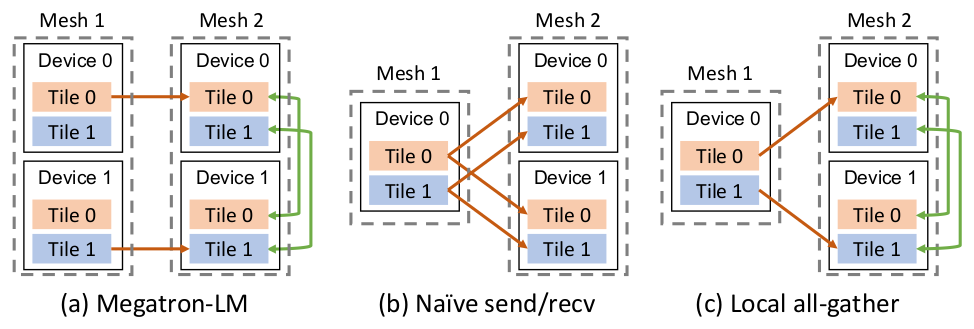

*图 6（原文 Figure 6，第 9 页）：跨 mesh 重分片。红色箭头表示慢速连接上的 send/recv，绿色箭头表示快速连接上的 all-gather。*

**图中文字翻译与读法**：

- **(a) Megatron-LM**：Mesh 1 与 Mesh 2 形状相同（各有 Device 0、Device 1，张量分成 Tile 0、Tile 1，源张量在两个设备上都是完整复制的）。Megatron-LM 的 scatter-gather 优化：两侧对应设备之间各发送自己负责的那一块（Mesh 1 的设备 0 把 Tile 0 发给 Mesh 2 的设备 0，设备 1 把 Tile 1 发给设备 1，红箭头），然后在 Mesh 2 内用 all-gather（绿箭头）互相补齐。
- **(b) Naïve send/recv（朴素 send/recv）**：Mesh 1 只有一个设备，Mesh 2 有两个设备且都需要完整张量。朴素做法是源设备把 Tile 0、Tile 1 各自发给目的 mesh 的每个设备，慢速链路上共 4 条传输。
- **(c) Local all-gather（本地 all-gather）**：每个 tile 只跨 mesh 传一次（Tile 0 发给目的设备 0，Tile 1 发给目的设备 1，慢速链路上共 2 条），然后在目的 mesh 内部用 all-gather（绿箭头）在高带宽连接上交换。
- **读图结论**：当目标 spec 里存在复制时，让每份数据只跨过慢速的 mesh 间链路一次，再用 mesh 内的快速链路补齐。

给定张量在发送方和接收方 mesh 上的 sharding spec，Alpa 分两轮生成通信方案：

1. **第一轮**：计算源 mesh 与目的 mesh 上张量分片（tile）之间的对应关系，据此生成源设备与目的设备之间的点对点 send/recv 原语来完成通信。
2. **第二轮**：找出目的张量的 spec 里存在**复制**的地方。此时张量只需要在两个 mesh 之间传一次，再借助目的 mesh 上更高的带宽通过 all-gather 在目的 mesh 的设备之间交换，也就是把第一轮生成的 send/recv 改写成 all-gather，避免重复通信。

原文把这个做法称为 **local all-gather 跨 mesh 重分片**。由于按设计 stage 之间的通信通常很小，实验表明它表现足够好（见 8.5 节）；最优的跨 mesh 重分片方案留作未来工作。

### 6.2 生成流水线执行指令（MPMD 风格运行时）

最后一步，Alpa 生成在集群上启动训练的静态执行指令。因为各 stage 的算子集合不同、所在 mesh 的形状也可能不同，不同于很多 SPMD 流水线并行系统，Alpa 采用 **MPMD** 风格的运行时来编排算子间并行：为**每个 device mesh 生成各不相同**的静态执行指令。

指令集包括：为某个 stage 的张量分配与释放内存、按照跨 mesh 重分片方案在 stage 之间通信张量、同步、计算等。根据用户选择的流水线调度，Alpa 用一个 driver 进程提前生成指令，并在执行前把完整的指令列表分发给每个 worker，从而避免运行期间 driver 与 worker 之间的协调开销。

## 七、实现与实验设置

### 7.1 实现

Alpa 用约 16K 行 Python 和 6K 行 C++ 实现。前端使用 Jax，后端使用 XLA：编译 pass 实现在 Jax 与 XLA 的中间表示（Jaxpr 和 HLO）之上。分布式运行时用 Ray actor 实现 device mesh worker，用 XLA 运行时执行计算，用 NCCL 做通信。

### 7.2 硬件与模型

测试平台是 8 个节点、64 块 GPU 的典型集群。每个节点是一台 Amazon EC2 p3.16xlarge 实例：8 块 NVIDIA V100 16 GB GPU、64 个 vCPU、488 GB 内存。节点内 8 块 GPU 通过 NVLink 相连，8 个节点放在同一个 placement group 里，跨节点带宽为 25 Gbps。

三类模型覆盖同构与异构结构：

- **GPT-3**：同构的 Transformer 语言模型（堆叠相同的 Transformer 层），其并行方案已被广泛研究；
- **GShard MoE**：稠密与稀疏混合的语言模型，每隔两层用 mixture-of-experts 层替换 Transformer 末尾的 MLP；
- **Wide-ResNet**：通道数更大的 ResNet 变体，与 Transformer 模型差异很大，没有现成的手工设计策略。

**表 4：端到端评估所用模型**（LM 为语言模型，IC 为图像分类）

| 模型 | 任务 | 全局 batch size | 参数量（十亿） | 精度 |
|---|---|---|---|---|
| GPT-3 | LM | 1024 | 0.35, 1.3, 2.6, 6.7, 15, 39 | FP16 |
| GShard MoE | LM | 1024 | 0.38, 1.3, 2.4, 10, 27, 70 | FP16 |
| Wide-ResNet | IC | 1536 | 0.25, 1.0, 2.0, 4.0, 6.7, 13 | FP32 |

（原文表 4，第 10 页。）为了研究训练大模型的能力，作者按常见做法让模型规模随 GPU 数一起增长（weak scaling）。对 GPT-3，按 Megatron-LM 论文的做法同时增大隐藏维度和层数；对 MoE，主要增加专家数；对 Wide-ResNet，增大卷积层的通道数和宽度因子。每个模型都采用 ML 实践中建议的全局 batch size 以保持相同的统计行为，再针对每个模型与系统配置调出使系统性能最大的 microbatch 大小；梯度在 microbatch 之间累积。

附录 B 给出了详细规格（序列长度：GPT-3 为 1024、词表 51200；MoE 为 1024、词表 32000；Wide-ResNet 输入图像 $224\times224\times3$、类别数 1024）。

**表 6：GPT-3 模型规格**

| 参数量 | 隐藏维度 | 层数 | 注意力头数 | GPU 数 |
|---|---|---|---|---|
| 350M | 1024 | 24 | 16 | 1 |
| 1.3B | 2048 | 24 | 32 | 4 |
| 2.6B | 2560 | 32 | 32 | 8 |
| 6.7B | 4096 | 32 | 32 | 16 |
| 15B | 5120 | 48 | 32 | 32 |
| 39B | 8192 | 48 | 64 | 64 |

**表 7：GShard MoE 模型规格**

| 参数量 | 隐藏维度 | 层数 | 注意力头数 | 专家数 | GPU 数 |
|---|---|---|---|---|---|
| 380M | 768 | 8 | 16 | 8 | 1 |
| 1.3B | 768 | 16 | 16 | 16 | 4 |
| 2.4B | 1024 | 16 | 16 | 16 | 8 |
| 10B | 1536 | 16 | 16 | 32 | 16 |
| 27B | 2048 | 16 | 32 | 48 | 32 |
| 70B | 2048 | 32 | 32 | 64 | 64 |

**表 8：Wide-ResNet 模型规格**

| 参数量 | 层数 | 基础通道数 | 宽度因子 | GPU 数 |
|---|---|---|---|---|
| 250M | 50 | 160 | 2 | 1 |
| 1B | 50 | 320 | 2 | 4 |
| 2B | 50 | 448 | 2 | 8 |
| 4B | 50 | 640 | 2 | 16 |
| 6.8B | 50 | 320 | 16 | 32 |
| 13B | 101 | 320 | 16 | 64 |

（原文表 6、7、8，第 19 页。）读法：最后一列是训练对应规模模型所用的 GPU 数。原文自身有一处小不一致：表 4 把 Wide-ResNet 的第五个规模写成 6.7B，表 8 写成 6.8B。

### 7.3 基线与指标

- **GPT-3 基线：Megatron-LM v2**。它是在 GPU 上训练同构 Transformer 语言模型的最先进系统，组合数据并行、流水线并行与手工设计的算子并行（记作 TMP，即张量模型并行）。这三种技术的组合由三个整数参数（各自的并行度）控制，作者按其论文的指导做网格搜索并报告最佳配置。Megatron-LM 专为 GPT 类模型设计，不支持表 4 里的其他模型。
- **MoE 基线：DeepSpeed**。它提供 GPU 上训练 MoE 的最先进实现，组合了为 MoE 层手工设计的算子并行（expert parallelism，专家并行）和基于 ZeRO 的数据并行，由若干整数参数控制，同样做网格搜索取最佳。DeepSpeed 在 GPT-3 上与 Megatron-LM 相近或更差，所以 GPT-3 上不比较。原始 GShard-MoE 实现只在 TPU 上有，所以不纳入，但它的策略在 Alpa 的策略空间内。
- **Wide-ResNet 基线**：没有专门系统或手工方案，作者用 Alpa 构造一个基线 “PP-DP”，空间只含数据并行与流水线并行，模仿 PipeDream 和 DAPPLE 的并行空间。
- **所有模型**：另外报告 Alpa 只开启算子内并行（“Intra-op only”）或只开启算子间并行（“Inter-op only”）的结果，模仿其他一些自动并行系统的表现。FlexFlow 缺少许多必要算子（如 layer normalization、混合精度算子），无法运行这些模型；Tofu 只支持单节点且未开源，所以二者不纳入对比（作者不认为它们会超过最先进的手工基线）。
- **指标**：Alpa 不改变同步梯度下降的语义，因此不影响收敛，只测训练吞吐。评估模型规模随 GPU 数一起增长时的 weak scaling，按 Megatron-LM 的做法，用**整个集群聚合的 PFLOPS** 作为指标（脚注 6：不同 GPU 数对应不同的模型，所以不能用 tokens/s 或 images/s 这类系统吞吐衡量扩展性）。测量方式是在预热之后用假数据跑几个 batch。包括后面各节在内的所有结果，标准差都在 0.5% 以内，所以图里省略误差线。

## 八、实验结果

### 8.1 端到端性能（图 7）

下图是论文最重要的结果：三类模型在 1 到 64 块 GPU 上的聚合吞吐，比较 Alpa 与各基线。

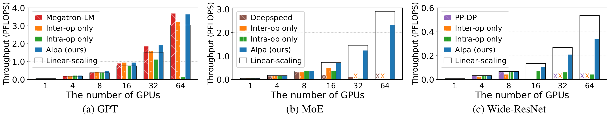

*图 7（原文 Figure 7，第 11 页）：端到端评估结果。“×”表示显存溢出（out-of-memory）。黑色方框表示线性扩展。*

**图中文字翻译与读法**：

- **坐标轴**：三个子图的横轴都是 The number of GPUs（GPU 数：1、4、8、16、32、64），纵轴是 Throughput (PFLOPS)（整个集群的聚合吞吐，PFLOPS，越大越好）。纵轴范围：（a）0 到 4.0，（b）0 到 3.0，（c）0 到 0.6。每个 GPU 数上并排的几根柱子：
  - **(a) GPT**：Megatron-LM（红）、Inter-op only（橙）、Intra-op only（绿）、Alpa (ours)（蓝）、Linear-scaling（黑框）；
  - **(b) MoE**：Deepspeed（棕）、Inter-op only（橙）、Intra-op only（绿）、Alpa (ours)（蓝）、Linear-scaling（黑框）；
  - **(c) Wide-ResNet**：PP-DP（紫）、Inter-op only（橙）、Intra-op only（绿）、Alpa (ours)（蓝）、Linear-scaling（黑框）。
- 黑框是线性扩展参考线（从图上看约等于单卡吞吐乘以 GPU 数）。柱子超出黑框，说明比线性扩展还好（超线性）。
- 每种模型在不同 GPU 数上训练不同规模的模型（见表 4、表 6 到表 8），所以这是 weak scaling。

**近似读数**（从图上量出来的聚合吞吐，PFLOPS，读图误差约 ±0.03，仅供比较相对大小；“OOM”表示图中标了 ×）：

| 模型 | GPU 数 | 基线 | Inter-op only | Intra-op only | Alpa |
|---|---|---|---|---|---|
| GPT | 16 | Megatron-LM 约 0.88 | 约 0.93 | 约 0.74 | 约 0.93 |
| GPT | 32 | Megatron-LM 约 1.84 | 约 1.57 | 约 1.10 | 约 1.90 |
| GPT | 64 | Megatron-LM 约 3.67 | 约 3.22 | 约 0.11 | 约 3.63 |
| MoE | 16 | DeepSpeed 约 0.19 | 约 0.48 | 约 0.34 | 约 0.70 |
| MoE | 32 | DeepSpeed 约 0.10 | OOM | 约 0.03 | 约 1.23 |
| MoE | 64 | OOM | OOM | 接近 0 | 约 2.32 |
| Wide-ResNet | 16 | PP-DP 接近 0 | 接近 0 | 约 0.07 | 约 0.10 |
| Wide-ResNet | 32 | OOM | OOM | 约 0.06 | 约 0.21 |
| Wide-ResNet | 64 | OOM | OOM | 约 0.04 | 约 0.34 |

线性扩展参考线在 64 GPU 处约为：GPT 3.05、MoE 2.9、Wide-ResNet 0.54（同为读图近似值）。

**GPT-3 结果**：GPT-3 的并行方案已被充分研究。Megatron-LM 在最佳网格搜索参数的手工方案下实现了**超线性**的 weak scaling。相比之下，Alpa 自动生成执行计划，并在若干设置下取得略好的扩展性。只用算子内并行的方案与近期研究一致，在超过 16 块 GPU（即 32、64 块）时表现很差，因为即使最优方案也必须在跨节点连接上大量通信，通信成为瓶颈。令人意外的是，“Inter-op only”表现很好，在多达 64 块 GPU 上保持了线性扩展。

作者进一步比较了 Megatron-LM 网格搜索得到的最佳手工参数与 Alpa 生成的方案，有两个主要发现：

1. 在 Megatron-LM 中，最佳手工方案的 TMP 取 1，只有少数情况例外，例如在 64 块 GPU 上放下 39B 模型时，仅靠流水线并行已无法把一个 stage 放进 GPU 内存；与此同时，只要内存允许，数据并行度就取到最大。实践中会开启梯度累积（GA）来达到所需的全局 batch size（本文设置为 1024）。GA 摊薄了数据并行的通信，也减少了流水线气泡，但 TMP 的通信量随 GA 步数线性增长，这使 TMP 处于劣势。
2. Alpa 生成的方案与 Megatron-LM 中表现最好的方案非常相似：（1）各 stage 大小均匀；（2）内存不紧张时在 stage 内沿 batch 维切分，内存紧张时沿非 batch 维切分。一个关键差别是：当存在数据并行时，Alpa 还会切分权重更新算子，这带来了相对 Megatron-LM 的小幅性能提升。这是因为 Alpa 作为通用编译器系统能组合多种并行方式，而 Megatron-LM 当时不支持 weight update sharding。

**MoE 结果**：DeepSpeed 对 MoE 采用 GShard 提出的手工算子并行方案“专家并行”（expert parallelism），规则很简单：对 MoE 层里的算子切分专家轴，对非专家层则切回数据并行。这套专家并行再与 ZeRO 数据并行以及 TMP 组合。它们全都属于算子内并行；DeepSpeed 的专用实现没有包含任何算子间并行，而在跨节点带宽较低时扩展到多节点必须用到算子间并行，所以 DeepSpeed 在这个集群上只在节点内（不超过 8 块 GPU）保持良好性能。“Intra-op only”因同样的原因无法跨节点扩展。“Inter-op only”在 32 和 64 块 GPU 上显存溢出，因为当 GPU 数大于模型层数时很难均匀切分模型，不均衡的切分使一些占内存大的 stage 溢出。

相比之下，Alpa 自动发现了结合算子内与算子间并行的最优执行计划。算子内部分，得益于基于 ILP 的 intra-op pass，Alpa 找到了与专家并行类似的策略，并与 ZeRO 数据并行结合；然后构造 stage，利用算子间并行来减少慢速连接上的通信量。Alpa 在 16 块 GPU 上保持线性扩展，并能较好扩展到 64 块。相比 DeepSpeed，Alpa 在 2 个节点上快 3.5 倍，在 4 个节点上快 9.7 倍。

**Wide-ResNet 结果**：与前两类堆叠相同层的模型不同，Wide-ResNet 的架构更加异构：数据 batch 前向通过各层时，activation 张量变小而权重张量变大，使各层的内存占用与计算强度分布不均衡。这类模型很难（甚至不可能）手工设计并行方案。即便如此，Alpa 仍在 32 块 GPU 上实现了可扩展的性能，扩展效率达到 80%（读图：Alpa 约 0.21 对线性参考线约 0.27，比值约 0.78，与原文相符）。基线“PP-DP”与“Inter-op only”在训练大模型时显存溢出，因为它们无法切分权重来降低内存占用，也难以构造内存均衡的 stage；“Intra-only”需要在慢速连接上大量通信，所以无法跨多个节点扩展。

**读图结论**：在这个集群（V100、节点内 NVLink、跨节点 25 Gbps）与 weak scaling 设置下：（1）GPT 上，Alpa 自动生成的方案与专门为它设计的 Megatron-LM 相当；（2）MoE 上，只有把算子内与算子间并行组合才能跨节点扩展，且 Alpa 大幅领先手工系统；（3）Wide-ResNet 上，别的方案要么爆显存要么无法跨节点，只有 Alpa 能扩展到 64 块 GPU。

### 8.2 算子内并行消融（图 8）

这组实验检验 intra-op pass 的 ILP 是否真的优于规则式或 ZeRO 方案。

**实验设置**：与 8.1 类似做模型规模的 weak scaling，但**关闭流水线并行与梯度累积**以控制变量。实验在一台 AWS p3.16xlarge（8 块 GPU）上进行。为了在单节点内模拟大规模训练的执行环境，使用比 8.1 更大的隐藏维度、更小的 batch size 和更少的层数。

**基线**：“Data”是普通数据并行；“ZeRO-2”是数据并行的省内存版本，切分梯度和优化器状态；“ZeRO-3”在 ZeRO-2 基础上还切分参数；“Heuristic”用一条规则结合 GSPMD 里的 sharding 传播：把每个输入张量的最大维度标记为被切分，再运行 sharding 传播得到图中所有节点的 sharding spec；“ILP”是 Alpa 基于 ILP 求解器的方案。

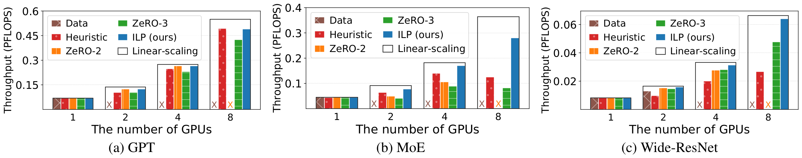

*图 8（原文 Figure 8，第 12 页）：算子内并行消融实验。“×”表示显存溢出，黑色方框表示线性扩展。*

**图中文字翻译与读法**：

- 三个子图 (a) GPT、(b) MoE、(c) Wide-ResNet，横轴 The number of GPUs（1、2、4、8），纵轴 Throughput (PFLOPS)。图例：Data（棕）、Heuristic（红）、ZeRO-2（橙）、ZeRO-3（绿）、ILP (ours)（蓝）、Linear-scaling（黑框）。
- 读图近似值（8 块 GPU 处，PFLOPS）：GPT 上 Heuristic 约 0.49、ZeRO-3 约 0.42、ILP 约 0.49（Data 与 ZeRO-2 显存溢出）；MoE 上 Heuristic 约 0.12、ZeRO-3 约 0.08、ILP 约 0.28；Wide-ResNet 上 Heuristic 约 0.026、ZeRO-3 约 0.047、ILP 约 0.064。
- **读图结论**：Data 很快显存溢出，无法训练大模型；ZeRO-2 与 ZeRO-3 解决了数据并行的显存问题，但它们总是通信梯度而不优化通信，当梯度远大于 activation 时性能退化；Heuristic 通过切分所有张量解决了显存问题，但可能被更大的通信拖慢；ILP 在各个点上都是最好或与最好者几乎持平（例如 GPT 的 8 GPU 点上与 Heuristic 几乎相同），并保持近线性扩展，因为它找到了总是使通信开销最小的切分方案。原文在文字里把这个方案称为“Auto-sharding”。

### 8.3 算子间并行消融（图 9）

**实验设置**：在 GPT 和 Wide-ResNet 上报告 DP 算法三种变体的性能，基准设置与 8.1 相同。

**基线**：“Equal operator”关闭 DP 的算子聚类，而是给每个聚类分配相同数量的算子；“Equal layer”限制 DP 算法让所有 stage 使用相同数量的层；“DP (ours)”是完整算法。

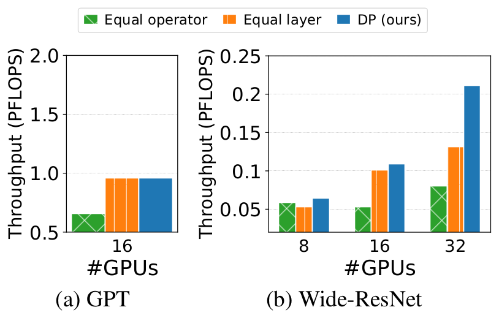

*图 9（原文 Figure 9，第 12 页）：算子间并行消融实验。*

**图中文字翻译与读法**：

- 图例：Equal operator（按算子数均分，绿）、Equal layer（按层数均分，橙）、DP (ours)（本文 DP，蓝）。(a) GPT 只有 16 GPU 一组，(b) Wide-ResNet 有 8、16、32 GPU 三组；横轴 #GPUs，纵轴 Throughput (PFLOPS)。**注意**：两个子图的纵轴都不是从 0 开始（GPT 子图从 0.5 起，Wide-ResNet 子图从约 0.02 起），柱高与数值不成正比，要看数值。
- 读图近似值（PFLOPS）：GPT 16 GPU：Equal operator 约 0.65，Equal layer 与 DP 都约 0.95。Wide-ResNet：8 GPU 时三者约 0.057、0.051、0.063；16 GPU 时约 0.051、0.099、0.107；32 GPU 时约 0.079、0.130、0.210。
- **读图结论**：DP 始终优于 Equal operator，因为 Equal operator 会把本应放到不同 device mesh 的算子合并到一起，而 Alpa 的算法能依据通信代价与计算均衡来聚类。DP 能否优于 Equal layer 取决于模型结构：在 GPT 这类同构模型上，DP 的解对所有 stage 使用相同层数，所以 Equal layer 与 DP 表现相同；在 Wide-ResNet 上，最优解可以给不同 stage 分配不同层数，所以 Equal layer 比完全灵活的 DP 差。在 32 块 GPU 的 Wide-ResNet 上，Alpa 的算法分别比 Equal operator 和 Equal layer 好 2.6 倍和 1.6 倍（原文数字；与读图结果 0.210/0.079 与 0.210/0.130 一致）。

### 8.4 编译时间（表 5、图 10）

图 10 显示 Alpa 在 8.1 所有 GPT 设置下的编译时间，每个点是用给定的 microbatch 数 $B$ 完整运行一次 Algorithm 1 的耗时。结果表明，编译时间随模型大小与集群 GPU 数大致线性增长，因此 Alpa 能较好地扩展到大模型或大集群。

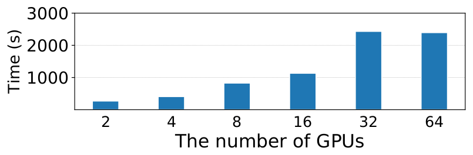

*图 10（原文 Figure 10，第 13 页）：Alpa 在所有 GPT 模型上的编译时间；模型大小与 GPU 数同时按比例增大。*

**图中文字翻译与读法**：横轴 The number of GPUs（2、4、8、16、32、64），纵轴 Time (s)（秒，0 到 3000）。读图近似值：2、4、8、16 块 GPU 时约 240、380、800、1100 秒；32 与 64 块 GPU 时都约 2400 秒（64 GPU 点与表 5 的 2393.26 秒一致）。读图结论：编译时间从小到大增长，64 GPU 的 39B 模型约 40 分钟。原文表 6 的最小 GPT 配置是 1 块 GPU，而图 10 的横轴从 2 开始，原文没有解释这一差异。

**表 5：GPT-39B（64 GPU）编译时间分解**

| 步骤 | 本文（Ours） | 不做优化（w/o optimization） |
|---|---|---|
| Compilation（编译） | 1582.66 s | > 16 hr |
| Profiling（性能测量） | 804.48 s | > 24 hr |
| Stage Construction DP（stage 构造 DP） | 1.65 s | N/A |
| Other（其他） | 4.47 s | N/A |
| Total（合计） | 2393.26 s | > 40 hr |

（原文表 5，第 13 页。）读法：大部分时间花在枚举 stage-mesh 配对并 profile 它们上。编译部分用分布式 worker **并行编译**不同 stage 来加速；profile 部分则用一个在 XLA 指令级别构建的简单代价模型加速，它用**分段线性模型**估计矩阵乘与通信原语的代价。有了这些优化，一个模型的编译与搜索至多需要几小时，原文认为这可以接受，因为远短于可能长达数周的真实训练时间。DP 本身只要 1.65 秒，说明开销全在“造表”（ILP、编译、profile）阶段。

### 8.5 跨 mesh 重分片（图 11）

**实验设置**：在 Wide-ResNet 上评估 6.1 节提出的 local all-gather 优化在不同形状 mesh 之间的跨 mesh 重分片效果。“signal send/recv”是一个合成情形：stage 之间只发送 1 个字节的信号，可以看作性能上界；“w/o local all-gather”关闭 local all-gather 优化，只用 send/recv；“w/ local all-gather”开启优化，把更多通信从慢速连接移到快速的本地连接上。

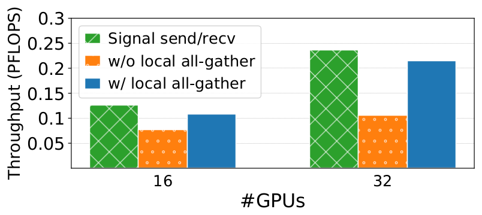

*图 11（原文 Figure 11，第 13 页）：Wide-ResNet 上的跨 mesh 重分片。*

**图中文字翻译与读法**：横轴 #GPUs（16、32），纵轴 Throughput (PFLOPS)。图例：Signal send/recv（只发 1 字节信号的上界，绿）、w/o local all-gather（不用 local all-gather，橙）、w/ local all-gather（使用 local all-gather，蓝）。读图近似值：16 GPU 时分别约 0.124、0.075、0.106；32 GPU 时约 0.234、0.104、0.213。读图结论：local all-gather 在 32 块 GPU 上带来 2.0 倍加速（原文数字），并且已经接近只发信号的上界（约为上界的 91%，读图估算）。

### 8.6 案例分析：Wide-ResNet（图 12、图 13）

作者可视化了 Alpa 在 Wide-ResNet 上找到的并行策略。

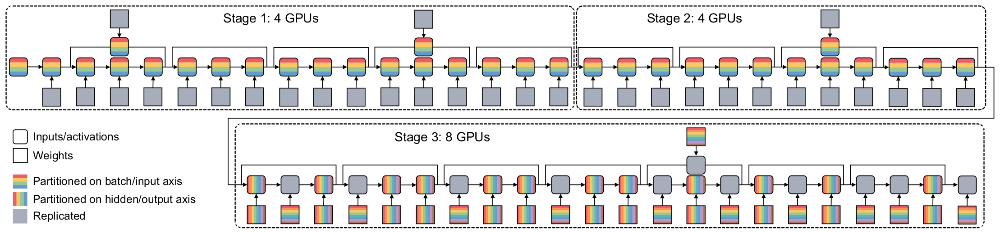

*图 12（原文 Figure 12，第 14 页）：Wide-ResNet 在 16 块 GPU 上的并行策略可视化。不同颜色表示张量分布在哪些设备上；灰色块表示张量在这些设备上是复制的。每个卷积与全连接层的输入数据和输出 activation 可沿 batch 轴与隐藏轴切分，权重可沿输入与输出通道轴切分。*

**图中文字翻译与读法**：

- **图例**：圆角方框为 Inputs/activations（输入/激活），方框为 Weights（权重）；彩色条纹方块中，横向条纹为 Partitioned on batch/input axis（沿 batch/输入轴切分），纵向条纹为 Partitioned on hidden/output axis（沿隐藏/输出轴切分），灰色为 Replicated（复制）；颜色代表所在的设备。
- 整个模型被切成 3 个 stage：Stage 1 用 4 块 GPU，Stage 2 用 4 块 GPU，Stage 3 用 8 块 GPU（共 16 块）。
- Stage 1 与 Stage 2：所有 activation 沿 batch 轴切分（横条纹），权重全部灰色（复制），也就是**纯数据并行**。原因是前面的层 activation 张量比权重大。
- Stage 3：activation 在“复制（灰）”与“沿隐藏轴切分（纵条纹）”之间交替，权重有的沿输入轴、有的沿输出轴切分。原文说，ILP 求解器找到了一种非平凡的卷积切分方式。
- **读图结论**：对 Wide-ResNet 这类异构模型，人工设计这样的策略即使对领域专家也很不透明；Alpa 自动给出了不同 stage 用不同 GPU 数、不同并行方式的方案。

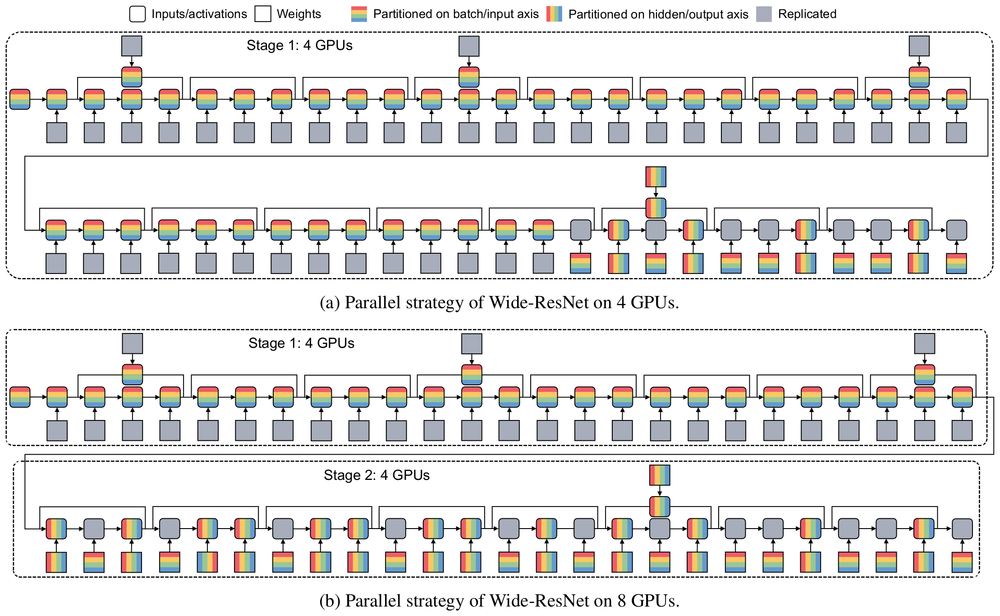

*图 13（原文 Figure 13，附录第 20 页）：Wide-ResNet 在 4 块与 8 块 GPU 上的并行策略可视化。图例与图 12 相同。*

**图中文字翻译与读法**：（a）4 块 GPU：只有 1 个 stage（Stage 1: 4 GPUs），即只用算子内并行：前面的几十层沿 batch 轴切分（横条纹，权重复制），最后几层转而沿通道轴切分（纵条纹）。（b）8 块 GPU：2 个 stage，各用 4 块 GPU（Stage 1: 4 GPUs、Stage 2: 4 GPUs），第一个 stage 为沿 batch 轴的数据并行，第二个 stage 里有沿隐藏轴切分的部分。原文正文只描述了 4 块与 16 块 GPU 的方案，8 块 GPU 的方案只在图中给出，没有逐条说明。

## 九、局限、证据边界与常见误读

### 9.1 相对手工 3D 并行的三点灵活性（原文第 7 节）

与手工组合数据、算子、流水线并行的 3D parallelism 和 PTD-P 相比，Alpa 的分层视角有三点灵活性：（1）流水线 stage 可以含有不均匀数量的算子或层；（2）流水线 stage 可以映射到形状不同的 device mesh；（3）在每个 stage 内，数据并行与算子并行的配置按算子逐个非均匀地定制。三者合起来使 Alpa 能统一已有的所有模型并行方法，并泛化到更异构的模型架构和集群设置。

### 9.2 原文承认的局限

- **不建模 stage 之间的通信代价**：因为跨 stage 通信按设计本来就小。在 DP 或 ILP 里建模是可行的，但需要枚举指数级更多的 intra-op pass 和 DP 状态。
- **microbatch 数 $B$ 是超参数**：当前公式不优化它，但可以通过枚举来搜索。
- **静态线性调度**：inter-op pass 用静态的线性调度建模流水线并行，没有考虑更动态的调度，例如把计算图里不同的分支并行到不同设备上。
- **不优化计算与通信的重叠**；Alpa 只能处理所有张量形状在编译时已知的**静态计算图**。

作者认为 weak scaling 的结果表明 Alpa 能为许多重要模型生成接近最优的执行计划。

### 9.3 阅读证据时的注意点（本文的补充，非原文表述）

- 分层求解**不保证全局最优**；ILP 里计算代价被设为 0，实际比较的是通信量；层间 DP 假设 stage 间通信可忽略。这些近似在 V100 集群上的实验中表现很好，但换成别的算力/带宽比（例如机间带宽高很多、或算力更强的 GPU）后，结论（尤其是“GPT 上 Inter-op only 也能线性扩展”）需要重新验证。
- 图 7 到图 9 比较的是 weak scaling 下的聚合 PFLOPS，不同 GPU 数的模型不同，不能直接当作 tokens/s 比较。
- “Alpa 与 Megatron-LM 持平”指的是：在 Megatron-LM 为之设计的 GPT 上，自动搜索达到了手工方案的水平；它不意味着 Alpa 在 GPT 上有明显优势。Alpa 的优势在没有现成手工方案的模型（MoE 的跨节点扩展、Wide-ResNet）上。
- Alpa 的搜索与编译耗时不可忽略（39B 模型、64 GPU 约 2393 秒），虽然相对训练时间可以接受。
- 图 9 的纵轴被截断，柱高的视觉比例不等于数值比例。
- 图 7 的黑框是线性扩展参考线，GPT 上 Alpa 与 Megatron-LM 的柱子高出黑框（超线性 weak scaling）。原文只指出 Megatron-LM 取得了超线性扩展，没有分析原因；由于每个 GPU 数对应的模型不同，这个“超线性”不能理解为同一个模型被加速了超过 GPU 倍数。

## 十、复现检查清单

- 软件栈：Jax（前端）、XLA 与 GSPMD（后端编译）、Ray（运行时 worker）、NCCL（通信）、CBC（ILP 求解器，参考文献 [18]）。
- 硬件与网络：8 台 p3.16xlarge（每台 8 块 V100 16 GB，节点内 NVLink）、同一 placement group、跨节点 25 Gbps。
- 模型规格见表 6 到表 8，batch size 见表 4；每个模型和系统配置要调 microbatch 大小；梯度在 microbatch 间累积。
- 记录并保存：stage 边界、每个 stage 的 submesh 形状与逻辑网格形状、每个算子的 sharding spec、microbatch 数 $B$、流水线调度（synchronous 1F1B）。
- 内存可行性检查按 Eq. 5（$\mathrm{mem}_{\text{stage}}+s\cdot\mathrm{mem}_{\text{act}}\le\mathrm{mem}_{\text{device}}$）。
- 搜索参数：early pruning 的 $\varepsilon=10^{-6}$ 秒；operator clustering 的 $L$ 与 $\delta$ 原文未给具体值，只说明 $L$ 取较小值且不敏感。
- 区分三类耗时：ILP + 编译 + profile（表 5）、DP 本身、稳态训练。
- 基线的网格搜索：Megatron-LM 的三个并行度、DeepSpeed 的并行度参数都要搜索并取最佳。
- 正确性：Alpa 不改变同步梯度下降语义，所以梯度累积、随机数和优化器更新应与未切分语义一致。

## 十一、与相关论文的关系

- **GSPMD**（[中文解读](../gspmd/论文中文解读.md)）：Alpa 的 mesh 内编译依赖 XLA 与 GSPMD，ILP 选出的 sharding spec 由 GSPMD 生成 SPMD 可执行程序并插入集合通信；8.2 的 “Heuristic” 基线就是 GSPMD 的 sharding 传播加一条规则。GSPMD 需要用户标注 sharding，Alpa 把“怎么标”自动化。
- **XLA**（[中文解读](../xla_compiler/论文中文解读.md)）：模型图用 XLA 的 HLO 表示，不到 80 个基本算子，Alpa 手工枚举每个算子的并行算法。
- **GPT-3、GShard/MoE**（[GPT-3](../openai_gpt3/论文中文解读.md)、[Sparsely-Gated MoE](../sparsely_gated_moe/论文中文解读.md)、[Switch Transformers](../switch_transformers/论文中文解读.md)）：本文的两类评估模型；MoE 的“专家并行”是手工的算子内并行方案。
- **Megatron-LM / DeepSpeed / ZeRO**：手工 3D 并行与 ZeRO；Alpa 把它们视作算子内并行（数据并行、算子并行、weight update sharding）与算子间并行（流水线）的组合，并自动搜索。
- **其他自动并行工作**：Tofu 用 DP 为单节点线性图找最优算子内策略；FlexFlow 提出 SOAP 空间并用 MCMC 随机搜索，只支持设备放置而没有流水线并行，搜索不能扩展到大图且没有最优性保证；TensorOpt 用 DP 搜索兼顾内存与计算代价的算子内策略；Varuna 面向低带宽集群、自动化流水线与数据并行；Piper 同时找算子间与算子内策略，但依赖手工设计的算子内策略、均匀网络拓扑和异步流水线调度。Google 的 Pathways 与 Alpa 是同期工作，提倡结合 SPMD 与 MPMD 的单控制器运行时架构，与 Alpa 的运行时思路相似（SPMD 用于算子内，MPMD 用于算子间）。
- **后续系统论文**（[Ascend CloudMatrix384](../ascend_cloudmatrix384/论文中文解读.md)、[DeepSeek-V3](../deepseek_v3/论文中文解读.md)）：展示生产系统如何在并行策略中加入 MoE、prefill/decode 分离等专用约束；它们不在 Alpa 的搜索空间之内，此处只作为同一仓库里的阅读衔接。

## 原文证据导航

- [原论文 PDF](paper.pdf)
- [原文提取文本](paper.txt)
- [论文概要](论文概要.md)
