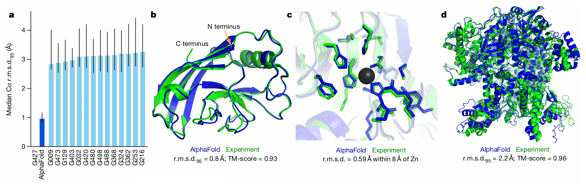
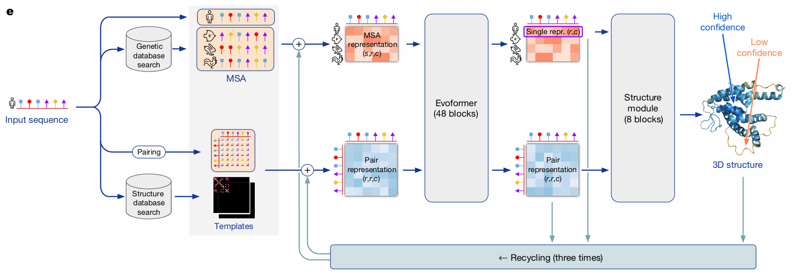
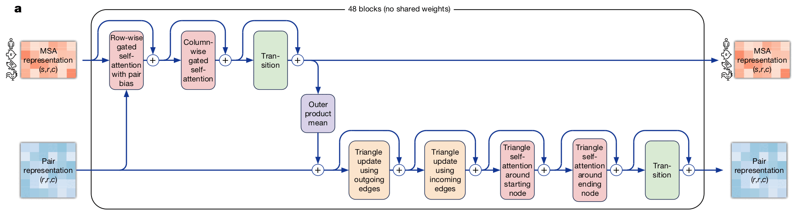
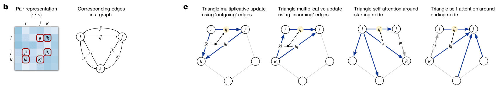
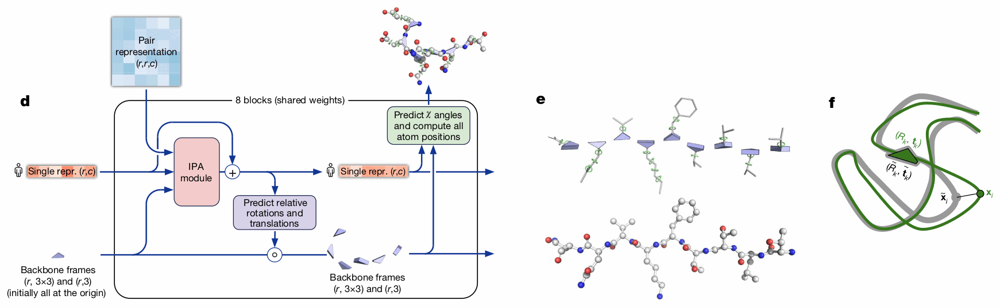
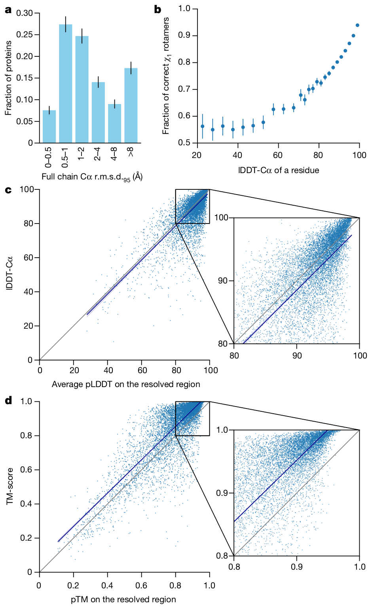
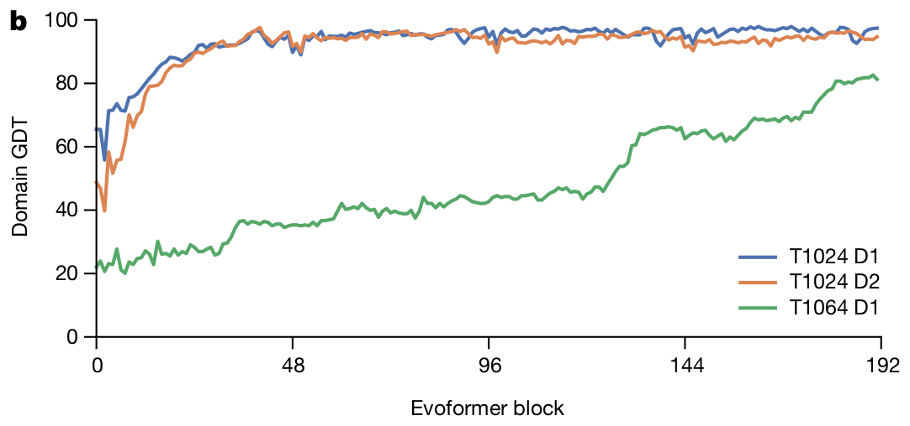
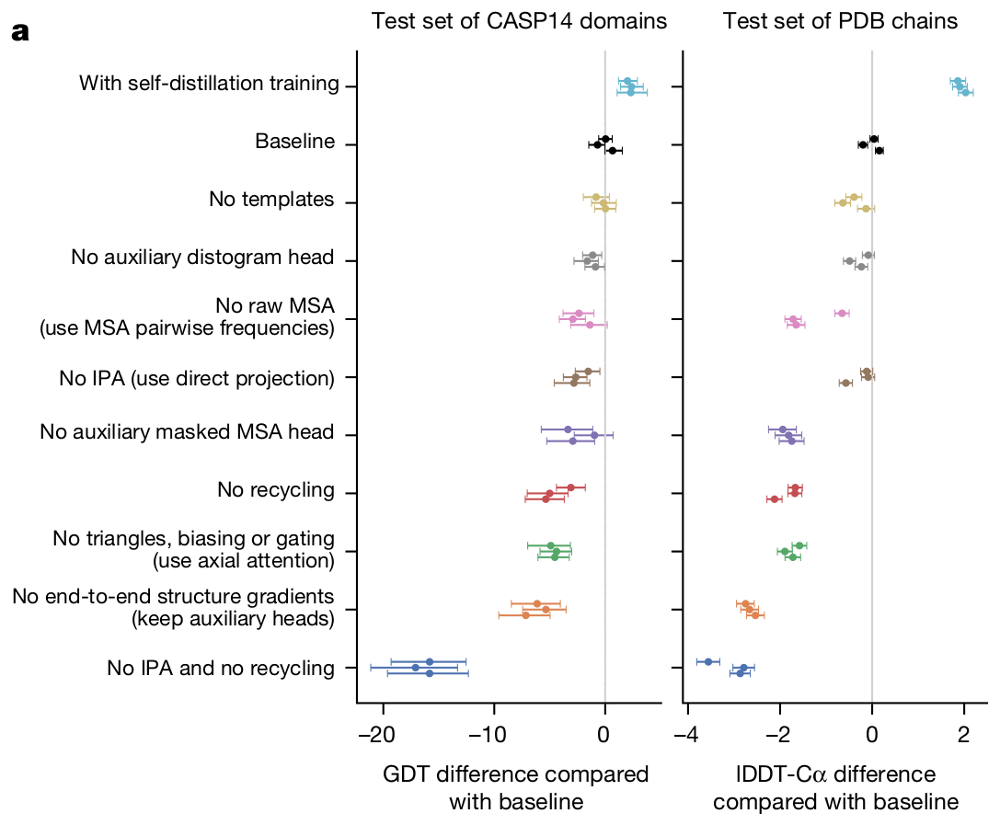
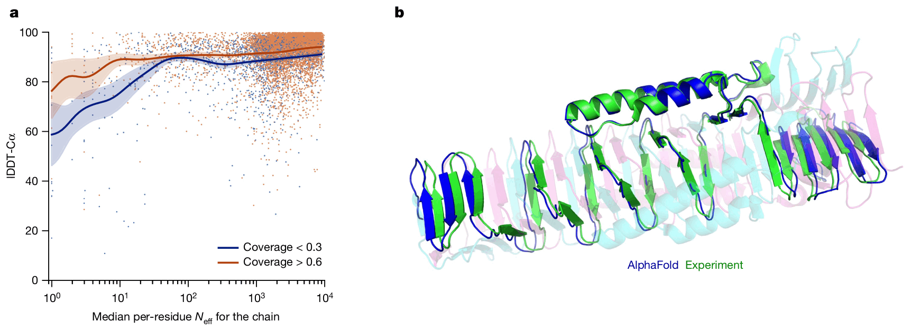

# 论文中文解读：《Highly accurate protein structure prediction with AlphaFold》

> **基本信息**：John Jumper、Richard Evans、Alexander Pritzel、Tim Green、Michael Figurnov 等 34 位作者（DeepMind，伦敦；Martin Steinegger 另隶属首尔国立大学；通讯作者 John Jumper、Demis Hassabis），《Nature》第 596 卷第 583–589 页（2021 年 8 月 26 日刊出；2021-05-11 收稿，2021-07-12 接受，2021-07-15 在线发表），开放获取，doi:[10.1038/s41586-021-03819-2](https://doi.org/10.1038/s41586-021-03819-2)。
>
> **资料范围（请先读）**：本地 `paper.pdf` 共 12 页。第 1–7 页是正文（第 7 页后半是参考文献 1–58），第 8–9 页是 Methods（含数据可用性），第 10 页是代码可用性的结尾、参考文献 59–84、致谢与作者贡献，第 11–12 页是 Nature 的 Reporting Summary。**Supplementary Information（补充方法 Supplementary Methods 1.1–1.16、算法伪代码 Algorithms 1–32、补充图表和视频）不在这份 PDF 里**，所以网络每一层的精确公式、超参数、各项损失的权重只能在补充材料里查到。本文把这类内容集中写在第十三节“正文没给出的细节”，其余各节只讲 PDF 里确实写了的东西；个别为帮助理解而加的示意式和推导，会明确标注“不是原文的公式”。
>
> **本文的读法**：图均取自论文原文，是从 PDF 页面按图裁出的原图（图 1 和图 3 因版面分成几张，子图标号与原文一致），每张图后有中文图题、图中文字翻译和读图结论。这篇论文的正文和 Methods 里没有正式的表格（Methods 里出现的 “Supplementary Table 1–6” 都是指向补充材料的引用，见第十三节），因此本文的表格都是把原文正文、Methods 或图中的数字整理成中文表，并注明来源页；从图上读出的数值一律写“约”。

## 一、一句话结论

只凭氨基酸序列预测蛋白质的三维结构，是一个超过 50 年的开放难题。AlphaFold 把它做成一个端到端的神经网络：输入目标序列、由同源序列组成的多序列比对（MSA）和少量同源模板结构，先用 48 个 **Evoformer** 块让“MSA 表示”和“残基对表示”反复交换信息，再用 8 个 **structure module** 块为每个残基维护一个刚体坐标系（frame），直接输出所有重原子的三维坐标；整个网络还把自己的输出送回输入再算几遍（**recycling**）。

在 2020 年的盲测 CASP14 上，AlphaFold 的中位主链精度是 0.96 Å（Cα r.m.s.d.95），次优方法是 2.8 Å；全原子精度 1.5 Å 对 3.5 Å。这种高精度在 CASP14 之后发布的一批 PDB 新结构上同样成立（整链中位 Cα r.m.s.d.95 为 1.46 Å），并且网络能给出可靠的逐残基置信度（pLDDT）。局限：MSA 太浅（中位深度低于约 30 条序列）时精度明显下降；对需要靠其他链才能成形的蛋白（异源复合体里异链接触很多）预测较弱。

## 二、背景与前置知识

### 2.1 问题有多大

蛋白质由氨基酸链折叠成特定的三维结构，结构决定功能。链上的每个氨基酸称为一个**残基**（residue）。靠实验测定一个蛋白的结构往往要数月到数年，原文摘要说，已测定结构的不同蛋白约 10 万种，而已知的蛋白序列有数十亿条。“预测一个蛋白仅凭氨基酸序列会折叠成什么三维结构”是蛋白质折叠问题（protein folding problem）的结构预测部分；摘要指出，已有方法离原子级精度还差得远，在没有已知同源结构时尤其如此。

### 2.2 两条传统路线（原文第 1 页）

- **物理相互作用路线**（physical interaction programme）：把分子驱动力的知识放进热力学或动力学模拟，或它们的统计近似。理论上很有吸引力，但对中等大小的蛋白也极其困难：分子模拟的计算不可行，蛋白稳定性依赖上下文，很难得到足够准确的蛋白物理模型。
- **进化历史路线**（evolutionary programme）：从蛋白的进化历史做生物信息学分析，得到对结构的约束，例如与已解析结构的同源性（homology）、残基对之间的成对进化相关性。这条路线受益于 PDB（Protein Data Bank，蛋白质结构数据库）里实验结构的稳步增长、基因组测序的爆发和深度学习的发展。

两条路线在“没有已解析近亲同源蛋白”的多数情形下，预测都远未达到实验精度，限制了它们在生物学中的用途。原文在讨论部分把 AlphaFold 定位为两者的结合：用物理和几何的归纳偏置（inductive bias）搭建能从 PDB 数据里学习的部件，同时尽量少地人为施加手工特征，例如它不用氢键打分函数也能有效地建出氢键。

### 2.3 CASP 盲测

CASP（Critical Assessment of protein Structure Prediction，蛋白质结构预测关键评估）每两年举办一次，用刚刚解出、但尚未存入 PDB 或公开的结构当考题，所以对参赛方法是盲测，长期被视为评价结构预测精度的金标准。AlphaFold 以队名 “AlphaFold2” 参加了 CASP14（2020 年 5–7 月），它是一个与 CASP13 时的 AlphaFold 系统（文献 10）完全不同的新模型。

### 2.4 前置概念速查

下表是帮助读者理解后文的通用背景（不是原文的论断）：

| 术语 | 含义 | 在本文里的作用 |
|---|---|---|
| 残基 residue、$N_{\mathrm{res}}$ | 蛋白链上的一个氨基酸；$N_{\mathrm{res}}$ 是目标蛋白的残基数 | 图中 r 表示残基数 |
| 主链 backbone、侧链 side chain | 主链由每个残基的 N、Cα、C 等原子连成；侧链挂在 Cα 上，种类决定氨基酸类型 | 主链朝向决定侧链位置（见第六节） |
| χ 角（torsion angle） | 侧链各化学键的二面角 | structure module 预测 χ 角来搭出侧链原子 |
| 肽键 | 相邻残基间的化学键 | AlphaFold 在迭代中会暂时“拆开”链（见第六节） |
| MSA（多序列比对） | 把目标序列与其同源序列对齐成矩阵：行是不同序列，列是目标序列的各残基位置 | 进化信息的来源；图中 s 表示序列数 $N_{\mathrm{seq}}$ |
| 共进化 / 协变 | 在三维结构里相互接近的两个位置，进化中倾向于一起发生变化 | “残基对之间的进化相关性”是进化路线的核心信号 |
| 模板 template | 同源蛋白中已解析的三维结构 | 网络的第三类输入 |
| 刚体 frame $(R,t)$ | 一个旋转矩阵 $R$ 加一个平移向量 $t$，表示一个局部坐标系在全局空间里的位置和朝向 | 每个残基一个 frame（见第六节） |
| 不变（invariant）/ 等变（equivariant） | 对整体旋转平移，输出不变称“不变”；输出随之做同样的旋转平移称“等变” | IPA 不变，frame 的更新等变 |
| 同聚体 homomer / 异聚体 heteromer | 由相同链 / 不同链组成的复合体 | 第十二节的局限 |

### 2.5 评价指标（原文 Methods “Metrics” 与正文）

| 指标 | 原文的说明 |
|---|---|
| lDDT、lDDT-Cα | 局部距离差异检验（local distance difference test），不需要先把链切成结构域，因此能直接报告域精度。lDDT 用所有重原子之间的距离，lDDT-Cα 只用 Cα 原子来衡量主链精度；后者只关注 Cα，不包含对结构违规和原子冲突的惩罚 |
| GDT | 全局距离检验（global distance test），CASP 里报告结构域精度所用 |
| TM-score | 模板建模分数（template modelling score），用作整条链的全局叠合指标 |
| r.m.s.d.95 | Cα 在 95% 覆盖率下的均方根偏差：先用全部 Cα 做最小二乘叠合，再选出对齐误差最小的 95% 的 Cα，重新叠合，如此做 5 轮，最后一轮选中原子的 r.m.s.d. 就是 r.m.s.d.95。它对晶体结构的伪影更稳健，代价是被剔掉的 5% 残基里可能含有真实的建模错误 |
| pLDDT | 网络预测的逐残基 lDDT-Cα（predicted lDDT），是网络给自己的置信度 |
| pTM | 网络预测的 TM-score，由最终 pair 表示的线性投影得到的成对误差预测算出 |

## 三、核心结果：CASP14 上的精度（图 1a–d）

*图 1a–d（原文 Figure 1，第 2 页；e 见第四节）：a，CASP14 各队的中位 Cα r.m.s.d.95；b–d，三个目标的预测结构（蓝）与实验结构（绿）叠合。*

**图中文字翻译与读法**：

- **a 图**：纵轴 Median Cα r.m.s.d.95 (Å)（Cα r.m.s.d.95 的中位数，单位 Å，越小越好）。数据是 CASP14 数据集的 87 个蛋白结构域，比较 AlphaFold 与排名前 15 的参赛条目（共 146 个条目），横轴的 G009、G473 等是 CASP 给各队分配的组号。柱高和误差棒是中位数及其 95% 置信区间，由 10,000 次自助法（bootstrap）估计。最左的深蓝柱是 AlphaFold（图中同时标有 G427，应为它的组号，原文图注没有单独说明），约 0.96 Å；其余 14 个组的柱为浅蓝，从约 2.8 到约 3.3 Å（从图上读出）。
- **b 图**：CASP14 目标 T1049（PDB 6Y4F）。蓝色是预测、绿色是实验结构，标注 N terminus（N 端）、C terminus（C 端）；$\text{r.m.s.d.}_{95}=0.8$ Å，TM-score = 0.93。图注说明实验结构 C 端的四个残基是 B 因子离群值，因此图中没有画出。
- **c 图**：CASP14 目标 T1056（PDB 6YJ1）的一个锌结合位点，标注 r.m.s.d. = 0.59 Å（锌周围 8 Å 内的原子）。图注指出，AlphaFold 并没有显式预测锌离子，但侧链仍然很准。
- **d 图**：CASP14 目标 T1044（PDB 6VR4），一条 2,180 个残基的单链，预测的结构域堆积是正确的；$\text{r.m.s.d.}_{95}=2.2$ Å，TM-score = 0.96。图注说明这一条是在 CASP 之后用 AlphaFold 在没有人工干预的情况下做出的预测。
- **读图结论**：在盲测的结构域层面，AlphaFold 的中位误差约为次优方法的三分之一（0.96 对 2.8 Å），它的置信区间与其余各队的置信区间不重叠；b、c、d 说明它不仅主链准，侧链和超长链的结构域堆积也可以准。

按文末参考文献的编号，原文展示的几个 PDB 结构分别对应：6Y4F（MrpH 金属结合粘附素，文献 77）、6YJ1（葡萄球菌噬菌体内溶素的 M23 肽酶结构域，文献 78）、6VR4（crAss 样噬菌体的病毒体 RNA 聚合酶，文献 79）。

**主要数字（整理自原文第 2 页正文）**：

| 指标（CASP14，结构域层面的中位数） | AlphaFold | 次优方法 |
|---|---|---|
| 主链精度：Cα r.m.s.d.95 | 0.96 Å（95% 置信区间 0.85–1.16 Å） | 2.8 Å（95% 置信区间 2.7–4.0 Å） |
| 全原子精度：all-atom r.m.s.d.95 | 1.5 Å（95% 置信区间 1.2–1.6 Å） | 3.5 Å（95% 置信区间 3.1–4.2 Å） |

读法：作为对比，原文说一个碳原子的宽度约为 1.4 Å。原文还指出，当主链很准时 AlphaFold 能给出很准的侧链（图 1c），并且即使在存在强模板时也明显优于基于模板的方法（后一比较的数据正文没有给出）。全原子精度的完整图在 Supplementary Fig. 14。

## 四、网络总览（图 1e）

*图 1e（原文 Figure 1e，第 2 页）：模型架构。箭头表示各部分之间的信息流；括号里是数组形状，s 为序列数（正文的 $N_{\mathrm{seq}}$），r 为残基数（$N_{\mathrm{res}}$），c 为通道数。*

**图中文字翻译与读法**：

- **左侧输入**：Input sequence（输入序列）。分成几路：Genetic database search（遗传序列数据库搜索）得到 MSA；Pairing（图中此路给出一个按残基对排布的特征阵列）；Structure database search（结构数据库搜索）得到 Templates（模板）。MSA 方框里是不同生物的序列行，最上一行是目标序列。
- **MSA representation (s,r,c)**（MSA 表示）与 **Pair representation (r,r,c)**（残基对表示）：这两个数组是网络的主体状态。MSA 一路和 Pairing、Templates 一路各自经过加号（把输入特征与被回收的上一遍结果相加）后进入主干。
- **Evoformer (48 blocks)**：处理这两个数组，输出更新后的 MSA 表示和 pair 表示；输出的 MSA 表示中，被紫框框出的第一行是 **Single repr. (r,c)**（单序列表示，图 3 图注说明它是 MSA 表示第一行的拷贝）。
- **Structure module (8 blocks)**：读取 pair 表示和单序列表示，输出 3D structure（三维结构），并按颜色给出每个位置的置信度：High confidence（高置信度，蓝）、Low confidence（低置信度，橙）。
- **底部 Recycling (three times)**：从 pair 表示、单序列表示和输出的三维结构各引出一条箭头进入 “Recycling” 条，再回到输入侧的两个加号。图中标注 “three times”：除第一遍外再回收三次。
- **读图结论**：整个系统是“输入特征 → 主干（Evoformer）→ 结构模块 → 回收”的一个端到端整体：从输入特征直接得到三维坐标，不再像此前的方法那样先预测距离图、再接一个启发式系统去生成坐标（原文 Related work 的说法，见第十六节）。预测之后仍有一步 Amber 松弛，但它不提高精度（第六节）。回收的更多细节在补充材料里。

**输入**（原文正文与 Methods）：

- 目标蛋白的一级序列。
- **MSA**：用 jackhmmer 和 HHBlits 等标准工具在序列数据库里搜索同源序列得到。MSA 和模板的搜索都调成高召回，所以原始 MSA 里很可能混有假匹配，但这与训练时的条件一致。
- **模板**：少数同源蛋白已解析的三维原子坐标，有就用。
- **MSA 表示用原始 MSA 初始化**（Supplementary Methods 1.2.7 讨论了超深 MSA 的处理）。

**论文列出的主要创新**（原文第 3 页，“The AlphaFold network”）：

1. 联合嵌入 MSA 与残基对特征的新架构；
2. 新的输出表示和相应的损失，使端到端的结构预测得以成功；
3. 新的等变注意力架构；
4. 用中间损失实现预测的迭代精化；
5. 用 masked MSA 损失与结构联合训练；
6. 用自蒸馏（self-distillation）从无标签的蛋白序列中学习；
7. 对自身精度的估计。

网络分两个阶段：**主干**（trunk）用重复的 Evoformer 块把输入加工成一个 $N_{\mathrm{seq}}\times N_{\mathrm{res}}$ 的数组（处理后的 MSA）和一个 $N_{\mathrm{res}}\times N_{\mathrm{res}}$ 的数组（残基对）；**结构模块**随后引入显式的三维结构。原文还提供一条证据（见第十一节）：一个具体的结构假设在 Evoformer 块的早期就出现，并被不断精化。

## 五、Evoformer：让 MSA 与残基对互相“对话”

### 5.1 设计思想

原文把结构预测看作一个**三维空间中的图推断问题**：图的节点是残基，边由空间上相近的残基对定义。pair 表示的每个元素编码一对残基之间的关系（图 3b）；在 MSA 表示里，**列**对应输入序列的各个残基，**行**对应这些残基所在的各条序列。在这个框架下，每个块里按顺序串行地施加若干种更新操作。

### 5.2 一个 Evoformer 块里有什么（图 3a）

*图 3a（原文 Figure 3a，第 4 页）：Evoformer 块。箭头表示信息流，括号里是数组形状。*

**图中文字翻译与读法**：

- 框上写 “48 blocks (no shared weights)”：共 48 个块，各块的权重不共享。
- 上一行是 **MSA 栈**（输入输出都是 MSA representation (s,r,c)），依次为：Row-wise gated self-attention with pair bias（带残基对偏置的逐行门控自注意力）、Column-wise gated self-attention（逐列门控自注意力）、Transition（过渡层）。每个子层外都有一条跳连到加号的弧线，表示残差连接。
- 下一行是 **pair 栈**（输入输出都是 Pair representation (r,r,c)），依次为：Triangle update using outgoing edges（用出边的三角更新）、Triangle update using incoming edges（用入边的三角更新）、Triangle self-attention around starting node（围绕起始节点的三角自注意力）、Triangle self-attention around ending node（围绕终止节点的三角自注意力）、Transition。同样每个子层都有残差连接。
- 两栈之间有两条连线：**Outer product mean**（外积均值）把 MSA 栈的输出写入 pair 表示（箭头从 MSA 栈向下进入 pair 栈开头的加号）；pair 表示还有一条箭头向上，进入第一个子层（Row-wise gated self-attention with pair bias），这是把 pair 信息作为偏置送回 MSA。
- **读图结论**：块内是“MSA 栈 → 外积均值写入 pair → pair 栈”，同时 pair 又给 MSA 的行注意力提供偏置，形成闭环。

整理成表（根据图 3a 和原文第 3–4 页的文字）：

| 顺序 | 子层 | 作用（原文的说法为主） |
|---|---|---|
| 1 | Row-wise gated self-attention with pair bias | 轴向注意力（axial attention）的变体：在 MSA 里做“逐序列的注意力”（per-sequence attention），并把 pair 栈投影出来的额外 logits 加进注意力作偏置，让 pair 信息回流到 MSA |
| 2 | Column-wise gated self-attention | 按名称是沿 MSA 的列（同一残基位置）、在各条序列之间做注意力；“gated”（门控）的具体含义正文没讲，在补充材料里 |
| 3 | Transition | 逐元素的过渡层（正文在结构模块一段称之为 “element-wise transition block”） |
| 4 | Outer product mean | MSA 表示通过逐元素外积、沿 MSA 序列维求和（图中称 mean），更新 pair 表示 |
| 5–6 | Triangle update using outgoing / incoming edges（三角乘法更新） | 非注意力的更新：用三角形里的两条边来更新缺失的第三条边（见 5.3） |
| 7–8 | Triangle self-attention around starting / ending node（三角自注意力） | 给轴向注意力加一个 logit 偏置，把三角形里“缺失的边”考虑进来（见 5.3） |
| 9 | Transition | pair 栈的过渡层 |

关于**外积更新**：原文强调，与以往的工作（文献 30）不同，这个操作在**每一个块里**都做，而不是整个网络只做一次，所以演化中的 MSA 表示可以持续地向 pair 表示传递信息。

### 5.3 三角更新：让残基对表示“自洽”

*图 3b、3c（原文 Figure 3b、3c，第 4 页）：b，pair 表示看作有向图的边；c，三角乘法更新与三角自注意力，每张图里被更新的边是 ij。*

**图中文字翻译与读法**：

- **b 图** “Pair representation (r,r,c)”（残基对表示）：左边是一个 $r\times r$ 的矩阵，行列分别对应残基 i、j、k，矩阵里被红框圈出的格子是 ij、ik、ji、jk、ki、kj；右边 “Corresponding edges in a graph”（图中对应的边）是三个节点 i、j、k 的有向图，每个矩阵元素对应一条有向边。读法：**pair 表示里的一格 = 图里的一条有向边**。
- **c 图**共四张，每张里圆圈是残基，淡黄色的边 ij 是要更新的边，蓝色箭头是参与更新的边：
  - Triangle multiplicative update using ‘outgoing’ edges（用“出边”的三角乘法更新）：用从 i 出发的边 ik 与从 j 出发的边 jk（两条边的终点都是 k），更新边 ij。
  - Triangle multiplicative update using ‘incoming’ edges（用“入边”的三角乘法更新）：用进入 i 的边 ki 与进入 j 的边 kj（起点都是 k），更新边 ij。
  - Triangle self-attention around starting node（围绕起始节点的三角自注意力）：边 ij 对所有以 i 为起点的边（图中从 i 射出的多条蓝箭头，其中一条是 ik）做注意力，灰色的 jk 是三角形里缺失的那条边，用来给注意力加偏置。
  - Triangle self-attention around ending node（围绕终止节点的三角自注意力）：边 ij 对所有以 j 为终点的边（图中指向 j 的多条蓝箭头，其中一条是 kj）做注意力，灰色的 ki 是缺失的边。
- **读图结论**：四种操作都是“在包含边 ij 的三角形上，用另外两条边的信息来更新 ij”，区别在于一种是乘法式的（非注意力），另一种是注意力式的。

**为什么要三角形**（原文第 3 页）：残基对的成对描述要能对应**一个**三维结构，必须满足很多约束，包括距离的三角不等式（三个残基两两间的距离 $d_{ij}\le d_{ik}+d_{kj}$）。基于这个直觉，原文把对 pair 表示的更新组织成“涉及三个不同节点的三条边”的形式。

**两种更新**：

- 三角自注意力：在轴向注意力（文献 31）上加一个额外的 logit 偏置，把三角形里“缺失的边”引入进来。
- **三角乘法更新**（triangle multiplicative update）：一种非注意力的更新，用两条边更新缺失的第三条边（细节见 Supplementary Methods 1.6.5）。它最初是作为注意力的一个“更对称、更便宜”的替代而提出的。原文报告：只用注意力或只用乘法更新的网络都能做出高精度结构，但**两者合用更准**。

帮助理解的示意（不是原文的公式）：用出边的乘法更新大致是 $\Delta z_{ij}\propto \sum_k a_{ik}\odot b_{jk}$，其中 $a$、$b$ 是对 pair 表示做（带门控的）线性投影得到的向量；用入边的则是 $\sum_k a_{ki}\odot b_{kj}$。它的结构正对应图 3c 的前两张，精确形式、归一化和门控细节以补充材料为准。

### 5.4 MSA 一侧：把 pair 信息送回 MSA

原文还在 MSA 表示里使用轴向注意力的一个变体：在逐序列注意力中，从 pair 栈投影出额外的 logits 作为偏置，加到 MSA 的注意力上。这**闭合了回路**：pair 表示的信息回流到 MSA 表示，保证整个 Evoformer 块能充分混合两者的信息，并为结构模块里的结构生成做好准备。

## 六、结构模块：直接输出三维坐标

### 6.1 残基气体（residue gas）与单序列表示

*图 3d–f（原文 Figure 3d–f，第 4 页）：d，结构模块（含 IPA）；e，residue gas；f，frame aligned point error（FAPE）。图注说明单序列表示是 MSA 表示第一行的拷贝。*

**图中文字翻译与读法**：

- **d 图**，框上写 “8 blocks (shared weights)”：8 个块，**权重共享**（与 Evoformer 不同）。输入是 Pair representation (r,r,c) 和 Single repr. (r,c)，以及 Backbone frames (r, 3×3) and (r,3) (initially all at the origin)（主链 frame：每个残基一个 3×3 旋转矩阵和一个三维平移，初始时全部在原点）。流程：IPA module（不变点注意力模块）更新单序列表示（经加号做残差连接）；Predict relative rotations and translations（预测相对旋转和平移）给出对每个 frame 的更新，并用带圆圈的符号把更新“复合”到现有 frame 上，得到新的 Backbone frames；更新后的单序列表示再进入绿色的 Predict χ angles and compute all atom positions（预测 χ 角并计算所有原子位置），最终得到顶部的全原子结构。
- **e 图** “Residue gas”：上半是每个残基一个自由漂浮的刚体（蓝色三角形表示主链）加上侧链的 χ 角（绿色圆圈）；下半是对应的原子结构。
- **f 图** “FAPE”：绿色是预测的结构，灰色是真实结构；图中标出预测 frame $(R_k,t_k)$、真实 frame $(\tilde R_k,\tilde t_k)$ 和原子位置 $x_i$（预测）、$\tilde x_i$（真实）。

结构模块（图 3d）作用在一个具体的三维主链结构上，输入是主干给出的 pair 表示和 MSA 表示里的“原始序列那一行”（单序列表示）。

**三维主链的表示**：用 $N_{\mathrm{res}}$ 个相互独立的旋转和平移表示，每一个都相对于全局坐标系，原文称之为 **residue gas**（残基气体，图 3e）。这些旋转与平移代表 N–Cα–C 三个原子的几何，它们着重刻画主链的朝向，使得每个残基侧链的位置在这个坐标系里被高度约束。反过来，**肽键几何则完全不受约束**，网络在结构模块的迭代中经常违反链的约束：原文解释这样做的好处是可以对链的所有部分同时做局部精化，而不必处理复杂的环闭合问题。

这些表示以“平凡状态”初始化：所有旋转设为单位阵、所有位置设在原点，但会迅速发展并精化成带有精确原子细节的高精度蛋白结构。

结构模块这一段的三个关键创新（原文第 3 页）：打破链结构以便同时局部精化所有部分；一种新的等变 Transformer，使网络能隐式地推理未被显式表示的侧链原子；一个很重视残基**朝向正确性**的损失项。

### 6.2 不变点注意力 IPA

残基气体分两步迭代更新（图 3d）：

1. **IPA（invariant point attention，不变点注意力）**：一种感知几何的注意力操作，用来更新 $N_{\mathrm{res}}$ 个神经激活（单序列表示），**不改变三维位置**；
2. 然后用更新后的激活，对残基气体做一次**等变更新**：每次注意力和逐元素过渡之后，模块为每个主链 frame 计算旋转和平移的更新。这些更新是在每个残基自己的局部 frame 里施加的，使整个“注意力加更新”的块成为对残基气体的**等变操作**。

**IPA 的原文描述**（正文第 5 页与 Methods 第 8 页）：

- IPA 在通常的注意力 query、key、value 之外，再给每个残基在**自己的局部 frame 里**产生三维“点”（query 点、key 点、value 点）；这些点用该残基的主链 frame 投影到全局坐标系，在那里彼此作用，得到的点再投影回局部 frame。
- 三维空间里的亲和度用**平方距离**计算；这些坐标变换保证了模块对全局旋转与平移**不变**（证明、多头版本见 Supplementary Methods 1.8.2）。
- 三维的 query 和 key 对注意力施加了很强的**空间局部性偏置**，非常适合蛋白结构的迭代精化。
- 三种表示——pair 表示、单序列表示、几何表示——各自向**共享的注意力权重**贡献亲和度，然后用这些权重去聚合各自的 value 得到输出。除了三维点这一部分，模块里还有对抽象单序列表示的标准点积注意力，以及对 pair 表示的一种特殊注意力；pair 表示同时增强注意力的 logits 和 values，这是 pair 表示控制结构生成的主要途径。

帮助理解的示意（不是原文的公式；原文正文没有给出 IPA 的公式，精确形式、常数和多头版本见补充材料）：把第 $h$ 个头里残基 $i$ 对残基 $j$ 的注意力 logit 写成

$$
\mathrm{logit}_{ij}=\alpha\,(q_i\cdot k_j)+\beta\,b_{ij}-\gamma\sum_{p}\big\lVert T_i\circ \vec q_{i}^{\,p}-T_j\circ \vec k_{j}^{\,p}\big\rVert^{2},
$$

其中第一项是单序列表示的点积，$b_{ij}$ 是由 pair 表示投影来的偏置，最后一项是 query 点与 key 点在全局坐标系里的平方距离（距离越近、logit 越大，对应原文说的“局部性偏置”）；$T_i=(R_i,t_i)$ 是残基 $i$ 的 frame，$T_i\circ\vec q$ 表示把局部点 $\vec q$ 映射到全局，$\alpha,\beta,\gamma>0$ 是缩放系数。

**为什么不变（理解性推导，非原文）**：若对所有 frame 同时施加一个全局刚体变换 $G$，则每个全局点 $T_i\circ\vec q$ 变成 $G\circ T_i\circ\vec q$，任意两点之间的距离不变，所以 logit 不变；输出的点再用 $T_i^{-1}$ 映射回局部 frame，$G$ 也被抵消，所以更新的单序列表示不变。frame 的更新则是 $T_i\leftarrow T_i\circ\Delta T_i$（在局部 frame 里施加），$\Delta T_i$ 由不变的激活算出，于是整体变换后得到 $G\circ T_i\circ\Delta T_i$，即**等变**。

### 6.3 侧链、置信度与 FAPE 损失

**从激活读出各种预测**（原文第 5 页）：

- 侧链的 **χ 角**以及每个残基最终的精度估计 **pLDDT**，由作用在网络末端激活上的小型逐残基网络算出；
- **pTM**（TM-score 的估计）由 pairwise error prediction（成对误差预测）得到，它是对最终 pair 表示的线性投影。原文 Methods 说明，pTM 预测目标是在 CASP14 之后微调加上的（Supplementary Methods 1.9.7），图 2d 用的是微调后的模型。

**FAPE（frame aligned point error，框架对齐点误差）**：最终的损失。原文的描述：它把预测的原子位置与真实位置在**许多不同的对齐方式**下比较。每一种对齐由“把预测 frame $(R_k,t_k)$ 对齐到对应的真实 frame”来定义；对齐之后计算所有预测原子 $x_i$ 到真实原子位置的距离，得到 $N_{\mathrm{frames}}\times N_{\mathrm{atoms}}$ 个距离，用**截断的 L1 损失**（clamped L1 loss）来惩罚。

用图 3f 的记号，可以把它写成（示意；截断值、归一化常数和对 frame、原子范围的细节原文没有在正文给出，见 Supplementary Methods 1.9.3 和 Supplementary Fig. 9）：

$$
\mathcal{L}_{\mathrm{FAPE}}=\frac{1}{N_{\mathrm{frames}}N_{\mathrm{atoms}}}\sum_{k}\sum_{i}\min\Big(d_{\mathrm{clamp}},\ \big\lVert T_k^{-1}\circ x_i-\tilde T_k^{-1}\circ \tilde x_i\big\rVert\Big),
$$

其中 $T_k=(R_k,t_k)$ 是预测 frame，$\tilde T_k=(\tilde R_k,\tilde t_k)$ 是对应的真实 frame，$T^{-1}\circ x=R^{\top}(x-t)$ 表示把原子位置表达在该 frame 的局部坐标里，$d_{\mathrm{clamp}}$ 是截断阈值。

原文指出这个损失的两点作用：

- 它对每个原子都要求“**相对于每个残基的局部 frame 是正确的**”，因此原子在侧链相互作用上也是对的；
- 它是 AlphaFold **手性（chirality）的主要来源**。原因可以这样理解（本文的解释，不是原文的论述）：frame 是由真正的旋转定义的，镜像结构在局部 frame 里的坐标会和真实结构差很多，所以被重罚。

### 6.4 链约束与最终松弛

肽键几何的满足是在**微调阶段**由一个违规损失项（violation loss）来鼓励的；对肽键几何的精确强制只在预测之后的**松弛**（relaxation）里实现：在 Amber 力场里用梯度下降优化（Methods：用 OpenMM v7.3.1 和 Amber99sb 做受约束松弛）。原文报告，这最后一步松弛**并不提高**按 GDT 或 lDDT-Cα 衡量的精度，但能去掉令人分心的立体化学违规，且不损失精度。

## 七、迭代精化与 recycling

原文强调“迭代精化”（iterative refinement）的思想贯穿整个网络：无论在结构模块内部，还是在整个网络层面，都**反复对输出施加最终损失，并把输出递归地送回同一模块**。

对整个网络的迭代精化，作者称为 **recycling**（回收），与计算机视觉中的一些做法（文献 28、29）相关，它对精度贡献显著，而额外训练时间很少（Supplementary Methods 1.8）。图 1e 标明回收三次；图 4b 的图注说“4 次 recycling 迭代和 48 个 Evoformer 块”，每个 Evoformer 块算一个中间结构，共 $4\times48=192$ 个。因此“回收三次”与“共四遍”应是同一件事（本文的推断）：第一遍之外再回收三遍。消融实验里去掉 recycling 会明显掉点（第十一节）。

## 八、训练：有标签与无标签数据

### 8.1 自蒸馏（noisy student self-distillation）

AlphaFold 的架构只靠 PDB 数据上的监督学习就能训到高精度，但借助类似 noisy student 自蒸馏（文献 35）的做法可以进一步提升（图 4a）。步骤：

1. 用一个已经训好的网络预测来自 Uniclust30 的约 35 万条多样序列的结构（Methods 给出的精确数字是 355,993 条序列），并把预测结构**过滤成一个高置信度子集**，组成新数据集；
2. 然后**从头**训练同样的架构，训练数据是 PDB 数据与这批预测结构的混合；
3. 训练中的各种数据增强（例如裁剪、MSA 子采样）使得网络很难直接“复述”之前预测过的结构。

这个自蒸馏过程有效利用了没有标签的序列数据，大幅提升了最终网络的精度。Methods 补充了混合比例：最终模型使用与初始模型相同的超参数，只是 75% 的训练样本来自 Uniclust 预测集（用子采样的 MSA），25% 来自按聚类采样的 PDB 集。*正文没给出*过滤的阈值和最终保留多少序列。

### 8.2 BERT 式的 masked MSA 目标

此外，训练时随机遮盖或突变 MSA 里的单个残基，让网络用一个 **BERT 风格**（文献 37，见 [BERT 精读](../bert/论文中文解读.md)）的目标去预测被遮盖的元素。这个目标促使网络学会解读系统发育和协变关系，而**不必把某个特定的相关性统计量硬编码进特征**。它与普通的 PDB 结构损失在同样的训练样本上**联合训练**，没有预训练，这一点与近期的独立工作（MSA Transformer，文献 38）不同。

### 8.3 整体监督信号（Methods，第 9 页）

网络由 FAPE 损失和若干辅助损失监督：

| 损失 | 来源与形式 |
|---|---|
| FAPE（主损失） | 最终结构 vs 真实结构（第六节） |
| 距离图（distogram）损失 | 把最终 pair 表示线性投影成**分箱距离分布**的预测，用交叉熵评分 |
| masked MSA 损失 | 对输入 MSA 随机遮盖，要求网络从输出的 MSA 表示重构被遮盖的区域（BERT 式） |
| 逐残基 lDDT-Cα 预测 | 用结构模块输出的单序列表示预测分箱的逐残基 lDDT-Cα（即 pLDDT） |
| 侧链辅助损失 | 训练时使用 |
| 结构违规辅助损失 | 仅在微调时使用 |

各项损失的详细描述与权重在补充材料里，*正文没给出*。

## 九、数据、训练规模与推理（Methods）

### 9.1 数据与版本

| 项目 | 内容 |
|---|---|
| 训练用 PDB | 2019 年 8 月 28 日下载的副本；训练结构的发布日期上限为 2018 年 4 月 30 日 |
| 预测时找模板 | 2020 年 5 月 14 日下载的 PDB 副本，以及 2020 年 5 月 13 日下载的 PDB70 聚类库 |
| MSA 搜索数据库（训练与预测都用） | UniRef90 v.2020_01、BFD、Uniclust30 v.2018_08、MGnify v.2018_12 |
| 自蒸馏数据 | 用 Uniclust30 v.2018_08 构造蒸馏结构数据集 |
| 搜索工具 | BFD+Uniclust30 的 MSA 搜索和 PDB70 的模板搜索用 hh-suite v.3.0-beta.3 里的 HHBlits、HHSearch；UniRef90 与聚类后的 MGnify 用 HMMER3 的 jackhmmer |
| 松弛 | OpenMM v.7.3.1 与 Amber99sb 力场 |
| 实现 | 网络用 TensorFlow v1、Sonnet v1、JAX v0.1.69、Haiku v0.0.4 开发（Code availability），XLA 编译器随 JAX 提供 |

**BFD**（Big Fantastic Database）是作者为此定制并公开发布的序列库，也被若干 CASP 队伍使用。原文给出它的构造：

| 步骤 | 数字 |
|---|---|
| 最终规模 | 65,983,866 个蛋白家族（以 MSA 与隐马尔可夫模型 HMM 表示），覆盖 2,204,359,010 条蛋白序列，来源含参考数据库、宏基因组和宏转录组 |
| 第一步：收集并聚类 | 从 UniProt（Swiss-Prot 与 TrEMBL，2017-11）、一个土壤参考蛋白目录和海洋真核生物参考目录收集 2,423,213,294 条序列，用 MMseqs2/Linclust 聚类到 30% 序列一致性，并要求较短序列有 90% 的比对覆盖，得到 345,159,030 个簇 |
| 去小簇 | 为了计算效率，去掉成员少于 3 个的簇，剩 61,083,719 个簇 |
| 第二步：并入 Metaclust | 把 Metaclust NR（2017-05，丢弃短于 150 个残基的序列）中的 166,510,624 条代表序列，用 MMseqs2 比对到上述簇代表上；满足一致性和覆盖标准的序列划入得分最高的簇；其余 25,347,429 条无法归入的序列单独聚类并作为新簇加入 |
| 第三步：每个簇的 MSA 与 HMM | 用 FAMSA 计算 MSA，按 Uniclust HH-suite 数据库的流程计算 HMM |

**数据源消融**（Methods 第 8 页）：把 CASP14 的蛋白用同样的模型重跑、只改变 MSA 的构造方式：

| 去掉的数据源 | CASP14 平均精度下降 |
|---|---|
| BFD | 0.4 GDT |
| MGnify | 0.7 GDT |
| 两者都去掉 | 6.1 GDT |

原文说多数目标变化很小，只有少数离群目标变化很大（超过 20 GDT）；两者作用大部分重叠，但对在 UniRef 中代表性差的目标类，至少需要其中一个宏基因组数据库，要达到完整的 CASP 精度则需要两者齐备。这与图 5a 的结论一致：MSA 较深时，深度的影响相对很小；当深度下降到约 30 条序列的阈值附近时，MSA 规模的影响就变得很大。

### 9.2 训练配置（Methods 第 8–9 页）

| 项目 | 内容 |
|---|---|
| 训练结构 | PDB 中发布日期不晚于 2018-04-30 的结构；按 40% 序列一致性聚类的簇大小的反比采样链 |
| 裁剪与批大小 | 随机裁剪到 256 个残基，组成 128 的批 |
| 硬件 | TPU v3，每个 TPU 核的批大小为 1，因此用 128 个 TPU v3 核 |
| 训练到收敛 | 约 1000 万个样本；之后用更长的 384 残基裁剪、更大的 MSA 栈和更低的学习率微调 |
| 耗时 | 初始训练约 1 周，微调再约 4 天 |
| 自蒸馏阶段 | 用初始模型对含完整 MSA 的 Uniclust 序列（355,993 条）做预测，再训一个超参数相同的最终模型；每个样本 75% 的概率取自 Uniclust 预测集（子采样 MSA），25% 取自聚类后的 PDB 集 |
| 多个模型 | 用不同随机种子训练 5 个模型，有的带模板、有的不带，以增加预测多样性（Supplementary Table 5、Supplementary Methods 1.12.1）；CASP14 之后又微调出带 pTM 预测目标的版本，用于图 2d |

### 9.3 推理（Methods 第 9 页）

- **选模型**：对 5 个训练好的模型都做推理，用预测的置信度分数为每个目标选出最好的一个。
- **CASP14 配置**：主干会用 MSA 簇中心的不同随机选择多次运行（集成，ensembling；Supplementary Methods 1.11.2）。
- **CASP14 之后**：作者发现不做集成的精度与做集成很接近甚至相等，所以大多数推理关掉集成，网络快 8 倍。
- **耗时**（单个模型，V100 GPU，开源代码，已用 XLA 编译器加速，比 CASP14 时运行的版本明显更快）：

| 残基数 | 做集成（CASP14 配置） | 不做集成 |
|---|---|---|
| 256 | 4.8 分钟 | 0.6 分钟 |
| 384 | 9.2 分钟 | 1.1 分钟 |
| 2,500 | 18 小时 | 2.1 小时 |

- **显存**：内存用量近似与残基数的平方成正比。16 GB 的 V100 在不做集成时可预测到约 1,300 个残基；256 与 384 个残基的耗时都是在单 GPU 内存里完成的；2,500 个残基要用统一内存（unified memory），云环境里计算只用一张 V100，但申请了四张 GPU 来保证内存足够。
- 数据库搜索（准备输入）和最后的松弛要额外消耗 CPU 时间，但不需要 GPU 或 TPU。
- 正文讨论部分也提到：因为直接输出蛋白坐标，预测只需要 GPU 分钟到 GPU 小时，例如 384 个残基每个模型约一个 GPU 分钟，这使得在蛋白质组规模上预测成为可能；伴随论文（文献 39）把 AlphaFold 用到了整个人类蛋白质组。

## 十、在近期 PDB 结构上的泛化与置信度校准（图 2）

为了验证 CASP14 上的高精度能否推广，作者用了一批在训练数据截止日期**之后**才存入 PDB 的结构，并且按整条链分析（Methods 里详述了过滤流程）。

*图 2（原文 Figure 2，第 3 页）：AlphaFold 在近期 PDB 结构上的精度。分析的结构都比训练集中任何结构新，并做了去冗余过滤。*

**图中文字翻译与读法**：

- **a 图**：整链主链精度的直方图。横轴 Full chain Cα r.m.s.d.95 (Å)，分箱为 0–0.5、0.5–1、1–2、2–4、4–8、&gt;8 Å；纵轴 Fraction of proteins（蛋白占比）。误差棒是 95% 置信区间（泊松）。这个数据集排除了“在训练集中有模板（用 hmmsearch 识别）、序列一致性超过 40% 且覆盖链的 1% 以上”的蛋白，共 n = 3,144 条链；整体中位数是 1.46 Å（95% 置信区间 1.40–1.56 Å）。从图上读出各箱占比约为 0.08、0.27、0.25、0.14、0.09、0.17，即约六成的链在 2 Å 以内，约 17% 的链超过 8 Å。图注提醒：这个度量对结构域堆积和结构域精度高度敏感，对堆积不确定或有误的链出现高 r.m.s.d. 是意料之中的。
- **b 图**：主链精度与侧链精度的关系。横轴 lDDT-Cα of a residue（残基的 lDDT-Cα），纵轴 Fraction of correct $\chi_1$ rotamers（正确的 $\chi_1$ 旋转异构体占比）。筛选条件：有被观测到的侧链、分辨率优于 2.5 Å（n = 5,317 条链），侧链再进一步筛选到 B 因子 &lt; 30 Ų；预测的扭转角与真实值相差在 40° 以内算旋转异构体正确。每个点汇总一段 lDDT-Cα（70 以上每箱 2 个单位，其余每箱 5 个单位），点是平均精度，误差棒是按残基计的 95% 置信区间（Student t 检验）。读图：lDDT-Cα 较低时正确率约 0.55–0.6，随主链精度升高单调上升，到 lDDT-Cα 接近 100 时约 0.94（从图上读出）。
- **c 图**：置信度与真实精度的关系。横轴 Average pLDDT on the resolved region（已解析区域的平均 pLDDT），纵轴 lDDT-Cα（整链），n = 10,795 条链；右侧放大的是 80–100 的区域。灰色斜线应是 y = x 参考线，蓝色直线是最小二乘拟合 $\text{lDDT-C}\alpha=0.997\times\text{pLDDT}-1.17$（Pearson 相关系数 $r=0.76$），阴影是由 10,000 次自助法估计的 95% 置信区间。原文说，伴随论文（文献 39）对 pLDDT 作为置信度的可靠性给出了更多量化。
- **d 图**：pTM 与整链 TM-score 的关系。横轴 pTM on the resolved region，纵轴 TM-score，n = 10,795；最小二乘拟合 $\text{TM-score}=0.98\times\text{pTM}+0.07$（Pearson $r=0.85$）。
- **读图结论**：（1）CASP14 上的高精度确实推广到了一批未经挑选的新 PDB 结构；（2）当主链准确时，侧链也高度准确；（3）pLDDT 能可靠地预测 lDDT-Cα（拟合的斜率接近 1，截距约 −1.2，即平均高估约 1 个点）；（4）全局的 TM-score 也能被较好地估计，但图 d 的拟合线在对角线之上，说明 pTM 平均低估 TM-score（线性拟合给出的是平均趋势，单条链的散点仍有明显离散）。

注意，图 2a 的整链中位数（1.46 Å）与 CASP14 的 0.96 Å **不能直接比较**：前者是整条链、来自另一批数据，后者是 CASP 切分好的结构域。关于新折叠（new folds），原文只说见 Supplementary Methods 1.15 和 Supplementary Fig. 11。

**各图用的评估集一览**（整理自各图图注与 Methods“Test set of recent PDB sequences”）：

| 图 | 数据集与筛选 | 样本数 |
|---|---|---|
| 图 1a、图 4a 左 | CASP14 的蛋白结构域 | 87 个域 |
| 图 2a | 近期 PDB 整链，去冗余；排除在训练集中有序列一致性 &gt;40% 且覆盖 &gt;1% 链长的模板的蛋白 | 3,144 条链 |
| 图 2b | 近期 PDB 链，有被观测到的侧链、分辨率优于 2.5 Å，侧链 B 因子 &lt;30 Ų | 5,317 条链 |
| 图 2c、2d | 近期 PDB 的完整评估集（见下） | 10,795 条链 |
| 图 4a 右 | 近期 PDB 链中，30% 一致性下模板覆盖度 ≤30% 的子集 | 2,261 条链 |
| 图 5a | 训练截止后的去冗余 PDB，且至多 25% 的长程接触在不同异聚体链之间；按模板覆盖度分两组 | 覆盖 &gt;60%：6,743 条链；覆盖 &lt;30%：1,596 条链 |

其中“近期 PDB 评估集”（Methods 第 9 页）的构造：取 2021-02-15 下载的 PDB 副本；只保留发布日期晚于 2018-04-30 的结构；去掉单个氨基酸的序列、任一残基位置含歧义化学成分的序列；去掉完全重复的序列（保留已解析 Cα 最多的链）；去掉已解析残基少于 16 个、含未知残基或由 NMR 解出的结构；在 PDB 40% 序列聚类的每个簇里取分辨率最高的链；再去掉已解析 Cα 少于 80 个的序列和长于 1,400 个残基的链，最终得到 10,795 条序列。按先前模板一致性过滤时，用 hmmsearch 对 2021-02-15 的 PDB SEQRES 序列库搜索，只接受发布日期早于 2018-04-30 的模板；每个残基位置取覆盖它的所有模板中的最大一致性。

## 十一、解读网络：中间结构轨迹与消融（图 4）

### 11.1 结构是怎样一步步长出来的（图 4b）

为了理解 AlphaFold 是怎样预测结构的，作者**为 48 个 Evoformer 块中的每一个都单独训练了一个结构模块，同时冻结主网络的所有参数**（Supplementary Methods 1.14）。计入 recycling，这给出由 192 个中间结构组成的轨迹，每个 Evoformer 块一个，每个中间结构代表网络在该块对“最可能结构”的当前判断。

*图 4b（原文 Figure 4b，第 5 页）：CASP14 目标 LmrP（T1024）和 Orf8（T1064）在 4 次 recycling、48 个 Evoformer 块上的结构域 GDT 轨迹。*

**图中文字翻译与读法**：横轴 Evoformer block（0 到 192，刻度 0、48、96、144、192，每 48 个块是一次 recycling 迭代），纵轴 Domain GDT（结构域 GDT，0–100）。三条线：T1024 D1（蓝）、T1024 D2（橙）、T1064 D1（绿），D1、D2 指 CASP 评估里定义的各个结构域。从图上读出的近似值：T1024 的两个域从约 65（D1）、约 49（D2）起步，都在前约 40 个块内升到 90 以上（第 40 块前后达到约 97），之后一直保持在约 93–97；T1064 的 D1 从约 22 起步，大约到第 35 块升到约 36，第 100 块前后仅约 45，在 120–140 块之间跳升到约 65，到第 192 块才达到约 82，整个过程需要几乎整个网络的深度。

原文的解读：轨迹在最初几个块之后**出奇地平滑**，说明 AlphaFold 在不断做增量式的改进，直到再无法改进为止。轨迹也揭示了网络深度的作用：对很有挑战的蛋白，如 SARS-CoV-2 的 ORF8（T1064），网络要搜索并重排二级结构元件许多层才落到一个好的结构上；对另一些蛋白，如 LmrP（T1024），网络在最初的几层内就找到了最终结构。T1024、T1044、T1064、T1091 的结构轨迹视频在 Supplementary Videos 1–4，对注意力图的解读在 Supplementary Methods 1.16 和 Supplementary Figs. 12、13。这些证据支持原文第 3 页的论断：一个具体的结构假设在 Evoformer 块的早期就出现，并被持续精化。

### 11.2 消融实验（图 4a）

*图 4a（原文 Figure 4a，第 5 页）：各个组件的消融结果，左为 CASP14 结构域（GDT），右为 PDB 链（lDDT-Cα）。*

**图中文字翻译与读法**：

- 左图标题 Test set of CASP14 domains（CASP14 域测试集，n = 87 个域，用 GDT 评分，横轴 GDT difference compared with baseline，相对基线的 GDT 差）；右图 Test set of PDB chains（PDB 链测试集，模板在 30% 一致性下覆盖度 ≤ 30% 的链，n = 2,261 条，用 lDDT-Cα 评分，横轴 lDDT-Cα difference compared with baseline）。
- 每一行是一种消融，每种有 3 个点（应对应三个随机种子，图注只明确提到基线有三个种子）及其 95% 自助法百分位区间（10,000 次重采样）；差值是相对 3 个基线种子均值的差，**越靠右越好，越靠左越差**。
- 行名：With self-distillation training（加自蒸馏训练）、Baseline（基线）、No templates（无模板）、No auxiliary distogram head（无辅助距离图头）、No raw MSA (use MSA pairwise frequencies)（不用原始 MSA，改用 MSA 的成对频率）、No IPA (use direct projection)（无 IPA，改用直接投影）、No auxiliary masked MSA head（无辅助 masked MSA 头）、No recycling（无 recycling）、No triangles, biasing or gating (use axial attention)（无三角、偏置和门控，改用轴向注意力）、No end-to-end structure gradients (keep auxiliary heads)（无端到端结构梯度，保留辅助头）、No IPA and no recycling（既无 IPA 又无 recycling）。

下表是**从图上读出的近似均值**（原文正文没给出这些数字；图中每行有三个种子的点，下表取它们的均值，读数误差约 ±0.5 GDT 或 ±0.2 lDDT-Cα，仅供比较排序用）：

| 消融（相对基线） | CASP14 域：GDT 差（约） | PDB 链：lDDT-Cα 差（约） |
|---|---|---|
| 加自蒸馏训练 | +2 | +2 |
| 基线 | 0 | 0 |
| 无模板 | −0.5 | −0.4 |
| 无辅助距离图头 | −1 | −0.3 |
| 不用原始 MSA（改用 MSA 成对频率） | −2 | −1.3 |
| 无 IPA（改用直接投影） | −2 | −0.3 |
| 无辅助 masked MSA 头 | −2.5 | −1.8 |
| 无 recycling | −4.5 | −1.9 |
| 无三角、偏置和门控（改用轴向注意力） | −4.5 | −1.7 |
| 无端到端结构梯度（保留辅助头） | −6 | −2.7 |
| 既无 IPA 又无 recycling | −16 | −3 |

**读图结论**：

- 各个机制都有贡献；图中几乎所有消融都落在基线左侧。**自蒸馏**让两个测试集都提高约 2 个点。
- 去掉**模板**的影响很小（约 −0.5 GDT），而去掉**端到端的结构梯度**（按名称理解：结构模块损失的梯度不再传回主干，只靠辅助头训练主干）约掉 6 GDT，去掉 **recycling** 或三角/偏置/门控各约掉 4.5 GDT。
- IPA 与 recycling 单独去掉各约掉 2 与 4.5 GDT，**同时去掉约掉 16 GDT**，远大于二者之和，说明两者在一定程度上互相补偿（这是本文对图的解读，原文正文没有展开）。
- 图中的基线应是没有自蒸馏的、只用 PDB 监督训练的模型（因为“加自蒸馏”显示为相对基线的正差）。各消融的训练细节、对每种消融的详细讨论和 MSA 深度对各消融的影响在 Supplementary Methods 1.13 和 Supplementary Fig. 10，*正文没给出*。

## 十二、局限：MSA 深度与跨链接触（图 5）

虽然 AlphaFold 对绝大多数已存入 PDB 的结构有很高精度，原文仍指出了影响精度或限制适用性的因素。

*图 5（原文 Figure 5，第 6 页）：MSA 深度与跨链接触的影响。a，主链精度随 MSA 深度的变化；b，一个相互缠绕的同源三聚体被正确预测。*

**图中文字翻译与读法**：

- **a 图**：纵轴 lDDT-Cα（0–100），横轴 Median per-residue $N_{\mathrm{eff}}$ for the chain（整条链逐残基有效序列数 $N_{\mathrm{eff}}$ 的中位数，对数刻度，$10^0$ 到 $10^4$）。数据是训练数据截止日期之后、去冗余的 PDB 子集，只保留“跨不同异聚体链的长程接触不超过 25%”的蛋白，并按模板覆盖度（30% 序列一致性下）分成两组：覆盖超过 60%（Coverage &gt; 0.6，红褐线，n = 6,743 条链）和覆盖不足 30%（Coverage &lt; 0.3，蓝线，n = 1,596 条链）；散点是单条链，曲线是高斯核平均平滑（窗口宽度 0.2 个 $\log_{10}N_{\mathrm{eff}}$ 单位），阴影是 10,000 次自助法估计的 95% 置信区间。$N_{\mathrm{eff}}$ 的算法：数 MSA 中每个位置的非空位残基数，并用 $N_{\mathrm{eff}}$ 方案对序列加权（80% 序列一致性阈值）。
- **b 图**：一个相互缠绕的同源三聚体（PDB 6SK0，对应文献 80 的 VgrG 刺），在没有输入化学计量比、也只有一个很弱模板的情况下被正确预测；蓝色是预测，绿色是实验结构；背景里半透明的青色和粉色结构图注没有说明，应是同一个三聚体里的其余链（读图后的推测）。
- **读图结论**：从图上读出的近似值：弱模板组（蓝线）的 lDDT-Cα 在 $N_{\mathrm{eff}}=1$ 时约 59，$N_{\mathrm{eff}}\approx10$ 时约 76，$\approx30$ 时约 86，$\approx100$ 时约 90，再往上基本平坦（约 88–91）；强模板组（红褐线）在 $N_{\mathrm{eff}}=1$ 时约 76，$\approx10$ 时约 89，之后约 91–93。没有强模板可依赖时，MSA 深度的影响更显著。

原文的文字结论：

- **MSA 深度**：模型使用 MSA，**当 MSA 的中位深度低于约 30 条序列时精度明显下降**；而超过约 100 条序列之后，再增加深度只带来小幅提升，呈**阈值效应**。作者的假设是：MSA 信息在网络的早期阶段用来粗略找到正确的结构，而把这个预测精化成高精度模型并不严重依赖 MSA 信息。
- **跨链接触**：AlphaFold 对那些链内（或同型）接触很少、而异型接触（不同链之间的接触）很多的蛋白明显较弱（细节见伴随论文 39）。这通常发生在更大复合体里的“桥接结构域”上，其形状几乎完全由与复合体中其他链的相互作用决定。反过来，AlphaFold 往往能给出同聚体的高精度预测，即使各链相互缠绕得很厉害（图 5b）。作者预期 AlphaFold 的思想可直接用于将来预测完整的异源复合体，并消除这一困难。

## 十三、正文没给出的细节（都在 Supplementary Information 里）

这份 PDF 只含正文、Methods 和 Reporting Summary。下表把正文里**明确指向补充材料**的内容列出，读者若要复现或深究，需要到补充材料里查（原文引用的位置如下）：

| 主题 | 补充材料位置（据 PDF 中的引用） |
|---|---|
| 全部算法的伪代码（共 32 个）、网络示意图、输入特征表 | Methods “Full algorithm details”（第 8 页）：Supplementary Methods 1.1–1.10、Algorithms 1–32、Supplementary Figs. 1–8、输入特征表 Supplementary Table 1，其他细节在 Supplementary Tables 2、3 |
| 训练与推理细节 | Supplementary Methods 1.11–1.12、Supplementary Tables 4、5 |
| 超深 MSA 的处理 | Supplementary Methods 1.2.7 |
| 三角乘法更新与三角注意力的精确公式 | Supplementary Methods 1.6.5 |
| recycling 的具体做法 | Supplementary Methods 1.8 |
| IPA 的算法、不变性证明和完整的多头版本 | Supplementary Methods 1.8.2 |
| FAPE 的定义细节（截断、手性） | Supplementary Methods 1.9.3、Supplementary Fig. 9 |
| pTM 的预测目标 | Supplementary Methods 1.9.7 |
| CASP14 的集成（MSA 簇中心的随机选择） | Supplementary Methods 1.11.2 |
| 5 个模型的差异 | Supplementary Table 5、Supplementary Methods 1.12.1 |
| 各消融的训练细节、讨论与 MSA 深度的影响 | Supplementary Methods 1.13、Supplementary Fig. 10 |
| 中间结构模块的训练（图 4b 的轨迹） | Supplementary Methods 1.14；轨迹视频 Supplementary Videos 1–4 |
| 高精度对新折叠同样成立 | Supplementary Methods 1.15、Supplementary Fig. 11 |
| 注意力图解读 | Supplementary Methods 1.16、Supplementary Figs. 12、13 |
| CASP14 的全原子精度 | Supplementary Fig. 14 |
| 近期 PDB 数据集的更多细节 | Supplementary Fig. 15、Supplementary Table 6 |

**因此，下列问题本文无法凭这份 PDF 回答，读者不要从本文里得到确切数字**：Evoformer 和结构模块的通道数、注意力头数；各辅助损失的权重；FAPE 的截断阈值；自蒸馏数据的过滤阈值；输入特征的完整清单（例如模板特征、MSA 子采样与簇中心的具体方式、回收时到底回送了什么）；pLDDT 分箱的设计。

## 十四、证据边界与常见误读

### 14.1 证据边界

- **CASP14 的结论是针对结构域的中位数**：n = 87 个域，对比的是前 15 名条目；0.96 Å 是中位数，不代表每个蛋白都这么准。在近期 PDB 整链上，中位数是 1.46 Å，且约 17% 的链超过 8 Å（读图）；图注指出整链 r.m.s.d. 对结构域堆积高度敏感，堆积不确定或有误的链出现高 r.m.s.d. 是预期之中的。
- **评估所用的模型是做了择优的**：每个目标用 5 个模型中预测置信度最高的那个（Methods），用的是模型自己的置信度，不是真值。
- **CASP14 配置与后来的开源配置不同**：CASP14 时用集成；之后关闭集成，速度快 8 倍而精度几乎不变；图 2d 用的是 CASP14 之后微调出的、带 pTM 目标的模型。
- **近期 PDB 数据集的“新”是以训练截止日期为界**：这些结构发布于 2018-04-30 之后；图 2a 又进一步排除了在训练集里有 &gt;40% 一致性模板的链；但其余图（如图 4a、5a）的筛选条件各不相同，要看各自图注。
- **图 4a 的消融数字**不是原文给出的数，本文的表是从图上读出的近似值。
- **Reporting Summary 说明**：没有做样本量设计，评估用的是完整的 CASP14 基准集和所有不在训练集中的 PDB 链（经所述过滤）；“重复”与“随机化/盲法”不适用，因为没有实验工作，结果是计算方法的输出。

### 14.2 常见误读

- **“AlphaFold 做的是物理模拟”**：不是。它是一个学习得到的神经网络，只是在设计中融入了物理和几何的归纳偏置；最后的 Amber 松弛只去除立体化学违规，并不提高 GDT 或 lDDT-Cα。
- **“它给出蛋白所有的真实构象”**：原文在讨论里说，AlphaFold 被训练来产生“最可能作为 PDB 结构之一出现”的蛋白结构，因此在缺失物理环境时也能给出合理结构（例如缠绕的同聚体、只在存在未知血红素时才折叠的蛋白）；如果某个化学计量比、配体或离子可从序列单独预测，它倾向于产生隐含满足这些约束的结构。它给出的是一个结构，而不是构象系综或折叠动力学（原文没有涉及动力学，这一点是对原文范围的说明）。
- **“不需要 MSA”**：不对。模型使用 MSA，MSA 中位深度低于约 30 条序列时精度明显下降；作者的假设是 MSA 信息主要用于在网络早期粗略找到正确结构。
- **“模板很重要”**：从图 4a 看，去掉模板的影响很小（约 −0.5 GDT），消融里更敏感的是 recycling、三角/偏置/门控、端到端结构梯度。
- **“pLDDT 高就一定对”**：图 2c 显示 pLDDT 与真实 lDDT-Cα 的 Pearson 相关系数是 0.76，且拟合线表明平均高估约 1 个点；pLDDT 是逐残基的局部度量，整条链的全局精度要看 pTM（图 2d），并且依然有离散。
- **“可以预测任意复合体”**：本文预测的是单链；同聚体可以做得不错（图 5b），但对依赖异链接触才能成形的蛋白较弱，作者把完整异源复合体留给未来的系统。
- **“AlphaFold 的精度已超过实验”**：原文的说法只是在多数情形下精度“可与实验结构媲美”（competitive with experimental structures）；而且 0.96 Å 是 r.m.s.d.95，已剔除了 5% 误差最大的 Cα，被剔除的部分可能含有真实的建模错误。

## 十五、复现检查清单

- **数据库版本**：训练用的 PDB 日期、MSA 数据库版本（UniRef90 v.2020_01、BFD、Uniclust30 v.2018_08、MGnify v.2018_12）、模板库（PDB70 的日期）要与 Methods 对应；MSA 与模板的搜索要调成高召回。
- **时间泄漏**：评估新结构必须晚于训练截止日期（2018-04-30）；做去冗余（PDB 40% 聚类）和模板过滤（hmmsearch）。
- **指标**：用 r.m.s.d.95（5 轮迭代的选择叠合）、lDDT、lDDT-Cα、GDT、TM-score（TM-align v.20190822）；比较时先做对的链映射和域切分。
- **推理**：区分集成与否（8 倍速度差）、5 个模型择优方式、是否做 Amber 松弛；报告置信度（pLDDT/pTM）而不仅是坐标。
- **官方实现**：原文在 Code availability 中说明，AlphaFold 模型的源代码、训练好的权重和推理脚本在开源许可下发布（github.com/deepmind/alphafold），可以直接对照。

## 十六、与相关论文的关系

- **Transformer 与注意力**（文献 52）：Evoformer 的行/列注意力和 IPA 都是注意力的变体，参见 [Transformer 精读](../transformer/论文中文解读.md)。
- **BERT**（文献 37）：masked MSA 目标借用 BERT 的掩码预测思想，参见 [BERT 精读](../bert/论文中文解读.md)。
- **MSA Transformer**（文献 38）：同期独立工作，用 masked 目标预训练 MSA 表示；AlphaFold 是联合训练、不预训练。
- **此前基于神经网络的结构预测**（原文 Related work，第 6 页）：近年神经网络才开始真正改进结构预测（文献 10、11、44、45，其中 10 是 CASP13 的 AlphaFold），它们借用计算机视觉的进展，把问题看成从“进化耦合的图像”到“蛋白距离矩阵的图像”的转换，再把距离预测接入一个启发式系统去生成最终三维坐标。少数直接预测三维坐标的工作（文献 47–50）精度赶不上传统的手工流水线（文献 51）。同时，面向语言的注意力网络（文献 52）和计算机视觉中的注意力网络（文献 31、53）启发了用注意力方法解读蛋白序列的探索（文献 54–56）。本文是与 CASP13 系统完全不同的新模型，把结构预测做成端到端。

## 原文证据导航

- [原论文 PDF](paper.pdf)
- [原文提取文本](paper.txt)
- [论文概要](论文概要.md)
