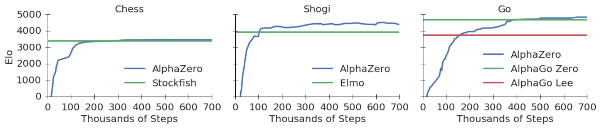
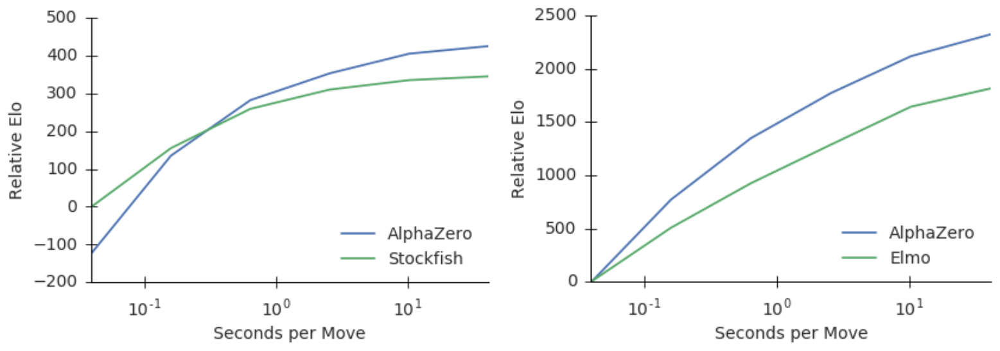
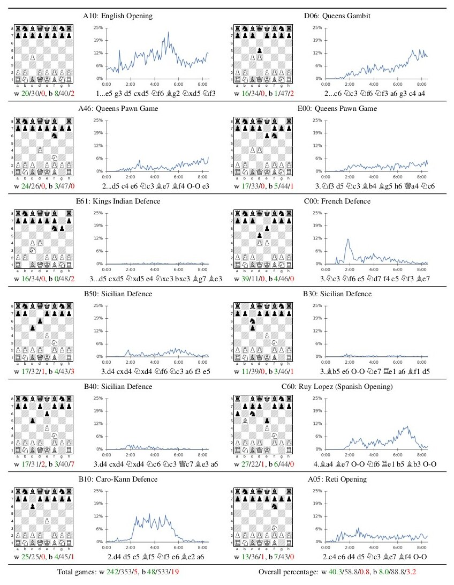

# 论文中文解读：《Mastering Chess and Shogi by Self-Play with a General Reinforcement Learning Algorithm》

> **基本信息**：David Silver、Thomas Hubert、Julian Schrittwieser 等 13 位作者（DeepMind，伦敦），arXiv:1712.01815v1，2017 年 12 月 5 日；[论文官方页面](https://arxiv.org/abs/1712.01815)。本地 PDF 是这个 arXiv v1 版本（19 页，含 Methods、补充表和 10 局示例对局），不是后来发表在 Science 上的扩充版，所以 Science 版新增的内容（例如完整伪代码）不在本文中。
>
> **本文的读法**：图 1、图 2 取自论文原图；表 1、表 S1–S4 为逐格核对后的中文转录；表 2 同时给出原表截图（含 12 个开局的棋盘和训练曲线）与数字转录。文中“第 N 页”指 PDF 页码。凡是论文没有写、由我补充的背景或推算，都会标明“背景补充”或“推算”。

## 一、一句话结论

AlphaZero 是把 AlphaGo Zero 的“深度神经网络 + 蒙特卡洛树搜索（MCTS）+ 纯自博弈强化学习”泛化成一个通用算法：除了游戏规则外不给任何领域知识（没有人类棋谱、开局库、残局库、手工评估函数），从随机初始化的网络开始，用同一套算法、网络结构和超参数分别训练国际象棋、将棋和围棋。论文报告：国际象棋训练 9 小时、将棋 12 小时、围棋 34 小时，各自击败了当时的世界冠军程序（Stockfish、Elmo、前一版 AlphaGo Zero），并且每秒只搜索约 8 万个局面，比 Stockfish 的 7000 万个少约三个数量级。

## 二、背景与动机

### 2.1 传统国际象棋程序长什么样（Methods：Anatomy of a Computer Chess Program）

论文以 2016 年 TCEC 世界冠军 Stockfish 为例，说明传统强程序的组成。AlphaZero 一项都没有用：

| 组件 | 传统引擎（以 Stockfish 为例） | AlphaZero |
|---|---|---|
| 局面评估 | 手工特征 $\phi(s)$（子力价值、子力不平衡表、棋子–格子表、机动性与被困子、兵型、王的安全、前哨、双象等）的线性组合 $v(s,w)=\phi(s)^\top w$，权重由人工与自动调参共同得到 | 深度神经网络 $f_\theta(s)=(p,v)$，从自博弈中学习 |
| 搜索 | 带静态搜索（quiescence search）的 alpha-beta 极小极大搜索，另有 aspiration windows 和 principal variation search | 通用 MCTS，对子树内的局面评估取平均，不做极小极大 |
| 剪枝与深度调整 | null move、futility 等剪枝；对有希望的变化加深、对没希望的变化缩减（如 late move reductions），大量依赖领域知识的规则 | 无，搜索方向由网络输出的先验引导 |
| 着法排序 | 迭代加深，加 killer、history、counter-move 启发式，以及基于吃子的 SEE、MVV/LVA 等领域知识 | 无，网络的着法概率 $p$ 充当先验 |
| 其他 | 置换表；精心调参的开局库；残局库（六子，有时七子以下局面的最优着法） | 无开局库、无残局库 |
| 搜索速度 | 约 7000 万个局面每秒（表 S4） | 约 8 万个局面每秒（国际象棋，表 S4） |

（该表由论文 Methods 第 10–11 页的文字整理而成。）论文说其他强国际象棋程序，包括 Deep Blue，结构都非常相似，细节各异。论文还说这些技术中的一部分可能还能进一步提升 AlphaZero，但本文只关注纯自博弈强化学习，把这些扩展留给未来。

### 2.2 此前把学习用于国际象棋/将棋的工作（Prior Work）

- NeuroChess：用 175 个手工输入特征的神经网络评估局面，用时序差分（TD）学习预测最终结果以及两步之后的期望特征，用固定深度 2 的搜索对战 GnuChess 胜率 13%；
- Beal 与 Smith：用 TD 学习从随机值出发、只靠自博弈估计国际象棋和将棋的棋子价值；
- KnightCap：评估网络使用“哪些格子被哪些棋子攻击/防守”的攻击表，用 TD(leaf)（更新 alpha-beta 搜索主变例叶节点的值）训练，在与手工初始化棋子价值的强电脑对手对战后达到人类大师水平；
- Meep：基于手工特征的线性评估函数，用 TreeStrap（更新 alpha-beta 搜索的所有节点）训练，从随机初始权重自博弈后在 15 局中击败人类国际大师 13 局；
- Kaneko 与 Hoki：为将棋训练含一百万个特征的评估函数，通过在 alpha-beta 搜索中学习选择人类专家着法；这是 2013 年世界电脑将棋锦标赛冠军 Bonanza 的一部分；
- Giraffe：评估网络加入机动性图和攻防图，用 TD(leaf) 自博弈，达到国际大师水平；
- DeepChess：用人类专家棋局（滤掉吃子着法和和棋）通过监督学习训练成对比较局面的网络，达到强大的特级大师水平；
- 此外，用类似 AlphaZero 的策略迭代训练策略/价值双网络的方法已成功用于 Hex。

论文指出，上述程序都把学到的评估函数与带各种扩展的 alpha-beta 搜索相结合。

### 2.3 为什么围棋“天然适合”而国际象棋/将棋不那么适合

围棋适合 AlphaGo 的网络结构：规则具有平移不变性（与卷积的权重共享对应）；规则由相邻点的“气”定义（与卷积的局部结构对应）；规则在旋转和翻转下对称（可做数据增强和集成）；动作空间简单（每个位置可落一子）；结局只有胜负两种。国际象棋与将棋则相反：规则依赖位置（如兵只能在第二横线走两步、在第八横线升变）且不对称（兵只向前走，王翼与后翼的王车易位不同）；包含远程作用（后可以一步横跨棋盘，也可以从远处将军）；动作空间包含所有棋子到所有合法目的地；将棋还允许把吃到的棋子放回棋盘；两者都可能出现和棋，而且认为国际象棋的最优解就是和棋。将棋比国际象棋计算复杂度更高：棋盘更大，被吃掉的对方棋子会改变阵营，之后可以放在棋盘上任何位置。

### 2.4 论文的核心主张

论文要证明的是：一个通用的强化学习算法可以从白板（tabula rasa）出发，在许多有挑战性的领域达到超人水平，而不必为每个领域重新设计评估函数和搜索启发式。

## 三、方法

### 3.1 网络：同时输出着法概率和局面价值

AlphaZero 用深度神经网络 $(p,v)=f_\theta(s)$：输入棋盘局面 $s$，输出着法概率向量 $p$（分量 $p_a=\Pr(a\mid s)$，对每个动作 $a$）和一个标量价值 $v$，估计从该局面出发的期望结局 $z$，即 $v\approx\mathbb{E}[z\mid s]$。网络完全从自博弈中学习着法概率和价值估计，再用它们指导搜索。

### 3.2 搜索：通用的蒙特卡洛树搜索（MCTS）

论文对 MCTS 的描述只有几句话：每次搜索由一系列从根节点 $s_{\text{root}}$ 到叶节点遍历搜索树的模拟自博弈组成；每次模拟在每个状态 $s$ 选择一个“访问次数低、着法概率高、价值高（对从 $s$ 选了该着法的各次模拟的叶节点状态取平均）”的着法 $a$，这里的概率和价值都来自当前网络 $f_\theta$；搜索返回一个着法分布 $\pi$，要么与根节点访问次数成比例，要么对访问次数取贪心。

背景补充（这一段不在本文中，是 AlphaGo Zero 论文的做法；本文说明“除非另有说明，训练和搜索算法及参数与 AlphaGo Zero 相同”）：

- 树的每条边 $(s,a)$ 记录先验概率 $P(s,a)$（来自网络的 $p$）、访问次数 $N(s,a)$、累计价值 $W(s,a)$ 和平均价值 $Q(s,a)=W/N$；
- 选择：从根出发，反复选使 $Q(s,a)+U(s,a)$ 最大的边，其中 $U(s,a)=c_{\text{puct}}\,P(s,a)\,\dfrac{\sqrt{\sum_b N(s,b)}}{1+N(s,a)}$，直到到达尚未展开的叶节点；$U$ 项正好对应论文里“访问次数低、概率高”的偏好，$Q$ 项对应“价值高”；
- 展开与评估：用网络评估叶节点得到 $(p,v)$，用 $p$ 作为新边的先验；若叶节点是终局，则用规则给出的结局；
- 回传：沿路径更新各边的 $N$ 和 $W$（价值的符号随走子方交替取反）；
- 若 $\tau$ 表示温度，AlphaGo Zero 的访问分布为 $\pi_a\propto N(\text{root},a)^{1/\tau}$；本文只写“成比例”或“贪心”，没有出现 $\tau$。

### 3.3 自博弈强化学习与损失函数

网络参数 $\theta$ 从随机初始化开始，通过自博弈强化学习训练。对局中双方的着法都由 MCTS 选出，$a_t\sim\pi_t$。对局结束时，终局局面 $s_T$ 按规则评分得到结局 $z$：输 $-1$，和 $0$，赢 $+1$（价值按当前走子方的视角理解，论文没有明说符号约定，由“输入棋盘按当前玩家视角摆放”推知）。网络参数的更新目标是：让预测的结局 $v_t$ 与实际结局 $z$ 的误差最小，同时让策略向量 $p_t$ 与搜索概率 $\pi_t$ 尽量相似。具体做法是对一个由均方误差和交叉熵相加的损失函数 $l$ 做梯度下降（论文式 (1)）：

$$
(p,v)=f_\theta(s),\qquad l=(z-v)^2-\pi^\top\log p+c\,\lVert\theta\rVert^2.
$$

逐项解释：

- $(z-v)^2$：价值头的均方误差，让 $v$ 回归整局的结局 $z$（价值学习）；
- $-\pi^\top\log p$：策略头对搜索得到的概率分布 $\pi$ 的交叉熵，让网络的直接输出 $p$ 逼近“搜索之后更强的分布” $\pi$（策略改进的蒸馏）；
- $c\lVert\theta\rVert^2$：L2 权重正则，$c$ 控制强度；论文没有给出 $c$ 的具体数值；
- 更新后的参数立刻用于之后的自博弈。

整个闭环是：当前网络引导 MCTS 产生比网络直接输出更强的着法分布 $\pi$ 和真实结局 $z$，网络再去拟合它们，变强的网络又让下一轮搜索更聚焦。这个“搜索 = 策略改进、结局 = 策略评估”的解读是我的概括，论文本身没有用这些术语。

我把论文中分散的描述整理成下面的训练流程：

1. 随机初始化 $\theta$；
2. 反复进行自博弈：每一步用最新参数的网络做 800 次 MCTS 模拟（训练时），在根节点先验上加 Dirichlet 噪声以保证探索，按根节点访问次数成比例地采样着法；
3. 终局时用规则评分得到 $z$；国际象棋和将棋超过某个最大步数（由典型对局长度决定）则判和，围棋按 Tromp–Taylor 规则判终；
4. 对每个走过的局面保存 $(s_t,\pi_t,z)$；
5. 以 4,096 的小批量对式 (1) 做梯度下降，共 700,000 步，学习率从 0.2 开始，训练过程中降低三次（依次到 0.02、0.002、0.0002；论文没有写在哪些步数降）；
6. 没有“评估新网络、再决定是否替换最强棋手”的步骤，始终只维护一个持续更新的网络。

论文没有说明训练样本怎样从自博弈数据中抽取（例如回放窗口多大），也没有写优化器及其动量，只说训练算法和参数与 AlphaGo Zero 相同。

### 3.4 与 AlphaGo Zero 的四点不同

1. **优化目标**：AlphaGo Zero 估计并优化获胜概率，假设结局只有输赢；AlphaZero 估计并优化期望结局，因此能把和棋（或其他结局）考虑进去。
2. **对称性**：围棋规则在旋转和翻转下不变，AlphaGo 与 AlphaGo Zero 以两种方式利用了这一点：训练数据对每个局面做 8 种对称变换的增强；MCTS 中把局面随机旋转或翻转后再送入网络，使蒙特卡洛评估对不同偏差取平均。国际象棋和将棋规则不对称，一般不能假设对称，所以 AlphaZero 既不做数据增强，也不在 MCTS 中变换局面。
3. **自博弈数据的来源**：AlphaGo Zero 用“历史上最强的棋手”生成自博弈对局；每轮训练后，新棋手与最强棋手对战，胜率达到 55% 才替换最强棋手。AlphaZero 只保留一个持续更新的网络，自博弈对局由最新参数产生，省掉评估步骤和最强棋手的选择。
4. **超参数**：AlphaGo Zero 用贝叶斯优化调搜索的超参数；AlphaZero 对所有游戏复用同一组超参数，不为单个游戏调参。唯一例外是加到先验策略上的探索噪声，按该游戏典型的合法着法数目成比例缩放。

### 3.5 论文为什么认为 MCTS 适合与神经网络结合

四十多年来最强的国际象棋程序都用 alpha-beta 搜索。AlphaZero 的做法明显不同：它对子树内的局面评估取平均，而不是计算该子树的极小极大值。但此前用传统 MCTS 的国际象棋程序远弱于 alpha-beta 程序，而基于神经网络的 alpha-beta 程序又一直无法与更快的手工评估函数竞争。

论文的论证是：AlphaZero 用深度神经网络做非线性函数逼近，而典型国际象棋程序用线性函数逼近。非线性网络表示能力强得多，但也可能引入虚假的逼近误差。MCTS 对这些逼近误差取平均，在评估大子树时误差倾向于相互抵消；相反，alpha-beta 做显式极小极大，会把最大的逼近误差一路传到子树的根节点。因此 MCTS 也许能让 AlphaZero 有效地把神经网络表示和强大的、与领域无关的搜索结合起来。（这是论文的论证，不是实验验证的结论；图 2 提供了间接证据。）

## 四、输入输出表示与领域知识（Methods）

### 4.1 论文明确给出的领域知识

AlphaZero 除下面几点之外，没有使用任何领域知识：

1. 输入特征和输出特征都组织成一组平面（planes），即网络结构匹配棋盘的网格结构；
2. 给定完美的游戏规则，用于 MCTS 中模拟一串着法之后得到的局面、判断对局是否终止、给到达终局的模拟打分；
3. 规则知识也用于输入平面（王车易位、重复局面、无进展）和输出平面（棋子如何走、升变、将棋的打入）的编码；
4. 典型合法着法数用于缩放探索噪声；
5. 国际象棋和将棋对局超过一个最大步数（由典型对局长度决定）就终止并判和；围棋对局按 Tromp–Taylor 规则终止并计分，与之前的工作一致。

论文说，输入输出的表示还可以有别的选择，在实验中训练算法对许多合理选择都稳健。

### 4.2 输入：$N\times N\times(MT+L)$ 的图像栈

网络输入是 $N\times N\times(MT+L)$ 的图像栈：把 $T$ 组、每组 $M$ 个 $N\times N$ 平面拼接起来，每组表示 $t-T+1,\dots,t$ 中某一时刻的棋盘局面，早于第 1 步的时间步置零；棋盘按当前走子方的视角摆放。$M$ 个特征平面由二值平面组成：每种己方棋子一个平面，另一组平面表示对方的棋子；将棋还有表示各类被吃棋子（prisoners）数量的平面。另有 $L$ 个常数平面，表示走子方颜色、总步数以及特殊规则状态：国际象棋的王车易位权（王翼或后翼）、该局面的重复次数（国际象棋重复 3 次自动判和，将棋重复 4 次）、国际象棋无进展步数（50 步无进展自动判和）。历史长度 $T=8$。

下表是原文 Table S1（第 13 页）的中文转录，数字为平面数。前一组特征对 $T=8$ 步历史中的每个局面各重复一次；计数用单个实数输入表示，其他特征用指定个数的二值平面做 one-hot 编码。P1 指当前走子方，P2 指对手。

| 特征 | 围棋 | 国际象棋 | 将棋 |
|---|---:|---:|---:|
| P1 棋子/棋子数（P1 stone / piece） | 1 | 6 | 14 |
| P2 棋子/棋子数（P2 stone / piece） | 1 | 6 | 14 |
| 重复次数（Repetitions） | - | 2 | 3 |
| P1 持子数（P1 prisoner count） | - | - | 7 |
| P2 持子数（P2 prisoner count） | - | - | 7 |
| 走子方颜色（Colour） | 1 | 1 | 1 |
| 总步数（Total move count） | - | 1 | 1 |
| P1 王车易位权（P1 castling） | - | 2 | - |
| P2 王车易位权（P2 castling） | - | 2 | - |
| 无进展步数（No-progress count） | - | 1 | - |
| 合计（Total） | 17 | 119 | 362 |

（原文表 S1，第 13 页。）合计可验证：围棋 $2\times8+1=17$；国际象棋 $(6+6+2)\times8+1+1+2+2+1=119$；将棋 $(14+14+3+7+7)\times8+1+1=362$。所以输入形状依次为 $19\times19\times17$、$8\times8\times119$、$9\times9\times362$。

### 4.3 输出：着法概率的平面编码

论文把国际象棋的一步棋拆成两部分：先选要走的棋子，再在这个棋子的合法着法中选。策略 $\pi(a\mid s)$ 用 $8\times8\times73$ 的平面栈编码，表示 4,672 种可能着法上的概率分布：$8\times8$ 个位置标识“拿起”棋子的格子；前 56 个平面是任何棋子的“后式走法”（沿 8 个罗盘方向 N、NE、E、SE、S、SW、W、NW 之一走 1 到 7 格）；接下来 8 个平面是马的走法；最后 9 个平面是兵走步或吃子时的“低升变”（underpromotion，分别升变为马、象、车，对应兵直走和两个斜吃方向）；其他从第七横线出发的兵走步或吃子一律升变为后。

将棋的策略用 $9\times9\times139$ 的平面栈编码，表示 11,259 种可能着法：前 64 个平面是“后式走法”，接下来 2 个是马的走法，另外 64+2 个平面是升变后的后式走法和马走法，最后 7 个平面表示把吃到的棋子打回棋盘该位置。围棋的策略与 AlphaGo Zero 相同，用 $19\times19+1$ 个着法上的平坦分布表示落子位置和停着（pass）。论文还试过对国际象棋和将棋也用平坦的着法分布，最终结果几乎一样，只是训练略慢。非法着法的概率被置零，剩余着法重新归一化。

下表是原文 Table S2（第 14 页）的中文转录，数字为平面数：

| 国际象棋特征 | 平面数 | 将棋特征 | 平面数 |
|---|---:|---|---:|
| 后式走法（Queen moves） | 56 | 后式走法（Queen moves） | 64 |
| 马走法（Knight moves） | 8 | 马走法（Knight moves） | 2 |
| 低升变（Underpromotions） | 9 | 升变后的后式走法（Promoting queen moves） | 64 |
| - | - | 升变后的马走法（Promoting knight moves） | 2 |
| - | - | 打入（Drop） | 7 |
| 合计 | 73 | 合计 | 139 |

（原文表 S2，第 14 页。）合计验证：$8\times8\times73=4672$，$9\times9\times139=11259$。

论文没有在本文中重复网络内部结构（层数、通道数等），只说沿用 AlphaGo Zero 的网络结构，因此那些细节在这篇论文里查不到。

## 五、训练配置与评测协议

### 5.1 训练

- 国际象棋、将棋、围棋各训练一个独立的 AlphaZero 实例；除非另有说明，三个游戏使用相同的算法设置、网络结构和超参数；
- 训练 700,000 步（小批量 4,096），从随机初始化出发；
- 5,000 个第一代 TPU 用来生成自博弈对局，64 个第二代 TPU 用来训练神经网络（脚注：原 AlphaGo Zero 论文用 GPU 训练）；
- 训练时每次 MCTS 用 800 次模拟；对局数、局面数和思考时间随游戏不同（主要因棋盘大小和对局长度），见表 S3；
- 学习率 0.2，训练中降低三次（0.02、0.002、0.0002）；着法按根节点访问次数成比例地选择；
- 根节点先验概率上加 Dirichlet 噪声 $\mathrm{Dir}(\alpha)$，强度与典型局面的大致合法着法数成反比，取值为 $\alpha=\{0.3,\,0.15,\,0.03\}$，依次对应国际象棋、将棋、围棋；
- 评测时 AlphaZero 对根节点访问次数取贪心选着法，每个 MCTS 在一台 4 个 TPU 的机器上运行。

下表是原文 Table S3（第 15 页）的转录：

| 项目 | 国际象棋 | 将棋 | 围棋 |
|---|---:|---:|---:|
| 小批量步数（Mini-batches） | 700k | 700k | 700k |
| 训练时间（Training Time） | 9 小时 | 12 小时 | 34 小时 |
| 训练对局数（Training Games） | 4400 万 | 2400 万 | 2100 万 |
| 思考时间（Thinking Time） | 800 次模拟，约 40 ms | 800 次模拟，约 80 ms | 800 次模拟，约 200 ms |

（原文表 S3，第 15 页。）读法：三个游戏的训练步数相同，耗时差别来自棋盘大小和单局长度；每步 800 次模拟对应的挂钟时间分别约为 40 ms、80 ms、200 ms。

### 5.2 对手与评测设置

- **国际象棋**：Stockfish 版本 8（官方 Linux 版），64 个 CPU 线程，哈希表 1 GB；
- **将棋**：Elmo 版本 WCSC27，配合 YaneuraOu 2017 Early KPPT 4.73 64AVX2，64 个 CPU 线程、1 GB 哈希表，USI 选项 EnteringKingRule 设为 NoEnteringKing；
- **围棋**：此前发表的 AlphaGo Zero（训练 3 天；图 1 图注写作 20 block / 3 day）；
- **对战**：每组 100 局，每步 1 分钟（对应计算机象棋比赛条件）；AlphaZero 与前一版 AlphaGo Zero 各用一台 4 个 TPU 的机器；Stockfish 和 Elmo 用最强技能等级；所有选手都允许认输（Stockfish 与 Elmo：连续 10 步评估值低于 -900 centipawns，约相当于落后 9 个兵；AlphaZero：胜率低于 5%），禁用 pondering（对手思考时间内的预思考）；
- **Elo 曲线**（图 1、图 2）：用每步 1 秒的锦标赛（tournament），对象为训练过程中不同迭代的 AlphaZero 以及一个基线选手（Stockfish、Elmo 或 AlphaGo Lee）；基线选手的 Elo 锚定到公开数值。选手 $a$ 击败选手 $b$ 的概率用逻辑函数建模：

$$
p(a\ \text{defeats}\ b)=\frac{1}{1+\exp\big(c_{\text{elo}}\,(e(b)-e(a))\big)},\qquad c_{\text{elo}}=\frac{1}{400},
$$

评分 $e(\cdot)$ 用贝叶斯逻辑回归（BayesElo 程序）估计。这里论文写的是自然指数形式，字面代入 $c_{\text{elo}}=1/400$，Elo 差 400 对应胜率约 73%，而传统的以 10 为底的 Elo 约为 91%。同一团队后来的 [MuZero 论文](../muzero/论文中文解读.md)（附录 I）把同一流程写成以 10 为底的 $\big(1+10^{c_{\text{elo}}(e(b)-e(a))}\big)^{-1}$，所以这里的 exp 很可能只是写法不同；本文不据此做精确的胜率换算，只读图中的相对高低。

## 六、实验结果

### 6.1 训练曲线：几小时超过世界冠军程序（图 1）

*图 1（原文 Figure 1，第 4 页）：训练 AlphaZero 700,000 步。Elo 来自不同选手之间每步 1 秒的评测对局。a，国际象棋，对比 2016 年 TCEC 世界冠军 Stockfish；b，将棋，对比 2017 年 CSA 世界冠军 Elmo；c，围棋，对比 AlphaGo Lee 与 AlphaGo Zero（20 block / 3 day）。*

**图中文字翻译与读法**：

- 三个子图依次是 Chess（国际象棋）、Shogi（将棋）、Go（围棋）；横轴 Thousands of Steps（训练步数，单位千步，0 到 700），纵轴 Elo（0 到 5000）。
- 蓝色曲线为 AlphaZero 在训练过程中的 Elo；绿色水平线是基线：国际象棋为 Stockfish，将棋为 Elmo，围棋为 AlphaGo Zero；围棋子图里的红色水平线是 AlphaGo Lee。水平线是固定的基线选手，不随训练步数变化。
- 从图上读出的近似数值（不是论文给出的数字）：国际象棋中 Stockfish 约 3400，AlphaZero 在 30 万步附近追平，最终约 3450–3500；将棋中 Elmo 约 3900，AlphaZero 在约 10 万步处升过 Elmo，最终约 4400–4500；围棋中 AlphaGo Lee 约 3750，AlphaGo Zero 约 4700，AlphaZero 在约 16 万步处超过 AlphaGo Lee，在约 40 万步附近追上 AlphaGo Zero，最终约 4850。
- 论文正文给出的精确说法：国际象棋在仅 4 小时（30 万步）后就超过 Stockfish；将棋在不到 2 小时（11 万步）后超过 Elmo；围棋在 8 小时（16.5 万步）后超过 AlphaGo Lee。脚注指出 AlphaGo Master 和 AlphaGo Zero 最终的训练长度约是这里的 100 倍，本文没有复现那样的规模。

摘要说“24 小时内”达到超人水平；对照表 S3，整个 700k 步的训练耗时是国际象棋 9 小时、将棋 12 小时、围棋 34 小时，围棋整程超过 24 小时，但在 8 小时左右就已超过 AlphaGo Lee。

**读图结论**：在单次训练、每步 1 秒的评测设置下，AlphaZero 的 Elo 随训练稳定上升并超过各自的基线。但这是每个游戏一条曲线、没有误差条（只训练一次）；每步 1 秒也不同于后面每步 1 分钟的锦标赛设置。

### 6.2 与世界冠军程序的对战（表 1）

训练结束后，AlphaZero 与 Stockfish、Elmo 和 3 天版 AlphaGo Zero 各打 100 局，每步 1 分钟。下表中胜、和、负都从 AlphaZero 的视角给出。

| 游戏 | 白方 | 黑方 | AlphaZero 胜 | 和 | AlphaZero 负 |
|---|---|---|---:|---:|---:|
| 国际象棋 | AlphaZero | Stockfish | 25 | 25 | 0 |
| 国际象棋 | Stockfish | AlphaZero | 3 | 47 | 0 |
| 将棋 | AlphaZero | Elmo | 43 | 2 | 5 |
| 将棋 | Elmo | AlphaZero | 47 | 0 | 3 |
| 围棋 | AlphaZero | AG0 3-day | 31 | - | 19 |
| 围棋 | AG0 3-day | AlphaZero | 29 | - | 21 |

（原文表 1，第 5 页；AG0 3-day 即训练 3 天的 AlphaGo Zero。）按我对表中数字的求和：国际象棋 100 局为 28 胜 72 和 0 负；将棋为 90 胜 2 和 8 负；围棋为 60 胜 40 负（围棋没有和棋）。与论文正文“对 Stockfish 一局未输、对 Elmo 输八局”一致。

读这张表要注意：

- 国际象棋里 AlphaZero 执白胜 25 局，执黑只胜 3 局，其余都是和棋；高水平国际象棋和棋很多，这是 Elo 刻度被压缩的原因（论文脚注 3）；
- 围棋 60 比 40 的差距，在每组 100 局的规模下，二项分布的标准误约 4.9 个百分点（我的计算），只比 50% 高约两个标准误，所以围棋这一项的结论比国际象棋、将棋弱；
- 论文没有给出 Stockfish 在对战中是否使用开局库或残局库，也没有分析 64 线程 CPU 与 4 个 TPU 的算力是否可比，对比是在“各自的硬件”上做的。

### 6.3 搜索效率与可扩展性（表 S4 与图 2）

AlphaZero 的 MCTS 每秒评估的局面远少于传统引擎：

| 程序 | 国际象棋 | 将棋 | 围棋 |
|---|---:|---:|---:|
| AlphaZero | 80k | 40k | 16k |
| Stockfish | 70,000k | - | - |
| Elmo | - | 35,000k | - |

（原文表 S4，第 19 页，单位：局面数每秒；k 表示千。）按这些数字，Stockfish 每秒评估的局面是 AlphaZero 的约 875 倍（70,000k 除以 80k，我的计算），Elmo 对 AlphaZero 也是 875 倍（35,000k 除以 40k）；论文说是“约一千倍”。论文的解释是：AlphaZero 用深度神经网络把搜索集中在最有希望的变化上，是更“像人”的搜索方式（Shannon 最早提出）。

接着，论文检验棋力如何随每步思考时间而增长：

*图 2（原文 Figure 2，第 7 页）：AlphaZero 的棋力随思考时间的可扩展性，用 Elo 衡量。a（左），国际象棋中 AlphaZero 与 Stockfish 随每步思考时间的变化；b（右），将棋中 AlphaZero 与 Elmo 的变化。*

**图中文字翻译与读法**：

- 横轴 Seconds per Move（每步用时，秒，对数刻度，刻度标注 $10^{-1}$、$10^{0}$、$10^{1}$，最左端约 40 ms），纵轴 Relative Elo（相对 Elo）：以 Stockfish 或 Elmo 在每步 40 ms 的棋力作为 0 点（原文：relative to Stockfish or Elmo with 40ms thinking time）。蓝线为 AlphaZero，绿线为 Stockfish（左）或 Elmo（右）。
- 从图上读出的近似数值（不是论文给出的数字）：国际象棋中，AlphaZero 在最短时间约 -125，随时间升到每步 40 秒量级时约 425；Stockfish 从 0 升到约 345；两条线在每步约 0.3 秒处相交，更长时间 AlphaZero 更高。将棋中，AlphaZero 升到约 2330，Elmo 约 1820，AlphaZero 在整个区间都更高。
- 论文的结论：AlphaZero 的 MCTS 随思考时间的扩展性比 Stockfish 或 Elmo 更好，这对“alpha-beta 搜索在这些领域本质上更优”的流行看法提出了质疑。

**读图结论**：这是一条间接支持“用网络引导的 MCTS 能随算力增长而持续获益”的证据，不是严格对照。国际象棋里 AlphaZero 曲线的总跨度约 550，将棋约 2300；由于高水平国际象棋和棋多，Elo 刻度被压缩，不要直接比较两张图的纵轴大小。

### 6.4 AlphaZero 发现了哪些国际象棋开局（表 2）

论文分析了人类最常见的 12 个开局（在线数据库中被下过 10 万次以上），检验 AlphaZero 是否“独立发现”并掌握它们。下图是原文 Table 2：每个开局一格，左边是开局后的棋盘局面，右边曲线是自博弈训练中 AlphaZero 下该开局的对局占比随训练时间的变化（横轴为训练时间，小时，约 0 到 8 多小时；纵轴为占比，0 到 25%），下方依次是 AlphaZero 对 Stockfish 的 100 局战绩（w 为 AlphaZero 执白，b 为执黑，格式为胜/和/负，均从 AlphaZero 视角）和 AlphaZero 的主变例（PV）。

*原文 Table 2，第 6 页：12 个最常见人类开局（在线数据库中被下过 10 万次以上），按 ECO 编码和通用名称标注。*

下表转录其中的数字与主变例（对局记录用代数记谱法，列出局面后的 AlphaZero 主变例）：

| ECO 编码与开局 | AlphaZero 执白（胜/和/负） | AlphaZero 执黑（胜/和/负） | AlphaZero 主变例（PV） |
|---|---:|---:|---|
| A10 英国式开局（English Opening） | 20/30/0 | 8/40/2 | 1...e5 g3 d5 cxd5 Nf6 Bg2 Nxd5 Nf3 |
| D06 后翼弃兵（Queens Gambit） | 16/34/0 | 1/47/2 | 2...c6 Nc3 Nf6 Nf3 a6 g3 c4 a4 |
| A46 后兵开局（Queens Pawn Game） | 24/26/0 | 3/47/0 | 2...d5 c4 e6 Nc3 Be7 Bf4 O-O e3 |
| E00 后兵开局（Queens Pawn Game） | 17/33/0 | 5/44/1 | 3.Nf3 d5 Nc3 Bb4 Bg5 h6 Qa4 Nc6 |
| E61 王印防御（Kings Indian Defence） | 16/34/0 | 0/48/2 | 3...d5 cxd5 Nxd5 e4 Nxc3 bxc3 Bg7 Be3 |
| C00 法兰西防御（French Defence） | 39/11/0 | 4/46/0 | 3.Nc3 Nf6 e5 Nd7 f4 c5 Nf3 Be7 |
| B50 西西里防御（Sicilian Defence） | 17/32/1 | 4/43/3 | 3.d4 cxd4 Nxd4 Nf6 Nc3 a6 f3 e5 |
| B30 西西里防御（Sicilian Defence） | 11/39/0 | 3/46/1 | 3.Bb5 e6 O-O Ne7 Re1 a6 Bf1 d5 |
| B40 西西里防御（Sicilian Defence） | 17/31/2 | 3/40/7 | 3.d4 cxd4 Nxd4 Nc6 Nc3 Qc7 Be3 a6 |
| C60 西班牙开局（Ruy Lopez） | 27/22/1 | 6/44/0 | 4.Ba4 Be7 O-O Nf6 Re1 b5 Bb3 O-O |
| B10 卡罗–卡恩防御（Caro-Kann Defence） | 25/25/0 | 4/45/1 | 2.d4 d5 e5 Bf5 Nf3 e6 Be2 a6 |
| A05 列蒂开局（Reti Opening） | 13/36/1 | 7/43/0 | 2.c4 e6 d4 d5 Nc3 Be7 Bf4 O-O |
| 合计（Total games） | 242/353/5 | 48/533/19 | - |
| 总占比（Overall percentage） | 40.3%/58.8%/0.8% | 8.0%/88.8%/3.2% | - |

（原文表 2，第 6 页。每个开局执白、执黑各 50 局，所以合计各 600 局；我核对过 12 行的总和与表中合计一致。）

读法：

- 论文的结论是：这 12 个开局都被 AlphaZero 在自博弈训练中独立发现并经常下；从每个人类开局出发，AlphaZero 都令人信服地击败了 Stockfish，说明它掌握了广泛的国际象棋着法。
- 数字上：AlphaZero 执白时胜率约 40%（242/600），几乎不输（5 负）；执黑时以和棋为主（533/600），输 19 局，其中 B40 西西里防御输 7 局、B50 输 3 局、A10 与 D06 与 E61 各输 2 局。
- 从曲线上读出的趋势（近似）：英国式开局（A10）和卡罗–卡恩（B10）在训练中期占比较高（A10 约在 5 小时前后达到约 20%，B10 在 2 到 6 小时之间约 10% 以上然后消退），法兰西防御（C00）在约 2 小时处有一个约 12% 的峰后降低，而三个西西里防御变例（B30、B40、B50）和王印防御（E61）占比始终很低，多数时间在约 0–4%；后翼弃兵（D06）则在训练后期缓慢升到约 10% 以上。所以“经常下”并不对每个开局都成立；这个读图结论是我的观察，论文正文只说“independently discovered and played frequently”。

### 6.5 示例对局

附录列出 AlphaZero 对 Stockfish 的 10 局示例对局（100 局对战中，每步 1 分钟），都是 AlphaZero 获胜：2 局执黑（Stockfish 执白）、8 局执白；每局完整着法见原文第 16–18 页。论文没有说明这 10 局是怎样挑选的，它们是定性展示，不是统计证据。

## 七、局限、证据边界与常见误读

论文指出的局限很少。主要有：

- 论文承认前面列出的传统技术（开局库、残局库、搜索缩减等）中有一些可能进一步提高 AlphaZero，但没有尝试；
- 论文只在国际象棋、将棋、围棋三个“完美信息、双人、零和、规则确定”的游戏上检验。

证据边界和常见误读：

- “zero”指不使用人类棋谱和领域评估知识，**不是**零规则、零搜索、零计算：规则被完整提供并在 MCTS 中用来模拟，训练用了 5,000 个第一代 TPU 生成自博弈；
- 超参数“不为每个游戏调参”，但并非没有调过：沿用 AlphaGo Zero 的搜索与训练参数（后者曾用贝叶斯优化调搜索超参数），三个游戏只有探索噪声按游戏缩放；
- 与 Stockfish、Elmo 的对比是在各自的硬件（4 个 TPU 对 64 个 CPU 线程）上、固定每步 1 分钟的条件下完成的，Stockfish 为 8 版；该结果不等于“同算力下更强”，论文也没有做硬件等价性分析；
- 每个游戏只有一次训练，没有跨种子的方差；Elo 曲线来自每步 1 秒的评测，与每步 1 分钟的对战条件不同；
- 开局分析和示例对局是定性展示；
- 论文没有证明函数逼近下的策略迭代收敛；它只是一个在这些游戏上有效的经验结果；
- 方法依赖可精确模拟的规则和明确的终局奖励，大量自博弈计算加 MCTS 也使它难以直接迁移到开放世界或语言任务。

## 八、复现检查清单

- 区分训练时的“按访问次数成比例采样着法”和评测时的“按访问次数贪心”；
- 根节点的 Dirichlet 噪声强度按游戏缩放（国际象棋 0.3、将棋 0.15、围棋 0.03），且只加在根节点；
- 保存搜索得到的访问分布 $\pi_t$，而不只是最终落子；损失里的策略项是对 $\pi_t$ 的交叉熵；
- 只维护一个持续更新的网络，不做最强棋手门控；国际象棋和将棋不做对称数据增强；
- 输入平面（8 步历史、重复次数、易位权、无进展计数）与输出平面（国际象棋 4,672、将棋 11,259 个着法）的编码，非法着法屏蔽后重新归一化；
- 最大步数判和、围棋 Tromp–Taylor 计分、认输阈值（AlphaZero 为 5% 胜率）；
- 每步 800 次模拟、小批量 4,096、700k 步、学习率 0.2 逐步降低三次；
- 比较时固定每步计算预算，给出足够对局数和置信区间，并同时报告硬件。

## 九、与本仓库其他论文的关系

- AlphaZero 依赖完整、精确的规则模拟器来做 MCTS；[MuZero](../muzero/论文中文解读.md) 取消了这个要求，学习一个只保留规划所需信息的隐空间动力学模型，在其中做同样的搜索，并扩展到 Atari；
- 与 [DQN](../deep_q_network/论文中文解读.md) 相比，AlphaZero 是“学习 + 搜索”的路线：DQN 只有价值网络且无搜索，在稀疏奖励和长程规划上失败；AlphaZero 用搜索把网络的判断放大成更强的训练目标；
- AlphaZero 的“用搜索产生更强的目标，再蒸馏给网络”的思想，与后来把搜索引入推理和后训练的工作有相通之处。

## 原文证据导航

- [原论文 PDF](paper.pdf)
- [原文提取文本](paper.txt)
- [论文概要](论文概要.md)
