# 论文中文解读：《Ansor: Generating High-Performance Tensor Programs for Deep Learning》

> **基本信息**：Lianmin Zheng、Chengfan Jia、Minmin Sun、Zhao Wu、Cody Hao Yu、Ameer Haj-Ali、Yida Wang、Jun Yang、Danyang Zhuo、Koushik Sen、Joseph E. Gonzalez、Ion Stoica（UC Berkeley / Alibaba Group / Amazon Web Services / Duke University），OSDI 2020，arXiv:2006.06762（本地 PDF 为 v5，2023 年 10 月版）；论文原文 [官方页面](https://arxiv.org/abs/2006.06762)。
>
> **本文的读法**：图均为从论文 PDF 中按图裁出的原图，表为逐格核对后的中文转录（数字与原文一致，表头翻译为中文）。每张图后有中文图题、图例/坐标轴翻译和读图结论，因此不必再翻英文版。图中读出的近似数值都写作“约”，原文正文给出的数字优先。

## 一、一句话结论

深度学习编译器要为每个算子（或融合后的子图）生成高性能的**张量程序**（tensor program，即带 tile、并行、向量化等优化的低层循环嵌套）。已有做法要么靠专家手写 schedule 模板、只搜索模板里的参数（AutoTVM、FlexTensor），要么按固定顺序逐步构造程序并在“半成品”上剪枝（Halide auto-scheduler），搜索空间都受限。

Ansor 的做法有三层：

1. **分层搜索空间**：先由一组“推导规则”从计算定义自动生成若干 **sketch**（只含高层结构，如 tile 结构、融合方式、是否加 cache、是否 rfactor），再对 sketch **随机标注**（random annotation）tile 大小、并行/向量化/展开等低层细节，得到**完整**程序。空间自动构造、覆盖面大、每个程序都有机会被采到。
2. **对完整程序微调**：用 evolutionary search（四种变异 + 基于 DAG 节点的交叉）和 learned cost model（梯度提升树）迭代挑选候选，再上真机测量，测量数据回头重训 cost model。
3. **task scheduler**：把整个网络切成许多子图（任务），用基于梯度下降的调度算法决定每一轮测量预算给哪个任务。

结论（作者实验）：相对当时最好的替代方案，端到端推理在 Intel CPU、ARM CPU、NVIDIA GPU 上最高分别快 3.8×、2.6×、1.7×；对多数算子，Ansor 找到的最佳程序落在已有搜索方法的搜索空间之外；论文称追平 AutoTVM 的性能所需的搜索时间可以少一个数量级；按表 3，节省倍数在测量次数上为 2.7× 到 16.5×，在墙钟时间上为 3.3× 到 88.6×，随网络差异很大。

## 二、背景与动机

### 2.1 张量程序与“计算定义”

深度神经网络（DNN）可以表示成有向无环图（DAG）：节点是算子（卷积、矩阵乘等），边是算子之间的依赖。现有框架（TensorFlow、PyTorch、MXNet）把算子映射到厂商提供的内核库（cuDNN、MKL-DNN）。这些库需要为每个硬件平台、每个算子投入大量人工调优，也限制了新算子和新型加速器的创新。

于是研究者转向**基于搜索的编译**（search-based compilation）：用户用高层声明式语言写出**计算定义**，编译器针对目标硬件搜索实现。图 1 是矩阵乘在 TVM tensor expression 语言中的计算定义：只需说明张量形状，以及输出的每个元素如何由输入算出。

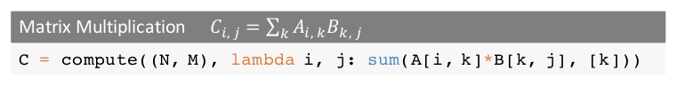

*图 1（原文 Figure 1，第 2 页）：矩阵乘法的计算定义。*

**图中文字翻译与读法**：灰色标题栏写着 Matrix Multiplication（矩阵乘法）及数学式 $C_{i,j}=\sum_k A_{i,k}B_{k,j}$；下面一行是 TVM 的写法 `C = compute((N, M), lambda i, j: sum(A[i, k]*B[k, j], [k]))`，含义是：输出 `C` 的形状为 `(N, M)`，每个元素 `C[i, j]` 是对归约轴 `k` 求和 `A[i, k]*B[k, j]`。这里没有任何“循环怎么嵌套、怎么分块”的信息，这些全部由编译器搜索决定。

**读图结论**：计算定义只描述“算什么”；“怎么算”（循环顺序、tile 大小、并行、向量化、缓存）正是搜索要决定的内容。

把计算定义直接展开成循环就是**朴素程序**。后文反复用到的例子（原文图 5 的 Example Input 1）是矩阵乘接 ReLU：

```python
# 朴素程序：C = A x B，D = ReLU(C)，0 <= i, j, k < 512
for i in range(512):
  for j in range(512):
    for k in range(512):
      C[i, j] += A[i, k] * B[k, j]
for i in range(512):
  for j in range(512):
    D[i, j] = max(C[i, j], 0.0)
```

编译器搜索的就是“把这个朴素程序改写成什么样的循环嵌套最快”。

### 2.2 搜索式方法必须同时做到两件事

要找到高性能程序，搜索方法既要**覆盖足够大的空间**（包含所有有用的优化组合：tile 结构、tile 大小、向量化、并行化、算子融合等），又要**在这个很大的空间里高效探索**。论文指出已有方法在这两点上都有缺口。

### 2.3 两条现有路线

**模板引导搜索（template-guided search）**，代表 TVM 的 AutoTVM 与 FlexTensor（图 2a）：

- 由人为每个计算定义写一个模板，模板规定程序结构，并留出一些可调参数（tile 大小、展开因子等）；编译器只针对具体的输入形状和硬件搜索这些参数的最优值。
- 在常见算子上效果不错，但写模板代价高：TVM 代码库里仅为这些模板就有超过 15K 行代码，并随新算子、新硬件继续增长；写好模板需要同时懂算子和硬件；而且通常一个算子一个模板，覆盖的程序结构有限。
- FlexTensor 提出可覆盖多个算子的通用模板，但仍然是**单算子粒度**，无法包含涉及多个算子的优化（如算子融合）：基于模板的方法没办法拆开固定模板再重组。

**顺序构造搜索（sequential construction based search）**，代表 Halide auto-scheduler（图 2b）：

- 把程序构造分解为固定顺序的一连串决策：按顺序展开计算图的每个节点，对每个节点决定如何变换为低层程序（计算位置、存储位置、tile 大小等）；所有节点展开完才得到完整程序。
- 每步的可选项很多，为了可行，每做完一个决策只保留 top-k 个候选（beam search），其余剪掉；候选的好坏用 learned cost model 估计。
- 这个过程中被比较的都是**不完整程序**（只展开了部分节点，或只做了部分决策）。

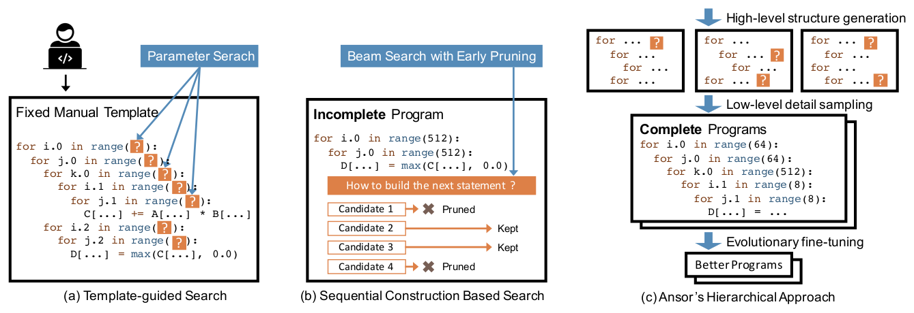

*图 2（原文 Figure 2，第 3 页）：搜索策略对比。伪代码表示带循环嵌套的张量程序，橙色背景的问号表示低层参数。*

**图中文字翻译与读法**：

- **(a) Template-guided Search（模板引导搜索）**：一位程序员（左上小人）写出 Fixed Manual Template（固定的人工模板），其中的 `?` 是待定参数（循环范围）；蓝色框 Parameter Search（参数搜索，原图拼写为 “Serach”）只在这些 `?` 上搜索。模板的循环结构本身是固定的（i.0、j.0、k.0、i.1、j.1 等多级 tile，再接另一个循环嵌套做 `D = max(C, 0.0)`）。
- **(b) Sequential Construction Based Search（顺序构造搜索）**：蓝色框 Beam Search with Early Pruning（带提前剪枝的 beam search）。左边是 Incomplete Program（不完整程序），只写了 `D[...] = max(C[...], 0.0)` 的循环；橙色条问“How to build the next statement？（下一条语句怎么构造？）”，下面 Candidate 1–4（候选 1–4）里 1 和 4 被 Pruned（剪掉），2 和 3 Kept（保留）。
- **(c) Ansor's Hierarchical Approach（Ansor 的分层方法）**：自上而下三步。High-level structure generation（高层结构生成）得到若干只含循环结构、带 `?` 的 sketch；Low-level detail sampling（低层细节采样）把 `?` 填上具体数值，得到 Complete Programs（完整程序，如 `i.0 in range(64)`、`k.0 in range(512)`、`i.1 in range(8)`）；Evolutionary fine-tuning（evolutionary 微调）在完整程序上继续改进，得到 Better Programs（更好的程序）。

**读图结论**：三种方法的根本区别是“谁决定结构、在什么形态的程序上评估”：模板方法由人决定结构；顺序构造在半成品上评估并剪枝；Ansor 自动生成结构，并且只在完整程序上做微调。

### 2.4 为什么在不完整程序上估计性能不可靠（图 3）

论文给出三条理由：

1. **cost model 只能在完整程序上训练**：训练标签来自“编译后真机测量”，只有完整程序才能测，因此拿它去比较不完整程序的最终性能，精度会很差。
2. **固定的决策顺序限制了搜索空间的设计**：有些优化需要往计算图里**新增节点**（如加 cache 节点、用 rfactor），不同程序的决策数量会不一样，很难把不完整程序对齐后公平比较。
3. **不可扩展**：扩大搜索空间要增加顺序构造的步数，导致累积误差更大。

第 1 条有一个案例研究：用 20,000 个从 Ansor 搜索空间随机采样的完整程序训练 cost model（§5.2 的模型），再让它预测“只施加了完整程序的一部分循环变换”的不完整程序的最终性能，用两个排序指标评估：

- **成对比较准确率**（pairwise comparison accuracy）：随机取两个程序，模型能否判断对谁更快；
- **top-k 召回率**（recall@k of top-k）：$\mathrm{recall@}k=\dfrac{\lvert G\cap P\rvert}{k}$，其中 $G$ 是按真实性能排名的前 $k$ 个程序，$P$ 是模型预测的前 $k$ 个程序，取 $k=10$。

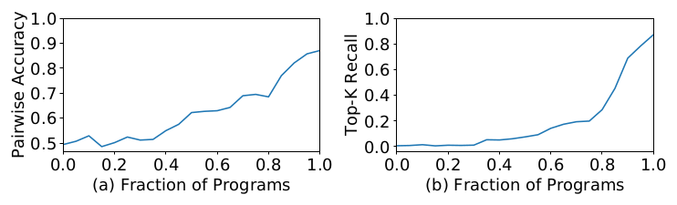

*图 3（原文 Figure 3，第 3 页）：随机不完整程序上的成对比较准确率（左）和 top-k 召回率（右）。两张图都是越高越好。*

**图中文字翻译与读法**：

- **(a)** 横轴 Fraction of Programs（程序的完成度，按正文说明是“只施加了完整程序多大比例的循环变换”，0 为未变换，1 为完整程序），纵轴 Pairwise Accuracy（成对比较准确率）；
- **(b)** 横轴同上，纵轴 Top-K Recall（top-k 召回率）。

**读图结论**：两条曲线分别从 50% 和 0% 起步，即在零信息时等于随机猜测（成对比较随机猜对一半，召回率为 0）；只有程序接近完整时才快速上升（从图上读出，完成度 1.0 处两项都约 0.87，而完成度 0.5 处成对准确率约 0.62、召回率仍在约 0.1 以下）。也就是说，cost model 对完整程序很准，对半成品预测不准，所以不能靠它在半成品上做提前剪枝。这是 Ansor 选择“先随机生成完整程序、再对完整程序微调”的直接动机。

### 2.5 Ansor 的思路

Ansor 用**分层搜索空间**把高层结构（sketch）和低层细节（annotation）解耦：自动枚举高层结构，高效采样低层细节；然后只对完整程序做微调，从而回避不完整程序的估计问题。论文的四条贡献为：

1. 为计算图自动生成大型分层搜索空间的机制；
2. 带 learned cost model 的 evolutionary 微调策略；
3. 基于梯度下降的调度算法，在端到端优化 DNN 时优先处理重要子图；
4. Ansor 系统的实现与全面评估。

## 三、系统总览（图 4）

Ansor 的输入是一组待优化的 DNN。它先用 Relay 的算子融合算法把 DNN（来自 ONNX、TensorFlow PB 等格式）切分成许多小**子图**，再为这些子图生成张量程序。切分对性能影响可以忽略，因为 DNN 是逐层构造的；不切分而把整个网络当作一张图去搜索，会让搜索空间无谓地指数爆炸。

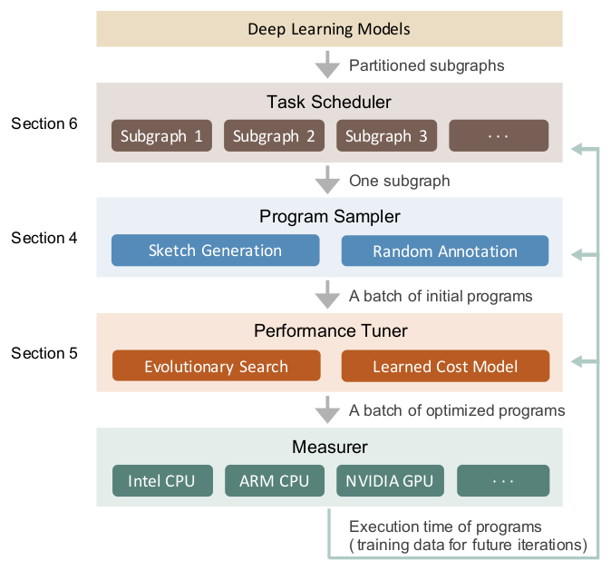

*图 4（原文 Figure 4，第 4 页）：系统总览。灰色箭头表示从深度学习模型中提取子图并为其生成优化程序的数据流；绿色箭头表示 measurer 把测量数据返回，用于更新系统中各组件的状态。*

**图中文字翻译与读法**（自上而下）：

- **Deep Learning Models（深度学习模型）** → 灰箭头 Partitioned subgraphs（切分后的子图） →
- **Task Scheduler（任务调度器，Section 6）**：内含 Subgraph 1、Subgraph 2、Subgraph 3、…；灰箭头 One subgraph（选出一个子图） →
- **Program Sampler（程序采样器，Section 4）**：Sketch Generation（sketch 生成）和 Random Annotation（随机标注）；灰箭头 A batch of initial programs（一批初始程序） →
- **Performance Tuner（性能微调器，Section 5）**：Evolutionary Search（evolutionary 搜索）和 Learned Cost Model（学习的 cost model）；灰箭头 A batch of optimized programs（一批优化后的程序） →
- **Measurer（测量器）**：Intel CPU、ARM CPU、NVIDIA GPU、…；
- 右侧绿色回路 Execution time of programs (training data for future iterations)（程序的执行时间，作为后续迭代的训练数据）从 Measurer 回到 Task Scheduler、Program Sampler、Performance Tuner。

**读图结论**：三个组件分工为：program sampler 负责构造大搜索空间并从中采样多样的程序；performance tuner 负责微调这些程序；task scheduler 负责在多个子图之间分配时间资源。系统是一个闭环：测量结果既训练 cost model，也更新每个任务的最佳延迟（供调度器计算梯度）。

## 四、Program sampler：sketch 与 annotation

搜索空间决定了算法能找到的最好程序。已有方法的空间受两个因素限制：（1）**人工枚举**（如 TVM）：不可能用模板穷举所有选择，模板只能启发式地覆盖很小的空间；（2）**激进的提前剪枝**（如 Halide auto-scheduler）：基于不完整程序的评估会让搜索永远探索不到某些区域。

Ansor 的对策：对（1），用一组灵活的**推导规则**递归地自动扩展搜索空间；对（2），**随机采样完整程序**——随机采样让空间中每个点被采到的机会均等，所以搜索理论上能触及空间里的任何程序。论文强调：不依赖随机采样直接找到最优，因为每个被采样的程序之后都会被微调（§5）。

分层空间的两级：顶层是 **sketch**（高层结构，由少数几条推导规则递归生成）；底层是 **annotation**（数十亿种低层选择，如 tile 大小、parallel、unroll 标注，随机填写）。下文先以 CPU 为例（§4.1、§4.2），再说 GPU（§4.3）。

### 4.1 Sketch 生成

**输入**是切分后的子图，原文图 5 第一列给出两个例子。每个输入有三种等价形式：数学表达式、直接展开循环下标得到的朴素程序、对应的计算图（DAG）。

**状态与遍历顺序**。把 DAG 的节点按拓扑序**从输出到输入**排序并编号；用状态 $\sigma=(S,i)$ 表示推导进度，其中 $S$ 是当前部分生成的 sketch，$i$ 是当前正在处理的节点下标。推导从初始状态 $\sigma_0=(\text{朴素程序},\,\text{最后一个节点的下标})$ 开始。

**推导过程（算法步骤）**：

1. 把初始状态放入队列。
2. 取出一个状态 $\sigma=(S,i)$。如果 $i=0$，它是**终态**，把 $S$ 加入 sketch 列表。
3. 否则，检查每条推导规则的条件；满足条件的规则被应用，得到新状态 $\sigma'=(S',i')$，且 $i'\le i$。因此工作节点下标单调不增。
4. 同一个状态可能满足多条规则，一条规则也可能返回多个可能的 $S'$（如 `AddRfactor`、`FuseConsumer` 的不同取法），每个后继状态都入队。
5. 队列为空时结束。所有终态里的 $\sigma.S$ 构成 sketch 列表。对典型的子图，sketch 数量少于 10 个。

**四个谓词**（通过对计算定义的数学表达式做静态分析，解析读写模式，自动得到）：

| 谓词 | 含义 | 例子 |
|---|---|---|
| $\mathrm{IsStrictInlinable}(S,i)$ | 节点 $i$ 是简单的逐元素算子，总是可以内联 | 逐元素加法、ReLU |
| $\mathrm{HasDataReuse}(S,i)$ | 节点 $i$ 是计算密集型算子，算子内部有大量数据复用机会 | matmul、conv2d |
| $\mathrm{HasFusibleConsumer}(S,i)$ | 节点 $i$ 只有一个消费者 $j$，且 $j$ 可以融合进 $i$ | matmul + bias_add、conv2d + relu |
| $\mathrm{HasMoreReductionParallel}(S,i)$ | 节点 $i$ 在空间维度上并行度很小，但归约维度上有充足的并行机会 | 求矩阵 2-范数；$C_{2\times2}=A_{2\times512}\cdot B_{512\times2}$ |

**推导规则表（CPU）**：条件在当前状态 $\sigma=(S,i)$ 上判断，应用得到下一状态。

| 编号 | 规则名 | 条件 | 应用 |
|---:|---|---|---|
| 1 | Skip（跳过） | $\neg\mathrm{IsStrictInlinable}(S,i)$ | $S'=S;\ i'=i-1$ |
| 2 | Always Inline（总是内联） | $\mathrm{IsStrictInlinable}(S,i)$ | $S'=\mathrm{Inline}(S,i);\ i'=i-1$ |
| 3 | Multi-level Tiling（多级分块） | $\mathrm{HasDataReuse}(S,i)$ | $S'=\mathrm{MultiLevelTiling}(S,i);\ i'=i-1$ |
| 4 | Multi-level Tiling with Fusion（多级分块并融合消费者） | $\mathrm{HasDataReuse}(S,i)\wedge\mathrm{HasFusibleConsumer}(S,i)$ | $S'=\mathrm{FuseConsumer}(\mathrm{MultiLevelTiling}(S,i),i);\ i'=i-1$ |
| 5 | Add Cache Stage（增加缓存阶段） | $\mathrm{HasDataReuse}(S,i)\wedge\neg\mathrm{HasFusibleConsumer}(S,i)$ | $S'=\mathrm{AddCacheWrite}(S,i);\ i'=i$ |
| 6 | Reduction Factorization（归约分解） | $\mathrm{HasMoreReductionParallel}(S,i)$ | $S'=\mathrm{AddRfactor}(S,i);\ i'=i-1$ |
| … | User Defined Rule（用户自定义规则） | … | … |

（原文表 1，第 5 页。规则 5 的“应用”栏原文写作 $S'=\mathrm{AddCacheWrite}(S,i);\ i=i'$，与 $i'=i$ 等价：加了缓存节点后仍停留在同一个节点上，下一步可以应用规则 4，所以它与其他规则“$i'=i-1$”的区别是下标不减。）

**逐条解释**：

- **规则 1 与 2**：规则 1 跳过非严格可内联的节点，规则 2 把严格可内联的节点内联掉（不再单独物化中间张量）。两者条件互斥，所以只要 $i>1$，状态总能满足其中一条而继续推导。
- **规则 3（多级分块）**：对有数据复用的节点做 multi-level tiling。CPU 上采用 **“SSRSRS” tile 结构**：S 表示一层空间循环（space loop）的 tile，R 表示一层归约循环（reduction loop）的 tile。以矩阵乘 $C(i,j)=\sum_k A[i,k]\times B[k,j]$ 为例，$i,j$ 是空间循环，$k$ 是归约循环；“SSRSRS”把原来的 3 层循环 $(i,j,k)$ 展开为 10 层循环 $(i_0,j_0,i_1,j_1,k_0,i_2,j_2,k_1,i_3,j_3)$。虽然不改变循环顺序，但把某些层的长度设为 1，就能退化出一些重排序的情形，例如上述 10 层循环可以特化成简单的重排 $(k_0,j_2,i_3)$。这个结构对 matmul、conv2d、conv3d 等计算密集型稠密算子都通用，因为它们都由空间循环和归约循环构成。
- **规则 4（多级分块并融合消费者）**：在做多级分块的同时，把可融合的消费者（如 ReLU、bias add 这类逐元素节点）融合进被分块的节点（如 conv2d、matmul）。
- **规则 5（增加缓存阶段）**：如果有数据复用的节点**没有**可融合的消费者，就给它加一个缓存（cache）节点。例如 DAG 的最终输出节点没有任何消费者，默认直接把结果写进主存，由于主存访问延迟高而低效。加入缓存节点就给 DAG 引入了一个新的可融合消费者，于是可以接着应用规则 4 把这个新缓存节点融合进最终输出节点；融合之后，输出节点先把结果写进一个缓存块，等整块数据都算完，再一次性写回主存。
- **规则 6（归约分解）**：用 rfactor 把一个归约循环分解成一个空间循环，带来更多并行度。

**三个 sketch 例子（原文图 5）**：图 5 的第一列是两个输入，第二列是生成的三个 sketch，第三列是从 sketch 随机标注得到的四个完整程序。注意：图 5 展示的是“三个例子”，不是这两个输入的全部 sketch。

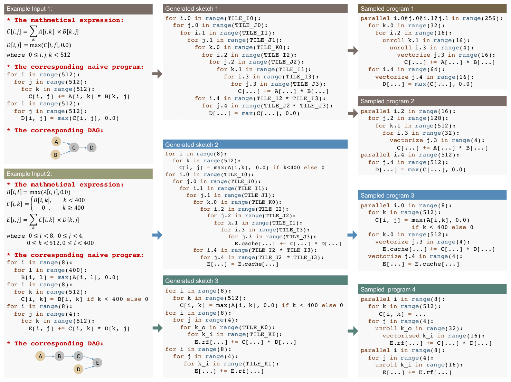

*图 5（原文 Figure 5，第 7 页）：生成的 sketch 与采样程序的例子。图中有两个输入样例、三个生成的 sketch、四个采样得到的程序；代码为类 Python 语法的伪代码。*

**图中文字翻译与读法**：

- **第一列 Example Input 1（输入样例 1）**：数学表达式（The mathematical expression）$C[i,j]=\sum_k A[i,k]\times B[k,j]$，$D[i,j]=\max(C[i,j],0.0)$，其中 $0\le i,j,k<512$；对应的朴素程序（The corresponding naive program）；对应的 DAG（The corresponding DAG）：$A,B\to C\to D$。
- **第一列 Example Input 2（输入样例 2）**：$B[i,l]=\max(A[i,l],0.0)$；$C[i,k]=B[i,k]$ 当 $k<400$，否则为 $0$（相当于把 $B$ 在 $k$ 方向补零到 512）；$E[i,j]=\sum_k C[i,k]\times D[k,j]$；范围 $0\le i<8$、$0\le j<4$、$0\le k<512$、$0\le l<400$。DAG：$A\to B\to C\to E$，$D\to E$。这是一个“小输出（$8\times4$）、长归约（$512$）”的例子。
- **第二列 Generated sketch 1/2/3（生成的 sketch 1/2/3）**：循环范围中的 `TILE_I0`、`TILE_J0`、`TILE_K0` 等是尚未确定的 tile 大小，即 sketch 的“待填空”。
- **第三列 Sampled program 1–4（采样程序 1–4）**：把 tile 大小填上具体数值，并加上 `parallel`（并行）、`unroll`（展开）、`vectorize`（向量化）标注。

**推导过程如何对应 sketch**（节点按拓扑序编号，输入样例 1 的节点序为 $(A,B,C,D)$，下标 1–4；样例 2 为 $(A,B,C,D,E)$，下标 1–5）：

- **输入样例 1 → sketch 1**：$\sigma(S_0,i{=}4)\xrightarrow{\text{规则 1}}\sigma(S_1,i{=}3)\xrightarrow{\text{规则 4}}\sigma(S_2,i{=}2)\xrightarrow{\text{规则 1}}\sigma(S_3,i{=}1)\xrightarrow{\text{规则 1}}$ sketch 1。解读：输出节点 $D$（ReLU，没有消费者，不能内联）被跳过；$C$（matmul，有数据复用，且有可融合的消费者 $D$）做多级分块并把 $D$ 融合进去；输入节点 $B$、$A$（占位符）被跳过。
- **输入样例 2 → sketch 2**：$\sigma(S_0,i{=}5)\xrightarrow{\text{规则 5}}\sigma(S_1,i{=}5)\xrightarrow{\text{规则 4}}\sigma(S_2,i{=}4)\xrightarrow{\text{规则 1}}\sigma(S_3,i{=}3)\xrightarrow{\text{规则 1}}\sigma(S_4,i{=}2)\xrightarrow{\text{规则 2}}\sigma(S_5,i{=}1)\xrightarrow{\text{规则 1}}$ sketch 2。解读：输出 $E$（matmul）没有可融合消费者，先加缓存阶段（规则 5，下标不变），再因新缓存节点而做分块并融合（规则 4）；$D$（权重占位符）和 $C$ 被规则 1 跳过，其中 $C$ 保留为单独的循环嵌套；$B$（ReLU）被内联进 $C$（规则 2）；$A$ 被跳过。所以 sketch 2 的第一个循环嵌套同时计算“ReLU + 补零”（`C[i, j] = max(A[i,k], 0.0) if k<400 else 0`），之后才是对 $E$ 的分块计算，且 $E$ 先累加到 `E.cache`，最后写回。
- **输入样例 2 → sketch 3**：$\sigma(S_0,i{=}5)\xrightarrow{\text{规则 6}}\sigma(S_1,i{=}4)\xrightarrow{\text{规则 1}}\sigma(S_2,i{=}3)\xrightarrow{\text{规则 1}}\sigma(S_3,i{=}2)\xrightarrow{\text{规则 2}}\sigma(S_4,i{=}1)\xrightarrow{\text{规则 1}}$ sketch 3。解读：输出 $E$ 空间维度很小（$8\times4$）而归约很长（$512$），满足 $\mathrm{HasMoreReductionParallel}$，用 rfactor 把归约拆成 `k_o`、`k_i` 两层：先对每个 `k_i` 各自累加出部分和 `E.rf`（`k_i` 因此变成可以并行或向量化的“空间”维度），再单独做一次循环把各个 `k_i` 的部分和合并进 `E`。

**sketch 1 与采样程序 1 的逐行对照**（代码为原图转录并加了中文注释）：

```python
# Generated sketch 1：多级分块 SSRSRS + 融合 ReLU（tile 大小尚未确定）
for i.0 in range(TILE_I0):
  for j.0 in range(TILE_J0):
    for i.1 in range(TILE_I1):
      for j.1 in range(TILE_J1):
        for k.0 in range(TILE_K0):
          for i.2 in range(TILE_I2):
            for j.2 in range(TILE_J2):
              for k.1 in range(TILE_I1):      # 原图印作 TILE_I1；按 SSRSRS 结构这层是 k 方向的第二级 tile，应为 TILE_K1（本文推断，原文疑为笔误）
                for i.3 in range(TILE_I3):
                  for j.3 in range(TILE_J3):
                    C[...] += A[...] * B[...]
        for i.4 in range(TILE_I2 * TILE_I3):  # 融合进来的 ReLU，与 k.0 同层，位于 j.1 内部
          for j.4 in range(TILE_J2 * TILE_J3):
            D[...] = max(C[...], 0.0)
```

```python
# Sampled program 1：从 sketch 1 随机填写得到
parallel i.0@j.0@i.1@j.1 in range(256):    # 最外四层融合后并行
  for k.0 in range(32):
    for i.2 in range(16):
      unroll k.1 in range(16):
        unroll i.3 in range(4):
          vectorize j.3 in range(16):
            C[...] += A[...] * B[...]
  for i.4 in range(64):
    vectorize j.4 in range(16):
      D[...] = max(C[...], 0.0)
```

可以自己验证采样程序与 sketch 的一致性：$i$ 方向 $i_0\cdot i_1\cdot 16\cdot 4=512$，故 $i_0i_1=8$；$j$ 方向 $j_0\cdot j_1\cdot 1\cdot 16=512$（$j.2$ 的长度为 1，被化简掉了），故 $j_0j_1=32$；并行循环长度 $8\times32=256$，与 `parallel ... in range(256)` 吻合；归约方向 $k_0\cdot k_1=32\times16=512$；融合的 ReLU 循环 $i.4=\text{TILE\_I2}\times\text{TILE\_I3}=16\times4=64$，$j.4=1\times16=16$，也吻合。论文指出，采样程序的循环可能比 sketch 少，因为长度为 1 的循环会被化简。

其余三个采样程序（读图要点）：采样程序 2 来自同一个 sketch 1，但取了完全不同的 tile 数值（`parallel i.2 in range(16)`、`j.2 in range(128)`、`k.1 in range(512)`、`i.3 in range(32)`、`vectorize j.3 in range(4)`，后面的 ReLU 循环是 `parallel i.4 in range(512)` 与 `for j.4 in range(512)`）；采样程序 3 来自 sketch 2（`parallel i.0 in range(8)`，对 `E.cache` 做向量化累加，再写回 `E`）；采样程序 4 来自 sketch 3（`unroll k_o in range(32)`、`vectorized k_i in range(16)` 对 `E.rf` 累加；随后在 `parallel i in range(8)` 之下，用 `unroll k_i in range(16)` 把 16 份部分和合并进 `E`）。

**读图结论**：同一个 sketch 能产生结构相同、数值不同的大量程序（采样程序 1、2）；不同的 sketch 对应根本不同的结构（融合与否、有无 cache、有无 rfactor）。这样“结构”由规则自动枚举，“数值”由采样决定。

**与手写模板的区别**：TVM 的手写模板同时规定高层结构和低层细节；sketch 只规定高层结构，tile 大小等一律留空。所以 sketch 是对数十亿种低层选择的概括。

**定制化（Customization）**：上面这组规则足以覆盖大多数算子，但总有例外：Winograd 卷积和加速器指令（如 TensorCore）需要特殊的 tile 结构。模板引导方法要为每个新情形手写新模板，设计代价很大；Ansor 允许用户注册新的推导规则，并与已有规则无缝配合，所以能生成新算法和新硬件所需的结构。

### 4.2 随机标注（Random annotation）

sketch 还是不完整的程序，只有 tile 结构，没有具体的 tile 大小，也没有 parallel、unroll、vectorize 等循环标注。随机标注把 sketch 变成能微调和评估的完整程序：

1. 从 sketch 列表中随机选一个 sketch；
2. 随机填写 tile 大小；
3. 并行化一些最外层循环；
4. 向量化一些最内层循环；
5. 展开少量内层循环；
6. 随机改变某些节点的**计算位置**（computation location），对 tile 结构做小幅调整。

这里的“随机”都指在所有合法取值上的**均匀分布**。若特殊算法需要自定义标注（如特殊的展开方式），用户可以在计算定义里给出简单的提示（hint）来调整标注策略。

另外有一个与权重张量相关的优化：推理时卷积层或全连接层的权重是常量，改变常量张量的布局可以在编译期完成，没有运行时开销，因此 Ansor 按多级 tile 结构重写常量张量的布局，让访存尽量对缓存友好。（论文在 §7.3 中说，这个布局重写给 Ansor 的 ResNet-50 带来约 40% 的提升。）

### 4.3 GPU 支持

GPU 上，多级分块结构从“SSRSRS”改为 **“SSSRRSRS”**，以匹配 GPU 架构：前三层空间 tile 的循环分别绑定到 BlockIdx、virtual thread（用于减少 bank conflict）和 ThreadIdx。另外增加两条 sketch 推导规则：一条通过插入缓存节点来利用共享内存（类似规则 5），另一条做跨线程归约（cross-thread reduction，类似规则 6）。

## 五、Performance tuner：evolutionary search 与 learned cost model

随机采样的程序覆盖面好，但质量没有保证，因为 tile 结构、循环标注等都是随机选的。性能微调器迭代地做三步：

1. 用 evolutionary search 在 learned cost model 的指导下，找出一小批有希望的程序；
2. 把这些程序在真机上测量，得到真实执行时间；
3. 用测量得到的数据重新训练 cost model，使它更准。

evolutionary search 以“随机采样的程序”加上“上一轮测量中的高质量程序”为初始种群，通过变异（mutation）和交叉（crossover）生成下一代；cost model 用来预测每个程序的适应度（fitness，这里就是该程序的**吞吐**）。固定演化若干代，从中选出得分最高的程序。使用 cost model 的原因：它对适应度的估计相对准确，且比真机测量快几个数量级，可以在几秒内比较数千乃至数万个程序，再挑有希望的上机测量。

### 5.1 Evolutionary search

evolutionary search 是受生物进化启发的通用元启发式算法：不断变异高质量程序，就可能产生质量更高的新程序。

**生成下一代的步骤**：

1. 按概率从当前一代选出一些程序，被选中的概率**正比于** cost model 预测的适应度（得分高的程序更容易被选中）；
2. 对每个被选中的程序，随机应用下列一种演化操作生成新程序。

原则是：对 §4.2 采样时做的每类决定，设计对应的演化操作去改写和微调它。

| 演化操作 | 做法 |
|---|---|
| Tile size mutation（tile 大小变异） | 扫描程序，随机选一个被 tile 的循环；把它某一层的 tile 大小**除以**一个随机因子，再把这个因子**乘到**另一层上。由于各层 tile 大小的乘积等于原循环长度，变异后的程序总是合法的 |
| Parallel mutation（并行变异） | 随机选一个带 parallel 标注的循环，通过**融合相邻循环层**或**按某个因子拆分**来改变并行粒度 |
| Pragma mutation（pragma 变异） | 有些优化由编译器相关的 pragma 指定。随机选一个 pragma，把它随机变成另一个合法值。例如底层代码生成器支持用 `auto_unroll_max_step=N` 指定自动展开的最大步数，就随机调整 $N$ |
| Computation location mutation（计算位置变异） | 随机选一个没有被多级分块的“灵活”节点（如卷积层里的 padding 节点），把它的计算位置随机改成另一个合法的挂载点 |
| Node-based crossover（基于节点的交叉） | 见下文 |

**节点交叉**。交叉操作通过组合两个或多个父代的“基因”生成后代。Ansor 里程序的基因就是它的**改写步骤**（rewriting steps）：Ansor 生成的每个程序都是从初始朴素实现一步步改写出来的，并在 sketch 生成和随机标注期间保存每个程序完整的改写历史，所以改写步骤描述了这个程序是怎样由朴素程序形成的。因此可以通过组合两个已有程序的改写步骤生成新程序。但是任意混合两个程序的改写步骤，可能破坏步骤之间的依赖、产生非法程序，所以 Ansor 的交叉以 **DAG 节点**为粒度（不同节点之间的改写步骤通常依赖更少）：对每个节点随机选择一个父代，把被选中节点的改写步骤合并；节点之间存在依赖时，Ansor 用简单的启发式规则分析并调整步骤；最后还要验证合并后的程序在功能上正确。验证很简单，因为 Ansor 只用一小组循环变换改写步骤，底层代码生成器可通过依赖分析检查正确性。

evolutionary search 用变异和交叉反复生成新一批候选，迭代若干轮，输出得分最高的一小批程序；它们被编译并在目标硬件上实测，得到真实运行时间，测量数据再用于更新 cost model，这样 cost model 逐步贴合目标硬件，evolutionary search 也逐步生成更高质量的程序。

**与已有方法的区别**：TVM 和 FlexTensor 的搜索算法只能在固定的网格状参数空间里工作；Ansor 的演化操作专为张量程序设计，可用于一般的张量程序，能处理依赖关系复杂的搜索空间。与 Halide auto-scheduler 的展开规则不同，这些操作可以**乱序**修改程序，解决了顺序构造的限制。

### 5.2 Learned cost model

**设计目标**：搜索过程中需要快速估计程序性能。Ansor 采用与已有工作类似的 learned cost model，但重新设计了程序特征。基于 learned cost model 的系统可移植性很好：同一个模型设计只要喂不同的训练数据就能复用于不同的硬件后端。

**预测对象**：目标程序主要是数据并行的张量程序，由多个交错的循环嵌套构成，最内层是若干赋值语句。因此训练模型预测循环嵌套中**一条最内层非循环语句**的得分；对整个程序，对每条最内层非循环语句各预测一次，**把预测值加起来**作为程序的得分。每条语句的特征向量在**完整程序的上下文**中提取，包括算术特征和访存特征（完整特征表见原文附录 B）。

**特征（附录 B 概览）**：每条语句的特征向量总长 164，CPU 与 GPU 用同一组特征。类别特征用 one-hot 编码，数值特征直接使用。大类如下：

- 浮点运算数：加法、减法、除法、取模、比较、内建数学函数调用（如 exp、sqrt）与其他数学函数调用的次数；整数运算数同理；
- 向量化相关：最内层向量化循环的长度、向量化位置的类型（InnerSpatial、MiddleSpatial、OuterSpatial、InnerReduce、MiddleReduce、OuterReduce、Mixed、None）、所有向量化循环长度之积、向量化循环个数；展开、并行相关特征类似；
- GPU 线程绑定相关：blockIdx.x/y/z、threadIdx.x/y/z 与 virtual thread 的长度；
- 算术强度曲线（arithmetic intensity curve）：算术强度定义为浮点运算数除以访问的字节数；对每一层循环计算算术强度，线性插值画成曲线，再从曲线上采样 10 个点；
- 缓冲区访问特征：对语句访问的每个缓冲区提取（最多 5 个，不足补零，过多则去掉小缓冲区）：访问类型（读/写/读写）、访问字节数、唯一字节数、cache line 数、唯一 cache line 数、复用类型（LoopMultipleRead、SerialMultipleRead、NoReuse）、复用距离、复用次数、访问步长、以及“访问量除以复用次数”的几个比值；
- 分配相关：该语句输出缓冲区的分配大小与分配次数；
- 其他：外层循环个数、外层循环长度之积、外层循环 pragma 指定的 `auto_unroll_max_step` 值。

**损失函数**。因为最关心的是找出表现好的程序，所以给运行更快的程序更大的权重。对模型 $f$、程序 $P$ 及其吞吐 $y$，损失为加权平方误差，并直接用吞吐 $y$ 作权重：

$$
\mathrm{loss}(f,P,y)=w_P\Big(\sum_{s\in S(P)}f(s)-y\Big)^2=y\Big(\sum_{s\in S(P)}f(s)-y\Big)^2,
$$

其中 $S(P)$ 是 $P$ 中所有最内层非循环语句的集合，$f(s)$ 是模型对语句 $s$ 的预测得分。

**模型与训练**：底层模型 $f$ 是梯度提升决策树（gradient boosting decision tree，原文引用 XGBoost 论文）。所有 DAG 的所有程序共用**一个**模型；来自同一个 DAG 的所有程序的吞吐被归一化到 $[0,1]$。优化一个 DNN 时，测量过的程序通常少于 30,000 个，在这么小的数据集上训练 GBDT 很快，所以每次都重新训练一个新模型，不做增量更新。

## 六、Task scheduler：在多个子图间分配时间

一个 DNN 可以被切成许多相互独立的子图（如 conv2d + relu）。给有些子图花时间调优并不会显著改善端到端性能，原因有二：（1）该子图不是性能瓶颈；（2）调优对该子图的提升很小。为避免浪费时间，Ansor 动态地给不同子图分配不同的时间资源。

以 ResNet-50 为例，图切分后有 29 个**不同**的子图，大多是形状配置（输入尺寸、卷积核大小、步长等）各不相同的卷积层；最佳张量程序依赖形状配置，所以要为不同卷积层生成不同的程序。实际中用户可能有多个 DNN，子图更多，也带来更多缩短总调优时间的机会，因为可以在子图之间共享、复用知识；一个子图也可能在一个 DNN 或不同 DNN 中重复出现。

**任务与时间单位**：为一个子图生成高性能程序的过程称为一个**任务**（task）；优化一个 DNN 需要完成几十个任务（如 ResNet-50 的 29 个任务）。task scheduler 以迭代方式分配时间资源：每个迭代选一个任务，为该子图生成一批有希望的程序，并在硬件上测量这批程序。一次这样的迭代就是**一个单位**的时间资源。给某个任务一个单位，就是给它生成并测量新程序的机会，也就是找到更好程序的机会。

### 6.1 问题形式化

设共有 $n$ 个任务，$t\in\mathbb{Z}^n$ 为**分配向量**，$t_i$ 是花在任务 $i$ 上的时间单位数。设任务 $i$ 取得的最小子图延迟是分配向量的函数 $g_i(t)$。DNN 的端到端代价是各子图延迟的函数 $f(g_1(t),g_2(t),\dots,g_n(t))$（原文此处末项印作 $g_3(t)$，按含义应为 $g_n(t)$）。目标是最小化端到端代价：

$$
\text{minimize}\quad f\big(g_1(t),g_2(t),\dots,g_n(t)\big).
$$

**单个 DNN 的目标**：端到端延迟近似为 $f(g_1,\dots,g_n)=\sum_{i=1}^{n}w_i\times g_i$，其中 $w_i$ 是任务 $i$ 在该 DNN 中出现的次数。

**多个 DNN 的目标**（表 2）：设 $m$ 为 DNN 个数，$S(j)$ 为属于 DNN $j$ 的任务集合。

| 目标 | 表达式 | 含义 |
|---|---|---|
| $f_1$ | $\sum_{j=1}^{m}\sum_{i\in S(j)}w_i\times g_i(t)$ | 把每个 DNN 的延迟加起来，即优化“依次运行每个 DNN 一次”的流水线代价 |
| $f_2$ | $\sum_{j=1}^{m}\max\Big(\sum_{i\in S(j)}w_i\times g_i(t),\,L_j\Big)$ | $L_j$ 是 DNN $j$ 的延迟要求；延迟已达标的 DNN 不再值得花时间 |
| $f_3$ | $-\Big(\prod_{j=1}^{m}\dfrac{B_j}{\sum_{i\in S(j)}w_i\times g_i(t)}\Big)^{1/m}$ | $B_j$ 是 DNN $j$ 的参考延迟；目标是最大化相对参考延迟的**加速比几何平均** |
| $f_4$ | $\sum_{j=1}^{m}\sum_{i\in S(j)}w_i\times\max\big(g_i(t),\,ES(g_i,t)\big)$ | $ES(g_i,t)$ 根据任务 $i$ 的延迟历史返回一个提前停止值，可实现逐任务的提前停止 |

（原文表 2，第 9 页，公式为逐项转写；用户也可以提供自己的目标函数。）

### 6.2 用梯度下降优化

给定当前分配 $t$，思路是近似目标函数的梯度 $\partial f/\partial t_i$，选使梯度绝对值最大的任务：

$$
i=\operatorname*{arg\,max}_{i}\ \Big\lvert\frac{\partial f}{\partial t_i}\Big\rvert .
$$

梯度通过“乐观猜测”与“任务之间的相似性”近似，推导见原文附录 A：

$$
\frac{\partial f}{\partial t_i}\approx\frac{\partial f}{\partial g_i}\Big(\alpha\,\frac{g_i(t_i)-g_i(t_i-\Delta t)}{\Delta t}+(1-\alpha)\Big(\min\Big(-\frac{g_i(t_i)}{t_i},\ \beta\,\frac{C_i}{\max_{k\in N(i)}V_k}-g_i(t_i)\Big)\Big)\Big).
$$

**符号**：$\Delta t$ 是一个很小的**向后**窗口；$g_i(t_i)$ 与 $g_i(t_i-\Delta t)$ 可以从分配历史中得到；$N(i)$ 是与任务 $i$ **相似**的任务集合；$C_i$ 是任务 $i$ 的浮点运算次数；$V_k$ 是任务 $k$ 已达到的每秒浮点运算数；$\alpha$、$\beta$ 控制对预测的信任程度。

**附录 A 的推导**：

1. 先做近似 $g_i(t)\approx g_i(t_i)$，即假设任务 $i$ 的最佳代价只取决于花在它身上的资源单位数。这未必成立，因为所有任务共用一个 cost model，不同的资源分配会产生不同的训练数据，进而得到不同的 cost model；这里为了继续推导做此近似。
2. 链式法则：$\dfrac{\partial f}{\partial t_i}=\dfrac{\partial f}{\partial g_i}\dfrac{\partial g_i}{\partial t_i}$，再把 $\partial g_i/\partial t_i$ 用向后差分和向前差分的加权和近似（权重 $\alpha$ 与 $1-\alpha$）：

$$
\frac{\partial f}{\partial t_i}\approx\frac{\partial f}{\partial g_i}\Big(\alpha\,\frac{g_i(t_i)-g_i(t_i-\Delta t)}{\Delta t}+(1-\alpha)\,\frac{g_i(t_i+\Delta t)-g_i(t_i)}{\Delta t}\Big)\approx\frac{\partial f}{\partial g_i}\Big(\alpha\,\frac{g_i(t_i)-g_i(t_i-\Delta t)}{\Delta t}+(1-\alpha)\big(g_i(t_i+1)-g_i(t_i)\big)\Big).
$$

3. 向后差分里的两项来自历史，已知；但 $g_i(t_i+1)$ 未知（还没给任务 $i$ 多分配一个单位），只能预测。预测用两种方式：
   - **乐观猜测**：若再花 $t_i$ 个单位，能把任务 $i$ 的延迟降到 0，因此多花一个单位大约降低 $g_i(t_i)/t_i$，即 $g_i(t_i+1)\approx g_i(t_i)-g_i(t_i)/t_i$；
   - **相似性**：结构相似的子图，每个浮点运算的延迟也相似。若任务 $i$ 达到与相似任务相同的最高算力 $\max_{k\in N(i)}V_k$，延迟应为 $C_i/\max_{k\in N(i)}V_k$。
4. 综合两者：

$$
g_i(t_i+1)\approx\min\Big(g_i(t_i)-\frac{g_i(t_i)}{t_i},\ \beta\,\frac{C_i}{\max_{k\in N(i)}V_k}\Big),
$$

代入第 2 步即得正文中的梯度近似式。

**调度算法**：

1. 从 $t=\mathbf{0}$ 开始，先做一轮 **round-robin 预热**，得到初始分配向量 $t=(1,1,\dots,1)$；
2. 预热后每个迭代，计算每个任务的梯度，选 $\operatorname*{arg\,max}_i\lvert\partial f/\partial t_i\rvert$，给它分配一个资源单位，更新 $t_i\leftarrow t_i+1$；
3. 直到时间预算用完；
4. 为了鼓励探索，采用 $\varepsilon$-greedy 策略：以概率 $\varepsilon$ 随机选一个任务。

**直觉**（以优化单个 DNN 的端到端延迟为例）：一个任务初始延迟高，乐观猜测认为能很快降低它，所以先被优先调优；之后如果在它上面花了很多迭代却看不到延迟下降，它的 $\lvert\partial f/\partial t_i\rvert$ 会变小，调度器就会离开这个子图。

## 七、实验

### 7.1 实验总设置

Ansor 的核心用 C++ 实现，约 12K 行代码（搜索策略 3K 行，其余基础设施 9K 行）。Ansor 用自己的中间表示（IR）生成程序，再 lower 到 TVM IR 进行面向各种硬件平台的代码生成；Ansor 只把 TVM 用作确定性的代码生成器。评估在三个层次进行（单算子、子图、整个神经网络），每个层次都与当时最好的搜索框架和硬件专用的手写库比较，还评估搜索效率和 Ansor 各组件的作用。

三个硬件平台：Intel CPU（正文写 18 核 Platinum 8124M@3.0 GHz；图 6、图 8 的图题写 20 核 Intel-Platinum-8269CY，原文前后不一致）、NVIDIA GPU（V100）、ARM CPU（树莓派 3b+ 上的 4 核 Cortex-A53@1.4GHz）。所有评估的数据类型都是 float32。

| 实验 | 对象 | 硬件 | 基线 | 预算与设置 | 指标 |
|---|---|---|---|---|---|
| 图 6 单算子 | 10 种算子 × 4 种形状 × batch 1/16 = 80 个测试用例（形状见附录 C，本文第十二节汇总） | Intel CPU | PyTorch v1.5（后端 MKL-DNN）、Halide auto-scheduler（commit 1f875b0）、FlexTensor（commit 7ac302c）、AutoTVM（commit 69313a7） | 每个搜索框架每个用例最多 1,000 次测量；关闭 AVX-512（Halide auto-scheduler 没有 AVX-512 的预训练 cost model）；每个算子用各框架可用的最佳 layout，但输入输出张量不得打包 | 吞吐，对每个用例归一化到最佳框架；4 个形状取几何平均，误差条为 4 个形状归一化吞吐的标准差 |
| 图 7 消融 | ResNet-50 的最后一个卷积算子，batch=16 | 同单算子实验（该图未单独写明硬件） | Ansor 的四个变体 | 5 次运行取中位数 | 相对最佳程序的吞吐 |
| 图 8 子图 | ConvLayer、TBS 两种子图 × 4 种形状 × batch 1/16 | Intel CPU 与 NVIDIA V100 | 同上（GPU 上不报告 Halide；FlexTensor 在 TBS 上无法运行） | 每个用例最多 1,000 次测量 | 吞吐，对每个子图归一化到最佳 |
| 图 9 端到端 | ResNet-50、MobileNet-V2、3D-ResNet-18、DCGAN 生成器、BERT | Intel CPU 与 NVIDIA GPU（batch 1、16），ARM CPU（仅 batch 1） | PyTorch v1.5（torch script）、TensorFlow v2.0（graph 模式）、TensorRT v6.0（TensorFlow 集成，GPU）、TensorFlow Lite v2.0（ARM）、AutoTVM | AutoTVM 与 Ansor 各自最多 $1000\times n$ 次测量（$n$ 为该 DNN 子图数）；task scheduler 目标为最小化单个 DNN 总延迟；Intel CPU 上所有框架都开启 AVX-512 | 吞吐，对每个网络归一化到最佳 |
| 图 10 调优曲线 | 单个 MobileNet-V2；MobileNet-V2 + ResNet-50 | 原文未单独写明硬件 | 三个 Ansor 变体 + AutoTVM | task scheduler 目标为“相对 AutoTVM 加速比的几何平均” | 相对 AutoTVM 的加速比 |
| 表 3 搜索时间 | 五个网络，batch=1 | Intel CPU | AutoTVM | 追平 AutoTVM 性能所需 | 测量次数；墙钟时间（秒） |
| 图 11 cost model | ResNet-50 在 Intel CPU 上调优时测得的 25,000 个程序 | Intel CPU | - | 随机 20,000 个训练，5,000 个测试 | 预测吞吐 vs 真实吞吐 |

### 7.2 单算子基准（图 6）

**被测算子**：1D、2D、3D 卷积（C1D、C2D、C3D）、矩阵乘（GMM）、分组卷积（GRP）、空洞卷积（DIL）、depth-wise 卷积（DEP）、转置 2D 卷积（T2D）、胶囊 2D 卷积（CAP）、矩阵 2-范数（NRM）。

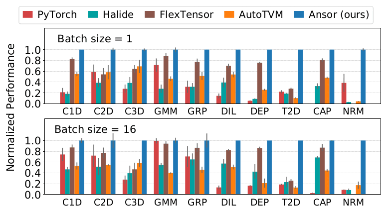

*图 6（原文 Figure 6，第 11 页）：在 20 核 Intel Platinum 8269CY 上的单算子性能基准。纵轴是对每个算子归一化到最佳吞吐的吞吐。*

**图中文字翻译与读法**：上下两个子图分别是 Batch size = 1 与 Batch size = 16；横轴是 10 种算子（C1D、C2D、C3D、GMM、GRP、DIL、DEP、T2D、CAP、NRM）；纵轴 Normalized Performance（归一化性能，最佳框架为 1.0）；图例五色：PyTorch（红）、Halide（青绿，即 Halide auto-scheduler）、FlexTensor（棕）、AutoTVM（橙）、Ansor (ours)（蓝）；每组柱上的竖线是 4 个形状的标准差。没有柱子表示该框架不支持或无法运行（如 NRM 上没有 FlexTensor；CAP 在 batch 1 下没有 PyTorch 的柱子）。

**结果**：Ansor 在所有算子和 batch size 设置下都是最佳或并列最佳，比已有的搜索框架快 $1.1\times$ 到 $22.5\times$。性能提升来自大搜索空间和有效的探索策略：对多数算子，Ansor 找到的最佳程序在已有搜索框架的搜索空间之外。论文对几个典型算子的解释：

- **NRM（矩阵 2-范数）**：大幅领先，是因为 Ansor 能并行化归约循环（rfactor），其他框架不能。从图上读出，batch 1 时 Halide、AutoTVM 只有约 0.03 到 0.04，FlexTensor 在归约算子上根本无法运行。
- **T2D（转置卷积）**：大幅领先，是因为 Ansor 能用正确的 tile 结构和展开策略，让代码生成器化简带步长的转置卷积中对 0 的乘法。从图上读出，batch 1 时各基线约在 0.1 到 0.28。
- **其他框架的空间缺口**：Halide 的展开规则不拆分 GMM 的归约循环，也不拆分 padding 在归约循环之外计算时 C2D 的归约循环；AutoTVM 的模板 tile 结构有限，不能覆盖图 5 中 Generated sketch 1 的结构；FlexTensor 的模板不改变 padding 的计算位置，并且无法运行 NRM 这样的归约算子。
- **并非每处都大幅领先**：从图上读出，GMM 在 batch 16 时 PyTorch（MKL-DNN）约 1.0，与 Ansor 基本持平。

### 7.3 消融：搜索组件的作用（图 7）

在 ResNet-50 的最后一个卷积算子（batch=16）上跑 Ansor 的四个变体并画出性能曲线。选它是因为搜索空间足够大，适合评估搜索算法；论文称其他算子有类似规律。每条曲线是 5 次运行的中位数。

- **Ansor (ours)**：使用论文引入的全部技术；
- **Beam search**：在采样过程中用 cost model 剪枝不完整程序，且不做微调；
- **No fine-tuning**：基于 Ansor，但关掉微调，只靠随机采样；
- **Limited space**：基于 Ansor，但限制搜索空间，使之类似现有手写模板的空间（限制 tile 层数、最内层 tile 大小、计算位置）。

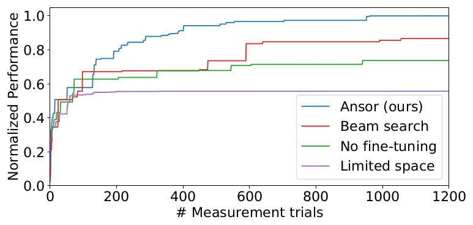

*图 7（原文 Figure 7，第 11 页）：在一个卷积算子上四个 Ansor 变体的消融。纵轴是相对于最佳程序的吞吐。*

**图中文字翻译与读法**：横轴 # Measurement trials（测量次数，0 到 1200）；纵轴 Normalized Performance（归一化性能）；四条曲线 Ansor (ours)（蓝）、Beam search（红）、No fine-tuning（绿）、Limited space（紫）。

**读图结论**：1200 次测量后，从图上读出，Ansor 约 1.0，Beam search 约 0.87，No fine-tuning 约 0.74，Limited space 约 0.56 并且很早就停止提升。去掉大搜索空间（Limited space）或去掉高效微调（No fine-tuning）都会显著降低最终性能；Beam search 因对不完整程序估计不准，把最终性能很好的不完整程序提前丢掉了。

### 7.4 子图基准（图 8）

两种常见子图：**ConvLayer**（2D 卷积 + batch normalization + ReLU，CNN 里常见）；**TBS**（两次矩阵转置 + 一次 batch 矩阵乘 + 一次 softmax，即语言模型里多头注意力的模式）。与单算子实验类似，每种选 4 个形状配置和两个 batch size，每个测试用例最多 1,000 次测量，在 Intel CPU 和 NVIDIA GPU 上用同一批基线。不报告 Halide auto-scheduler 在 GPU 上的结果，因为论文写作时其 GPU 支持仍是实验性的；FlexTensor 在 TBS 这样复杂的子图上无法运行。

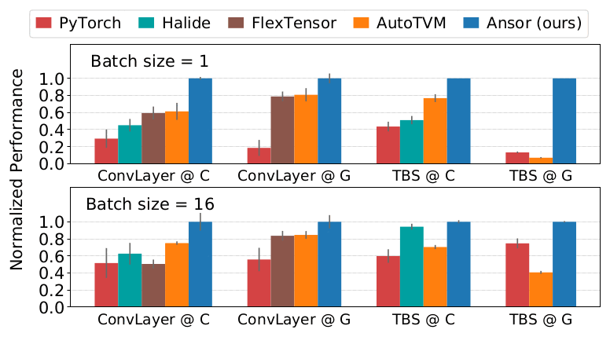

*图 8（原文 Figure 8，第 11 页）：在 20 核 Intel Platinum 8269CY 与 NVIDIA V100 上的子图性能基准。“@C”表示 CPU 结果，“@G”表示 GPU 结果。纵轴是对每个子图归一化到最佳吞吐的吞吐。*

**图中文字翻译与读法**：上下分别为 Batch size = 1 与 16；横轴四组 ConvLayer @ C、ConvLayer @ G、TBS @ C、TBS @ G；图例同图 6。

**结果**：Ansor 比手写库和其他搜索框架快 $1.1\times$ 到 $14.2\times$，在两个平台上都能稳定地生成高性能程序。FlexTensor 在单算子上表现不错，但因为不支持算子融合，在子图上优势变弱。从图上读出的示例：batch 1 的 TBS @ G 上，AutoTVM 只有约 0.07、PyTorch 约 0.13，即 Ansor 领先约 8 到 14 倍；batch 16 的 TBS @ C 上，Halide 约 0.94，与 Ansor 非常接近。

### 7.5 端到端网络基准（图 9）

**负载**：ResNet-50（图像分类）、MobileNet-V2（图像分类）、3D-ResNet-18（动作识别）、DCGAN 生成器（图像生成）、BERT（语言理解）。服务器级 Intel CPU 与 NVIDIA GPU 报告 batch 1 与 batch 16；边缘设备 ARM CPU 通常要求实时反馈，只报告 batch 1。

**基线与设置**：PyTorch（v1.5 torch script）、TensorFlow（v2.0 graph 模式）、TensorRT（v6.0，TensorFlow 集成）、TensorFlow Lite（V2.0）、AutoTVM。不包含 Halide auto-scheduler 和 FlexTensor，因为它们不支持常用的深度学习模型格式（ONNX、TensorFlow PB）和高层图优化，端到端时间预期只是各子图延迟之和；AutoTVM 则可用手写模板和多种图级优化（图级 layout 搜索、图级常量折叠）优化整个 DNN，这些优化显著提升性能。AutoTVM 与 Ansor 都跑到 $1000\times n$ 次测量为止（$n$ 为该 DNN 的子图数），通常足以收敛；task scheduler 的目标设为最小化一个 DNN 的总延迟，并逐个网络生成程序；Ansor 同样做 §4.2 的布局重写。PyTorch、TensorFlow、TensorRT、TensorFlow Lite 都依赖静态内核库（Intel CPU 上 MKL-DNN，NVIDIA GPU 上 cuDNN，ARM CPU 上 Eigen），不需要自动调优。Intel CPU 上所有框架都开启 AVX-512。

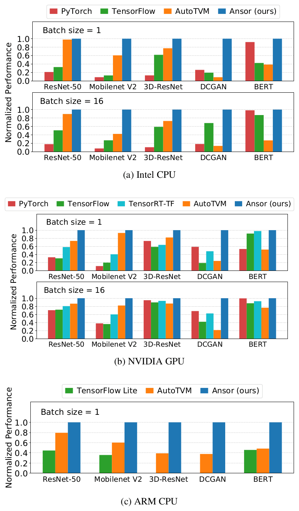

*图 9（原文 Figure 9，第 12 页）：三个硬件平台上的网络推理性能基准。纵轴是对每个网络归一化到最佳吞吐的吞吐。*

**图中文字翻译与读法**：(a) Intel CPU、(b) NVIDIA GPU 各有 Batch size = 1 与 16 两个子图，(c) ARM CPU 只有 Batch size = 1；横轴五个网络 ResNet-50、Mobilenet V2、3D-ResNet、DCGAN、BERT；图例：(a) PyTorch、TensorFlow、AutoTVM、Ansor (ours)；(b) 多一个 TensorRT-TF；(c) 为 TensorFlow Lite、AutoTVM、Ansor (ours)。脚注：ARM CPU 上 TensorFlow Lite 尚不支持 3D-ResNet 和 DCGAN，所以图 9c 中这两组没有 TensorFlow Lite 柱子。

**结果**：Ansor 在所有情形下最佳或并列最佳。与基于搜索的 AutoTVM 相比，Ansor 在所有情形下持平或更好，加速 $1.0\times$ 到 $21.8\times$。与最佳替代方案相比，Ansor 在 Intel CPU、ARM CPU、NVIDIA GPU 上端到端分别最高加速 $3.8\times$、$2.6\times$、$1.7\times$（按图上读数推算：Intel CPU 上 DCGAN 的最佳替代 PyTorch 约 0.26，取倒数约 3.8；ARM CPU 上 DCGAN 与 3D-ResNet 的最佳替代 AutoTVM 约 0.38 到 0.39，取倒数约 2.6；GPU 上 DCGAN 的最佳替代 PyTorch 约 0.59，取倒数约 1.7。与正文一致，但这是读图推算，不是原文数据。）

论文给出的解释：

- **DCGAN 的大幅领先**：DCGAN 主要由转置 2D 卷积（T2D）构成，而 T2D 恰好是 Ansor 擅长的算子（见 §7.2）。
- **AutoTVM 在 CPU 上的 ResNet-50 非常强**：靠高度优化的 2D 卷积模板和全局布局搜索。Ansor 不做全局布局搜索，但会重写权重张量的布局；Ansor 用了更多层 tile，所以把权重张量打包成更多层；布局重写给 Ansor 的 ResNet-50 带来约 40% 的提升。从图上读出，batch 1 时 AutoTVM 约 0.98，几乎追平。
- **相对厂商静态库的优势**：在不常见的形状和小 batch 上更明显，因为这些情形不容易手工优化。从图上读出，BERT 在 Intel CPU batch 16 时 PyTorch 约 0.98，接近 Ansor。

### 7.6 端到端消融：task scheduler 的作用（图 10）

在图 10 的两个测试用例上跑 Ansor 的变体：左图只针对单个 MobileNet-V2，右图同时针对 MobileNet-V2 与 ResNet-50。task scheduler 的目标函数设为相对 AutoTVM 加速比的几何平均。

- **No task scheduler**：用 round-robin 给所有子图分配相同的时间资源；
- **Limited space**：基于完整 Ansor 限制搜索空间；
- **No fine-tuning**：基于完整 Ansor 关闭微调，只靠随机采样。

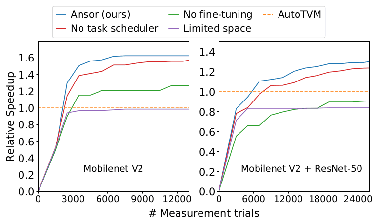

*图 10（原文 Figure 10，第 12 页）：网络性能自动调优曲线。纵轴是相对 AutoTVM 的加速比。*

**图中文字翻译与读法**：左图标注 Mobilenet V2，右图标注 Mobilenet V2 + ResNet-50；横轴 # Measurement trials（测量次数）；纵轴 Relative Speedup（相对加速比）；图例 Ansor (ours)（蓝）、No task scheduler（红）、No fine-tuning（绿）、Limited space（紫），橙色虚线 AutoTVM 在 1.0 处，作为基准。

**读图结论**（最终值为从图上读出的近似值）：

- **Limited space 最差**（左图约 0.98，右图约 0.84），说明最佳程序不在受限的空间里；放大搜索空间（No fine-tuning，左图约 1.27）可以提高最终性能；
- 但在右图中，仅随机赋 tile 大小和标注（No fine-tuning，约 0.9）在给定时间预算内仍然打不过 AutoTVM；
- 开启微调后，No task scheduler（左约 1.57，右约 1.24）在两种情形下都超过 AutoTVM；
- 完整的 Ansor 用 task scheduler 优先处理性能瓶颈（如包含 3x3 卷积的子图），在搜索效率和最终性能上都最好（左约 1.62，右约 1.3）。

### 7.7 搜索时间（表 3）

Ansor 能用更少的搜索时间追平甚至超过 AutoTVM。原因是 Ansor 把时间切片，用 task scheduler 同时优化所有子图；AutoTVM 等系统没有 task scheduler，逐个子图以预先设定的测量预算生成程序，可能在不重要的子图上浪费预算。表 3 给出 Ansor 追平 AutoTVM 性能所需的搜索时间，分别用两个指标：**测量次数**（与测量实现和搜索算法开销无关）与**墙钟时间**（把这些因素计入）。设置：Intel CPU，batch size = 1（§7.5 的网络基准）。

**表 3(a)：测量次数**

| 网络 | AutoTVM | Ansor | 节省倍数（Time-saving） |
|---|---:|---:|---:|
| ResNet-50 | 21,220 | 6,403 | 3.3× |
| Mobilenet-V2 | 31,272 | 1,892 | 16.5× |
| 3D-ResNet | 5,158 | 1,927 | 2.7× |
| DCGAN | 3,003 | 298 | 10.1× |
| BERT | 6,220 | 496 | 12.5× |

**表 3(b)：墙钟时间（秒）**

| 网络 | AutoTVM | Ansor | 节省倍数（Time-saving） |
|---|---:|---:|---:|
| ResNet-50 | 39,250 | 4,540 | 8.6× |
| Mobilenet-V2 | 58,468 | 660 | 88.6× |
| 3D-ResNet | 7,594 | 2,296 | 3.3× |
| DCGAN | 4,914 | 420 | 11.7× |
| BERT | 12,007 | 266 | 45.1× |

（原文表 3，第 13 页；表中节省倍数已与两列数字相除核对一致。）

**读法**：测量次数上的节省来自 task scheduler、高效的微调和对有效优化的全面覆盖；墙钟时间上节省更多，是因为 Ansor 的搜索开销小，而且测量实现更好（在 Intel CPU 上，Ansor 通过显式刷新某些张量的缓存，可用更少的重复次数获得准确的测量结果）。在其他后端，Ansor 追平 AutoTVM 也有类似的节省。论文还指出：Ansor 在一台机器上为一个 DNN 生成完全优化的程序通常需要几个小时；对推理应用是部署前的一次性工作，可以接受，而且 Ansor 的整体架构很容易并行化。

### 7.8 cost model 评估（图 11）

用在 Intel CPU 上调优 ResNet-50 时测得的 25,000 个程序做数据集，随机取 20,000 个训练、其余 5,000 个测试。

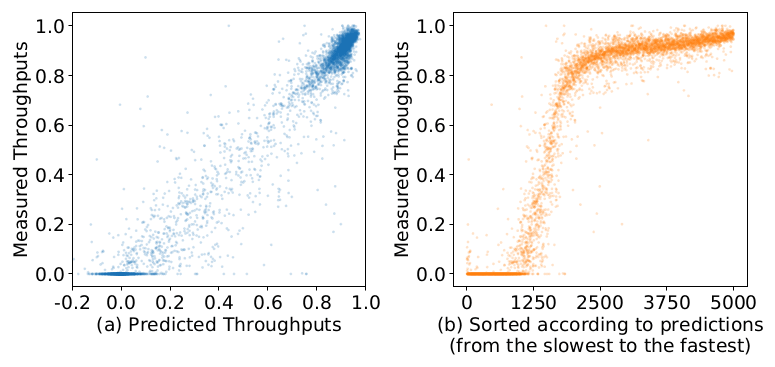

*图 11（原文 Figure 11，第 13 页）：测量吞吐与预测吞吐。*

**图中文字翻译与读法**：

- **(a) Predicted Throughputs（预测吞吐）**：横轴是模型预测的吞吐，纵轴 Measured Throughputs（测量吞吐，已归一化到测试集中最佳程序）。预测值是模型输出，所以可以为负。点分布在对角线附近，说明预测准确；点不是均匀分布的，因为数据集是在搜索过程中收集的，好程序更可能被选去测量，因此大多数点聚在右上角。测量吞吐为 0.0 的点是非法程序或测量时超时被杀掉的程序。
- **(b) Sorted according to predictions（按预测排序）**：把 5000 个点按预测值从最慢到最快排序，用相对名次作横轴，所以点沿横轴均匀分布，更能展示被探索程序的性能分布。

**结论**：模型在测试集上 RMSE 为 0.079，$R^2$ 相关系数为 0.958，成对比较准确率为 0.851，top-30 程序的 recall@30 为 0.624。

## 八、相关工作（论文第 8 节要点）

- **基于调度语言的自动张量程序生成**：Halide 引入可描述循环优化原语的调度语言，既适合手工优化也适合自动搜索；Halide 有三版 auto-scheduler，最新的用 beam search 与 learned cost model，效果最好，也是本文评估所用的版本。TVM 用类似的调度语言，并含模板引导搜索框架 AutoTVM；FlexTensor 提出可面向一组算子的通用模板，但模板为单算子设计，难以用于涉及多个算子的优化（如算子融合）。同期工作 ProTuner 用蒙特卡洛树搜索解决 Halide auto-scheduler 的估计不准问题，主要面向图像处理负载，而 Ansor 面向深度学习负载并引入新的搜索空间等优化。
- **多面体编译模型**：把程序优化表述为整数线性规划（ILP）问题，用仿射循环变换最小化相依语句间的数据复用距离。Tiramisu 与 Tensor Comprehensions 是面向深度学习的多面体编译器：Tiramisu 提供类似 Halide 的调度语言且需要手工调度；Tensor Comprehensions 可自动搜索 GPU 代码，但目前不适合计算受限的问题，在 conv2d、matmul 等算子上无法超过 TVM，原因是缺少某些优化以及多面体表述中隐式 cost model 不准。（Tensor Comprehensions 见 [本仓库解读](../tensor_comprehensions/论文中文解读.md)。）
- **深度学习图级优化**：以计算图中的算子为基本单元、不改变算子内部实现，包括布局优化、算子融合、常量折叠、自动批处理、自动生成图替换等；通常与算子级优化互补，也受益于高性能的算子实现（例如通用算子融合依赖 Ansor 的代码生成能力）。论文把 Ansor 与更多图级优化的联合优化留作未来工作。
- **其他领域的搜索式编译与自动调优**：Stock（基于随机搜索的超级优化器，搜索无循环的硬件指令序列）、OpenTuner（基于多臂老虎机的通用自动调优框架，依赖用户指定的搜索空间）、ATLAS 与 FFTW（传统高性能库也用自动调优）、NeuroVectorizer 与 AutoPhase（用深度强化学习做自动向量化与编译器 phase ordering）。

## 九、局限与未来方向（论文第 9 节）

1. **不支持动态 shape**：Ansor 要求计算图中的形状静态且事先已知，才能做分析、构造搜索空间和测量。为符号形状或动态形状生成程序是有趣的未来方向。
2. **只支持稠密算子**：要支持稀疏算子（如神经网络稀疏化、图神经网络中常用的 SpMM），论文预计大部分 Ansor 可复用，但需要重新设计搜索空间。
3. **只在高层做程序优化**：依赖其他代码生成器（LLVM、NVCC 等）做平台相关优化（如指令选择）；因此 Ansor 没能很好地利用特殊指令，如 Intel VNNI、NVIDIA Tensor Core、ARM Dot，它们用于混合精度和低精度算子，现成的代码生成器目前处理得不好。

此外，论文评估中的实验边界：所有评估都是 float32；基线版本是论文写作时的 PyTorch 1.5、TensorFlow 2.0、TensorRT 6.0；调优是部署前的离线一次性过程，需要真机测量。

## 十、复现与阅读检查清单

- **版本核对**：原文正文与图题对 Intel CPU 型号写法不一致（18 核 Platinum 8124M 与 20 核 Platinum 8269CY），复现或引用时应写明用的是哪一种；
- **预算对齐**：单算子/子图实验每个框架每个用例最多 1,000 次测量；网络实验是 $1000\times n$ 次；比较搜索框架必须保持相同的测量预算；
- **AVX-512**：单算子和子图实验关闭了 AVX-512，网络实验对所有框架开启，不能混用两套数字；
- **指标**：图 6、图 8、图 9 的纵轴是“相对该组最佳框架的归一化吞吐”，不是绝对延迟；图 10 是相对 AutoTVM 的加速比；
- **表 3** 的“节省”是追平 AutoTVM 所需的代价，不是 Ansor 完整调优的耗时；
- **可记录的搜索状态**：每个任务的 sketch 列表、每个程序的改写步骤历史、测量记录、cost model 特征和随机种子；runner 要隔离编译失败、超时与计时噪声；
- 模型级结果必须包含 layout 变换与没有被调优的算子。

## 十一、常见误读

- Ansor **不是**无先验的黑盒：推导规则、“SSRSRS”/“SSSRRSRS”tile 结构、特征设计、合法性验证都编码了大量编译知识；它减少的是“每个算子手写模板”，并未消除搜索和真机测量。
- sketch **不是**模板：模板同时规定结构和低层数值，sketch 只规定结构，数值由随机标注与微调决定。
- 随机采样**不是**为了直接找到最优：它负责覆盖空间，之后所有程序都会被微调。
- 3.8×、2.6×、1.7× 是“最高”倍数（对应图 9 里的 DCGAN），不是所有网络的平均加速；对 ResNet-50 这类 AutoTVM 模板已高度优化的网络，Ansor 只是持平或略好。
- 单算子/子图的加速不等于端到端同倍加速；而且搜索结果只对固定的静态 shape 和目标硬件成立。
- 论文的图 5 只给出 sketch 的**例子**，一个典型子图的 sketch 个数是“少于 10 个”。

## 十二、附录 C：评估所用的形状配置

原文附录 C（第 19 页）以列表形式给出形状配置，下表是按列表逐项转录整理成的表格（原文没有这张表）。每个算子 4 个配置，“格式”列是各数字的含义。

| 算子 | 格式 | 四个配置 |
|---|---|---|
| C1D（1D 卷积） | (length, 输入通道, 输出通道, kernel size, stride, padding) | (256, 64, 128, 3, 2, 1)；(128, 128, 256, 1, 2, 0)；(64, 256, 256, 5, 1, 2)；(32, 512, 512, 3, 1, 1) |
| C2D（2D 卷积） | (height, width, 输入通道, 输出通道, kernel size, stride, padding) | (224, 224, 3, 64, 7, 2, 3)；(56, 56, 64, 64, 1, 1, 0)；(14, 14, 256, 256, 3, 1, 1)；(7, 7, 512, 512, 3, 1, 1) |
| C3D（3D 卷积） | (depth, height, width, 输入通道, 输出通道, kernel size, stride, padding) | (16, 224, 224, 3, 64, 7, 2, 3)；(16, 56, 56, 64, 64, 1, 1, 0)；(16, 14, 14, 256, 256, 3, 1, 1)；(16, 7, 7, 512, 512, 3, 1, 1) |
| GMM（矩阵乘） | (N, M, K) | (128, 128, 128)；(512, 32, 512)；(512, 512, 512)；(1024, 1024, 1024) |
| GRP（分组卷积，附录中写作 GRD） | (height, width, 输入通道, 输出通道, kernel size, stride, padding, groups) | (224, 224, 3, 64, 7, 2, 3, 4)；(56, 56, 64, 64, 1, 1, 0, 4)；(14, 14, 256, 256, 3, 1, 1, 4)；(7, 7, 512, 512, 3, 1, 1, 4) |
| DIL（空洞卷积） | (height, width, 输入通道, 输出通道, kernel size, stride, padding, dilation) | (224, 224, 3, 64, 7, 2, 3, 2)；(56, 56, 64, 64, 1, 1, 0, 2)；(14, 14, 256, 256, 3, 1, 1, 2)；(7, 7, 512, 512, 3, 1, 1, 2) |
| DEP（depth-wise 卷积） | (height, width, channel, kernel size, stride, padding) | (112, 112, 32, 3, 1, 1)；(112, 112, 64, 3, 2, 1)；(14, 14, 512, 3, 2, 1)；(7, 7, 1024, 3, 1, 1) |
| T2D（转置 2D 卷积） | (height, width, 输入通道, 输出通道, kernel size, stride, padding) | (4, 4, 512, 256, 4, 2, 1)；(8, 8, 256, 128, 4, 2, 1)；(16, 16, 128, 64, 4, 2, 1)；(32, 32, 64, 3, 4, 2, 1) |
| CAP（胶囊 2D 卷积） | (height, width, 输入通道, 输出通道, kernel size, stride, padding, capsule size) | (16, 16, 32, 32, 3, 2, 1, 4)；(8, 8, 32, 32, 3, 1, 1, 4)；(16, 16, 8, 16, 3, 2, 1, 4)；(8, 8, 16, 16, 3, 1, 1, 4) |
| NRM（矩阵 2-范数） | (N, M) | (256, 256)；(512, 512)；(1024, 1024)；(4096, 4096) |
| ConvLayer（卷积层） | (height, width, 输入通道, 输出通道, kernel size, stride, padding) | (224, 224, 3, 64, 7, 2, 3)；(56, 56, 64, 64, 3, 2, 1)；(28, 28, 128, 256, 1, 2, 0)；(7, 7, 512, 512, 3, 1, 1) |
| TBS（多头注意力中的 转置 + BatchMatmul + Softmax） | (序列长度, 头数, 隐藏维度) | (128, 12, 64)；(128, 16, 64)；(64, 12, 128)；(128, 12, 128) |

## 十三、与相关论文的关系

- **AutoTVM / TVM**：Ansor 是对 AutoTVM“模板 + 参数搜索”路线的替代，并集成进 Apache TVM（见 [TVM 论文解读](../tvm_compiler/论文中文解读.md)）；
- **MetaSchedule**：把搜索空间写成可组合的概率程序，进一步让用户扩展“变换模块”（见 [MetaSchedule 解读](../metaschedule/论文中文解读.md)）；
- **TensorIR**：提供更适合 tensorization（Tensor Core 等）的 IR（见 [TensorIR 解读](../tensorir/论文中文解读.md)），弥补 Ansor 不能很好利用特殊指令的局限；
- **Roller、Bolt**：分别从“用 tile 构造替代搜索”和“回到硬件原生模板”两个方向降低搜索成本或提高上限（见 [Roller 解读](../roller/论文中文解读.md)、[Bolt 解读](../bolt/论文中文解读.md)）；
- **Tensor Comprehensions**：论文在相关工作中作为多面体编译器对照（见 [Tensor Comprehensions 解读](../tensor_comprehensions/论文中文解读.md)）。

## 原文证据导航

- [原论文 PDF](paper.pdf)
- [原文提取文本](paper.txt)
- [论文概要](论文概要.md)
