# 论文中文解读：《Serving Large Language Models on Huawei CloudMatrix384》

> **基本信息**：Pengfei Zuo 等（华为 Huawei；带星号的作者来自 SiliconFlow），通讯作者 Zhou Yu、Heng Liao；arXiv:2506.12708（cs.DC，本地 PDF 为 v3，2025 年 6 月 19 日）；论文原文 [官方页面](https://arxiv.org/abs/2506.12708)。
>
> **本文的读法**：图均为从论文原文 PDF 中按图裁出的原图，每张图后有中文图题、图中文字翻译和读图结论；表为逐格核对后的中文转录（数字与原文一致，表头和行名译成中文，模型名、数据集名保留英文）。原文的图 20–23 没有在柱子或折线点上标数字，文中标“约”的数值是从 PDF 矢量坐标换算出的近似读数，已与正文给出的百分比互相印证；有正文数字时以正文为准。读完本文应当不必再翻英文原文。

## 一、一句话结论

大型 MoE 模型（以 DeepSeek-R1 为代表）的在线推理，同时被算力、显存带宽、芯片间通信和延迟目标（SLO）卡住。华为提出 CloudMatrix 数据中心架构，并给出首个量产级实现 CloudMatrix384：384 颗 Ascend 910 NPU 和 192 颗 Kunpeng CPU 通过统一总线（Unified Bus，UB）在一个超节点内非阻塞地全互联，跨节点通信相对节点内的带宽下降不到 3%、时延增加不到 1 µs。在这套硬件上，论文提出服务系统 CloudMatrix-Infer，核心有三项：

1. **对等的 PDC 解耦**：把推理拆成 prefill、decode、caching 三个可独立伸缩的资源池；所有 NPU 经 UB 以统一的带宽和时延访问同一个分布式内存池，请求调度因此不必再迁就 KV cache 所在的位置；
2. **大规模专家并行（LEP）**：decode 使用 EP320，每个 NPU die 恰好承载一个专家，并配套融合通信算子（FusedDispatch、FusedCombine）、MLA 专用算子、微批流水和流水化的多 token 预测（MTP）；
3. **硬件感知的其他优化**：prefill 的混合并行与微批流水、prefill 到 decode 的低干扰 KV 传输、UB 驱动的上下文缓存与模型缓存，以及 INT8 无训练量化。

在 256 颗 NPU 上评测 DeepSeek-R1（INT8）：4K 输入的 prefill 吞吐在默认负载下为 5,655 tokens/s/NPU，在理想专家负载均衡（Perfect EPLB）下为 6,688；decode 在 TPOT 49.4 ms 下为 1,943 tokens/s/NPU，在 15 ms 的更严格 SLO 下为 538；16 个基准上 INT8 精度与 DeepSeek 官方 API 相当。论文所说“优于 SGLang（H100）和 DeepSeek（H800）”指的是吞吐除以峰值算力后的“每 TFLOPS 吞吐”，并不是每卡原始吞吐；对比对象是公开数字，不是同条件复测。

## 二、先建立几个概念

读本文需要下面这些术语。它们在论文里默认读者已经知道。

| 术语 | 含义 |
|---|---|
| prefill / decode | 推理的两个阶段。prefill 一次性处理整段输入 prompt，产出第一个输出 token 和初始 KV cache，计算密集；decode 逐 token 自回归生成，每步只处理很少的 token，更受访存、通信和批大小影响 |
| TTFT / TPOT / SLO | TTFT（time to first token）是首 token 时延，主要由 prefill 决定；TPOT（time per output token）是相邻输出 token 的平均间隔，由 decode 决定；SLO 是服务时延目标，例如“TPOT 低于 50 ms” |
| DP / TP / SP / EP | 数据并行（每个设备持有完整权重，各处理自己的请求）、张量并行（把一层的权重或注意力头切到多个设备）、序列并行（沿 token 维度切分）、专家并行（把 MoE 的不同专家放到不同设备） |
| MoE、router expert、shared expert | 混合专家层：门控网络（gate）为每个 token 选出 Top-K 个路由专家（DeepSeek-R1 中 K=8，共 256 个）计算；另有每个 token 都要经过的共享专家 |
| dispatch / combine | MoE 在 EP 下的两次通信：dispatch 把 token 的隐状态发到被选中专家所在的设备；combine 把专家输出送回原设备，并按路由权重加权求和 |
| EPLB | 专家并行负载均衡（Expert Parallelism Load Balancer）。热门专家会让个别设备过载，常见办法是给热门专家放冗余副本；“Perfect EPLB”是假设负载被完美均衡的理想情形 |
| MLA | 多头潜在注意力（DeepSeek）：把 K、V 压缩成低秩 latent 向量再缓存，KV cache 大幅缩小（论文引用“最多减小 93.3%”），并用权重吸收降低计算量 |
| MTP | 多 token 预测。DeepSeek-R1 用它做投机解码：每个 decode 步额外预测 k 个 token，后续步骤由主模型验证。论文评测 k=1，假设接受率 70%，因此每次迭代平均产出 1.7 个 token |
| KV cache、context caching | KV cache 是已处理 token 的 Key/Value；context caching 把历史前缀的 KV 块存起来，后续请求命中相同前缀时跳过这部分 prefill |
| NPU、die、AIC、AIV | Ascend 910 是双 die 封装；每个 die 有 24 个 AI Cube 核（AIC，做矩阵和卷积）和 48 个 AI Vector 核（AIV，做逐元素向量运算）。论文里的“EP320”指 320 个 die |
| SDMA | 系统直接内存访问引擎，传统的跨 NPU 数据搬运通路，每次传输有启动开销 |
| UB 与 UBuffer | UB（Unified Bus）是 CloudMatrix 的互联网络；UBuffer 是 AIV 核旁的本地片上缓冲，二者名字相近但无关 |

## 三、背景：模型趋势与基础设施挑战（论文第 1–2 节）

### 3.1 三个趋势

论文用下面三个趋势说明为什么传统 AI 集群不够用。表中数字均为论文第 2.1 节所列。

| 趋势 | 论文列举的代表 |
|---|---|
| 参数量越来越大 | Llama 4 Behemoth 近 2 万亿参数，Llama 4 Maverick 4,000 亿；DeepSeek-V3 6,710 亿；PaLM 5,400 亿；Grok-1 3,140 亿 |
| 用 MoE 稀疏化 | Mixtral 8×7B：总参 46.7B，每 token 激活 12.9B（8 选 2）；DBRX：总参 132B，激活 36B（16 选 4）；Llama 4 Maverick 128 个专家、Scout 16 个专家，均激活 17B；DeepSeek-V3 把每层路由专家从 160 个增加到 256 个；Qwen3-235B：128 个专家，激活 22B；华为 Pangu Ultra MoE：718B 总参，激活 39B，每层 256 个专家、激活 8 个 |
| 上下文窗口变长 | GPT-4.5 为 128K token，Gemini 2.5 Pro 最长 100 万 token；长提示显著增加计算和 KV cache，生产系统用 context caching 复用前缀 KV |

MoE 把“总容量”和“每 token 计算量”解耦，但引入新的系统问题：专家路由、跨设备同步和大量 all-to-all 通信。KV cache 总量随并发用户数线性增长，如何放置、分布和访问它，决定了推理效率。

### 3.2 四个基础设施挑战

1. **扩展通信密集型并行**。现有集群的节点间 RDMA 网络按数据并行、流水并行的流量特点设计（节点间流量适中）；张量并行和专家并行需要频繁、细粒度、低时延的通信，很难跨节点扩展，许多部署只好把 TP/EP 组限制在单个节点内。
2. **在异构负载下保持高利用率**。训练偏计算密集，LLM 的 decode 常受显存带宽限制，自动驾驶模型训练还需要大量 CPU 侧预处理；固定的节点配置会造成过配或闲置，需要对 NPU、CPU、内存做动态、细粒度的组合。
3. **AI 与数据密集型负载的融合执行**。数据摄取、预处理、检索、分析、仿真等和 AI 流程越来越交织；为通用负载优化的旧数据中心难以满足所需的高吞吐低时延通信和灵活编排。
4. **内存级的存储性能**。PB 级数据集、多 TB 的 checkpoint、带大 KV cache 和 RAG 的低时延推理，需要内存级的带宽、时延和 IOPS；基于磁盘访问模式设计的旧存储层级会造成 NPU 的数据饥饿。

### 3.3 论文的回应

CloudMatrix384 的最初设计早于 MoE 架构的普及（这类超节点系统从设计到部署通常要几年），但它本来就是为提升互联带宽和通信效率而建。论文认为，DeepSeek-R1 等大型 MoE 的出现印证了这一点：通信带宽和算力、显存带宽同样关键。

## 四、CloudMatrix 愿景与 CloudMatrix384 硬件（论文第 3.1–3.3 节）

### 4.1 愿景：全对等互联与细粒度资源解耦

CloudMatrix 以“全对等（peer-to-peer）的高带宽互联”和“细粒度资源解耦”为原则，跳出以 CPU 为中心的层级结构：NPU、CPU、DRAM、SSD、NIC 和领域专用加速器之间可以直接高性能通信，不需要 CPU 中转。图 1 是这个愿景的示意。

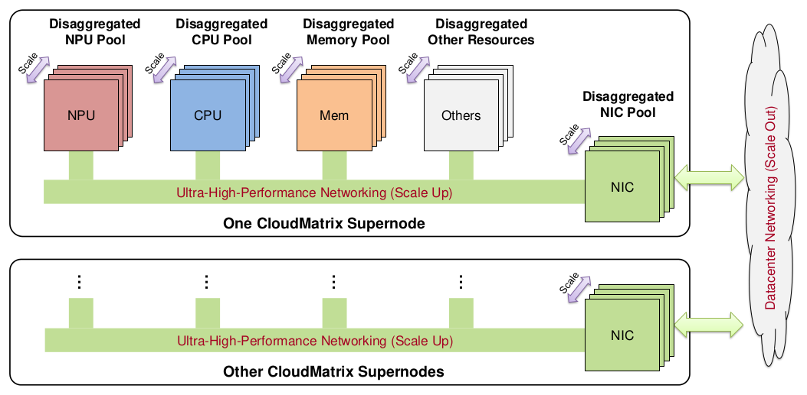

*图 1（原文 Figure 1，第 8 页）：CloudMatrix 把 NPU、CPU、内存、网卡等资源解耦成池，通过统一的超高性能网络互联。*

**图中文字翻译与读法**：

- **上方大框 One CloudMatrix Supernode（一个 CloudMatrix 超节点）**：并排的五类资源池——Disaggregated NPU Pool（解耦的 NPU 池）、CPU Pool（CPU 池）、Memory Pool（内存池）、Other Resources（其他资源）和右侧的 Disaggregated NIC Pool（解耦的网卡池）。每个池旁边的紫色双箭头标注 Scale，表示该资源池可以独立扩缩。池下面的绿色长条 Ultra-High-Performance Networking (Scale Up)（超高性能网络，纵向扩展）把所有池连在一起。
- **右侧云形图案 Datacenter Networking (Scale Out)（数据中心网络，横向扩展）**：超节点之间经各自的 NIC 池接入数据中心网络。
- **下方框 Other CloudMatrix Supernodes（其他超节点）**：结构相同，省略号表示同样的资源池。
- **读图结论**：愿景是资源按类型成池、彼此对等，由超节点内部的 scale-up 网络承载大带宽通信，超节点之间再用 scale-out 网络；这是对“以 CPU 为中心的服务器”的结构性替代，而不是在原有服务器上加一块更快的网卡。图中 RDMA 和 VPC 被合并成同一个“数据中心网络”，是长期愿景；当前的 CloudMatrix384 仍把两个平面分开（见 4.2）。

在这个互联基础上，论文列出 CloudMatrix 的四项基础能力：

1. **TP/EP 的可扩展通信**：UB 支持 NPU 之间直接的高吞吐对等通信，TP、EP 组可以跨出单个节点，大模型能在整个超节点内高效切分；
2. **面向异构负载的灵活资源组合**：CPU、NPU、内存被解耦成各自独立的池，可按负载细粒度组合（例如内存充裕的缓存节点、CPU 密集的预处理节点），摆脱固定节点配置和基于 PCIe 的主机-设备耦合；
3. **面向融合负载的统一基础设施**：高带宽 UB 在同一个 scale-up 设施里同时承载 AI 与数据密集型应用（LLM 推理、训练、仿真、分析）；
4. **经解耦内存池实现的“内存级存储”**：把整个集群 CPU 挂载的 DRAM 聚合成共享的高性能内存池，经 UB 访问，支撑弹性内存服务（Elastic Memory Service，EMS），加速 KV cache 复用、参数加载和模型 checkpoint。

### 4.2 CloudMatrix384 总览与三个网络平面

CloudMatrix384 是首个量产级实现：384 颗 Ascend 910 NPU 加 192 颗 Kunpeng CPU，通过 UB 协议在一个非阻塞的全互联网络里连成对等关系。论文称 UB 设计是 UB-Mesh（论文参考文献 [38]）的前身。节点间通信性能接近节点内：带宽衰减不到 3%，时延增加不到 1 µs；论文的论断是现代 AI 负载主要受带宽而非时延限制，这点时延对端到端性能影响可以忽略。

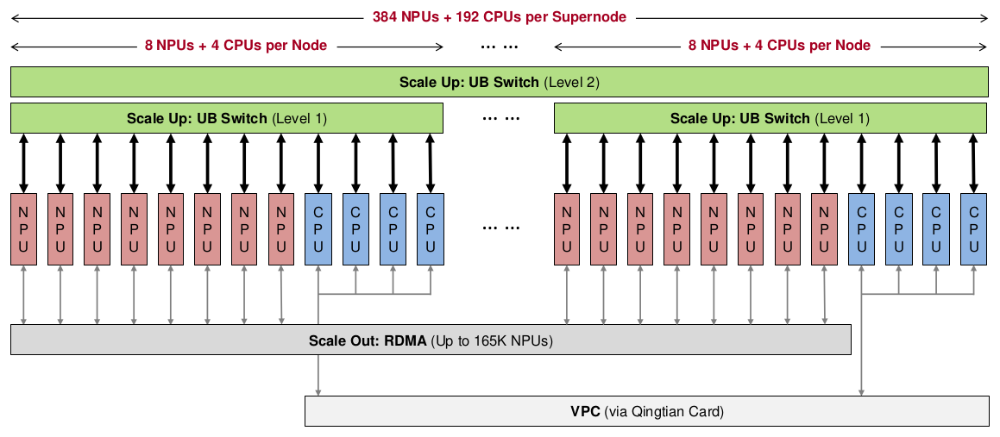

*图 2（原文 Figure 2，第 10 页）：超节点内由两级 UB 交换机全互联 NPU 和 CPU；RDMA 平面连接超节点之间，VPC 平面连接数据中心网络。图注说明所有带宽数值均指单向带宽（图中没有标出具体数值）。*

**图中文字翻译与读法**：

- **最上方 384 NPUs + 192 CPUs per Supernode（每个超节点 384 个 NPU + 192 个 CPU）**；其下 8 NPUs + 4 CPUs per Node（每个节点 8 个 NPU + 4 个 CPU），中间的省略号表示共 48 个这样的节点（384÷8 = 48）。红色方块为 NPU，蓝色方块为 CPU。
- **绿色横条 Scale Up: UB Switch (Level 1)（纵向扩展：UB 交换机，第 1 级）**：每个节点一组。**最上方通栏的 Scale Up: UB Switch (Level 2)（第 2 级）** 横跨所有节点，把各节点的 L1 交换机连起来。黑色粗双向箭头表示 NPU、CPU 到 L1 交换机的 UB 链路。
- **灰色横条 Scale Out: RDMA (Up to 165K NPUs)（横向扩展：RDMA，最多 16.5 万个 NPU）**：只连接 NPU（灰色细双向箭头），用于超节点之间。
- **最下方 VPC (via Qingtian Card)（经 Qingtian 卡接入 VPC）**：由每个节点里一颗 CPU 上的 Qingtian 卡引出到数据中心网络。
- **读图结论**：同一个节点里的 NPU、CPU 既连 UB（超节点内部），NPU 还额外连 RDMA（超节点之间），CPU 额外连 VPC（数据中心），三个平面各管各的流量。

为兼容旧数据中心并承载不同流量，CloudMatrix384 有三个互补的网络平面：

| 平面 | 范围与协议 | 参与者 | 主要用途 |
|---|---|---|---|
| UB 平面（scale-up） | 超节点内部，非阻塞全互联 384 个 NPU 和 192 个 CPU | NPU、CPU | TP、EP 等细粒度并行不再受节点边界限制；NPU 与 CPU 内存池的对等快速访问（缓存模型权重和 KV cache） |
| RDMA 平面（scale-out） | 超节点之间及外部兼容 RDMA 的系统；当前采用 RoCE（RDMA over Converged Ethernet），以兼容标准 RDMA 栈 | 只有 NPU，与控制和存储流量隔离 | prefill 与 decode NPU 之间传输活跃 KV cache；基于 RDMA 框架的分布式训练与推理；多集群部署的跨超节点低时延互联 |
| VPC 平面 | 经高速网卡（华为 Qingtian 卡）接入数据中心网络；标准以太网和 IP，可选 UB-over-Ethernet（UBoE） | CPU | 部署、监控、调度等管理控制面；访问持久存储（对象存储 OBS、弹性卷 EVS、文件系统 SFS）；CPU 侧工作负载（数据库、用户界面）的对外通信 |

论文脚注 1 讨论了另一种设计 RDMA over UB：利用 UB 原生的远程内存访问，把超节点内外统一成一个 UB 域，语义更简洁、免去协议转换，但当前实现选 RoCE 以便立即兼容现有的 RDMA 库和工具。第 6.1.1 节把“合并 VPC 与 RDMA 平面”列为未来工作。

### 4.3 Ascend 910 芯片

CloudMatrix384 的核心是海思 Ascend 910 NPU（论文称其为华为 2024 年旗舰 AI 加速器），采用双 die 封装：两个相同的计算 die 共封装，共享 8 个封装内的内存堆栈，并通过高带宽的跨 die 互联相连。每个 die 含 24 个 AIC（AI Cube）核，擅长矩阵与卷积；48 个 AIV（AI Vector）核，做逐元素运算。所有计算引擎都支持 FP16/BF16 和 INT8；论文强调 8 位量化可用 INT8 实现，其计算效率可比肩原生 FP8 硬件，而无需专门的 FP8 支持。每个 die 接两个网络平面：集成 7 个高速收发器接 scale-up 的 UB 平面，另有一个独立接口接 scale-out 的 RDMA 平面。

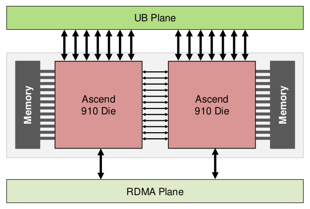

*图 3（原文 Figure 3，第 11 页）：Ascend 910 的双 die 结构，每个 die 有 7 路 UB 链路和 1 路 RDMA 链路。*

**图中文字翻译与读法**：

- **顶部绿条 UB Plane（UB 平面）**：两个粉色方块 Ascend 910 Die（Ascend 910 计算 die）各向上连出 7 条双向箭头，对应每个 die 的 7 个 UB 收发器。
- **两个 die 之间的一排双向箭头**：封装内的跨 die 高带宽互联。
- **左右两侧的深灰色块 Memory（内存）**：封装内的内存堆栈，论文正文写明共 8 个堆栈，由两个 die 共享。
- **底部浅绿条 RDMA Plane（RDMA 平面）**：每个 die 各有 1 条双向箭头连到 RDMA 平面。
- **读图结论**：一个“NPU”在物理上是两个 die；后文“每个 die 一个专家”“EP320 对应 320 个 die、160 个 NPU”这类说法都要按 die 计数。

### 4.4 Ascend 910 节点

每个计算节点集成 8 颗 Ascend 910 NPU、4 颗 Kunpeng CPU 和 7 颗板载 UB 交换芯片。12 个处理器（8 个 NPU 和 4 个 CPU）通过 UB 链路连到这些板载交换芯片，在节点内形成单层 UB 平面；每颗板载 UB 交换芯片再连接超节点交换网络的下一层。只有 NPU 参与第二个网络平面（RDMA）。4 颗 Kunpeng CPU 通过全互联（full-mesh）的 NUMA 拓扑相连，节点内所有 CPU 挂载的 DRAM 可统一访问。其中一颗 CPU 上挂着节点的 Qingtian 卡：这是一块数据处理单元（DPU），既集成高速网络接口，也承担节点级资源管理，是节点南北向的出口，连接第三个网络平面（数据中心的 VPC）。

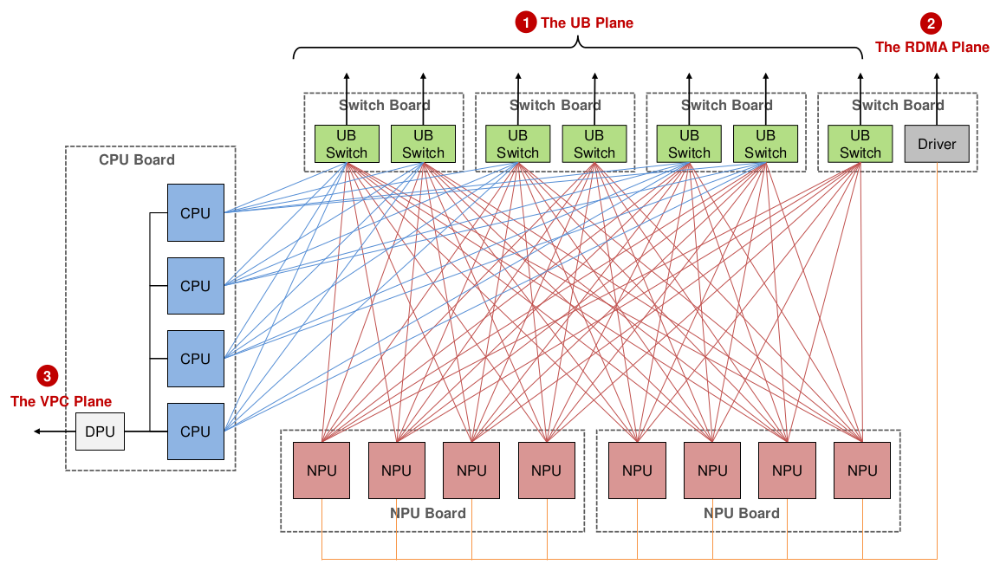

*图 4（原文 Figure 4，第 12 页）：一个节点内 NPU、CPU 与 UB 交换芯片的连接，以及三个网络平面的出口。*

**图中文字翻译与读法**：

- **顶部花括号 ❶ The UB Plane（UB 平面）**：四块 Switch Board（交换板）上共 7 颗绿色 UB Switch（UB 交换芯片），最右一块板上还有一个灰色的 Driver；交换芯片上方的黑色箭头表示向上连到下一级（L2）交换机。
- **左侧 CPU Board（CPU 板）**：4 颗蓝色 CPU，其中一颗旁边挂着 DPU，经 ❸ The VPC Plane（VPC 平面）通向数据中心网络。
- **下方 NPU Board（NPU 板）×2**：每块 4 颗 NPU，共 8 颗。
- **连线**：红线从每个 NPU 连到每一颗 UB 交换芯片，蓝线从每个 CPU 连到 UB 交换芯片（线的颜色图注没有说明，这是按线条两端读出的）。NPU 下方的细线汇到右上角的 Driver，再通向 ❷ The RDMA Plane（RDMA 平面）；Driver 的具体含义论文没有展开。
- **读图结论**：节点内是“全连接的单层 UB”：每个 NPU 都能直达全部 7 颗 UB 交换芯片，这与“每个 die 有 7 个 UB 收发器”的描述吻合（论文没有逐条交代链路的对应关系）；节点内、节点间的访问都经过同一套 UB 交换结构。

### 4.5 UB 交换系统：两级、非阻塞

整个超节点跨 16 个机架：12 个计算机架共同容纳 48 个 Ascend 910 节点（384 个 NPU），4 个通信机架容纳第二级（L2）UB 交换机，把全部节点互联起来。图 5 展示节点内板载的第一级（L1）UB 交换芯片与机架级 L2 UB 交换机之间的拓扑。网络设计为非阻塞，即 L2 交换层没有带宽超订。

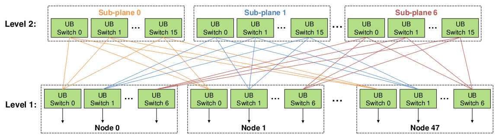

*图 5（原文 Figure 5，第 13 页）：L2 交换机分成 7 个独立子平面，每个节点的 7 颗 L1 交换芯片与 7 个子平面一一对应。*

**图中文字翻译与读法**：

- **上层 Level 2（第 2 级）**：Sub-plane 0、Sub-plane 1、……、Sub-plane 6 共 7 个独立子平面（橙、蓝、红三色线分别对应子平面 0、1、6），每个子平面含 16 颗 UB Switch（编号 0–15），每颗 L2 交换芯片提供 48 个端口。
- **下层 Level 1（第 1 级）**：Node 0、Node 1、……、Node 47 共 48 个节点，每个节点内有 UB Switch 0–6 共 7 颗 L1 交换芯片；每颗 L1 芯片向下的箭头通向节点内的 NPU 和 CPU。
- **连线**：节点内第 i 颗 L1 交换芯片，与第 i 个子平面中的全部 16 颗 L2 交换芯片各连一条链路（所以每颗 L1 芯片向上有 16 条链路）。
- **自洽性核对**（本文计算）：7 个子平面 × 16 颗 = 112 颗 L2 芯片，每颗 48 个端口，共 5,376 个端口；48 个节点 × 7 颗 L1 芯片 × 16 条上行链路 = 5,376 条，两者相等，且每颗 L2 芯片的 48 个端口恰好各连一个节点。这对应论文所说“节点到 L2 的聚合上行带宽与其内部 UB 容量精确匹配，因此全超节点保持非阻塞”。112 颗芯片也解释了表 10 中的“56 个逻辑交换机”：每个逻辑交换机由两颗物理芯片构成。

## 五、软件栈（论文第 3.4 节）

### 5.1 CANN：Ascend 的类 CUDA 软件栈

华为为 Ascend NPU 开发的计算架构软件叫 CANN（Compute Architecture for Neural Networks），论文把它类比 NVIDIA 的 CUDA 生态：驱动、运行时、库三层架构。

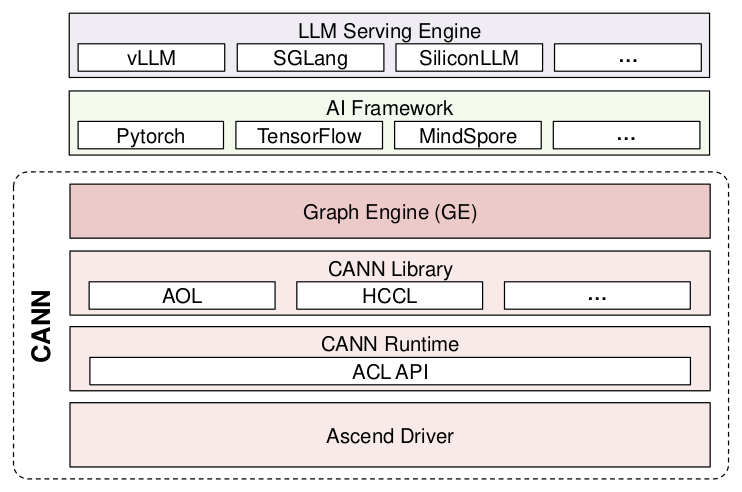

*图 6（原文 Figure 6，第 14 页）：从底层驱动到上层 LLM Serving Engine 的完整软件栈。*

**图中文字翻译与读法**（自底向上）：

- **Ascend Driver（Ascend 驱动）**：最底层。
- **CANN Runtime（CANN 运行时）**：内含 ACL API（Ascend Computing Language API）。
- **CANN Library（CANN 库）**：内含 AOL（领域专用加速库）、HCCL（华为集合通信库，Huawei Collective Communication Library）等。
- **Graph Engine (GE)（图引擎）**：编译、优化来自各框架的计算图。以上四层合称 CANN（图中用花括号标出）。
- **AI Framework（AI 框架）**：PyTorch、TensorFlow、MindSpore 等。
- **LLM Serving Engine（LLM 服务引擎）**：vLLM、SGLang、SiliconLLM 等。
- **读图结论**：CANN 对应 CUDA + cuDNN/NCCL 的角色；GE 做算子融合、显存规划、动态形状处理和调度等整图优化；框架适配层（如 PyTorch Ascend 适配器 torch_npu）让已有 CUDA 代码能以较小改动迁移到 CANN。

### 5.2 云端部署软件栈

Huawei Cloud 提供 MatrixResource（物理资源编排，基于拓扑感知调度，agent 跑在每节点的 Qingtian 卡上）、MatrixLink（UB/RDMA 的服务化组网，服务质量保证和动态路由）、MatrixCompute（CloudMatrix 实例的全生命周期管理：从裸金属到自动扩缩和故障恢复）和 MatrixContainer（基于 Kubernetes、带拓扑感知调度的容器服务）。ModelArts 位于基础设施栈之上，提供端到端 AI 平台服务：ModelArts Lite（裸金属/容器化直接访问 Ascend 硬件）、ModelArts Standard（完整 AI 开发与 MLOps 流水线）、ModelArts Studio（MaaS，模型即服务，用于 LLM 的快速部署和定制）。

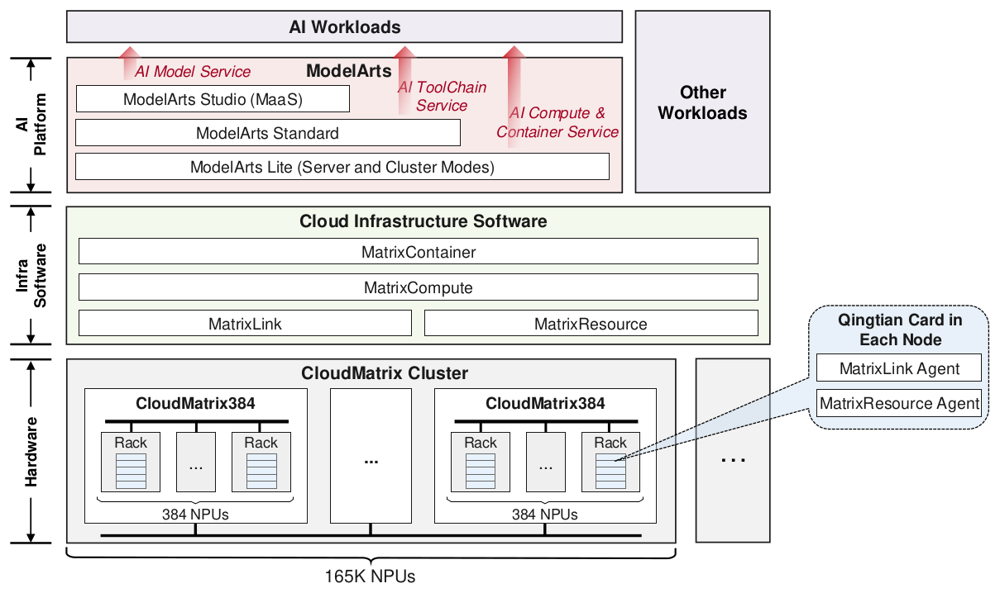

*图 7（原文 Figure 7，第 15 页）：从 AI Workloads 到 CloudMatrix384 硬件的四层云软件栈，右侧展示 Qingtian 卡上运行的两个 agent。*

**图中文字翻译与读法**：

- **AI Platform（AI 平台）层**：左侧 ModelArts 内含 ModelArts Studio (MaaS)、ModelArts Standard、ModelArts Lite (Server and Cluster Modes) 三档，右侧 Other Workloads（其他负载）。
- **Infra Software（基础设施软件）层**：Cloud Infrastructure Software 内含 MatrixContainer、MatrixCompute、MatrixLink、MatrixResource。
- **Hardware（硬件）层**：CloudMatrix Cluster 下并排多个 CloudMatrix384，每个含若干 Rack（机架），合计标注 384 NPUs；最底部横跨标注 165K NPUs，对应 RDMA 平面“最多 16.5 万 NPU”的扩展上限。
- **右侧说明框 Qingtian Card in Each Node（每节点的 Qingtian 卡）**：内含 MatrixLink Agent 和 MatrixResource Agent，用虚线指向机架中的某个节点，说明这两个 agent 实际运行在哪里。
- **读图结论**：四层体现“硬件 → 基础设施软件 → AI 平台 → 上层负载”的层层封装；MatrixLink/MatrixResource 的实际执行点在每个节点的 Qingtian 卡，而不是某个中心控制器，这与 UB 对等互联、避免单点瓶颈的设计思路一致。

## 六、CloudMatrix384 与 DeepSeek 模型的适配性分析（论文第 3.5 节）

### 6.1 DeepSeek 在 H800 上的部署方式（背景，不是本文的结果）

论文先总结 DeepSeek-V3/R1 的架构特征：6,710 亿总参数的 MoE，每 token 经 Top-8 路由只激活 370 亿参数；MLA 把 KV cache 减小最多 93.3%；MTP 支持多 token 生成和 decode 期验证；训练用 FP8 量化。DeepSeek 把这些模型部署在 NVIDIA H800 集群（单卡 80 GB 显存，节点内 NVLink、节点间 400 Gbps InfiniBand）：

- **prefill**：4 个 H800 节点（32 卡）为一个部署单元，256 个路由专家分布在 32 卡上，每卡 9 个路由专家 + 1 个共享专家，记作 DP32+EP32（共享专家和 MLA 用 DP 复制，专家层用 EP）；
- **decode**：扩大到 18 个节点（144 卡），记作 DP144+EP144，每卡 2 个路由专家 + 1 个共享专家，路由专家在全局保有 32 份冗余副本；
- **双微批流水**：一个 microbatch 做 MoE 的 dispatch/combine 通信时，另一个 microbatch 同时做本地 attention 或 MLP 计算，以重叠计算和通信；
- **DeepSeek 自报的结果**（引用自其公开 blog/report，不是本文测的）：prefill 每 H800 最高 9,213 tokens/s，配合 56.3% 的 context cache 命中率，刨除命中部分后的有效吞吐为 4,026 tokens/s；decode 平均每卡 1,850 tokens/s。

这一节是本文后续设计对照的基线，论文在第五节的评测表里也引用了这两个数字（4,026、1,850）作为 DeepSeek on H800 (Blog) 的参照。

### 6.2 CloudMatrix384 与 DeepSeek 的架构协同（四个维度）

1. **MoE 通信协同**：dispatch 把 token 从路由器送到可能跨越数百个 NPU 的目标专家，combine 要跨设备加权求和多个专家的输出；UB 的全互联拓扑以最小开销快速完成这两步，论文认为这是传统架构里网络性能严重制约 MoE 推理吞吐的地方。
2. **显存容量与管理**：6,710 亿参数的权重和 KV cache 都需要大量显存；CloudMatrix384 提供的 NPU 挂载显存总量很大，支持用 TP、PP、EP 的组合分布式存放权重；长上下文或高并发下 KV cache 本身也可能很大，需要高效的跨 NPU 分区和同步。
3. **上下文缓存复用**：多轮对话和长上下文场景下前缀复用收益显著，DeepSeek-AI 报告的命中率超过 56%；传统系统从片外 DRAM 或更慢的存储层取历史 KV 会引入明显时延，CloudMatrix384 让 NPU 经高带宽 UB 平面直接访问解耦的、CPU 挂载的 DRAM 池（见 8.1 节），从而达到内存级的带宽和时延。
4. **量化效率**：Ascend 910 原生支持 INT8（见 4.3 节），为在保持精度的前提下优化 DeepSeek 模型的推理性能提供了机会。

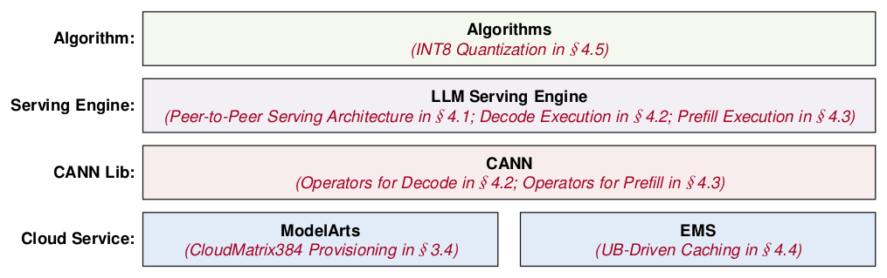

*图 8（原文 Figure 8，第 17 页）：按软件栈层次列出本文各项优化技术及对应章节。*

**图中文字翻译与读法**：

- **Algorithm（算法层）**：Algorithms——INT8 Quantization in §4.5（INT8 量化，见本文第十二节）。
- **Serving Engine（服务引擎层）**：LLM Serving Engine——Peer-to-Peer Serving Architecture in §4.1（对等服务架构，第七节）；Decode Execution in §4.2（decode 执行，第八、九节）；Prefill Execution in §4.3（prefill 执行，第十节）。
- **CANN Lib（CANN 库层）**：CANN——Operators for Decode in §4.2；Operators for Prefill in §4.3。
- **Cloud Service（云服务层）**：左 ModelArts——CloudMatrix384 Provisioning in §3.4（资源编排，对应本文第五节）；右 EMS——UB-Driven Caching in §4.4（UB 驱动缓存，第十一节）。
- **读图结论**：这张图是全文的路线图，把“量化算法 → 服务引擎 → 算子库 → 云服务”四层和论文章节一一对应；下文按这个顺序展开 CloudMatrix-Infer 的设计。

## 七、对等服务架构：PDC 解耦（论文第 4.1 节）

### 7.1 为什么不是 KV-cache-centric

CloudMatrix-Infer 把推理系统拆成三个功能子系统：prefill 集群（处理输入 prompt，生成首个输出 token 和初始 KV cache）、decode 集群（持续消费并更新 KV cache，自回归生成后续 token，直到遇到结束符或达到输出长度上限）、caching 集群（建立在解耦内存池之上的 UB 连接缓存层，提供 context caching 加速 prefill 复用和 model caching 加速模型加载）。三者“对等”（peer-to-peer）：地位相同、独立运作，不以某个中心实体编排。

论文将其与现有的 KV-cache-centric 架构（如 NVIDIA Dynamo、Mooncake，论文引用 [41,48]）对比：那类系统把请求调度和 KV cache 的物理位置紧密耦合——请求通常被路由到已持有对应历史 KV 的计算节点，因为节点内访问（如 PCIe，约 256 GB/s）远快于节点间（约 25 GB/s 或 200 Gbps），否则远程取 cache 时延很高。但这种亲和性调度会增加调度复杂度、有负载失衡风险，且 decode 节点上的 DRAM 通常各自孤立、未被充分利用，无法真正贡献成共享的缓存容量。

CloudMatrix-Infer 依托 UB 的超高带宽，构建一个所有 NPU（无论属于 prefill 还是 decode）都能统一访问的分布式缓存集群，彻底拉平了内存层级，消除了本地与远程访问时延的传统鸿沟。解耦“请求调度”与“KV cache 位置”带来三点好处：调度变得轻量且无状态，请求可派发到任意可用 NPU 实例而不受数据位置约束，提升全局负载均衡和 NPU 利用率；不再需要复杂的亲和性感知调度机制；汇聚 prefill 和 decode 节点的 DRAM 形成统一、弹性的缓存底座，提高命中率，在偏斜或突发负载下更有韧性。

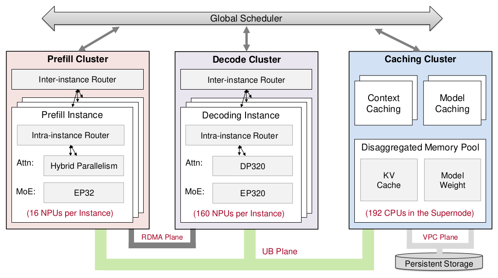

*图 9（原文 Figure 9，第 19 页）：Prefill、Decode、Caching 三个集群通过 Global Scheduler 协同，经 RDMA/UB/VPC 三个平面与持久存储相连。*

**图中文字翻译与读法**：

- **顶部 Global Scheduler（全局调度器）**：与三个集群双向通信（灰色箭头），负责把请求派发到合适的 prefill/decode 实例，并协调 cache 访问。
- **Prefill Cluster（prefill 集群）**：内含 Inter-instance Router（实例间路由）和多份堆叠的 Prefill Instance（prefill 实例，表示有多个同构实例）；每个实例内 Intra-instance Router（实例内路由）之下，Attn 用 Hybrid Parallelism（混合并行，见第十节），MoE 用 EP32；括号标注 16 NPUs per Instance（每实例 16 个 NPU）。
- **Decode Cluster（decode 集群）**：结构类似，Attn 用 DP320，MoE 用 EP320；括号标注 160 NPUs per Instance（每实例 160 个 NPU）。
- **Caching Cluster（缓存集群）**：Context Caching（上下文缓存）与 Model Caching（模型缓存）并列在上，下方 Disaggregated Memory Pool（解耦内存池）内含 KV Cache 和 Model Weight 两类数据；括号标注 192 CPUs in the Supernode（超节点内 192 个 CPU）。
- **底部三条横带**：RDMA Plane（连 Prefill 与 Decode 集群，用于迁移 KV cache）、UB Plane（横跨三个集群，缓存的统一访问通道）、VPC Plane（连向 Persistent Storage，持久存储）。
- **读图结论**：三个集群各自的 NPU/CPU 数目和并行度在图中已标出；prefill 用较小的 EP32，decode 用大得多的 EP320，这是后文第八节要解释的核心设计。caching 集群不占用 NPU，只用超节点里的 192 个 CPU（即全部 CPU）。

### 7.2 prefill 与 decode 的具体部署

每个 prefill 实例配置 16 颗 Ascend 910 NPU（32 个 die），采用 EP32；专家配置为每 rank 10 个专家：1 个共享专家、8 个路由专家、1 个冗余路由专家（用于 EPLB）。prefill 阶段另外叠加混合并行策略（第十节）和微批流水（第十节）来对冲通信开销。

每个 decode 实例配置大得多的 NPU 组，典型为 160 颗 Ascend 910 NPU（320 个 die），对应 MoE 层 EP320：每个 rank 承载一个专家，整体配置为 32 份共享专家副本、256 个不同的路由专家、32 个冗余路由专家（用于 EPLB）。decode 阶段另外叠加优化的 Ascend 原生算子、流水化的 decode 策略和 MTP 支持（第八、九节）。

### 7.3 面向异步真实负载的动态调整

真实在线服务中，请求到达是异步的——每个会话有各自的到达时间、prompt 长度和生成时长。PDC 架构允许根据负载的统计特征动态、细粒度地调整 prefill、decode、caching 节点数：输入更长的请求增加对 prefill 节点的相对需求，输出更长的请求增加对 decode 容量的需求，比例不是固定的，会随时间调整以在满足时延 SLO 的前提下最大化效率。为应对这种高度动态、不可预测的到达模式，CloudMatrix-Infer 通过批处理和调度机制强制实现“伪同步”执行：在 token 边界对齐请求，让多个会话可以被共同调度、并发处理，从而摊薄计算开销、提升吞吐，并在完全异步的到达模式下依然保持高资源利用率。

## 八、Decode 优化之一：面向大规模专家并行的融合通信算子（论文第 4.2.1 节）

### 8.1 为什么要做 LEP（大规模专家并行）

把 TPOT 时延降到最低，需要细粒度的专家并行：每个专家独占一颗 NPU die。DeepSeek-R1 部署 256 个路由专家，这使大规模专家并行（Large-scale Expert Parallelism，LEP）成为核心需求。但 LEP 并不简单：token 处理本身有顺序依赖，协调数百个 NPU die 又带来显著通信开销。

### 8.2 基础 MoE 流程的三个问题

门控网络为每个 token 选出 Top-K（DeepSeek-R1 中 K=8）个激活专家后，FFN 计算前需要两次 all-to-all 通信：第一次交换路由元数据（token 到专家的分配关系），第二次交换实际 token 数据——一个 7,168 维的隐状态向量，原始为 BF16，在发往各自分配到的 FFN 之前先在每颗 NPU 上量化为 INT8 以降低通信和计算成本。FFN 计算后，第三次 all-to-all 把专家输出送回源 rank，由该 rank 完成最终的 token 合并（combine）。这个基础实现有三个问题：

1. **通信开销**：三次 all-to-all 通信域可达数百个 NPU，带来显著时延；
2. **动态形状**：每次 decode 迭代里各专家分到的 token 数都会变化，all-to-all 的数据形状因此是动态的，需要动态内存分配和频繁的 CPU-NPU 同步，降低执行效率；
3. **顺序依赖**：MoE 计算的串行执行特性在各步骤间形成依赖，降低资源利用率和吞吐。

### 8.3 FusedDispatch 与 FusedCombine：四项优化

论文开发了两个融合算子 FusedDispatch 和 FusedCombine，把通信和计算整合在一起，专门为 CloudMatrix384 上的最优 decode 性能设计。

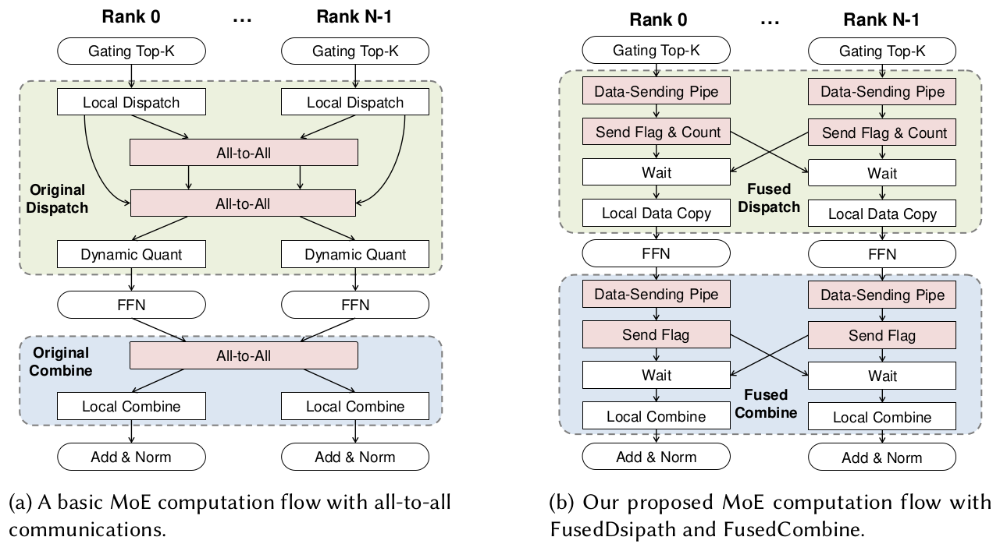

*图 10（原文 Figure 10，第 20–21 页）：左，基础 MoE 流程用三次 all-to-all；右，FusedDispatch / FusedCombine 用 send-receive 原语替代，并引入流水和双缓冲。*

**图中文字翻译与读法**：

- **左 (a) A basic MoE computation flow with all-to-all communications（基础 MoE 流程）**：Rank 0 … Rank N-1 各自经 Gating Top-K（门控选专家）→ Local Dispatch（本地整理待发送数据）→ 两次 All-to-All（分别对应路由元数据和 token 数据）→ Dynamic Quant（动态量化）→ FFN → 一次 All-to-All → Local Combine（本地合并）→ Add & Norm。Original Dispatch、Original Combine 用虚线框圈出对应的通信+计算子流程。
- **右 (b) Our proposed MoE computation flow with FusedDsipath and FusedCombine（本文方案，图中原文拼写 FusedDsipath 为笔误，应为 FusedDispatch）**：Fused Dispatch 虚线框内为 Data-Sending Pipe（数据发送流水）→ Send Flag & Count（发送完成标志和计数）→ Wait（等待对端标志）→ Local Data Copy（本地数据整理），两个 rank 之间的交叉箭头表示彼此直接写入对方的缓冲区而非经过集中式 all-to-all；之后是 FFN；Fused Combine 虚线框结构类似：Data-Sending Pipe → Send Flag → Wait → Local Combine；最后 Add & Norm。
- **读图结论**：三次集中式 all-to-all 被替换成两两对等的 send-receive（AIV-direct 直接写），且每个阶段都做成流水（下一项优化会展开）；这是减少通信轮次、去掉同步等待的直接体现。

**① AIV-Direct 跨 NPU 通信**：传统 all-to-all 通常依赖 SDMA（系统直接内存访问）引擎搬运数据，但 SDMA 的启动开销在超低时延场景（尤其 decode）下成为关键瓶颈。论文设计 AIV-Direct：让 AIV（向量）核直接把数据写入远端 NPU 的内存，经 UB 互联，完全绕开时延较高的 SDMA 路径。省去 SDMA 的启动开销后，AIV-Direct 为对等通信提供了一条轻量快速的路径，显著降低传输发起时延、加速跨 NPU 数据交换，对 decode 这类时延敏感操作尤其有效。

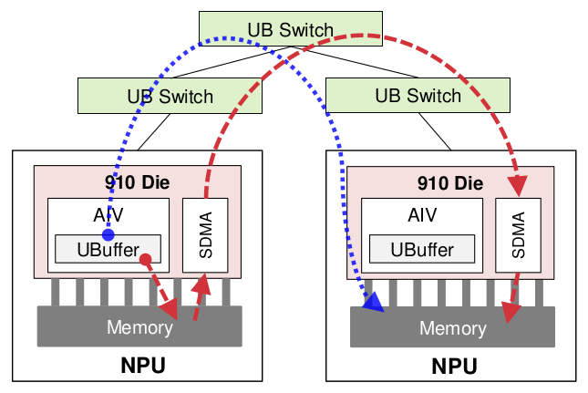

*图 11（原文 Figure 11，第 22 页）：红线为传统 SDMA 路径，蓝线为新设计的 AIV-Direct 路径。*

**图中文字翻译与读法**：

- **上方 UB Switch（UB 交换机）**：两侧各连一颗 910 Die（Ascend 910 die），每个 die 内有 AIV 核（内含 UBuffer，AIV 本地片上缓冲）和 SDMA 引擎，二者都能访问 die 下方的 Memory（显存）。
- **红色虚线（SDMA 路径）**：从左侧 die 的 SDMA 出发，经 UB 交换机，到右侧 die 的 Memory，再反向也有一条到左侧（图中红线双向，对应发送和接收）。
- **蓝色点线（AIV-Direct 路径）**：从左侧 AIV 的 UBuffer 出发，经 UB 交换机，直接写入右侧 die 的 Memory，不经过右侧的 SDMA。
- **读图结论**：AIV-Direct 比 SDMA 少了“进中转引擎再搬运”的一跳，用 AIV 核的片上 UBuffer 作为发送暂存区，直接把数据写到对端显存；省去的是 SDMA 固有的启动开销，不是降低了单次传输的带宽上限。

**② 提前量化**：基础流程在 token dispatch 时发送 BF16 数据，通信量大。论文把 INT8 量化提前到 FusedDispatch 内、数据发送之前：不发送 BF16，而是发送 INT8 量化后的数据加上其缩放因子。给定 7,168 维的 token，INT8 表示需要 7 KB；缩放因子占 4 字节（INT32），但为对齐分配 512 B；因此每个 token 的传输消息大小为 7.5 KB。这项优化显著降低了带宽最紧张阶段（通信）的开销。

**③ 基于共享内存预分配的静态执行**：为避免动态内存分配及其伴随的 CPU-NPU 同步开销，论文为 MoE 层中来自每个其他 rank 的数据，在每个 NPU rank 上静态预分配共享内存缓冲区。所需缓冲区大小为：

$$
\text{buffer\_size} = \text{rank\_num} \times \text{max\_tokens} \times \text{msg\_size} \tag{1}
$$

其中

$$
\text{max\_tokens} = \text{local\_batch} \times \min(\text{topK},\ \text{experts\_per\_die}) \tag{2}
$$

`max_tokens` 是单个 NPU 可能发给某一个对端的最坏情况 token 数，`msg_size` 是量化后单 token 的消息长度（dispatch 为 7.5 KB，combine 为 14 KB，因为 combine 传输的是未量化数据）。空间预分配完成后，FusedDispatch 和 FusedCombine 都通过 AIV-direct 直接把数据写入目标 NPU 的内存缓冲区，省去中间的本地拷贝和随后的远程读取，从而减少内存流量和同步时延。

因为 FusedDispatch 与 FusedCombine 背靠背执行，若共用一块缓冲区会产生竞态：更快的 NPU 可能在对端消费完上一次 FusedDispatch 数据前，就发起 FusedCombine 并覆盖对端缓冲区，造成数据损坏。论文用**双缓冲**消除这一风险：为 FusedDispatch 和 FusedCombine 分别保留独立缓冲区，保证写入方始终有一块空闲缓冲、读取方读的是另一块。

预分配的内存开销不大。论文的实验设置中，每个 die 的本地 batch 最多 96 个 token、最多承载 2 个专家，`max_tokens = 96 × min(8, 1) = 96`；在 320 rank 的通信域上，dispatch 缓冲区占用 `320 × 96 × 7.5 KB ≈ 225 MB`，combine 缓冲区占用 `320 × 96 × 14 KB ≈ 420 MB`，两块缓冲合计每 die 约 645 MB。

**④ 数据发送流水**：远程写入需要先计算在对端预分配缓冲区中的目标偏移，若把这个计算和传输串行执行会造成停顿。论文在每个融合算子内部设计了数据发送流水（图 12），把三个阶段流水起来：(1) 把下一个 token 拷入本地 UBuffer；(2) 计算远端缓冲偏移，若启用则做 INT8 量化；(3) 把 AIV-Direct 写发往对端 NPU。token 以“单 token 微批”的形式流过这条流水线：当一个 microbatch 的第 3 阶段在传输数据时，后续 microbatch 的第 1、2 阶段并行执行，从而把计算和通信时延都隐藏起来，实现连续、高效的 token dispatch。

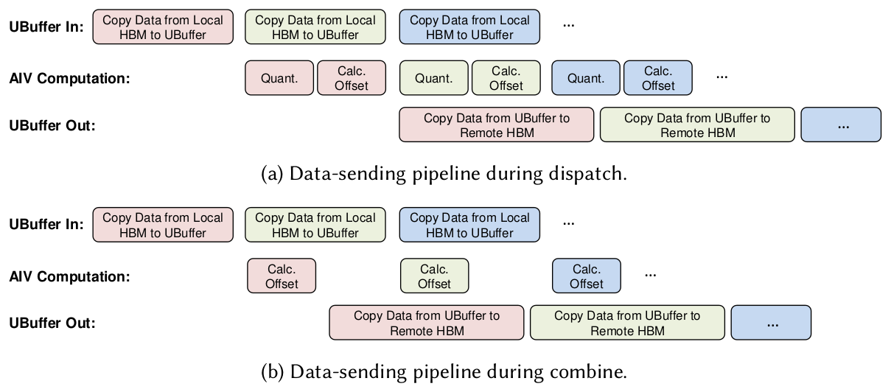

*图 12（原文 Figure 12，第 23 页）：dispatch 流水含量化步骤，combine 流水不含（传输未量化数据）。*

**图中文字翻译与读法**：

- **(a) Data-sending pipeline during dispatch（dispatch 阶段的数据发送流水）**：三行 UBuffer In（从本地 HBM 拷入 UBuffer）、AIV Computation（Quant. 量化 → Calc. Offset 计算偏移，两步交替）、UBuffer Out（从 UBuffer 拷到远端 HBM）；相邻 token 的三个阶段依次错开、相互重叠（图中颜色区分不同 token）。
- **(b) Data-sending pipeline during combine（combine 阶段的数据发送流水）**：结构相同但 AIV Computation 只有 Calc. Offset（计算偏移）一步，没有量化，对应 combine 传输的是未量化数据。
- **读图结论**：两张图直观展示了“流水掩盖延迟”：只要后一个 token 的前两步能在前一个 token 的传输阶段内完成，整条流水线的吞吐就由单步里最慢的阶段决定，而不是三步时间之和。

### 8.4 FusedDispatch 与 FusedCombine 的完整流程

结合上述四项优化（AIV-direct 通信、提前量化、预分配双缓冲、数据发送流水），FusedDispatch 分三步：第一步是流水化的 token 发送阶段（优化④）：每个 rank 遍历分配给远端专家的 token，dispatch 的 AIV 核先把 token 数据从内存读入本地 UBuffer，量化为 INT8（优化②）并附上缩放因子，同时附上源 rank ID、batch-slot ID、key offset 等路由元数据，再确定每个专家 ID 对应的目标 rank，通过 AIV-direct 把数据包写入对端的预分配共享缓冲区（优化①③）。第二步：所有数据包发出后，用一个 barrier 确保全部 token 数据写入完成，再发送完成标志；dispatch 核并行统计每个专家收到的 token 数、跨核同步，再通过 AIV-direct 把完成标志和 token 计数发给对应的对端。第三步是协调与输出整理：每个 rank 轮询远端写入的标志，等待全部置 1 后，读取对应的 token 计数以算出输出偏移；最后所有 dispatch 核并行把收到的 token 数据、量化缩放因子、各专家 token 计数，从共享内存整理进连续的输出缓冲区，供后续 FFN 计算使用。

FusedCombine 同样分三步：第一步是流水化的数据发送阶段（优化④），每个 combine AIV 核遍历其负责的对端 rank，读取对应的接收计数，把相应的 FFN 结果数据拷入本地 UBuffer，用 token 的源元数据（源 rank ID、batch-slot ID、key offset）计算在对端上的目标地址，再经 AIV-direct 把 token 数据传回发起该 token 的原 rank（优化①③）。第二步：combine AIV 核在对端上对相应标志执行原子加操作（经 AIV-direct），标记“已交付一份贡献”。第三步：每个核等待其负责批次的全部标志置 1，表示该 token 的所有专家输出均已收到，再从共享内存中收集各专家的 FFN 输出、取出对应缩放因子、做逐元素缩放并求和；合并后的专家输出再加到共享的 FFN 输出上，得到每个 token 的最终结果。

## 九、Decode 优化之二、三、四：MLA 融合、微批流水、流水化 MTP（论文第 4.2.2–4.2.4 节）

### 9.1 MLA 优化：三个瓶颈与三项对策

MLA（多头潜在注意力，DeepSeek 提出）用低秩压缩缩小 KV cache 的空间占用，并用权重吸收降低计算量。直接把 DeepSeek 的 MLA 算子搬到 Ascend 910 上会暴露三个瓶颈：

1. **细粒度算子的启动开销**：MLA 引入大量细粒度操作（RMSNorm、线性投影、RoPE 编码等），通常各自实现为独立的 NPU 算子。每次算子调用都有不可忽略的启动时延，来自 CPU 侧派发、参数加载、指令调度和 tiling 配置。把这些算子捕获进计算图可以摊薄 CPU 派发开销，但消除不了每个算子在 NPU 上的启动成本本身，大量小算子的累积仍会在 MLA 路径上带来显著时延。
2. **KV cache 格式转换开销**：Ascend 910 的 AIC（AI Cube）核的 L1 Cache 为高性能矩阵计算最优地以 NZ 格式存储数据（一种混合行主序/列主序的特殊布局，形成 N 形和 Z 形结合的遍历路径），但 KV cache 通常以标准的 ND（N 维）格式存放在 NPU 内存里。因此算子内部往往需要在 AIC 做矩阵计算前，把 KV cache 显式转换成 NZ 格式，这个显式转换消耗内存带宽，影响访存效率，降低了可用于计算的有效内存带宽。
3. **MTP 下的负载不均衡**：启用 MTP 时，decode 阶段要验证前一步预测的多个 token，导致同一批内不同请求的有效序列长度不同（见 9.3 节）。原来假设 BNSD（Batch, Num-heads, Sequence-length, Head-dimension）内存布局的 attention 算子 tiling 策略，在这种情况下会造成严重的负载不均衡：不启用 MTP 时，一个 decode 步内所有请求的序列长度都是 1，按 B 轴和 N 轴切分就能得到大小相等的计算任务（因为 S、D 在每个任务里都是常数），天然负载均衡；MTP 开启后序列长度 S 会随请求不同而变化，继续按 B 轴、N 轴切分会让不同 NPU 核之间的负载严重失衡，拉长整体 MLA 计算时间。

针对这三点，论文提出三项 NPU 友好的优化：

**融合算子：MLAProlog 与 FusedAttention (FA)**。为大幅削减 MLA 计算路径上众多小算子的启动开销，论文做了激进的算子融合。首先，把多个 attention 前的操作——RMSNorm、Q/K/V 投影、RoPE——合并成一个复合算子 MLAProlog，把许多独立算子的启动成本降为一次；MLAProlog 内部还设计了细粒度的微并行，把工作拆成多个子任务，在 AIC 和 AIV 之间流水执行，让异构核上不同子任务的计算时间相互掩盖，进一步压缩融合算子的执行时间。其次，论文开发了融合 attention 算子 FA，把 FlashAttention 与相邻的数据整形操作（attention 前的 Concat，用于准备 Q、K、V；attention 后的 Slice，用于取出相关输出）整合在一起，进一步减少 kernel 启动次数、提升 attention 计算路径上的数据局部性。

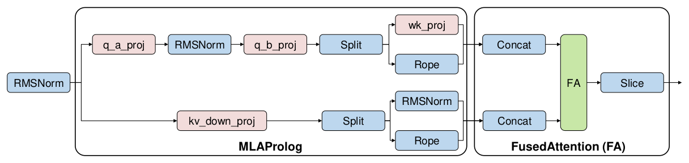

*图 13（原文 Figure 13，第 24 页）：MLAProlog 融合了 RMSNorm、Q/K 投影和 RoPE；FusedAttention 融合了 Concat、FlashAttention 和 Slice。*

**图中文字翻译与读法**：

- **左框 MLAProlog**：输入 RMSNorm 后分两路——上路 q_a_proj → RMSNorm → q_b_proj → Split，分出 wk_proj 和 Rope 两个分支；下路 kv_down_proj → Split，分出 RMSNorm 和 Rope 两个分支。
- **右框 FusedAttention (FA)**：两路输入各自经 Concat 后汇入绿色的 FA（核心 attention 计算），再经 Slice 输出。
- **读图结论**：图里每个方框（q_a_proj、RMSNorm、q_b_proj……）在原始实现中都是独立算子，MLAProlog 和 FA 分别把它们合并成一次调用；这正是“启动开销从多次降为一次”的直接体现。

**NZ 格式原生存储 KV cache**：为消除张量格式转换开销，论文让 KV cache 在 NPU 内存中原生以 NZ 格式存储。MLA 计算产生的 KV 张量直接以 NZ 格式追加进 cache；decode 阶段逐 token 产生新 KV 时，按 NZ 格式规则高效写入 NPU 内存。Ascend NPU 提供能在内存写入时同步做格式转换的数据搬运接口，这种“写入即转换”能力省去了 KV cache 单独、显式的 ND 到 NZ 转换步骤，从而提升了有效 NPU 内存带宽利用率。

**面向 MTP 的 BSND 布局自适应 tiling**：为在 MTP 下恢复负载均衡，论文把内存布局从 BNSD 改为 BSND，并采用沿 batch（B）轴和 sequence（S）轴的动态 tiling 策略（这两个轴会随请求变化）。由于头数 N 和头维度 D 在这些操作中相对稳定，这样切分能让各 AIC 核之间的任务规模更均匀，减少因个别核拖后腿造成的尾部时延。

三项策略——算子融合、原生 NZ 存储、自适应 tiling——共同把 CloudMatrix384 上基于 MLA 的推理性能推到更高水平，为 DeepSeek 系列模型带来显著的时延与吞吐收益。

### 9.2 微批流水：decode 阶段的双流设计

仅靠融合通信算子（9.1 节）还不足以完全消除专家并行通信在 decode 阶段的显著时延。受 DeepSeek 微批流水策略启发，论文为 CloudMatrix384 设计了定制的 decode 微批流水：用两条交错的执行流做细粒度的时延重叠。

CloudMatrix384 上的资源划分和流水策略和 DeepSeek 的方法不同，原因在于 Ascend NPU 的硬件特点和本文特有的并行部署方式。DeepSeek 在 H800 上的部署每卡共置 3 个专家（1 个共享专家 + 2 个路由专家，见图 14a）；本文在 CloudMatrix384 上为了降低 decode 时延，采用大规模专家并行（EP320），典型情况下每颗 NPU die 只放 1 个专家。没有共享专家的计算量来填补，单靠 ATTN-0 阶段的计算时延不足以完全掩盖 MoE dispatch 的通信时延，因此需要一种不同的负载均衡流水策略。

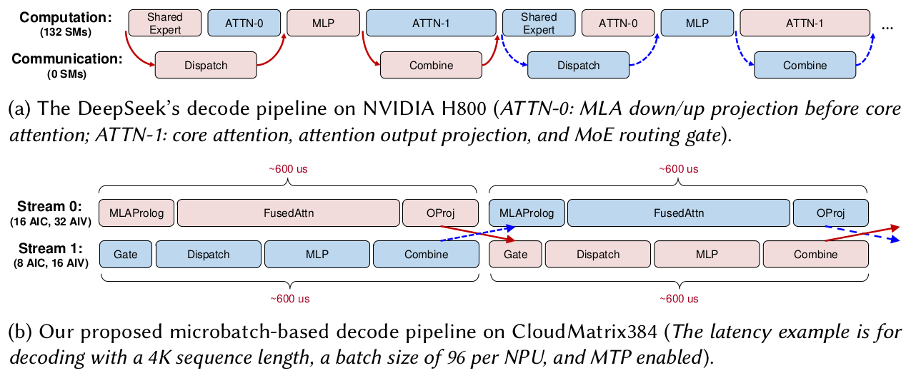

*图 14（原文 Figure 14，第 26 页）：(a) DeepSeek 在 H800 上的 decode 流水；(b) 本文在 CloudMatrix384 上提出的微批流水，两条流各自承担不同任务并做非对称资源划分。*

**图中文字翻译与读法**：

- **(a) DeepSeek 在 NVIDIA H800 上的 decode 流水**：Computation（计算，132 SMs）一行依次是 Shared Expert（共享专家）、ATTN-0、MLP、ATTN-1……（交替颜色表示两个交错的 microbatch）；Communication（通信，0 SMs）一行对应位置是 Dispatch、Combine。图注说明 ATTN-0 指核心 attention 之前的 MLA 下投影/上投影，ATTN-1 指核心 attention、attention 输出投影和 MoE 路由门控。
- **(b) 本文在 CloudMatrix384 上的微批流水**：Stream 0（16 AIC, 32 AIV）依次执行 MLAProlog → FusedAttn → OProj，标注每一轮约 600 µs；Stream 1（8 AIC, 16 AIV）依次执行 Gate → Dispatch → MLP → Combine，同样约 600 µs。两条流之间用红蓝交叉箭头表示相互重叠：Stream 0 处理某个 microbatch 的 attention 路径时，Stream 1 同时处理另一个 microbatch 的 MoE 路径。图注注明该时延示例对应 4K 序列长度、每 NPU 批大小 96、MTP 开启的典型 decode 条件。
- **读图结论**：本文方案把 attention 路径和 MoE 路径拆成两条资源配比不同的流（16:8 的 AIC、32:16 的 AIV），而不是像 DeepSeek 那样用“专用 SM 做通信”；两条流各自约 600 µs，靠非对称的资源配比让二者时延接近，从而实现近乎完美的交错重叠。

具体地，流水包含两条交错执行流，各自负责 decode 流程中不同的部分、配置不同的计算能力：

- **Stream 0（Attention 路径）**：执行 MLAProlog、FusedAttention 和 O_PROJ。这些是计算密集或访存密集的算子，因此分配更多 NPU 资源——16 个 AIC 和 32 个 AIV。在典型 decode 条件下（4K 序列、批大小 96、MTP 开启），该流每 microbatch 的时延为 600 µs。
- **Stream 1（MoE 路径）**：处理 MoE 序列：Gate、Dispatch、MLP、Combine。由于同时包含计算和通信阶段，该流分配 8 个 AIC 和 16 个 AIV，只有 Stream 0 一半的资源，却因计算负载更低（尽管通信时延更高）达到相近的时延（约 600 µs）。

非对称的资源分配确保 Stream 0 和 Stream 1 执行时每层时延接近，从而让两个交错 microbatch 能够完美重叠：如图 14b 中交替的颜色所示，Stream 0 为一个 microbatch 做 attention 计算的同时，Stream 1 同步为另一个 microbatch 做 MoE 计算和通信。为适应运行时条件变化（例如可变的 KV cache 长度），两条流的计算资源配比可以自适应调整，确保时延平衡在不同负载下都能维持，从而获得持续稳定的性能。

### 9.3 多 Token 预测（MTP）支持：流水化消除“管线断裂”

MTP 是 DeepSeek-R1 使用的一种投机解码技术：每个 decode 步预测 k 个 token，这些预测在后续步骤中被验证。通过每次 decode 生成多个 token，MTP 能显著提升吞吐。但在现有推理框架中启用 MTP，常因紧密的 CPU-NPU 同步而带来可观的低效，导致流水线中断、性能下降。论文称之为**管线断裂问题（pipeline break problem）**。

如图 15b（朴素 MTP 流水）所示，MTP 通常每个 decode 步触发 k+1 个计算图：k 个用于投机模块，1 个用于最终验证。每次图派发都会带来 0.6–0.8 ms 的启动时延，这种开销（尤其在 CPU 主导的编排下）会在 NPU 上产生空闲气泡，削弱 MTP 本应带来的收益。论文识别出两个主要成因：

- **CPU 介入的动态元数据初始化**：MTP 模块和主 LLM 都依赖会在解码过程中动态变化的元数据（如当前序列长度），这些元数据只有在前一个模块执行完成后才能确定。例如，MTP 模块需要的序列长度要等前一次 LLM 验证完成后才能确定。如图 15b，CPU 在派发每个图之前都要初始化并传输这份元数据，造成频繁的 CPU-NPU 同步屏障。
- **CPU 介入的采样打断 NPU 执行**：MTP 模块和主 LLM 产生 token 分布后，需要采样选出实际 token，这个过程混合了 CPU 流程和零散的 NPU 操作。这些频繁的 CPU-NPU 交互带来主机与设备间数据拷贝的开销；更关键的是，由于每个后续计算图都依赖前一个图采样得到的输出，这引入了串行化，阻止 NPU 连续执行。

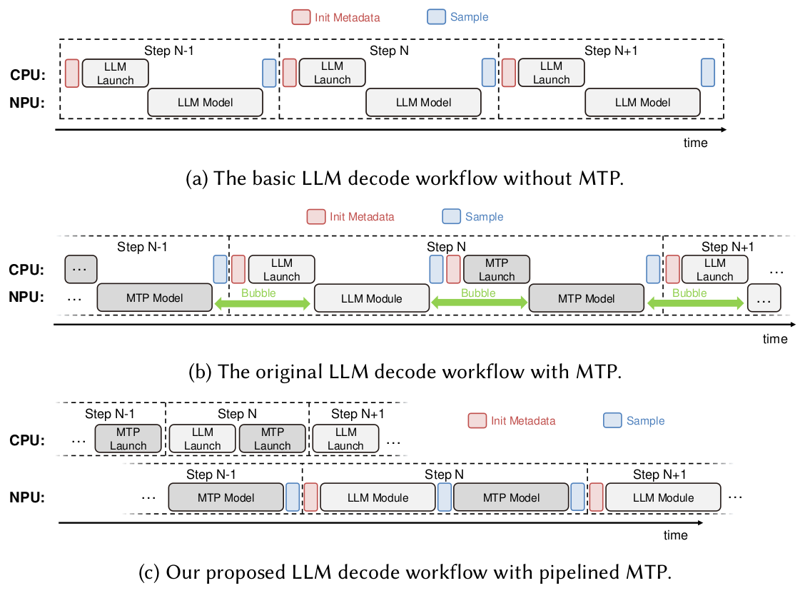

*图 15（原文 Figure 15，第 27 页）：(a) 无 MTP 的基础流程；(b) 原始 MTP 流程中 CPU 派发造成的气泡；(c) 本文流水化 MTP 消除气泡。*

**图中文字翻译与读法**：

- **(a) 无 MTP 的基础 LLM decode 流程**：CPU 在每个 Step（步）内只做一次 LLM Launch（LLM 图派发），NPU 对应执行一次 LLM Model；步与步之间紧邻、无额外气泡。
- **(b) 带 MTP 的原始 LLM decode 流程**：CPU 侧每步要先后做 MTP Launch 和 LLM Launch 两次派发，并穿插 Init Metadata（初始化元数据，红色方块）和 Sample（采样，蓝色方块）；NPU 侧对应执行 MTP Model 和 LLM Module，两者之间出现绿色 Bubble（气泡，即空闲等待）。
- **(c) 本文提出的流水化 MTP 流程**：CPU 侧的 MTP Launch、LLM Launch 提前打包、连续发出，不再和 NPU 侧的执行交替等待；NPU 侧 MTP Model 和 LLM Module 背靠背连续执行，图中不再出现气泡；Init Metadata 和 Sample 被整体挪到流程前后，不再逐图打断。
- **读图结论**：三张图的核心对比是 (b) 中 NPU 执行被绿色气泡打断、(c) 中 NPU 执行连续无气泡；差别来自把“逐图初始化元数据+逐图 CPU 采样”改成“批量预计算元数据+采样搬到 NPU 上”，具体做法见下文两项优化。

为克服这些瓶颈，论文引入流水化 MTP 执行技术（图 15c），消除这些 CPU 依赖，实现高效的图执行：

**聚合元数据初始化**：不再为 k+1 个图分别单独做元数据准备，而是在 decode 步开始时一次性预计算并打包全部元数据张量。这些直接存放在 NPU 内存中的张量包括每个 MTP 模块的增量序列长度，以及验证图所需的元数据块。这样就消除了重复的 CPU 介入，实现无缝的、元数据感知的 NPU 端执行。

**无 CPU 介入的 NPU 内采样**：为消除频繁由 CPU 采样引起的 NPU 执行停顿，论文把整个采样流程迁移到 NPU 上，把 token 概率排序、累积和计算、候选过滤等采样所需的操作实现为一系列 NPU 算子；并把这些采样算子融合进 MTP 和 LLM 验证图，以进一步降低派发大量 NPU 采样算子可能带来的启动开销。采样完全留在设备端执行后，MTP 各阶段与 LLM 验证阶段之间不再出现执行停顿，计算图可以背靠背执行，无需主机介入。

两项改进共同消除了朴素 MTP 实现中由 CPU-NPU 协调引起的频繁管线中断：NPU 执行某个计算图时，CPU 并发调度下一个，从而实现持续的并行和不间断的 NPU 执行，充分释放 MTP 本应带来的时延收益。

## 十、Prefill 优化：混合并行、微批流水、低干扰转移（论文第 4.3 节）

### 10.1 MLA 的分阶段混合并行

prefill 阶段负责处理输入 prompt、生成初始 KV cache，对 TTFT 和系统吞吐影响很大；由于通常是计算密集型，prefill 阶段保持高 NPU 利用率至关重要。但异构的输入序列长度和（尤其是 MoE 这类复杂架构下的）通信开销会带来负载不均衡等挑战。

论文观察到，DeepSeek 在 GPU 部署中原本用于 MLA 计算的纯数据并行（DP），在 Ascend NPU 上会导致次优的负载均衡和资源利用率，原因有二：

1. **序列长度偏斜**：真实请求的输入长度差异很大。典型的 32 路 DP 配置下，分到较短序列的 NPU 先完成工作，随后闲置等待处理批内最长序列的那个，浪费计算周期。
2. **并发度不足**：若在途请求数少于 DP 度（例如 DP32 却不足 32 个请求），部分 DP 分片拿不到任何工作。为凑够 32 个请求的完整批而延迟处理会增加 TTFT，而用不完整的批继续处理又会造成 NPU 资源利用不足。

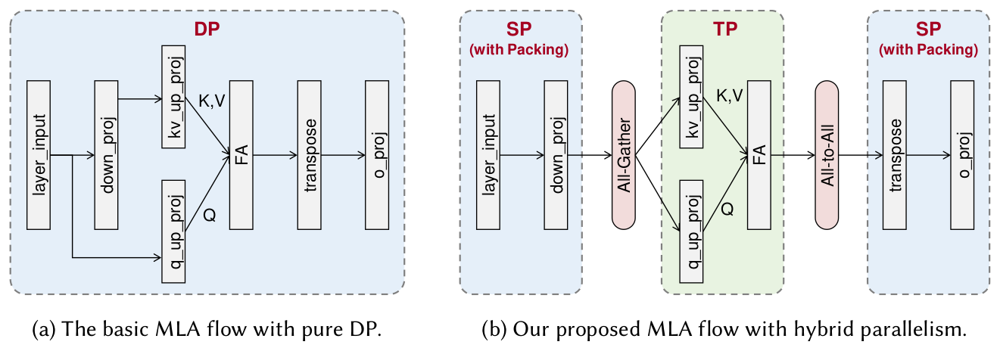

*图 16（原文 Figure 16，第 28 页）：(a) 纯 DP 的基础 MLA 流程；(b) 本文提出的混合并行 MLA 流程，加入 All-Gather 和 All-to-All 两次集合通信。*

**图中文字翻译与读法**：

- **(a) 纯 DP 的基础 MLA 流程**：layer_input → down_proj 后分两路：kv_up_proj 产生 K,V、q_up_proj 产生 Q，两者汇入 FA（核心 attention），再经 transpose → o_proj 输出；整个过程标注在 DP 虚线框内，即各 rank 各自独立处理自己的请求，互不通信。
- **(b) 混合并行的 MLA 流程**：三个阶段依次为 SP (with Packing)（序列并行+打包）——layer_input → down_proj；接一次 All-Gather；TP（张量并行）——kv_up_proj/q_up_proj 产生 K,V/Q → FA；接一次 All-to-All；SP (with Packing)——transpose → o_proj。
- **读图结论**：(b) 比 (a) 多出 All-Gather 和 All-to-All 两次通信，这是“用通信换负载均衡”的直接体现，具体收益和代价见下文。

为缓解这些低效，论文为 prefill 阶段的 MLA 计算引入分阶段混合并行策略，把 MLA 拆成三个阶段、各阶段用不同的并行方式：

第一阶段（包含 layer_input 和 down_proj 的处理）和第三阶段（包含 o_proj）的计算本质上不依赖 token 在序列中的位置，因此论文用序列并行（SP）配合序列打包（sequence packing）取代纯 DP：把多个请求的 prompt 序列拼接起来，再把这条打包后的超长序列的各段分配到不同 SP rank。这样一来，不同长度请求的 token 就能近似均匀地分布到各个 NPU die 上，与具体请求长度无关地实现有效负载均衡。

第二阶段（包含 q_up_proj、kv_up_proj 和核心 FlashAttention）的计算关键性地依赖 token 位置，因此这一阶段用张量并行（TP）确保各 NPU die 间计算负载均衡。prefill 实现中，MLA 通常不做某些权重矩阵吸收以提升原始计算效率，这使它可以被有效地当作标准的 128 头多头注意力（MHA）处理；由于 MHA 计算对每个头都是独立的，论文按注意力头切分、把这些头均匀分布到各 NPU die 上实现 TP。

跨阶段切换并行策略需要数据重分布：论文在第 1、2 阶段之间插入一次 All-Gather，在第 2、3 阶段之间插入一次 All-to-All，以正确地对激活数据重新分片和分布。

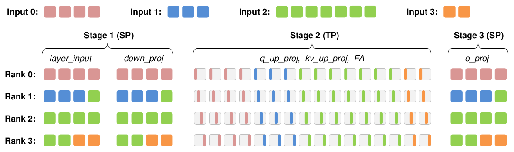

*图 17（原文 Figure 17，第 29 页）：四个不同长度的输入经 SP → TP → SP 三阶段在四个 rank 上的数据流动示例。*

**图中文字翻译与读法**：

- **顶部 Input 0/1/2/3**：四个长度不同的输入，分别用粉、蓝、绿、橙四色小方块表示各自的 token（数量即长度：4、3、7、2）。
- **Stage 1 (SP)**：layer_input、down_proj 两列，Rank 0–3 每行都混有四种颜色的方块且数量接近，体现打包后按序列位置均匀切分，与原始请求边界无关。
- **Stage 2 (TP)**：q_up_proj, kv_up_proj, FA 一列，每个 Rank 现在处理全部四个输入的某个头切片（图中每行都出现四种颜色的细长条，表示该 rank 持有所有 token 在某些头上的数据）。
- **Stage 3 (SP)**：o_proj 一列，布局与 Stage 1 相同，四种颜色再次按序列位置均匀分布到四个 Rank。
- **读图结论**：Stage 1/3 中每个 rank 拿到的是“所有请求的一段 token”，天然均衡；Stage 2 中每个 rank 拿到的是“所有请求在某些注意力头上的全部 token”，这正是 TP 的切分方式；两种切分之间的转换就是图 16(b) 中的 All-Gather 和 All-to-All。

相比传统 DP 策略（图 16a），混合并行多引入了这两次额外的集合通信，但其开销经过精心控制：All-Gather 操作在一次降维步骤（down_proj 隐含的）之后进行，因此作用在相对更小的张量上；All-to-All 主要重分布的是 attention 机制里已经按 TP 度切分过的分片，由于这些分片已经比完整、未切分的张量小很多，这次操作交换的数据量远小于处理完整张量的集合通信。在带有高带宽 UB 平面的 CloudMatrix384 上，这两个算子的通信开销都相对较小。

### 10.2 微批流水：prefill 阶段的 AIC/AIV/SDMA 异构分工

为缓解专家并行带来的通信开销，DeepSeek 原始部署采用双微批流水：如图 18a，在 NVIDIA H800 上交错两个并发 microbatch 的计算和通信，用一个 microbatch 的计算重叠另一个的通信开销（即 Dispatch 和 Combine），以提升流水效率、摊薄 prefill 阶段的时延。

但把这套策略直接搬到 CloudMatrix384 的 Ascend 910 上并不高效，原因在于架构不匹配：H800 上的流水通常预留一部分流多处理器（SM）专门做通信，虽然实现了并发但减少了可用计算资源。相比之下，Ascend 910 提供异构的计算结构——AIC 做矩阵运算、AIV 做轻量计算、SDMA 引擎做数据搬运，支持更细粒度、按角色分工的任务分配。

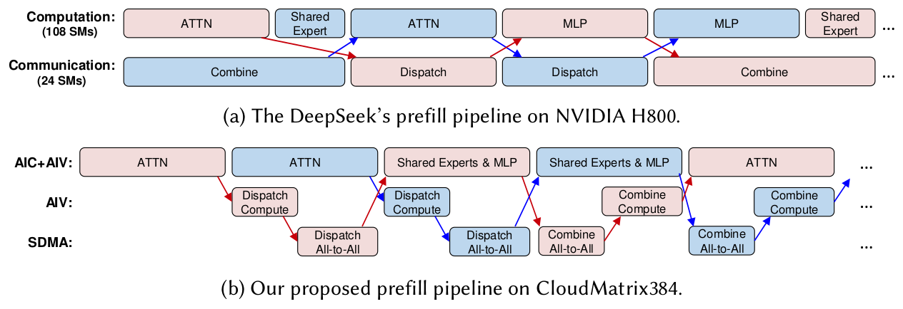

*图 18（原文 Figure 18，第 31 页）：(a) DeepSeek 在 H800 上预留 SM 做通信；(b) 本文方案把计算、轻量向量任务、批量数据搬运分别交给 AIC、AIV、SDMA。*

**图中文字翻译与读法**：

- **(a) DeepSeek 在 NVIDIA H800 上的 prefill 流水**：Computation（计算，108 SMs）一行依次是 ATTN、Shared Expert、ATTN、MLP、MLP、Shared Expert……；Communication（通信，24 SMs）一行对应 Combine、Dispatch、Dispatch、Combine……，交替颜色表示两个交错的 microbatch。
- **(b) 本文在 CloudMatrix384 上的 prefill 流水**：三行——AIC+AIV（ATTN、Shared Experts & MLP 等主计算）、AIV（Dispatch Compute、Combine Compute，轻量向量任务）、SDMA（Dispatch All-to-All、Combine All-to-All，批量数据搬运），用交叉箭头表示跨行、跨 microbatch 的重叠。
- **读图结论**：(a) 用“预留 SM”的方式在同一类计算单元里硬性切出通信份额；(b) 则是把通信相关的辅助计算（Dispatch/CombineCompute）和真正的批量数据搬运（All-to-All）分别卸载到 AIV 和 SDMA 这两类不同于主计算单元 AIC 的硬件，腾出 AIC 专注核心计算。

为充分利用这种异构性，论文为 CloudMatrix384 引入了优化的微批流水 prefill 方案（图 18b），把工作负载按角色分配到 AIC、AIV、SDMA 三个子系统：

第一，把低强度的辅助计算卸载给 AIV，让 AIC 专注于计算密集的 ATTN 和 MLP 等算子。Dispatch 前的 token 重排和元数据生成（记作 DispatchCompute）、Combine 后的专家输出累加（记作 CombineCompute）这类任务被分配给 AIV——它们轻量且可向量化，很适合 AIV 执行。如图 18b 所示，AIV 可以为一个 microbatch 处理 DispatchCompute，同时 AIC 为另一个 microbatch 执行核心计算，实现细粒度的算子级重叠。

第二，把高流量的数据传输（例如 MoE Dispatch 和 Combine 的 All-to-All 通信）显式路由到 SDMA 引擎。把这些内存操作隔离到专用的传输流，可以避免与 AIC、AIV 执行产生争用，这样计算密集的操作能不受打断地继续，通信时延则由并发执行的 AIC/AIV 任务重叠掩盖。鉴于 prefill 负载以稠密矩阵运算和通信为主，这种把数据流显式分流到 SDMA 的做法，对维持 NPU 峰值吞吐起到了关键作用。

这种硬件感知的任务分配——AIC 做主计算、AIV 做辅助向量任务、SDMA 做通信——提升了并发度、减少了执行停顿。论文还指出，这个设计和 decode 阶段的流水（9.2 节）有明显不同：decode 流水里通信逻辑与计算流更紧密耦合，因为两阶段的时延和吞吐需求不同；prefill 阶段需要处理更长的序列和更大的 microbatch，对计算饱和度和带宽争用更敏感，因此通过专用执行单元分离关注点、在算子级别重叠任务，更契合 CloudMatrix384 的性能特点。

### 10.3 Prefill 到 Decode 的低干扰转移

在 prefill-decode 解耦的服务架构中，prefill 阶段负责产生首个 token 和对应的 KV cache，之后必须转移给 decode 阶段以启动自回归生成。为防止时延敏感的 decode 性能被 prefill 活动干扰，论文在 CloudMatrix-Infer 中引入三项系统级优化：(1) 经 RDMA 平面对 KV cache 传输做硬件级隔离；(2) 异步调度，把 prefill 执行和 decode 调度解耦；(3) 模型感知的连接分组，均衡 prefill-decode 通信流量。

**基于 RDMA 平面的 KV Cache 传输**：prefill 阶段完成后，完整的 KV cache 被传输到指定的 decode 节点。为消除对 decode 阶段通信的潜在干扰，这次 NPU 到 NPU 的传输经由 RDMA 平面进行——它在物理和逻辑上都与承载 token dispatch、专家输出合并等带宽密集型 decode 操作的 UB 平面分离。借助 RDMA 平面这条专用路径，KV cache 的搬运被隔离在时延关键的 decode 流量之外；而且由于每个请求的 KV cache 只传输一次，RDMA 平面有足够带宽，不会成为性能瓶颈。

**异步 Prefill 调度**：为进一步最小化两阶段之间的干扰，论文把 prefill 调度和 KV cache 传输都放到 decode 调度器中的一个专用后台线程上。新请求到达时，推理引擎立即把控制权交还给后台线程，由它异步完成：(i) 在目标 decode 节点上分配 KV cache 缓冲区；(ii) 把 prefill 任务路由到负载较低的 prefill 节点；(iii) 完成后触发基于 RDMA 的缓存传输。这样 decode 线程就不会被 prefill 的计算或数据传输阻塞，从而保持连续的 decode 调度和更好的响应性。

**负载均衡的 Prefill-Decode 连接映射**：PD 解耦系统中常见的场景是 prefill 和 decode 阶段使用不同的并行配置——例如 decode 阶段可能结合张量并行（TP）和数据并行（DP），而 prefill 阶段为加速长输入序列处理通常使用更大的 TP 度。DeepSeek-R1 使用单个 latent head 的 MLA，这意味着一个 TP 组内的所有 rank（tp_rank）都持有完全相同、完整的 KV cache 副本。

这种数据冗余带来灵活性的同时，也带来网络热点风险：若一个 decode 实例的全部 rank 都从同一个源 prefill rank 拉取 KV cache，那条单一网络链路就会成为严重瓶颈。为避免这一点，论文设计了一种确定性的分组连接机制，保证传输负载均衡。该映射方案计算如下：

- 设 `prefill_tp_size` 为 prefill 实例的 TP 大小；
- 设 `decode_tp_size`、`decode_dp_size` 分别为 decode 实例的 TP、DP 大小；
- 设 `decode_tp_rank_id`、`decode_dp_rank_id` 分别为某个 decode 进程的 TP、DP rank id。

首先确定分组参数：

$$
\text{ratio} = \frac{\text{prefill\_tp\_size}}{\text{decode\_tp\_size}},\qquad \text{group\_size} = \frac{\text{decode\_dp\_size}}{\text{ratio}}
$$

随后，每个 decode rank 用下式确定其源 prefill rank：

$$
\text{group\_id} = \left\lfloor \frac{\text{decode\_dp\_rank\_id}}{\text{group\_size}} \right\rfloor,\qquad \text{prefill\_tp\_rank\_id} = (\text{group\_id} \times \text{decode\_tp\_size}) + \text{decode\_tp\_rank\_id}
$$

这个方案确保所有 prefill-decode 链路之间的连接拓扑保持均衡，避免通信热点、维持高吞吐。

综合这三项技术，CloudMatrix-Infer 实现了从 prefill 到 decode 的无缝、低干扰交接，在解耦架构下保持系统效率，确保大规模 LLM 的高性能服务。

## 十一、UB 驱动的分布式缓存（论文第 4.4 节）

### 11.1 解耦内存池：承载两类缓存的基础设施

云环境中高效部署 LLM 高度依赖高性能缓存策略，主要服务两个场景：加速上下文 prefill 的历史 KV cache（Context Caching，上下文缓存）、加速模型部署和切换的模型参数（Model Caching，模型缓存）。这两层缓存的有效实现能显著减少冗余计算、缩短模型加载时延、提升整体系统性能，需要一个高性能、大容量、低时延的中间内存层，战略性地架在 NPU 高速内存和较慢的持久存储服务（如对象存储 OBS）之间。

EMS 缓存服务的核心是一个逻辑上解耦的内存池，由 CloudMatrix384 内各节点 CPU 挂载的 DRAM 聚合而成，作为缓存历史 KV cache 和模型参数的统一高性能内存底座。这个内存池的独特之处在于它与 UB 网络的深度整合：UB 使任意 NPU 或 CPU 都能高效访问其他节点上的 DRAM，依托三项 UB 硬件能力——高速对等结构（快速跨节点数据传输）、UB 上的 DMA（经直接内存访问实现零拷贝传输，绕开 CPU 中转，压低传输时延）、底层内存原语（UB 协议暴露远程内存注册与访问原语，让软件栈维护一个全局内存视图）。

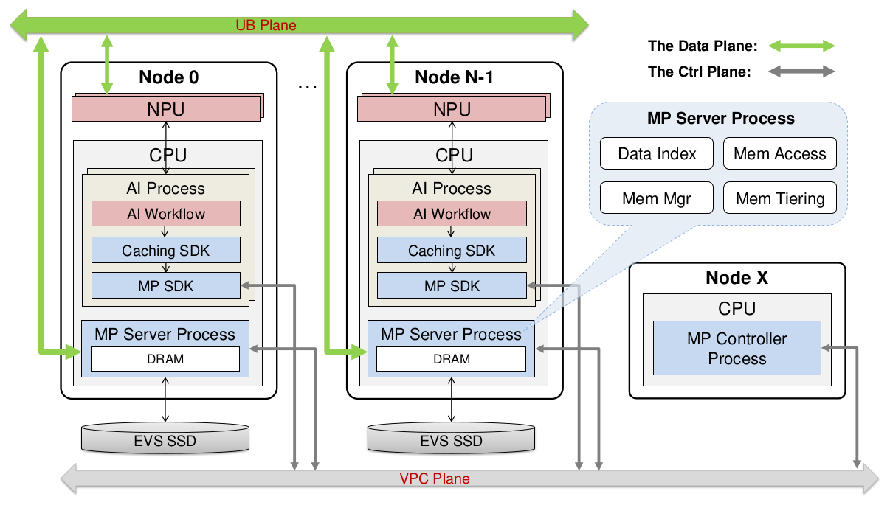

*图 19（原文 Figure 19，第 33 页）：三组件软件架构——MP SDK、MP Controller、MP Server——如何借助 UB 平面管理跨节点 DRAM。*

**图中文字翻译与读法**：

- **顶部绿色双箭头 UB Plane（UB 平面）**：横跨 Node 0 … Node N-1，是数据面（The Data Plane，绿色箭头）的通路。
- **每个 Node 内部**：NPU 之下是 CPU，CPU 内自上而下是 AI Process（AI 进程，内含 AI Workflow、Caching SDK、MP SDK）和 MP Server Process（MP 服务进程，内含 DRAM）；节点底部连一个 EVS SSD（弹性卷 SSD，持久存储层）。
- **右侧 MP Server Process 放大框**：内含 Data Index（数据索引）、Mem Access（内存访问）、Mem Mgr（内存管理）、Mem Tiering（内存分层）四个子模块。
- **右下 Node X**：单独的 CPU 节点运行 MP Controller Process（MP 控制器进程），通过灰色箭头的 The Ctrl Plane（控制面）与各节点的 MP Server Process 通信。
- **底部 VPC Plane（VPC 平面）**：连接各节点的 EVS SSD，对应持久化存储路径。
- **读图结论**：数据面（绿色，UB）和控制面（灰色）是分开的两套通路；MP Controller 只管元数据和协调（走控制面），真正的数据搬运都在 UB 数据面上进行，这是解耦内存池能做到“统一、高性能访问”的关键。

这个解耦内存池由三组件软件架构管理：**MP SDK** 嵌入 AI 应用的进程中，把上层缓存请求翻译成分布式内存操作，暴露出 Put/Get 这类键值存储风格的 API；**MP Controller** 是集中式控制面，维护元数据（如分布式哈希表 DHT 视图、命名空间），协调操作并编排资源管理；**MP Server** 部署在贡献 DRAM 的节点上，管理本地内存、处理分层和故障恢复，并参与负载均衡。

这些软件组件与 UB 平面的交互支撑了几项关键机制：**分布式数据索引与放置**——用全局一致性哈希索引决定键值对在解耦内存池中的放置位置并高效定位；该索引把输入 key 映射到负责的 MP Server 节点，底层由 MP Controller 统一维护一致性和元数据的 DHT 视图支撑，各 MP Server 通过管理各自的本地数据分片、响应路由请求参与这个 DHT。**高性能远程内存访问**——NPU 可直接高性能访问远程 DRAM，这依赖 MP Server 实例和 MP SDK 客户端初始化时建立的内存映射与注册过程：各方协商交换用于该内存池的 DRAM 段物理地址范围，并将其注册到 UB 结构和 MP Controller；这种跨节点映射能力利用了 CloudMatrix384 超节点对全局统一内存寻址与路由的支持，使 UB 交换机能把 NPU 发起的 SDMA 驱动访问请求直接路由到目标 MP Server 管理的 DRAM。**细粒度本地内存管理**——每个 MP Server 用多粒度内存分配系统管理其分配到的 DRAM 段、对抗变长数据对象（如 KV cache 块或模型分片）造成的碎片化；关键手段是用大页（huge pages）降低内存切片分配的频率和相应的管理开销，并支持变长内存分区，比定长分配器显著提升内存利用率，还允许在其管理的 DRAM 内不同粒度间动态流转，依据负载相关的使用模式提升资源效率。**带持久化与恢复的内存分层**——为控制存储成本并保证数据持久性，解耦内存池内置一层由 MP Server 管理的 SSD 分层，利用云端提供的弹性卷服务（EVS）SSD 提供大容量持久存储（另一种选择是云端的可扩展文件系统服务 SFS，但成本更高）；分布式 DRAM 池作为快速缓存层叠在 EVS 层之上，提供对高频数据的低时延访问；持久性通过把所有数据写入 EVS 来保证，由于 EVS 卷容量有限，系统采用本地淘汰策略（例如最近最少使用 LRU）在需要时腾出空间，MP Server 用自己的 LRU 淘汰逻辑和容量阈值独立管理 DRAM 驻留，从 DRAM 淘汰的数据仍持久保存在 EVS（除非被 EVS 自身的空间管理机制移除），这种分层结构确保了容错能力：若内存中数据丢失（如节点故障），只要尚未被淘汰，就能从 EVS 层恢复。**命名空间隔离**——为支持多租户并管理不同 Context Caching 和 Model Caching 实例的数据，解耦内存池提供 KV 命名空间隔离，主要由 MP Controller 编排命名空间的创建、删除和元数据；每个 MP Server 感知当前活跃的命名空间，确保数据操作被限制在指定命名空间内，在共享池中提供逻辑数据隔离和容量使用限制。

论文特别指出一个带宽放大效果：单节点经 Qingtian 卡访问 EVS 的带宽相对有限，通常低于 400 Gbps；但 CloudMatrix384 的解耦内存池把全部 48 个节点的这一带宽聚合起来，总 EVS 访问带宽最高可达 `48 × 400 Gbps`。由于数据被切成细粒度块并分布在各节点，NPU 可以经高带宽 UB 平面同时从多个节点并发取这些块，即便所请求数据位于 EVS 层，也能实现很高的聚合加载带宽，从系统层面摊薄了单节点 EVS 访问的限制。

### 11.2 Context Caching：复用历史 KV cache

prefill 阶段负责处理输入 prompt、生成初始 KV cache，计算量大，尤其是长序列。复用早前请求的历史 KV cache 能带来可观的性能提升，在重复前缀场景下尤其有价值，例如多轮对话、few-shot 提示和重复的系统指令。在本文架构中，Context Caching 是专门存储和高效检索这些历史 KV cache 的机制。

Context Caching 由 Huawei Cloud 的服务 EMS 实现。EMS 借助 UB 驱动的解耦内存池（11.1 节），为历史 KV cache 建立一个共享、分布式的存储库；这些缓存按模型特性和 UB 传输效率组织成分页块（例如每块 128–512 个 token）。服务集群内所有 NPU 都能经 EMS API 访问或贡献这个缓存。

**索引、去重与检索**：EMS 提供专门的 Context Caching SDK（即 API 层）供上层 LLM 服务框架存取历史 KV cache 块。这个 EMS SDK 内部调用 MP SDK（11.1 节）的 API 与底层分布式 DRAM 和分层存储交互。每个 KV cache 块都关联一个由其 token 序列派生、并结合前缀哈希增强的唯一哈希键，以支持内容寻址索引，从而实现快速查找和去重——相同的 KV 块只存一份、跨请求复用。

分配给 Context Caching 的那部分解耦内存池容量有限。接近容量上限时，MP Server（11.1 节）会触发把较冷的 KV cache 块从 DRAM 淘汰到 EVS 支撑的 SSD 层；若 SSD 容量也紧张，则按类似 LRU 的策略彻底移除数据。这个淘汰流程确保统一内存池内 context cache 与 model cache 之间公平、高效地共享资源。

**与 PDC 解耦的交互**：EMS 与解耦的 prefill、decode 流水紧密集成：

- **Prefill——复用与存储**：收到新请求后，prefill 引擎用输入前缀的哈希查询 EMS 以寻找可复用的 KV cache 块；若命中，这些块经 UB 平面取出并直接加载进 NPU 内存，跳过冗余计算；引擎接着处理剩余的后缀部分，生成对应的 KV cache 块；这些新块被异步写回 EMS，供未来请求复用，不阻塞当前计算。
- **Decode——选择性缓存存储**：decode 阶段产生的 KV cache 对非推理模型可以复用，但对像 DeepSeek-R1 这样的推理模型不行。这类推理模型会先输出中间推理 token，再输出最终回答 token；中间推理 token 通常不会在后续轮次被重新摄入，因此最终回答 token 在被纳入后续 prompt 时位置会发生偏移。这种位置变化因位置敏感的 attention 而破坏缓存有效性，所以 decode 产生的缓存通常被排除在存储之外。但是，如果系统采用能容忍位置偏移的近似 KV 复用技术，有选择地存储最终回答 token 的缓存块仍可能带来性能收益。

### 11.3 Model Caching：加速模型加载与切换

现代 LLM 服务基础设施必须高效支持大小、架构、任务专长各异的多样化模型组合，还要应对波动的服务需求和持续的模型更新带来的动态模型切换。然而，把数十亿乃至数千亿参数的 LLM 从持久存储（如对象存储服务 OBS）加载进 NPU 内存会产生显著时延。例如，假设每个存储桶的标准访问带宽为 2.5 GB/s，从 OBS 加载一个 6,710 亿参数的 DeepSeek-R1 模型需要超过五分钟。这种延迟严重限制了动态模型切换的实用性，损害服务的响应能力，在模型更新或 A/B 测试场景下尤其明显。因此，一套快速缓存机制不仅能缓解这些开销，也是实现敏捷模型部署的关键。

为此，论文引入由 EMS 提供的 Model Caching。其核心是利用 UB 驱动的解耦内存池（11.1 节）作为高性能、分布式的缓存底座，支持全系统的低时延模型访问。为与上层服务框架集成，EMS 提供 Model Caching SDK，暴露检查、预取和从缓存加载模型的 API：允许用户查询某个模型当前是否已缓存在 EMS 内存池中，发起从持久存储到 EMS 的异步模型块预取，并触发模型块加载进目标 NPU 内存以供推理。当模型已部分缓存时，预取相当于一个提示，把数据块从较慢的层（如 SSD）提升到更快的层（如 DRAM），进一步优化访问时延。

**缓存管理策略**：EMS 内部把每个模型拆解成内存块，作为键值条目存储在解耦内存池中；一个集中式元数据服务追踪每个模型到其对应块集合的映射，支持细粒度、分片式的模型加载和推理期间的高效检索。EMS 通过准入、淘汰、版本管理这几项协同策略管理缓存的模型块：准入和预取方面，EMS 基于应用提示和观测到的访问模式，把模型块载入 DRAM 或 SSD 层；淘汰由解耦内存池原生的基于 LRU 的策略处理，由于模型块的访问行为高度一致，淘汰通常以模型级粒度进行——即整个模型或大段一起被淘汰，避免碎片化状态；版本管理方面，EMS 通过维护版本感知的标识符、把每个模型关联到其对应的块集合，确保 NPU 始终执行正确的模型版本；部署新版本时，服务框架显式请求该版本，旧版本则随自然的缓存淘汰逐步被替换。

**UB 驱动解耦内存池为 Model Caching 带来的收益**：EMS 利用 UB 驱动的解耦内存池取得两项关键优势。第一，高带宽、低时延的 UB 平面让模型块能从 EMS 内存层（如 DRAM 或 SSD）快速传输到 NPU 内存，大幅降低模型加载时延。第二，EMS 使用统一的、集群级的内存池来消除数据冗余，让单一缓存的模型版本能被所有 NPU 实例共享；这既减轻了持久存储带宽的压力，也降低了缓存所需的累计 DRAM 和 SSD 占用，从而提升可扩展性和资源效率。

表 1 用一个 6,710 亿参数、INT8 量化模型的加载场景，量化上述收益。

**场景设置**：把一个约 671 GB 的 671B INT8 模型加载进 CloudMatrix384 内的 8 个模型实例。模型原存于带宽 2.5 GB/s 的 OBS 桶。两个子场景：① Model Load——8 个实例用不同加载策略并发加载同一模型，比较加载时延和 DRAM 开销；② Model Switch——已有 8 个不同的活跃模型，比较某实例随机切换到其中一个模型时的切换时延和缓存命中率。论文注明这些时延是示意性的、代表所定义场景的典型值。

| 场景 | 指标 | No Cache（直接读 OBS） | Local DRAM Cache（本地 DRAM 缓存） | EMS |
|---|---|---:|---:|---:|
| Model Load（模型加载） | Cold Start Latency（冷启动时延，OBS 到 NPU，秒） | ～2,560 ¹ | ～2,560 ¹ | ～320 |
| Model Load（模型加载） | Warm Start Latency（热启动时延，DRAM 到 NPU，秒） | N/A | ～5 | ～5 |
| Model Load（模型加载） | DRAM Capacity Overhead（DRAM 容量开销，×模型大小） | 0 | 8× | 1× |
| Model Switch（模型切换） | Cache Hit Rate（缓存命中率，%） | 0 | 12.5% | 100% ² |
| Model Switch（模型切换） | Average Latency to Switch（平均切换时延，秒） | ～320 | ～281 | ～5 |

¹ 8 个实例从同一个共享 OBS 桶并发加载同一模型，存在显著争用。² 假设 EMS 容量恰好能容纳全部 8 个不同的 671B 活跃模型版本。（原文 Table 1，第 36 页。）

**读法**：不用任何缓存时，8 个实例争抢同一个 2.5 GB/s 的 OBS 带宽，每个实例冷启动约 2,560 秒；本地 DRAM 缓存对冷启动没有帮助（因为每个节点仍独立从 OBS 取完整模型一次），但换来约 5 秒的热启动（即该节点第二次加载同一模型时）。EMS 把冷启动时延压到约 320 秒——靠内存池内的共享加载和跨实例复用模型块；热启动时延与本地 DRAM 缓存相同（约 5 秒）。内存效率上，本地 DRAM 缓存是 8× 开销（8 个实例各自存一份完整副本），EMS 只需 1× DRAM 占用即可服务全部实例。模型切换场景下，EMS 达到 100% 缓存命中率、平均约 5 秒切换时延，远优于本地 DRAM 缓存的 12.5% 命中率和约 281 秒时延。

## 十二、INT8 量化（论文第 4.5 节）

为在 Ascend 910 上为 DeepSeek-V3/R1 这类大规模 MoE 模型实现高吞吐、低时延推理，论文设计并实现了一套**无需训练**（training-free）的分层 INT8 量化方案，覆盖模型权重和激活，目标是在谨慎控制精度损失的前提下最大化计算效率、降低显存占用。核心由五部分组成：

**混合精度策略**：按算子对整体性能的影响（计算量、访存量）与其对数值精度的敏感度之间的权衡，对模型内不同算子分类。关键执行路径上计算量最大的操作——例如 FFN 和 attention 机制里的大矩阵乘法——量化为 INT8 以获取最高吞吐；相反，对量化误差更敏感、但占整体访存或计算负担比例较小的子模块或特定操作（例如某些归一化层或关键的门控机制）保留 BF16 或 FP32 的更高精度。这种灵活的位宽划分确保整个模型能在统一硬件流水线上高效执行，同时避开数值敏感通路上的精度瓶颈。

**自适应 scale 搜索**：有效的量化需要把浮点值的动态范围仔细对齐到 INT8 整数的有限范围。对每个待 INT8 量化的权重张量和激活张量，论文引入一个轻量的自适应 scale 搜索过程，自动确定能最小化量化误差的最优缩放因子 $s^*$，使量化前后的值分布对齐。该搜索被表述为一个优化问题：

$$
s^* = \operatorname*{arg\,min}_{s}\ \mathcal{L}(s),\qquad \mathcal{L}(s) = \lVert Q(W\cdot s)(s^{-1}\cdot X) - WX\rVert \tag{3}
$$

其中 $W$ 表示权重，$X$ 表示激活，$Q(\cdot)$ 表示量化函数。这个表达式要找到权重的缩放 $s$（以及激活对应的 $s^{-1}$），使量化后运算 $Q(W\cdot s)(s^{-1}\cdot X)$ 的输出尽可能接近原始浮点输出 $WX$。整个 scale 确定过程在离线的后量化（post-quantization）校准阶段完成，因此推理期间不产生额外运行时开销；其思路是在量化乘法之前先用合适的缩放变换 $X$ 和 $W$。

**离群值抑制与结构变换**：大模型中的某些组件，尤其是 MoE 架构里特定的专家子网络或门控结构，可能呈现带长尾或显著离群值的激活/权重分布。这些离群值会不成比例地影响量化范围，造成大多数数值的精度损失。为缓解这一点，论文采用一种涉及结构变换的离群值抑制技术：在量化之前引入简单的线性变换（概念上类似于应用学习到的正交基旋转，或把缩放因子吸收进前后相邻层），把极端值重新分布到更均衡、更适合量化的范围，且不改变该层底层的数学功能。通过降低离群值的影响，这种方法既减小了大幅量化误差的风险，也抑制了误差在网络中逐层放大。

**高效的 INT8 矩阵乘法 kernel**：INT8 量化的性能收益高度依赖高度优化的执行 kernel。论文为矩阵乘法采用混合粒度的量化方案：激活 $X$ 按 token 粒度量化（动态范围逐 token 确定），权重 $W$ 按通道粒度量化（通常是逐输出通道，静态范围）。这种方式兼顾了快速变化的激活统计特性和权重表示的稳定性需求。这种混合粒度配合精心对齐的权重、激活内存布局，使 Ascend NPU 上专用的整数矩阵乘法指令能被充分利用。相比等价的 BF16 或 FP16 实现，这些优化过的 INT8 kernel 能在同一硬件上带来数倍的推理吞吐提升，同时确保精度损失保持在应用可接受的容限内。

**块级裁剪与误差补偿**：为进一步提升精度、处理大权重张量内的局部变化，论文实现块级裁剪和误差补偿。权重先经统计分析、划分成更小的块，每块设定一个独立的、可容忍的裁剪范围；该范围可以通过优化一个裁剪缩放因子 $\alpha$（例如 $W_{\text{clip\_max}} = \alpha\cdot\max(W_{\text{block}})$、$W_{\text{clip\_min}} = \alpha\cdot\min(W_{\text{block}})$）来确定，使该块的量化误差最小化，例如通过求解：

$$
\operatorname*{arg\,min}_{\alpha}\ \lVert \text{Block}(X;W) - \text{Block}(X;Q(W;\alpha))\rVert \tag{4}
$$

其中 $Q(W;\alpha)$ 表示用裁剪因子 $\alpha$ 量化块内权重 $W$。与此同时，轻量的误差补偿项被策略性地插入推理计算图中，用以在模型内不同位置抵消或部分纠正量化引入的系统性误差，从而缓解量化噪声对最终模型输出的累积影响。这种方法的一个显著优势是不需要修改原始模型训练流程，也不依赖额外的微调阶段，便于快速部署和迭代。

综合这五项策略，论文构建了一套稳健、分层的 INT8 量化框架，使 DeepSeek-V3/R1 这类超大模型能在 Ascend 硬件上高性能推理，同时在计算效率与模型精度保持之间做了细致的平衡。

## 十三、实验评测（论文第 5 节）

### 13.1 实验设置

评测在一个 Huawei CloudMatrix384 超节点上进行，由 Huawei Cloud 的 ModelArts Lite（Cluster Mode）服务提供，具体使用单个 CloudMatrix384 中的 **256 颗 Ascend 910 NPU** 及其对应的宿主 Kunpeng CPU。服务系统是华为与 SiliconFlow 联合优化的 LLM 推理引擎，部署时配套所需的华为 CANN 软件包；Huawei Cloud 的弹性内存服务（EMS，提供 11 节所述的分布式缓存能力）预先部署在分配的计算节点上。整套部署遵循本文提出的 PDC 解耦对等服务架构（第七节），各逻辑集群的具体配置为：

- **Decode 集群**：单个 decode 实例，使用 160 颗 Ascend 910 NPU（跨 20 个计算节点，合计 320 个 NPU die），MoE 稀疏层采用 EP320；MLA 和稠密 FFN 层等其他组件在 320 个 NPU die 上采用 DP320。320 个 EP rank 内每 rank 部署一个专家实例，专家配置为 32 份共享专家副本、256 个不同路由专家、另加 32 个冗余路由专家以支持 EPLB。
- **Prefill 集群**：6 个 prefill 实例，每实例分配 16 颗 Ascend 910 NPU（每实例两个计算节点，合计 32 个 NPU die），prefill 集群总计使用 96 颗 NPU。每个 prefill 实例的 MoE 稀疏层采用 EP32；MLA 组件采用 10.1 节所述的混合并行策略。每个 32-rank prefill 实例内配置 10 个专家：1 个共享专家、8 个路由选中的专家、1 个冗余路由专家以实现有效的 EPLB。
- **Caching 集群（EMS）**：由构成 prefill 和 decode 集群的全部物理计算节点的宿主 CPU DRAM 实现分布式缓存。这些节点上的 Kunpeng CPU 及其 DRAM（decode 集群 20 个节点 + prefill 集群 12 个节点）共同构成 UB 驱动的解耦内存池；EMS 用这个池同时提供 Model Caching（11.3 节）和 Context Caching（11.2 节），全部 NPU 对这个共享内存池的访问都经 CloudMatrix384 的高速 UB 平面完成。

评测的 DeepSeek-R1 模型是 671B 参数版本，已按第十二节的方案量化为 INT8，在 Ascend 910 NPU 上执行。

### 13.2 总体性能：吞吐与每 TFLOPS 效率

论文将 CloudMatrix-Infer 与两个公开的基线对比：DeepSeek 在 NVIDIA H800 上的服务数据（引用自其公开 blog/profile）、SGLang 在 NVIDIA H100 上的服务数据（引用自 SGLang 论文）。prefill 和 decode 阶段分别独立评测，并尽量贴近对比来源的实验设置。

**Prefill 吞吐（原文表 2，第 40 页）**。SGLang 的分析指出，MoE 模型 prefill 阶段的有效服务高度依赖稳健的 EPLB；DeepSeek (Profile) 数据吞吐很高（7,839 tokens/s/GPU），可能反映的是接近理想专家负载均衡下的表现。为提供可比的分析基线，表 2 同时给出 SGLang 和 CloudMatrix-Infer 在 Perfect EPLB（理想专家负载均衡）假设下的投影结果。

| 方法 | 批大小 Batch Size | 输入长度 Input Length | 吞吐 Throughput（tokens/s） | 每 TFLOPS 吞吐 Throughput per TFLOPS |
|---|---:|---:|---:|---:|
| DeepSeek on H800 (Blog) | N/A | N/A | 4,026 | 2.03 |
| SGLang on H100 (Default) | 16,384 | 4,096 | 6,288 | 3.18 |
| CloudMatrix-Infer (Default) | 16,384 | 4,096 | 5,655 | 3.76 |
| DeepSeek on H800 (Profile) | 16,384 | 4,096 | **7,839** | 3.96 |
| SGLang on H100 (Perfect EPLB) | 16,384 | 4,096 | 7,417 | 3.75 |
| CloudMatrix-Infer (Perfect EPLB) | 16,384 | 4,096 | 6,688 | **4.45** |

（原文 Table 2，第 40 页；加粗为原文表中的最佳数字。）**读法**：默认配置下 CloudMatrix-Infer 每 NPU 处理 5,655 tokens/s，对应每 TFLOPS 3.76 tokens/s 的计算效率，明显高于 SGLang 在 H100 上的默认配置（3.18 tokens/s/TFLOPS），尽管后者原始吞吐略高。理想 EPLB 条件下，CloudMatrix-Infer 达到 6,688 tokens/s/NPU，效率 4.45 tokens/s/TFLOPS，超过 SGLang 在 H100 上的理想效率（3.75）和 DeepSeek 在 H800 上的 profile 效率（3.96）。这组对比说明 CloudMatrix-Infer 有较强潜力，但默认与理想结果之间的差距也说明负载均衡算法仍有改进空间——换言之，表中加粗的最佳原始吞吐（7,839）其实属于 DeepSeek (Profile)，CloudMatrix-Infer 领先的是“归一化到算力之后”的效率指标，不是吞吐本身。

**Decode 吞吐（原文表 3，第 40 页）**。评测目标 TPOT SLO 为低于 50 ms，同时评估按加速器算力归一化的吞吐（tokens/s/TFLOPS）。SGLang (Simulated MTP) 和 CloudMatrix-Infer 都使用 MTP，假设单个投机 token、有效接受率 70%。

| 方法 | 批大小 Batch Size | KV Cache 长度 | TPOT（ms） | 吞吐 Throughput（tokens/s） | 每 TFLOPS 吞吐 |
|---|---:|---:|---:|---:|---:|
| DeepSeek (Blog) on H800 | N/A | 4,989 | ～50.0 | 1,850 | 0.93 |
| DeepSeek (Profile) on H800 | 128 | 4,096 | ～50.2 | **2,325** | 1.17 |
| SGLang (Simu. MTP) on H100 | 128 | 4,000 | ～55.6 | 2,172 | 1.10 |
| CloudMatrix-Infer | 96 | 4,096 | 49.4 | 1,943 | **1.29** |

（原文 Table 3，第 40 页。）**读法**：CloudMatrix-Infer 以每 NPU 批大小 96、KV cache 长度 4,096 token，实现 49.4 ms 的 TPOT，优于 50 ms 的 SLO。绝对吞吐 1,943 tokens/s/NPU 高于 DeepSeek (Blog) 的 1,850；数值上低于 DeepSeek (Profile) 的 2,325 和 SGLang 的 2,172，但这两者用的批大小是 128，比 CloudMatrix-Infer 的 96 更大。归一化到算力后，CloudMatrix-Infer 的 1.29 tokens/s/TFLOPS 是四者中最高的，高于 SGLang（1.10）、DeepSeek Blog（0.93）和 DeepSeek Profile（1.17），说明其服务方案在 decode 阶段更充分地利用了 CloudMatrix384 的算力。

**不同 TPOT SLO 与 prompt/output 长度下的 decode 吞吐（原文表 4，第 41 页）**：

| TPOT SLO（ms） | Prompt 长度 | Output 长度 | 批大小 | 实际 TPOT（ms） | 每 NPU 吞吐（tokens/s） |
|---:|---:|---:|---:|---:|---:|
| 50 | 1,024 | 1,024 | 128 | 46.8 | 2,733 |
| 50 | 2,048 | 256 | 112 | 47.4 | 2,360 |
| 50 | 4,096 | 256 | 96 | 49.4 | 1,943 |
| 30 | 4,096 | 256 | 24 | 24.6 | 974 |
| 15 | 4,096 | 256 | 8 | 14.9 | 538 |

（原文 Table 4，第 41 页。）**读法**：结果显示明确趋势——prompt 与 output 的总长度越短，decode 吞吐越高：prompt/output 均为 1,024 token 时达到 2,733 tokens/s/NPU，prompt 增到 2,048（output 256）时降到 2,360，这是因为更短的总长度降低了每个请求所需的 KV cache 空间，从而允许更大的批大小。随 TPOT SLO 从 50 ms 收紧到 15 ms，CloudMatrix-Infer 相应调低批大小以满足时延目标：50 ms 下批大小 96、吞吐 1,943；30 ms 下批大小降到 24、吞吐 974；15 ms 下批大小降到 8、吞吐 538。这说明系统能通过动态调整批大小，在不同时延约束下维持尽可能高的吞吐。

### 13.3 精度：INT8 量化是否损失能力

为全面评估 DeepSeek-R1 量化到 INT8 并部署在 CloudMatrix384 上（下文简称 DeepSeek-R1 (INT8)）的推理精度，论文基于广泛使用的基准做了大量测试，重点比较 SiliconFlow 实现的 INT8 量化（第十二节）与官方 DeepSeek-R1 API、以及 DeepSeek-R1 技术报告公布结果的差异。由于原始技术报告未完全公开每个基准的全部测试参数（可能导致直接复现存在差异），论文采用与在线 DeepSeek-R1 API 的并排评测方法，以确保实际性能比较的公平和直接。

评测套件共 16 个基准，覆盖英语（MMLU、MMLU-Pro、DROP、IFEval、GPQA Diamond、SimpleQA）、代码生成（LiveCodeBench、HumanEval）、数学（AIME 2024、MATH-500、CNMO 2024、MGSM）、中文（CLUEWSC、C-Eval、C-SimpleQA、C-MMLU）。排除了依赖 GPT-4 评分的 AlpacaEval 2.0 和 Arena-Hard，以及缺乏现成自动评测脚本的 CodeForces。提示来源上，MMLU、DROP、MGSM、GPQA Diamond、HumanEval、MATH-500、SimpleQA、C-SimpleQA 用 simple-evals 框架；CMMLU、C-Eval、LiveCodeBench、IFEval、CLUEWSC 用 OpenCompass 框架。MMLU-Pro、C-Eval、CLUEWSC 按 DeepSeek-R1 技术报告的方法论用 zero-shot 设置测试，其余按各自原始协议。数学竞赛基准（AIME 2024、CNMO 2024）各重复测试 32 次以准确估计 pass@1。MATH-500、SimpleQA、C-SimpleQA 原本用不同版本 GPT-4 评分，本文统一改用 Qwen2.5-72B-Instruct 作评分模型，以保证内部一致性（但可能是本文分数与技术报告分数存在差异的原因之一）。生成参数为温度 0.6、top-p 0.95，与 DeepSeek-R1 技术报告一致。

| 类别 | 基准（指标） | DeepSeek-R1 (INT8) | DeepSeek-R1 API | DeepSeek-R1 技术报告 |
|---|---|---:|---:|---:|
| English | MMLU（Pass@1） | 90.82 | 91.05 | 90.8 |
| English | MMLU-Pro（EM） | 83.91 | 83.82 | 84.0 |
| English | DROP（3-shot F1） | 90.42 | 91.02 | 92.2 |
| English | IF-Eval（Prompt Strict） | 83.55 | 83.92 | 83.3 |
| English | GPQA Diamond（Pass@1） | 71.66 | 71.77 | 71.5 |
| English | SimpleQA（Correct） | 30.60 | 30.69 | – |
| Code | LiveCodeBench（Pass@1-COT） | 63.80 | 63.44 | 65.9 |
| Code | HumanEval（Pass@1-COT） | 91.83 | 91.85 | – |
| Math | AIME 2024（Pass@1） | 78.96 | 78.12 | 79.8 |
| Math | MATH-500（Pass@1） | 94.46 | 94.62 | – |
| Math | CNMO 2024（Pass@1） | 77.95 | 76.70 | 78.8 |
| Math | MGSM | 92.40 | 92.65 | – |
| Chinese | CLUEWSC（Test） | 94.67 | 94.98 | – |
| Chinese | C-Eval（EM） | 82.05 | 79.92 | – |
| Chinese | C-SimpleQA（Correct） | 74.70 | 75.43 | – |
| Chinese | C-MMLU | 90.76 | 90.84 | – |

（原文 Table 5，第 42 页；论文说明已排除测试配置被认定不一致的基准结果；“–”为原文未提供。）**读法**：16 项中 DeepSeek-R1 (INT8) 与官方 API 的差距大多在 1 分以内（例如 MMLU 90.82 对 91.05，GPQA Diamond 71.66 对 71.77），个别项如 C-Eval（82.05 对 79.92）INT8 反而更高；与技术报告数字对照时同样接近，DROP 的差距稍大（90.42 对 92.2，相差 1.8 分），论文把这类差异主要归因于测试协议和评分模型的差别，而非量化本身。整体结论是 INT8 量化在覆盖英语、代码、数学、中文的 16 个基准上基本保持了原模型能力。

### 13.4 消融研究（论文第 5.4 节）

**微批流水——decode（原文 Figure 20，第 43 页）**：

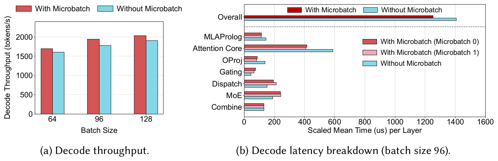

*图 20（原文 Figure 20，第 43 页）：全部请求的 KV cache 长度为 4,096 token。(a) decode 吞吐；(b) 批大小 96 时的分层时延拆解。*

**图中文字翻译与读法**：

- **(a) Decode Throughput（decode 吞吐）**：横轴 Batch Size（批大小：64、96、128），纵轴 Decode Throughput (tokens/s)。红色 With Microbatch（启用微批流水）均高于浅蓝 Without Microbatch（未启用）。正文给出精确提升幅度：批大小 64、96、128 时分别提升 **5.8%、9.4%、6.9%**。从柱高换算的近似吞吐（约）：启用时约 1,700 / 1,940 / 2,030 tokens/s，未启用时约 1,600 / 1,780 / 1,900 tokens/s。
- **(b) Decode Latency Breakdown (batch size 96)（decode 分层时延拆解，批大小 96）**：横轴 Scaled Mean Time (µs) per Layer（每层缩放平均时间），纵轴自上而下 Overall、MLAProlog、Attention Core、OProj、Gating、Dispatch、MoE、Combine；图例区分 With Microbatch (Microbatch 0)、With Microbatch (Microbatch 1)、Without Microbatch。虚线把 Overall 与各算子明细分开。正文指出：启用微批流水后，Overall 每层时延降低约 **10%**；Gating、Dispatch、MoE 等单个算子的时延因每条流计算资源减少反而略有上升（例如 AIC 从 24 降到 16），但 Attention Core 等占比更大的算子明显缩短，整体仍是净降低。从条形长度换算的近似值（约，µs/层）：Overall 约 1,250（启用）对约 1,410（未启用）；其中降幅最大的是 Attention Core，约从 590 降到约 410–420。
- **读图结论**：微批流水对 decode 的收益是通过让 Stream 0（attention）与 Stream 1（MoE）相互重叠获得的整体层时延下降，不是靠单个算子变快；这与 9.2 节“两条流各自约 600 µs、彼此重叠”的描述一致。

**微批流水——prefill（原文 Figure 21，第 44 页）**：

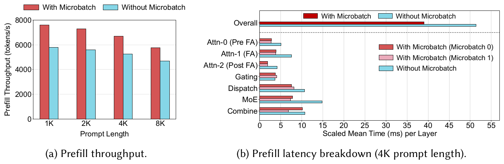

*图 21（原文 Figure 21，第 44 页）：所有实验每 NPU 批次含 16K 总 token。(a) prefill 吞吐；(b) 4K prompt 长度下的分层时延拆解。*

**图中文字翻译与读法**：

- **(a) Prefill Throughput（prefill 吞吐）**：横轴 Prompt Length（1K、2K、4K、8K），纵轴 Prefill Throughput (tokens/s)。正文给出精确幅度：启用微批流水后 prefill 吞吐提升 **23% 到 31%**；吞吐随 prompt 变长而下降，因为 attention 计算的单 token 时延随 prompt 长度增加。换算的近似吞吐（约，tokens/s）：启用时 7,600 / 7,280 / 6,690 / 5,760，未启用时 5,800 / 5,600 / 5,250 / 4,700（对应 1K/2K/4K/8K）。
- **(b) Prefill Latency Breakdown (4K prompt length)（4K prompt 下分层时延拆解）**：纵轴自上而下 Overall、Attn-0 (Pre FA)、Attn-1 (FA)、Attn-2 (Post FA)、Gating、Dispatch、MoE、Combine，横轴 Scaled Mean Time (ms) per Layer。正文给出：Overall 每层时延降低约 **24%**。换算的近似值（约，ms/层）：Overall 约 39（启用）对约 51（未启用），主要降幅来自 MoE（约 8 对约 15）和 Combine（约 10 对约 11，降幅相对小）。
- **读图结论**：收益来源是把 DispatchCompute/CombineCompute 这类轻量计算卸载到 AIV、把 All-to-All 卸载到 SDMA，让它们与 AIC 上的 ATTN、FFN 主计算重叠（见 10.2 节），因此吞吐提升幅度（23%–31%）比 decode 微批（5.8%–9.4%）更大——prefill 阶段通信和计算都更重，可重叠的空间也更大。

**MTP（原文 Figure 22，第 45 页）**：评测场景固定为单个投机 token、4K 输入序列长度。

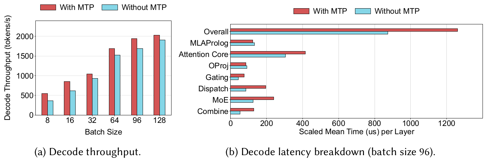

*图 22（原文 Figure 22，第 45 页）：(a) decode 吞吐；(b) 批大小 96 时的分层时延拆解。*

**图中文字翻译与读法**：

- **(a) Decode Throughput（decode 吞吐）**：横轴 Batch Size（8、16、32、64、96、128），红色 With MTP 始终高于浅蓝 Without MTP。正文给出精确幅度：启用 MTP 后吞吐提升 **6% 到 49%**，批大小越小提升比例越大（因为小批下未开 MTP 的系统离峰值效率更远，MTP 额外产出的 token 带来的相对增益更大；批大小越大，MTP 仍有绝对收益，但相对增幅趋缓）。换算的近似吞吐（约，tokens/s，批大小 8→128）：启用时 550 / 850 / 1,040 / 1,690 / 1,940 / 2,030；未启用时 370 / 620 / 930 / 1,530 / 1,690 / 1,910。
- **(b) Decode Latency Breakdown (batch size 96)（批大小 96 的分层时延拆解）**：纵轴自上而下与图 20b 相同。正文给出精确数字：启用 MTP 后每层执行时延增加约 **44%**（从基线 **874 µs** 增至 **1,260 µs**；本文从条形长度换算的比例约为 1,260/874，与正文吻合）。这是因为每个开启 MTP 的 LLM decode 步要处理来自上一轮的两个输入 token（一个基础 token + 一个投机 token），更大的有效批大小自然拉长 Attention Core、Gating、Dispatch、MoE、Combine 等核心算子的执行时间。
- **读图结论**：MTP 是“用更长的单步时延换更多单步产出”：70% 接受率下平均每次迭代产出 1.7 个 token（1 个基础 token + 0.7 个投机 token），这个产出增益超过了约 44% 的单步时延增长，因此总吞吐仍是净提升；这组数字直接对应 9.3 节描述的权衡。

**Context Caching（原文 Figure 23，第 46 页）**：评测用 4K token 输入长度、每 NPU 批次含 16K 总 token，调节 token 复用率（控制历史前缀被复用的比例），对比 EMS 经 UB 平面访问与经 VPC 平面访问（回退到较慢网络）两种配置。

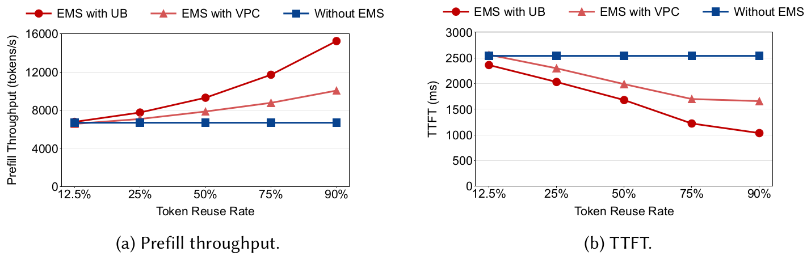

*图 23（原文 Figure 23，第 46 页）：(a) prefill 吞吐；(b) TTFT，三条线分别为 EMS with UB、EMS with VPC、Without EMS。*

**图中文字翻译与读法**：

- **(a) Prefill Throughput（prefill 吞吐）**：横轴 Token Reuse Rate（token 复用率：12.5%、25%、50%、75%、90%），纵轴 Prefill Throughput (tokens/s)。正文给出精确数字：EMS with UB 下，复用率从 12.5% 升到 50% 时吞吐提升 **1.42×**；复用率 90% 时吞吐比不用 EMS 的基线提升 **2.28×**；此外 EMS with UB 相对 EMS with VPC 最高快 **1.52×**。Without EMS（不用缓存）吞吐基本不随复用率变化，维持在约 6,700 tokens/s 的水平线附近；EMS with VPC 随复用率缓慢上升；EMS with UB 上升最快、在 90% 复用率时达到约 15,000+ tokens/s（约，从图上读出）。
- **(b) TTFT（ms）**：横轴同为 Token Reuse Rate，纵轴 TTFT (ms)。正文给出精确数字：EMS with UB 下，复用率 50% 时 TTFT 比不用 context caching 降低 **861 ms（34%）**，复用率 90% 时降低 **1,505 ms（59%）**。Without EMS 的 TTFT 基本保持不变（约 2,500+ ms 的水平线）；EMS with VPC 随复用率缓慢下降；EMS with UB 下降最快，在 90% 复用率时降到约 1,000+ ms（约，从图上读出）。
- **读图结论**：两张图传达同一个机制——复用率越高，意味着输入序列中越大比例的 KV cache 直接从 EMS 缓存加载而非重新计算，显著降低 prefill NPU 的计算负担，因此吞吐上升、TTFT 下降；而 UB 相对 VPC 的额外优势，直接来自 UB 平面远高于 VPC 的带宽和远低于 VPC 的时延，用于加速从分布式 EMS 缓存向 NPU 加载 KV cache 块的过程。

### 13.5 关键算子性能（论文第 5.5 节）

**通信算子（原文 Table 6，第 47 页）**：对比 CANN EP 在 CloudMatrix384（UB 平面）上与 DeepSeek DeepEP 在 NVIDIA H800（RDMA）上的 Dispatch、Combine 两个 MoE 通信算子，EP 度数从 8 扫到 256，每 rank 批大小 128。

| 算子 | #EP | DeepEP@H800 时延（µs） | DeepEP@H800 带宽（GB/s） | CANN EP@CM384 时延（µs） | CANN EP@CM384 带宽（GB/s） |
|---|---:|---:|---:|---:|---:|
| Dispatch | 8 | 163 | 46 | 116 | 71 |
| Dispatch | 16 | 173 | 43 | 131 | 63 |
| Dispatch | 32 | 182 | 41 | 133 | 62 |
| Dispatch | 64 | 186 | 40 | 141 | 58 |
| Dispatch | 128 | 192 | 39 | 152 | 54 |
| Dispatch | 256 | 194 | 39 | 152 | 54 |
| Combine | 8 | 318 | 46 | 118 | 131 |
| Combine | 16 | 329 | 44 | 132 | 117 |
| Combine | 32 | 350 | 41 | 146 | 105 |
| Combine | 64 | 353 | 41 | 150 | 103 |
| Combine | 128 | 369 | 39 | 150 | 103 |
| Combine | 256 | 360 | 40 | 149 | 103 |

（原文 Table 6，第 47 页。）**读法**：Dispatch 上 CM384 在所有测试的 EP 度下时延都更低（EP8：116 对 163 µs；EP256：152 对 194 µs）；小 EP 度下 CM384 的每 rank 带宽也更高（EP8：71 对 46 GB/s），但随 EP 度增大，CANN EP 的有效带宽明显下降（EP256 降到 54 GB/s），论文指出这暴露了当前 EP 实现的一个可扩展性瓶颈，留作未来优化方向——这里带宽下降不代表时延变差，时延仍随 EP 增大保持相对平稳且低于 H800。Combine 上优势更明显：EP8 时 CM384 时延 118 µs 对 H800 的 318 µs，EP256 时 149 对 360 µs；带宽上 EP8 时 CM384 达到 131 GB/s，接近 H800 的 46 GB/s 的三倍，EP256 时仍保持 103 对 40 GB/s。

**MLA 算子（原文 Table 7、Table 8，第 47–48 页）**：对比 CANN MLA 在 CM384 与 DeepSeek FlashMLA 在 H800 上的 TFLOPS 利用率（计算密集场景）和显存带宽利用率（访存密集场景），均为 BF16/FP16 精度。

| 算子实现 | 精度 | 计算利用率 Compute Utilization（%） |
|---|---|---:|
| DeepSeek FlashMLA on H800 | BF16/FP16 | 66.7 |
| CANN MLA on Ascend 910 die | BF16/FP16 | 65.4 |

（原文 Table 7，第 47 页。）

| 算子实现 | 显存带宽利用率 Utilization |
|---|---:|
| DeepSeek FlashMLA on H800 | 89.6% |
| CANN MLA on Ascend 910 die | 84.1% |

（原文 Table 8，第 48 页。）**读法**：两张表都是“接近但略低于”H800：计算密集场景下 CANN MLA 利用率 65.4% 对 H800 的 66.7%；访存密集场景下 84.1% 对 89.6%。论文的结论是两个平台在 MLA 算子上利用底层硬件能力的效率相近，并未声称 CM384 的 MLA 算子本身比 H800 更快，这点和通信算子（表 6）、GEMM（表 9）的叙述基调不同，读者不应把“CloudMatrix-Infer 整体效率更高”误读成“每个算子都更快”。

**INT8 GEMM 算子（原文 Table 9，第 49 页）**：在单颗 Ascend 910 die 上测试 CANN INT8 GEMM kernel，输入 INT8、输出 BF16，tiling 为 BM×BN = 128×152。

| Groups | M | N | K | 显存带宽（GB/s） | 计算利用率（%） |
|---:|---:|---:|---:|---:|---:|
| 4 | 7168 | 4096 | 4096 | 260 | 79.4 |
| 4 | 2048 | 7168 | 4096 | 325 | 77.4 |
| 4 | 7168 | 4096 | 8192 | 195 | 82.7 |
| 4 | 2048 | 7168 | 8192 | 266 | 81.1 |
| 8 | 7168 | 4096 | 4096 | 261 | 79.6 |
| 8 | 2048 | 7168 | 4096 | 327 | 77.9 |

（原文 Table 9，第 49 页。）**读法**：六种矩阵形状和分组数下，计算利用率都在 77.4%–82.7% 区间，显存带宽实际使用在 195–327 GB/s，明显低于 Ascend 910 die 的峰值显存带宽。论文把“高计算利用率 + 远低于峰值的显存带宽”解读为这些 INT8 GEMM 操作主要是计算瓶颈而非访存瓶颈，说明 NPU 内部缓存和寄存器里的数据复用效率较高。

## 十四、未来方向（论文第 6 节）

### 14.1 CloudMatrix 架构的演进

**统一 VPC 与 RDMA 平面**：当前 CloudMatrix384 为 scale-out（RDMA）和 VPC 流量使用独立网络平面。论文观察到，典型 AI 训练和推理负载中，带宽密集的通信阶段（TP/EP/SP）主要被限制在超节点内部，而跨超节点通信（主要来自 DP/PP）的带宽需求低得多；配合分层 DP 通信和通信隐藏技术，VPC 网络足以承载大多数 AI 负载的超节点间通信需求。基于这一观察，一个以 VPC 平面为基础的统一网络架构，可以支撑可用区（AZ）规模的大型 AI 集群，兼容异构代际的 AI 硬件、以超节点为基本单元灵活模块化扩展，并通过数据中心网络（DCN）技术支持跨区域互联。

**更大规模的超节点**。论文给出四点理由，说明为何需要比 384 更大的超节点：

1. **匹配模型演进**：未来模型参数更大、输入更长、MoE 专家更多，模块化子网络（专用推理、RAG、稠密-稀疏混合计算）之间的耦合更紧，需要在单个超节点内共置计算和内存以最小化通信时延；
2. **提升资源分配效率**：论文基于真实生产 trace，把每个 AI 任务建模为若干个“紧耦合块”（tightly-coupled block，即必须整体放进同一个超节点才能满足带宽时延约束的一组连续 NPU），仿真未来的 NPU 请求模式。

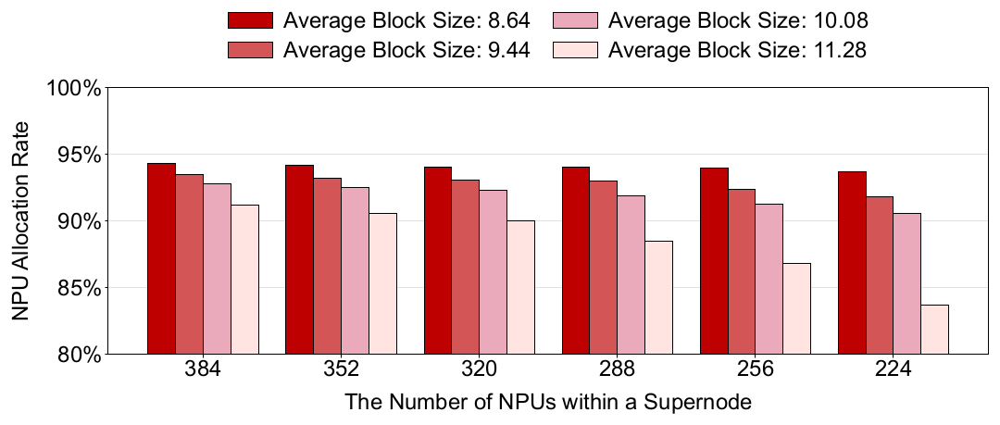

*图 24（原文 Figure 24，第 50 页）：横轴为超节点内 NPU 数量（384 到 224），纵轴为 NPU Allocation Rate（NPU 分配率），四条/组柱子对应四种平均紧耦合块大小（8.64、9.44、10.08、11.28）。*

**图中文字翻译与读法**：

- **横轴 The Number of NPUs within a Supernode（超节点内 NPU 数量）**：384、352、320、288、256、224 六档，自左向右递减。
- **纵轴 NPU Allocation Rate（NPU 分配率）**：范围 80%–100%。
- **图例**：Average Block Size（平均块大小）8.64、9.44、10.08、11.28，颜色从深红到浅粉依次对应这四个值；每组内部同样按这个顺序从左到右排列，颜色越深代表块越小。
- **读图结论（以正文给出的精确锚点为准）**：正文指出，在平均块大小为 10.08 时，384-NPU 超节点的分配率超过 94%，而 224-NPU 超节点的分配率降到 91% 以下；平均块大小升到 11.28 时，224-NPU 超节点的分配率降到 85% 以下。图上可以看到两个一致的趋势：同一超节点规模下，块越大（颜色越浅）分配率越低；同一块大小下，超节点越小（柱组越靠右）分配率越低。两种效应在图最右侧、最浅色的柱子（224-NPU、块大小 11.28）上叠加，是全图最低的一根。论文将这一现象归因于更大的资源池提供更好的统计复用和更少的碎片化，为非均匀任务大小提供了更大的放置灵活性；本文未对图中每根柱子的具体数值做像素级换算，只采用正文给出的三个精确锚点，避免引入未经核实的读数。

3. **近乎恒定的摊薄网络成本**：在同样的两层 Clos 式交换拓扑下，只要配置能让交换机端口被充分利用，每 NPU 的摊薄网络基础设施成本在不同超节点规模间基本保持不变。

| 超节点规模（NPU 数） | 节点数 | 交换机数 | 交换机利用率 |
|---:|---:|---:|---:|
| 384 | 48 | 56 | 100% |
| 352 | 44 | 56 | 92% |
| 288 | 36 | 42 | 100% |
| 256 | 32 | 42 | 89% |
| 192 | 24 | 28 | 100% |

（原文 Table 10，第 51 页；表注说明每个逻辑交换机由两颗物理交换芯片组成，对应 4.5 节的 L2 交换结构。）**读法**：384、288、192 这几档配置交换机利用率都是 100%，而 352、256 这类“非整齐”配置存在交换机利用不足（92%、89%），每节点成本略有上升。结论是把超节点规模扩到某个交换层级的上限（例如从 352 扩到 384，或从 256 扩到 288）不会带来额外的网络成本开销，是一种从组网角度看划算的扩展策略。

4. **容纳更多样的资源异构性**：未来 AI 负载需要在同一执行上下文中支持更多样的硬件——物理仿真、实时视频处理、无损数据压缩、密码学计算等专用加速器，都需要共享同一套高带宽低时延互联结构，作为超节点内的一等计算对等体。

**CPU 的物理解耦与池化**：当前 CloudMatrix384 已经通过把 CPU、NPU 按节点（每节点 4 CPU + 8 NPU）汇聚实现了一定程度的资源灵活性，但更根本的方向是把 CPU 和 NPU 物理拆分成独立的、专门化节点类型——NPU 密集节点和 CPU/内存密集节点，经 UB 网络互联。动机在于固定 CPU-NPU 配比的刚性：某些推理负载需要密集的 CPU 前后处理或大容量内存支撑的缓存，即便 NPU 空闲也会遭遇 CPU 瓶颈；训练负载则可能让 NPU 饱和而 CPU 资源闲置。物理解耦能带来独立优化扩展（NPU 节点可专注供电和散热，CPU/内存节点可专注内存密度、I/O 带宽或特定指令集）与更贴合主导负载的 NPU:CPU:内存配比（例如 NPU 密集型用于训练、CPU/内存密集型用于数据预处理或大规模 EMS 缓存）。

### 14.2 服务系统的未来增强

**组件级解耦**：在当前 prefill-decode-caching 粗粒度解耦之外，论文列举两个方向：① Decode-Attention 解耦与卸载——引用 Adrenaline 系统 [37] 的发现，把访存密集的 attention 计算从 decode 路径解耦、卸载到利用率较低的 prefill 实例，可以提升整体显存带宽利用率并允许 decode 实例使用更大批大小，但依赖低时延同步、卸载任务的合理协同放置和 SLO 感知的卸载策略；② Attention 与 MoE 解耦——引用 MegaScale-Infer [59]，把 attention 层（逐 token 处理，用数据并行部署在内存优化节点）与专家 FFN（用专家并行分布在专用资源池）拆成独立的执行服务，减少争用、提升吞吐，并支持两者独立扩展，这对高效服务万亿参数级 MoE 模型尤为关键。

**混合与自适应部署**：把 LLM 推理拆解成细粒度微服务（attention 执行、FFN 计算、KV cache 管理、MoE 专家门控）之后，服务系统能做更精细的部署：① 硬件感知的微服务放置（例如访存密集的 attention 优先放在高显存带宽的 NPU 上）；② 混合微服务共置（如把 decode 阶段访存密集的 attention 操作卸载到内存利用率较低的 prefill 实例 [37]）；③ 微服务的自适应独立扩缩（例如长上下文负载下只扩展 attention 微服务，无需连带扩展 FFN 或专家资源）。这要求服务基础设施具备持续画像系统负载、预测性能瓶颈、并做出实时 SLO 感知调度与扩缩决策的编排层。

## 十五、结论（论文第 7 节）

论文提出 Huawei CloudMatrix——体现华为对先进 AI 基础设施愿景的新一代数据中心架构，首个量产级实现 CloudMatrix384：384 颗 Ascend 910 NPU 与 192 颗 Kunpeng CPU 经超高带宽、低时延的 UB 网络互联，形成全对等互联的硬件设计，支持动态资源池化、精简的内存管理和出色的节点间通信。基于 CloudMatrix384，论文提出的 CloudMatrix-Infer 服务方案，把推理流程解耦成 prefill、decode、caching 三个独立子系统，并实现大规模专家并行（LEP）、优化的通信与 MLA 算子、微批流水和 INT8 量化。评测显示：DeepSeek-R1 的 prefill 达到 6,688 tokens/s/NPU、decode 在 TPOT 持续低于 50 ms 的前提下达到 1,943 tokens/s/NPU，对应 4.45（prefill）和 1.29（decode）tokens/s/TFLOPS 的计算效率，均超过公开的 SGLang（H100）和 DeepSeek（H800）效率数据；在更严格的 sub-15 ms TPOT 约束下仍能维持 538 tokens/s/NPU 的吞吐；INT8 量化在大量基准上保持了与官方 API 相当的精度。

## 十六、局限、证据边界与常见误读

论文第 5.5.1 节已自陈一个局限：CANN EP 实现在大 EP 度下有效带宽显著下降（表 6），这是作者明确标注的未来优化点，不是本文回避的问题。除此之外，通读全文后还应注意以下几点，它们大多不是论文自曝的局限，而是读者在引用论文数字时容易忽略的边界条件：

1. **“优于 SGLang/DeepSeek”指的是归一化效率，不是原始吞吐**：表 2、表 3 中 CloudMatrix-Infer 的 tokens/s 原始吞吐在多处低于对比系统（例如 decode 表中 DeepSeek Profile 的 2,325 高于 CloudMatrix-Infer 的 1,943），论文领先的是除以峰值 TFLOPS 之后的效率指标，且对比方用的批大小、EPLB 配置并不完全相同（见表 2、3 行内的 Batch Size 列）。
2. **对比基线并非同机、同软件、同请求 trace 的受控实验**：DeepSeek on H800、SGLang on H100 的数字均引用自各自公开的 blog、profile 或论文，测试环境、请求分布、量化格式都可能与本文设置不同；论文自己也在表 2 的讨论中用“Perfect EPLB”这种理想化场景做平行对照，说明作者也意识到直接比较存在可比性问题。
3. **主要评测对象是单一模型、单一精度**：全部性能和精度实验都基于 DeepSeek-R1 671B 的 INT8 版本，不能直接外推到 BF16/FP8 版本、其他架构的模型，或更小规模的部署。
4. **256 颗 NPU 的评测规模小于完整超节点（384 颗）**：实验环境用的是“CloudMatrix384 内的 256 颗 NPU”，而不是满配的 384 颗整机；超节点整体的 TCO、功耗、故障域等运维层面的数据，论文没有披露。
5. **消融实验的收益高度依赖具体工作负载参数**：例如 Context Caching 的收益（图 23）强依赖 token 复用率，复用率为 0 的场景下 EMS 几乎没有帮助，甚至因管理开销略有拖累；MTP 的收益（图 22）同样依赖假设的 70% 接受率，真实接受率会因任务和模型而变化。
6. **图 20–23 柱状图/折线图上的大多数具体数字，论文正文给出了精确值（本文已逐条引用），但少数辅助性的细分读数（如分层时延拆解中单个算子的具体 µs/ms）正文未给出精确数字，本文对应处已标注为“约”，是从图上矢量坐标换算的近似值，不作为精确引用。**
7. **图 24 没有给出完整的柱状数值表**：本文只采用了正文明确给出的三个精确锚点（10.08 块大小下 384→>94%、224→<91%；11.28 块大小下 224→<85%），不做进一步的像素级读数。

## 十七、复现检查清单

若要复现或验证论文的结论，建议至少核对以下几点：

- **硬件与规模**：是否使用完整的 CloudMatrix384（384 NPU + 192 CPU）还是其子集（论文评测用 256 NPU）；UB/RDMA/VPC 三个平面是否都按论文配置启用。
- **并行度与部署**：prefill 是否为 EP32 + 混合并行（10.1 节），decode 是否为 EP320 + DP320（7.2、13.1 节）；专家配置（共享/路由/冗余专家数量）是否与论文一致。
- **量化与精度**：是否采用与论文一致的 INT8 混合精度方案（第十二节），精度对比是否使用同一套 16 个基准、同样的 few-shot/zero-shot 设置和评分模型（13.3 节）。
- **性能指标口径**：引用吞吐数字时要同时注明批大小、prompt/output 长度、TPOT SLO，以及是“默认”还是“Perfect EPLB”这类理想化配置（13.2 节表 2、表 3、表 4）。
- **消融条件**：引用微批流水、MTP、Context Caching 的收益时，要注明对应的批大小、序列长度、MTP 接受率假设或 token 复用率（13.4 节）。
- **对比基线**：与 SGLang/DeepSeek 等系统对比时，注明数字来源于哪篇文档/blog，是否为同一时间点、同一量化格式下的公开数据，而非本文自己复现的受控实验。

## 原文证据导航

- [原论文 PDF](paper.pdf)
- [原文提取文本](paper.txt)
- [论文概要](论文概要.md)
