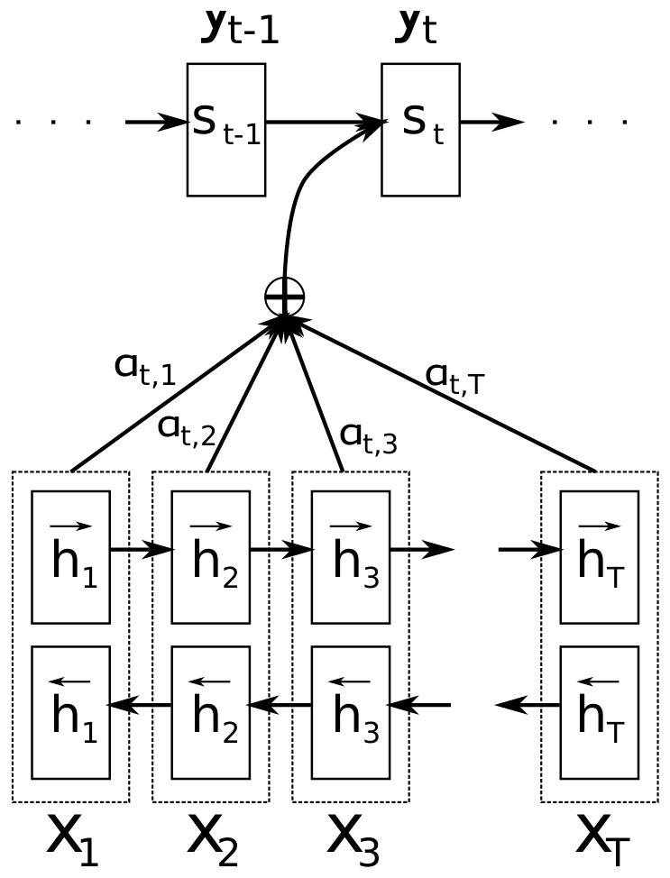
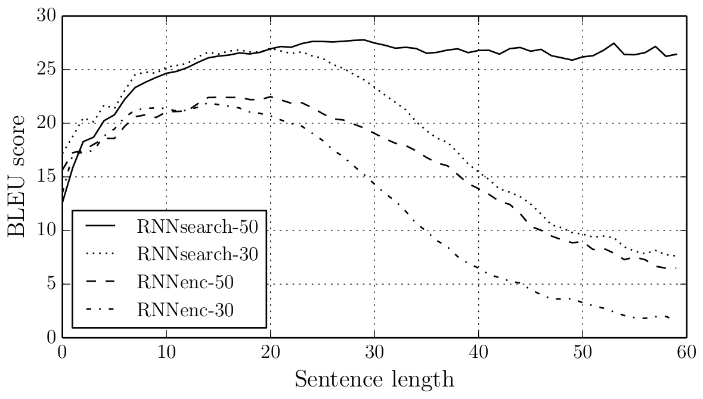
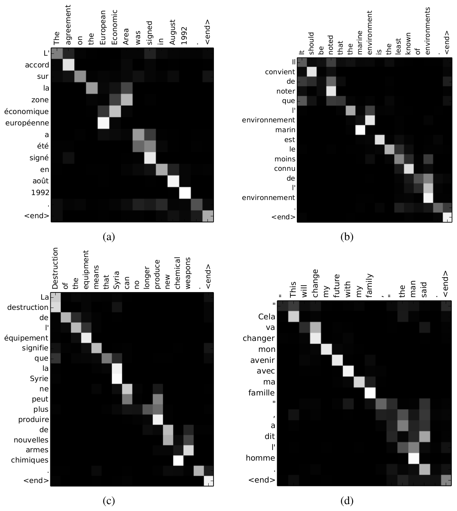

# 论文中文解读：《Neural Machine Translation by Jointly Learning to Align and Translate》

> **基本信息**：Dzmitry Bahdanau（Jacobs University Bremen）、KyungHyun Cho、Yoshua Bengio（Université de Montréal），arXiv:1409.0473（本文所用为 v7，2016 年 5 月 19 日），ICLR 2015 会议论文；[论文原文（arXiv 页面）](https://arxiv.org/abs/1409.0473)。
>
> **本文的读法**：本文覆盖原文的全部 3 张图和全部 3 张表。图取自论文 PDF 的原图，表为逐格核对后的中文转录（数字、模型名保持原样，表头译为中文）；每张图后有图中文字翻译和读图结论，每张表后有原文页码和读法。模型公式（含附录 A 的门控单元、对齐模型、输出层）和训练设置都在正文里讲清楚，因此不必再翻英文原文。图上读出的数值一律标“约”。论文中的术语是 annotation（标注向量）、alignment model（对齐模型）和 context vector（上下文向量）；后人常用的 query/key/value、“加性注意力”说法不出现在原文里，本文只在说明处用到。

## 一、一句话结论

当时的神经机器翻译几乎都是“编码器–解码器”：编码器把整个源句压成一个定长向量，解码器再从这个向量生成译文。论文猜想这个定长向量是性能瓶颈，尤其对长句。它的做法是：编码器改用双向 RNN，为源句的**每个位置**产生一个标注向量 $h_j$；解码器在生成每个目标词时，用一个小型前馈网络（对齐模型）给每个 $h_j$ 打分，经 softmax 得到软对齐权重 $\alpha_{ij}$，再对所有 $h_j$ 加权求和得到本步专用的上下文向量 $c_i$。对齐不作为隐变量，而是直接算出的软权重，因此梯度能一路回传，翻译与对齐只靠翻译对数似然联合训练，不需要词对齐标注。在 WMT'14 英译法上，新模型 RNNsearch 在所有设置下都明显优于基本的编码器–解码器 RNNencdec：长句上优势尤其明显（RNNsearch-50 在长度 50 以上也不退化）；单模型在“不含未知词的句子”上与短语式系统 Moses 相当（36.15 对 35.63，该数字来自训练得更久的 RNNsearch-50⋆），但在全部测试句上仍落后（28.45 对 33.30）。

## 二、背景与动机

### 2.1 神经机器翻译与 RNN 编码器–解码器（第 2 节）

从概率角度看，翻译就是给定源句 $\mathbf x$ 找使条件概率最大的目标句 $\mathbf y$，即 $\operatorname*{arg\,max}_{\mathbf y}p(\mathbf y\mid\mathbf x)$。神经机器翻译用参数化模型在平行语料上拟合句对的条件概率，训练好之后，对给定源句，搜索使条件概率最大的译文。这类方法通常包含两部分：编码器读入源句 $\mathbf x$，解码器生成目标句 $\mathbf y$；例如 Cho 等人（2014a）和 Sutskever 等人（2014）用两个 RNN，把变长源句编码成定长向量，再把向量解码成变长目标句。Sutskever 等人报告，基于 LSTM 的神经翻译在英译法上已接近传统短语式系统的水平（论文脚注：这里的“最好水平”指不含任何神经网络部件的传统短语式系统）；给现有翻译系统加神经部件，例如给短语表打分（Cho 等 2014a）或给候选译文重排序（Sutskever 等 2014），已能超过此前最好水平。

论文所依托的 RNN 编码器–解码器框架（Cho 等 2014a；Sutskever 等 2014）如下。编码器读入由向量组成的输入句 $\mathbf x=(x_1,\dots,x_{T_x})$，产生一个向量 $c$。最常见的做法是用 RNN：

$$
h_t=f(x_t,h_{t-1}),\qquad c=q\bigl(\{h_1,\dots,h_{T_x}\}\bigr),\qquad(1)
$$

其中 $h_t\in\mathbb R^n$ 是 $t$ 时刻的隐藏状态，$c$ 由隐藏状态序列产生，$f$、$q$ 是非线性函数。Sutskever 等人用 LSTM 作 $f$，并取 $q(\{h_1,\dots,h_T\})=h_T$（见 [Seq2Seq 的中文解读](../seq2seq/论文中文解读.md)）。解码器通常被训练成：给定上下文向量 $c$ 和前面已预测的所有词 $\{y_1,\dots,y_{t-1}\}$，预测下一个词 $y_t$。也就是把联合概率分解成有序的条件概率：

$$
p(\mathbf y)=\prod_{t=1}^{T_y}p\bigl(y_t\mid\{y_1,\dots,y_{t-1}\},c\bigr),\qquad(2)
$$

用 RNN 时每个条件概率建模为

$$
p\bigl(y_t\mid\{y_1,\dots,y_{t-1}\},c\bigr)=g(y_{t-1},s_t,c),\qquad(3)
$$

其中 $g$ 是非线性的（可能是多层的）函数，输出 $y_t$ 的概率，$s_t$ 是 RNN 的隐藏状态。注意这里 $c$ 对所有目标词都是**同一个**向量。论文也提醒，RNN 与反卷积网络的混合等其他架构也可用（Kalchbrenner 与 Blunsom 2013）。

### 2.2 动机：定长向量是瓶颈（第 1 节）

编码器–解码器方法的潜在问题是：神经网络需要把源句的**全部**必要信息压缩进一个定长向量。这可能使网络难以处理长句，尤其是比训练语料中的句子更长的句子。Cho 等人（2014b）已经证明，基本编码器–解码器的性能确实随输入句长增加而迅速恶化。

论文的对策是：让模型学会**联合对齐与翻译**。每次生成一个译词时，模型在源句中（软）搜索信息最集中的一组位置，然后基于与这些位置相关联的上下文向量和之前生成的所有目标词来预测目标词。它与基本编码器–解码器最重要的区别是：**不试图把整个输入句子编码成单个定长向量**；而是把输入句编码成一个向量序列，并在解码时自适应地挑选其中一部分。这使翻译模型不必把任意长度的源句信息挤进定长向量。论文的结论是：这让模型更能应付长句；改进在句子越长时越明显，但任何长度的句子上都能观察到。

## 三、方法：对齐与翻译联合学习（第 3 节与附录 A）

### 3.1 解码器：新的条件概率与上下文向量（第 3.1 节）

新架构里，式 (2) 中的每个条件概率改写为

$$
p(y_i\mid y_1,\dots,y_{i-1},\mathbf x)=g(y_{i-1},s_i,c_i),\qquad(4)
$$

其中 $s_i$ 是时刻 $i$ 的 RNN 隐藏状态，

$$
s_i=f(s_{i-1},y_{i-1},c_i).
$$

注意与原来的编码器–解码器（式 (2)(3)）不同：这里的概率条件于**每个目标词 $y_i$ 各自不同的上下文向量 $c_i$**。$c_i$ 依赖于编码器把输入句映射成的一个**标注向量**（annotation）序列 $(h_1,\dots,h_{T_x})$。每个标注 $h_j$ 含有关于整个输入序列的信息，但特别关注输入序列第 $j$ 个词周围的部分（下一小节说明怎样得到）。上下文向量 $c_i$ 是这些标注的加权和：

$$
c_i=\sum_{j=1}^{T_x}\alpha_{ij}\,h_j,\qquad(5)
$$

每个标注 $h_j$ 的权重 $\alpha_{ij}$ 由 softmax 算出：

$$
\alpha_{ij}=\frac{\exp(e_{ij})}{\sum_{k=1}^{T_x}\exp(e_{ik})},\qquad(6)
$$

其中

$$
e_{ij}=a(s_{i-1},h_j)
$$

是一个**对齐模型**（alignment model），给“源句第 $j$ 个位置附近的输入”与“第 $i$ 个位置的输出”的匹配程度打分。分数基于 RNN 隐藏状态 $s_{i-1}$（即刚好在输出 $y_i$ 之前的状态，见式 (4)）和输入句的第 $j$ 个标注 $h_j$。论文把对齐模型 $a$ 参数化成一个**前馈神经网络**，与系统的所有其他部件联合训练。

**关键性质**：与传统机器翻译不同，这里对齐**不是隐变量**；对齐模型直接算出一个**软对齐**，使代价函数的梯度能够反向传播过去，这个梯度既训练对齐模型，也训练整个翻译模型，二者联合训练。

**期望标注的解读**：对所有标注取加权和，可以理解为计算一个“期望标注”，期望是对可能的对齐取的。令 $\alpha_{ij}$ 是目标词 $y_i$ 与源词 $x_j$ 对齐（或译自 $x_j$）的概率，那么第 $i$ 个上下文向量 $c_i$ 就是在概率 $\alpha_{ij}$ 下所有标注的期望。概率 $\alpha_{ij}$（或其能量 $e_{ij}$）反映了标注 $h_j$ 相对于前一隐藏状态 $s_{i-1}$ 在决定下一个状态 $s_i$ 和生成 $y_i$ 时的重要性。直观上，这就在解码器里实现了一种**注意力机制**：解码器决定要关注源句的哪些部分。通过让解码器拥有注意力机制，编码器不再需要承担把源句全部信息编码进定长向量的负担；信息可以分散在整个标注序列中，由解码器按需选择性地取回。

### 3.2 编码器：用双向 RNN 产生标注（第 3.2 节）

通常的 RNN（式 (1)）按顺序从第一个符号 $x_1$ 读到最后一个符号 $x_{T_x}$。但在新方案中，希望每个词的标注不仅概括它前面的词，也概括它后面的词。因此论文用**双向 RNN**（BiRNN，Schuster 与 Paliwal 1997，近来成功用于语音识别）：它由前向 RNN 和后向 RNN 组成。前向 RNN $\overrightarrow f$ 按原序（从 $x_1$ 到 $x_{T_x}$）读入并算出前向隐藏状态序列 $(\overrightarrow h_1,\dots,\overrightarrow h_{T_x})$；后向 RNN $\overleftarrow f$ 按逆序（从 $x_{T_x}$ 到 $x_1$）读入，得到后向隐藏状态序列 $(\overleftarrow h_1,\dots,\overleftarrow h_{T_x})$。把前向与后向隐藏状态**拼接**，得到词 $x_j$ 的标注：

$$
h_j=\begin{bmatrix}\overrightarrow h_j\\[2pt]\overleftarrow h_j\end{bmatrix}.\qquad(7)
$$

这样标注 $h_j$ 同时包含前面的词和后面的词的概括。由于 RNN 倾向于更好地表示最近的输入，标注 $h_j$ 会集中在 $x_j$ 周围的词上。解码器和对齐模型用这个标注序列来计算上下文向量（式 (5)(6)）。

*图 1（原文 Figure 1，第 3 页）：所提模型在给定源句 $(x_1,x_2,\dots,x_T)$ 时生成第 $t$ 个目标词 $y_t$ 的示意图。*

**图中文字翻译与读法**：

- **下半部分（编码器）**：最下面一行是源句的词 $x_1,x_2,x_3,\dots,x_T$；每个词上方有两个方框，上面一个 $\overrightarrow h_j$（前向 RNN 的状态，向右的箭头把状态逐位置传下去），下面一个 $\overleftarrow h_j$（后向 RNN 的状态，箭头向左）；每一对由虚线框圈起来，表示标注 $h_j$。
- **中间的 $\alpha_{t,1},\alpha_{t,2},\alpha_{t,3},\dots,\alpha_{t,T}$ 与 $\oplus$**：从每个标注向上的箭头标着权重 $\alpha_{t,j}$，汇集到 $\oplus$ 节点，表示“加权求和”，得到本步的上下文向量。
- **上半部分（解码器）**：隐藏状态 $s_{t-1}\to s_t$ 沿时间向右传递，输出 $y_{t-1},y_t$；$\oplus$ 的输出作为 $s_t$ 的输入之一。
- **读图结论**：编码器输出的是**整个标注序列**，而不是一个向量；解码器每一步用不同的权重 $\alpha_{t,\cdot}$ 重新组合这个序列，得到本步的上下文，所以同一个源句在不同的解码步里“被看”的方式不同。

### 3.3 与基本编码器–解码器的关系

论文附录 A.2.2 指出：如果把 $c_i$ 固定为 $\overrightarrow h_{T_x}$（前向 RNN 在最后一个位置的状态），新模型就退化成 Cho 等人（2014a）的 RNN 编码器–解码器。也就是说，RNN 编码器–解码器是新模型的一个特例；实验里的 RNNencdec 就是这个基线。

### 3.4 实验里的具体选择（附录 A）

第 3 节的方案是一个通用框架，其中 RNN 的激活函数 $f$ 和对齐模型 $a$ 可以自由定义；附录 A 描述了实验所用的选择。

**门控隐藏单元（GRU）**：作为 RNN 的 $f$，论文用 Cho 等人（2014a）新提出的门控隐藏单元，它是传统简单单元（如逐元素 tanh）的替代品。这种门控单元类似更早的 LSTM 单元（见 [LSTM 的中文解读](../lstm/论文中文解读.md)），共有的能力是更好地建模和学习长程依赖：在展开的 RNN 中存在导数乘积接近 1 的计算路径，使梯度能反向轻松流动而不遭受太多消失效应。论文说明也可以用 LSTM 单元代替，Sutskever 等人就是这么做的。用 $n$ 个门控隐藏单元的 RNN，新状态 $s_i$ 为

$$
s_i=f(s_{i-1},y_{i-1},c_i)=(1-z_i)\circ s_{i-1}+z_i\circ\tilde s_i,
$$

其中 $\circ$ 是逐元素乘法，$z_i$ 是更新门的输出；候选状态 $\tilde s_i$ 为

$$
\tilde s_i=\tanh\bigl(W\,e(y_{i-1})+U\,[r_i\circ s_{i-1}]+C\,c_i\bigr),
$$

$e(y_{i-1})\in\mathbb R^m$ 是词 $y_{i-1}$ 的 $m$ 维嵌入（$y_i$ 用 1-of-$K$ 向量表示时，$e(y_i)$ 就是嵌入矩阵 $E\in\mathbb R^{m\times K}$ 的一列），$r_i$ 是重置门的输出。更新门和重置门为

$$
z_i=\sigma\bigl(W_z\,e(y_{i-1})+U_z\,s_{i-1}+C_z\,c_i\bigr),\qquad
r_i=\sigma\bigl(W_r\,e(y_{i-1})+U_r\,s_{i-1}+C_r\,c_i\bigr),
$$

$\sigma$ 是 logistic sigmoid。（为让公式简洁，论文省略了偏置项。）更新门 $z_i$ 让每个隐藏单元保持它先前的激活；重置门 $r_i$ 控制应当把前一状态中的多少、哪些信息重置掉。编码器里同样的公式去掉上下文向量 $c_i$ 及相关项即可使用。

**对齐模型**：因为对一对长度为 $T_x$ 和 $T_y$ 的句子，对齐模型要被计算 $T_x\times T_y$ 次，设计时要考虑计算量。为减少计算，论文用单隐藏层的多层感知机：

$$
a(s_{i-1},h_j)=v_a^\top\tanh\bigl(W_a\,s_{i-1}+U_a\,h_j\bigr).
$$

后人把这种形式称为加性（additive）注意力。形状：$W_a\in\mathbb R^{n'\times n}$，$U_a\in\mathbb R^{n'\times 2n}$，$v_a\in\mathbb R^{n'}$（附录 A.1.2 写作 $n\times n$、$n\times2n$、$\mathbb R^n$，A.2.2 与 A.2.3 里用 $n'$ 表示对齐模型的隐藏单元数，二者在实验里都取 1000）。因为 $U_ah_j$ 不依赖于 $i$，可以预先算好，以最小化计算代价。

### 3.5 逐步写出完整模型（附录 A.2）

**编码器**。模型的输入是 1-of-$K$ 编码的源句词向量 $\mathbf x=(x_1,\dots,x_{T_x})$，$x_i\in\mathbb R^{K_x}$，输出是 1-of-$K$ 编码的译文 $\mathbf y=(y_1,\dots,y_{T_y})$，$y_i\in\mathbb R^{K_y}$，$K_x,K_y$ 是源、目标语言的词表大小。前向状态先算（$i=0$ 时 $\overrightarrow h_0=0$）：

$$
\overrightarrow h_i=(1-\overrightarrow z_i)\circ\overrightarrow h_{i-1}+\overrightarrow z_i\circ\tilde{\overrightarrow h}_i,
$$

$$
\tilde{\overrightarrow h}_i=\tanh\bigl(\overrightarrow W\bar E\,x_i+\overrightarrow U[\overrightarrow r_i\circ\overrightarrow h_{i-1}]\bigr),\quad
\overrightarrow z_i=\sigma\bigl(\overrightarrow W_z\bar E\,x_i+\overrightarrow U_z\,\overrightarrow h_{i-1}\bigr),\quad
\overrightarrow r_i=\sigma\bigl(\overrightarrow W_r\bar E\,x_i+\overrightarrow U_r\,\overrightarrow h_{i-1}\bigr).
$$

这里 $\bar E\in\mathbb R^{m\times K_x}$ 是源语言的词嵌入矩阵；$\overrightarrow W,\overrightarrow W_z,\overrightarrow W_r\in\mathbb R^{n\times m}$，$\overrightarrow U,\overrightarrow U_z,\overrightarrow U_r\in\mathbb R^{n\times n}$；$m$ 是词嵌入维数，$n$ 是隐藏单元数。后向状态 $(\overleftarrow h_1,\dots,\overleftarrow h_{T_x})$ 同样计算，前向与后向 RNN **共享词嵌入矩阵 $\bar E$，但权重矩阵不共享**。把前向与后向状态拼接得到标注 $h_i$（式 (7)）。

**解码器**。给定编码器的标注，解码器的隐藏状态 $s_i=(1-z_i)\circ s_{i-1}+z_i\circ\tilde s_i$，其中

$$
\tilde s_i=\tanh\bigl(W E\,y_{i-1}+U[r_i\circ s_{i-1}]+C\,c_i\bigr),\quad
z_i=\sigma\bigl(W_zE\,y_{i-1}+U_zs_{i-1}+C_zc_i\bigr),\quad
r_i=\sigma\bigl(W_rE\,y_{i-1}+U_rs_{i-1}+C_rc_i\bigr),
$$

$E$ 是目标语言的词嵌入矩阵；$W,W_z,W_r\in\mathbb R^{n\times m}$，$U,U_z,U_r\in\mathbb R^{n\times n}$，$C,C_z,C_r\in\mathbb R^{n\times 2n}$。初始隐藏状态 $s_0=\tanh\bigl(W_s\overleftarrow h_1\bigr)$，$W_s\in\mathbb R^{n\times n}$，也就是用后向 RNN 在第一个位置的状态（它读完了整个源句）来初始化解码器。上下文向量 $c_i$ 在每一步由对齐模型重新计算：

$$
c_i=\sum_{j=1}^{T_x}\alpha_{ij}h_j,\qquad
\alpha_{ij}=\frac{\exp(e_{ij})}{\sum_{k=1}^{T_x}\exp(e_{ik})},\qquad
e_{ij}=v_a^\top\tanh\bigl(W_as_{i-1}+U_ah_j\bigr).
$$

**输出层**：给定解码器状态 $s_{i-1}$、上下文 $c_i$ 和上一个生成的词 $y_{i-1}$，目标词 $y_i$ 的概率定义为

$$
p(y_i\mid s_i,y_{i-1},c_i)\propto\exp\bigl(y_i^\top W_o\,t_i\bigr),
$$

其中 $t_i=\bigl[\max\{\tilde t_{i,2j-1},\tilde t_{i,2j}\}\bigr]^\top_{j=1,\dots,l}$（maxout：把每相邻两个分量取最大），$\tilde t_i=U_o\,s_{i-1}+V_oE\,y_{i-1}+C_o\,c_i$，$W_o\in\mathbb R^{K_y\times l}$，$U_o\in\mathbb R^{2l\times n}$，$V_o\in\mathbb R^{2l\times m}$，$C_o\in\mathbb R^{2l\times 2n}$。这可以理解为带单个 maxout 隐藏层的“深输出”（Pascanu 等 2014；Goodfellow 等 2013）。最后用 softmax 对每个词的输出概率归一化。（注意：第 3.1 节的式 (4) 写作 $g(y_{i-1},s_i,c_i)$，而附录这个输出公式用的是 $s_{i-1}$，原文两处写法略有出入。）

**模型规模**（附录 A.2.3）：所有模型的隐藏层大小 $n=1000$，词嵌入维数 $m=620$，深输出中 maxout 隐藏层大小 $l=500$，对齐模型的隐藏单元数 $n'=1000$。

**一步解码的流程**（本文对上述公式的归纳）：

1. 用前向、后向 GRU 读完源句，得到标注 $h_1,\dots,h_{T_x}$（每个 $2n$ 维），并算出初始状态 $s_0=\tanh(W_s\overleftarrow h_1)$。
2. 对每个目标位置 $i=1,2,\dots$：先对所有 $j$ 算 $e_{ij}=v_a^\top\tanh(W_as_{i-1}+U_ah_j)$；再 softmax 得 $\alpha_{ij}$；加权求和得 $c_i$。
3. 用 $s_{i-1}$、$y_{i-1}$、$c_i$ 按 GRU 公式更新出 $s_i$。
4. 用 maxout 输出层和 softmax 得到 $y_i$ 的概率分布，用 beam search 选词；直到生成句末标记。

## 四、实验设置（第 4 节与附录 B）

**任务与数据**：英译法。使用 ACL WMT'14 提供的双语平行语料：Europarl（6100 万词）、news commentary（550 万词）、UN（4.21 亿词）和两个爬取语料（分别为 9000 万词和 2.725 亿词），共 8.5 亿词。按 Cho 等人（2014a）的方法，用 Axelrod 等（2011）的数据选择法把合并语料缩减到 3.48 亿词。除上述平行语料外不使用任何单语数据（尽管也许可以用大得多的单语语料来预训练编码器）。把 news-test-2012 和 news-test-2013 拼接作为开发（验证）集，在 WMT'14 的测试集 news-test-2014（3003 个句子，不在训练数据中）上评测。

**预处理**：先用 Moses 的分词脚本做常规分词，然后每种语言只取 30,000 个最常见的词作为词表（shortlist），不在词表内的词映射为特殊记号 [UNK]；不做小写化或词干提取等其他特殊预处理。

**对比模型**：训练两类模型。一类是 RNN 编码器–解码器（RNNencdec，Cho 等 2014a），另一类是所提的模型 RNNsearch。两类模型各训练两次：先用长度至多 30 个词的句子（RNNencdec-30、RNNsearch-30），再用长度至多 50 个词的句子（RNNencdec-50、RNNsearch-50）。两种模型使用相同的训练方法和相同的数据集。

**结构规模**：RNNencdec 的编码器和解码器各有 1000 个隐藏单元（这里“隐藏单元”一律指门控隐藏单元）。RNNsearch 的编码器由前向和后向两个 RNN 组成，各有 1000 个隐藏单元，解码器有 1000 个隐藏单元。两种情况下都用带单个 maxout 隐藏层的多层网络计算每个目标词的条件概率。

**训练**（附录 B）：

- 随机梯度下降（SGD）配合 Adadelta（Zeiler 2012）自动调整每个参数的学习率（$\epsilon=10^{-6}$，$\rho=0.95$）。
- 每次把代价函数梯度的 $L_2$ 范数规范化到至多为预设阈值 1（范数超过阈值时缩放）。
- 每次 SGD 更新方向由 80 个句子的 minibatch 算出。
- 初始化：循环权重矩阵（$U,U_z,U_r$ 及前向、后向 RNN 的对应矩阵）初始化为随机正交矩阵；$W_a$、$U_a$ 的每个元素取自均值 0、方差 $0.001^2$ 的高斯分布；$v_a$ 的所有元素和所有偏置向量初始化为 0；其他权重矩阵取自均值 0、方差 $0.01^2$ 的高斯分布。
- 实现上每次更新所需时间与 minibatch 中最长句子的长度成正比，为减少浪费，每 20 次更新之前取出 1600 个句对，按长度排序后切成 20 个 minibatch；训练数据在训练前只打乱一次，之后按这种方式顺序遍历。
- 每个模型训练约 5 天（详见表 2）。

**解码**：训练好后用束搜索（beam search）找近似使条件概率最大的译文（论文没有给出束宽）。

## 五、实验结果

### 5.1 定量结果：表 1

表 1：已训练模型在测试集上的 BLEU（越高越好）。“All”列是全部测试句的分数；“No UNK”列只评测“句子本身和参考译文中都没有未知词”的句子，并且禁止模型在此情形下生成 [UNK] 记号。

| 模型 | All（全部句子） | No UNK（无未知词的句子） |
|---|---:|---:|
| RNNencdec-30 | 13.93 | 24.19 |
| RNNsearch-30 | 21.50 | 31.44 |
| RNNencdec-50 | 17.82 | 26.71 |
| RNNsearch-50 | 26.75 | 34.16 |
| RNNsearch-50⋆ | 28.45 | 36.15 |
| Moses | 33.30 | 35.63 |

原文表 1，第 7 页。原文表注：RNNsearch-50⋆ 训练的时间长得多，直到开发集上的性能不再提高为止。读法：

- **同训练长度下新模型都更好**：RNNsearch-30 对 RNNencdec-30：21.50 对 13.93（All）、31.44 对 24.19（No UNK）；RNNsearch-50 对 RNNencdec-50：26.75 对 17.82、34.16 对 26.71。RNNsearch-30（21.50 / 31.44）甚至超过 RNNencdec-50（17.82 / 26.71），论文把它当作新模型优越的进一步证据。
- **与 Moses 的比较要分两种口径**：在“无未知词”的句子上，RNNsearch-50⋆ 为 36.15，高于 Moses 的 35.63（RNNsearch-50 为 34.16，略低）；论文称“当只考虑由已知词构成的句子时，RNNsearch 与传统短语式系统 Moses 一样好”，并强调 Moses 在这两个平行语料之外还用了独立的单语语料（4.18 亿词）。但在**全部句子**上，RNNsearch-50⋆ 只有 28.45，比 Moses 的 33.30 低 4.85，RNNsearch-50 低 6.55。摘要里的“comparable”因此只适用于前一种口径和训练更久的 ⋆ 模型。
- 未知词的影响很大：词表仅 30,000，所有模型在含未知词的句子上都损失很多（如 RNNsearch-50 从 34.16 降到 26.75）；论文把“更好地处理未知词或罕见词”列为未来的挑战之一。

### 5.2 训练统计：表 2

表 2：学习统计量与相关信息。每次 update 指用一个 minibatch 更新一次参数；一个 epoch 是对训练集遍历一遍；NLL 是句子在训练集或开发集上的平均条件对数概率（取负，越小越好），注意各句子长度不同。

| 模型 | 更新次数（×10^5） | Epoch 数 | 小时数 | GPU | 训练 NLL | 开发 NLL |
|---|---:|---:|---:|---|---:|---:|
| RNNenc-30 | 8.46 | 6.4 | 109 | TITAN BLACK | 28.1 | 53.0 |
| RNNenc-50 | 6.00 | 4.5 | 108 | Quadro K-6000 | 44.0 | 43.6 |
| RNNsearch-30 | 4.71 | 3.6 | 113 | TITAN BLACK | 26.7 | 47.2 |
| RNNsearch-50 | 2.88 | 2.2 | 111 | Quadro K-6000 | 40.7 | 38.1 |
| RNNsearch-50⋆ | 6.67 | 5.0 | 252 | Quadro K-6000 | 36.7 | 35.2 |

原文表 2，第 14 页。读法：

- 表中 RNNenc 即正文的 RNNencdec。
- 四个基础模型的训练时长都在 108–113 小时（约 4.5 天），RNNsearch-50⋆ 训练了 252 小时（约 10.5 天）。
- 同样时间里，RNNsearch 做的更新次数更少（如 -50：2.88 对 6.00，按此折算每次更新约慢 2 倍，这是本文的换算）；即使如此，它的开发集 NLL 更低（-30：47.2 对 53.0；-50：38.1 对 43.6），⋆ 训练到收敛得到 35.2。
- NLL 是按句子平均，-30 与 -50 模型训练和比较的句子长度范围不同，不同行之间的数值要谨慎比较。

### 5.3 BLEU 随句长的变化：图 2

*图 2（原文 Figure 2，第 5 页）：生成译文在测试集上的 BLEU 分数随句子长度的变化。结果是在完整测试集上计算的，其中包括含模型未知词的句子。*

**图中文字翻译与读法**：

- 横轴 Sentence length（句子长度，0 到 60），纵轴 BLEU score（BLEU 分数，0 到 30）。四条线：RNNsearch-50（实线）、RNNsearch-30（点线）、RNNenc-50（虚线）、RNNenc-30（点划线）。
- 从图上读出的近似值：RNNencdec 两条线在长度约 15–20 附近达到峰值（-50 约 22.4，-30 约 21.8），之后随句长一直下降，-50 在长度约 40 时约 14、约 59 时约 6.5，-30 在长度约 40 时约 6.5、约 58 时不到 2。RNNsearch-30 峰值约 27（长度约 20），超过 30 个词后下降，约 50 时约 10、约 59 时约 7.6，即超出训练长度（30）后也衰退，但仍高于 RNNencdec-30。**RNNsearch-50 在长度 20 到 60 之间基本稳定在约 26–28，没有随句长下降。**
- 原文结论：RNNencdec 的性能随句长增加而急剧下降；RNNsearch-30 和 RNNsearch-50 对句长更稳健，尤其是 RNNsearch-50，即使句长为 50 或更长也没有性能下降。
- **读图结论**：这是对“定长向量是长句瓶颈”这个猜想最直接的检验；注意模型是“用最长 30（或 50）词的句子训练”，RNNsearch-30 在更长的句子上虽然也衰退，但比 RNNencdec-30 平缓，说明稳健性不只是靠见过长句。图上的值是从曲线读出的近似数字。

### 5.4 对齐可视化：图 3

论文提供了一种直观检查（软）对齐的办法：把式 (6) 的标注权重 $\alpha_{ij}$ 画成矩阵。矩阵的每一行表示生成某个目标词时各源位置的权重，由此可以看出生成这个目标词时源句的哪些位置被认为更重要。

*图 3（原文 Figure 3，第 6 页）：RNNsearch-50 找到的四个样例对齐。每幅图的横轴和纵轴分别对应源句（英语）与生成译文（法语）中的词；每个像素用灰度显示第 $i$ 个目标词对第 $j$ 个源词标注的权重 $\alpha_{ij}$（0：黑，1：白）。(a) 一个任意句子；(b)(c)(d) 从测试集中不含任何未知词、长度在 10 到 20 个词之间的句子里随机抽取的三个样例。*

**图中文字翻译与读法**：

- **(a)** 英 *The agreement on the European Economic Area was signed in August 1992 .*，法 *L' accord sur la zone économique européenne a été signé en août 1992 .*。大体沿对角线，唯独 *zone économique européenne* 对 *European Economic Area* 是反方向的：形容词和名词在法语与英语里次序不同。
- **(b)** 英 *It should be noted that the marine environment is the least known of environments .*，法 *Il convient de noter que l' environnement marin est le moins connu de l' environnement .*。
- **(c)** 英 *Destruction of the equipment means that Syria can no longer produce new chemical weapons .*，法 *La destruction de l' équipement signifie que la Syrie ne peut plus produire de nouvelles armes chimiques .*。
- **(d)** 英 *" This will change my future with my family , " the man said .*，法 *" Cela va changer mon avenir avec ma famille " , a dit l' homme .*。
- **论文的读图结论**：英法词对齐在很大程度上是**单调**的，每个矩阵的对角线上有强权重；同时也有一些非平凡的非单调对齐。例如 (a) 中，模型正确地把 [European Economic Area] 译成 [zone économique européenne]：它先把 [zone] 对准 [Area]，跳过了前面的两个词（[European] 和 [Economic]），然后每次往回看一个词，补全整个短语。
- **软对齐相对硬对齐的优势**：以 (d) 为例，源短语 [the man] 被译成 [l' homme]。任何硬对齐都会把 [the] 对应 [l']、[man] 对应 [homme]，这对翻译没有帮助，因为必须看 [the] 后面的词才能决定它应译成 [le]、[la]、[les] 还是 [l']。软对齐让模型同时看 [the] 和 [man]，在这个例子里模型正确地把 [the] 译成了 [l']；论文说在展示的所有例子里都观察到类似行为。软对齐的另一个好处是能自然地处理长度不同的源短语和目标短语，不必像传统方法那样把一些词映射到“无处”（[NULL]）。
- **证据边界**：权重矩阵是模型内部的注意力分布，论文只做了定性检查，并未对照人工标注的对齐做量化评估，也不能证明权重大的位置是译词的唯一原因。

### 5.5 长句的定性例子：表 3（附录 C）

论文在正文 5.2.2 节挑了两个长句，附录 C 的表 3 给出三个例子（含参考译文，并附 Google Translate 2014 年 8 月 27 日的译文）。

表 3：RNNenc-50 和 RNNsearch-50 对测试集中长源句（30 个词或更多）的译文；每个源句同时给出金标准（Reference）译文。Google Translate 的译文是 2014 年 8 月 27 日生成的。法语原文逐字转录（保留原文的标点和个别印刷错误）。

| 例 | 类型 | 句子 |
|---|---|---|
| 1 | Source | An admitting privilege is the right of a doctor to admit a patient to a hospital or a medical centre to carry out a diagnosis or a procedure, based on his status as a health care worker at a hospital. |
| 1 | Reference | Le privilège d’admission est le droit d’un médecin, en vertu de son statut de membre soignant d’un hôpital, d’admettre un patient dans un hôpital ou un centre médical afin d’y délivrer un diagnostic ou un traitement. |
| 1 | RNNenc-50 | Un privilège d’admission est le droit d’un médecin de reconnaître un patient à l’hôpital ou un centre médical d’un diagnostic ou de prendre un diagnostic en fonction de son état de santé. |
| 1 | RNNsearch-50 | Un privilège d’admission est le droit d’un médecin d’admettre un patient à un hôpital ou un centre médical pour effectuer un diagnostic ou une procédure, selon son statut de travailleur des soins de santé à l’hôpital. |
| 1 | Google Translate | Un privilège admettre est le droit d’un médecin d’admettre un patient dans un hôpital ou un centre médical pour effectuer un diagnostic ou une procédure, fondée sur sa situation en tant que travailleur de soins de santé dans un hôpital. |
| 2 | Source | This kind of experience is part of Disney’s efforts to ”extend the lifetime of its series and build new relationships with audiences via digital platforms that are becoming ever more important,” he added. |
| 2 | Reference | Ce type d’expérience entre dans le cadre des efforts de Disney pour ”étendre la durée de vie de ses séries et construire de nouvelles relations avec son public grâce à des plateformes numériques qui sont de plus en plus importantes”, a-t-il ajouté. |
| 2 | RNNenc-50 | Ce type d’expérience fait partie des initiatives du Disney pour ”prolonger la durée de vie de ses nouvelles et de développer des liens avec les lecteurs numériques qui deviennent plus complexes. |
| 2 | RNNsearch-50 | Ce genre d’expérience fait partie des efforts de Disney pour ”prolonger la durée de vie de ses séries et créer de nouvelles relations avec des publics via des plateformes numériques de plus en plus importantes”, a-t-il ajouté. |
| 2 | Google Translate | Ce genre d’expérience fait partie des efforts de Disney à “étendre la durée de vie de sa série et construire de nouvelles relations avec le public par le biais des plates-formes numériques qui deviennent de plus en plus important”, at-il ajouté. |
| 3 | Source | In a press conference on Thursday, Mr Blair stated that there was nothing in this video that might constitute a ”reasonable motive” that could lead to criminal charges being brought against the mayor. |
| 3 | Reference | En conférence de presse, jeudi, M. Blair a affirmé qu’il n’y avait rien dans cette vidéo qui puisse constituer des ”motifs raisonnables” pouvant mener au dépôt d’une accusation criminelle contre le maire. |
| 3 | RNNenc-50 | Lors de la conférence de presse de jeudi, M. Blair a dit qu’il n’y avait rien dans cette vidéo qui pourrait constituer une ”motivation raisonnable” pouvant entraîner des accusations criminelles portées contre le maire. |
| 3 | RNNsearch-50 | Lors d’une conférence de presse jeudi, M. Blair a déclaré qu’il n’y avait rien dans cette vidéo qui pourrait constituer un ”motif raisonnable” qui pourrait conduire à des accusations criminelles contre le maire. |
| 3 | Google Translate | Lors d’une conférence de presse jeudi, M. Blair a déclaré qu’il n’y avait rien dans cette vido qui pourrait constituer un ”motif raisonnable” qui pourrait mener à des accusations criminelles portes contre le maire. |

原文表 3，第 15 页（例 1、例 2 也出现在正文第 7–8 页，那里用下划线标出 RNNenc-50 偏离原意之处）。中文大意与读法（译文大意为本文翻译）：

- **例 1**：源句大意是“‘入院特权’是医生基于其作为医院医务人员的身份，把患者收入医院或医疗中心以进行诊断或某项操作的权利”。RNNenc-50 一直到 [a medical center] 之前都译对了，从那之后偏离了原意：它把 [based on his status as a health care worker at a hospital] 换成了 *en fonction de son état de santé*（“根据他的健康状况”）；前面还把“收治（admit）”译成了 *reconnaître*（“认出”）。RNNsearch-50 的译文保留了全部意思，没有遗漏细节。
- **例 2**：RNNenc-50 在生成了大约 30 个词之后开始偏离源句原意（把 *series* 译成 *nouvelles*，“新闻”；把“越来越重要”译成 *plus complexes*，“更复杂”），之后质量下降，甚至出现缺少右引号这样的基本错误；RNNsearch-50 译得正确。
- **例 3**：三个系统基本都对，差别较小（例如 RNNenc-50 把 *reasonable motive* 译成 *motivation raisonnable*，参考与 RNNsearch-50 用 *motif*）；这个例子只出现在附录。
- Google Translate 的译文只作旁证，本身也有毛病（例如例 1 的 *privilège admettre*、例 3 的 *portes*）；例 3 里的 *vido* 是原文印刷时丢了 é，表中按原样转录。
- **读法**：这些例子是定性展示，和图 2 的定量结果相互印证；它们不能代替对整个测试集的评测。论文给出的解释是：RNNsearch 不需要把长句完美地编码成一个定长向量，只需要准确编码围绕某个特定词的那部分输入。

## 六、相关工作（第 6 节）

- **学习对齐**：Graves（2013）在手写合成中提出了类似的把输出符号与输入符号对齐的方法：用高斯核的混合来计算标注的权重，核的位置、宽度和混合系数由对齐模型预测；但他的对齐被限制为位置单调递增。主要区别是，这里标注权重的众数只朝一个方向移动。在机器翻译中这是严重的限制，因为生成语法正确的译文常常需要（长距离）重排序（例如英译德）。论文的方法则需要对译文中的**每个词**计算源句**每个词**的标注权重；这个缺点在翻译任务里不严重，因为大多数输入输出句只有 15–40 个词，但这可能限制该方案在其他任务上的适用性。
- **神经网络用于机器翻译**：自 Bengio 等（2003）提出神经概率语言模型以来，神经网络已广泛用于机器翻译，但它们的作用大多局限于给现有统计机器翻译系统提供一个特征，或对现有系统给出的候选译文列表重排序。例如 Schwenk（2012）用前馈网络计算源短语与目标短语对的分数并作为短语式 SMT 的附加特征；Kalchbrenner 与 Blunsom（2013）、Devlin 等（2014）报告了把神经网络作为现有翻译系统子部件的成功应用；传统上还有用作目标端语言模型的神经网络给候选译文列表重新打分（Schwenk 等 2006）。本文关心的是更有野心的目标：设计一个完全基于神经网络的新翻译系统，它不是现有系统的一部分，而是自己独立地从源句直接生成译文，因此是对以往工作的彻底改变。

## 七、结论、局限与证据边界

**论文的结论（第 7 节）**：传统的神经机器翻译（编码器–解码器）把整句编码成定长向量再解码；作者基于 Cho 等（2014b）和 Pouget-Abadie 等（2014）的经验研究，猜想使用定长上下文向量对翻译长句是有问题的。论文通过让模型在生成每个目标词时（软）搜索一组输入词（或编码器算出的它们的标注）来扩展基本编码器–解码器，使模型不必再把整句编码成定长向量，而能只聚焦于与生成下一个目标词相关的信息；这对神经机器翻译系统在更长句子上产生好结果有重大积极影响。与传统机器翻译系统不同，包括对齐机制在内的翻译系统的所有部件都为提高产生正确译文的对数概率而联合训练。实验表明，RNNsearch 显著优于基本的编码器–解码器 RNNencdec，不论句长；并且对源句长度稳健得多。对软对齐的定性分析让作者得出：模型能够把每个目标词与源句中的相关词（或它们的标注）正确对齐，同时产生正确的译文。更重要的也许是，该方法取得了与现有短语式统计机器翻译相当的翻译性能。尚待解决的挑战之一是更好地处理未知词或罕见词。

**局限与证据边界**（部分为论文自述，部分为本文基于数字的判断）：

- **只有一个语言对和一个数据集**（英译法，WMT'14）；长度敏感性只在这个设置下检验。
- **“与 Moses 相当”只在无未知词的子集上成立**，并且依赖训练更久的 RNNsearch-50⋆；全部句子上仍低 4.85 BLEU（28.45 对 33.30）。
- **未知词问题明显**：词表只有 30,000 词，神经模型在“无未知词的句子”与“全部句子”两种口径下相差约 7 到 10 个 BLEU（如 RNNsearch-50⋆ 为 36.15 对 28.45），而 Moses 只差约 2.3（35.63 对 33.30）；两个口径的句子集合不同，差距里也含句子本身难度的差别。
- **计算量**：对每个目标词要计算对所有源词的权重，总计算随 $T_x\times T_y$ 增长（论文自己指出这在 15–40 词的句子上不严重，但可能限制其他任务）；表 2 里同样时间内 RNNsearch 的更新次数约为 RNNencdec 的一半。
- **对齐可视化只是定性证据**：论文没有用人工对齐做量化评估。
- **编码和解码仍是 RNN 串行**：论文没有处理这个问题（后来的 Transformer 才去掉循环）。
- **不同论文的数字不能直接比**：表 1 只含本文自己训练的 RNNencdec/RNNsearch 单模型和 Moses；Sutskever 等的结果（集成、80k 目标词表，见 Seq2Seq 的解读）不在表 1 里，两篇论文的 BLEU 不能直接比较。

**常见误读**：

- “注意力就是 query/key/value 点积”：本文的对齐模型是一个小型前馈网络 $v_a^\top\tanh(W_as_{i-1}+U_ah_j)$，不是点积；$q$/$k$/$v$ 是后来的叫法。
- “注意力为每个目标词选一个硬位置”：不是，它对**所有**源位置做 softmax 加权，是可微的“期望标注”。
- “论文证明注意力完全消除了长句问题”：图 2 显示 RNNsearch-50 在长度 50 以上也不退化，但 RNNsearch-30 在超过训练长度后仍衰退；论文的结论是“更稳健”，不是“完全没有衰退”。
- “对齐矩阵就是模型的解释”：它是模型内部的软权重，与人工对齐的一致程度没有被量化。
- “RNNsearch 单模型已超过 Moses”：只有在无未知词的子集上、用训练更久的 ⋆ 模型才成立；全部句子上低于 Moses。

## 八、复现检查清单

- 数据：WMT'14 英法平行语料按 Axelrod 选择法缩减到 3.48 亿词；开发集 news-test-2012+2013，测试集 news-test-2014（3003 句）；Moses 分词；两种语言各取 30,000 个最常见的词，其余记为 [UNK]；不做小写化和词干提取。
- 模型：双向 GRU 编码器（每个方向 1000 单元）、1000 单元 GRU 解码器、词嵌入 620 维、深输出 maxout 隐藏层 500、对齐模型隐藏单元 1000；解码器初始状态由后向 RNN 第一个位置的状态经 $W_s$ 和 tanh 得到；编码器前后向共享词嵌入矩阵。
- 对照：同样的数据和训练流程训练 RNNencdec 和 RNNsearch，分别用最大长度 30 与 50 的句子训练。
- 训练：Adadelta（$\epsilon=10^{-6}$，$\rho=0.95$），梯度范数裁剪到 1，minibatch 为 80 句，按长度排序分组（每 1600 句分成 20 批），循环权重矩阵用正交初始化，其他见上文。
- 评测：BLEU（论文没给出脚本名和大小写设置，复现时需明确）；分别报告“全部句子”和“无未知词的句子”两种口径，在后一种口径下不允许生成 [UNK]；束搜索的束宽论文没给出，需自行记录。
- 注意力实现：论文没有提到 padding；按长度分批时，源句 padding 位置必须在 softmax 之前屏蔽（这是实现上的常识，论文没写）；检查 $\sum_j\alpha_{ij}=1$；对 $U_ah_j$ 预计算，避免对每个解码步重复计算。
- 评估长句：按源句长度分桶画 BLEU 曲线（图 2），并区分模型训练时见过的最大句长。
- 消融：双向编码器与注意力同时改变，严格归因需独立消融；论文只比较了“基线 RNNencdec 对完整 RNNsearch”。

## 九、与相关论文的关系

- 前置：[LSTM](../lstm/论文中文解读.md)（门控单元解决长程依赖，论文用的 GRU 是类似思路）；[Seq2Seq](../seq2seq/论文中文解读.md)（把整句压进一个定长向量，用反转源句缓解长程依赖；本文认为定长向量是瓶颈并以注意力对此修正）。
- 后续：[Transformer](../transformer/论文中文解读.md)：本文是“解码器对编码器”的交叉注意力；Transformer 保留交叉注意力，并把序列内部的循环完全换成自注意力。

## 原文证据导航

- [原论文 PDF](paper.pdf)：模型描述与式 (4)–(7) 在第 3–4 页，实验设置在第 4–5 页，图 2 在第 5 页，图 3 在第 6 页，表 1 在第 7 页，附录 A 的门控单元、对齐模型与完整模型在第 12–14 页，表 2 在第 14 页，表 3（附录 C）在第 15 页。
- [原文提取文本](paper.txt)：文本抽取丢失了公式里的箭头和帽子（如 $\overrightarrow h$、$\overleftarrow h$），核对公式请以 PDF 为准。
- [论文概要](论文概要.md)
