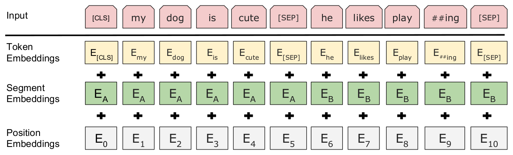
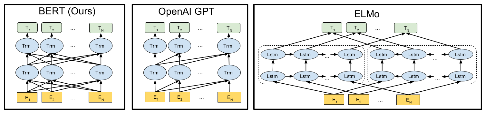
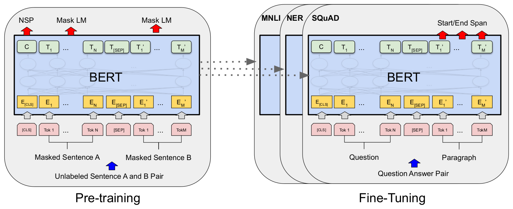
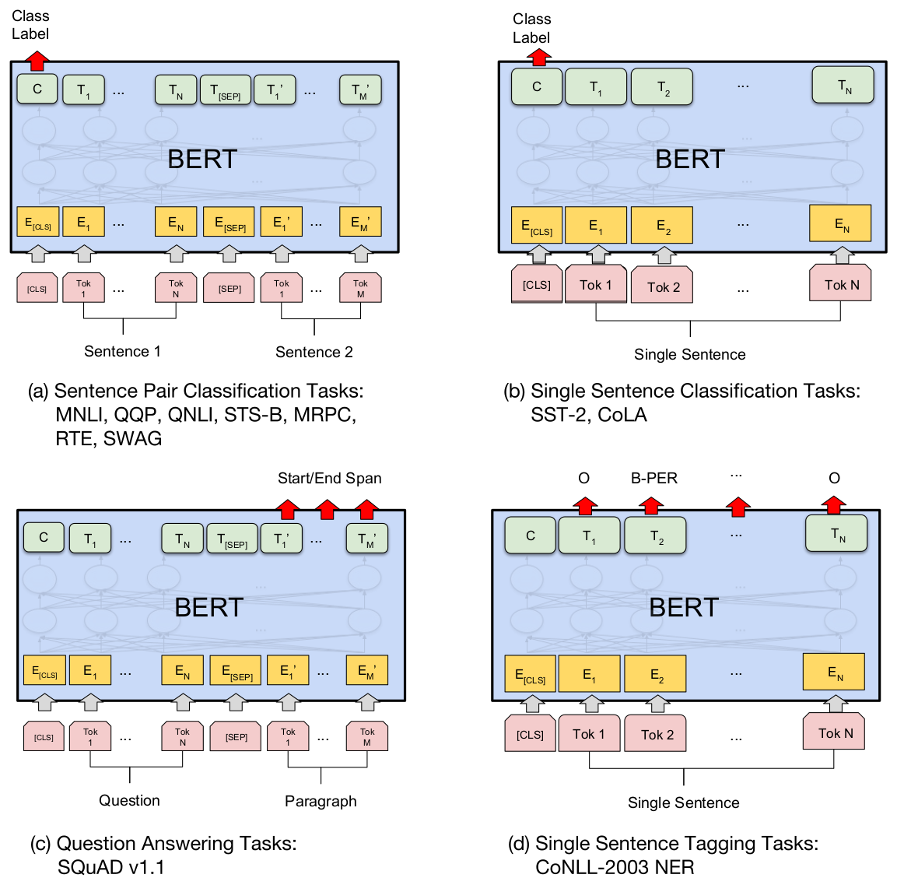
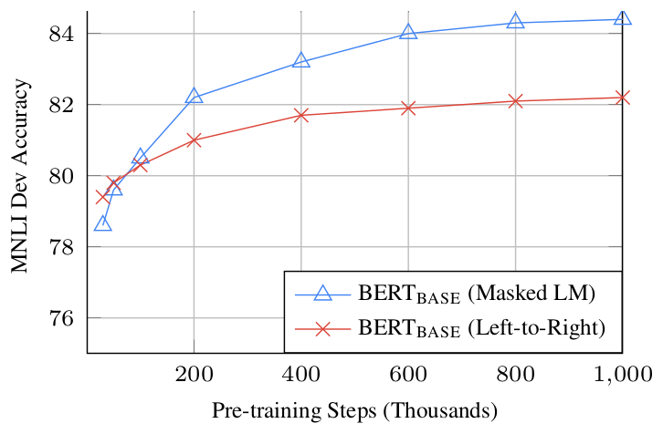

# 论文中文解读：《BERT: Pre-training of Deep Bidirectional Transformers for Language Understanding》

> **基本信息**：Jacob Devlin、Ming-Wei Chang、Kenton Lee、Kristina Toutanova（Google AI Language），arXiv:1810.04805（首版 2018 年 10 月；本地 PDF 为 v2，2019 年 5 月 24 日）；[官方页面](https://arxiv.org/abs/1810.04805)；代码与预训练模型：github.com/google-research/bert。
>
> **本文的读法**：图取自论文原文 PDF，表为逐格核对后的中文转录（数字与原文一致，模型名、数据集名保持英文，行名和列名译为中文）。每张图、表后有读法和结论，因此不必再翻英文原文。凡标注“推算”“推断”“本文的判断”的内容是本文自己的整理，不是原文数字或原话。原文把 Transformer 的细节省略了，本文第三节为读者补上这部分前置知识。

## 一、一句话结论

以前的预训练语言表示（GPT、ELMo）要么只用从左到右的单向语言模型，要么把独立训练的左向、右向两个模型浅层拼接，限制了预训练表示的能力。BERT（Bidirectional Encoder Representations from Transformers）用**掩码语言模型**（masked language model，MLM）预训练一个**所有层都同时看左右上下文**的深层双向 Transformer encoder，另加一个**下一句预测**（next sentence prediction，NSP）任务来学习句对关系。预训练好的模型只需在顶部加一个很小的输出层，就能微调到各种任务上，不用为每个任务重新设计网络。

结果：在 11 个 NLP 任务上刷新当时最好成绩（GLUE 的 8 个任务、SQuAD v1.1、SQuAD v2.0、SWAG），包括 GLUE 官方得分 80.5（比 OpenAI GPT 的 72.8 高 7.7）、MultiNLI 准确率 86.7（高 4.6）、SQuAD v1.1 测试 F1 93.2（高 1.5）、SQuAD v2.0 测试 F1 83.1（高 5.1）。消融实验显示，收益的主要来源正是 MLM 带来的双向性和 NSP。

## 二、背景与动机

### 2.1 两种使用预训练表示的方式

原文开头把已有做法分成两类：

- **feature-based（基于特征）**：以 ELMo 为代表。下游任务有自己专门设计的网络结构，把预训练表示当作**额外特征**输入进去；预训练模型本身不再更新。
- **fine-tuning（微调）**：以 OpenAI GPT 为代表。预训练模型加上很少的任务专用参数，在下游任务上**微调全部预训练参数**。

两类方法在预训练阶段目标相同，都用**单向**语言模型学通用语言表示。

### 2.2 单向语言模型的问题

论文认为主要限制在于标准语言模型是单向的，这限制了预训练时可选的结构。例如 OpenAI GPT 用从左到右的结构，Transformer 自注意力里每个 token 只能关注它前面的 token。这种限制对**句子级任务**不是最优，而对**token 级任务**（例如问答，需要同时利用两侧上下文来确定答案位置）可能非常有害。

那为什么不直接训练双向语言模型？论文给出的原因是：标准的条件语言模型只能从左到右或从右到左训练，因为双向条件会让每个词在多层网络里**间接“看到自己”**，模型就能轻易地预测目标词。

### 2.3 BERT 的两个想法与论文的三点贡献

- **MLM（灵感来自 Cloze 完形填空任务）**：随机遮住输入里的一部分 token，目标是**只根据上下文**预测被遮住词的原始词表 id。这样表示可以融合左右两侧，从而预训练出深层双向 Transformer。
- **NSP**：联合预训练文本对表示。

三点贡献：

1. 证明了**双向预训练**对语言表示的重要性：不同于 GPT 的单向语言模型，也不同于 Peters 等人（ELMo）把独立训练的左向和右向语言模型做浅层拼接；
2. 证明预训练表示**减少了对大量精心设计的任务专用结构的需求**：BERT 是第一个在大量句子级和 token 级任务上取得最好成绩、超过许多任务专用结构的**微调类**表示模型；
3. 在 11 个 NLP 任务上刷新最好成绩（代码与预训练模型已公开）。

### 2.4 相关工作

| 路线 | 做法与代表 | 与 BERT 的关系 |
|---|---|---|
| 无监督 feature-based：词向量 | word2vec、GloVe 等预训练词向量，早期也有非神经网络方法；目标有从左到右语言建模，也有区分左右上下文里正确词与错误词 | BERT 的 MLM 同样利用左右上下文，但学的是整个深层网络 |
| 无监督 feature-based：句、段落向量 | skip-thought（用句子表示生成下一句）、候选下一句排序、去噪自编码器目标 | BERT 的 NSP 与排序类目标相关，但 BERT 迁移**全部参数** |
| ELMo 及其前身 | 从左到右和从右到左两个语言模型抽取上下文相关特征，每个 token 的表示是两个方向表示的拼接；context2vec 用 LSTM 从左右上下文预测单个词 | 都是 feature-based 且不是深层双向的 |
| 无监督微调 | 先只预训练词嵌入；之后有预训练的句子、文档编码器再微调（Dai and Le；Howard and Ruder；OpenAI GPT）。优点是几乎不需要从头学参数 | BERT 属于这一类，但改成双向 |
| 从有监督数据迁移 | 在大规模有监督任务（自然语言推断、机器翻译）上预训练后迁移；计算机视觉里在 ImageNet 上预训练再微调 | 论文强调自己用的是无监督预训练 |

## 三、前置知识：Transformer encoder 一层在做什么

原文说 BERT 的实现与原始 Transformer 几乎相同，因此省略了背景介绍，并推荐读者看 Vaswani 等人的论文和 “The Annotated Transformer”。为了让只读本文也能看懂，这里补一个最小版本（以下是通用知识，不是原文内容）。

输入是一串向量 $X\in\mathbb R^{n\times H}$（$n$ 个位置，隐藏维度 $H$）。每一层由两个子层组成。

**多头自注意力**。每个头先把 $X$ 投影成查询、键、值，再做缩放点积注意力：

$$
\mathrm{Attention}(Q,K,V)=\operatorname{softmax}\!\Big(\frac{QK^{\top}}{\sqrt{d_k}}\Big)V,\qquad d_k=H/A.
$$

$A$ 个头的结果拼接后再做一次线性变换。**BERT 的注意力没有因果 mask**：每个位置都能关注序列里的所有位置（含左右两侧）；GPT 则要加一个下三角 mask，只让每个位置看左边。

**逐位置前馈网络**：$\mathrm{FFN}(x)=\mathrm{GELU}(xW_1+b_1)W_2+b_2$，内层维度为 $4H$（原文脚注 3：$H=768$ 时为 3072，$H=1024$ 时为 4096）。

每个子层外面都套“残差连接 + LayerNorm”。整个模型是这样的层堆叠 $L$ 次。原文用 $L$ 表示层数（Transformer 块数）、$H$ 表示隐藏维度、$A$ 表示自注意力头数。

## 四、模型：规模与输入表示

### 4.1 两种规模

BERT 的结构就是多层**双向 Transformer encoder**（基于 tensor2tensor 库里的原始实现）。主要报告两种规模：

| 模型 | 层数 $L$ | 隐藏维度 $H$ | 头数 $A$ | FFN 内层维度 | 总参数量 |
|---|---:|---:|---:|---:|---:|
| BERT_BASE | 12 | 768 | 12 | 3072 | 110M |
| BERT_LARGE | 24 | 1024 | 16 | 4096 | 340M |

（原文第 3 节及脚注 3。）**BERT_BASE 特意选成与 OpenAI GPT 一样大，便于对比**；关键区别在于 BERT 用双向自注意力，GPT 用只看左边的受限自注意力。

按上表维度粗算（本文的推算，不是原文）：BERT_BASE 的 12 层约 $12\times(4\times768^2+2\times768\times3072)\approx85$M，30,000 词的词嵌入约 23M，再加上位置嵌入、偏置、LayerNorm 等，与论文的 110M 接近。

### 4.2 输入与输出的表示（图 1、图 2）

为了用同一个结构处理单句和句对任务，输入表示要能在**一个 token 序列**里无歧义地表示单个句子或一对句子（如〈问题，答案〉）。这里的“句子”可以是任意一段连续文本，“序列”指输入 BERT 的 token 序列，可以是一个句子或两个打包在一起的句子。

- 使用 **WordPiece** 嵌入（Wu et al. 2016），词表 30,000 个 token；
- 每个序列的**第一个 token 永远是特殊分类 token `[CLS]`**，它最后一层的隐藏状态被用作分类任务的整个序列表示；
- 句对被打包成一个序列，用两种方式区分两句：先用特殊 token `[SEP]` 分隔；再给每个 token 加一个学出来的**句子嵌入**，表示它属于句子 A 还是句子 B。

记输入嵌入为 $E$，最后一层 `[CLS]` 的隐藏向量为 $C\in\mathbb R^{H}$，第 $i$ 个输入 token 最后一层的隐藏向量为 $T_i\in\mathbb R^{H}$。



*图 2（原文 Figure 2，第 5 页）：BERT 的输入表示。输入嵌入是 token 嵌入、句子（segment）嵌入和位置嵌入三者之和。*

**图中文字翻译与读法**：

- 最上面的 Input 行是输入 token 序列：`[CLS] my dog is cute [SEP] he likes play ##ing [SEP]`，其中 `##ing` 表示 WordPiece 把 “playing” 切成 `play` 和 `##ing` 两个片段；
- **Token Embeddings（token 嵌入）**：每个 token 查词表得到 $E_{[CLS]},E_{my},\ldots$；
- **Segment Embeddings（句子嵌入）**：第一句（含 `[CLS]` 和第一个 `[SEP]`）都加 $E_A$，第二句（含最后的 `[SEP]`）都加 $E_B$；
- **Position Embeddings（位置嵌入）**：位置 0 到 10 各加一个 $E_0,\ldots,E_{10}$；
- 三行逐位置**相加**（图中的加号）就是输入给第一层的向量。位置嵌入是学出来的：原文 A.2 说最后 10% 的步骤用长度 512 的序列来“学习位置嵌入”。

### 4.3 BERT、OpenAI GPT、ELMo 的结构对比（图 3，原文附录 A.4）



*图 3（原文 Figure 3，第 13 页，附录 A.4）：三种预训练模型的结构差别。*

**图中文字翻译与读法**：

- **BERT (Ours)**：两层 Trm（Transformer 块）从输入嵌入 $E_1,\ldots,E_N$ 到输出 $T_1,\ldots,T_N$，**每个位置都连向下一层的所有位置**，所以双向；
- **OpenAI GPT**：同样是 Transformer，但每个位置只连向**左侧**的位置（从左到右）；
- **ELMo**：两个**独立训练**的 LSTM，一个从左到右、一个从右到左（图中两个虚线框），最后把两者的表示拼接成特征。
- 图注原话的结论：三者中只有 BERT 的表示在**所有层**都同时以左右上下文为条件；此外 BERT 和 GPT 是微调类方法，ELMo 是 feature-based 方法。

原文 A.4 还列出了 BERT 与 GPT 在训练上的其他差别，这些差别会混入对比（因此论文用第 5.1 节的消融单独分离“双向性”和 NSP 的贡献）：

| 项目 | OpenAI GPT | BERT |
|---|---|---|
| 注意力 | 只能看左侧 | 双向 |
| 预训练语料 | BooksCorpus（8 亿词） | BooksCorpus（8 亿词）加英文 Wikipedia（25 亿词） |
| `[SEP]`、`[CLS]`、句子 A/B 嵌入 | 只在微调时才引入 | 在预训练中学习 |
| 训练步数与批大小 | 100 万步，每批 32,000 词 | 100 万步，每批 128,000 词 |
| 微调学习率 | 所有微调实验都用 5e-5 | 每个任务在开发集上选最优学习率 |

## 五、预训练

不使用传统的从左到右或从右到左语言模型，而是用两个无监督任务（图 1 左半部分）。



*图 1（原文 Figure 1，第 3 页）：BERT 预训练与微调的整体流程。除输出层外，预训练与微调使用同样的结构；同一份预训练参数用来初始化不同下游任务的模型；微调时所有参数都会被更新。`[CLS]` 是加在每个输入样本前面的特殊符号，`[SEP]` 是特殊的分隔 token（例如分隔问题和答案）。*

**图中文字翻译与读法**：

- **左图 Pre-training（预训练）**：输入是 Unlabeled Sentence A and B Pair（无标注的句子 A、B 对），其中 Masked Sentence A 和 Masked Sentence B 是被遮盖过的句子，序列为 `[CLS] Tok 1 … Tok N [SEP] Tok 1 … Tok M`。经过输入嵌入 $E_{[CLS]},E_1,\ldots,E_N,E_{[SEP]},E_1',\ldots,E_M'$，进入 BERT，得到输出 $C,T_1,\ldots,T_N,T_{[SEP]},T_1',\ldots,T_M'$。顶部红色箭头表示两个预训练输出：**NSP** 接在 $C$ 上，**Mask LM** 接在被遮盖位置的输出上；
- **右图 Fine-Tuning（微调）**：MNLI、NER、SQuAD 三张叠放的卡片表示不同下游任务，各有自己的一份模型，由预训练参数（左边的点状箭头）初始化；图中展开的 SQuAD 的输入是 Question Answer Pair（问题与段落对），Question 在前、Paragraph 在后，顶部 Start/End Span 是预测答案起止位置的输出。
- **读图结论**：预训练和微调的结构几乎完全一样，只是顶部换成不同的小输出层。

### 5.1 任务一：掩码语言模型（Masked LM）

**直觉**：深层双向模型比从左到右模型、或左右两个模型的浅层拼接都更强大。但双向条件会让词“看到自己”，所以论文**随机遮住输入中一定比例的 token，再去预测被遮住的 token**。被遮位置的最后一层隐藏向量送入一个覆盖整个词表的 softmax，和标准语言模型一样。论文对每个序列**随机遮盖 15% 的 WordPiece token**。与去噪自编码器不同，BERT **只预测被遮住的词，不重建整个输入**。

**问题与修补**：这样得到了双向模型，但在预训练和微调之间造成了**不匹配**：微调时输入里不会出现 `[MASK]`。为缓解它，被选中预测的 15% 位置并不总是替换成真正的 `[MASK]`：

- 80% 的情况换成 `[MASK]`；
- 10% 的情况换成一个**随机 token**；
- 10% 的情况**保持原词不变**。

然后用该位置最终隐藏向量 $T_i$ 去预测原始 token，损失为交叉熵。

原文附录 A.1 的例子：句子 `my dog is hairy`，随机选中第 4 个 token（`hairy`）时：

```text
80% 的情况：my dog is hairy  ->  my dog is [MASK]
10% 的情况：my dog is hairy  ->  my dog is apple      （随机词）
10% 的情况：my dog is hairy  ->  my dog is hairy      （保持不变，使表示偏向真实观察到的词）
```

附录对这种做法的解释：Transformer encoder 不知道哪些词会被要求预测、哪些被换成了随机词，所以对**每个**输入 token 都被迫保留一个分布式的上下文表示；随机替换只占全部 token 的 1.5%（15% 的 10%），不会明显损害语言理解能力。

把文字描述写成公式（本文的形式化，原文没有给公式）：设被选中的位置集合为 $\mathcal M$，则

$$
L_{\mathrm{MLM}}=-\frac{1}{\lvert\mathcal M\rvert}\sum_{i\in\mathcal M}\log P\big(x_i\mid T_i\big),
$$

其中 $x_i$ 是被选中位置的原始 token，$P(\cdot\mid T_i)$ 是 $T_i$ 经输出层和 softmax 得到的词表分布。

**代价**：MLM 每批只对 15% 的 token 做预测，所以可能需要更多预训练步数才能收敛（附录 C.1 的结论是确实略慢，但经验提升远超过增加的训练成本）。

### 5.2 任务二：下一句预测（NSP）

问答（QA）和自然语言推断（NLI）等许多重要的下游任务建立在理解**两个句子之间的关系**上，而语言建模并不直接学到这种关系。因此预训练一个二值化的下一句预测任务，它可以从任何单语语料里轻松生成：为每个预训练样本选句子 A 和 B 时，**50% 的情况 B 是紧跟在 A 后面的真实下一句**（标签 `IsNext`），**50% 的情况 B 是语料中的随机句子**（标签 `NotNext`）。图 1 里 $C$ 就用于 NSP。

附录 A.1 的例子：

```text
Input = [CLS] the man went to [MASK] store [SEP] he bought a gallon [MASK] milk [SEP]
Label = IsNext

Input = [CLS] the man [MASK] to the store [SEP] penguin [MASK] are flight ##less birds [SEP]
Label = NotNext
```

两条脚注值得记住：最终模型在 NSP 上能达到 97%–98% 的准确率；**不经微调时，向量 $C$ 并不是有意义的句子表示**，因为它是为 NSP 训练的。

论文还指出，NSP 与 Jernite 等人、Logeswaran 和 Lee 的表示学习目标密切相关，但这些先前工作只把**句子嵌入**迁移到下游任务，而 BERT 迁移**全部参数**来初始化终端任务模型。

整个预训练的损失是“MLM 的平均似然”与“NSP 的平均似然”**之和**（原文 A.2），可记为：

$$
L=L_{\mathrm{MLM}}+L_{\mathrm{NSP}}.
$$

### 5.3 预训练数据与训练设置

预训练流程大体沿用已有的语言模型预训练文献。下表整理自原文第 3.1 节和附录 A.2、A.3（原文没有这张表）：

| 项目 | 预训练 | 微调 |
|---|---|---|
| 语料 | BooksCorpus（8 亿词）和英文 Wikipedia（25 亿词），共约 33 亿词。Wikipedia 只取正文段落，忽略列表、表格、标题 | 各任务自己的标注数据 |
| 为什么用文档级语料 | 必须用**文档级**语料，而不是 Billion Word Benchmark 这样按句子打乱的语料，才能抽取长的连续序列 | - |
| 序列构造 | 从语料里采样两段文本作为“句子”A、B（常常比一个真正的句子长，也可能更短）；50% 概率 B 是 A 的真实后继，50% 随机；两段总长不超过 512 token；在 WordPiece 分词之后统一用 15% 的比例做 mask，不特别照顾词的部分片段 | 按第六节的格式 |
| 批大小 | 256 条序列（256×512 = 128,000 token 每批） | 16 或 32 |
| 步数 | 100 万步，约等于对 33 亿词语料训练 40 个 epoch | 2、3 或 4 个 epoch |
| 优化器 | Adam，学习率 1e-4，$\beta_1=0.9$，$\beta_2=0.999$，L2 权重衰减 0.01，前 10,000 步学习率 warmup，之后线性衰减 | 学习率从 5e-5、3e-5、2e-5 中选（GLUE 的候选里还有 4e-5）；其余超参数大多与预训练相同 |
| Dropout 与激活 | 所有层 dropout 0.1；激活用 gelu（沿用 OpenAI GPT），而不是标准 relu | dropout 始终 0.1 |
| 序列长度策略 | 因为注意力对序列长度是二次的，90% 的步数用长度 128，剩下 10% 的步数用长度 512 来学习位置嵌入 | - |
| 硬件与耗时 | BERT_BASE 用 4 个 Cloud TPU（Pod 配置，共 16 个 TPU 芯片），BERT_LARGE 用 16 个 Cloud TPU（64 个芯片），**各训练 4 天** | 微调相对便宜：论文里所有结果最多 1 小时就能在单个 Cloud TPU 上复现，或在 GPU 上几小时（例如 SQuAD 模型在单个 Cloud TPU 上约 30 分钟就能达到 Dev F1 91.0） |

原文还提到：数据量大的任务（例如 100k+ 标注样本）对超参数选择远不如小数据集敏感；微调很快，所以直接对上述超参数范围做穷举搜索，选开发集上最好的模型是合理的。

## 六、微调：每类任务怎么接输出层

Transformer 的自注意力机制让 BERT 可以通过**更换输入和输出**来建模很多下游任务，无论是单个文本还是文本对。对文本对，常见做法是先独立编码两段文本，再做双向交叉注意力（如 Parikh 等人；Seo 等人）；BERT 则用自注意力把这两个阶段统一起来：把拼接后的文本对一起编码，自注意力天然就包含了两段文本之间的**双向交叉注意力**。

对每个任务，只需把任务的输入输出接到 BERT 上，**端到端地微调全部参数**。预训练中的句子 A、B 对应下游里的：(1) 复述任务中的句子对；(2) 蕴含任务中的假设与前提对；(3) 问答中的问题与段落对；(4) 文本分类或序列标注中退化的“文本加空”对。输出端：token 级任务（序列标注、问答）把每个 token 的表示送入输出层；分类任务（蕴含、情感分析）把 `[CLS]` 的表示送入输出层。



*图 4（原文 Figure 4，第 15 页，附录 A.5）：在不同任务上微调 BERT。其中 (a)、(b) 是序列级任务，(c)、(d) 是 token 级任务。图中 $E$ 表示输入嵌入，$T_i$ 表示 token $i$ 的上下文表示，`[CLS]` 是分类输出用的特殊符号，`[SEP]` 是分隔不连续 token 序列的特殊符号。*

**图中文字翻译与读法**：

- **(a) Sentence Pair Classification Tasks（句对分类任务）：MNLI、QQP、QNLI、STS-B、MRPC、RTE、SWAG**：输入 `[CLS] 句子 1 [SEP] 句子 2`，用 $C$ 输出 Class Label（类别标签）；
- **(b) Single Sentence Classification Tasks（单句分类任务）：SST-2、CoLA**：输入 `[CLS] 单个句子`，同样用 $C$ 输出类别；
- **(c) Question Answering Tasks（问答任务）：SQuAD v1.1**：输入 `[CLS] 问题 [SEP] 段落`，在段落 token 的输出上预测 Start/End Span（答案的起止位置）；
- **(d) Single Sentence Tagging Tasks（单句标注任务）：CoNLL-2003 NER**：输入 `[CLS] 单个句子`，每个 token 的输出 $T_i$ 都接一个标签预测（图中例如 O、B-PER、O）。
- **读图结论**：四类任务共用同一个 BERT 主体，差别只在输入怎么排和从哪个位置取输出；任务专用的新参数极少。

### 6.1 各任务的输出层与公式

**分类（GLUE）**：用 $C\in\mathbb R^{H}$ 作为整个序列的表示。微调中唯一新增的参数是分类层权重 $W\in\mathbb R^{K\times H}$，$K$ 为标签数。原文写的“标准分类损失”是

$$
\log\operatorname{softmax}\big(CW^{\top}\big),
$$

即正确类别的对数概率（取负号就是通常的交叉熵损失）。

**SQuAD v1.1（抽取答案区间）**：问题用 A 嵌入，段落用 B 嵌入。只新增一个起始向量 $S\in\mathbb R^{H}$ 和一个结束向量 $E\in\mathbb R^{H}$。第 $i$ 个词是答案起点的概率是 $T_i$ 与 $S$ 的点积，再对段落里所有词做 softmax：

$$
P_i=\frac{e^{S\cdot T_i}}{\sum_j e^{S\cdot T_j}}.
$$

结束位置用类似的公式（把 $S$ 换成 $E$）。从位置 $i$ 到 $j$ 的候选区间得分为 $S\cdot T_i+E\cdot T_j$，取 $j\ge i$ 的最高分区间作为预测。训练目标是正确起点和终点的对数似然之和。微调 3 个 epoch，学习率 5e-5，批大小 32。

**SQuAD v2.0（允许“没有答案”）**：把没有答案的问题看作答案区间的起点和终点都在 `[CLS]` 上，起点、终点的概率空间扩展到包含 `[CLS]` 位置。预测时比较**无答案得分** $s_{\mathrm{null}}=S\cdot C+E\cdot C$ 与最佳非空区间得分 $\hat s_{i,j}=\max_{j\ge i}\,S\cdot T_i+E\cdot T_j$：当 $\hat s_{i,j}>s_{\mathrm{null}}+\tau$ 时预测非空答案，阈值 $\tau$ 在开发集上选使 F1 最大的值。该模型没有用 TriviaQA 数据；微调 2 个 epoch，学习率 5e-5，批大小 48。

**SWAG（四选一）**：构造 4 条输入序列，每条是给定句子（句子 A）与一个可能的续写（句子 B）的拼接。唯一新增的任务参数是一个向量，它与 `[CLS]` 表示 $C$ 的点积就是该选项的得分，4 个选项的得分再经 softmax 归一化。微调 3 个 epoch，学习率 2e-5，批大小 16。

**NER（CoNLL-2003，第 5.3 节）**：表述成标注任务，不使用 CRF 层；用每个词**第一个子词**（sub-token）的表示送入 NER 标签集上的 token 级分类器。输入用保留大小写的 WordPiece 模型，并包含数据集提供的最大文档上下文。

## 七、实验结果

共 11 个任务（本文的计数：GLUE 的 8 个任务 + SQuAD v1.1 + SQuAD v2.0 + SWAG）。NER 只出现在第 5.3 节的 feature-based 对比里。

### 7.1 GLUE

GLUE（General Language Understanding Evaluation）是一组多样的自然语言理解任务的集合。下表整理自原文附录 B.1：

| 数据集 | 任务 | 训练样本数（表 1 标注） |
|---|---|---:|
| MNLI | 大规模众包的蕴含分类：给定一对句子，预测第二句相对第一句是 entailment（蕴含）、contradiction（矛盾）还是 neutral（中性） | 392k |
| QQP | 二分类：判断 Quora 上的两个问题语义是否等价 | 363k |
| QNLI | 把 SQuAD 转成二分类：正例是包含正确答案的（问题，句子）对，负例是同一段落里不含答案的（问题，句子）对 | 108k |
| SST-2 | 二分类单句任务：电影评论句子的情感 | 67k |
| CoLA | 二分类单句任务：判断一个英语句子在语言学上是否“可接受” | 8.5k |
| STS-B | 来自新闻标题等来源的句子对，人工标注 1 到 5 的语义相似度分数 | 5.7k |
| MRPC | 从网络新闻中自动抽取的句子对，人工标注两句是否语义等价 | 3.5k |
| RTE | 与 MNLI 类似的二值蕴含任务，但训练数据少得多 | 2.5k |
| WNLI | 小型自然语言推断数据集，构造有问题：所有提交到 GLUE 的训练系统都比总是预测多数类的 65.1 基线更差。为了对 OpenAI GPT 公平，论文**排除了该数据集**；提交 GLUE 时始终预测多数类 | - |

微调设置：输入如第六节所述，用 `[CLS]` 的最终隐藏向量 $C$ 作为整体表示，批大小 32，所有 GLUE 任务微调 3 个 epoch；每个任务在开发集上从 5e-5、4e-5、3e-5、2e-5 里选最优学习率。BERT_LARGE 在小数据集上微调有时不稳定，所以做若干次随机重启，选开发集上最好的模型；随机重启使用同一个预训练 checkpoint，但微调数据的打乱顺序和分类层的初始化不同。每个 GLUE 测试集的评测服务器只提交了一次（BERT_BASE 和 BERT_LARGE 各一次，因为 GLUE 不公开测试集标签）。

表 1 的设置：GLUE 测试集结果，由评测服务器打分；每个任务名下方的数字是训练样本数；“平均”这一列与官方 GLUE 得分略有不同，因为排除了 WNLI；BERT 和 OpenAI GPT 都是单模型、单任务；QQP 和 MRPC 报告 F1，STS-B 报告 Spearman 相关系数，其余任务报告 accuracy；排除了把 BERT 作为组成部分的条目；越大越好。

| 系统 | MNLI（m/mm） | QQP | QNLI | SST-2 | CoLA | STS-B | MRPC | RTE | 平均 |
|---|---:|---:|---:|---:|---:|---:|---:|---:|---:|
| 训练样本数 | 392k | 363k | 108k | 67k | 8.5k | 5.7k | 3.5k | 2.5k | - |
| Pre-OpenAI SOTA（OpenAI GPT 之前的最好成绩） | 80.6/80.1 | 66.1 | 82.3 | 93.2 | 35.0 | 81.0 | 86.0 | 61.7 | 74.0 |
| BiLSTM+ELMo+Attn | 76.4/76.1 | 64.8 | 79.8 | 90.4 | 36.0 | 73.3 | 84.9 | 56.8 | 71.0 |
| OpenAI GPT | 82.1/81.4 | 70.3 | 87.4 | 91.3 | 45.4 | 80.0 | 82.3 | 56.0 | 75.1 |
| BERT_BASE | 84.6/83.4 | 71.2 | 90.5 | 93.5 | 52.1 | 85.8 | 88.9 | 66.4 | 79.6 |
| BERT_LARGE | **86.7/85.9** | **72.1** | **92.7** | **94.9** | **60.5** | **86.5** | **89.3** | **70.1** | **82.1** |

（原文表 1，第 6 页。）读法：

- BERT_BASE 和 BERT_LARGE 在**全部 8 个任务**上都超过所有对比系统（论文称幅度很大；按表中数字幅度并不均匀，例如 BERT_BASE 在 SST-2 上只比此前最好的 93.2 高 0.3，在 QQP 上只比 OpenAI GPT 高 0.9）；平均分比此前最好（OpenAI GPT 的 75.1）分别高 4.5 和 7.0；BERT_BASE 与 OpenAI GPT 除注意力 mask 外模型结构几乎相同；
- 最大、报告最广的 GLUE 任务 MNLI 上，BERT_LARGE 的绝对准确率提升为 4.6（86.7 对 82.1）；在**官方 GLUE 排行榜**上 BERT_LARGE 得分 80.5，OpenAI GPT 为 72.8（写作时）；
- BERT_LARGE 在所有任务上都显著优于 BERT_BASE，**尤其是训练数据非常少的任务**（例如 CoLA 52.1 到 60.5，RTE 66.4 到 70.1）；模型规模的影响在第 8.2 节细讲。
- 本文的提醒：原文脚注说“其余任务报告 accuracy”，但 GLUE 的 CoLA 官方指标是 Matthews 相关系数；表中 OpenAI GPT 的 CoLA 45.4 与 GPT 论文表 4 里标为 Matthews 相关系数（mc）的 45.4 是同一个数，所以这一列实际应是 Matthews 相关系数（本文的判断）。表中 OpenAI GPT 的 QNLI（87.4）、STS-B（80.0）与 GPT 论文自己的结果（88.1、82.0）并不相同，原文只说 GLUE 结果取自排行榜和 OpenAI 的博客，没有解释差异。

### 7.2 SQuAD v1.1

SQuAD v1.1 是 10 万个众包的问答对（Rajpurkar 等人）：给定一个问题和一段包含答案的 Wikipedia 段落，任务是预测段落里的答案文本区间。表中 EM 是精确匹配（exact match），F1 是词级重合度的 F1；越大越好。

由于 SQuAD 排行榜上的靠前系统没有最新的公开系统说明，并且允许使用任何公开数据训练，论文因此采用了**适度的数据增强**：先在 TriviaQA（Joshi 等人）上微调，再在 SQuAD 上微调。（脚注 12：所用的 TriviaQA 数据是 TriviaQA-Wiki 中每篇文档前 400 个 token 构成、且至少包含一个给定可能答案的段落。）BERT 集成模型是 7 个系统的集成，它们使用不同的预训练 checkpoint 和微调随机种子。

| 系统 | Dev EM | Dev F1 | Test EM | Test F1 |
|---|---:|---:|---:|---:|
| **排行榜靠前的系统（2018 年 12 月 10 日）** | | | | |
| Human（人类） | - | - | 82.3 | 91.2 |
| #1 Ensemble - nlnet | - | - | 86.0 | 91.7 |
| #2 Ensemble - QANet | - | - | 84.5 | 90.5 |
| **已发表的系统** | | | | |
| BiDAF+ELMo (Single) | - | 85.6 | - | 85.8 |
| R.M. Reader (Ensemble) | 81.2 | 87.9 | 82.3 | 88.5 |
| **本文** | | | | |
| BERT_BASE (Single) | 80.8 | 88.5 | - | - |
| BERT_LARGE (Single) | 84.1 | 90.9 | - | - |
| BERT_LARGE (Ensemble) | 85.8 | 91.8 | - | - |
| BERT_LARGE (Sgl.+TriviaQA) | **84.2** | **91.1** | **85.1** | **91.8** |
| BERT_LARGE (Ens.+TriviaQA) | **86.2** | **92.2** | **87.4** | **93.2** |

（原文表 2，第 7 页。）读法：

- 最佳系统（集成 + TriviaQA）测试 F1 为 93.2，比排行榜第一的 91.7 高 1.5；论文还说单个 BERT 模型（含 TriviaQA，Test F1 91.8）就**超过了排行榜上最好的集成系统的 F1**（91.7）；原文称“单系统比榜首高 1.3 F1”，对应的比较对象原文没写明，按表中数字，91.8 比 QANet 集成的 90.5 高 1.3（本文的推断）；
- **不用 TriviaQA 数据只损失 0.1 到 0.4 F1**，仍然大幅领先已有系统；
- 在这个任务上，表中 BERT 集成 + TriviaQA 的 Test F1（93.2）和 EM（87.4）都高于表中人类行的 91.2 和 82.3。

### 7.3 SQuAD v2.0

SQuAD v2.0 在 v1.1 的基础上允许**提供的段落里没有简短答案**，使问题定义更现实。

| 系统 | Dev EM | Dev F1 | Test EM | Test F1 |
|---|---:|---:|---:|---:|
| **排行榜靠前的系统（2018 年 12 月 10 日）** | | | | |
| Human（人类） | 86.3 | 89.0 | 86.9 | 89.5 |
| #1 Single - MIR-MRC (F-Net) | - | - | 74.8 | 78.0 |
| #2 Single - nlnet | - | - | 74.2 | 77.1 |
| **已发表的系统** | | | | |
| unet (Ensemble) | - | - | 71.4 | 74.9 |
| SLQA+ (Single) | - | - | 71.4 | 74.4 |
| **本文** | | | | |
| BERT_LARGE (Single) | 78.7 | 81.9 | 80.0 | 83.1 |

（原文表 3，第 7 页；排除了把 BERT 作为组成部分的系统。原表里 SLQA+ 行 Dev 两格为 “-” 和空白，这里统一写作 “-”。）读法：相对此前最好的系统，测试 F1 提升 5.1（83.1 对 78.0）；但仍低于人类行的 89.5。

### 7.4 SWAG

SWAG（Situations With Adversarial Generations）含 11.3 万个句对补全样本，评测有依据的常识推断（grounded commonsense inference）：给定一个句子，从四个选项中选出最合理的续写。

| 系统 | Dev | Test |
|---|---:|---:|
| ESIM+GloVe | 51.9 | 52.7 |
| ESIM+ELMo | 59.1 | 59.2 |
| OpenAI GPT | - | 78.0 |
| BERT_BASE | 81.6 | - |
| BERT_LARGE | **86.6** | **86.3** |
| Human (expert)† | - | 85.0 |
| Human (5 annotations)† | - | 88.0 |

（原文表 4，第 7 页。†人类表现由 100 个样本测得，数字来自 SWAG 论文。）读法：BERT_LARGE 比作者自己的基线 ESIM+ELMo 高 27.1，比 OpenAI GPT 高 8.3（均为测试集准确率之差：86.3 对 59.2，86.3 对 78.0）；它高于“Human (expert)”的 85.0，但低于 5 人标注的 88.0。

## 八、消融与分析

### 8.1 预训练任务的作用（表 5）

这一组实验用和 BERT_BASE **完全相同的预训练数据、微调方式和超参数**，只改预训练目标：

- **No NSP**：双向模型，用 MLM 训练，但**没有** NSP 任务；
- **LTR & No NSP**：只看左边的模型，用标准的从左到右（LTR）语言模型训练，而不是 MLM，也没有 NSP。微调时同样保留“只看左边”的限制，因为去掉它会造成预训练与微调不一致，使下游表现变差。它与 OpenAI GPT 直接可比，但用的是 BERT 更大的训练集、输入表示和微调方案；
- **+ BiLSTM**：在 “LTR & No NSP” 模型的顶部加一个**随机初始化的 BiLSTM**，微调时一起训练，试图增强 LTR 系统（对 SQuAD 来说，LTR 模型做 token 预测时隐藏状态没有右侧上下文，显然会很差）。

| 预训练设置（BERT_BASE 结构） | MNLI-m（Acc） | QNLI（Acc） | MRPC（Acc） | SST-2（Acc） | SQuAD（F1） |
|---|---:|---:|---:|---:|---:|
| BERT_BASE | 84.4 | 88.4 | 86.7 | 92.7 | 88.5 |
| 无 NSP | 83.9 | 84.9 | 86.5 | 92.6 | 87.9 |
| LTR 且无 NSP | 82.1 | 84.3 | 77.5 | 92.1 | 77.8 |
| 　+ BiLSTM | 82.1 | 84.1 | 75.7 | 91.6 | 84.9 |

（原文表 5，第 8 页，均为开发集结果。）读法：

1. **去掉 NSP**：在 QNLI（88.4 到 84.9）、MNLI（84.4 到 83.9）和 SQuAD 1.1（88.5 到 87.9）上显著变差，论文据此认为 NSP 对 QA 和 NLI 很有益（MRPC、SST-2 几乎不变）；
2. **MLM 与 LTR 对比**（“无 NSP”对“LTR 且无 NSP”）：LTR 模型在**所有任务**上都比 MLM 差，MRPC（86.5 到 77.5）和 SQuAD（87.9 到 77.8）下降最大；
3. **给 LTR 加 BiLSTM**：SQuAD 明显提高（77.8 到 84.9），但仍远不如预训练的双向模型（87.9 以上）；而 BiLSTM **损害了 GLUE 任务**的表现；
4. 也可以分别训练 LTR 和 RTL（从右到左）两个模型再像 ELMo 那样拼接，但论文列了三条理由认为不划算：(a) 开销是单个双向模型的两倍；(b) 对 QA 这类任务不直观，因为 RTL 模型无法把答案建立在问题之上；(c) 严格弱于深层双向模型，因为后者在每一层都能同时用左右上下文。

### 8.2 模型规模的影响（表 6）

论文训练了不同层数、隐藏单元数和注意力头数的 BERT，其余超参数和训练过程与之前相同。表中报告的是**5 次随机重启微调的平均开发集准确率**。“LM (ppl)”是**保留的训练数据上的掩码语言模型困惑度**（越小越好）。

| 层数 $L$ | 隐藏维度 $H$ | 头数 $A$ | LM 困惑度 | MNLI-m | MRPC | SST-2 |
|---:|---:|---:|---:|---:|---:|---:|
| 3 | 768 | 12 | 5.84 | 77.9 | 79.8 | 88.4 |
| 6 | 768 | 3 | 5.24 | 80.6 | 82.2 | 90.7 |
| 6 | 768 | 12 | 4.68 | 81.9 | 84.8 | 91.3 |
| 12 | 768 | 12 | 3.99 | 84.4 | 86.7 | 92.9 |
| 12 | 1024 | 16 | 3.54 | 85.7 | 86.9 | 93.3 |
| 24 | 1024 | 16 | 3.23 | 86.6 | 87.8 | 93.7 |

（原文表 6，第 9 页。）读法：

- 越大的模型准确率**严格地**越高，即便是只有 3,600 个标注训练样本、且与预训练任务差别很大的 MRPC；
- 论文强调的意义：机器翻译和语言建模等大规模任务上增大模型会带来持续提升早已为人所知（表 6 的语言模型困惑度也说明了这点），但作者认为这是**第一项令人信服地表明“只要模型预训练得足够充分，把模型扩展到极端规模也会给非常小规模的任务带来大幅提升”的工作**。作者找到的已有文献里，最大的是原始 Transformer 的 (L=6, H=1024, A=16)（编码器 100M 参数），以及 Al-Rfou 等人的 (L=64, H=512, A=2)（235M 参数）；BERT_BASE 为 110M，BERT_LARGE 为 340M；
- 论文的假设：之前 Peters 等人把预训练双向语言模型从两层增到四层结果有好有坏，Melamud 等人把隐藏维度从 200 增到 600 有帮助、增到 1,000 没有进一步提升，这两项工作都是 feature-based 的；而当模型**直接在下游任务上微调**、只使用极少量随机初始化的额外参数时，任务模型即使在下游数据非常少的情况下，也能从更大、表达力更强的预训练表示中获益。
- 小提醒：原文正文写“所有四个数据集”，但表 6 只有 MNLI-m、MRPC、SST-2 三项下游指标；此外 BERT_BASE 的 SST-2 在表 5 里是 92.7，在表 6 里是 92.9（后者是 5 次重启平均），属于原文内部的小出入。

### 8.3 BERT 用作 feature-based 方法（表 7）

前面所有结果都用微调方法。但 feature-based 方法（从预训练模型抽取固定特征）也有优点：第一，并非所有任务都能轻松表示成 Transformer encoder 结构，所以需要加任务专用模型；第二，可以把昂贵的训练数据表示只算一次，之后在这个表示上用更便宜的模型做很多实验。

论文在 CoNLL-2003 命名实体识别（NER）上比较两种方法。feature-based 的做法：不微调 BERT 的任何参数，从一层或多层抽取激活，作为一个**随机初始化的两层 768 维 BiLSTM** 的输入，BiLSTM 之后接分类层。超参数在开发集上选；报告的开发集和测试集分数是用选定超参数 5 次随机重启的平均。

| 系统 | Dev F1 | Test F1 |
|---|---:|---:|
| ELMo（Peters et al., 2018a） | 95.7 | 92.2 |
| CVT（Clark et al., 2018） | - | 92.6 |
| CSE（Akbik et al., 2018） | - | **93.1** |
| **微调方法** | | |
| BERT_LARGE | 96.6 | 92.8 |
| BERT_BASE | 96.4 | 92.4 |
| **feature-based 方法（BERT_BASE）** | | |
| 只用 Embeddings（嵌入层） | 91.0 | - |
| 倒数第二层隐藏状态（Second-to-Last Hidden） | 95.6 | - |
| 最后一层隐藏状态（Last Hidden） | 94.9 | - |
| 最后四层加权和（Weighted Sum Last Four Hidden） | 95.9 | - |
| 最后四层拼接（Concat Last Four Hidden） | 96.1 | - |
| 全部 12 层加权和（Weighted Sum All 12 Layers） | 95.5 | - |

（原文表 7，第 9 页。）读法：BERT_LARGE 与最先进方法相比有竞争力；feature-based 里最好的做法是**拼接最后四层的 token 表示**，只比微调整个模型低 0.3 F1（96.1 对 96.4，均为 BERT_BASE 开发集）。论文据此认为 BERT 对微调和 feature-based 两种方法**都有效**。

### 8.4 预训练步数（图 5，原文附录 C.1）



*图 5（原文 Figure 5，第 16 页，附录 C.1）：预训练步数的消融。纵轴是从预训练了 $k$ 步的参数出发、微调之后的 MNLI 准确率，横轴是 $k$。*

**图中文字翻译与读法**：

- 横轴 Pre-training Steps (Thousands)（预训练步数，千步），纵轴 MNLI Dev Accuracy（MNLI 开发集准确率）；
- 蓝色三角线 BERT_BASE (Masked LM)，红色叉号线 BERT_BASE (Left-to-Right)；
- 从图上读出的近似值（原文没有给出这些点的数字）：最左边的点 MLM 约 78.6、LTR 约 79.4；100k 步附近两者相近（约 80.5 与 80.3）；200k 步 MLM 约 82.2、LTR 约 81.0；400k 步约 83.2 对 81.7；100 万步 MLM 约 84.4、LTR 约 82.2。

论文用它回答两个问题：

1. **BERT 真的需要这么大量的预训练吗（每批 128,000 词 × 100 万步）？** 需要：BERT_BASE 训练 100 万步比训练 50 万步在 MNLI 上多得**将近 1.0%** 的准确率；
2. **MLM 因为每批只预测 15% 的词，是否比 LTR 收敛得更慢？** 是的，MLM 的收敛**略慢**；但从绝对准确率看，MLM 模型**几乎一开始就开始超过** LTR 模型（原文用语是 “almost immediately”；按图上读数，100k 步附近两者持平，之后差距逐渐拉开）。

### 8.5 不同 mask 策略的消融（表 8，原文附录 C.2）

mask 策略的目的是减轻预训练和微调之间的不匹配（`[MASK]` 在微调阶段不出现）。论文在 MNLI 和 NER 的开发集上报告结果；NER 同时给出微调和 feature-based 两种方式，因为不匹配在 feature-based 方式下预计会被放大（模型没有机会调整表示）。feature-based 方式是把 BERT 最后 4 层拼接作为特征（第 5.3 节中最好的方式）。表中：“mask”表示把目标 token 换成 `[MASK]`，“same”表示保持目标 token 不变，“rnd”表示换成另一个随机 token；左边的百分比是预训练时采用各策略的概率（BERT 用 80%、10%、10%）。

| mask 比例 | same 比例 | rnd 比例 | MNLI（微调） | NER（微调） | NER（feature-based） |
|---:|---:|---:|---:|---:|---:|
| 80% | 10% | 10% | 84.2 | 95.4 | 94.9 |
| 100% | 0% | 0% | 84.3 | 94.9 | 94.0 |
| 80% | 0% | 20% | 84.1 | 95.2 | 94.6 |
| 80% | 20% | 0% | 84.4 | 95.2 | 94.7 |
| 0% | 20% | 80% | 83.7 | 94.8 | 94.6 |
| 0% | 0% | 100% | 83.6 | 94.9 | 94.6 |

（原文表 8，第 16 页，开发集结果。）读法：

- **微调对 mask 策略出人意料地稳健**（MNLI 在 83.6 到 84.4 之间）；
- 但如预期，**只用 mask 策略**（100%、0%、0%）在 NER 的 feature-based 方式下有问题（94.0，对 BERT 的 94.9）；
- 有趣的是**只用 rnd 策略**也比论文的策略差得多（MNLI 83.6 对 84.2）。

## 九、局限、证据边界与常见误读

**论文自己承认的局限与代价**：

- **预训练与微调的不匹配**：`[MASK]` 不出现在微调里，只能用 80/10/10 缓解，不能消除；
- MLM 每批只预测 15% 的 token，收敛略慢（图 5），预训练成本高（BERT_BASE、BERT_LARGE 各 4 天，用 16 与 64 个 TPU 芯片）；
- BERT_LARGE 在小数据集上微调**有时不稳定**，需要随机重启并按开发集选模型；
- 每个下游任务都有**各自独立微调的模型**，即便它们用同一份预训练参数初始化；
- 论文只报告**单任务**微调结果。脚注 14 说多任务微调可能进一步提升，例如作者观察到用 MNLI 做多任务训练能显著提升 RTE；
- 输入序列总长不超过 512 token（预训练时 A、B 两段的总长 ≤ 512）。

**证据边界**（本文的判断，不是原文的话）：

- 表 1 到表 4 的对比里，BERT 与 OpenAI GPT 在语料、批大小、微调学习率选择等方面都不同（第 4.3 节的表），所以“BERT 比 GPT 好”不能全部归因于双向性；最干净的证据是表 5：同样的数据和超参数下去掉 NSP、再把 MLM 换成 LTR；
- SQuAD v1.1 的最佳成绩用了集成模型和额外的 TriviaQA 数据，表中单模型与集成要分开看；
- GLUE 测试集分数每个模型只提交一次，且 BERT_LARGE 的结果来自在开发集上选择的随机重启；
- 排行榜数字的截止时间是 2018 年 12 月 10 日。

**常见误读**：

- **“BERT 的双向就是把左向、右向两个模型拼起来”**：不对。那是 ELMo；BERT 是每一层的自注意力都同时看左右（图 3）；
- **“MLM 是去噪自编码器”**：不对。BERT 只预测被选中的 15% 位置，不重建整个输入；
- **“`[CLS]` 向量不用微调就是好的句子向量”**：不对。脚注 6 明确说不经微调它不是有意义的句子表示；
- **“NSP 一定必要”**：本文只是在 BERT_BASE 的配置下，用表 5 显示去掉它会让 QNLI、MNLI、SQuAD 变差。后来的工作（如 RoBERTa）对 NSP 的必要性提出过质疑，那不在本文范围之内，这里只作提示；
- **“BERT 在 SQuAD 上超过人类，所以理解能力超过人类”**：表 2 里 BERT 超过人类行只发生在 SQuAD v1.1 的 F1 和 EM 上（还是集成加 TriviaQA 的系统）；在 SQuAD v2.0 上仍低于人类行（83.1 对 89.5）；在 SWAG 上高于 Human (expert) 的 85.0，但低于 Human (5 annotations) 的 88.0，而且人类数字只由 100 个样本测得。

## 十、复现检查清单

- 先确认复现的是哪个模型：BERT_BASE（12 层、768 维、12 头）或 BERT_LARGE（24 层、1024 维、16 头），FFN 内层维度都是 $4H$；
- 输入：WordPiece 词表 30,000；`[CLS]` 放最前面；两句之间和末尾放 `[SEP]`；加 token、segment、position 三种嵌入再求和；
- 预训练：每个序列随机 mask 15% 的 WordPiece，其中 80% 换成 `[MASK]`、10% 换成随机词、10% 保持不变；NSP 的 B 句 50% 真实后继、50% 随机；损失 = MLM 平均似然 + NSP 平均似然；
- 训练日程：批大小 256 条序列，100 万步，Adam 学习率 1e-4、warmup 10,000 步后线性衰减、权重衰减 0.01，dropout 0.1，gelu；90% 的步数用序列长度 128，最后 10% 用 512；
- 微调：GLUE 批大小 32、3 个 epoch、学习率在 {5e-5, 4e-5, 3e-5, 2e-5} 里按开发集选；SQuAD v1.1 为 3 个 epoch、5e-5、批大小 32；SQuAD v2.0 为 2 个 epoch、5e-5、批大小 48；SWAG 为 3 个 epoch、2e-5、批大小 16；
- 输出层：分类用 `[CLS]`；SQuAD 用起点向量 $S$ 与终点向量 $E$，取 $j\ge i$ 的最高分区间；SQuAD v2.0 用 `[CLS]` 位置做“无答案”并用开发集上选出的阈值 $\tau$；不要混淆各任务的输出头；
- 小数据集上的 BERT_LARGE 需要多次随机重启（相同 checkpoint，不同的数据顺序和分类层初始化），选开发集最优并报告波动；
- 汇报数字时写清楚评测是 Dev 还是 Test、是否用了集成与 TriviaQA 增强、指标是哪一种（CoLA 是 Matthews 相关系数，STS-B 是 Spearman 相关系数，QQP 与 MRPC 是 F1）。

## 十一、与相关论文的关系

- 前驱：[GPT-1](../gpt1/论文中文解读.md) 提出“生成式预训练 + 判别式微调”的单向版本；BERT 把预训练目标换成 MLM 以使用双向上下文；
- 结构基础：[Transformer](../transformer/论文中文解读.md)，BERT 只用其 encoder 一侧；
- 同时期的对照：[GPT-2](../gpt2/论文中文解读.md) 沿着单向、decoder-only 的路线继续扩大规模，走向零样本；
- 后续：[T5](../t5/论文中文解读.md) 用 encoder–decoder 与 text-to-text 形式统一所有任务，并系统比较了多种预训练目标。

## 原文证据导航

- [原论文 PDF](paper.pdf)
- [原文提取文本](paper.txt)
- [论文概要](论文概要.md)
