# 论文中文解读：《Big Bird: Transformers for Longer Sequences》

> **基本信息**：Manzil Zaheer、Guru Guruganesh、Avinava Dubey、Joshua Ainslie、Chris Alberti、Santiago Ontanon、Philip Pham、Anirudh Ravula、Qifan Wang、Li Yang、Amr Ahmed（Google Research），NeurIPS 2020（第 34 届神经信息处理系统大会），arXiv:2007.14062（本仓库的 `paper.pdf` 是 2021 年 1 月 8 日的 v2）；论文原文 [官方页面](https://arxiv.org/abs/2007.14062)，代码见原文脚注 [goo.gle/bigbird-transformer](http://goo.gle/bigbird-transformer)。
>
> **本文的读法**：图取自论文 PDF 的原图（按图裁出并逐张核对），表为逐格核对后的中文转录（数字、模型名、数据集名保持原样，表头和行名译成中文）。每张图、表后都有中文图题、图例翻译和读图结论，因此不必再翻英文原文。理论部分（通用逼近、图灵完备、下界）只讲清定理陈述、直觉和证明骨架，不转录全部证明。文中标注“笔者示例”“笔者算例”的内容是为帮助理解而加的，不是论文原话。

## 一、一句话结论

完全 self-attention 的计算和显存对序列长度 $n$ 是二次方，所以 BERT 一类模型在常见硬件上只能读 512 个 token。BigBird 把 attention 看成一个“谁看谁”的图，再把这个完全图稀疏化，使每个 query 只看三类 key：**$r$ 个随机 key、左右各 $w/2$ 个滑窗邻居、$g$ 个全局 token**。时间和显存随 $n$ 线性增长，同样硬件上能处理约 8 倍长的序列（4,096 对 512）。

论文有三个层面的结论：

1. **理论**：只要稀疏图包含一个“星形图”（有一个全局节点与所有节点相连），稀疏 attention 的 Transformer 编码器仍是连续序列到序列函数的**通用逼近器**；稀疏的编码器-解码器在标准的精度假设下仍然**图灵完备**；但稀疏有代价：存在一个自然任务，完全 attention 一层就能解决，而任何只有 $\tilde O(n)$ 条边的稀疏 attention 在正交向量猜想成立时需要 $\tilde\Omega(n^{1-o(1)})$ 层。
2. **NLP 实验**：长上下文显著提升问答和摘要。Natural Questions 的长答案、TriviaQA、WikiHop 的测试集成绩刷新当时的最好结果；Arxiv、PubMed、BigPatent 三个长文档摘要数据集上全面领先；Arxiv 文档分类比此前最好结果高约 4 个点（相对 RoBERTa 高约 5 个点）。
3. **基因组**：首次把这类长上下文模型用到 DNA 序列。启动子区域预测 F1 达到 99.9，染色质 profile 预测中最难的组蛋白标记（HM）子任务 AUC 为 88.7（此前最好 85.6）。

读这篇论文时需要带走的几件事：

- BigBird 是“三种边的并集”，但**论文里最好的问答结果（BigBird-ETC）并不使用随机边**（$r=0$），随机边只出现在 BigBird-ITC 以及摘要、分类、基因组的设置中；不能把 BigBird 简化成“随机 attention”。
- 理论依赖的是**全局 token（星形图）**，不是随机边。随机边和滑窗的动机来自“图稀疏化”的视角和经验结果。
- 理论上的 $O(n)$ 要靠“分块（blockify）”才能在 GPU/TPU 上兑现：把稀疏模式改写成对紧凑的稠密张量做一次批量矩阵乘法。

## 二、背景与动机

### 2.1 完全 attention 的二次依赖与 512 限制

基于 Transformer 的 BERT 等模型在 NLP 中非常成功，关键创新是 self-attention：每个位置可以独立地 attend 序列里的每个其他位置，没有 RNN 那样的顺序依赖，因此能在 GPU/TPU 上并行，也就能在前所未有的大数据上预训练。但完全 self-attention 的计算和内存需求对序列长度是二次方的（论文强调主要是内存）。语料可以很大，而提供上下文的序列长度很受限：在常用硬件和模型规模下，大致只能处理 512 个 token，这降低了它在问答、文档分类等需要更大上下文的任务上的直接适用性。

与此同时，对 self-attention 的理论理解还很初步。例如 self-attention 本身对位置是置换等变的（不感知顺序）。已有的两个理论结果缓解了部分担忧：Yun et al. [104] 证明 Transformer 足以逼近紧致定义域上的所有连续序列到序列函数；Pérez et al. [72] 证明完整 Transformer 是图灵完备的（能模拟图灵机）。于是自然有两个问题：

1. 能否用更少的内积（inner product）得到完全二次 attention 的经验收益？
2. 这些稀疏 attention 机制是否保留原网络的表达力和灵活性？

论文要同时回答这两个问题。做法是：从图稀疏化方法获得灵感，并分析“表达力的证明在完全 attention 被放松成稀疏模式时，在哪里失效”，据此设计 BigBird，使它在理论上同样有表达力，在经验上也有用。

### 2.2 此前的两条路线（相关工作）

1. **接受长度限制，围绕它设计方法**。最简单的是滑窗；更一般的做法是用某种机制先选出较小的相关上下文子集喂给 Transformer，并可迭代调用多次，代表有 SpanBERT [42]、ORQA [54]、REALM [34]、RAG [57]。它们往往需要大量工程（如反向传播穿过大规模最近邻检索），也难训练。
2. **质疑完全 attention 是否必要**。Transformer-XL [21]、Adaptive Span [82]、Compressive Transformer [74] 是自回归模型，适合从左到右的语言建模，但在需要双向上下文的任务上吃亏；Child et al. [16] 提出复杂度 $O(n\sqrt n)$ 的稀疏模型；Kitaev et al. [49]（Reformer）用 LSH 找近邻，复杂度降到 $O(n\log n)$；Ye et al. [103] 提出对数据做二叉划分；Qiu et al. [73] 用块稀疏降低复杂度；Longformer [8] 引入局部滑窗加少量全局 mask 来把 BERT 扩展到长序列任务；与 BigBird 最相关并作为其基础的是 ETC（Extended Transformer Construction）[4]，它大量使用全局 token 来编码文本结构，BigBird 的理论也可以看作对这类模型成功的一个解释。

论文的评价是：以上方法大多是启发式的，经验上也不如原始 Transformer 通用、稳健（同一个架构没能在多个标准基准上都达到最好），并且没有理论保证；唯一的例外是 Longformer，所以论文在所有对比里都包含了它（详见 8 节）。

### 2.3 论文的三个贡献

1. **理论**：BigBird 满足完全 Transformer 已知的所有理论性质。特别地，加入额外 token 后，只用 $O(n)$ 个内积就能表达所有连续的序列到序列函数；在关于精度的标准假设下，BigBird 是图灵完备的。
2. **实验**：扩展的上下文使多种 NLP 任务受益，在问答和文档摘要的多个数据集上取得最好成绩。
3. **新应用**：把基于 attention 的模型用到长上下文有益的基因组序列（DNA），长序列的 MLM 预训练提升了启动子区域预测和染色质 profile 预测。

## 三、方法：BigBird 的稀疏 attention

### 3.1 把 attention 看成一个图

论文用“广义 attention 机制”描述每一层：输入序列 $X=(x_1,\dots,x_n)\in\mathbb{R}^{n\times d}$，用一个**有向图** $D$ 描述 attention，顶点集是 $[n]=\{1,\dots,n\}$，每条边（有向弧）代表 attention 要计算的一个内积。记 $N(i)$ 为节点 $i$ 的出邻居集合，则第 $i$ 个输出向量是

$$
\mathrm{ATTN}_D(X)_i=x_i+\sum_{h=1}^{H}\sigma\!\left(Q_h(x_i)\,K_h(X_{N(i)})^{\top}\right)\cdot V_h(X_{N(i)})
$$

符号含义（原文式 (AT)）：$Q_h,K_h:\mathbb{R}^d\to\mathbb{R}^m$ 是第 $h$ 个头的 query 和 key 函数，$V_h:\mathbb{R}^d\to\mathbb{R}^d$ 是 value 函数，$\sigma$ 是打分函数（如 softmax 或 hardmax），$H$ 是头数；$X_{N(i)}$ 表示只把 $\{x_j: j\in N(i)\}$ 堆叠起来得到的矩阵，而不是全部输入。如果 $D$ 是完全有向图，就还原成 Vaswani et al. [91] 的完全二次 attention。

为了叙述方便，论文用 $D$ 的**邻接矩阵** $A\in[0,1]^{n\times n}$ 表示：若 query $i$ 要 attend key $j$，则 $A(i,j)=1$，否则为 0。例如 BERT 的 $A$ 是全 1 矩阵，所以复杂度是二次方。这个视角把“降低 self-attention 的二次复杂度”变成了一个**图稀疏化**问题，可以借用已有的图论工具。

论文认为稀疏随机图用于 attention 应有两个期望性质：节点之间平均路径短，以及有“局部性”的概念。下面分别对应随机 attention 和滑窗 attention。

### 3.2 随机 attention：让信息快速流动

最简单的随机图是 Erdős–Rényi 模型：每条边以固定概率独立产生。这样的随机图只要有 $\tilde\Theta(n)$ 条边，任意两点之间的最短路径长度就是节点数的对数量级；它在谱的意义上近似完全图，邻接矩阵的第二特征值与第一特征值相距很远，从而随机游走混合很快，直观上信息可以在任意两个节点间快速流动。所以论文让每个 query attend $r$ 个随机选取的 key，即对随机选出的 $r$ 个 key 令 $A(i,\cdot)=1$（图 1(a)）。

### 3.3 滑窗 attention：利用局部性

NLP 和计算生物学的数据都有很强的“局部性”：关于一个 token 的大量信息可以从它的邻居得到。Clark et al. [19] 对 NLP 中 self-attention 模型的分析也得出相邻内积极其重要。图论里用聚类系数衡量局部性：Erdős–Rényi 随机图的聚类系数不高，而一类称为“小世界图”的随机图聚类系数高。Watts–Strogatz 模型很贴近需求，它在“平均最短路径”和“局部性”之间取得平衡：先构造一个规则环形格，$n$ 个节点各与 $w$ 个邻居相连（每侧 $w/2$ 个），也就是对节点做滑窗；再把其中随机比例 $k\%$ 的连接替换成随机连接，其余 $(100-k)\%$ 的局部连接保留。BigBird 的做法略有不同：因为删除这些边在现代硬件上反而低效，所以不删除，而是保留局部边并另外加入随机边，论文称这不影响图的性质。

于是 BigBird 定义宽度为 $w$ 的滑窗：位置 $i$ 的 query 关注从 $i-w/2$ 到 $i+w/2$ 的 key，即 $A(i,\,i-w/2:i+w/2)=1$（图 1(b)）。

**表 1：构件对比（序列长度 512）**。论文作为“初步的合理性检验”，看只用随机和滑窗能否在保持 attention 线性的前提下接近 BERT。原文未说明各列的指标，按常规理解数值越大越好。

| 模型 | MLM | SQuAD | MNLI |
|---|---:|---:|---:|
| BERT-base | 64.2 | 88.5 | 83.4 |
| Random (R) | 60.1 | 83.0 | 80.2 |
| Window (W) | 58.3 | 76.4 | 73.1 |
| R+W | 62.7 | 85.1 | 80.5 |

（原文表 1，第 4 页。）读法：单用随机（R）或单用滑窗（W）都明显不如 BERT-base；两者合用（R+W）比各自单用都好，但仍低于 BERT-base（MLM 低 1.5、SQuAD 低 3.4、MNLI 低 2.9，笔者相减）。论文由此得出：随机块和局部窗口不足以捕获与 BERT 竞争所需的全部上下文，需要第三个成分，即下一节的全局 token。

### 3.4 全局 token：ITC 与 ETC 两种定义

BigBird 的最后一块来自理论分析（第 4 节），对经验性能很关键：**全局 token** 是“能 attend 序列中所有 token、并且所有 token 也都 attend 它”的 token（图 1(c)）。有两种定义方式：

- **BigBird-ITC**（internal transformer construction，内部构造）：让已有的一部分 token 成为全局 token。具体做法是选一个下标子集 $G$（记 $g:=|G|$），对所有 $i\in G$ 令 $A(i,:)=1$ 且 $A(:,i)=1$。
- **BigBird-ETC**（extended transformer construction，扩展构造）：额外加入 $g$ 个“全局” token（例如 CLS）。具体做法是构造新矩阵 $B\in[0,1]^{(N+g)\times(N+g)}$：在 $A$ 上增加 $g$ 行（和 $g$ 列），对 $i\in\{1,\dots,g\}$ 令 $B(i,:)=1$ 且 $B(:,i)=1$，并令 $B(g+i,\,g+j)=A(i,j)$ 对所有 $i,j\in\{1,\dots,N\}$。这相当于增加了存放上下文的额外位置，实验表明能提升性能。

### 3.5 BigBird = 三者合一（图 1）

最终的 BigBird attention（图 1(d)）同时具备三种性质：每个 query attend $r$ 个随机 key；每个 query 关注自己位置左侧 $w/2$ 个和右侧 $w/2$ 个 token；并有 $g$ 个全局 token（可以来自已有 token，也可以是额外加入的 token）。

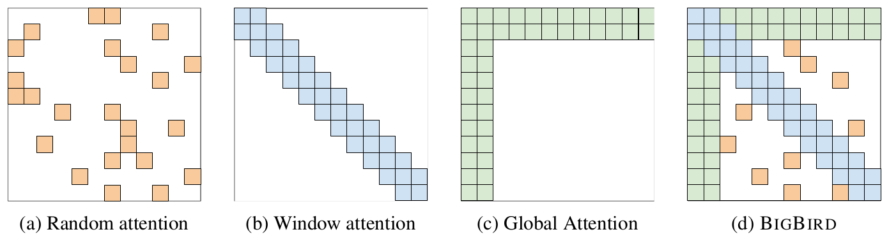

*图 1（原文 Figure 1，第 3 页）：BigBird 使用的 attention 机制的构件。白色表示没有 attention。*

**图中文字翻译与读法**：

- **(a) Random attention（随机 attention）**：$r=2$，即每一行（每个 query）有 2 个随机位置被计算（橙色格）。
- **(b) Window attention（滑窗 attention）**：$w=3$，即每个 query 看自己和左右各 1 个邻居，形成对角线附近一条宽度为 3 的带（蓝色格）。
- **(c) Global attention（全局 attention）**：$g=2$，即前 2 行和前 2 列整行整列都是满的（绿色格）：这 2 个全局 token 看所有位置，所有位置也看它们。
- **(d) BigBird**：三者的并集（蓝色滑窗带、绿色全局行/列、橙色随机格叠在同一矩阵里）。

图是 $12\times12$ 的示意，行是 query、列是 key（这是按 attention 惯例的读法，图本身没有标坐标轴）。

**读图结论**：三种构件各自稀疏，叠加后，除 $g$ 个全局行以外，每行的非零个数是常数（$r+w+g$ 量级），不随 $n$ 变化；全局行各有 $n$ 个非零，所以总的非零格数是 $O(n(r+w+g))$，随 $n$ 线性增长。

### 3.6 每个 query 看多少个 key（笔者算例）

附录 E 的 BigBird-ITC 基础配置（表 8）是块长 $b=64$、全局 $g=2\times b$、窗口 $w=3\times b$、随机 $r=3\times b$，所以每个 query 看 $(2+3+3)\times64=512$ 个 key，序列长度 4,096 时只有完全 attention 的 $512/4096=1/8$。这正好与 BERT 在 512 长度时每个 token 看到的 key 数相同，也对应摘要里“同样硬件上可处理约 8 倍长的序列”。

## 四、理论结果：定理陈述与直觉

本节论证稀疏 attention 机制在两个方面与完全 attention 一样强大、有表达力：作为独立编码器（如 BERT）时是序列到序列函数的**通用逼近器**；稀疏的编码器-解码器 Transformer 是**图灵完备**的。同时也给出代价：稀疏 attention 不是免费午餐，存在一个任务需要多项式倍的层数。证明很长（附录 A、B、C），这里只讲陈述、直觉和证明骨架。

### 4.1 记号

完整的 Transformer 编码器栈就是单层编码器（参数独立）的重复应用。论文把用广义编码器（由图 $D$ 定义 attention）构成的这类编码器栈记作 $\mathcal{T}_D^{H,m,q}$：$H$ 个头，头大小为 $m$，输出网络的隐层大小为 $q$。附录 A.1 中，单层编码器是 $z_i=O(a_i)+a_i$，其中 $a_i=\mathrm{ATTN}(X)_i+x_i$，$O$ 是带 ReLU 的两层全连接网络。

与 Vaswani et al.、Yun et al. 的主要区别是：在每条序列开头加一个特殊 token $x_0$（给它一个特殊向量），因此图 $D$ 的顶点集是 $\{0\}\cup[n]=\{0,1,\dots,n\}$，这个额外节点在最终输出层被丢掉；并允许 Transformer 在输入层给 $X$ 加位置嵌入 $E$。

为了定义通用逼近，记 $\mathcal{F}_{CD}$ 为所有连续函数 $f:[0,1]^{n\times d}\to\mathbb{R}^{n\times d}$ 的集合（对 $\ell_p$ 范数诱导的拓扑连续），距离为

$$
d_p(f_1,f_2)=\left(\int\lVert f_1(X)-f_2(X)\rVert_p^p\,dX\right)^{1/p}.
$$

### 4.2 通用逼近（Theorem 1）：星形图是关键

**定义 1（星形图）**：以 0 为中心的星形图 $S$ 定义在 $\{0,\dots,n\}$ 上：对 $i\in\{1,\dots,n\}$，$N(i)=\{0,i\}$；而 $N(0)=\{1,\dots,n\}$。也就是每个普通节点只看自己和中心 0，中心 0 看所有节点。

**Theorem 1**：给定 $1<p<\infty$ 和 $\epsilon>0$，对任意 $f\in\mathcal{F}_{CD}$，存在带稀疏 attention 的 Transformer $g\in\mathcal{T}_D^{H,m,q}$，使 $d_p(f,g)\le\epsilon$，其中 $D$ 是**任意包含星形图 $S$ 的图**。

直觉：只要图里有一个“全局节点”与所有位置相连，哪怕其余位置之间几乎没有边，稀疏 attention 的 Transformer 仍能任意精度逼近任何连续的序列到序列函数。BigBird 的图包含全局 token，所以包含星形图。注意这个结论依赖的是**全局 token**，并不要求随机边或滑窗。

**证明骨架**（遵循 Yun et al. [104] 的结构，三步）：

1. **用分段常数函数逼近连续函数**：把定义域 $[0,1)^{n\times d}$ 划成粒度为 $\delta$ 的网格，在网格上用分段常数函数 $\bar f$ 逼近 $f$，使 $d_p(f,\bar f)\le\epsilon/3$。
2. **用“修改过的 Transformer”逼近分段常数函数**（硬 max 的打分函数 $\sigma_H$ 和分段线性的激活函数）。这是关键一步，要用 self-attention 为输入生成一个**上下文映射**（contextual mapping）：为“整个输入矩阵 $X$ 加上其中的某一列 $x_i$”这个组合分配一个唯一编码，之后前馈层就可以把每个唯一编码映射到该位置唯一的目标输出列。难点是只用稀疏 attention 做出上下文映射：每个 query 只看少数几个 key，不清楚能不能汇集足够的信息为整个矩阵编码。Yun et al. 用的是一个“选择性移位”算子（只把落在某个区间内的项上移），关键在于移位量恰好等于最大项与最小项之差。论文的办法是：（i）构造**稀疏移位算子**（引理 2），对落在某个区间的项做移位，移位量由稀疏 attention 图 $D$ 决定；（ii）使用额外的**全局 token**。引理 3 的构造分 $n$ 个阶段，每个阶段含两种操作：“低移位”只作用于第 $i$ 列，使它的编码包含前 $i$ 列的信息；“高移位”只作用于全局列（0 号 token），把到目前为止的信息累积进全局 token。$n$ 个阶段之后，全局 token 含有整个输入的唯一编码；最后再加一层，让每一列读取全局 token，使所有列的编码互不相同，于是每一列都得到唯一的上下文编码。这样利用多层和辅助全局 token，就补偿了稀疏 attention 丢失的内积。引理 3 说明这个上下文映射可由 $\mathcal{T}_D^{2,1,1}$ 中的稀疏 attention 层组合实现，只要 $D$ 包含星形图。
3. **用原始 Transformer（ReLU 与 softmax）逼近修改过的 Transformer**（引理 5，沿用 Yun et al.）。附录 A 最终给出的结论（Theorem 2）是：对 $1\le p\le\infty$ 和 $\epsilon>0$，存在 $g\in\mathcal{T}_D^{2,1,4}$（2 个头，头大小 1，隐层大小 4）使 $d_p(f,g)\le\epsilon$。主文写 $1<p<\infty$，附录写 $1\le p\le\infty$，两处区间不同，原文没有解释。

**边界**：这是“存在性”结论。引理 4 把上下文编码映射到目标输出需要 $O(n\delta^{-nd})$ 层前馈网络，层数随 $n$、$d$ 指数增长，所以定理说明表达力不缺失，对有限深度模型是否容易训练、需要多少层、泛化如何，它什么也没说。论文还提到同期工作 Yun et al. [105] 也独立探索了带线性连接的稀疏 Transformer 对紧致域上序列到序列函数的逼近能力。

### 4.3 图灵完备（Theorem 3）

Pérez et al. [72] 证明基于完全 attention 的 Transformer（编码器加解码器）是图灵完备的，但这个结果做了一个不现实的假设：模型在**任意精度**下工作。这是必要的，否则 Transformer 就只是有界的有限状态机，不可能图灵完备。BigBird 论文问的是：能否用稀疏 attention 的编码器和解码器模拟任何图灵机？答案是可以（同样假设与 [72] 相同的条件）。

**Theorem 3**：存在一种只使用 $O(n)$ 个内积的稀疏 attention 机制，使得用它的 Transformer 网络类是图灵完备的。

直觉：BERT 的编码器把 attention 整体用一次；而完整 Transformer 的解码器是逐 token 使用稀疏 attention 的，且每个 token 只能关注它之前的 token。Pérez et al. 的构造让每个 token 表示一段“纸带历史”，并用完全 attention 一步找到纸带上某个位置最后写入的符号（他们的引理 B.4，即“指回历史”的寻址方案）。除这一步外，Pérez 的大部分构造可以直接用于稀疏 attention。BigBird 的做法是利用 max（以及 min）的**结合律**，把“从历史中挑出符号”拆成多个步骤，逐步聚合最大值。

这带来一个后果：稀疏 Transformer 的**一个解码步不再对应图灵机的一步**。附录 B.2 区分两类步：

- **计算步**：对应图灵机状态的更新；
- **中间步**：对应沿着稀疏图聚合最大值（再用它选符号）。在中间步里图灵机的状态保持不变，为此引入一个额外的“切换层”（附录 B.2.3）。

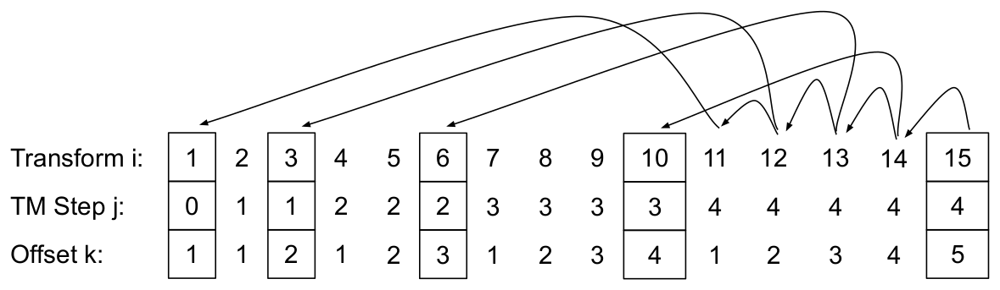

*图 2（原文 Figure 2，第 23 页）：稀疏解码器的 Transformer 步（Transform $i$）与原图灵机步（TM Step $j$）的对应关系。*

**图中文字翻译与读法**：

- 三行分别是 Transform $i$（Transformer 的解码步编号，1 到 15）、TM Step $j$（该步对应模拟的图灵机步编号）、Offset $k$（该步在这个图灵机步内部的偏移）。方框标出的 $i=1,3,6,10,15$ 是每个图灵机步的最后一个解码步，即“计算步”，其余是“中间步”。
- 曲线箭头是稀疏图 $D$ 的边：每个中间步（$i=11,12,13,14$）都连向一个更早的计算步（$i=1,3,6,10$）以及它紧邻的前一个节点；计算步 $i=15$ 连回 $i=14$。这对应附录 B.2 对稀疏解码器图的定义：中间节点 $i=j(j+1)/2+k$ 关注计算节点 $k(k+1)/2$ 以及已经算出的“目前最佳”（从 $i-1$ 复制而来）。论文说这个图是 BigBird 的特例：第一类边相当于随机边，第二类边相当于局部边，并且满足解码器“不看未来”的约束。
- **读图结论**：图灵机的第 $j$ 步被展开成 $j+1$ 个解码步（图中 $j=1$ 占 $i=2,3$，$j=2$ 占 $i=4,5,6$，依此类推），每个节点只需 attend 少数几个位置，所以总内积数是 $O(n)$。按附录的位置编码 $g(i)=\lfloor(-1+\sqrt{1+8i})/2\rfloor$，第 $i$ 个解码步对应图灵机第 $g(i)$ 步，所以模拟 $T$ 步图灵机大约需要 $T^2/2$ 个解码步（笔者由公式推出，论文只说约 $O(\sqrt i)$ 个中间步）。

证明的其余部分是一层一层地“搭电路”（附录 B.2）：第 1 层用编码器-解码器的 cross-attention 读输入串并用前馈网络模拟转移函数；第 2 层用前馈网络求下一个磁头位置；第 3 层（新增）区分是计算节点还是中间节点，对中间节点沿用上一步的状态；第 4 层用稀疏 attention 分步求出“磁头下一位置上最后写入的符号”；最后用一个前馈网络整理输出，得到下一步输入。这里需要的向量维度是 $d=2|Q|+4|\Sigma|+16$，比 Pérez et al. 多用 5 维（$|Q|$ 为状态数，$|\Sigma|$ 为符号数）。

### 4.4 代价：稀疏 attention 不是免费午餐（Proposition 1）

论文给出一个完全 attention 用常数层即可解决的自然任务，而任何边数为 $\tilde O(n)$ 的稀疏 attention（不只是 BigBird）都需要很多层。

**Task 1（最远向量）**：给定 $n$ 个单位向量 $u_1,\dots,u_n$，对每个 $j$ 求 $j^*=\operatorname*{arg\,max}_k\lVert u_k-u_j\rVert_2^2$，输出 $(u_{1^*},\dots,u_{n^*})$。

对单位向量，$\lVert u_k-u_j\rVert_2^2=2-2\langle u_k,u_j\rangle$，所以找最远向量等价于找**内积最小**的向量（最小内积搜索）。完全 attention 只需把所有两两内积算一遍；稀疏 attention 每层只算 $\tilde O(n)$ 个内积，要靠很多层才能覆盖所有可能的配对。

**Proposition 1**：存在单层完全 self-attention $g\in\mathcal{T}^{H=1,m=2d,q=0}$ 能计算 Task 1，即 $g(u_1,\dots,u_n)=[u_{1^*},\dots,u_{n^*}]$；但对任何边数（内积数）为 $\tilde O(n)$ 的稀疏 attention 图 $D$，要计算 Task 1 需要 $\tilde\Omega(n^{1-o(1)})$ 层。

下界依赖**正交向量猜想**（Orthogonal Vectors Conjecture，OVC，细粒度复杂度里常用的假设）：非正式地说，不可能在子二次时间内判断 $n$ 个布尔向量中是否存在一对正交向量。附录 C 的证明分两部分：

1. 完全 attention 的单层构造：令 $x_i=[u_i;0]$，取 $Q([a;b])=-a$、$K([a;b])=a$、$V([a;b])=[0;a]$，用 hardmax 的打分函数，则 attention 输出就是使 $\langle-u_i,u_j\rangle$ 最大（即内积最小）的那个 $u_j$，加上残差得到 $[u_i;u_{i^*}]$，前馈网络取 0 即可。有了它，只需再做 $O(n)$ 次内积 $\langle u_i,u_{i^*}\rangle$ 就能判断是否存在正交对。
2. 反证：若某个 $l$ 层的稀疏网络能解 Task 1，每层的计算量是 $\tilde O(nd^3)$，总计 $\tilde O(nld^3)$；取维度 $d=\Theta(\log^2 n)$，若 $l=O(n^{1-\epsilon})$ 就会在 $\tilde O(n^{2-\epsilon})$ 时间内解决正交向量问题，与 OVC 矛盾。所以至少需要 $\tilde\Omega(n^{1-o(1)})$ 层。

### 4.5 理论对实践的意义与边界

- 论文摘要说，理论分析揭示了拥有 $O(1)$ 个全局 token（如 CLS）的好处：全局 token 是通用逼近证明里的关键部件，也正是表 1 的实验里缺的那一块。
- 理论不保证可训练性，也不保证在有限深度、有限精度下能达到完全 attention 的精度；图灵完备要求任意精度，并且要用约二次方个解码步。
- 下界表明，BigBird 一类稀疏模型并不能在所有任务上替代完全 attention，需要“全局搜索”式计算（如最远向量）的任务对稀疏 attention 是困难的。

## 五、实现：块稀疏与 GPU/TPU 友好的计算（附录 D）

### 5.1 为什么要“分块”

GPU 和 TPU 擅长合并（coalesced）的内存访问，一次读一整块连续字节；而滑窗和随机元素查询带来的小而零散的访存很低效。论文指出，众所周知，这种稀疏矩阵乘法无法在 GPU 上高效实现（GPU 有成千上万个核同时并行）。所以不能直接按第 3 节的定义去乘稀疏矩阵，而是先把 attention 模式**分块（blockify）**：把 query 和 key 各自按块大小 $b$ 打包，再在块的层面定义三种构件。

示例（论文图 3）：有 12 个 query 和 12 个 key，块大小 $b=2$，则 query 矩阵分成 $12/2=6$ 个块，key 矩阵同样分成 6 个块。三种成分在块矩阵上定义为：

1. **随机 attention**：每个 query 块 attend $r$ 个随机的 key 块。图 3(a) 中 $r=1$、块大小 2：每个大小为 2 的 query 块随机 attend 一个大小为 2 的 key 块。
2. **滑窗 attention**：构造时保证 query 块数与 key 块数相同，这样便于定义块的滑窗：下标为 $j$ 的 query 块 attend 下标从 $j-(w-1)/2$ 到 $j+(w-1)/2$ 的 key 块（包括 $j$）。图 3(b) 中 $w=3$：每个 query 块 $j$ 关注 key 块 $j-1,j,j+1$。
3. **全局 attention**：定义同第 3 节，但按块计算。图 3(c) 中 $g=1$：对 BigBird-ITC，一个 query 块和一个 key 块 attend 所有位置。

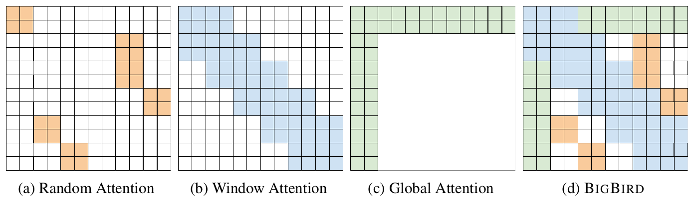

*图 3（原文 Figure 3，第 30 页）：块 attention 的构件，块大小为 2，attention 矩阵被分成 $2\times2$ 的块，此前所有 BigBird 参数都以“块”为单位。白色表示没有 attention。*

**图中文字翻译与读法**：

- **(a) Random Attention**：$r=1$，每个 query 块恰有一个随机的 key 块（橙色）。
- **(b) Window Attention**：$w=3$，每个 query 块关注相邻的 3 个 key 块（蓝色；两端的块因超出边界只有 2 个）。
- **(c) Global Attention**：$g=1$，第一个块行和块列（绿色）。
- **(d) BigBird**：三者叠加的 $12\times12$ 矩阵（共 $6\times6$ 个块）。

### 5.2 分块之后怎样高效计算

直接对任意（query，key）对取内积需要 gather（按索引收集）操作，很低效。仔细观察窗口和全局 attention，可以不用 gather 来算它们的分数。完全稠密的 attention 分数是 query 矩阵和 key 矩阵的矩阵乘积，代价 $O(n^2d)$（图 4(a)）。

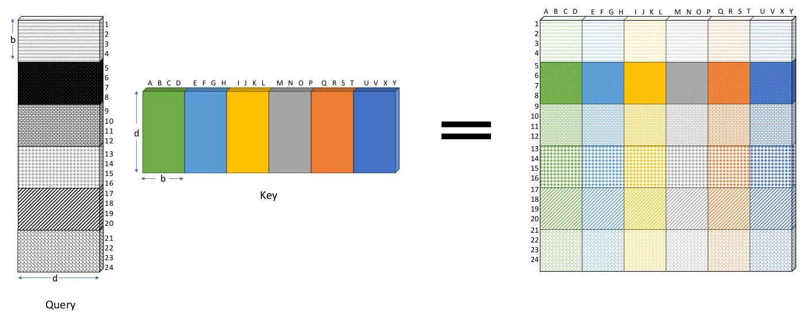

*图 4(a)（原文 Figure 4，第 31 页）：完全的所有配对 attention 可由 query 矩阵与 key 矩阵直接相乘得到；图中按块着色只是为了说明分组。*

**图中文字翻译与读法**：左边 Query 是 24 行（编号 1 到 24）、宽 $d$ 的矩阵，每 4 行一个块（块大小 $b=4$，用不同纹理表示）；中间 Key 的 24 列用字母 A 到 Y 标记，每 4 个一组共 6 个块，每块宽 $b$、高 $d$；右边是它们的乘积，即 $24\times24$ 的完全 attention 矩阵，按 $6\times6$ 个块着色，其中第 5 到 8 行（第二个 query 块）用实色强调。

若把 query 和 key 矩阵分块再相乘，则只需 $O(nbd)$ 的代价就得到注意力分数的**块对角**部分（图 4(b)）。具体地，设 $Q,K\in\mathbb{R}^{n\times d}$，把它们沿序列方向重塑成 $\lceil n/b\rceil\times b\times d$ 的张量 $Q'$ 和 $K'$，然后按块做批量乘法：

$$
A_{jst}=\sum_{u}Q'_{jsu}K'_{jtu},\qquad j=0,1,\dots,\lceil n/b\rceil
$$

（原文式 (13)，$j$ 遍历各个块）得到的 $\lceil n/b\rceil\times b\times b$ 张量 $A$ 可以重塑成完全 attention 模式中的块对角部分。

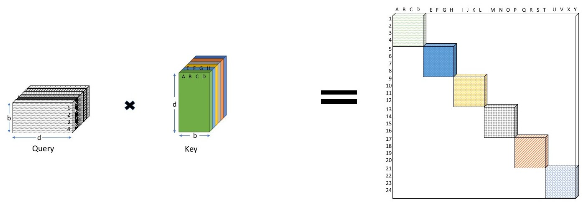

*图 4(b)（原文 Figure 4，第 31 页）：块对角 attention 可以通过把 query 与 key 矩阵“分块”后得到。*

**图中文字翻译与读法**：左边 Query 被堆成 6 个 $b\times d$ 的块（沿深度方向排列），中间 Key 同样堆成 6 个块；两者按块（逐层）相乘，右边得到的 $24\times24$ 矩阵只在对角线上的 6 个 $4\times4$ 块非零（彩色），其余为空白。

要把块对角扩展成窗口（下标为 $j$ 的 query 块关注 key 块 $j-(w-1)/2$ 到 $j+(w-1)/2$），做法是：把重塑后的 key 张量 $K'$ 复制 $w$ 份，第 $j$ 份沿块的维度（长度 $\lceil n/b\rceil$ 的第一个轴）**滚动**（roll）$j$ 个块（正滚动表示循环左移，负滚动表示循环右移），如图 5；再把这 $w$ 个滚动后的 key 块张量与 query 块张量相乘，就得到窗口 attention 的分数（图 4(c)）。

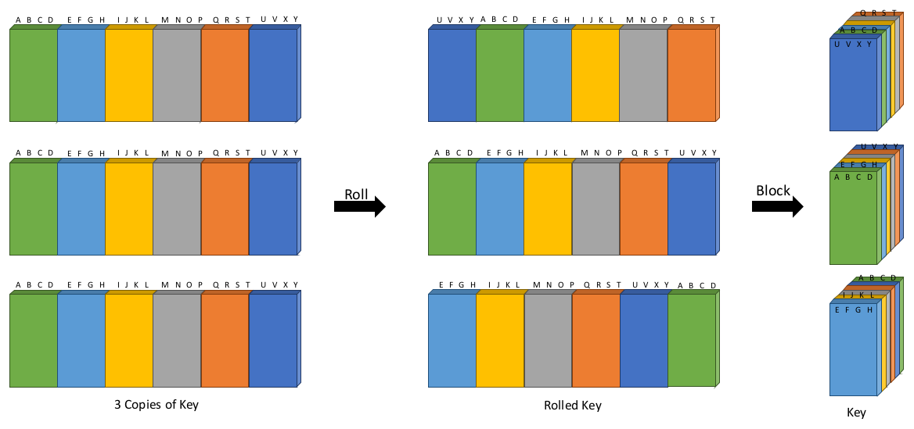

*图 5（原文 Figure 5，第 32 页）：构造滚动后的 key 块张量。把 key 矩阵复制 $w$ 份，按 $-(w-1)/2\le j\le(w-1)/2$ 给各份编号，第 $j$ 份滚动 $j$ 个块；最后沿新轴把各块分组，得到 key 块张量。图中取 $w=3$。*

**图中文字翻译与读法**：左列 3 Copies of Key（key 的 3 份拷贝）：每份都是 A 到 Y 共 6 个块；中列 Rolled Key（滚动后的 key）：第一份右移一格（块顺序变成 U–Y、A–D、E–H、…），第二份不动，第三份左移一格（E–H、I–L、…、U–Y、A–D）；右列 Key：把三份在“块”这个新轴上叠成三维张量（箭头 Roll 表示滚动，Block 表示分组堆叠）。

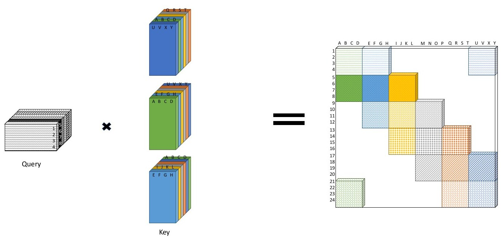

*图 4(c)（原文 Figure 4，第 31 页）：窗口局部 attention：把 query、key 矩阵分块，复制 key 矩阵并滚动得到的 key 张量，相乘后得到窗口分数；这保证每个 query 在每一侧至少看到一个、至多看到两个大小为 $b$ 的 key 块（原文题注）。滚动细节见图 5。*

**图中文字翻译与读法**：中间有三份滚动后的 key 张量（上：蓝色 U–Y 块在最前；中：绿色 A–D 在最前；下：浅蓝 E–H 在最前），与左边的 query 块张量相乘，右边得到块三对角带；因为是循环滚动，矩阵的右上角和左下角会出现环绕（wrap-around）的块（淡色）。

全局成分则总可以把 key 张量的前 $g$ 个块直接并入。随机成分很小（原文说所有实验中 $r=3$，但表 8、12、13 里 BigBird-ETC 的 $r=0$，所以这句话只适用于含随机 attention 的 ITC 配置），只好用 gather 操作（图 4(d)）；并且按设计，每个 query 块恰好 attend $r$ 个随机块。

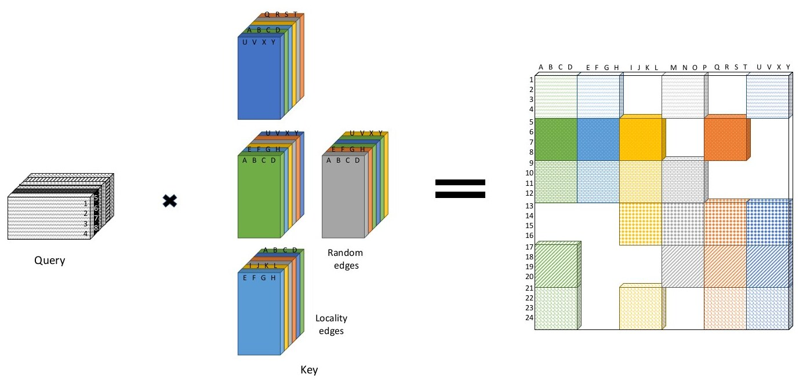

*图 4(d)（原文 Figure 4，第 31 页）：窗口加随机 attention：沿用上述过程，并额外 gather 一些随机的 key 块。*

**图中文字翻译与读法**：与 (c) 相同的三份滚动 key（图中标注 Locality edges，局部边）之外，又多了一份灰色的随机 key 块（标注 Random edges，随机边），乘出的矩阵里除了对角带，还出现了散落的随机块（例如第 17 到 20 行、A–D 列的块）。

三个成分合起来就是一个紧凑的稠密张量 $K''$，大小为 $\lceil n/b\rceil\times(g+w+r)b\times d$（图 6，这里 $g,w,r$ 是以块为单位的个数）。于是最终的注意力分数只是一次稠密张量乘法，这正是 TPU/GPU 擅长的：用 $Q'$（$\lceil n/b\rceil\times b\times d$）乘 $K''$，代价 $O(n(g+w+r)bd)$，得到大小为 $\lceil n/b\rceil\times b\times(g+w+r)b$ 的分数张量，再重塑成符合 BigBird 模式的全部分数。

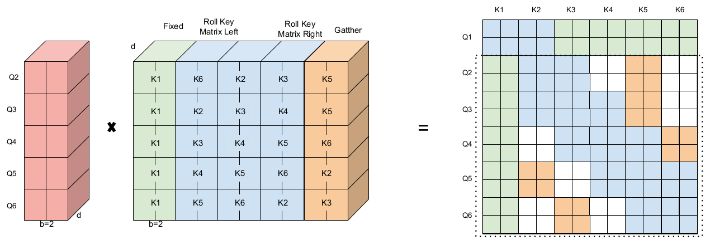

*图 6（原文 Figure 6，第 32 页）：BigBird attention 的计算总览。结构化的块稀疏使稀疏 attention 的运算可以被紧凑地打包，从而在 GPU/TPU 上高效。*

**图中文字翻译与读法**：

- **左边**：变换后的稠密 query 张量（红色）：只需把 query 分块并重塑，$Q_2,\dots,Q_6$ 是第 2 到 6 个 query 块，块大小 $b=2$。
- **中间**：最终的 key 张量，由三种变换拼接而成：第一列绿色（Fixed，固定）对应全局 attention（始终是 $K_1$）；中间的蓝色列（Roll Key Matrix Left / Roll Key Matrix Right，向左/向右滚动的 key 矩阵）对应窗口局部 attention，由图 5 的滚动得到；最后一列橙色（图中写作 Gatther，即 Gather）对应随机 attention，需要用计算上低效的 gather 操作。例如 $Q_3$ 这一行依次是 $K_1$（全局）、$K_2,K_3,K_4$（窗口）、$K_5$（随机）。
- **右边**：稠密乘法高效地算出了稀疏 attention 模式（第一个行块 $Q_1$ 除外，它直接做乘法；笔者的理解是因为全局 token 的 query 要看所有 key）；结果矩阵与图 3(d) 相同。滚动带来的环绕位置在这个矩阵里是空白，即被屏蔽（例如 $Q_2$ 行的 $K_6$、$Q_6$ 行的 $K_2$）。

读完这一节可以看到：BigBird 的 $O(n)$ 之所以能在加速器上兑现，是因为它把“稀疏”做成了“规整的块 + 一次稠密批量乘法 + 极少量 gather”，而不是靠任意稀疏矩阵乘法。

## 六、NLP 实验

论文要展示长输入对 NLP 任务的好处，选了三类代表任务：MLM（检验更长的连续序列能否学到更好的上下文表示）；带证据的问答（更长的序列使得可以用 TF-IDF/BM25 这类粗糙系统检索更多证据）；长文档分类与摘要（判别信息可能不在前 512 个 token 内）。以下主要用序列长度 4,096 的 BigBird。

### 6.1 预训练与 MLM（附录 E.1）

按 BERT/RoBERTa 的做法训练 base 和 large 两个版本，用 MLM 目标预训练；用四个公开数据集（表 9），从公开的 RoBERTa 检查点热启动。词表沿用 RoBERTa 的 sentencepiece 词表（来自 GPT-2）。长于 4,096 的文档被拆成多个文档，过短的文档被拼接；与 BERT 一样遮住 15% 的 token。训练两个 base 模型：BigBird-ITC-base 与 BigBird-ETC-base，超参数见表 8，学习率前 10,000 步线性 warmup，之后线性衰减。large 版本是 24 层、16 个头、隐层 1024，参照 RoBERTa 的观察把 batch size 取 2048；BigBird-ITC 的块长与 base 相同，BigBird-ETC 的块长几乎翻倍为 169，其余参数相同。论文说模型在每块芯片 16GB 显存、batch size 32 到 64 下训练，显存效率来自高效的分块和稀疏结构。

**表 8：两个 BigBird base 模型的 MLM 超参数**

| 参数 | BigBird-ITC | BigBird-ETC |
|---|---|---|
| 块长度 $b$ | 64 | 84 |
| 全局 token 数 $g$ | $2\times b$ | 256 |
| 窗口长度 $w$ | $3\times b$ | $3\times b$ |
| 随机 token 数 $r$ | $3\times b$ | 0 |
| 最大序列长度 | 4096 | 4096 |
| 头数 | 12 | 12 |
| 层数 | 12 | 12 |
| 隐层大小 | 768 | 768 |
| Batch size | 256 | 256 |
| 损失 | MLM | MLM |
| 激活函数 | gelu | gelu |
| Dropout 概率 | 0.1 | 0.1 |
| Attention dropout 概率 | 0.1 | 0.1 |
| 优化器 | Adam | Adam |
| 学习率 | $10^{-4}$ | $10^{-4}$ |
| 计算资源 | 8 × 8 TPUv3 | 8 × 8 TPUv3 |

（原文表 8，第 33 页。）读法：ETC 版本没有随机 token（$r=0$），全局 token 是额外加入的 256 个；块长 84 使窗口 $w=3\times84=252$，与 ITC 的 $(g+w+r)=512$ 大致相当（笔者算：ETC 为 $252+256=508$）。

**表 9：预训练数据**

| 数据集 | Token 数 | 平均文档长度 |
|---|---:|---:|
| Books [110] | 1.0B | 37K |
| CC-News [34] | 7.4B | 561 |
| Stories [89] | 7.7B | 8.2K |
| Wikipedia | 3.1B | 592 |

（原文表 9，第 33 页。）四项相加约 19.2B 个 token（笔者相加）。

**表 10：留出集上的 MLM 性能**（BPC，越小越好）

| 模型 | base | large |
|---|---:|---:|
| RoBERTa (sqln: 512) | 1.846 | 1.496 |
| Longformer (sqln: 4096) | 1.705 | 1.358 |
| BigBird-ITC (sqln: 4096) | 1.678 | 1.456 |
| BigBird-ETC (sqln: 4096) | 1.611 | 1.274 |

（原文表 10，第 33 页。）读法：BigBird 和 Longformer 都优于受长度限制的 RoBERTa，BigBird-ETC 最好（base 1.611、large 1.274）。需要注意：BigBird-ITC 在 large 上（1.456）反而比 Longformer（1.358）差；并且表中 RoBERTa 与 Longformer 两行的数字与 Longformer 论文表 5 完全相同（1.846/1.496、1.705/1.358，见 [Longformer 解读](../longformer/论文中文解读.md)），而两篇论文的预训练语料不同，BigBird 论文没有说明这些数字是重新评测还是转引，因此这张表只能作为大致比较。

### 6.2 问答（附录 E.2）

选了四个有挑战性的数据集：

1. **Natural Questions**：给定问题，从证据中找短答案片段（SA），并标出含正确答案信息的段落（LA）。
2. **HotpotQA-distractor**：同样要求找出答案（Ans），并找出跨多个文档的支持事实（Sup），用于多跳推理。
3. **TriviaQA-wiki**：用提供的 Wikipedia 证据回答问题，但证据中不一定有答案；在较小的“已验证”子集上保证证据包含答案；论文仍把它建模成片段选择问题。
4. **WikiHop**：多项选择，聚合分散在多个文档里的信息选出正确选项。

**表 11：问答数据集**（长度单位原文未标，按 token 理解）

| 数据集 | 训练实例数 | 开发集实例数 | 实例长度中位数 | 实例长度最大值 |
|---|---:|---:|---:|---:|
| HotpotQA-distractor [100] | 90447 | 7405 | 1227 | 3560 |
| Natural Questions [52] | 307373 | 7830 | 3258 | 77962 |
| TriviaQA [41] | 61888 | 7993 | 4900 | 32755 |
| WikiHop [95] | 43738 | 5129 | 1541 | 20337 |

（原文表 11，第 34 页。）读法：除 HotpotQA 外，中位数都远超 512，Natural Questions 的最大长度近 78K。

**各数据集上的任务设置**（附录 E.2）：这些任务竞争激烈，已有针对每个数据集设计的高度工程化的系统。为公平比较，BigBird 的训练用了额外的正则化：一种对比预测编码（CPC）[70] 的变体作为双编码器模型；ITC 用绝对位置嵌入，ETC 用相对位置编码 [79]。各任务的全局 token 与预测头如下。

| 数据集 | BigBird-ITC 的全局 token | BigBird-ETC 的全局 token（最多个数） |
|---|---|---|
| HotpotQA | 前 128 个 token | 每个问题 token、每个证据段落、段落内每个句子各一个（最多 256） |
| Natural Questions | 前 128 个 token | CLS、问题、每个段落各一个（最多 230） |
| TriviaQA | 前 128 个 token | CLS、问题、每个句子各一个（最多 320） |
| WikiHop | 前 128 个 token（序列开头是问题和候选答案） | 问题的全局 token，加每个候选答案一个（最多 430） |

- **HotpotQA**：数据是问题加多个证据段落。过滤掉了 16 个答案不在给定证据里的问答。用证据段落全局 token 的输出接一个稠密层，加阈值预测它是否是支持事实；答案类型（是/否/片段）由全局 CLS token 接一个稠密层预测；片段答案在整条序列上用稠密层预测，起止位置距离不超过 30 个词，按起点与终点 logit 之和排序。
- **Natural Questions**：数据是问题加一篇可能很长的文档（而不是多个段落）。基本沿用 Alberti et al. [5] 的设置。超过 4,096 的文档用滑动窗口，步长 2,048。输入是 CLS、问题、分隔符、文档。在最后一层训练四个预测器分别预测长答案起点、终点和短答案起点、终点；先预测起点，再预测起点之后最好的终点；短答案起止距离限制在 38 个词以内。答案类型（null、yes、no、short、long）由 CLS 输出向量预测；当 yes/no 的 logit 高于 short、long、null 时，把短答案替换成对应的 yes/no 文本。
- **TriviaQA**：问答对加 Wikipedia 文章作为“有噪声”的证据（文章不一定含答案；答案实体也没有标注到具体片段，而是列出所有模糊字符串匹配的出现位置）。输入是 CLS、问题、分隔符、文档；训练遵循 Clark and Gardner [18]；在序列上用稠密层独立地为每篇文章预测答案片段，起止距离不超过 16 个词，每篇文章取起点与终点 logit 之和最大的片段，再在与该问题相关的所有文档上归一化。
- **WikiHop**：每题最多 79 个候选、63 个支持段落。BigBird-ITC 沿用 Beltagy et al. [8] 的做法，用特殊标记 `[q] Question [/q] [ans] Ans1 [/ans] ... [ans] AnsN [/ans]` 把问题和候选答案拼起来，再接上下文；因为序列开头总是问题和答案，所以令前 128 个 token 全局。BigBird-ETC 不需要插入 `[ans]`、`[/ans]` 等标记，因为可以合理地设计全局 token：问题的全局 token，加每个候选答案一个（最多 430 个），并用相对位置标签把答案 token 与它的提及（mention）连起来。最后用一个稠密层读候选答案的输出向量，为每个候选独立打分，取分数最高的作为答案。论文说：ETC 中显式设计的 attention 连接效果稍好，但基于随机连接的 ITC 也相当有竞争力。

**表 12：用于问答的 base 版 BigBird 超参数**（即表 2 的数字所用；所有列的头数 12、层数 12、隐层 768、最大序列长度 4096 相同）

| 参数 | HotpotQA ITC | HotpotQA ETC | NaturalQ ITC | NaturalQ ETC | TriviaQA ITC | TriviaQA ETC | WikiHop ITC | WikiHop ETC |
|---|---:|---:|---:|---:|---:|---:|---:|---:|
| 全局 token 数 $g$ | 128 | 256 | 128 | 230 | 128 | 320 | 128 | 430 |
| 窗口长度 $w$ | 192 | 252 | 192 | 252 | 192 | 252 | 192 | 252 |
| 随机 token 数 $r$ | 192 | 0 | 192 | 0 | 192 | 0 | 192 | 0 |
| Batch size | 32 | 32 | 128 | 128 | 32 | 32 | 64 | 64 |

损失：HotpotQA 与 NaturalQ 为 cross-entropy（golden spans，金标准片段），TriviaQA 为 cross-entropy（noisy spans，按 [18] 处理有噪声的片段），WikiHop 为 cross-entropy（ans choices，答案选项）。计算资源：HotpotQA 4 × 2 TPUv3，NaturalQ 4 × 8 TPUv3，TriviaQA 4 × 2 TPUv3，WikiHop 4 × 4 TPUv3。（原文表 12，第 34 页。）

**表 13：提交测试集成绩（表 3）所用的 large 版 BigBird 超参数**（全部是 ETC，$r=0$；最大序列长度 4096，损失均为 cross-entropy）

| 参数 | HotpotQA | NaturalQ | TriviaQA | WikiHop |
|---|---:|---:|---:|---:|
| 全局 token 数 $g$ | 256 | 230 | 320 | 430 |
| 窗口长度 $w$ | 507 | 507 | 507 | 507 |
| 随机 token 数 $r$ | 0 | 0 | 0 | 0 |
| 头数 | 16 | 16 | 16 | 16 |
| 层数 | 24 | 24 | 24 | 24 |
| 隐层大小 | 1024 | 1024 | 1024 | 1024 |
| Batch size | 32 | 64 | 32 | 64 |
| 训练轮数（Num epochs） | {5, 9} | {3, 5} | {3, 5} | {5, 10} |
| 优化器 | Adam | Adam | Adam | LAMB |
| 学习率 | $3\times10^{-5}$ | $\{5,10\}\times10^{-5}$ | $\{3,5\}\times10^{-5}$ | $\{2,5\}\times10^{-5}$ |
| 计算资源 | 4 × 4 TPUv3 | 4 × 8 TPUv3 | 4 × 4 TPUv3 | 4 × 8 TPUv3 |

（原文表 13，第 35 页；花括号表示在这些取值中搜索。）读法：窗口 507 正好是块长 169 的 3 倍（$3\times169=507$，见 6.1 节 large 版 ETC 的块长），所有 large 模型都不含随机 attention。

**开发集结果（base 模型）**：在 base 尺寸上，对每个数据集在开发集上选最佳配置（表 2）。

**表 2：用 base 尺寸模型的 QA 开发集结果**（WikiHop 报告准确率，HotpotQA、Natural Questions、TriviaQA 报告 F1；越大越好；“-”表示该模型没有这项结果）

| 模型 | HotpotQA Ans | HotpotQA Sup | HotpotQA Joint | NaturalQ LA | NaturalQ SA | TriviaQA Full | WikiHop MCQ |
|---|---:|---:|---:|---:|---:|---:|---:|
| RoBERTa | 73.5 | 83.4 | 63.5 | - | - | 74.3 | 72.4 |
| Longformer | 74.3 | 84.4 | 64.4 | - | - | 75.2 | 75.0 |
| BigBird-ITC | **75.7** | 86.8 | 67.7 | 70.8 | 53.3 | **79.5** | **75.9** |
| BigBird-ETC | 75.5 | **87.1** | **67.8** | **73.9** | **54.9** | 78.7 | **75.9** |

（原文表 2，第 7 页。LA、SA 分别是 Natural Questions 的长答案、短答案；MCQ 是 WikiHop 的多项选择。）读法：在有对比数据的列上，BigBird 的两个版本都高于 RoBERTa 和 Longformer（与 Longformer 相比：HotpotQA joint 高约 3.3–3.4、TriviaQA 高 3.5–4.3、WikiHop 高 0.9，笔者相减）。论文正文说“带扩展全局 token 的 BigBird-ETC 一致地优于其他所有模型”，但表中 ITC 在 HotpotQA 的 Ans（75.7 对 75.5）和 TriviaQA（79.5 对 78.7）上更高、WikiHop 打平，所以“一致”略有夸大。论文据此选择 ETC 配置训练 large 模型去测试集评测。

**测试集结果（large 模型）**：论文把 BigBird-ETC 与各榜单（不含 BigBird 的）前三名比较。

**表 3：问答任务测试集上的微调结果**（HotpotQA、Natural Questions、TriviaQA 报告 F1，WikiHop 报告准确率；取自各榜单；“-”表示没有）

| 模型 | HotpotQA Ans | HotpotQA Sup | HotpotQA Joint | NaturalQ LA | NaturalQ SA | TriviaQA Full | TriviaQA Verified | WikiHop MCQ |
|---|---:|---:|---:|---:|---:|---:|---:|---:|
| HGN [26] | **82.2** | 88.5 | **74.2** | - | - | - | - | - |
| GSAN | 81.6 | 88.7 | 73.9 | - | - | - | - | - |
| ReflectionNet [32] | - | - | - | 77.1 | **64.1** | - | - | - |
| RikiNet-v2 [61] | - | - | - | 76.1 | 61.3 | - | - | - |
| Fusion-in-Decoder [39] | - | - | - | - | - | 84.4 | 90.3 | - |
| SpanBERT [42] | - | - | - | - | - | 79.1 | 86.6 | - |
| MRC-GCN [87] | - | - | - | - | - | - | - | 78.3 |
| MultiHop [14] | - | - | - | - | - | - | - | 76.5 |
| Longformer [8] | 81.2 | 88.3 | 73.2 | - | - | 77.3 | 85.3 | 81.9 |
| BigBird-ETC | 81.2 | **89.1** | 73.6 | **77.8** | 57.9 | **84.5** | **92.4** | **82.3** |

（原文表 3，第 7 页。）读法：论文宣称 BigBird-ETC 在 Natural Questions 的长答案（LA）、TriviaQA 和 WikiHop 上是新的最好成绩；HotpotQA 上按 F1 排第三、按精确匹配（EM）排第二（表中 joint 73.6，落后于 HGN 74.2 和 GSAN 73.9）。Natural Questions 的短答案（SA 57.9）明显低于 ReflectionNet 的 64.1，论文解释是 BigBird 的提交是单模型，而 Natural Questions 榜单前三名是集成模型，这可能解释了精确答案片段选择上略低的准确率（这是论文的解释，未验证）。论文据此说 Longformer 和 BigBird 都优于上下文更短的模型，可见长上下文很重要；但表中并不处处如此（例如 TriviaQA 上 Longformer 的 77.3 低于 SpanBERT 的 79.1 和 Fusion-in-Decoder 的 84.4），这些对比系统的上下文长度和整体设计各不相同，所以这张表不能把“上下文长度”单独分离出来。另外，表里 Longformer 的 HotpotQA Ans 写作 81.2，而 Longformer 论文自己的表 9 里是 81.3（其余数字一致），应是榜单与论文的细小出入。

### 6.3 文档分类与 GLUE（附录 E.4）

**文档分类**：在长度和内容都不同的数据集上试验：情感分析（IMDb [64]、Yelp-5 [108]）和主题分类（Arxiv [35]、Patents [53]、Hyperpartisan [47]）。沿用 BERT 的做法，在 BigBird 编码器（读入 4,096 个 token）第一个 `[CLS]` token 的输出上接一层带交叉熵损失的分类层。与最好方法（SoTA）以及截断为 512 个 token 的普通 RoBERTa 比较；学习率前 10% 步 warmup，之后线性衰减。论文还计算了“超过 512 个 token 的样本比例”（excess fraction），用来量化截断的影响。

**表 14：文档分类超参数**（编码器共享的设置：块长 $b=64$，全局 token 位置 ITC，$g=2\times b$，$w=3\times b$，$r=3\times b$，最大序列长度 4096，词表 50358，激活 gelu，dropout 0.1，attention dropout 0.1，损失 cross-entropy，优化器 Adam）

| 参数 | IMDb | Arxiv | Patents | Hyperpartisan | Yelp-5 |
|---|---:|---:|---:|---:|---:|
| Batch size | 64 | 64 | 64 | 32 | 32 |
| 学习率 | $1\times10^{-5}$ | $3\times10^{-5}$ | $5\times10^{-5}$ | $5\times10^{-6}$ | $2\times10^{-5}$ |
| 训练轮数 | 40 | 10 | 3 | 15 | 2 |
| TPUv3 slice | 4 × 4 | 4 × 4 | 4 × 4 | 4 × 2 | 4 × 8 |
| 头数 | 12 | 12 | 12 | 12 | 16 |
| 层数 | 12 | 12 | 12 | 12 | 24 |
| 隐层大小 | 768 | 768 | 768 | 768 | 1024 |

（原文表 14，第 36 页。头数、层数、隐层大小在原表中前四列合并为一格，Yelp-5 用 large 尺寸。）

**表 15：分类结果**（所有数据集报告 micro 平均 F1；较小的 IMDb 和 Hyperpartisan 重复 5 次，给出均值和标准差）

| 项目 | IMDb | Yelp-5 | Arxiv | Patents | Hyperpartisan |
|---|---:|---:|---:|---:|---:|
| 样本数 | 25000 | 650000 | 30043 | 1890093 | 645 |
| 类别数 | 2 | 5 | 11 | 663 | 2 |
| 超过 512 token 的比例（Excess fraction） | 0.14 | 0.04 | 1.00 | 0.90 | 0.53 |
| SoTA | [88] 97.4 | [3] 73.28 | [69] 87.96 | [69] 69.01 | [40] 90.6 |
| RoBERTa | 95.0 ± 0.2 | 71.75 | 87.42 | 67.07 | 87.8 ± 0.8 |
| BigBird | 95.2 ± 0.2 | 72.16 | **92.31** | 69.30 | **92.2 ± 1.7** |

（原文表 15，第 36 页。）读法：论文的结论是，文档越长、训练样本越少，BigBird 的收益越大。Arxiv 的文档全部超过 512 个 token（比例 1.00），BigBird 比 SoTA 高 4.35、比 RoBERTa 高 4.89（笔者相减；论文说“约 5 个点”）；Hyperpartisan 只有 645 个样本，BigBird 比 RoBERTa 高 4.4。Patents 数据量大，BigBird 比 RoBERTa 好，但比最好方法（不基于 BERT）只高 0.29，论文认为改进不显著。在小得多的 IMDb 上没有这种增益，还低于 SoTA 2.2 个点；Yelp-5 比 RoBERTa 高 0.41，比 SoTA 低 1.12（笔者相减）。

**GLUE**：沿用 fairseq 中 RoBERTa 的 GLUE 训练参数；模型参数 $b=64$、$g=2\times b$、$w=3\times b$、$r=3\times b$，用 MLM 预训练的 BigBird-ITC base 模型。比较对象是 BERT、XLNet [101] 和 RoBERTa，论文的结论是：即使在上下文小得多的任务上，BigBird 与完全 attention 模型也有竞争力。

**表 16：基于 base 尺寸模型的 GLUE 开发集结果**（各任务训练样本数标在表头下；CoLA 用 MCC，MRPC 用 F1，STS-B 用 Spearman 相关，其余用准确率）

| 系统 | MNLI-(m/mm) 392k | QQP 363k | QNLI 108k | SST-2 67k | CoLA 8.5k | STS-B 5.7k | MRPC 3.5k | RTE 2.5k |
|---|---:|---:|---:|---:|---:|---:|---:|---:|
| BERT | 84.6/83.4 | 71.2 | 90.5 | 93.5 | 52.1 | 85.8 | 88.9 | 66.4 |
| XLNet | 86.8/- | 91.4 | 91.7 | 94.7 | 60.2 | 89.5 | 88.2 | 74.0 |
| RoBERTa | 87.6/- | 91.9 | 92.8 | 94.8 | 63.6 | 91.2 | 90.2 | 78.7 |
| BigBird | 87.5/87.3 | 88.6 | 92.2 | 94.6 | 58.5 | 87.8 | 91.5 | 75.0 |

（原文表 16，第 36 页。）读法：BigBird 在 MNLI、QNLI、SST-2 上与 RoBERTa 相差不到 1 个点，在 MRPC 上最好（91.5），在 QQP（88.6 对 91.9）、CoLA（58.5 对 63.6）、STS-B（87.8 对 91.2）、RTE（75.0 对 78.7）上落后 RoBERTa 更多；整体上稀疏 attention 在短上下文任务上没有大的损失，但也不是全面持平。

### 6.4 摘要（编码器-解码器任务，第 4.1 节与附录 E.5）

对编码器-解码器结构，两者都受完全 self-attention 的二次复杂度困扰。论文只在**编码器**端引入 BigBird 稀疏 attention，**解码器**保留完全 attention：因为实际生成任务里输出序列通常远短于输入，例如摘要的输出长度中位数约 200，而输入长度中位数大于 3000，所以编码器用稀疏、解码器用完全 attention 更有效。

**数据与设置**：论文用三个长文档摘要数据集（表 18），关注长文档的**抽象式摘要**，理由有二：显著内容可能均匀分布在长文档里而不只在前 512 个 token（BigPatent 数据集在设计上就是如此）；更长的文档有更丰富的话语结构，摘要也更抽象，所以看到更多上下文有帮助。在 base 尺寸上，从自己通用 MLM 预训练的模型热启动（它又从 RoBERTa 检查点初始化）；在 large 尺寸上，用 Pegasus [107] 针对摘要设计的预训练权重。编码器与解码器共享权重：自注意力的 query/key/value 矩阵和所有前馈层共享，只有编码器-解码器 attention 是随机初始化的。学习率前 10,000 步 warmup，之后按平方根衰减。

**表 17：摘要的编码器超参数**（解码器用完全 attention；两个模型共有：块长 64、全局 token 位置 ITC、$g=2\times b$、$w=3\times b$、$r=3\times b$、beam size 5、batch size 128、损失 teacher forced cross-entropy、激活 gelu、dropout 与 attention dropout 均 0.1）

| 参数 | Base: BigBird-RoBERTa | Large: BigBird-Pegasus |
|---|---|---|
| 最大编码器序列长度：BBC-XSUM | 1024 | 1024 |
| 最大编码器序列长度：CNN/DM | 2048 | 2048 |
| 最大编码器序列长度：其他 | 3072 | 3072 |
| 最大解码器序列长度：BBC-XSUM | 64 | 64 |
| 最大解码器序列长度：CNN/DM | 128 | 128 |
| 最大解码器序列长度：其他 | 256 | 256 |
| 长度惩罚：BBC-XSUM | 0.7 | 0.7 |
| 长度惩罚：其他 | 0.8 | 0.8 |
| 头数 | 12 | 16 |
| 层数 | 12 | 16 |
| 隐层大小 | 768 | 1024 |
| 优化器 | Adam | Adafactor |
| 学习率 | $1\times10^{-5}$ | $1\times10^{-4}$ |
| 计算资源 | 4 × 4 TPUv3 | 4 × 8 TPUv3 |

（原文表 17，第 37 页。）

**表 18：摘要所用长文档数据集的统计**（长度单位原文未标）

| 数据集 | 训练 | 开发 | 测试 | 输入长度中位数 | 输入长度 90 分位 | 输出长度中位数 | 输出长度 90 分位 |
|---|---:|---:|---:|---:|---:|---:|---:|
| Arxiv [20] | 203037 | 6436 | 6440 | 6151 | 14405 | 171 | 352 |
| PubMed [20] | 119924 | 6633 | 6658 | 2715 | 6101 | 212 | 318 |
| BigPatent [78] | 1207222 | 67068 | 67072 | 3082 | 7693 | 123 | 197 |

（原文表 18，第 37 页。）

**表 4：长文档摘要的 ROUGE 分数**（R-1、R-2、R-L 越大越好；“-”表示没有）

| 组别 | 模型 | Arxiv R-1 | Arxiv R-2 | Arxiv R-L | PubMed R-1 | PubMed R-2 | PubMed R-L | BigPatent R-1 | BigPatent R-2 | BigPatent R-L |
|---|---|---:|---:|---:|---:|---:|---:|---:|---:|---:|
| 先前工作 | SumBasic [68] | 29.47 | 6.95 | 26.30 | 37.15 | 11.36 | 33.43 | 27.44 | 7.08 | 23.66 |
| 先前工作 | LexRank [25] | 33.85 | 10.73 | 28.99 | 39.19 | 13.89 | 34.59 | 35.57 | 10.47 | 29.03 |
| 先前工作 | LSA [97] | 29.91 | 7.42 | 25.67 | 33.89 | 9.93 | 29.70 | - | - | - |
| 先前工作 | Attn-Seq2Seq [85] | 29.30 | 6.00 | 25.56 | 31.55 | 8.52 | 27.38 | 28.74 | 7.87 | 24.66 |
| 先前工作 | Pntr-Gen-Seq2Seq [77] | 32.06 | 9.04 | 25.16 | 35.86 | 10.22 | 29.69 | 33.14 | 11.63 | 28.55 |
| 先前工作 | Long-Doc-Seq2Seq [20] | 35.80 | 11.05 | 31.80 | 38.93 | 15.37 | 35.21 | - | - | - |
| 先前工作 | Sent-CLF [81] | 34.01 | 8.71 | 30.41 | 45.01 | 19.91 | 41.16 | 36.20 | 10.99 | 31.83 |
| 先前工作 | Sent-PTR [81] | 42.32 | 15.63 | 38.06 | 43.30 | 17.92 | 39.47 | 34.21 | 10.78 | 30.07 |
| 先前工作 | Extr-Abst-TLM [81] | 41.62 | 14.69 | 38.03 | 42.13 | 16.27 | 39.21 | 38.65 | 12.31 | 34.09 |
| 先前工作 | Dancer [31] | 42.70 | 16.54 | 38.44 | 44.09 | 17.69 | 40.27 | - | - | - |
| Base | Transformer | 28.52 | 6.70 | 25.58 | 31.71 | 8.32 | 29.42 | 39.66 | 20.94 | 31.20 |
| Base | + RoBERTa [76] | 31.98 | 8.13 | 29.53 | 35.77 | 13.85 | 33.32 | 41.11 | 22.10 | 32.58 |
| Base | + Pegasus [107] | 34.81 | 10.16 | 30.14 | 39.98 | 15.15 | 35.89 | 43.55 | 20.43 | 31.80 |
| Base | BigBird-RoBERTa | 41.22 | 16.43 | 36.96 | 43.70 | 19.32 | 39.99 | 55.69 | 37.27 | 45.56 |
| Large | Pegasus (Reported) [107] | 44.21 | 16.95 | 38.83 | 45.97 | 20.15 | 41.34 | 52.29 | 33.08 | 41.75 |
| Large | Pegasus (Re-eval) | 43.85 | 16.83 | 39.17 | 44.53 | 19.30 | 40.70 | 52.25 | 33.04 | 41.80 |
| Large | BigBird-Pegasus | **46.63** | **19.02** | **41.77** | **46.32** | **20.65** | **42.33** | **60.64** | **42.46** | **50.01** |

（原文表 4，第 8 页。）原表中 Base 组最好的一行（BigBird-RoBERTa）用下划线标出，Large 组最好的一行（BigBird-Pegasus）用粗体标出；“Transformer、+ RoBERTa、+ Pegasus”是同尺寸的对照基线（原文来源标为 [76]、[107]，论文没有逐行说明设置）。Pegasus (Reported) 是 Pegasus 论文报告的数字，Pegasus (Re-eval) 是作者重新评测的数字。

读法：BigBird 编码器处理更长的输入，带来明显提升：

- **Arxiv**：BigBird-Pegasus 比 Pegasus (Reported) 高 2.42/2.07/2.94（R-1/R-2/R-L，笔者相减）。
- **PubMed**：高 0.35/0.50/0.99，增幅较小。
- **BigPatent**：高 8.35/9.38/8.26，增幅最大。连 Base 组的 BigBird-RoBERTa（55.69/37.27/45.56）都超过 Large 组的 Pegasus（52.29/33.08/41.75）。论文说明 BigPatent 在设计上显著内容均匀分布在整篇文档里。
- 论文的结论是：长上下文建模带来显著提升。

**更短文档上的检验**：为检验稀疏 attention 会不会明显损害性能，论文还在两个更短但更常用的数据集上实验（这两个数据集完全 attention 也不用大幅截断）。

**表 19：较短摘要数据集的统计**

| 数据集 | 训练 | 开发 | 测试 | 输入长度中位数 | 输入长度 90 分位 | 输出长度中位数 | 输出长度 90 分位 |
|---|---:|---:|---:|---:|---:|---:|---:|
| BBC XSum [67] | 204044 | 11332 | 11334 | 359 | 920 | 25 | 32 |
| CNN/DailyMail [36] | 287113 | 13368 | 11490 | 777 | 1439 | 59 | 93 |

（原文表 19，第 38 页。）

**表 20：较短文档的摘要 ROUGE 分数**

| 组别 | 模型 | BBC XSum R-1 | BBC XSum R-2 | BBC XSum R-L | CNN/DailyMail R1 | CNN/DailyMail R2 | CNN/DailyMail R-L |
|---|---|---:|---:|---:|---:|---:|---:|
| 先前工作 | Lead | 16.30 | 1.61 | 11.95 | 39.60 | 17.70 | 36.20 |
| 先前工作 | PtGen [77] | 29.70 | 9.21 | 23.24 | 39.53 | 17.28 | 36.38 |
| 先前工作 | ConvS2S [28] | 31.89 | 11.54 | 25.75 | - | - | - |
| 先前工作 | MMN [48] | 32.00 | 12.10 | 26.00 | - | - | - |
| 先前工作 | Bottom-Up [29] | - | - | - | 41.22 | 18.68 | 38.34 |
| 先前工作 | TransLM [45] | - | - | - | 39.65 | 17.74 | 36.85 |
| 先前工作 | UniLM [23] | - | - | - | 43.47 | 20.30 | 40.63 |
| 先前工作 | Extr-Abst-BERT [62] | 38.81 | 16.50 | 31.27 | 42.13 | 19.60 | 39.18 |
| 先前工作 | BART [56] | 45.14 | 22.27 | 37.25 | 44.16 | 21.28 | 40.90 |
| Base | Transformer [91] | 29.61 | 9.47 | 23.17 | 34.89 | 13.13 | 32.12 |
| Base | + RoBERTa [76] | 39.92 | 17.33 | 32.63 | 39.44 | 18.69 | 36.80 |
| Base | + Pegasus [107] | 39.79 | 16.58 | 31.70 | 41.79 | 18.81 | 38.93 |
| Base | BigBird-RoBERTa | 39.52 | 17.22 | 32.30 | 39.25 | 18.46 | 36.61 |
| Large | Pegasus (Reported) [107] | 47.60 | 24.83 | 39.64 | 44.16 | 21.56 | 41.30 |
| Large | Pegasus (Re-eval) | **47.37** | **24.31** | **39.23** | **44.15** | **21.56** | **41.05** |
| Large | BigBird-Pegasus | 47.12 | 24.05 | 38.80 | 43.84 | 21.11 | 40.74 |

（原文表 20，第 38 页。）读法：在较短的文档上，BigBird-Pegasus 比完全 attention 的 Pegasus（Re-eval）低 0.25 到 0.45 个点（笔者相减），BigBird-RoBERTa 也略低于 + RoBERTa 的完全 attention 基线（XSum R-1 39.52 对 39.92），论文的结论是性能“有竞争力”，说明稀疏 attention 可以达到与完全 attention 模型相近的性能；但这里也能看到小幅的下降，并非严格持平。

## 七、基因组实验（第 5 节与附录 F）

### 7.1 为什么做，怎样做

深度学习已用于基因组数据，在启动子位点预测、甲基化分析、非编码变异的功能影响预测等有生物学意义的任务上提高了性能。这些方法以 DNA 片段作为输入，论文认为 BigBird 处理更长输入的能力会有益，因为 DNA 中许多功能效应是高度非局部的。同时借鉴 NLP，利用大量无标注数据（如人类参考基因组、酿酒酵母基因组数据库）通过 MLM 预训练学习 DNA 片段的上下文表示。

**数据构造与分词**（附录 F.1）：论文尽量保持与典型 NLP 流程一致。把人类参考基因组 GRCh37 转成“文档”：对每条染色体，重复 10 次：在 5′ 端的 0 到 5000 个碱基对（bp）之间均匀随机选一个起点；不断构造文档直到超出染色体长度，每个文档包含 50 到 100 个“句子”（均匀随机），每个句子长度在 500 到 1000 bp 之间均匀随机，所以一个文档有 25,000 到 100,000 bp，最终得到约 45 万个文档。再用 sentencepiece 做 tokenization：用 5 个字符（A、T、C、G 四种碱基加表示缺失的 N）作为基本单元，构造大小 32K 的 BPE 表，每个 token 平均代表 8.78 个 bp。这样同样 4,096 个 token 能覆盖远多于 4,096 个碱基的序列。

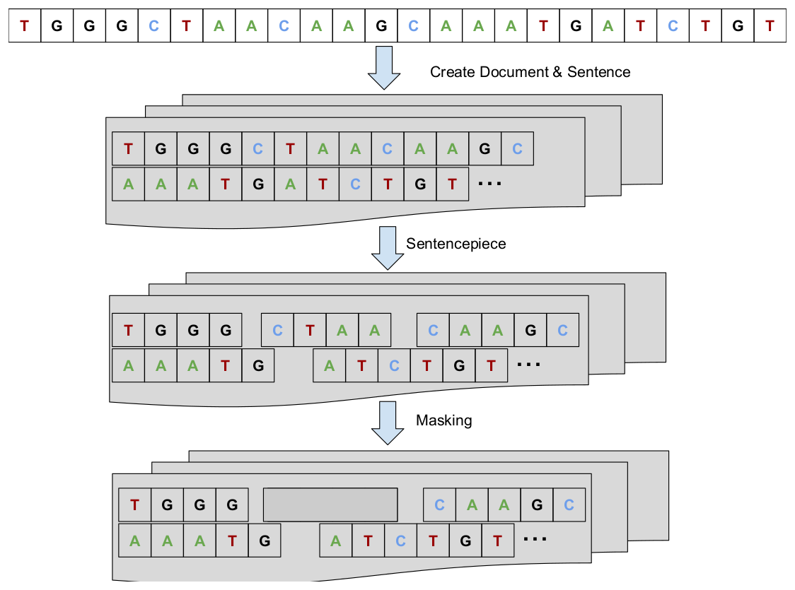

*图 7（原文 Figure 7，第 40 页）：MLM 数据如何从原始 DNA 数据集生成。原始 GRCh37 的 DNA 序列被在随机位置切分，生成有 50–100 个句子的文档，每个句子 500–1000 bp，因此每个文档是 25,000–100,000 bp 的连续 DNA 链；这个过程重复 10 次；所得文档集合再经过 Sentencepiece，产生平均 8 bp 的 token；预训练用掩码语言模型。*

**图中文字翻译与读法**：自上而下四个阶段：（1）一条原始碱基序列（T、G、C、A 彩色字母）；（2）Create Document & Sentence（创建文档与句子）：切成多个文档，每个文档由若干行“句子”组成；（3）Sentencepiece：把连续的碱基合并成变长的 token（用空隙分隔的块）；（4）Masking（遮盖）：随机把一些 token 遮掉（灰色空框），MLM 要预测它们。读图要点：与 NLP 的“文档—句子—词”一一对应，碱基对应字符，BPE token 对应词。图题写“遮住 10% 的 token”，而附录正文写的是与 BERT 一样遮住 15%，原文前后不一致。

**预训练任务**：与 BERT 一致，同时用 MLM 和 NSP（下一句预测）训练。MLM：随机遮住 15% 的输入 token，其中 80% 换成 `[MASK]`，10% 换成随机 token，10% 保持不变但仍要预测。NSP：输入是 `[CLS] 序列 A [SEP] 序列 B [SEP]`，50% 的时间第二个序列是真实的后续，其余 50% 是数据集中随机的序列，用 `[CLS]` 输出接一个二分类层预测。训练超参数见表 21 的第二列。

**表 5：基因组上的 MLM BPC**（越小越好）

| 模型 | BPC |
|---|---:|
| SRILM [58] | 1.57 |
| BERT (sqln. 512) | 1.23 |
| BigBird (sqln. 4096) | **1.12** |

（原文表 5，第 9 页。）读法：基于 attention 的 DNA 上下文表示确实改善 BPC（1.57 到 1.23），更长的上下文还能进一步改善（1.23 到 1.12）。

**一个简单的消融**：验证“与 NLP 类似，更大的上下文能提高性能”的假说，用 MLM 任务比较不同序列长度（图 8）。

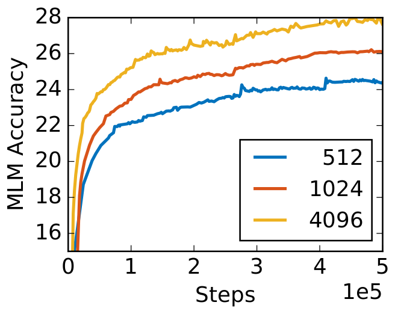

*图 8（原文 Figure 8，第 40 页）：BigBird 的准确率随上下文长度变化。*

**图中文字翻译与读法**：横轴 Steps（训练步数，单位 $10^5$，0 到 5），纵轴 MLM Accuracy（MLM 准确率，约 16 到 28，原文未标注单位）；图例 512（蓝）、1024（橙）、4096（黄）是序列长度。**读图结论**：序列越长，曲线整体越高，上升也越快；在 $5\times10^5$ 步附近，从图上读出约为 24.4（512）、26.1（1024）、27.9（4096）（近似值）。论文的解释是：更长的上下文不仅提高了最终准确率，也使学习更快，因为有了更多遮盖的机会。

### 7.2 启动子区域预测

启动子是通常位于基因上游的 DNA 区域，是转录起始的位点，识别它是理解基因调控的重要第一步。任务是把一段 DNA 片段分类为启动子或非启动子序列。数据集由 Oubounyt et al. [71] 整理，来自真核启动子数据库 EPDnew [24]，包含人类基因组中 29,597 个启动子区域；围绕转录起始位点（TSS）提取 8000 bp 的序列（−5000 到 +3000 bp），从 GRCh37 参考基因组取得（EPDnew 使用更新的 GRCh38，用 LiftOver 转换坐标）。负样本按 Oubounyt et al. 的办法为每个正样本构造一个同样大小的非启动子序列：把正序列切成 20 段，随机选 12 段并随机替换，保留其余 8 段不变；论文说这样得到的负样本集合中有 32% 和 40% 的序列含有启动子序列的保守部分（原文表述如此，没有进一步解释这两个比例）。每个例子前后加 `[CLS]` 和 `[SEP]`，用 `[CLS]` 的输出接简单的二分类层，在 7.1 节预训练好的 BigBird 上微调（超参数见表 21）。

**表 6：启动子区域预测**（F1，越大越好）

| 模型 | F1 |
|---|---:|
| CNNProm [90] | 69.7 |
| DeePromoter [71] | 95.6 |
| BigBird | **99.9** |

（原文表 6，第 9 页。）读法：BigBird 几乎达到完美准确率，比此前最好的方法高约 4.3（笔者相减；论文说“5% 的提升”）。论文在附录中自己提醒：这样高的性能并不意外，因为负样本的生成方式与 MLM 预训练在性质上有重叠。论文没有展开，笔者的推测是：负样本由正样本随机替换若干片段得到，与 MLM 预训练中“随机遮盖或替换再还原”的过程相似，预训练可能让模型更容易分辨这类被打乱的序列。所以 99.9 不宜当作对真实启动子识别能力的无偏估计。

### 7.3 染色质 profile 预测

人类基因组中非编码区域不编码蛋白质，大多数疾病和性状相关的单核苷酸多态性与非编码基因组变异相关，所以理解非编码区的功能效应很重要。Zhou 和 Troyanskaya [109] 定义的重要一步是：从非编码基因序列预测大尺度的染色质 profile。DeepSea [109] 数据集收集了来自 ENCODE 和 Roadmap Epigenomics 项目的 240 万个非编码变异的 919 个染色质 profile：690 个转录因子（TF）结合 profile（涉及 160 种不同的 TF）、125 个 DNase I 敏感性（DHS）profile 和 104 个组蛋白标记（HM）profile。任务是对给定的非编码 DNA 区域预测这 919 个 profile，也就是联合学习 919 个二分类器。

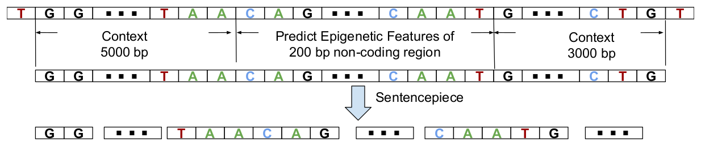

*图 9（原文 Figure 9，第 41 页）：用于预测给定非编码区染色质 profile 的 DNA 片段示意（取自 GRCh37 原始 DNA 序列）。预测目标是 919 个染色质 profile：690 个 TF 结合 profile（160 种 TF）、125 个 DHS profile 和 104 个 HM profile。*

**图中文字翻译与读法**：最上一行是原始 DNA；中间标注“Predict Epigenetic Features of 200 bp non-coding region（预测 200 bp 非编码区的表观遗传特征）”，左侧 Context 5000 bp（上游 5000 bp 上下文）、右侧 Context 3000 bp（下游 3000 bp 上下文）；下面经 Sentencepiece 分词成 token 序列作为模型输入。**读图结论**：模型输入是目标 200 bp 区域加两侧上下文，共约 8,000 bp。需要注意：原文图题写“前后各取 8000 bp 作为上下文”，附录正文写“以每个 200 bp 区间为中心的 8,000 bp 序列”，而图上标的是上游 5000、下游 3000，三处说法不完全一致，本文以图上标注的 8,000 bp 总长为准。

**实验细节**（附录 F.3）：每个训练样本是来自 GRCh37 的、以某个 200 bp 区间为中心的 8,000 bp 序列，配一个 919 维的标签向量；与前面一样加 `[CLS]` 和 `[SEP]`，用 `[CLS]` 的输出接一个有 919 个头的线性层，联合预测 919 个独立的二分类问题。因为数据高度不平衡（负样本远多于正样本），把正样本的损失权重提高 8 倍。数据划分沿用 Zhou 和 Troyanskaya，按染色体严格不重叠：第 8、9 号染色体不参与训练、用于测试；其余常染色体用于训练和验证；7 号染色体上坐标 30,508,751–35,296,850 的 4,000 个样本作为验证集。由于 DeepSea 的预测概率是对正向序列与互补序列预测取集成平均，BigBird 也用两个独立训练的模型集成。

**表 7：染色质 profile 预测**（在留出的染色体上比较 AUC，越大越好）

| 模型 | TF | HM | DHS |
|---|---:|---:|---:|
| gkm-SVM [30] | 89.6 | - | - |
| DeepSea [109] | 95.8 | 85.6 | **92.3** |
| BigBird | **96.1** | **88.7** | 92.1 |

（原文表 7，第 10 页。）读法：BigBird 在 TF 上略好（96.1 对 95.8），在 DHS 上略低（92.1 对 92.3），在 HM 上高出 3.1 个点（88.7 对 85.6，笔者相减）。论文强调 HM 是更难的任务，已知有更长程的相关性，所以这是长上下文的优势所在。

**表 21：计算生物学（基因组）实验的超参数**

| 参数 | 预训练 | 启动子区域 | 染色质 profile |
|---|---|---|---|
| 块长度 $b$ | 64 | 64 | 64 |
| 全局 token 位置 | ITC | ITC | ITC |
| 全局 token 数 $g$ | $2\times b$ | $2\times b$ | $2\times b$ |
| 窗口长度 $w$ | $3\times b$ | $3\times b$ | $3\times b$ |
| 随机 token 数 $r$ | $3\times b$ | $3\times b$ | $3\times b$ |
| 最大序列长度 | 4096 | 4096 | 4096 |
| 头数 | 12 | 12 | 12 |
| 层数 | 12 | 12 | 12 |
| 隐层大小 | 768 | 768 | 768 |
| Batch size | 256 | 256 | 256 |
| 词表大小 | 32000 | 32000 | 32000 |
| 损失 | MLM + NSP | BCE | 正样本加权的 BCE（919 个输出） |
| Dropout 概率 | 0.1 | 0.1 | 0.1 |
| 优化器 | Adam | Adam | Adam |
| 学习率 | 0.0001 | 0.0001 | 0.0001 |
| 训练步数 | 1000000 | 711 | 500000 |
| 计算资源 | 8 × 8 TPUv3 | 8 × 8 TPUv3 | 8 × 8 TPUv3 |

（原文表 21，第 41 页；BCE 为二元交叉熵。）读法：基因组实验全部用 ITC 配置（含随机 attention，$r=3\times b$），所以随机 attention 不只出现在表 1 的小实验里。启动子区域微调只有 711 步。

## 八、与 Longformer 的关系（附录 E.3）

论文说明：Child et al. [16] 先引入了局部滑窗来降低计算量；包含局部滑窗加全局 token 的较新版本由 Longformer 独立提出。BigBird 虽然多了随机 token，但即使在没有随机 token 的设置下（正是取得问答最好成绩的 BigBird-ETC，$r=0$），BigBird-ETC 与 Longformer 也有两点关键差别（见 ETC [4]）：

1. BigBird 的全局-局部 attention 使用相对位置编码，使它能更好地处理有结构的输入；
2. 与 Longformer 不同，BigBird 用 CPC 损失来训练全局 token，并在微调时学习如何使用它们。

另外，Longformer 论文的脚注 9 指出，BigBird 的预训练用了 Longformer 约 16 倍的算力，这可能是它改进榜单成绩的混杂因素。把两篇论文的数据放在一起看：表 2 中 RoBERTa 和 Longformer 的开发集数字与 Longformer 论文表 7 一致，表 3 里 Longformer 的数字与 Longformer 论文表 8、表 9 基本一致（HotpotQA Ans 差 0.1）；两篇论文都给出同一组摘要数字（BigBird-Pegasus 在 Arxiv 上的 46.63/19.02/41.77），可以互相印证。

## 九、证据边界、局限与常见误读

### 9.1 证据边界

1. **随机 attention 的作用证据较弱**：随机边的经验证据主要来自表 1 的小实验（R+W 好于单用 R 或 W）和 ITC 版本；问答的最好结果来自没有随机边的 ETC，论文也承认 ETC 稍好、ITC 相当有竞争力。没有直接的“有/无随机边”的受控消融。
2. **理论与实验之间有距离**：通用逼近的构造需要指数多的层，图灵完备需要任意精度和约二次方个解码步，两者都是存在性结论，不保证有限深度、有限精度的模型能学到。
3. **一些比较并非同条件**：BigBird 的 QA 用了额外的正则化（CPC 双编码器）和针对各数据集的全局 token 设计；表 4 中与更早方法（Sent-PTR、Extr-Abst-TLM、Dancer 等）的比较没有控制预训练和模型尺寸，只有“Pegasus (Re-eval) 对 BigBird-Pegasus”以及“+ RoBERTa 对 BigBird-RoBERTa”这类同初始化的对照更接近受控比较；表 10 的 RoBERTa 与 Longformer 数字与 Longformer 论文相同但语料不同；Natural Questions 短答案低于榜单是单模型对集成的差异，这是论文的解释。
4. **基因组结果的限制**：启动子任务的负样本构造与 MLM 预训练有重叠，论文自己说高性能不意外；图 7 题注与附录正文对遮盖比例（10% 与 15%）、图 9 题注与图上标注的上下文长度说法不一致。
5. **方差信息很少**：论文只为 IMDb 和 Hyperpartisan 报告了 5 次重复的均值和标准差，其余结果没有给出方差。
6. **稀疏代价的实证很少**：只有短文档摘要（表 20）和 GLUE（表 16）能看到稀疏相对完全 attention 的小幅下降，没有系统的“不同稀疏度”的消融。

### 9.2 局限

- 理论下界（Proposition 1）表明稀疏 attention 不能在所有任务上替代完全 attention。
- 超参数（块长、$g$、$w$、$r$、全局 token 的选取）要按任务设计：问答里的全局 token 是按问题、段落、句子、候选答案手工设置的。
- 随机连接的生成规则、训练和推理是否一致等细节，需要看官方代码；论文没有给出随机块的采样细节。
- 论文处理的最长序列是 4,096，所谓“8 倍”是相对 512 的；更长序列（如 Natural Questions 最长近 78K）靠滑动窗口切分。

### 9.3 常见误读

- **“BigBird = 随机 attention”**：误。论文最好的 QA 模型 BigBird-ETC 的随机 token 数为 0；表达力理论依赖的是全局 token。
- **“图灵完备/通用逼近说明稀疏 attention 和完全 attention 一样好”**：误。这些是存在性结论；同一篇论文的下界表明稀疏有代价，实验里也能看到短文档上的小幅下降。
- **“$O(n)$ 意味着常数显存”**：误。$O(n(w+r+g))$ 在 $w,r,g$ 固定时随 $n$ 线性，增大这些超参数会改变实际成本；而且实际速度取决于块稀疏实现。
- **“99.9 的启动子 F1 说明模型几乎完美”**：需要谨慎，见上文。

## 十、复现检查清单

- 明确是 ITC 还是 ETC；是否使用随机块以及 $r$、$g$、$w$ 取值（base 的 ITC 用 $b=64$、$g=2b$、$w=3b$、$r=3b$，ETC 用 $b=84$、$g=256$、$w=3b$、$r=0$；large 的 ETC 块长 169、$w=507$）。
- 按块实现：query/key 按块大小分块，窗口用滚动实现，全局用固定块，随机用 gather，并屏蔽滚动带来的环绕位置。
- 随机块的生成规则和随机种子要固定并记录，训练和推理是否一致要说明。
- padding 之后的块布局必须屏蔽无效 token。
- 问答里全局 token 的设置：ITC 取前 128 个 token；ETC 按问题、段落、句子、候选答案设置（上限 256/230/320/430）。全局 token 的数量和选择最好作为消融变量单独检查，论文没有对它做系统消融。
- QA 用到 CPC 双编码器的正则化；ITC 用绝对位置嵌入、ETC 用相对位置编码。
- 摘要只对编码器稀疏、解码器完全 attention，编码器-解码器共享权重（仅编码器-解码器 attention 随机初始化）。
- 基因组：先按 7.1 节构造文档和 BPE（32K 词表，平均每 token 8.78 bp），再预训练 MLM + NSP；染色质任务正样本损失权重 8。
- 报告块稀疏 kernel 的实际吞吐和峰值显存；理论非零数不自动等于硬件加速。

## 十一、与相关论文的关系

- **Longformer**（[解读](../longformer/论文中文解读.md)）：局部滑窗加全局 attention 的同类工作；BigBird 多了随机 attention 和理论分析，QA 最好结果的 ETC 版本也没有随机边，差别主要在相对位置编码和全局 token 的训练方式。
- **Transformer-XL**（[解读](../transformer_xl/论文中文解读.md)）：从左到右的自回归路线，论文把它归为适合语言建模但不适合双向任务的一类。
- **Linformer / Performer**（[Linformer](../linformer/论文中文解读.md)、[Performer](../performer/论文中文解读.md)）：用低秩或核近似改变 attention 的计算方式；BigBird 保留 softmax，只改连接图。
- **FlashAttention**（[解读](../flash_attention/论文中文解读.md)）：保持精确的完全 attention，通过 IO 感知把 HBM 访问降下来，与“改稀疏图”的思路互补；两者都说明，吞吐取决于 kernel 能否把模式变成规整的块计算。
- **BERT**（[解读](../bert/论文中文解读.md)）：BigBird 沿用其 MLM 预训练和 `[CLS]` 分类的做法，并从 RoBERTa 检查点热启动。

## 原文证据导航

- [原论文 PDF](paper.pdf)
- [原文提取文本](paper.txt)
- [论文概要](论文概要.md)
