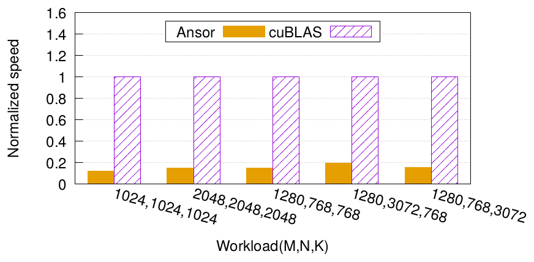
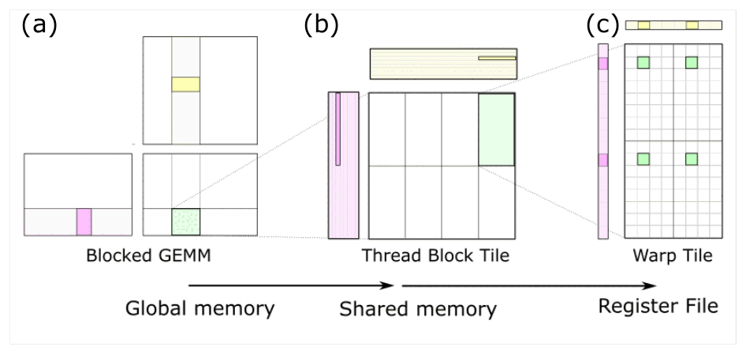
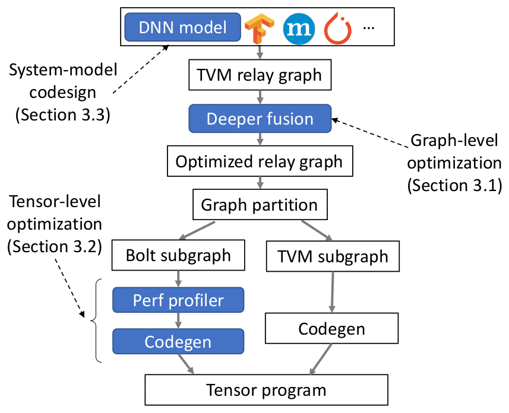
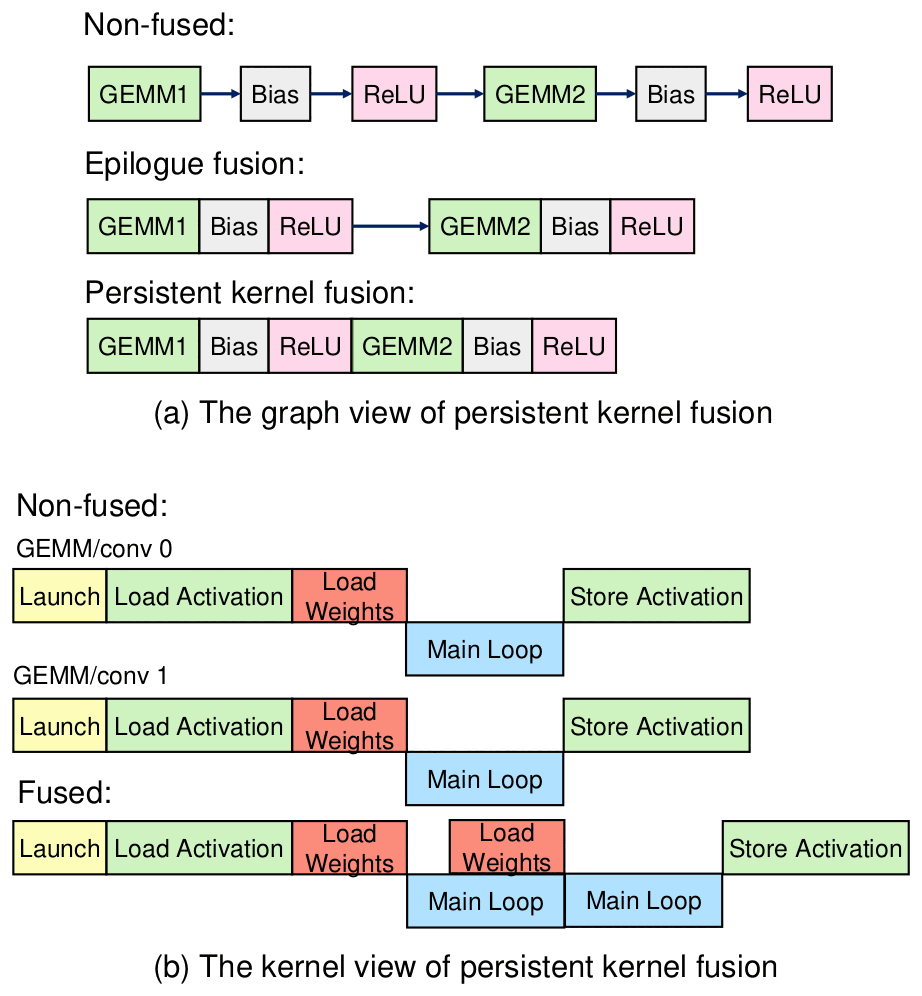
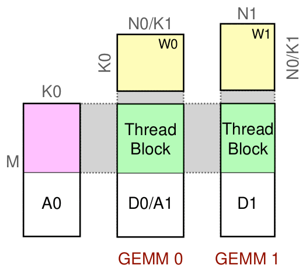
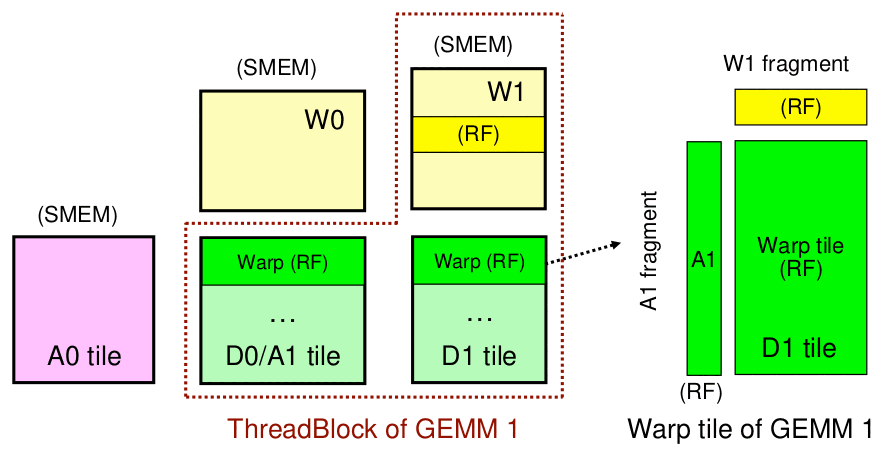
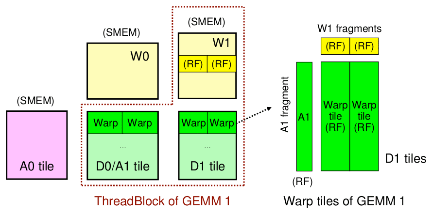
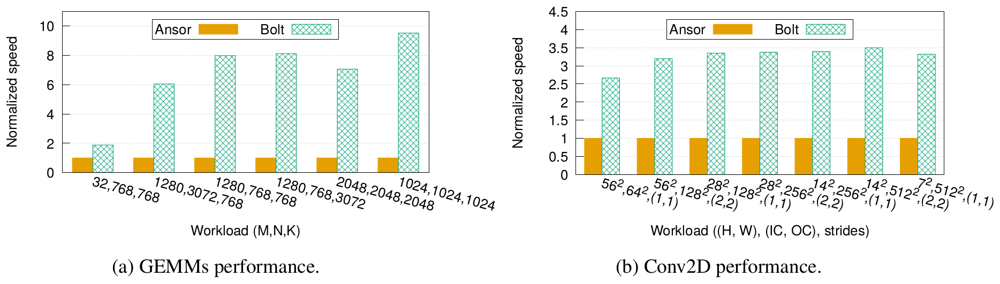
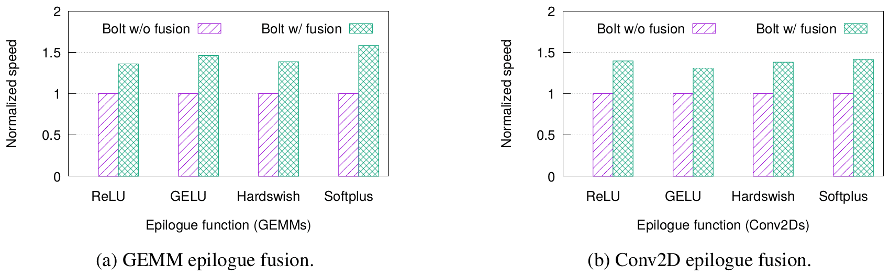
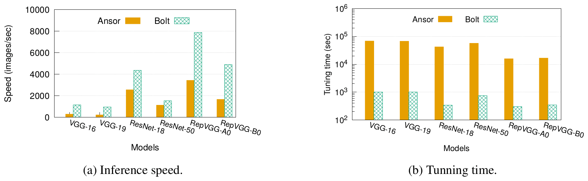

# 论文中文解读：《Bolt: Bridging the Gap between Auto-tuners and Hardware-native Performance》

> **基本信息**：Jiarong Xing*、Leyuan Wang*、Shang Zhang、Jack Chen、Ang Chen、Yibo Zhu（ByteDance / Rice University / NVIDIA，*为同等贡献），arXiv:2110.15238（本地 PDF 为 v1，2021 年 10 月；该文发表于 MLSys 2022）；论文原文 [官方页面](https://arxiv.org/abs/2110.15238)。
>
> **本文的读法**：图均为从论文 PDF 中按图裁出的原图，表和公式为逐项核对后的中文转录（数字与原文一致，表头翻译为中文）。每张图后有中文图题、图例/坐标轴翻译和读图结论，因此不必再翻英文版。图中读出的近似数值都写作“约”，原文正文给出的数字优先。

## 一、一句话结论

AutoTVM、Ansor 这类 auto-tuner 把硬件当作“不透明”的黑盒，靠在真机上试跑样例程序来学习 cost model。这带来两个问题：一是在张量核心（tensor core）上的非 FP32 计算（如 FP16 GEMM、卷积）达不到厂商库（cuBLAS、cuDNN）的**硬件原生性能**；二是**搜索慢**，调优整个 ResNet-50 在 GPU 上要几天。厂商库虽然快，但功能固定、缺乏定制和自动化。

Bolt 抓住一个趋势：厂商库正变得**模板化、可重配置**（以 NVIDIA CUTLASS 为代表）。Bolt 的做法叫**硬件原生的模板化搜索**（hardware-native templated search），在三个层次上同时优化：

1. **图级**：基于 CUTLASS 的 epilogue 融合，新增**持久内核融合**（persistent kernel fusion），把相邻的多个 GEMM/Conv 融合进一个 kernel，中间激活不落回全局内存；
2. **算子级**：用轻量的硬件原生 profiler 在由 GPU 架构知识限定的小空间里搜索 CUTLASS 模板参数，再把模板实例化成 CUDA 代码，并自动做 layout 转换和 kernel padding；
3. **模型级**：总结出三条“系统友好”的模型设计原则，并在 RepVGG 上验证。

结果（作者实验，单张 Tesla T4，FP16）：相对 Ansor，常见卷积网络的端到端推理平均快约 2.5 倍（摘要口径；§4.2 正文写 2.8 倍），调优在 20 分钟内完成，而 Ansor 平均需要 12 小时；GEMM 快 6.1 至 9.5 倍（计算密集的）、Conv2D 快 2.7 至 3.5 倍；持久内核融合对 GEMM、Conv2D 再带来 1.2 至 1.5 倍、1.1 至 2.0 倍的加速。

## 二、背景与动机

### 2.1 auto-tuner 的两个问题（图 1）

auto-tuner 通过构造硬件的 cost model（例如用样例程序及其在目标设备上的性能训练学习模型，预测哪些实现更可能高效）在大搜索空间里挑选有效的变换。把设备当作不透明模型带来平台通用性（同一套方法适用于不同硬件，无需硬件细节），但也带来两个性能后果：

- **缺乏硬件原生性能**：对某些负载（如非 FP32 的 GEMM/Conv），auto-tuner 生成的代码与厂商调优库（cuBLAS、cuDNN）有差距。原因是 NVIDIA GPU 有专门加速 FP16 的 tensor core，而使用不透明硬件模型的 Ansor 无法高效利用它们。
- **搜索低效**：不透明模型加上推断出的硬件执行代价，让调优过程缺乏信息指导。已有 auto-tuner 在模型含许多不同负载（如 ResNet-152、Inception-V3）时要花数天乃至数周；原文引用：AutoTVM 调优整个 ResNet-50，在 x86 CPU 上要 10 小时，在 NVIDIA GPU 上要 7 天。缓存复用旧调优日志（SAMPL）对静态模型有效，但对含动态数据结构或动态形状的模型（精确负载要到运行时才确定）效果差，而且维护这些数据库代价高。

图 1 是第一个问题的实证：

*图 1（原文 Figure 1，第 2 页）：在 TVM auto-scheduler 里实现的 Ansor，速度显著低于 cuBLAS 能达到的设备速度。负载：两个大的方阵 GEMM，以及 BERT 里 batch size 为 32、序列长度为 40 时的三个 GEMM。（设置：FP16，NVIDIA Tesla T4，见正文第 1 节。）*

**图中文字翻译与读法**：横轴 Workload(M,N,K)（负载，GEMM 的维度 $M,N,K$）：(1024,1024,1024)、(2048,2048,2048)、(1280,768,768)、(1280,3072,768)、(1280,768,3072)；纵轴 Normalized speed（归一化速度，以 cuBLAS 为 1）；图例 Ansor（橙，实心）、cuBLAS（紫，斜线）。

**读图结论**：Ansor 只有 cuBLAS 的约 0.12 到 0.2（从图上读出），正文说“不到库性能的 20%”。

### 2.2 趋势：模板化库与 CUTLASS（图 2）

Bolt 的优化建立在一个新趋势上：厂商库正在摆脱早期“固定原语”的设计，变得模块化、可组合——模板由一组声明式参数控制，可实例化以适配不同硬件和负载；新的原语可以由已有原语组合，创建新模板的门槛也更低。模板库里编码了考虑设备细节的高效设计模式，能提取不透明 auto-tuning 不可能达到的硬件性能。

**例子：NVIDIA CUTLASS**。CUTLASS 为 GEMM 的 CUDA 编程模型每一层提供可复用的 C++ 模板组件，参数正确时在 thread 级、warp 级、block 级和设备级原语上都能达到高性能。这些模板利用了细致的设备知识，特别是 Volta、Turing、Ampere GPU 集成的 tensor core，并针对多种混合精度计算优化（B1、INT4、INT8、FP16、BF16、FP32、TF32、FP64、复数和四元数）。选对 tile 大小、数据类型等参数，用户就能为自己的负载获得设备级性能。Intel 的 oneDNN 和 AMD 的 ROCm 也出现类似趋势，所以这个设计原则可推广到其他平台。

CUTLASS 利用 GPU 的 tiling 结构，把 GEMM 分解为 threadblock tile 与 warp tile 的层次，并精心控制数据从全局内存到共享内存再到寄存器堆的搬运。

*图 2（原文 Figure 2，第 3 页）：CUTLASS 中的 GEMM 层次，以及 threadblock tile 与 warp tile 中的数据搬运。*

**图中文字翻译与读法**：下方箭头 Global memory（全局内存）→ Shared memory（共享内存）→ Register File（寄存器堆）；

- **(a) Blocked GEMM（分块 GEMM）**：全局内存里的输入 $A$（粉色条带）、$B$（黄色条带）与结果 $C$（绿色方块），彩色部分是各自的 threadblock tile；
- **(b) Thread Block Tile**：一个 threadblock tile 在共享内存里被切成若干 warp tile（图中为 8 个，$2\times4$ 的格子，右上角一个绿色 warp tile 被放大）；
- **(c) Warp Tile**：warp tile 再被划分成寄存器堆中的 thread tile（细格子，绿色小方块即 thread tile，粉色与黄色细条是 $A$、$B$ 的 fragment）。

**读图结论**：从全局内存到共享内存再到寄存器堆，存储容量依次减小、读写速度依次提高；tensor core 以 thread tile 作为输入，并把输出存到寄存器堆。

### 2.3 Bolt：兼得两者之长

Bolt 在三个层次上提供端到端优化：

- **图级——更深的算子融合**：利用模板化设计可以通过模板定制把新的优化引入设备库。算子融合是用一个 kernel 计算多个算子，减少访存以提高局部性；但已有 auto-tuner 的融合与高性能设备库配合不好（例如 Conv2D+BiasAdd+Hardswish 放在一个 kernel 里会更快，但得到的算子可能不被 cuDNN 这类固定功能库支持）。Bolt 借助模板化设计开辟了考虑更深融合的新搜索空间。
- **算子级——自动化模板化代码生成**：模板库本身对普通用户太底层（要精确设定控制 tile 大小和数据类型的参数，负担很高；模板原语也只是积木，要拼成完整的 DNN 模型）。Bolt 把库原语与 auto-tuner 结合：设计轻量的性能 profiler 自动搜索最佳模板参数，再据此实例化模板，生成具有硬件原生性能的低层张量代码。
- **模型级——系统友好的模型**：端到端优化也启发了高效的模型设计。提出以系统友好的方式设计模型，以便高效利用底层系统提供的优化；Bolt 总结了三条系统-模型协同设计（system-model codesign）原则，并用若干 RepVGG 模型验证。

## 三、Bolt 的设计

### 3.1 总体流程（图 3）

Bolt 采用 **BYOC** 方式（Bring Your Own Codegen）：从张量程序里划出合适的子图，交给 Bolt 优化。

*图 3（原文 Figure 3，第 4 页）：Bolt 的工作流。蓝色方框是本文的贡献。*

**图中文字翻译与读法**（自上而下）：

1. DNN model（DNN 模型，来自 TensorFlow、MXNet、PyTorch 等）→ TVM relay graph（TVM 的 Relay 图），Bolt 复用 TVM 前端解析模型；
2. **Deeper fusion**（更深的融合，蓝色）→ Optimized relay graph（优化后的 Relay 图）：这是 Graph-level optimization（图级优化，Section 3.1，图中右侧虚线标注）；
3. **Graph partition**（图划分）→ 分成 Bolt subgraph（Bolt 子图）和 TVM subgraph（TVM 子图）；
4. Bolt subgraph → **Perf profiler**（性能 profiler，蓝色）→ **Codegen**（代码生成，蓝色）：这两步属于 Tensor-level optimization（张量级优化，Section 3.2）；TVM subgraph → TVM 自己的 Codegen；
5. 两路汇合成 Tensor program（张量程序）；左上虚线标注 System-model codesign（系统-模型协同设计，Section 3.3）作用于 DNN 模型本身。

**文字说明的流程**：Bolt 先在这个 relay 图上做计算图优化（如更深的融合），再对优化后的图做图划分；然后对 Bolt 子图里的每个算子做硬件原生 profiling，搜索最佳 kernel；最后生成高性能 CUDA 代码，与 TVM 生成的代码一起编译进**同一个运行时文件**。

### 3.2 更深的算子融合：持久内核融合

Bolt 通过扩展硬件原生模板启用新的图级优化。具体是引入**持久内核**（persistent kernel）实现更深的算子融合：在 epilogue 融合的基础上，进一步融合两个或更多相邻的 GEMM/Conv（图 4a）。把多个 GEMM 或 Conv 融合成一个算子，在三个方面提高性能：（i）消除存取层间激活的内存流量；（ii）消除 kernel 启动延迟，对小 batch 的短 kernel 尤其有利；（iii）扩大编译器的优化范围，可探索更多指令调度选项。

**前提：epilogue 融合**。持久内核融合的前提是先集成 CUTLASS 提供的 epilogue 融合：把一个 GEMM/Conv 与其后面的 epilogue 一起融合成一个算子。CUTLASS 里的 epilogue 融合模式包括：（i）逐元素算子；（ii）数据类型转换；（iii）沿列广播向量；（iv）沿列的部分归约。Bolt 在计算图里识别这些模式并自动生成相应的算法策略。

*图 4（原文 Figure 4，第 4 页）：背靠背 GEMM/Conv 的持久内核融合：图视角与 kernel 视角。*

**图中文字翻译与读法**：

- **(a) 图视角**：Non-fused（未融合）：GEMM1 → Bias → ReLU → GEMM2 → Bias → ReLU，每个算子各自一个 kernel；Epilogue fusion（epilogue 融合）：[GEMM1 Bias ReLU] 与 [GEMM2 Bias ReLU] 各融合成一个 kernel，两者之间仍有数据传递；Persistent kernel fusion（持久内核融合）：[GEMM1 Bias ReLU GEMM2 Bias ReLU] 整体是一个 kernel。
- **(b) kernel 视角**：每个 GEMM/conv 的 kernel 由 Launch（启动，黄）、Load Activation（载入激活，绿）、Load Weights（载入权重，红）、Main Loop（主循环，蓝）、Store Activation（存储激活，绿）等阶段构成。Non-fused（未融合）：GEMM/conv 0 与 GEMM/conv 1 各走一遍全部阶段；Fused（融合后）：只 Launch 一次、Load Activation 一次，然后 Load Weights → Main Loop（第一个 GEMM）→ Load Weights → Main Loop（第二个 GEMM），最后一次 Store Activation。

**读图结论**：融合后，第一个 GEMM/Conv 的输出激活停留在更快的 GPU 存储里，省掉了“把 GEMM0/Conv0 输出激活写回全局内存、再启动 GEMM1/Conv1 kernel、再从全局内存载入其输入激活”三步。Bolt 自动识别使用持久内核的机会，并通过在 CUTLASS 里创建新模板来生成 CUDA 代码；下面详述背靠背 GEMM 融合，卷积融合类似。

**背靠背 GEMM 的定义**：

$$
D_0=\alpha_0\,A_0\cdot W_0+\beta_0\,C_0,\tag{1}
$$

$$
D_1=\alpha_1\,D_0\cdot W_1+\beta_1\,C_1,\tag{2}
$$

其中 $A_0,W_0,W_1$ 是矩阵输入，$\alpha,\beta$ 是标量输入，$C_0,C_1$ 是已有的矩阵（偏置），会被输出覆盖。要融合背靠背 GEMM，第一个 GEMM 的输出激活 $D_0$ 必须作为第二个 GEMM 的输入激活。这要求所有层的 GEMM **$M$ 维保持不变**；对背靠背 Conv，要求从第二个起的所有后续 Conv 都使用 $1\times1$ 卷积核、无 padding、步长为 1。

**关键性质：threadblock residence（threadblock 驻留）**。持久内核的关键挑战是计算第二个 GEMM/Conv 时，不从全局内存载入它的输入激活。这要求第一个 GEMM/Conv 的每个输出 threadblock 与它对应的输入 threadblock 留在**同一个 threadblock 的存储里**（共享内存或寄存器堆）——称为 threadblock residence；否则第二个 GEMM/Conv 还要从全局内存取数据，持久内核的收益就没了。对 GEMM 融合，threadblock residence 要求每个算子的 **ThreadBlock N = GEMM N**；对 Conv 融合，则要求 ThreadBlock N = Conv 输出通道数。

*图 5（原文 Figure 5，第 5 页）：GEMM 融合的 threadblock 驻留示意。彩色方框代表一个 threadblock。这要求 ThreadBlock0 N = N0，ThreadBlock1 N = N1。*

**图中文字翻译与读法**：自左向右：$A_0$（$M\times K_0$，粉色表示一个 threadblock 要读的行块）、GEMM 0 的权重 $W_0$（$K_0\times N_0$，黄色）与输出 $D_0/A_1$（$M\times N_0$，绿色为一个 Thread Block 的输出行块，同时也是 GEMM 1 的输入 $A_1$）、GEMM 1 的权重 $W_1$（$N_0/K_1\times N_1$）与输出 $D_1$（$M\times N_1$）。灰色带说明同一个 threadblock 在 GEMM 0 与 GEMM 1 里对应同一批行。

**读图结论**：一个 threadblock 负责 $M$ 方向的一个行块，并在每个 GEMM 里覆盖**完整的 $N$**；因此它在 GEMM 0 产出的 $D_0$ 行块，恰好就是它在 GEMM 1 里需要的 $A_1$ 行块，不需要别的 threadblock 参与。在此基础上有两种设计。

**RF 驻留融合（RF-resident fusion）**。当权重矩阵 $W_1$ 能被完整地流入一个 warp tile 的 $N$ 维（图 6）时，只要把每个 threadblock 的输出激活整体存在**寄存器堆**（RF）里，就满足 threadblock 驻留。这样第二个 GEMM/Conv 计算时不必与别的 warp 交换 $W_1$。这要求 warp 大小满足：每一层都有 Warp N = ThreadBlock N = GEMM N。RF 驻留融合里，每个 warp 持有当前层产出的一块累加器数据（accumulator fragment）放在 RF 中，并完整地用作同一个 warp 计算下一层的输入。Bolt 开发了 CUTLASS 的 **warp fragment iterator**，从累加器 fragment 中取出数据送给 warp 级 MMA 运算。RF 驻留融合通过扩展 CUTLASS 的 threadblock 级 GEMM 设计来整合背靠背的 MMA 流水线，各 GEMM 之间没有相互干扰；第二个 GEMM 唯一的额外操作，是从前一个累加器取 warp fragment，并全部在 RF 内完成 epilogue 计算。

*图 6（原文 Figure 6，第 5 页）：背靠背 GEMM 的一个 threadblock 内的 RF 驻留融合。threadblock 与 warp 的大小要求：Warp0 N = ThreadBlock0 N = N0，Warp1 N = ThreadBlock1 N = N1。*

**图中文字翻译与读法**：左侧 $A_0$ tile（SMEM，共享内存）与 $W_0$（SMEM）算出 $D_0/A_1$ tile，其中每个 Warp (RF) 持有累加器的一块；虚线框 ThreadBlock of GEMM 1（GEMM 1 的 threadblock）：$W_1$（SMEM）的一部分被取为 W1 fragment (RF)；右侧 Warp tile of GEMM 1（GEMM 1 的 warp tile）：A1 fragment (RF)（来自本 warp 自己的累加器）与 W1 fragment (RF) 相乘，得到 D1 tile 的 Warp tile (RF)。

**读图结论**：第一个 GEMM 的结果从头到尾留在寄存器里，第二个 GEMM 直接把它当作 $A_1$ fragment 使用；代价是每个 warp 要覆盖整行宽度 $N$。

**共享内存驻留融合（shared memory-resident fusion）**。当 GEMM 的 $N$ 很大时，RF 驻留融合会带来较高的 RF 压力，可能损害 kernel 性能并限制适用场景。为此论文提出共享内存驻留融合来**放宽 warp 大小限制**：当第二个 GEMM/Conv 需要在 warp 之间共享数据时，数据可以暂存在**共享内存**而不是 RF。图 7 的例子里，计算 $D_1$ 需要从 $N$ 维上多个 warp tile 流入 $W_1$ 的 fragment，所以 GEMM0 产生的累加器数据必须从 RF 搬到共享内存，才能被 GEMM1 载入；每个 warp 持有的那块数据在 $M$ 维上被下一层共享。这样 RF 驻留融合里对 Warp N 的限制就放宽了。为实现它，论文引入 **smem fragment iterator** 机制：把累加器 tile 存入共享内存，再从共享内存取出 fragment 给第二个 GEMM；并精心设计共享内存布局，避免存放第一个 kernel 的累加器、载入给第二个 kernel 时的共享内存 bank 冲突，以获得更高性能。

*图 7（原文 Figure 7，第 5 页）：背靠背 GEMM 的一个 threadblock 内的共享内存驻留融合。threadblock 大小要求：ThreadBlock0 N = N0 ≠ Warp0 N，ThreadBlock1 N = N1 ≠ Warp1 N。*

**图中文字翻译与读法**：与图 6 对照，区别在于每层有多个 Warp（图中两个 Warp 并排）；右侧 Warp tiles of GEMM 1 里有两个 W1 fragments (RF)、两个 Warp tile (RF)，共同组成 D1 tiles：同一个 A1 fragment 要与来自多个 warp tile 的 W1 fragment 相乘，因此累加器数据要经共享内存在 warp 之间共享。

**小结**：RF 驻留与共享内存驻留融合使相邻 GEMM/Conv 的更深融合成为可能。在背靠背融合的基础上，Bolt 可以通过扩展持久内核模板、复制 GEMM 流水线，支持融合多个 GEMM/Conv。

**适用边界**（论文第 5 节）：持久内核融合针对**访存受限**的算子设计，与一般算子融合的动机一致，所以对 $N$、$K$ 较小而 $M$ 较大的连续 GEMM，以及通道数较小的 Conv2D 有提升；融合计算受限的算子可能因 threadblock 驻留要求而性能下降。

### 3.3 自动化的模板化代码生成

**挑战**。模板库对端到端张量程序优化提出新挑战：首先，模板通常不提供端到端模型所需的完整功能，只支持部分算子。一个朴素方案是为每种硬件从头开发完整编译栈，但这无法规模化。Bolt 用 BYOC 方式尽可能复用已有编译栈（如 TVM），把精力集中在用模板设备库做优化与代码生成上。

但单纯套用 BYOC 还不够：

1. 模板化设备库本身不能直接运行，要用户用调好的参数实例化模板才有好性能，而 BYOC 不支持这种性能 profiling。Bolt 提出轻量的硬件原生性能 profiler，能在几分钟内为特定负载的算子搜出最佳参数。
2. 传统 BYOC 把设备库看作无差别的外部函数，生成带钩子的硬件代码在运行时调用，这使得定制库、支持新优化（如 layout 转换、kernel padding）很困难。Bolt 把库当作**白盒**，直接按库的约定生成代码。

**轻量性能 profiler**。传统 auto-tuner 不假设任何硬件信息，通过生成样例实现并测量速度来推断 cost model，这需要探索很大的搜索空间，调优时间长。Bolt 大幅缩短搜索时间的办法是：把耗时的**样例程序生成**与**性能测量**分离，并用硬件细节加速前者。具体地，CUTLASS 模板里与性能相关的参数包括 threadblock、warp 和 instruction（指令）形状、swizzling functor、stages 等。得益于白盒方式，Bolt 根据 GPU 架构以及针对各硬件的调优经验来确定这些参数的可能取值。例如：

- 在寄存器堆容量允许的范围内，Bolt 偏好较大的 warp tile 以获得更高的计算访存比；
- 现代 NVIDIA GPU 上每个 threadblock 用 4 个或 8 个 warp 往往性能更好；
- 小问题规模需要小的 threadblock，才能启动足够多的 threadblock 让更多 SM 保持忙碌。

对每种 GPU 架构，Bolt 产生几十组最佳参数组合，并通过实例化模板生成对应的样例程序。这些样例程序对不同输入可以**跨模型、跨负载复用**，所以运行时 Bolt 只需用具体输入调用这些预先生成的样例程序来测性能。

**模板化代码生成**。传统 BYOC 不能以模板形式做代码生成。Bolt 则按 CUTLASS 的约定，用 profiler 找出的最佳参数实例化模板，直接产出低层张量实现。这有两个好处：第一，生成的代码性能优越，例如 Ampere A100 上 FP16 GEMM 可达 300 TFLOPS 吞吐，超过硬件理论上限的 95%（原文数字，文中未给对应图表）；第二，在生成代码里可以灵活加入新优化，Bolt 做了两个：

- **Layout 转换**：CUTLASS 的 Conv 只支持 NHWC layout，因为它比 NCHW 快；但不是所有模型都用理想的 layout（如所有 PyTorch 模型用 NCHW）。Bolt 提供自动 layout 转换。它不同于 TVM 里通过修改 relay 图实现的 layout 转换，而是**直接在模型首层和末层生成的 CUDA 代码里实现**，省去额外 kernel 启动开销。转换需要一个新张量来存放新 layout 的数据，若在 kernel 内部分配并模拟这个新张量会带来显著的内存开销；所以 Bolt 通过在模型参数里增加一个新变量来**预分配**内存，kernel 可直接使用。
- **Kernel padding**：CUTLASS 支持 8、4、2、1 的对齐（alignment）来覆盖所有负载，但不同对齐的性能差别很大。NVIDIA GPU 支持的最大向量化读写是 128 位，所以对 FP16 数据最高效的是对齐 8（128/16）：它能减少 load/store 指令数，也减少每条 load/store 指令所需的谓词数。有某个维度不能被 8 整除的张量形状只能用更小的对齐——例如 CNN 第一层通常只有 3 个输入通道，只能用对齐 1，这会导致不合并的内存访问和共享内存 bank 冲突。因此 Bolt **自动把未对齐的张量 padding 到对齐 8**，既能充分利用 tensor core 加速，又能缩短内存载入时间。与 layout 转换类似，对齐后的张量内存也在模型参数里预分配。

### 3.4 系统友好的模型设计三原则

图级和算子级优化（如持久内核融合、自动 padding）也启发了模型级优化。能有效利用系统强项设计的模型推理更高效，论文称这为系统-模型协同设计，并提炼出三条原则：

1. **用 epilogue 融合探索不同的激活函数**：激活函数的选择对 DNN 模型精度有显著影响，多年来出现了 ReLU 及其变体、GELU、Softplus、Hardswish 等。Bolt 的 epilogue 融合会把激活函数与前面的 GEMM/Conv 融合，降低激活的开销；因此模型设计可以尝试不同激活函数，找出最有效的一个。
2. **用 $1\times1$ Conv 加深模型**：加深网络是提高精度的常用手段（如 ResNet 从 18 层到 151 层，精度提高），但推理速度会随深度迅速下降。在 Bolt 里，用 $1\times1$ Conv 加深模型只带来很低的计算开销，这归功于持久内核融合；所以虽然加 $1\times1$ Conv 提升精度的幅度不如更大的卷积核，仍可以用它在速度损失较小的前提下提升精度。
3. **对齐张量形状以更高效地使用 GPU**：如 3.3 节所说，张量形状对 GPU 上的模型效率有显著影响。Bolt 虽然会对未对齐的张量自动 padding，但 padding 本身有额外开销（见表 3），所以可以设计具有对齐张量形状的模型，避免额外 padding。

## 四、实验

**设置**：单张 NVIDIA Tesla T4 GPU；以 TVM 里最先进的 auto-tuner **Ansor** 为基线；评估中所有推理计算都用 **FP16**。

### 4.1 微基准

#### 4.1.1 GEMM / Conv2D 性能（图 8）

GEMM：（a）BERT 里的典型 GEMM（batch size 为 32、序列长度为 40，所以 $M=32\times40=1280$）；（b）两个方阵 GEMM。Ansor 基线按 TVM 官方示例对每个负载调优 2000 次试验；每个负载运行 1000 次取平均速度。Conv2D：负载取自 ResNet-50，batch size 为 32，所有 Conv2D 都用 $3\times3$ 卷积核和 $(1,1)$ 零 padding。

*图 8（原文 Figure 8，第 8 页）：Bolt 在 GEMM 与 Conv2D 上的性能。图 8a 是 BERT（batch size=32、序列长度=40）里的 GEMM 以及两个方阵 GEMM 的速度；图 8b 是 ResNet-50 里 $3\times3$ Conv2D 的速度，batch size=32，所有 Conv2D 使用 (1, 1) 零 padding。*

**图中文字翻译与读法**：纵轴 Normalized speed（归一化速度，Ansor 为 1）；图例 Ansor（橙，实心）、Bolt（绿，网格）。**(a) GEMMs performance**：横轴 Workload (M,N,K)：(32,768,768)、(1280,3072,768)、(1280,768,768)、(1280,768,3072)、(2048,2048,2048)、(1024,1024,1024)。**(b) Conv2D performance**：横轴 Workload ((H, W), (IC, OC), strides)：56²,64²,(1,1)；56²,128²,(2,2)；28²,128²,(1,1)；28²,256²,(2,2)；14²,256²,(1,1)；14²,512²,(2,2)；7²,512²,(1,1)（标签里的 $64^2$、$128^2$ 等，按 ResNet-50 的层结构应理解为 IC=OC=该值；原文未单独解释）。

**结果**：

- **GEMM**：Ansor 采用“激进地耗尽所有寄存器堆来获得更高性能”的策略，但这种贪心做法只对计算强度较低的负载有效。因此 Bolt 在**计算密集**的负载上比 Ansor 快 **6.1 至 9.5 倍**，在计算强度较低的那个负载上快 **1.9 倍**（从图上读出：约 1.9、6.1、8.0、8.1、7.1、9.5 倍，依横轴顺序）。
- **Conv2D**：所有情形下 Bolt 比 Ansor 快 **2.7 至 3.5 倍**（从图上读出约 2.7、3.2、3.35、3.4、3.4、3.5、3.3 倍）。

总体上，基于硬件原生模板的调优策略提取出了原生性能。

#### 4.1.2 Epilogue 融合性能（图 9）

评估 epilogue 融合对逐元素算子的效果：从图 8 中各选一个 GEMM 和一个 Conv2D 负载，测量 GEMM/Conv2D+BiasAdd+Activation 模式的性能；试验 4 种激活函数：ReLU、GELU、Hardswish、Softplus。基线是**没有 epilogue 融合的 Bolt**——Bolt 只计算 GEMM/Conv2D，由 TVM 把 BiasAdd 与激活融合成一个算子计算。

*图 9（原文 Figure 9，第 8 页）：模式 GEMM/Conv2D+BiasAdd+Activation 上 epilogue 融合的性能。GEMM 的负载是 M=1280、N=3072、K=768（原文图题误写作“N=3072, and N=768”）。Conv2D 的负载是 H=W=56，IC=OC=64，kernel=(3, 3)，stride=(1,1)，padding=(1,1)。*

**图中文字翻译与读法**：(a) GEMM epilogue fusion、(b) Conv2D epilogue fusion；横轴 Epilogue function（epilogue 函数：ReLU、GELU、Hardswish、Softplus）；纵轴 Normalized speed（归一化速度，未融合为 1）；图例 Bolt w/o fusion（无融合，紫色斜线）、Bolt w/ fusion（有融合，绿色网格）。

**结果**：epilogue 融合对 GEMM 和 Conv2D 都提高了计算速度，GEMM 与 Conv2D 的平均加速分别为 **1.45 倍**和 **1.38 倍**；在未展示的其他负载上也观察到类似收益。（从图上读出：GEMM 约 1.36、1.46、1.39、1.58；Conv2D 约 1.40、1.31、1.38、1.42，与文中平均值一致。）

#### 4.1.3 持久内核融合性能（表 1、表 2）

先用 Bolt 把模式 GEMM1+ReLU+GEMM2+ReLU 的两个 GEMM 融合成一个 GEMM 算子，根据性能选择 RF 型或共享内存型持久内核。基线是只有 epilogue 融合、顺序计算两个 GEMM 的 Bolt。负载取自真实推荐模型（如 DCNv2、DLRM）。

**表 1：用持久内核融合两个背靠背 GEMM 的性能**（每个 GEMM 后接 ReLU epilogue，全部融合为一个 kernel；归一化速度以未融合为 1.00，越大越好）

| GEMM1 的 M | GEMM1 的 N | GEMM1 的 K | GEMM2 的 M | GEMM2 的 N | GEMM2 的 K | 未融合（w/o fuse.） | 融合（w/ fuse.） |
|---:|---:|---:|---:|---:|---:|---:|---:|
| 2464 | 1 | 4 | 2464 | 4 | 1 | 1.00 | 1.24 |
| 16384 | 64 | 256 | 16384 | 16 | 64 | 1.00 | 1.34 |
| 32768 | 128 | 576 | 32768 | 64 | 128 | 1.00 | 1.28 |
| 128320 | 32 | 96 | 128320 | 96 | 32 | 1.00 | 1.46 |

（原文表 1，第 8 页。可以验证第二个 GEMM 的 $K$ 等于第一个的 $N$，$M$ 保持不变，符合融合条件。）

对卷积：取 RepVGG 前几层的 $3\times3$ Conv2D，并为每个创建一个 $1\times1$ Conv2D。

**表 2：用持久内核融合两个背靠背 Conv2D 的性能**（每个 Conv2D 后接 BiasAdd 和 ReLU epilogue；$3\times3$ Conv2D 用 (1, 1) padding，$1\times1$ Conv2D 步长为 (1, 1) 且无 padding；$224^2$ 表示 $H=W=224$）

| 3×3 Conv2D 的 H,W | IC,OC | strides | 1×1 Conv2D 的 H,W | IC,OC | 未融合 | 融合 |
|---|---|---|---|---|---:|---:|
| 224² | 3, 48 | (2, 2) | 112² | 48, 48 | 1.00 | 1.10 |
| 112² | 48, 48 | (2, 2) | 56² | 48, 48 | 1.00 | 1.41 |
| 56² | 48, 48 | (1, 1) | 56² | 48, 48 | 1.00 | 1.87 |
| 224² | 3, 64 | (2, 2) | 112² | 64, 64 | 1.00 | 1.24 |
| 112² | 64, 64 | (2, 2) | 56² | 64, 64 | 1.00 | 1.12 |
| 56² | 64, 64 | (1, 1) | 56² | 64, 64 | 1.00 | 2.02 |

（原文表 2，第 8 页。）

**结果**：持久内核融合把 GEMM 的计算加速 **1.2 至 1.5 倍**，把 Conv 的计算加速 **1.1 至 2.0 倍**。而且持久内核可以融合不止两个 GEMM/Conv，通过节省中间内存访问与 kernel 启动，可进一步提高性能。（原文第 1 节写“GEMM 最多 1.3 倍、Conv2D 最多 2.0 倍”，与本节表 1 的最大值 1.46 不一致，应以表为准。）

#### 4.1.4 Padding 的收益与开销（表 3）

选取生产环境中输入通道不能被 8 整除的几个 Conv2D 负载：不 padding 时只能用对齐 2；Bolt 自动把它们 pad 到最近的 8 的倍数，从而使用对齐 8。

**表 3：Bolt 自动 padding 的性能与开销**（Unpadded 的 Conv2D 用对齐 2 计算，padding 之后可用对齐 8；开销（Cost）是 padding 所花时间占总计算时间（padding+Conv2D）的比例）

| N | H, W | IC, OC | kernel | padding | 归一化速度：未 padding | 归一化速度：padding 后 | 开销 |
|---:|---|---|---|---|---:|---:|---:|
| 32 | 20, 26 | 46, 32 | (3, 3) | (1, 1) | 1.00 | 1.62 | 18% |
| 32 | 20, 26 | 46, 32 | (5, 5) | (2, 2) | 1.00 | 1.95 | 9% |
| 128 | 14, 19 | 46, 32 | (5, 7) | (0, 0) | 1.00 | 1.77 | 15% |
| 288 | 11, 15 | 46, 32 | (5, 7) | (0, 0) | 1.00 | 1.71 | 18% |
| 32 | 20, 26 | 174, 64 | (3, 3) | (1, 1) | 1.00 | 1.60 | 24% |
| 32 | 20, 26 | 174, 64 | (5, 5) | (2, 2) | 1.00 | 1.99 | 12% |

（原文表 3，第 9 页。）

**结果**：padding 之后速度平均提高 **1.8 倍**（本文按表中六行复核为约 1.77 倍）；但 padding 本身有额外开销，这个基准里 padding 时间占总时间（padding+Conv2D 计算）的平均比例为 **16%**（表中六个百分比的平均，复核一致）。这进一步印证了第 3 条系统友好设计原则——模型应该设计成张量形状对齐。

### 4.2 端到端优化（图 10）

在 6 个常用卷积网络上评估端到端模型优化：VGG-16、VGG-19、ResNet-18、ResNet-50、RepVGG-A0、RepVGG-B0。基线是做 auto-tuning 的 Ansor，按官方示例配置，调优试验次数设为推荐的“$900\times$ 任务数”；所有模型用 batch size=32 和 FP16。

*图 10（原文 Figure 10，第 10 页）：常用卷积网络的归一化推理速度与调优时间。*

**图中文字翻译与读法**：横轴 Models（模型）：VGG-16、VGG-19、ResNet-18、ResNet-50、RepVGG-A0、RepVGG-B0；图例 Ansor（橙，实心）、Bolt（绿，网格）。**(a) Inference speed（推理速度）**：纵轴 Speed (images/sec)（每秒图像数），越高越好。**(b) Tunning time（调优时间，原文拼写如此）**：纵轴 Tuning time (sec)（调优时间，秒，对数刻度，$10^2$ 到 $10^6$），越低越好。

**结果**：Bolt 的推理性能显著好于 Ansor：在 VGG 模型上快 **4.2 倍**，在 ResNet 模型上快 **1.5 倍**，在 RepVGG 模型上快 **2.6 倍**；平均比 Ansor 快 **2.8 倍**（原文 §4.2 数字；摘要、引言、结论写“平均 2.5 倍”，两处口径不同，引用时应注明）。调优时间上，Bolt 能在 **20 分钟内**完成所有模型的调优，而 Ansor 平均需要 **12 小时**，原因是 Bolt 用硬件原生的模板化搜索，大大缩小了搜索空间。

从图上读出的近似数值：(a) 速度（images/sec），VGG-16 约 300（Ansor）与 1150（Bolt）；VGG-19 约 230 与 950；ResNet-18 约 2550 与 4350；ResNet-50 约 1100 与 1500；RepVGG-A0 约 3400 与 7850；RepVGG-B0 约 1650 与 4900。(b) 调优时间：Ansor 约 $1.6\times10^4$ 到 $7\times10^4$ 秒（RepVGG 最短，VGG-16 最长），Bolt 约 300 到 1000 秒。

### 4.3 系统友好模型：RepVGG 案例

RepVGG 是类 VGG 的卷积网络，只用 $3\times3$ Conv2D 来获得更高精度和更快推理；核心想法是训练时用多分支结构获得高精度，推理时通过重参数化（re-parameterization）去掉分支来加速。论文把系统友好模型原则用于增强 RepVGG。实验中模型在 ImageNet 上用 FP32 训练（用 Swin Transformer 的训练代码库），推理时量化为 FP16 且精度无损；推理在 NVIDIA Tesla T4 上、batch size 为 32。

**(1) 更换激活函数**。原始 RepVGG 选择 ReLU，论文还试验了 GELU、Hardswish、Softplus。

**表 4：RepVGG-A0 使用不同激活函数的 top-1 精度与速度**（120 个 epoch + 简单数据增强）

| 激活函数 | Top-1 精度（%） | 速度（images/sec） |
|---|---:|---:|
| ReLU | 72.31 | 5909 |
| GELU | 72.38 | 5645 |
| Hardswish | 72.98 | 5713 |
| Softplus | 72.57 | 5453 |

（原文表 4，第 9 页。）

激活函数确实影响精度：用 Hardswish 的 RepVGG-A0 精度高 **0.67%**；而推理速度差别不大，即使 Softplus 计算复杂，速度也只降 **7.7%**（本文复核：$(5909-5453)/5909\approx7.7\%$）。

**(2) 用 $1\times1$ Conv2D 加深模型**。在每个 $3\times3$ Conv2D 之后加一个 $1\times1$ Conv2D（最后一个因输出通道数太多除外），$1\times1$ Conv2D 的输入输出通道相同、步长为 (1, 1)、无 padding；Bolt 在融合有利时用持久内核融合相邻的 $3\times3$ 与 $1\times1$ Conv2D。为验证每条原则各自的效果，这个实验不更换激活函数。

**表 5：原始 RepVGG 模型及其加 $1\times1$ Conv2D 的增强版的 top-1 精度与速度**（200 个 epoch + 简单数据增强；Params 为参数量，原文未标单位，数值与 RepVGG 的百万参数量相符）

| 模型 | Top-1 精度（%） | 速度（images/sec） | 参数量 |
|---|---:|---:|---:|
| RepVGG-A0 | 73.05 | 7861 | 8.31 |
| RepVGG-A1 | 74.75 | 6253 | 12.79 |
| RepVGG-B0 | 75.28 | 4888 | 14.34 |
| RepVGGAug-A0 | 73.87 | 6716 | 13.35 |
| RepVGGAug-A1 | 75.52 | 5241 | 21.7 |
| RepVGGAug-B0 | 76.02 | 4145 | 24.85 |

（原文表 5，第 9 页。）

加 $1\times1$ Conv2D 能以很小的速度损失提高精度：RepVGGAug-A0、A1、B0 的精度分别提高 **0.82%、0.77%、0.74%**，速度平均下降 **15.3%**（本文逐项复核：A0 下降约 14.6%、A1 约 16.2%、B0 约 15.2%，平均约 15.3%）。

**(3) 组合效果**。把前两种技术合起来，并用高级数据增强、label smoothing 和 mixup 训练 300 个 epoch。对 RepVGG-A0，仅用简单增强训练 300 个 epoch 精度更好（所以表中 A0 为该设定）。

**表 6：原始 RepVGG 模型及其加 $1\times1$ Conv2D+Hardswish 的增强版的 top-1 精度与速度**（300 个 epoch + 高级数据增强、label smoothing 与 mixup）

| 模型 | Top-1 精度（%） | 速度（images/sec） |
|---|---:|---:|
| RepVGG-A0 | 73.41 | 7861 |
| RepVGG-A1 | 74.89 | 6253 |
| RepVGG-B0 | 75.89 | 4888 |
| RepVGGAug-A0 | 74.54 | 6338 |
| RepVGGAug-A1 | 76.72 | 4868 |
| RepVGGAug-B0 | 77.22 | 3842 |

（原文表 6，第 10 页。）

**读法**：以系统友好的方式设计模型能更高效地提高精度。例如在原始 RepVGG 里，B0 是用更多 $3\times3$ Conv2D 增强 A1 得到的，比 A1 精度高 1%（75.89 对 74.89），速度低 21.8%（4888 对 6253）；而论文的增强版 RepVGGAug-A1 是通过加 $1\times1$ Conv2D 增强的，速度开销相近（4868 对 6253，约低 22%），精度却比 RepVGG-A1 高 **1.83%**（76.72 对 74.89）。设计者可以在精度和速度间权衡，例如只给 RepVGG-A0 的前三层加 $1\times1$ Conv2D 并使用 Hardswish，可得到 74.02% top-1 精度、7288 images/sec 的 RepVGGAug-A0。

## 五、讨论与局限

**论文自己交代的**：

- **其他平台**：论文用 NVIDIA CUTLASS 和 GPU 演示 Bolt 的设计，但这种方法不绑定特定设备或库；模板化库也是其他设备的设计趋势，预计对其他库，类似 Bolt 的方法也会带来新的端到端优化。
- **持久内核融合的局限**：见 3.2 节末尾——针对访存受限算子设计，融合计算受限算子可能因 threadblock 驻留要求而性能下降。

**读证据时应注意的边界**（以下是对论文内容的核对，不是论文自己列的局限）：

1. **基线只有 Ansor**：端到端与算子级对比都以 Ansor 为基线；cuBLAS 只出现在图 1（动机），没有端到端的 cuDNN/TensorRT 对比，也没有与 CUTLASS 手工配置的对比。“硬件原生性能”主要是靠 CUTLASS 模板和 A100 上 300 TFLOPS（无图表）的陈述支撑。
2. **硬件与精度单一**：评估只在一张 Tesla T4、FP16 上；A100 的数字仅有一句文字；CNN 只有 VGG、ResNet、RepVGG 六个，没有端到端的 Transformer（BERT 只出现在 GEMM 微基准里），也没有动态形状实验，尽管动机里提到了动态模型。
3. **数字口径不一致**：端到端平均加速在摘要/引言/结论里是 2.5 倍，§4.2 是 2.8 倍；持久内核融合在引言里是 GEMM 最高 1.3 倍，§4.1.3 与表 1 是 1.2 至 1.5 倍（最大 1.46）；表 4 中 ReLU 版 RepVGG-A0 速度为 5909，与表 5、表 6 的 A0 速度 7861 不同，原文没有解释（速度不应取决于训练 epoch 数）。
4. **模型精度结论来自单次训练**：表 4 到 6 没有重复训练与方差；不同表的训练设定（120/200/300 个 epoch、数据增强）不同，不能跨表直接比较。
5. **搜索的“自动化”程度**：Bolt 搜索的是 CUTLASS 模板参数（threadblock、warp、instruction 形状、swizzling functor、stages 等），范围由 GPU 架构知识限定，每种架构只保留几十组最佳参数组合；融合模式、layout 转换和 padding 是规则/自动代码生成，不是搜索得出的。
6. **模板覆盖**：新算子或新硬件指令仍需专家扩展模板；论文宣称“将开源”，但文中没有给出代码链接，需要在使用前确认。

## 六、复现检查清单

- 固定 CUTLASS 版本、CUDA 版本、GPU 架构（论文为 Tesla T4，Turing）、FP16；
- 记录每种架构保留的“几十组最佳参数组合”以及筛选规则（warp tile 大小、每个 threadblock 的 warp 数、threadblock 大小与问题规模的关系）；
- 记录运行时 profiling 的候选数、测量次数与失败配置；
- 把 layout 转换（NCHW 到 NHWC）、padding 的预分配内存和 epilogue 计入端到端计时（表 3 说明 padding 本身有 9% 到 24% 的开销）；
- 对持久内核融合，检查融合条件：各层 $M$ 一致；后续 Conv 必须是 $1\times1$、无 padding、步长 1；ThreadBlock N = GEMM N（Conv 为输出通道数）；
- Ansor 基线设置：算子级每个负载 2000 次试验，端到端按 $900\times$ 任务数；
- 对不同形状做覆盖率统计，不要只选模板友好的尺寸（例如通道数不是 8 的倍数时要计入 padding 开销）。

## 七、常见误读

- Bolt **不是**证明通用搜索无用，而是展示在硬件成熟原语（tensor core 上的 CUTLASS 模板）上，强模板先验能显著提高搜索效率并提取原生性能。
- 它**不是**对任意算子生效：仅限模板库覆盖的 GEMM/Conv 及其 epilogue；新算子、attention、MoE 等需要专家新增模板。
- 持久内核融合**不是**总有益：只适用于访存受限（$N$、$K$ 小、$M$ 大，或通道少）的相邻 GEMM/Conv，且有 threadblock 驻留的形状要求。
- “20 分钟”指的是调优时间（相对 Ansor 的 12 小时平均），不是推理时间；加速倍数都以 Ansor 为基线、在 T4/FP16 上测得。
- 系统-模型协同设计的精度收益来自作者训练的 RepVGG 变体，不是 Bolt 编译器本身提升精度。

## 八、与相关论文的关系

- **Ansor / AutoTVM**：Bolt 的对立面——不透明硬件上的通用搜索（见 [Ansor 解读](../ansor/论文中文解读.md)）；
- **TVM**：Bolt 基于 TVM 的 BYOC 机制，复用其前端和 Relay 图（见 [TVM 解读](../tvm_compiler/论文中文解读.md)）；
- **Roller**：同样以“硬件对齐”为切入点降低搜索成本，但它用 rTile 构造取代搜索，不依赖厂商模板（见 [Roller 解读](../roller/论文中文解读.md)）；
- **FlashAttention 与 CuTe/CUTLASS 系列**：同样是把专家写的高性能 kernel 封装成可调模板，思路与持久内核融合（把中间结果留在片上）一致（见 [FlashAttention 解读](../flash_attention/论文中文解读.md)、[CuTe layout algebra 解读](../cute_layout_algebra/论文中文解读.md)）。

## 原文证据导航

- [原论文 PDF](paper.pdf)
- [原文提取文本](paper.txt)
- [论文概要](论文概要.md)
