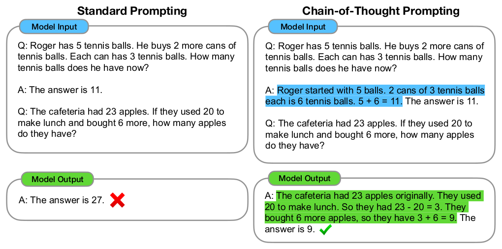
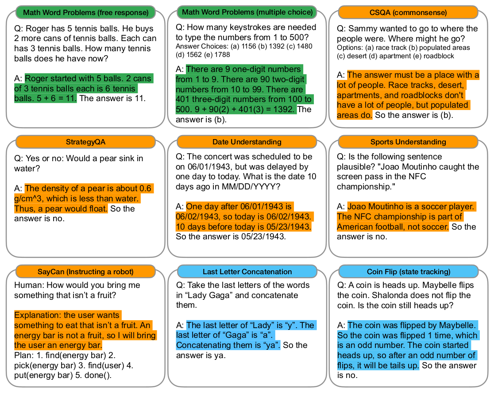
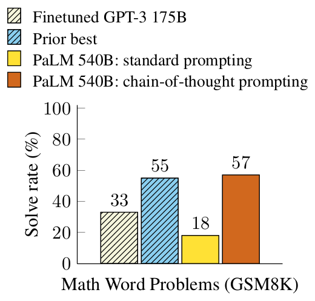
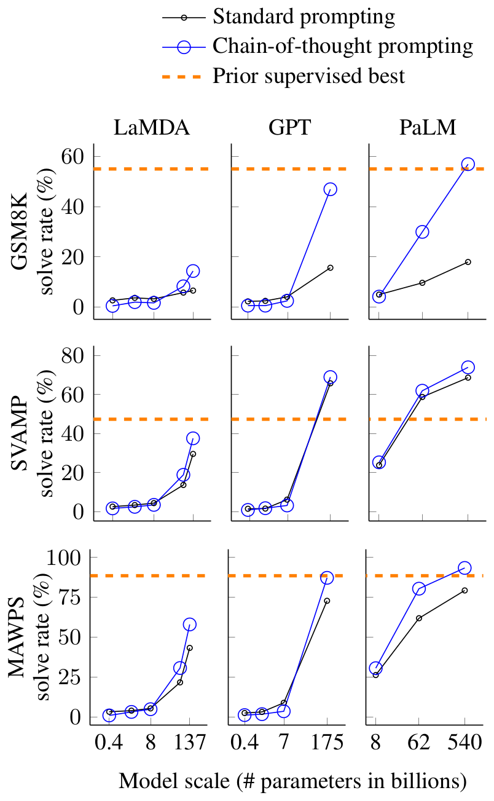
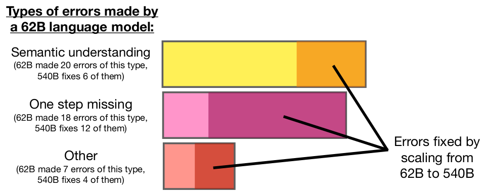
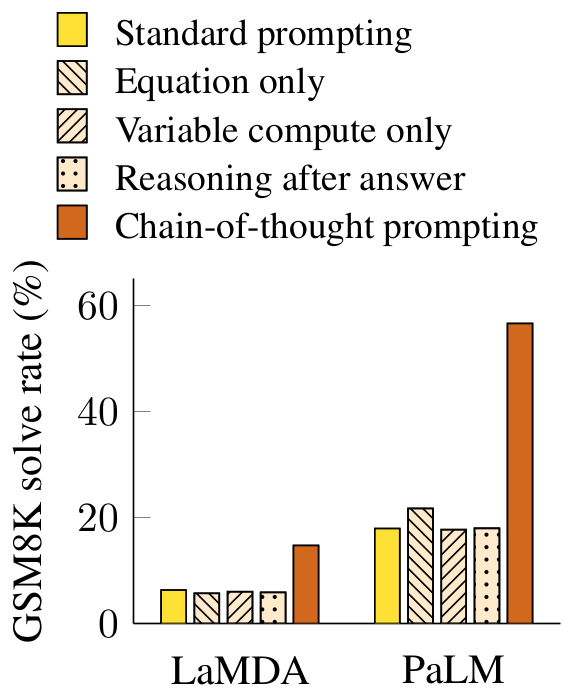
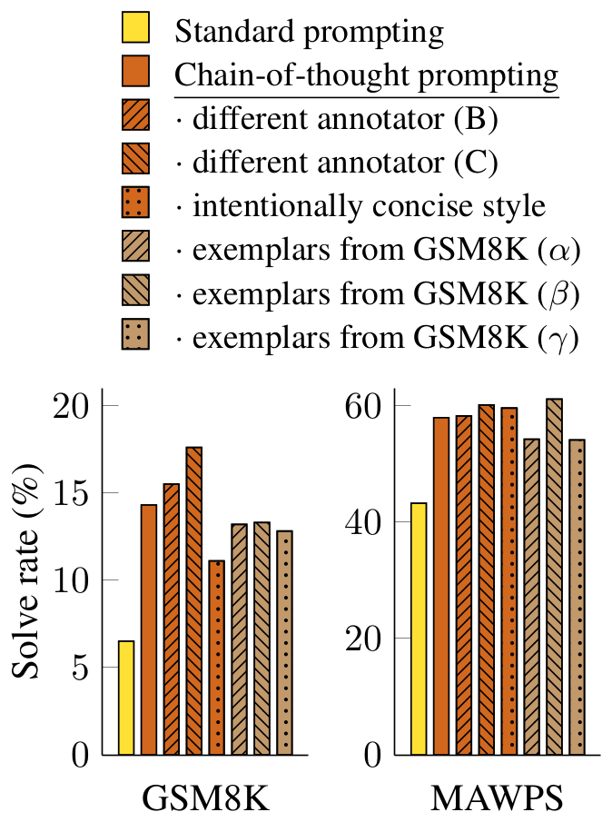
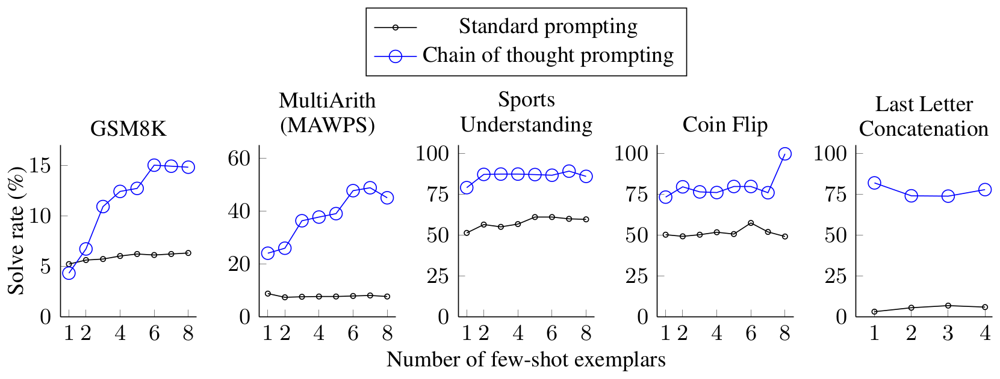
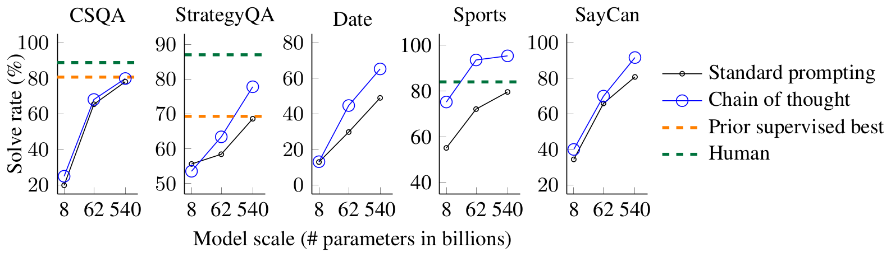
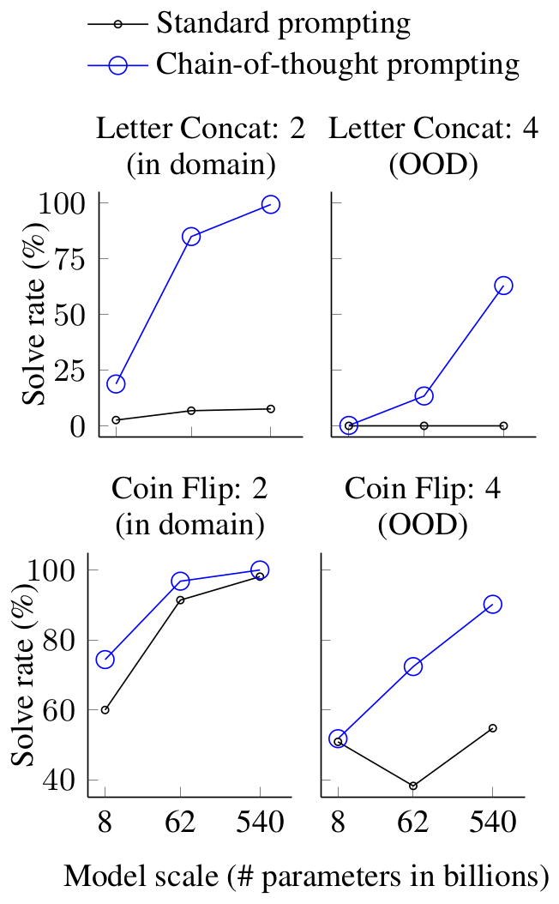

# 论文中文解读：《Chain-of-Thought Prompting Elicits Reasoning in Large Language Models》

> **基本信息**：Jason Wei、Xuezhi Wang、Dale Schuurmans、Maarten Bosma、Brian Ichter、Fei Xia、Ed H. Chi、Quoc V. Le、Denny Zhou（Google Research, Brain Team），NeurIPS 2022，arXiv:2201.11903（本文依据 v6，2023 年 1 月）；论文原文 [官方页面](https://arxiv.org/abs/2201.11903)。
>
> **本文的读法**：图为从论文 PDF 中裁出的原图，表为逐格核对后的中文转录（数字与原文一致，表头和行名译成中文；凡一格里写“标准 / CoT”的，表示同一设置下标准提示与思维链提示两个数字）。每张图、表前后都有中文图题、图例翻译和读法结论。附录里数量很大的 prompt 示例和逐任务输出只摘取关键的，其余用文字概括。文中标“读者注”的是整理者的补充理解，不是论文原话。

## 一、一句话结论

标准 few-shot 提示只让模型看到“问题 → 答案”，在多步算术、常识和符号推理上表现很差，而且单靠加大模型规模改善有限。这篇论文的做法极其简单：把每个示例改写成“问题 → 一串自然语言中间推理步骤（chain of thought，思维链，下文简称 CoT）→ 答案”，让模型回答新问题时也先写步骤、再给答案。全程不微调、不改参数、不需要额外训练数据。主要结论：

- PaLM 540B 只用 8 个手写 CoT 示例，GSM8K 数学应用题的解题率从标准提示的 17.9% 升到 56.9%，超过此前最好的 55%（Cobbe et al. 的微调 GPT-3 加 verifier）；
- 这种收益是模型规模的“涌现”能力：约 100B 参数以上才明显出现；更小的模型写出流畅但不合逻辑的链，往往还不如标准提示；
- 题目越需要多步推理，收益越大；一步就能做对的题几乎没有收益；
- 消融排除了三种替代解释：只写方程、只增加没有语义的计算量（点号）、把推理放到答案之后，都不能复现收益；
- 换标注者、换示例、换示例顺序和数量，收益依然存在（但有方差）；在常识推理和符号推理上同样有效，符号任务上还能泛化到比示例更长的输入；
- 论文也明确承认：链看起来像推理，不等于网络真的在“推理”；链本身不保证正确；收益只在大模型上出现，部署成本高。

## 二、背景与动机

### 2.1 已有的两条路线及各自的缺点

论文从两个各有缺陷的想法出发：

1. **生成自然语言推理依据（rationale）**：先前工作让模型生成通向答案的自然语言中间步骤，要么从头训练（Ling et al., 2017），要么微调预训练模型（Cobbe et al., 2021）；另有神经符号方法，用形式语言而不是自然语言表示推理（Roy and Roth, 2015；Chiang and Chen, 2019；Amini et al., 2019；Chen et al., 2019）。缺点：要构造一大批高质量的 rationale，比普通的“输入—输出对”复杂、昂贵得多。
2. **少样本提示（few-shot prompting）**：不为每个任务微调一份模型，而是在输入里放几个“输入—输出”示例来演示任务（Brown et al., 2020）。它在简单问答上很成功，但在需要推理的任务上效果差，而且往往不随模型变大而明显变好（Rae et al., 2021）。

本文把两者的优点合起来：提示里的每个示例是（输入，思维链，输出）三元组。只靠提示的好处是，不需要大规模训练集，一份模型权重就能做很多任务。

### 2.2 思维链的定义

论文把 CoT 定义为“通向最终答案的一串连贯的中间自然语言推理步骤”。类比人解多步应用题：通常先把问题分解成中间步骤，逐步解决，再给最终答案，例如“Jane 给了妈妈 2 朵花后还剩 10 朵……再给爸爸 3 朵后剩 7 朵……所以答案是 7”。目标就是让语言模型也生成这样的链。

为什么叫 chain of thought，而不叫解答（solution）或解释（explanation）？论文承认图 1 里的链“像一份解答，也可以当作解答来读”，但仍称其为 chain of thought，是想强调它模仿的是逐步思考、得出答案的过程；而且以往文献中的解答或解释通常出现在最终答案**之后**（Narang et al., 2020；Wiegreffe et al., 2022；Lampinen et al., 2022 等）。位置的差别在第五节“答案之后再推理”的消融里会变得很关键。

### 2.3 论文列出的四个性质

1. **分解**：原则上，CoT 允许模型把多步问题分解成中间步骤，因此可以给需要更多推理步骤的问题分配更多计算。
2. **可解释的窗口**：CoT 给出模型可能如何得到某个答案的线索，让人有机会调试推理在哪一步出了错。论文同时说明：完整刻画模型内部到底做了什么计算来支持答案，仍是开放问题。
3. **通用**：可用于数学应用题、常识推理、符号操作，原则上适用于任何人类能用语言解决的任务。
4. **易于激发**：只要把 CoT 示例放进 few-shot 提示，就能在足够大的现成语言模型中引出这种推理。

### 2.4 读者注：把 CoT 看成条件生成

标准提示让模型直接建模 $p(y\mid x)$；CoT 提示让模型先生成一段中间文字 $r$，再生成答案：

$$
p(y\mid x)\quad\Longrightarrow\quad p(r,y\mid x)=\prod_t p(r_t\mid x,r_{\lt t})\prod_j p(y_j\mid x,r,y_{\lt j}).
$$

这个写法**不是论文里的公式**，只是帮助理解：$r$ 不是另一个隐藏网络，而是一串普通 token。自回归模型每生成一个 token 都要做一次前向计算，把中间状态写成 token，后面的预测就能以这些状态为条件；于是输出长度同时是一种随题目难度伸缩的顺序计算预算（对应上面的性质 1）。但第五节的消融会表明，只有计算量不够，中间文字还必须有任务语义并且位于答案之前。

多步题同时要求语义解析、状态维护、运算和答案格式化。若只要求最终答案，一个错误 token 就可能对应整条隐含推导失败，而且外部无法定位问题；CoT 把任务拆成多个局部转移：先识别量，再建立关系，再计算，再输出答案。

另外要区分“可检查”和“忠实”：CoT 提供的是行为层面的调试接口，不等于读出了模型真实的内部计算。论文第 2 节和第 6 节都明确把这一点留作开放问题。

### 2.5 与相邻方法的区别（论文第 7 节与附录 C）

- **指令类方法**（FLAN、T0、InstructGPT 等）：在**输入**一侧加说明，指令通常放在输入前面；CoT 则增强语言模型的**输出**。
- **自然语言解释（NLE）**：通常和最终预测同时、或在预测之后生成，主要目的是提高可解释性；CoT 发生在最终答案之前，目的是把多跳推理拆成多步，可解释性只是副产品。
- **Scratchpad**（Nye et al., 2021）：让语言模型先逐行预测 Python 程序的中间计算结果，再给出最终输出，比直接预测最终输出更好；CoT 把这类面向特定领域的中间步骤推广为开放域的自然语言，并且不需要微调。
- **Cobbe et al. (2021)**：扩大了数据集并用它微调预训练模型；本文没有任何微调。

附录 C 的扩展相关工作还补充了几条线索：

- **提示**：除了指令类方法，还有人机交互（HCI）工作表明，把语言模型的多次生成顺序地组合起来，能在 20 人的用户研究里改善任务结果；
- **程序合成与执行**：用中间步骤有很长的历史；与本文最近的是 Nye et al. (2021)，表明大语言模型能做最多 10 位的加法、求多项式的值、执行 Python 程序；本文把这类领域专用的原语推广到自然语言；
- **数值与逻辑推理**：已有工作用预定义的可执行操作增强 BERT、加图神经网络、专门的训练过程来注入数值推理能力，或把规则用自然语言表达来做逻辑推理；它们通常针对特定任务且需要微调；
- **中间语言步骤**：已有大量工作表明，让神经网络产生自然语言中间步骤可以提高性能、鲁棒性、加快训练、缓解偏见，甚至帮助图像和强化学习场景；做法通常是在人工标注或合成的数据集上微调；本文则表明，只靠提示就能在现成的足够大的模型里引出这类能力，一个模型无需任何梯度更新就能做多种推理任务。

## 三、方法与实验设置

### 3.1 一个 CoT 提示长什么样



*图 1（原文 Figure 1，第 1 页）：标准提示（左）与思维链提示（右）的模型输入与输出。*

**图中文字翻译与读法**：

- **左图 Standard Prompting（标准提示）**：Model Input（模型输入）先给一个示例——“Q：Roger 有 5 个网球。他又买了 2 罐网球，每罐 3 个。他现在有多少个网球？ A：答案是 11。”——再给要回答的新问题“Q：食堂有 23 个苹果。如果用掉 20 个做午饭，又买了 6 个，他们现在有多少个苹果？”。Model Output（模型输出）是“A：答案是 27。”，旁边的红叉表示错误。
- **右图 Chain-of-Thought Prompting（思维链提示）**：输入里的示例多了蓝色高亮的推理——“Roger 起初有 5 个球。2 罐每罐 3 个网球就是 6 个网球。5 + 6 = 11。答案是 11。”。模型输出（绿色高亮）是“食堂原来有 23 个苹果。他们用掉 20 个做午饭，所以剩 23 - 20 = 3 个。又买了 6 个苹果，所以有 3 + 6 = 9 个。答案是 9。”，绿色对勾表示正确。
- **读图结论**：两边的问题和示例题目完全相同，唯一的差别是示例答案里有没有那段中间推理。模型的输出会模仿示例的格式，于是“一步给出答案”变成“先推理、后给答案”，同一个模型就从答错变成答对。

### 3.2 九类任务里的思维链长什么样



*图 3（原文 Figure 3，第 4 页）：算术、常识和符号推理基准上的（输入，思维链，输出）三元组示例，高亮部分是思维链。完整 prompt 见论文附录 G。*

**图中文字翻译与读法**：九个面板按颜色分三组——绿色标题是数学应用题，橙色标题是常识推理，蓝色标题是符号推理。每个面板上半是问题，下半是带高亮思维链的回答。

| 面板（任务） | 问题（译） | 高亮的思维链（译）与最终答案 |
|---|---|---|
| Math Word Problems（free response，自由作答） | Roger 有 5 个网球。他又买了 2 罐，每罐 3 个。他现在有多少个？ | Roger 起初有 5 个球。2 罐每罐 3 个网球共 6 个。5 + 6 = 11。答案是 11。 |
| Math Word Problems（multiple choice，选择题） | 键入 1 到 500 的所有数字需要敲多少次键？选项：(a) 1156 (b) 1392 (c) 1480 (d) 1562 (e) 1788 | 1 到 9 有 9 个一位数；10 到 99 有 90 个两位数；100 到 500 有 401 个三位数。9 + 90(2) + 401(3) = 1392。答案是 (b)。 |
| CSQA（commonsense，常识问答） | Sammy 想去人多的地方。他可能去哪？选项：(a) 赛马场 (b) 人口密集区 (c) 沙漠 (d) 公寓 (e) 路障 | 答案必须是人很多的地方。赛马场、沙漠、公寓和路障人都不多，但人口密集区人多。所以答案是 (b)。 |
| StrategyQA | 是或否：梨会沉在水里吗？ | 梨的密度约为 0.6 g/cm^3，比水小。因此梨会浮起来。所以答案是 no。 |
| Date Understanding（日期理解） | 音乐会原定于 06/01/1943，推迟一天到今天。10 天前的日期是什么（MM/DD/YYYY）？ | 06/01/1943 的后一天是 06/02/1943，所以今天是 06/02/1943。今天的 10 天前是 05/23/1943。所以答案是 05/23/1943。 |
| Sports Understanding（体育理解） | 下面这句话是否合理？“Joao Moutinho 在 NFC 冠军赛中接到了 screen pass。” | Joao Moutinho 是足球运动员。NFC 冠军赛属于美式橄榄球，不属于足球。所以答案是 no。 |
| SayCan（Instructing a robot，指挥机器人） | Human：你会怎样给我拿一样不是水果的东西？ | Explanation：用户想要不是水果的吃的东西。能量棒不是水果，所以我给用户拿一根能量棒。Plan：1. find(energy bar) 2. pick(energy bar) 3. find(user) 4. put(energy bar) 5. done()。 |
| Last Letter Concatenation（末字母拼接） | 取 “Lady Gaga” 中各个词的最后一个字母并拼接。 | “Lady” 的最后一个字母是 “y”。“Gaga” 的最后一个字母是 “a”。拼接起来是 “ya”。所以答案是 ya。 |
| Coin Flip（state tracking，状态追踪） | 硬币正面朝上。Maybelle 抛了硬币。Shalonda 没有抛。硬币还是正面朝上吗？ | 硬币被 Maybelle 抛了。所以硬币被抛了 1 次，是奇数。硬币开始时正面朝上，所以抛奇数次后会变成反面朝上。所以答案是 no。 |

**读图结论**：思维链的内容随任务变化——数学题的链里有算式，常识题的链里有排除法和背景知识（梨的密度、运动项目归属），符号题的链里有逐步的状态更新（抛了几次、奇偶）——但接口完全一致：先复述并拆解条件、逐步推出，最后用固定句式“So the answer is …”收尾（读者注：这个固定句式也方便从生成文本里抽取最终答案）。

### 3.3 提示是怎样构造的

标准提示是同样的 few-shot 格式，只是每个示例的答案里去掉思维链，只剩一句“答案是 X”（图 1 左）。CoT 提示则给每个示例补上一条思维链。各任务的示例数量与来源如下：

| 任务 | few-shot 示例数 | 示例的来源与做法 | 全文所在 |
|---|---:|---|---|
| 算术：GSM8K、SVAMP、ASDiv、MAWPS 各子集 | 8 | 作者手写 CoT；同一套 8 个示例用于这些数据集的全部评测；这套示例没有经过 prompt 工程 | 表 20 |
| 算术：AQuA（选择题） | 4 | 取自训练集的题目及其解答 | 表 21 |
| CSQA、StrategyQA | 附录分别列出 7、6 个 | 从训练集随机抽取，手写 CoT | 表 24、25 |
| Date、Sports（BIG-bench） | 附录分别列出 6、8 个 | 这两个任务没有训练集：取评测集中前 10 个例子作示例，在其余例子上报告结果 | 表 26、27 |
| SayCan（机器人规划） | 正文写 6 个，附录表 28 实际列出 7 个 | 取自 Ahn et al. (2022) 使用的训练集，手写 CoT（格式为 Explanation 加 Plan） | 表 28 |
| 末字母拼接 | 4 | 只给 2 个词的名字（如 Elon Musk） | 表 22 |
| 抛硬币 | 8 | 只给 2 个人的情形 | 表 23 |

补充几点：标注者在写 CoT 时没有拿到具体写法的指令，只被要求“把得到答案的逐步推理过程写下来”，所以每个人的链带有自己的语言风格（附录 A.2）；示例总数固定为 8 个，是受输入长度 1024 个 token 的限制（附录 D.3）。

### 3.4 算术提示全文（原文表 20）

这是论文最核心的“方法”本身：下面 8 个示例就是 GSM8K、SVAMP、ASDiv、MAWPS 全部使用的 CoT 提示（原文表 20，第 35 页）。使用时把它们依次拼在前面，最后接上待回答的新问题和 `A:`，让模型续写。

```text
Q: There are 15 trees in the grove. Grove workers will plant trees in the grove today. After they are done, there will be 21 trees. How many trees did the grove workers plant today?
A: There are 15 trees originally. Then there were 21 trees after some more were planted. So there must have been 21 - 15 = 6. The answer is 6.

Q: If there are 3 cars in the parking lot and 2 more cars arrive, how many cars are in the parking lot?
A: There are originally 3 cars. 2 more cars arrive. 3 + 2 = 5. The answer is 5.

Q: Leah had 32 chocolates and her sister had 42. If they ate 35, how many pieces do they have left in total?
A: Originally, Leah had 32 chocolates. Her sister had 42. So in total they had 32 + 42 = 74. After eating 35, they had 74 - 35 = 39. The answer is 39.

Q: Jason had 20 lollipops. He gave Denny some lollipops. Now Jason has 12 lollipops. How many lollipops did Jason give to Denny?
A: Jason started with 20 lollipops. Then he had 12 after giving some to Denny. So he gave Denny 20 - 12 = 8. The answer is 8.

Q: Shawn has five toys. For Christmas, he got two toys each from his mom and dad. How many toys does he have now?
A: Shawn started with 5 toys. If he got 2 toys each from his mom and dad, then that is 4 more toys. 5 + 4 = 9. The answer is 9.

Q: There were nine computers in the server room. Five more computers were installed each day, from monday to thursday. How many computers are now in the server room?
A: There were originally 9 computers. For each of 4 days, 5 more computers were added. So 5 * 4 = 20 computers were added. 9 + 20 is 29. The answer is 29.

Q: Michael had 58 golf balls. On tuesday, he lost 23 golf balls. On wednesday, he lost 2 more. How many golf balls did he have at the end of wednesday?
A: Michael started with 58 golf balls. After losing 23 on tuesday, he had 58 - 23 = 35. After losing 2 more, he had 35 - 2 = 33 golf balls. The answer is 33.

Q: Olivia has $23. She bought five bagels for $3 each. How much money does she have left?
A: Olivia had 23 dollars. 5 bagels for 3 dollars each will be 5 x 3 = 15 dollars. So she has 23 - 15 dollars left. 23 - 15 is 8. The answer is 8.
```

读这套提示可以看出几个特点：

- 8 道题都是小学水平的 1–2 步应用题（一步减法、一步加法、先加后减、先乘后加、先乘后减等），没有一道需要复杂技巧；链的写法是“复述已知量 → 逐步列出带数字的算式 → 用固定句式 The answer is X 收尾”。
- 其中第 6 题（服务器机房）的链里包含 `5 * 4 = 20` 这样的乘法，第 5 题（Shawn 的玩具）则要先把“两个人各给 2 个”合并成“4 个”，这是 CoT 示例里“分解”的典型样子。
- AQuA 的 4 个示例（表 21，第 36 页）取自训练集，是带选项的代数题：例如“15 个数的平均数是 40，每个数加 10 后平均数是多少？”的链为“每个数加 10，平均数也增加 10，所以新平均数是 50。答案是 (a)”；另一例就是图 3 里的“键入 1 到 500 要敲多少次键”。其余任务（末字母、抛硬币、CSQA、StrategyQA、Date、Sports、SayCan）的示例都与图 3 的格式一致，不再逐个转录。

### 3.5 模型、解码与评测协议

- **模型**（共五类）：GPT-3（Brown et al., 2020），使用 `text-ada-001`、`text-babbage-001`、`text-curie-001`、`text-davinci-002`，论文说它们“大概”对应 InstructGPT 的 350M、1.3B、6.7B、175B（Ouyang et al., 2022）；LaMDA（Thoppilan et al., 2022），422M、2B、8B、68B、137B（表中记作 420M 等）；PaLM，8B、62B、540B；UL2 20B（Tay et al., 2022）；Codex（Chen et al., 2021；OpenAI API 里的 `code-davinci-002`）。
- **解码**：贪心解码。论文在括号里提到，后续工作（Wang et al., 2022a，即 Self-Consistency）表明，对多条采样结果取多数最终答案还能进一步提高 CoT 的效果。
- **随机性**：LaMDA 报告 5 个随机种子的平均，每个种子对应示例的一种随机洗牌顺序；由于 LaMDA 在不同种子下方差不大，为节省算力，其他模型只用一种示例顺序。
- **算力**：全文只做提示推理，没有微调。LaMDA 137B 推理用 TPU v3（8×8 配置，64 chip / 128 core），PaLM 540B 用 TPU v4（4×4×12 配置，192 chip / 384 core），GPT-3 使用公开 API。
- **指标**：所有表中的数字都是准确率（solve rate，%）。
- **版本说明**：本文依据 v6。版本记录（附录 E）：v2 加入 PaLM（v1 只有 LaMDA）；v3 加入 GPT-3、SVAMP 与 AQuA、SayCan、附录 FAQ、扩展相关工作和各项原始结果；v5 加入 Codex 与 UL2；v4 和 v6 分别修正了图 3 的笔误。

### 3.6 外部计算器（附录 B）

附录 B 观察到，有些链的方程本身是对的，只是模型把算术算错了（Cobbe et al. 也有类似观察）。于是论文对所有生成的 CoT，用一个 Python 程序（调用 `eval`）作为**事后外部计算器**重新计算其中每个方程；当一条链里有多个方程时，通过字符串匹配把前一个方程的计算结果传到后面的方程。这一步只修正算术，不改变推理，在表 1 里记作“+ ext. calc”。

## 四、算术推理实验

### 4.1 数据集（原文表 12）

论文用五个数学应用题基准：GSM8K（Cobbe et al., 2021）、SVAMP（Patel et al., 2021，结构各异的应用题）、ASDiv（Miao et al., 2020，多样化应用题）、AQuA（Ling et al., 2017，代数应用题，选择题）和 MAWPS（Koncel-Kedziorski et al., 2016）。MAWPS 又按难度分成 SingleOp、SingleEq、AddSub、MultiArith 四个子集（表 3）。

| 数据集 | 评测题数 N | 例题（译） |
|---|---:|---|
| GSM8K | 1,319 | Josh 想试着翻修房子再转卖。他花 80,000 美元买了房子，又花 50,000 美元修缮，这使房子的价值增加了 150%。他赚了多少钱？ |
| SVAMP | 1,000 | 每包 DVD 76 美元。如果每包优惠 25 美元，买每包要付多少钱？ |
| ASDiv | 2,096 | Ellen 比 Marin 多 6 个球。Marin 有 9 个球。Ellen 有多少个球？ |
| AQuA | 254 | 一辆车沿直线匀速驶向一座垂直塔的塔底，从车上观察塔顶，仰角在 10 分钟内从 45° 变为 60°。这辆车还要多久到达塔底？选项：(a) 5√3 + 1 (b) 6√3 + 2 (c) 7√3 - 1 (d) 8√3 - 2 (e) 以上都不对 |
| MAWPS：SingleOp | 562 | 盒子里有 7 个瓶盖，Linda 又放进 7 个，盒子里有多少个瓶盖？ |
| MAWPS：SingleEq | 508 | Benny 买了一瓶 2 美元的软饮和 5 根糖棒，一共花了 27 美元。每根糖棒多少钱？ |
| MAWPS：AddSub | 395 | 花瓶里有 6 朵玫瑰。Mary 从花园里剪了一些。现在花瓶里有 16 朵玫瑰。她剪了多少朵？ |
| MAWPS：MultiArith | 600 | 学校食堂为学生午餐订了 42 个红苹果和 7 个绿苹果。但只有 9 个学生想要水果，食堂多出了多少个？ |

（原文表 12，第 29 页。）读法：GSM8K 是需要多步推理的题（论文称它是基线表现最低的数据集）；SingleOp 只要一步；AQuA 是带选项的代数题，不需要自由生成数字答案。题型从“一步”到“多步”依次排开，正好用来检验“收益是否随所需步数增加”。

### 4.2 主结果：图 2、图 4 与表 1

先看最醒目的一个结果。



*图 2（原文 Figure 2，第 2 页）：PaLM 540B 使用思维链提示在 GSM8K 数学应用题上达到当时最好的水平。*

**图中文字翻译与读法**：纵轴 Solve rate (%)（解题率），横轴单一类别 Math Word Problems (GSM8K)。四根柱依次为：Finetuned GPT-3 175B（微调的 GPT-3，33）、Prior best（此前最好，55，即摘要所说带 verifier 的微调 GPT-3，二者都引自 Cobbe et al., 2021）、PaLM 540B: standard prompting（标准提示，18）、PaLM 540B: chain-of-thought prompting（思维链提示，57）。图上标注的 18 与 57 是取整值，精确值见表 1：17.9 与 56.9。

**读图结论**：同一个 PaLM 540B，只把提示从标准换成 CoT，解题率约提高三倍，并略高于此前需要微调加 verifier 才能达到的水平。

图 4 把三个模型家族随规模的变化放在一起：



*图 4（原文 Figure 4，第 5 页）：LaMDA、GPT、PaLM 在 GSM8K、SVAMP、MAWPS 上，标准提示与思维链提示随模型规模的变化。*

**图中文字翻译与读法**：

- **布局**：3 行 × 3 列。行从上到下是 GSM8K、SVAMP、MAWPS，列从左到右是 LaMDA、GPT、PaLM；纵轴 solve rate (%)；横轴 Model scale (# parameters in billions)（模型参数量，单位十亿）：LaMDA 五个点（420M、2B、8B、68B、137B）、GPT 四个点（350M、1.3B、6.7B、175B）、PaLM 三个点（8B、62B、540B），图上只标出部分刻度（如 0.4、8、137）。
- **图例**：黑色细线加小圆点是 Standard prompting（标准提示）；蓝色线加大空心圆是 Chain-of-thought prompting（思维链提示）；橙色虚线是 Prior supervised best（此前最好的有监督结果）。
- **GSM8K 行**：小模型上蓝线与黑线几乎重合，甚至蓝线略低；到 LaMDA 137B、GPT 175B、PaLM 62B/540B 时蓝线才明显抬升，PaLM 540B 的蓝线（约 57）越过橙色虚线（55）。
- **SVAMP 与 MAWPS 行**：规律相同，只是起点更高；GPT 175B、PaLM 的 CoT 点也接近或超过橙线。
- **读图注意**：本图只用来看趋势。把 PDF 里的矢量坐标换算成数值（以同一行里 LaMDA 137B 与 GPT 175B 的已知点标定，换算结果与表 2 的其余点完全吻合），PaLM 的 SVAMP 子图里 CoT 的三个点是 25.2、61.9、73.9，与表 2 中 PaLM 的 ASDiv 行完全相同，而表 2 的 SVAMP 行是 16.8、46.7、79.0；标准提示的 8B、62B 两点（23.7、58.7）也是 ASDiv 行的数字，540B 的点换算为 68.6，与 SVAMP 行（69.4）和 ASDiv 行（72.1）都对不上。SVAMP 的橙色虚线换算为 47.3（图注引 Jie et al., 2022），而表 1 的此前最好是 57.4（引 Pi et al., 2022）。精确数字请一律看表 1 和表 2。
- **读图结论**：CoT 的优势只出现在曲线的右端（大模型）；横轴靠左的小模型上，蓝线不高于黑线。

表 1 给出五个模型在五个基准上的精确结果，并附上外部计算器的效果：

**表 1：标准提示、思维链提示与思维链加外部计算器在五个算术基准上的准确率（%）；括号内为思维链相对标准提示的变化**

| 模型 | 提示方式 | GSM8K | SVAMP | ASDiv | AQuA | MAWPS |
|---|---|---:|---:|---:|---:|---:|
| 此前最好（有监督微调） | 不适用 | 55 | 57.4 | 75.3 | 37.9 | 88.4 |
| UL2 20B | 标准 | 4.1 | 10.1 | 16.0 | 20.5 | 16.6 |
| | 思维链 | 4.4 (+0.3) | 12.5 (+2.4) | 16.9 (+0.9) | 23.6 (+3.1) | 19.1 (+2.5) |
| | 思维链 + 外部计算器 | 6.9 | 28.3 | 34.3 | 23.6 | 42.7 |
| LaMDA 137B | 标准 | 6.5 | 29.5 | 40.1 | 25.5 | 43.2 |
| | 思维链 | 14.3 (+7.8) | 37.5 (+8.0) | 46.6 (+6.5) | 20.6 (-4.9) | 57.9 (+14.7) |
| | 思维链 + 外部计算器 | 17.8 | 42.1 | 53.4 | 20.6 | 69.3 |
| GPT-3 175B（`text-davinci-002`） | 标准 | 15.6 | 65.7 | 70.3 | 24.8 | 72.7 |
| | 思维链 | 46.9 (+31.3) | 68.9 (+3.2) | 71.3 (+1.0) | 35.8 (+11.0) | 87.1 (+14.4) |
| | 思维链 + 外部计算器 | 49.6 | 70.3 | 71.1 | 35.8 | 87.5 |
| Codex（`code-davinci-002`） | 标准 | 19.7 | 69.9 | 74.0 | 29.5 | 78.7 |
| | 思维链 | 63.1 (+43.4) | 76.4 (+6.5) | 80.4 (+6.4) | 45.3 (+15.8) | 92.6 (+13.9) |
| | 思维链 + 外部计算器 | 65.4 | 77.0 | 80.0 | 45.3 | 93.3 |
| PaLM 540B | 标准 | 17.9 | 69.4 | 72.1 | 25.2 | 79.2 |
| | 思维链 | 56.9 (+39.0) | 79.0 (+9.6) | 73.9 (+1.8) | 35.8 (+10.6) | 93.3 (+14.2) |
| | 思维链 + 外部计算器 | 58.6 | 79.8 | 72.6 | 35.8 | 93.5 |

（原文表 1，第 20 页。此前最好数字的来源：GSM8K 来自 Cobbe et al., 2021；SVAMP 与 MAWPS 来自 Pi et al., 2022；ASDiv 来自 Lan et al., 2021；AQuA 来自 Piękos et al., 2021。）

**读法**：

- PaLM 540B 加 CoT 后，GSM8K、SVAMP、MAWPS 三项超过表中的“此前最好”（56.9 对 55，79.0 对 57.4，93.3 对 88.4）；ASDiv（73.9 对 75.3，差 1.4）和 AQuA（35.8 对 37.9，差 2.1）略低。论文正文说这两项“在 2% 以内”，按表中数字，AQuA 差 2.1 个百分点，是近似说法。
- 表中 Codex 的 CoT 成绩（GSM8K 63.1）比 PaLM 540B 还高，五项全部超过“此前最好”；GPT-3 175B 的 CoT 只在 SVAMP 上超过它。摘要里的“state-of-the-art”是对 PaLM 540B 在 GSM8K 上的陈述。
- 外部计算器对小模型帮助很大（UL2 20B 的 MAWPS 从 19.1 升到 42.7），说明小模型的链常常“推理对但算错”；对 PaLM 540B 的增益较小（GSM8K 56.9 到 58.6）。它并非处处有益：ASDiv 上 PaLM（73.9 到 72.6）、GPT-3（71.3 到 71.1）、Codex（80.4 到 80.0）都略有下降。AQuA 是选择题，没有可交给计算器的自由数字答案，所以数字不变。
- LaMDA 137B 在 AQuA 上 CoT 反而低于标准（25.5 到 20.6，-4.9），是表中唯一的负增益格子。

### 4.3 三个主要结论（论文第 3.2 节）

**一、CoT 是模型规模的涌现能力**：对小模型，CoT 不但没有提升，还会降低表现——论文定性地观察到小模型写出的链“流畅但不合逻辑”；只有约 100B 参数的模型才出现增益。以 GSM8K 为例（表 2 的数字，增益为 CoT 减标准，由本文相减得到）：

| 模型 | 标准 | CoT | 增益 |
|---|---:|---:|---:|
| LaMDA 420M | 2.6 | 0.4 | -2.2 |
| LaMDA 2B | 3.6 | 1.9 | -1.7 |
| LaMDA 8B | 3.2 | 1.6 | -1.6 |
| LaMDA 68B | 5.7 | 8.2 | +2.5 |
| LaMDA 137B | 6.5 | 14.3 | +7.8 |
| GPT 350M | 2.2 | 0.5 | -1.7 |
| GPT 1.3B | 2.4 | 0.5 | -1.9 |
| GPT 6.7B | 4.0 | 2.4 | -1.6 |
| GPT 175B | 15.6 | 46.9 | +31.3 |
| PaLM 8B | 4.9 | 4.1 | -0.8 |
| PaLM 62B | 9.6 | 29.9 | +20.3 |
| PaLM 540B | 17.9 | 56.9 | +39.0 |
| UL2 20B | 4.1 | 4.4 | +0.3 |
| Codex | 19.7 | 63.1 | +43.4 |

附录 A.1 更明确地说：CoT 的成功不能由小模型的表现外推预测，对多数小于 10B 参数的模型，CoT 实际上有害。

**二、越复杂的题，收益越大**：GSM8K 是基线最低的数据集，最大的 GPT 和 PaLM 上解题率翻了一倍以上（GPT 175B 从 15.6 到 46.9，PaLM 540B 从 17.9 到 56.9，都约为三倍）；MAWPS 里只需一步的 SingleOp 子集上，提升为负或很小。表 3 把 MAWPS 分层后看得更清楚（见 4.4 节）：需要多步的 MultiArith 上 PaLM 540B 从 42.2 升到 94.7，只需一步的 SingleOp 上只是 94.1 到 94.1。

**三、与有监督 SOTA 相比很有竞争力**：GPT-3 175B 和 PaLM 540B 加 CoT 后，与通常需要在带标注训练集上微调专用模型的此前最好结果相比，表现不逊；PaLM 540B 在 GSM8K、SVAMP、MAWPS 上刷新了最好水平（SVAMP 上标准提示本身就已经超过此前最好）。

### 4.4 全部模型的完整结果（表 2、表 3）

**表 2：五个算术基准上，标准提示与思维链提示的准确率（%），每格为“标准 / CoT”**

| 模型 | GSM8K | SVAMP | ASDiv | AQuA | MAWPS |
|---|---:|---:|---:|---:|---:|
| UL2 20B | 4.1 / 4.4 | 10.1 / 12.5 | 16.0 / 16.9 | 20.5 / 23.6 | 16.6 / 19.1 |
| LaMDA 420M | 2.6 / 0.4 | 2.5 / 1.6 | 3.2 / 0.8 | 23.5 / 8.3 | 3.2 / 0.9 |
| LaMDA 2B | 3.6 / 1.9 | 3.3 / 2.4 | 4.1 / 3.8 | 22.9 / 17.7 | 3.9 / 3.1 |
| LaMDA 8B | 3.2 / 1.6 | 4.3 / 3.4 | 5.9 / 5.0 | 22.8 / 18.6 | 5.3 / 4.8 |
| LaMDA 68B | 5.7 / 8.2 | 13.6 / 18.8 | 21.8 / 23.1 | 22.3 / 20.2 | 21.6 / 30.6 |
| LaMDA 137B | 6.5 / 14.3 | 29.5 / 37.5 | 40.1 / 46.6 | 25.5 / 20.6 | 43.2 / 57.9 |
| GPT 350M | 2.2 / 0.5 | 1.4 / 0.8 | 2.1 / 0.8 | 18.1 / 8.7 | 2.4 / 1.1 |
| GPT 1.3B | 2.4 / 0.5 | 1.5 / 1.7 | 2.6 / 1.4 | 12.6 / 4.3 | 3.1 / 1.7 |
| GPT 6.7B | 4.0 / 2.4 | 6.1 / 3.1 | 8.6 / 3.6 | 15.4 / 13.4 | 8.8 / 3.5 |
| GPT 175B | 15.6 / 46.9 | 65.7 / 68.9 | 70.3 / 71.3 | 24.8 / 35.8 | 72.7 / 87.1 |
| Codex | 19.7 / 63.1 | 69.9 / 76.4 | 74.0 / 80.4 | 29.5 / 45.3 | 78.7 / 92.6 |
| PaLM 8B | 4.9 / 4.1 | 15.1 / 16.8 | 23.7 / 25.2 | 19.3 / 21.7 | 26.2 / 30.5 |
| PaLM 62B | 9.6 / 29.9 | 48.2 / 46.7 | 58.7 / 61.9 | 25.6 / 22.4 | 61.8 / 80.3 |
| PaLM 540B | 17.9 / 56.9 | 69.4 / 79.0 | 72.1 / 73.9 | 25.2 / 35.8 | 79.2 / 93.3 |

（原文表 2，第 21 页。）读法：看每一行的两个数字谁大。LaMDA、GPT 的前三个小尺寸几乎每格都是 CoT 更低；到 LaMDA 68B 起、GPT 175B、PaLM 62B 起才普遍翻正，且在 GSM8K 列差距最大。PaLM 62B 在 SVAMP（48.2 对 46.7）和 AQuA（25.6 对 22.4）上仍是 CoT 略低，LaMDA 在 AQuA 一列的所有尺寸（包括 137B）都是 CoT 更低，说明涌现的“门槛”因任务而异；Codex 在所有五列都是 CoT 更高。

**表 3：把 MAWPS 按难度拆成四个子集后的准确率（%），每格为“标准 / CoT”**

| 模型 | SingleOp | SingleEq | AddSub | MultiArith |
|---|---:|---:|---:|---:|
| UL2 20B | 24.9 / 27.2 | 18.0 / 20.2 | 18.5 / 18.2 | 5.0 / 10.7 |
| LaMDA 420M | 2.8 / 1.0 | 2.4 / 0.4 | 1.9 / 0.7 | 5.8 / 1.5 |
| LaMDA 2B | 4.6 / 4.1 | 2.4 / 3.3 | 2.7 / 3.2 | 5.8 / 1.8 |
| LaMDA 8B | 8.0 / 7.0 | 4.5 / 4.4 | 3.4 / 5.2 | 5.2 / 2.4 |
| LaMDA 68B | 36.5 / 40.8 | 23.9 / 26.0 | 17.3 / 23.2 | 8.7 / 32.4 |
| LaMDA 137B | 73.2 / 76.2 | 48.8 / 58.7 | 43.0 / 51.9 | 7.6 / 44.9 |
| GPT 350M | 3.2 / 1.8 | 2.0 / 0.2 | 2.0 / 1.5 | 2.3 / 0.8 |
| GPT 1.3B | 5.3 / 3.0 | 2.4 / 1.6 | 2.3 / 1.5 | 2.2 / 0.5 |
| GPT 6.7B | 13.5 / 3.9 | 8.7 / 4.9 | 8.6 / 2.5 | 4.5 / 2.8 |
| GPT 175B | 90.9 / 88.8 | 82.7 / 86.6 | 83.3 / 81.3 | 33.8 / 91.7 |
| Codex | 93.1 / 91.8 | 86.8 / 93.1 | 90.9 / 89.1 | 44.0 / 96.2 |
| PaLM 8B | 41.8 / 46.6 | 29.5 / 28.2 | 29.4 / 31.4 | 4.2 / 15.8 |
| PaLM 62B | 87.9 / 85.6 | 77.2 / 83.5 | 74.7 / 78.2 | 7.3 / 73.7 |
| PaLM 540B | 94.1 / 94.1 | 86.5 / 92.3 | 93.9 / 91.9 | 42.2 / 94.7 |

（原文表 3，第 21 页。）读法：论文拆开 MAWPS 的目的，是证明“在一步或两步的简单题上，大模型本来就接近满分，所以增益很小”（SingleOp、SingleEq、AddSub）。大模型在这三列里很多格子是 CoT 略低（如 GPT 175B 的 SingleOp 90.9 对 88.8、AddSub 83.3 对 81.3），而在需要多步的 MultiArith 上，增益巨大：GPT 175B 33.8 到 91.7，PaLM 62B 7.3 到 73.7，PaLM 540B 42.2 到 94.7，Codex 44.0 到 96.2。

### 4.5 链本身对不对：LaMDA 137B 的人工检查（附录 D.1、D.2）

提升准确率不等于链是对的。作者人工检查了 LaMDA 137B 在 GSM8K 上的输出。

**答对的 50 个样本**：绝大多数链的逻辑和数学都正确。其中有 5 个有轻微瑕疵但仍连贯可懂：1 个陈述不够明确、1 个出现了无关但正确的话、2 个逻辑对但算式写得不完整、1 个数学对但语义颠倒；另有 1 个是通过错误推理“碰巧”答对。（原文正文写的是“除了两个碰巧答对的之外都正确”，附录 D.1 写的是只有一个，见第十一节。）一个典型的正确链（原文表 8，第 25 页）：

> **问**：James 决定每周跑 3 次，每次 3 个冲刺。每个冲刺跑 60 米。他每周一共跑多少米？
>
> **模型（正确）**：James 决定每周跑 3 次，每次 3 个冲刺。他每个冲刺跑 60 米。所以他一周跑 60 米 × 3 个冲刺 × 3 次。也就是 60 米 × 9。答案是 540。

原文表 9（第 26 页）列出的几类瑕疵案例，用来说明“答案对”不等于“链对”：

| 瑕疵类型 | 题目（译，简） | 模型链中有问题的地方（译） |
|---|---|---|
| 碰巧答对 | 36 只企鹅，三分之一下海，另三分之一进洞吃饭，还有多少只在晒太阳？ | 链里只写了“三分之一是 12 只；另三分之一也是 12 只。答案是 12”，并没有做 36 − 12 − 12，答案 12 恰好与“第二个三分之一”相同。 |
| 陈述不明确 | John 有 2 栋房子，每栋 3 间卧室，每间卧室 2 扇窗；每栋另有 4 扇不属于卧室的窗。两栋共多少扇窗？ | “每栋房子有 4 + 4 = 8 扇窗”“每栋房子有 6 × 2 = 12 扇窗”这两句话的主语不准确（它们其实是两栋合计），最后 12 + 8 = 20 才对。 |
| 无关但正确的话 | Ann 9 岁，她哥哥是她年龄的两倍，3 年后哥哥多大？ | 链中插入了与问题无关的一句“3 年后她将 12 岁”，其余正确，答案 21。 |
| 算式不完整（1） | 汽油每加仑 3 美元，返现每加仑 0.20 美元，买 10 加仑后多少钱？ | 链里写成“20 × 10 = 2 美元”（应是 0.20 × 10），结果 2 是对的，最终 28 美元。 |
| 算式不完整（2） | Nissa 雇了 60 个季节工扮演圣诞精灵，三分之一辞职，随后又有 10 个辞职，还剩多少？ | 链里写成“60 − 1/3 = 40”（应是 60 − 60/3），后一步 40 − 10 = 30 正确。 |
| 语义颠倒 | Jones 奶奶烤了 5 个苹果派，每个切 8 块，晚上结束时还剩 14 块，客人吃了多少块？ | 链里说“客人吃了 14 块，40 − 14 = 26 块被剩下”，把“剩 14、吃了 26”说反了，数字 26 恰好对。 |

作者因此提醒：自由作答的数学题很难“蒙对”，所以答对时链大多也对；但对选择题或二分类任务（比如本文所有常识推理数据集），通过错误推理得到正确答案要容易得多，这是一个局限，需要未来对链的事实性做专门分析。

**答错的 50 个样本**：作者按“要让这条链变对需要怎样修改”来分类（原文表 10、表 11，第 27–28 页）：

| 类别 | 占比（按 50 个折算） | 含义 | 原文例子（译） |
|---|---|---|---|
| 只有计算器错误 | 8%（4 个） | 链完全正确，只是算术算错；交给外部计算器就能修正 | Dan 种了 3 丛玫瑰，每丛 25 朵，每朵 8 根刺，共多少根刺？模型写“3 × 25 × 8 = 300”（应为 600），答案 300。 |
| 符号映射错误 | 16%（8 个） | 链除了数字符号之外都对，只改算式里的数字、不改文字，就能变成完全正确的推理 | Jill 每周教书 35 小时、当啦啦队教练 15 小时，一年工作 50 周。模型把“15 × 50”写成了“15 × 30”。 |
| 缺一步 | 22%（11 个） | 链除了缺一个推理步骤外都对，补上这一步即可 | Kelian 有两份菜谱，一份 20 条说明，另一份是第一份的两倍，共要读多少条？模型算出第二份有 40 条后直接答 40，漏了 20 + 40。 |
| 需要大幅修改 | 54%（27 个） | 几乎都有语义理解错误；其中 8 个还有链不连贯（后面的话推不出前面，或违反常识） | Gretchen 共 110 枚硬币，金币比银币多 30 枚，金币几枚？模型写“110 − 30 = 80 枚银币，所以金币 110 − 80 = 30 枚”（没有意识到 110 是总数、需要解方程；正确答案 70）。另一例：一个舞蹈班的百分比题，链里出现“(25 + 20) − (25 + 20) = 100%”这类自相矛盾的话。 |

前三类合计 46%，即论文正文所说“接近正确、只有小错误”的链；这一类问题可以靠外部计算器、投票或验证器缓解，而第四类（语义和连贯性）需要更强的模型。此外，另有 34% 的错误样本在其他错误之外还含有计算器错误（8% 是仅有计算器错误）；其余的分类是独立于计算器错误进行的。表 1 里 LaMDA 137B 的 GSM8K 加计算器后从 14.3 升到 17.8。论文致谢里感谢 Sid Maxwell 指出原稿的人工误差分析中有一处错误；本文使用的是 v6 的数字。

### 4.6 为什么需要大模型：PaLM 62B 到 540B 的错误分析（附录 A.1）

为了对“为什么规模提高 CoT 能力”给一点线索，作者人工读了 PaLM 62B 答错的 45 个问题，粗分为三类（类别借自前述 LaMDA 在 GSM8K 上的错误分析；原文没有写这 45 题的数据集，图 10 的例子都是数学应用题），再看这些错误在 PaLM 540B 上是否被修正。



*图 9（原文 Figure 9，第 16 页）：对 PaLM 62B 答错的 45 个问题的错误分析，以及扩大到 540B 后被修正的部分。*

**图中文字翻译与读法**：标题“Types of errors made by a 62B language model”（62B 语言模型所犯错误的类型）。三根横条的宽度对应错误个数，每根条右侧颜色较深的部分是“Errors fixed by scaling from 62B to 540B”（从 62B 扩大到 540B 所修正的错误，图中黑线指向各条的深色段）：

- **Semantic understanding（语义理解）**：62B 犯了 20 个，540B 修正其中 6 个；
- **One step missing（缺一步）**：62B 犯了 18 个，540B 修正其中 12 个；
- **Other（其他）**：62B 犯了 7 个，540B 修正其中 4 个。“其他”包括幻觉、重复输出和符号映射错误。

**读图结论**：三类错误都有相当一部分被规模修正（合计 22 个，约一半），其中“缺一步”被修正的比例最高（18 个里修正 12 个），“语义理解”最低（20 个里修正 6 个）。原文图 10（第 17 页）给出了被 540B 修正的实例，下面翻译两例：

| 类型 | 问题（译） | 62B 的输出（译） | 540B 的输出（译） |
|---|---|---|---|
| 语义理解 | Tracy 用一根 4 英尺长的铁丝给花园里的番茄支架。铁丝被剪成 6 英寸一段，她得到多少段？ | “她把铁丝剪成 6 英寸一段。这意味着她得到 4 × 6 = 24 段。答案是 24。”（错误：语义理解错误） | “铁丝长 4 英尺，也就是 4 × 12 = 48 英寸。剪成 6 英寸一段，得到 48 / 6 = 8 段。答案是 8。”（正确） |
| 缺一步 | 四所学校参加篮球赛，每校派出一支女队和一支男队，每队 5 人，每队还配一名教练。所有学校一共派出多少人？ | “4 所学校，每校 2 支队，每队 5 人，共 4 × 2 × 5 = 40 名球员。每队一名教练，所以有 40 + 4 = 44 名教练。答案是 44。”（错误：缺一步） | “每校派 2 支队、每队 5 人，所以每校 2 × 5 = 10 名球员。每校还有 2 名教练，所以每校 10 + 2 = 12 人。4 所学校共 4 × 12 = 48 人。答案是 48。”（正确） |

这与“语言模型的语义理解和逻辑推理能力随规模提升”的假设一致，但论文提醒：模型规模常常与训练算力等其他因素混在一起，不能单独归因。

附录 A.1 还总结了小模型失败的三个观察：

1. 小模型连相对简单的符号映射都做不好——第八节的符号任务里，只要求把示例里的同样逻辑结构用到新例子上，小模型也失败；
2. 小模型的算术能力本来就较弱（Brown et al., 2020 指出，做简单算术需要足够的规模）；
3. 小模型经常生成无法解析出最终答案的输出，原因是重复，或者推理始终没有走到最终答案。

论文的概括是：规模带来 CoT 能力是个复杂现象，涉及多种涌现能力（语义理解、符号映射、保持话题、算术能力、忠实性等），未来需要研究预训练数据、模型结构和优化目标中究竟哪些因素导致了这种推理能力。

## 五、消融：到底是什么在起作用

CoT 既让输出变长、又产生方程、又给出解释，那么起作用的究竟是哪一个？论文设计了三个变体（第 3.3 节），都在 GSM8K 等数据集上与完整 CoT 比较：

1. **Equation only（只写方程）**：提示模型在给答案前只输出要计算的数学方程，不写自然语言。检验“CoT 有效是因为它产生了方程”。
2. **Variable compute only（只增加可变计算量）**：提示模型只输出一串点号（. . .），点号个数等于解这道题所需方程的字符数。检验“CoT 有效是因为多花了计算（多生成了 token）”。
3. **Chain of thought after answer（答案之后再给思维链）**：先给答案，再给 CoT。检验“CoT 有效只是因为它帮模型调出了预训练时学到的相关知识”——如果模型的最终答案并不依赖它自己生成的链，这种顺序就应该同样有效。



*图 5（原文 Figure 5，第 6 页）：不同提示变体在 GSM8K 上的解题率，使用 LaMDA 137B 与 PaLM 540B。其他数据集的结果见表 6、表 7。*

**图中文字翻译与读法**：纵轴 GSM8K solve rate (%)（GSM8K 解题率），横轴两组模型：LaMDA、PaLM。每组五根柱，图例自上而下为：Standard prompting（标准提示，黄色实心）、Equation only（只写方程，斜线）、Variable compute only（只增加可变计算量，另一种斜线）、Reasoning after answer（答案之后推理，点状）、Chain-of-thought prompting（思维链提示，深橙色实心）。

- LaMDA 组（数字取自表 6）：标准 6.5，只写方程 5.4，仅计算量 6.4，答案后推理 6.1，CoT 14.3。
- PaLM 组（从图上读出的近似值）：标准约 18，只写方程约 22，仅计算量约 18，答案后推理约 18，CoT 约 57。
- **读图结论**：三个变体都停在标准提示附近（PaLM 上只写方程略有提升），只有完整 CoT 把解题率抬高。

表 6 和表 7 给出了 LaMDA 137B 上的数值（SayCan 一列用的是 PaLM 540B）：

**表 6（上半）：算术数据集上的消融，LaMDA 137B，准确率（%）；“±”后为 5 个随机示例顺序下的标准差**

| 设置 | GSM8K | SVAMP | ASDiv | MAWPS |
|---|---:|---:|---:|---:|
| 标准提示 | 6.5 ± 0.4 | 29.5 ± 0.6 | 40.1 ± 0.6 | 43.2 ± 0.9 |
| 思维链提示 | 14.3 ± 0.4 | 36.7 ± 0.4 | 46.6 ± 0.7 | 57.9 ± 1.5 |
| 消融：只写方程 | 5.4 ± 0.2 | 35.1 ± 0.4 | 45.9 ± 0.6 | 50.1 ± 1.0 |
| 消融：只增加可变计算量（点号） | 6.4 ± 0.3 | 28.0 ± 0.6 | 39.4 ± 0.4 | 41.3 ± 1.1 |
| 消融：答案之后再推理 | 6.1 ± 0.4 | 30.7 ± 0.9 | 38.6 ± 0.6 | 43.6 ± 1.0 |

**表 7（上半）：常识与符号数据集上的消融，准确率（%）；Date、Sports、末字母拼接（Concat）、抛硬币（Coin）用 LaMDA 137B，SayCan 用 PaLM 540B（SayCan 评测集只有 120 个例子，多次运行较便宜）**

| 设置 | Date | Sports | SayCan | Concat | Coin |
|---|---:|---:|---:|---:|---:|
| 标准提示 | 21.5 ± 0.6 | 59.5 ± 3.0 | 80.8 ± 1.8 | 5.8 ± 0.6 | 49.0 ± 2.1 |
| 思维链提示 | 26.8 ± 2.1 | 85.8 ± 1.8 | 91.7 ± 1.4 | 77.5 ± 3.8 | 99.6 ± 0.3 |
| 消融：只增加可变计算量 | 21.3 ± 0.7 | 61.6 ± 2.2 | 74.2 ± 2.3 | 7.2 ± 1.6 | 50.7 ± 0.7 |
| 消融：答案之后再推理 | 20.9 ± 1.0 | 63.0 ± 2.0 | 83.3 ± 0.6 | 0.0 ± 0.0 | 50.2 ± 0.5 |

（原文表 6、表 7 的前半部分，第 23 页；两张表的下半部分“稳健性”见第六节。表 7 没有“只写方程”一行，原文没有给出这个变体在这些任务上的结果。）

**读法**：

- **只写方程**：在 SVAMP、ASDiv、MAWPS 这类一两步的题上确实有帮助（如 MAWPS 43.2 到 50.1，SVAMP 29.5 到 35.1），但仍低于完整 CoT；在 GSM8K 上不但没帮助，LaMDA 上 5.4 还略低于标准提示的 6.5。（表 6 的题注说只写方程“介于标准提示与 CoT 之间”，GSM8K 一列并不符合这个描述。）
- **只增加可变计算量**：除 Sports（高 2.1）和 SayCan（低 6.6）外，各数据集都与标准提示相差不到 2 个点，所以“光多算几步”本身不是原因；用自然语言表达中间步骤有独立的作用。
- **答案之后再推理**：同样大体接近标准提示（Sports 高 3.5，Concat 从 5.8 掉到 0.0），说明有效的是**在答案之前**按序生成的推理，答案依赖于它，而不只是“唤起预训练知识”。

为什么只写方程在 GSM8K 上不够？附录 A.4 给了 LaMDA 137B 的一个例子：

> **问**：Mike 打乒乓球 40 分钟。前 20 分钟他得了 4 分，后 20 分钟他多得了 25%。他一共得了多少分？
>
> **只写方程（错）**：(4 + 20 × 0.25) = 6。答案是 6。
>
> **思维链（对）**：Mike 打了 40 分钟乒乓球。前 20 分钟得了 4 分。后 20 分钟他多得了 25%。所以后 20 分钟他多得 25%。4 × 1.25 = 5。所以后 20 分钟他得了 5 分。所以他一共得了 9 分。答案是 9。

GSM8K 的题语义太复杂，模型很难一步把整道题的语义直接翻译成一个方程；自然语言链允许它一部分一部分地处理。对一两步的数据集，方程容易直接从题目写出，所以只写方程也有效。

## 六、稳健性：换标注者、示例、顺序、数量

示例敏感性是提示方法的老问题：例如，仅仅改变 few-shot 示例的排列，就能让 GPT-3 在 SST-2 上的准确率从接近随机（54.3%）变到接近最好（93.4%）（Zhao et al., 2021）。论文用 LaMDA 137B 检查 CoT 是否同样脆弱（第 3.4 节、附录 A.2）。



*图 6（原文 Figure 6，第 6 页）：CoT 提示在不同标注者、不同示例下的表现（LaMDA 137B，GSM8K 与 MAWPS）。*

**图中文字翻译与读法**：左面板 GSM8K，右面板 MAWPS，纵轴 Solve rate (%)。每个面板 8 根柱，图例依次为：Standard prompting（标准提示，黄色）；Chain-of-thought prompting（思维链提示，橙色，标注者 A 的原版）；different annotator (B)、different annotator (C)（另外两位合作者独立为同样 8 个问题写的链）；intentionally concise style（刻意写得更简洁的风格，仿照 Cobbe et al. 的解答风格）；exemplars from GSM8K (α)、(β)、(γ)（从 GSM8K 训练集随机抽取的三组各 8 个示例，这些示例由没有机器学习背景的众包工人写成，并限定在不超过 60 个 token、不超过 2 步，以便与作者手写的 8 个示例公平比较）。

**读图结论**：所有 CoT 版本的柱都远高于标准提示；不同版本之间有明显起伏（如 GSM8K 上标注者 C 最高，刻意简洁风格最低），但没有任何一种写法让 CoT 失效。论文据此推论：成功使用 CoT 不依赖某一种特定的语言风格。

“刻意简洁”的差别，论文脚注举了“服务器机房”这个示例：原版写成几个短句，`There were originally 9 computers. For each of 4 days, 5 more computers were added. So 5 * 4 = 20 computers were added. 9 + 20 is 29.`；简洁版则写成 `5 * 4 = 20 new computers were added. So there are 9 + 20 = 29 new computers in the server room now`。再看三位标注者对同一道题（15 棵树，表 20、29、30）的写法：

| 标注者 | 同一示例的思维链（原文） |
|---|---|
| A（原版） | `There are 15 trees originally. Then there were 21 trees after some more were planted. So there must have been 21 - 15 = 6. The answer is 6.` |
| B | `There are 21 trees now and there are 15 trees in the beginning, so the workers plant 21 - 15 = 6 trees. The answer is 6.` |
| C | `We start with 15 trees. Later we have 21 trees. The difference must be the number of trees they planted. So, they must have planted 21 - 15 = 6 trees. The answer is 6.` |

三种写法的措辞和结构都不同（B 先说“现在 21 棵、开始 15 棵”再列算式，C 额外写了一句“差值一定就是种的棵数”），但 B、C 都是论文的合作者，熟悉 CoT 的目的（表 29 的说明）。

**表 6（下半）：算术数据集上的稳健性，LaMDA 137B，准确率（%）**

| 设置 | GSM8K | SVAMP | ASDiv | MAWPS |
|---|---:|---:|---:|---:|
| 标准提示（对照） | 6.5 ± 0.4 | 29.5 ± 0.6 | 40.1 ± 0.6 | 43.2 ± 0.9 |
| 思维链提示（标注者 A，对照） | 14.3 ± 0.4 | 36.7 ± 0.4 | 46.6 ± 0.7 | 57.9 ± 1.5 |
| 不同标注者 (B) | 15.5 ± 0.6 | 35.2 ± 0.4 | 46.5 ± 0.4 | 58.2 ± 1.0 |
| 不同标注者 (C) | 17.6 ± 1.0 | 37.5 ± 2.0 | 48.7 ± 0.7 | 60.1 ± 2.0 |
| 刻意简洁的风格 | 11.1 ± 0.3 | 38.7 ± 0.8 | 48.0 ± 0.3 | 59.6 ± 0.7 |
| 示例取自 GSM8K (α) | 12.6 ± 0.6 | 32.8 ± 1.1 | 44.1 ± 0.9 | 53.9 ± 1.1 |
| 示例取自 GSM8K (β) | 12.7 ± 0.5 | 34.8 ± 1.1 | 46.9 ± 0.6 | 60.9 ± 0.8 |
| 示例取自 GSM8K (γ) | 12.6 ± 0.7 | 35.6 ± 0.5 | 44.4 ± 2.6 | 54.2 ± 4.7 |

**表 7（下半）：常识与符号数据集上的稳健性（SayCan 为 PaLM 540B，其余为 LaMDA 137B），准确率（%）**

| 设置 | Date | Sports | SayCan | Concat | Coin |
|---|---:|---:|---:|---:|---:|
| 标准提示（对照） | 21.5 ± 0.6 | 59.5 ± 3.0 | 80.8 ± 1.8 | 5.8 ± 0.6 | 49.0 ± 2.1 |
| 思维链提示（标注者 A，对照） | 26.8 ± 2.1 | 85.8 ± 1.8 | 91.7 ± 1.4 | 77.5 ± 3.8 | 99.6 ± 0.3 |
| 不同标注者 (B) | 27.4 ± 1.7 | 75.4 ± 2.7 | 88.3 ± 1.4 | 76.0 ± 1.9 | 77.5 ± 7.9 |
| 不同标注者 (C) | 25.5 ± 2.5 | 81.1 ± 3.6 | 85.0 ± 1.8 | 68.1 ± 2.2 | 71.4 ± 11.1 |

（原文表 6、表 7 的后半部分，第 23 页。）读法：

- 所有 CoT 变体都明显高于标准提示，包括由没有机器学习背景的众包工人写成的 GSM8K 示例，说明示例**不必**来自与测试题相同的分布（论文把每组示例用在全部四个算术数据集上，而不是为每个数据集从训练集挑示例）。
- 方差确实存在：GSM8K 上从 11.1（简洁风格）到 17.6（标注者 C）。更大的波动出现在抛硬币上：标注者 A 的 99.6 对标注者 C 的 71.4，二者都高于标准提示的 49.0，但差距很大。
- 表中“±”是不同示例顺序（5 个随机种子）下的标准差，在几乎所有情形都很小；唯一例外是抛硬币，论文引用 Zhao et al. (2021) 的解释——连续放多个同类别示例会让模型输出偏向该类别。

附录 A.2 补充了其他几个因素：

- **示例数量**：图 11 显示在 1 至 8 个示例的范围内，CoT 的增益大体保持。



*图 11（原文 Figure 11，第 29 页）：LaMDA 137B 在五个数据集上，few-shot 示例数不同时，标准提示与思维链提示的解题率。*

**图中文字翻译与读法**：五个面板：GSM8K、MultiArith (MAWPS)、Sports Understanding、Coin Flip、Last Letter Concatenation；横轴 Number of few-shot exemplars（few-shot 示例数，前四个面板为 1 到 8，末字母拼接为 1 到 4），纵轴 Solve rate (%)；黑线是 Standard prompting，蓝线是 Chain of thought prompting。图上读出的近似值：GSM8K 上标准提示始终在约 5–6，CoT 从 1 个示例时的约 4（甚至略低于标准）升到 6–8 个示例时的约 15；MultiArith 上标准提示约 8，CoT 从约 24 升到约 45–49；Sports 上标准约 51–61，CoT 约 79–88；Coin Flip 上标准约 50，CoT 大多在约 73–80，8 个示例时约 100；末字母拼接上标准约 3–7，CoT 约 74–82。

**读图结论**：CoT 在几乎所有示例数下都高于标准提示，且标准提示不随示例数增加而变好。论文还指出，在初步实验里把标准提示的示例从 8 个增加到 16 个，也没有追上 CoT。

- **示例顺序**：见上文表中标准差，除抛硬币外很小。
- **不同语言模型**：论文的说法是，同一套提示在 LaMDA、GPT-3、PaLM 上对所有数据集都提高了性能，只有 GPT-3 的 CSQA 和 StrategyQA 例外（表 1、表 4、表 5）；并承认“增益不能完美地跨模型迁移”是一个局限。按表 1，LaMDA 137B 在 AQuA 上也是 CoT 更低，所以这句话应理解为概括性说法。

**prompt 工程仍然重要**：论文明确说，尽管算术推理对提示相对稳健，提示的写法仍可能显著影响结果。抛硬币就是例子（99.6 对 71.4）。还有些任务，没有好的 prompt 工程根本做不好：初步实验里，作者尝试用 CoT 让模型把 5 个元素的列表反序，两位合作者尽了最大努力也没写出能解决这个任务的 CoT 提示，第三位合作者则写出了完美解决它的链。如何稳健地生成 CoT 标注是个未来方向，一个想法是让大模型自己通过提示生成链，并在验证集上优化。

## 七、常识推理

### 7.1 任务与提示

CoT 以自然语言写成，所以不局限于数学。论文选了五个常识数据集：CSQA（Talmor et al., 2019，需要先验知识和复杂语义的常识问答）、StrategyQA（Geva et al., 2021，需要推断多跳策略；使用 BIG-bench 的开放域设置，即只有问题）、BIG-bench 的 Date Understanding（从给定语境推断日期）和 Sports Understanding（判断一个与体育相关的句子是否合理）、SayCan（Ahn et al., 2022，把自然语言指令映射成离散动作集合中的机器人动作序列；评测集只有 120 个例子）。示例的来源见 3.3 节的表格。

### 7.2 结果（图 7、表 4）



*图 7（原文 Figure 7，第 7 页）：PaLM（8B、62B、540B）在五个常识任务上的标准提示与思维链提示。其他规模的 LaMDA、GPT-3 和 PaLM 结果见表 4。*

**图中文字翻译与读法**：五个面板（CSQA、StrategyQA、Date、Sports、SayCan），纵轴 Solve rate (%)，横轴 Model scale (# parameters in billions)（8、62、540）。图例：黑线 Standard prompting（标准提示），蓝线 Chain of thought（思维链），橙色虚线 Prior supervised best（此前最好的有监督结果；来自 CSQA 与 StrategyQA 排行榜，仅含单模型，截至 2022 年 5 月 5 日），绿色虚线 Human（人类水平）。橙色虚线只画在 CSQA 和 StrategyQA 两个面板，绿色虚线画在 CSQA、StrategyQA 和 Sports 三个面板。

- 五个任务上，标准提示随规模提升而提升，CoT 在其上再进一步，PaLM 540B 处的增益最大。
- CSQA 上两条线在 540B 处几乎重合（见表 4：78.1 对 79.9），CoT 增益很小，且低于图中橙色虚线（约 81）。
- StrategyQA 上 CoT 越过橙色虚线（图中约 69，正文给出的此前最好是 69.4%）；Sports 上 CoT 越过绿色的人类水平虚线（图中约 84，正文称“一位没有借助工具的体育爱好者”的 84%）。图中人类水平约为：CSQA 89、StrategyQA 87（均为从图上读出的近似值）。

**表 4：五个常识基准上，标准提示与思维链提示的准确率（%），每格为“标准 / CoT”**

| 模型 | CSQA | StrategyQA | Date | Sports | SayCan |
|---|---:|---:|---:|---:|---:|
| UL2 20B | 34.2 / 51.4 | 59.0 / 53.3 | 13.5 / 14.0 | 57.9 / 65.3 | 20.0 / 41.7 |
| LaMDA 420M | 20.1 / 19.2 | 46.4 / 24.9 | 1.9 / 1.6 | 50.0 / 49.7 | 7.5 / 7.5 |
| LaMDA 2B | 20.2 / 19.6 | 52.6 / 45.2 | 8.0 / 6.8 | 49.3 / 57.5 | 8.3 / 8.3 |
| LaMDA 8B | 19.0 / 20.3 | 54.1 / 46.8 | 9.5 / 5.4 | 50.0 / 52.1 | 28.3 / 33.3 |
| LaMDA 68B | 37.0 / 44.1 | 59.6 / 62.2 | 15.5 / 18.6 | 55.2 / 77.5 | 35.0 / 42.5 |
| LaMDA 137B | 53.6 / 57.9 | 62.4 / 65.4 | 21.5 / 26.8 | 59.5 / 85.8 | 43.3 / 46.6 |
| GPT 350M | 14.7 / 15.2 | 20.6 / 0.9 | 4.3 / 0.9 | 33.8 / 41.6 | 12.5 / 0.8 |
| GPT 1.3B | 12.0 / 19.2 | 45.8 / 35.7 | 4.0 / 1.4 | 0.0 / 26.9 | 20.8 / 9.2 |
| GPT 6.7B | 19.0 / 24.0 | 53.6 / 50.0 | 8.9 / 4.9 | 0.0 / 4.4 | 17.5 / 35.0 |
| GPT 175B | 79.5 / 73.5 | 65.9 / 65.4 | 43.8 / 52.1 | 69.6 / 82.4 | 81.7 / 87.5 |
| Codex | 82.3 / 77.9 | 67.1 / 73.2 | 49.0 / 64.8 | 71.7 / 98.5 | 85.8 / 88.3 |
| PaLM 8B | 19.8 / 24.9 | 55.6 / 53.5 | 12.9 / 13.1 | 55.1 / 75.2 | 34.2 / 40.0 |
| PaLM 62B | 65.4 / 68.1 | 58.4 / 63.4 | 29.8 / 44.7 | 72.1 / 93.6 | 65.8 / 70.0 |
| PaLM 540B | 78.1 / 79.9 | 68.6 / 77.8 | 49.0 / 65.3 | 80.5 / 95.4 | 80.8 / 91.7 |

（原文表 4，第 22 页。）读法与论文的结论：

- PaLM 540B 加 CoT 在 StrategyQA 上超过此前最好（正文写 75.6% 对 69.4%，但表 4 与图 7 的数字是 77.8，见第十一节），在 Sports 上达到 95.4，超过一位无辅助体育爱好者的 84%；Date 从 49.0 升到 65.3，SayCan 从 80.8 升到 91.7；CSQA 增益最小（78.1 到 79.9）。
- 对 GPT-3 175B，CSQA（79.5 到 73.5）和 StrategyQA（65.9 到 65.4）上 CoT 反而更低；Codex 的 CSQA 也下降（82.3 到 77.9）。这是论文承认的“增益不能完美跨模型迁移”的例子。
- 小模型上常见大幅下降，例如 GPT 350M 的 StrategyQA 从 20.6 降到 0.9。论文没有逐项解释这些数字；附录 A.1 提到小模型经常生成无法解析出最终答案的输出，可能是原因之一。

### 7.3 几个失败样例（原文表 15–19，第 32–34 页）

下面选 LaMDA 137B（以及 SayCan 上的 PaLM 540B）的几个错误链，看常识任务里 CoT 是怎样出错的：

| 任务 | 问题（译） | 模型的链（译） | 错在哪里 |
|---|---|---|---|
| CSQA | 除了水和营养，你的狗还需要什么？(a) 骨头 (b) 魅力 (c) 被抚摸 (d) 很多关注 (e) 被遛 | 答案必须是狗需要的东西。上面的选项里，只有骨头是狗需要的。所以答案是 (a)。 | 标准答案是 (d)；“只有……”的排除式断言本身不成立 |
| StrategyQA | Harry Potter 能订亚洲航空公司的机票吗？ | Harry Potter 是虚构人物。因此 Harry Potter 什么都能做。所以答案是 yes。 | 标准答案是 no；混淆了“虚构”与“能力无限” |
| Sports | “Derrick White backhanded a shot.”（合理吗？） | Derrick White 是篮球运动员。backhanding a shot 属于篮球。所以答案是 yes。 | 标准答案是 no，backhand a shot 属于冰球 |
| Date | Jane 为明天（周二，7/9/1972）安排了 3 次约会。从今天算起一周前的日期是什么？ | 明天是 7/9/1972。从今天算起一周前是 7/2/1972。所以答案是 7/2/1972。 | 标准答案是 07/01/1972；没有先从“明天”回推出“今天”是 7/8 |
| SayCan | 你能给我拿点咸的东西吗？ | Explanation：用户想要咸的东西。物品列表里有好几种，所以我给用户拿 lime soda。Plan：find(lime soda)、pick(lime soda)、find(user)、put(lime soda)。 | 把 lime soda 误认为是咸的（可行答案包括 chips） |

另一个典型错误是在 SayCan 里让机器人“拿一杯不是可乐的饮料”，模型回答“拿 sprite”，而场景的物品清单里根本没有 sprite（可行答案是 lime soda、pepsi、grapefruit soda 或 water）。这类错误说明，CoT 不会自动保证事实正确或遵守环境约束；对二分类和选择题，答案对而链错也更容易发生（第 4.5 节）。

## 八、符号推理与长度泛化

### 8.1 两个玩具任务

符号推理对人很简单，但对语言模型可能很难。论文用两个人工构造的任务：

- **末字母拼接（last letter concatenation）**：把名字里每个词的最后一个字母拼起来，例如 “Amy Brown” → “yn”。它比“首字母拼接”难——后者语言模型不用 CoT 也能做（脚注：用 GPT-3 davinci 试了 10 个常见名字，只错 1 个）。名字由人口普查数据中前一千个名和前一千个姓随机拼接而成。
- **抛硬币（coin flip）**：判断几个人依次“抛”或“不抛”硬币后，硬币是否仍然正面朝上，例如“硬币正面朝上。Phoebe 抛了硬币。Osvaldo 没有抛硬币。硬币还是正面朝上吗？”答案是 “no”。

两个任务的结构都定义得很清楚，因此论文构造了两种测试集：**域内**（in-domain）测试集，步数与 few-shot 示例相同（末字母任务里示例只有 2 个词的名字，抛硬币里示例只有 2 个人）；**域外**（out-of-domain，OOD）测试集，步数多于示例（末字母任务测 3 个词和 4 个词的名字——多于 2 个词的名字由多个名和姓拼接而成；抛硬币测 3 个人和 4 个人）。CoT 示例的形式如图 3 所示，完整示例见表 22、表 23（末字母拼接 4 个，抛硬币 8 个）。

### 8.2 结果（图 8、表 5）



*图 8（原文 Figure 8，第 8 页）：PaLM（8B、62B、540B）在两个符号推理任务上的域内与域外（OOD）表现。*

**图中文字翻译与读法**：四个面板，上排是 Letter Concat: 2 (in domain)（末字母拼接，2 个词，域内）和 Letter Concat: 4 (OOD)（4 个词，域外），下排是 Coin Flip: 2 (in domain)（抛硬币，2 个人）和 Coin Flip: 4 (OOD)（4 个人）；纵轴 Solve rate (%)，横轴 Model scale (# parameters in billions)（8、62、540）；黑线是标准提示，蓝线是思维链提示。

- 域内：CoT 随规模单调上升，540B 处接近 100%（末字母约 99，抛硬币约 100）；抛硬币的标准提示在 PaLM 540B 上本来就已很高（约 98），但末字母拼接的标准提示几乎为 0。
- 域外：标准提示在两个任务上都失败（末字母约为 0；抛硬币约在 38–55，接近随机）；CoT 随规模出现向上的曲线（4 个词的末字母拼接 540B 约 63，4 个人的抛硬币 540B 约 90），虽然低于域内。
- **读图结论**：CoT 在足够大的模型上促进了对“比示例更长的输入”的长度泛化：示例里的链只覆盖 2 个词或 2 个人，模型却能把同样的步骤重复三次、四次。

**表 5：两个符号任务的准确率（%），每格为“标准 / CoT”；OOD 表示测试时词数或人数多于 few-shot 示例**

| 模型 | 末字母 2 词（域内） | 末字母 3 词（OOD） | 末字母 4 词（OOD） | 抛硬币 2 人（域内） | 抛硬币 3 人（OOD） | 抛硬币 4 人（OOD） |
|---|---:|---:|---:|---:|---:|---:|
| UL2 20B | 0.6 / 18.8 | 0.0 / 0.2 | 0.0 / 0.0 | 70.4 / 67.1 | 51.6 / 52.2 | 48.7 / 50.4 |
| LaMDA 420M | 0.3 / 1.6 | 0.0 / 0.0 | 0.0 / 0.0 | 52.9 / 49.6 | 50.0 / 50.5 | 49.5 / 49.1 |
| LaMDA 2B | 2.3 / 6.0 | 0.0 / 0.0 | 0.0 / 0.0 | 54.9 / 55.3 | 47.4 / 48.7 | 49.8 / 50.2 |
| LaMDA 8B | 1.5 / 11.5 | 0.0 / 0.0 | 0.0 / 0.0 | 52.9 / 55.5 | 48.2 / 49.6 | 51.2 / 50.6 |
| LaMDA 68B | 4.4 / 52.0 | 0.0 / 0.8 | 0.0 / 2.5 | 56.2 / 83.2 | 50.4 / 69.1 | 50.9 / 59.6 |
| LaMDA 137B | 5.8 / 77.5 | 0.0 / 34.4 | 0.0 / 13.5 | 49.0 / 99.6 | 50.7 / 91.0 | 49.1 / 74.5 |
| PaLM 8B | 2.6 / 18.8 | 0.0 / 0.0 | 0.0 / 0.2 | 60.0 / 74.4 | 47.3 / 57.1 | 50.9 / 51.8 |
| PaLM 62B | 6.8 / 85.0 | 0.0 / 59.6 | 0.0 / 13.4 | 91.4 / 96.8 | 43.9 / 91.0 | 38.3 / 72.4 |
| PaLM 540B | 7.6 / 99.4 | 0.2 / 94.8 | 0.0 / 63.0 | 98.1 / 100.0 | 49.3 / 98.6 | 54.8 / 90.2 |

（原文表 5，第 22 页。）读法：

- PaLM 540B：末字母拼接域内 7.6 到 99.4；3 个词 0.2 到 94.8；4 个词 0.0 到 63.0；抛硬币 98.1 到 100.0、49.3 到 98.6、54.8 到 90.2。
- LaMDA 137B：末字母拼接 5.8 到 77.5、0.0 到 34.4、0.0 到 13.5；抛硬币 49.0 到 99.6、50.7 到 91.0、49.1 到 74.5。
- 这些域内评测是“玩具任务”：完美的解题结构已经包含在示例的链里，模型只需把同样的步骤用到新符号上。然而小模型仍然失败，对未见符号做抽象操作的能力要到约 100B 参数规模才出现。
- 抛硬币域外的标准提示在多数模型上在 50% 上下（二分类的随机水平），所以这里的标准提示数字不要解读成“模型做了某种有效推理”。

原文表 13、表 14（第 32 页）给了 LaMDA 137B 的失败样例，可以看出符号任务里 CoT 是怎样出错的：

- **末字母拼接**：问题是取 “Daniel Friedman” 各词的最后一个字母。模型写“Daniel 的最后一个字母是 l。Friedman 的最后一个字母是 m。拼接起来是 lm”，答案 lm 错——Friedman 的最后一个字母应是 n，错在单个字母的读取，而不是步骤结构。
- **抛硬币**：问题是“Kristian 没有抛硬币，Dallas 没有抛硬币”。模型却写“硬币被 Kristian 抛了。所以硬币被抛了 1 次，是奇数……所以答案是 no”——把“没有抛”当成了“抛了”，后面的奇偶推理本身是对的，前提错了。

## 九、讨论与局限（论文第 6 节）

论文的总体讨论：CoT 在算术推理上带来很大提升，强于各种消融并对标注者、示例、语言模型稳健（第 3 节）；常识推理表明 CoT 的语言性使它广泛适用（第 4 节）；符号推理上它促进了对更长序列的域外泛化（第 5 节）。整个过程中没有任何语言模型被微调，推理仅通过提示现成模型引出。

对许多推理任务，标准提示的规模曲线是平坦的，而 CoT 把它变成急剧上升的曲线。论文据此认为：CoT 似乎扩展了大语言模型能成功完成的任务集合——标准提示只给出模型能力的**下界**。作者提出的开放问题包括：进一步增大规模，推理能力还能提高多少？还有什么提示方法能扩大语言模型可解的任务范围？

论文自述的四个局限：

1. CoT 模仿了人类推理者的思考过程，但这并没有回答神经网络是否真的在“推理”，这仍是开放问题；
2. 在 few-shot 设置下手工为示例写链的成本很小，但如果要用于微调，标注成本可能高到不可接受（也许可以靠合成数据生成或零样本泛化缓解）；
3. 不能保证推理路径正确，路径可能导向正确答案也可能导向错误答案；改进语言模型生成的事实性是未来方向；
4. CoT 只在大模型规模上才出现，因此实际应用中服务成本高；未来可研究如何在更小的模型里引出推理。

### 什么时候 CoT 最有用（附录 A.3）

论文的直觉是：当三个条件同时满足时 CoT 帮助最大：（1）任务有挑战性、需要多步推理；（2）使用大语言模型；（3）标准提示的规模曲线相对平坦。条件不满足时收益较小。算术结果支持这个直觉：PaLM 540B 在 GSM8K（多步困难题、平坦曲线）上增益最大；MAWPS 里只需一两步的 SingleOp、SingleEq、AddSub 子集，论文说 PaLM 540B 在上面本来就达到 90% 或更高（按表 3，CoT 下为 94.1、92.3、91.9，标准提示下 SingleEq 为 86.5），增益很小——也因为提升空间本来就小。论文认为 CoT 原则上可用于任何人类会用“思维链”解决的任务，但本文只在算术、常识、符号这类多步推理任务上做了实证，其他任务（如机器翻译）留给未来工作。

### 常见误读

- CoT **不是训练**：全程没有任何微调或梯度更新，改变的只是提示里示例的格式。
- 它**不是**对所有模型都有效：对多数小于 10B 的模型是有害的；也不是对所有任务都有效（CSQA 上增益很小，GPT-3 和 Codex 在 CSQA 上更低）。
- 链**不等于**模型内部的真实计算：论文没有证明，也明确说这是开放问题。链答对不等于链对（表 9），答案错也不一定链全错（4.5 节：46% 的错误链只有局部小错）。读者注：一条连贯但错误的链反而会让错误显得更有说服力，所以 CoT 不会自动带来可靠性。
- 更长**不等于**更好：“只增加点号”的消融和“答案之后再推理”的消融都接近标准提示。
- 示例写法**不是**无所谓：虽然不同标注者都有效，但方差可以很大（抛硬币 99.6 对 71.4）。
- 表中的提升是在**当时**那一代模型上、在**贪心解码、固定提示**下取得的，不能直接外推到后来的推理模型。

## 十、复现检查表

- 标准提示与 CoT 提示用同一个模型、同样的示例问题和同样的答案解析；CoT 示例以固定句式（The answer is X）收尾，便于解析。
- 记录模型规模、解码方式（本文为贪心）、示例数量与顺序；不要只报告最好的一套提示。LaMDA 的结果是 5 个示例顺序的均值加标准差。
- 分开记录：最终答案正确、链正确、答案正确但链有问题（表 9）；选择题和二分类尤其要抽查。
- 对小模型要检查最终答案能否被解析；算术错误可单独用外部计算器评估，并分别报告有无计算器的结果。
- 按所需步数把题目分桶（如 MAWPS 的四个子集），验证收益是否确实集中在多步题上。
- 记录生成长度与延迟：CoT 的准确率提升要付出输出 token 增多的代价，而且需要大模型。
- 把可读性和忠实性分开评估，不把一条漂亮的解释当作机制证明。

## 十一、原文自身的数字不一致备忘

核对 `paper.txt` 和 PDF 原页时发现下列原文内部的不一致；它们不影响论文的主结论，但引用数字时要注意取哪一处：

1. **答对样本里“碰巧答对”的个数**：正文第 3.2 节写“50 个答对的样本里，除两个碰巧答对的之外，链都正确”；附录 D.1 写“50 个里只有一个通过错误推理得到正确答案”，随后列出 1 + 5 个瑕疵案例；表 9 的题注写“7 个有瑕疵的显著案例”，但表里实际只列了 6 个。
2. **外部计算器对 LaMDA 137B 的 GSM8K 增益**：附录 D.2 写“从 14.3% 升到 17.3%（见表 2）”，而表 1 的“+ ext. calc”为 17.8（且该数字在表 1，而非表 2）。
3. **SVAMP 上 LaMDA 137B 的 CoT 数字**：表 1、表 2 是 37.5，表 6 是 36.7 ± 0.4（同一模型同一设置；表 6 的其余数字与表 2 一致）。
4. **StrategyQA 上 PaLM 540B 的 CoT 数字**：正文第 4 节写 75.6%，附录表 4 与图 7 是 77.8。
5. **SayCan 的示例数**：正文写 6 个训练集例子，附录表 28 列出 7 个示例。Date、Sports 则是正文写“取评测集前 10 个例子”，附录表 26、27 分别列出 6 个和 8 个。
6. **图 4 与表格**：PaLM 的 SVAMP 子图里 CoT 的三个点（25.2、61.9、73.9）其实是表 2 的 ASDiv 行，不是 SVAMP 行；SVAMP 的“此前最好”虚线是 47.3（图注引 Jie et al., 2022），与表 1 的 57.4（引 Pi et al., 2022）不同。
7. **“三个”还是“五个”模型**：摘要写“三个大语言模型”，第 3.1 节列出五类（v5 加入了 UL2 与 Codex）。
8. **“对所有数据集都有提升”的说法**：附录 A.2 说同一套提示在 LaMDA、GPT-3、PaLM 上对所有数据集都有提升、仅 GPT-3 的 CSQA 与 StrategyQA 例外；但表 1 中 LaMDA 137B 的 AQuA 是 CoT 更低（20.6 对 25.5），表 4 中 Codex 的 CSQA 也更低。
9. **小的引用笔误**：第 5 节说“these three tasks”，但该节只有两个符号任务；附录 E.3 说符号数据集“如第 4 节所述”，实际在第 5 节。

## 十二、与相关论文的关系

CoT 是后来“推理阶段花更多 token”这一思路的最小原型，但它只展开**单条**推理轨迹。后续工作沿几个方向补足：

- [Self-Consistency](../self_consistency/论文中文解读.md)：并行采样多条链，对最终答案做多数投票（即本文提到的 Wang et al., 2022a），降低单路径方差；
- [Tree of Thoughts](../tree_of_thoughts/论文中文解读.md)：在“thought”级状态上分支、估值、剪枝和回溯；
- [Let’s Verify Step by Step](../lets_verify_step_by_step/论文中文解读.md)：学习每一步是否正确，让搜索获得密集反馈；
- [Scaling LLM Test-Time Compute Optimally](../scaling_test_time_compute/论文中文解读.md)：不再假定统一策略，而是按题目难度分配并行、顺序和搜索预算。

本文用到的模型对应的论文解读：[PaLM](../palm/论文中文解读.md)、[GPT-3](../openai_gpt3/论文中文解读.md)、[Codex](../openai_codex/论文中文解读.md)。

## 原文证据导航

- [原论文 PDF](paper.pdf)：第 2 节（CoT 定义与四个性质）、第 3 节（算术实验、消融、稳健性）、第 4 节（常识）、第 5 节（符号）、第 6 节（讨论与局限）；附录 A（FAQ）、B（表 1–7 全部数值）、C（扩展相关工作）、D（人工误差分析与示例数）、F（输入输出样例，表 13–19）、G（全部提示，表 20–28）、H（其他标注者的提示，表 29–30）。
- [原文提取文本](paper.txt)
- [论文概要](论文概要.md)
