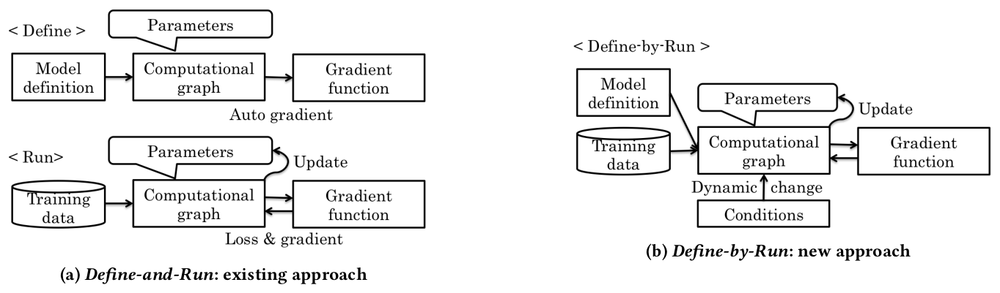
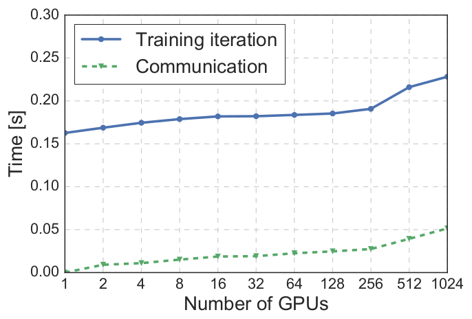

# 论文中文解读：《Chainer: A Deep Learning Framework for Accelerating the Research Cycle》

> **基本信息**：Seiya Tokui、Ryosuke Okuta、Takuya Akiba、Yusuke Niitani、Toru Ogawa、Shunta Saito、Shuji Suzuki、Kota Uenishi、Brian Vogel、Hiroyuki Yamazaki Vincent（Preferred Networks, Inc.，东京），KDD 2019（2019 年 8 月 4–8 日，Anchorage），arXiv:1908.00213；论文原文 [官方页面](https://arxiv.org/abs/1908.00213)。
>
> **本文的读法**：原文只有 2 幅真正的图（Figure 1、Figure 6）和 1 张表（Table 1），其余 Figure 2、3、4、5、7、8 都是代码清单。图为从 PDF 裁出的原图并配中文说明；代码清单转录成带语言标识的代码块并逐行解释；Table 1 逐格转录。凡不是出自论文的补充（示意代码、由图读出的近似值、笔者的换算、对今天 Chainer/PyTorch 的类比）都会明确标注“笔者补充”或“示意”，以免与论文结论混淆。

## 一、一句话结论

Chainer 是 Preferred Networks 开发的开源深度学习框架。论文把它的核心思想命名为 **Define-by-Run**（边运行边定义）：不再先“定义”一张静态计算图、再“运行”它，而是让用户用普通 Python 程序写前向计算，框架在执行每个可微运算的同时记录“如何沿着已发生的运算反向回溯”的历史，由此得到**这一次迭代**的计算图。这张图的拓扑和大小可以每次调用都不同，`if`/`for`/递归直接用 Python 语法，标准的调试器和性能分析器也能直接使用。

围绕这一核心，论文还介绍了五件事：

1. 在引用计数垃圾回收（reference-counting GC）下省内存的设计：`Variable` 与 `VariableNode` 分离，`FunctionNode` 显式声明 `retain_inputs` / `retain_outputs`；
2. 支持二阶反向传播（double backpropagation，对应 Hessian-vector product）且不产生引用环；
3. NumPy 兼容的 GPU 数组库 CuPy，及用户自定义 CUDA kernel 的接口；
4. 同步数据并行的分布式训练 ChainerMN（128 个节点、1024 块 P100 上训练 90 epoch 的 ResNet-50，平均 897.9 s；对单卡、单节点的扩展效率约 70%、80%）；
5. 计算机视觉扩展包 ChainerCV（统一 API、预训练权重、可复现的训练脚本，Table 1 给出 19 个模型条目的复现分数）。

## 二、背景与动机：Define-and-Run 的两个问题

### 2.1 先补几个前置概念

- **计算图（computational graph）**：把一次数值计算拆成“变量”和“运算”两类节点，运算节点连接它的输入变量和输出变量，整体是有向无环图。
- **反向模式自动微分（reverse-mode automatic differentiation，即反向传播）**：先做前向计算得到输出（损失），再沿图从输出向输入回溯，对每个运算用链式法则把“输出处的梯度”换算成“输入处的梯度”。因此反向传播需要两样东西：一份“哪个运算产生了哪个变量”的历史，以及某些运算的梯度公式所需要的前向中间值（例如 $y=\tanh x$ 的梯度可由 $y$ 算出）。
- **宿主语言（host language）**：框架所嵌入的编程语言。对 Chainer 就是 Python；“用宿主语言的语法写控制流”就是直接写 Python 的 `if`、`for`、`while`、递归。

### 2.2 引言里的问题意识

论文引言的出发点是：早期的开源框架（Caffe、Torch）主要为前馈网络，尤其是处理定长数据（图像）的卷积网络（CNN）设计；而后来 RNN/LSTM 用于变长数据（机器翻译、对话模型），深度强化学习兴起（游戏博弈），研究者需要实现更一般的模型。多数现有框架（a）为 CNN 而设计，缺少对更一般数据结构和训练方式的抽象；（b）用一种领域专用语言（DSL）描述模型，再由解释器把它翻译成内存里的数据结构，所以开发者**不能使用标准编程语言的调试器**，而调试和调参恰恰是模型研发的主要工作。

### 2.3 Define-and-Run（图 1a）

论文把现有框架的模型构建方式命名为 **Define-and-Run**，分两个阶段：

- **Define 阶段**：先定义并构造模型的计算图。这对应于依据“模型定义”（说明层间连接的数据流图、初始权重、激活函数等）实例化出一个神经网络对象。自动微分通常在这一阶段为前向和反向计算定义好运算，还可以选做图优化。
- **Run 阶段**：真正执行图的前向、反向计算。给定一批训练样本，用随机梯度下降等优化算法最小化损失函数来训练模型。

在这种范式下，CNN 之类的静态模型很容易实现：模型定义可以写成 Protobuf 或 YAML 之类的标记语言，框架相当于一个解释器，把这份与框架无关的“NN 程序”跑起来——接收输入（数据样本）、处理（前向/反向计算）、改变内部状态（更新参数）、输出结果（预测）。因为整张计算图在运行之前就完整可见，框架还可以做图优化来改善内存效率或运行速度；论文认为这正是 Define-and-Run 对静态模型表现良好的原因。

### 2.4 Define-and-Run 的两个问题

对其他类型的网络，论文指出两个主要问题：

1. **动态图（带控制流的网络）支持繁琐。** 例如在 TensorFlow 中，控制流的判断要用数据流图里的特殊算子 `Switch`、`Merge` 来表达，而不是用宿主语言自己的控制流语法。
2. **网络内部机制对用户不可见。** 要有效地调试和调优模型，用户必须能观察模型内部发生了什么。但计算图是“一个类的大对象”，装着整个模型的全部信息——结构、权重、梯度、节点之间的运算——本质上是一个黑盒。于是调试器、性能分析器无法判断模型哪里出错、怎么改进；如果框架还做了图优化，这个问题会更严重。

### 2.5 图 1：两种范式的关系

先看图再读解释：图 1 用同一套元素（模型定义、计算图、参数、训练数据、梯度函数）画出两种范式里“构图”与“训练”的时间关系。



*图 1（原文 Figure 1，第 2 页）：计算图构造与训练之间的关系。（a）Define-and-Run，现有做法；（b）Define-by-Run，新做法。*

**图中文字翻译与读法**：

- **左（a）Define-and-Run：现有做法**。上半部分 `< Define >`（定义阶段）：Model definition（模型定义）→ Computational graph（计算图，带 Parameters 参数的标注）→ Gradient function（梯度函数），两者之间的箭头标注为 Auto gradient（自动求导）。也就是说，先由模型定义生成计算图，并由自动微分生成梯度函数。下半部分 `< Run >`（运行阶段）：Training data（训练数据）送入同一张 Computational graph；图与 Gradient function 之间来回的箭头标注为 Loss & gradient（损失与梯度），Parameters 通过 Update（更新）箭头被修改。运行阶段的图在 Define 阶段已经固定。
- **右（b）Define-by-Run：新做法**。只有一个 `< Define-by-Run >` 阶段：Model definition 和 Training data 一起进入 Computational graph，图与 Gradient function 之间同样有来回的箭头，Parameters 被 Update；此外多了一个 **Conditions（条件）**，通过 Dynamic change（动态改变）箭头作用到 Computational graph 上。意思是：图不是预先定义好的，而是随着数据流过模型、随运行时条件（例如数据依赖的分支）而动态变化的。
- **读图结论**：两种范式的区别不在于有没有计算图，而在于“图什么时候形成”和“谁决定图的形状”——Define-and-Run 在训练开始之前就固定了图；Define-by-Run 把定义与运行合成一个阶段，图随运行时的执行路径生成。

### 2.6 两种范式的对照（笔者整理，内容均来自论文第 2–3 节）

| 维度 | Define-and-Run | Define-by-Run |
|---|---|---|
| 图何时形成 | Define 阶段一次性构造完整图，之后在 Run 阶段重复执行 | 前向计算在具体数组上执行的同时逐个运算记录 |
| 图描述什么 | 前向与反向计算 | 只描述“如何沿已发生的运算回溯”，前向计算由 Python 程序本身定义 |
| 控制流 | 需要图里的特殊算子（如 TensorFlow 的 `Switch`、`Merge`） | 直接用宿主语言的 `if`、`for` 等 |
| 每次迭代的图 | 同一张图 | 拓扑和大小可以每次调用都不同 |
| 调试与分析 | 图是黑盒，标准调试器、性能分析器难以介入 | 可以直接使用调试器、性能分析器等宿主语言工具 |
| 全图优化 | 完整图可见，可做图优化（论文承认这一优点） | 论文没有讨论 |

## 三、设计与编程模型（论文第 3 节）

### 3.1 按需构图（On Demand Graph Construction）

反向传播的做法是：**记录施加在输入数组上的运算历史，然后回溯这份历史**。Define-by-Run 中，这份历史是在对具体输入数组做前向计算的同时被记录下来的，方法是为每个变量和每个运算在计算图里创建一个节点。

论文用两类节点定义计算图：

- **变量节点（variable node）**：表示参与计算的变量；
- **函数节点（function node）**：表示施加在变量上的运算。

对输入变量 $x$ 施加函数 $f$ 得到输出变量 $y$ 之后：函数节点 $n_f$ 持有对输入节点 $n_x$ 的引用，输出节点 $n_y$ 持有对函数节点 $n_f$ 的引用。回溯计算图就沿这些引用进行。

```text
前向（Python 逐行执行，数组立即算出）：   x --f--> y --g--> z

图中记录的引用（只为回溯）：
  n_z --引用--> n_g --引用--> n_y --引用--> n_f --引用--> n_x
  （变量节点引用“产生它的函数节点”；函数节点引用“它的输入变量节点”）

反向传播：从 n_z 出发沿引用往回走，依次调用 g 的反向、f 的反向。
```

读这一节要抓住三点：

1. **图只负责“怎么回溯”，不负责“前向怎么算”。** 论文原话：计算图只定义如何回溯施加在输入上的运算，并不定义前向计算。前向计算就是普通的数值程序，与不求梯度的数值计算没有区别；唯一的差别是每个可微函数在算出输出之外，还把自己的计算历史存进图里。
2. **图完全由程序的执行轨迹（execution trace）决定。** 因此它可以与宿主语言的任意语法结构结合，例如条件分支和循环；同一段程序每次调用都可能产生拓扑和规模不同的图，同时保持梯度计算正确。读者可以这样理解：没有被执行到的分支不会出现在图里，循环会被“展开”成重复的节点。
3. **能用宿主语言的高层工具。** 不只是 `if`、`for` 这些基本语法，调试器（debugger）和性能分析器（profiler）等高层工具也可以直接用，这正是 2.4 节第二个问题的回答。

下面是一段**笔者补充的示意代码**（非原文），用来体会“拓扑由数据决定”。它只表达思想，不是可直接运行的完整程序：

```python
# 示意（非原文）：循环次数由当前数值决定，每次调用得到的图大小都可能不同
h = x                                  # x 是 Variable
while abs(h.array).max() > 1.0:        # 普通 Python 的 while，依据具体数值判断
    h = F.tanh(layer(h))               # 每执行一次，就在图里追加对应的函数节点
loss = F.sum(h)
loss.backward()                        # 沿这一次实际产生的图反向传播
```

### 3.2 面向对象的模型定义（Object-Oriented Model Definition）

深度学习的一个重要特性是**组合性（compositionality）**：网络片段以各种方式连接，构成丰富的结构，因此编写深度模型的 API 要能灵活地复用与组合部件。

在 Define-by-Run 中，一个模型由两部分构成：定义前向计算的代码，以及决定其行为的参数。代码是宿主语言的程序，它必须与参数**绑定**。论文用面向对象编程解决这个“参数绑定问题”：每个带有自己参数的网络片段由一个类定义，若干片段再组合进另一个类，构成更大的模型部件，于是网络的模块化与参数绑定同时得到解决。

图 2（原文 Figure 2，第 3 页）是一段代码清单，定义了一个全连接层和一个多层感知机：

```python
class Linear(Link):
    def __init__(self, n_in, n_out):
        with self.init_scope():
            self.W = Parameter(HeNormal(),
                               (n_out, n_in))
            self.b = Parameter(0, (n_out,))

    def forward(self, x):
        return x @ self.W.T + self.b

class MultiLayerPerceptron(Chain):
    def __init__(self, n_in, n_hid, n_out):
        with self.init_scope():
            self.l1 = Linear(n_in, n_hid)
            self.l2 = Linear(n_hid, n_out)

    def forward(self, x):
        h = relu(self.l1(x))
        return self.l2(h)
```

*图 2（原文 Figure 2，第 3 页）：面向对象的模型定义示例。*

**逐行解释**：

- `class Linear(Link)`：全连接层是一个 `Link`。按 Chainer 的约定（论文未单独定义），`Link` 是“带有参数的最小网络片段”，`Chain` 是“由若干 Link 或 Chain 组合而成的更大模型部件”。
- `with self.init_scope():`：在这个作用域里赋给属性的 `Parameter` 或子 `Link` 会被登记为该对象的参数或子模块（笔者补充：这是 Chainer API 的通常含义，论文没有展开）。
- `self.W = Parameter(HeNormal(), (n_out, n_in))`：权重矩阵，初始化器为 `HeNormal()`（He 初始化），形状 `(n_out, n_in)`。参数在对象**构造时**就创建并初始化。
- `self.b = Parameter(0, (n_out,))`：偏置向量，形状 `(n_out,)`，初始值 0。
- `def forward(self, x): return x @ self.W.T + self.b`：前向计算写成普通方法，即 $y=xW^\top+b$；`@` 是矩阵乘法。
- `class MultiLayerPerceptron(Chain)`：多层感知机是一个 `Chain`，其 `__init__` 里把两个 `Linear` 作为子模块登记：`l1` 把维度从 `n_in` 变到 `n_hid`，`l2` 从 `n_hid` 变到 `n_out`。
- `h = relu(self.l1(x)); return self.l2(h)`：前向就是“先经过第一层，再过 ReLU，最后经过第二层”。每一行都是真正执行，同时在图里留下记录。

**为什么这样设计**：模型是由模型片段构成的一棵树，所以要收集某个子树的参数，只需遍历这棵树，这给所有模型提供了统一的参数处理接口。论文还指出，这种面向对象的模型定义风格由 Chainer 在 2015 年首先引入，现在被其他 Define-by-Run 框架（如 PyTorch 与 TensorFlow Eager）广泛使用。

## 四、技术特性（论文第 4 节）

这一节讲 Chainer 里提升简洁性与效率的几项技术，论文声明它们适用于任何基于 Define-by-Run 的框架。

### 4.1 省内存的反向传播（Memory-Efficient Backpropagation）

深度学习框架非常关心内存效率，因为模型和数据的大小受限于可用物理内存；框架层面还可以进一步优化，尤其是降低**峰值内存**。

#### 4.1.1 全局的内存占用降低（Global Memory Usage Reduction）

在 Define-by-Run 框架里，内存管理自然交给宿主语言。Chainer 依赖**引用计数垃圾回收**，这是标准 Python 实现（CPython）的主要内存管理机制。Define-by-Run 的自动微分与引用计数 GC 配合良好：计算历史中的一个子图一旦不可达，就会被立即释放。

进一步的优化是：

- 引用计数 GC 释放一张图时，各节点是按计算图的**拓扑顺序**释放的；
- 反向传播算法也按拓扑顺序访问各节点；
- 把这两个过程合并，就能把反向传播的峰值内存降到最低；
- 做法是在反向回溯时，**处理完某个函数节点后，立即手动删除对它的引用**。

通俗地说：不要等整个反向传播结束再统一释放整张图，而是每反向走过一个函数节点，就把它（及它保存的数组）释放掉，所以反向传播越往前走，占用的内存越少。

#### 4.1.2 逐函数的局部内存占用降低（Function-wise Local Memory Usage Reduction）

一般来说，一个函数的梯度（更准确地说是雅可比矩阵）依赖于输入。所以很自然地，反向计算的接口会设计成同时接收输入数组和输出误差。但这样的接口让**不需要输入数组也能算出梯度的运算**无法做内存优化：

- 有些运算，例如 `tanh`，可以用**输出数组**代替输入数组来计算梯度。如果紧随其后的下一个运算在求梯度时本来就需要保留这个数组（它既是 `tanh` 的输出，又是下一个运算的输入），就可以丢掉 `tanh` 的输入数组、只留输出数组，使反向传播需要保存的数据最少；
- 还有些运算既不需要输入，也不需要输出数组，这时可以同时去掉对两者的引用。（笔者补充一个例子：加法 $z=x+y$ 的反向只需要把上游梯度原样传给两个输入。）

具体实现：每个可微运算是 `FunctionNode` 的一个子类，覆盖 `forward` 和 `backward` 方法。在 `forward` 里，反向所需的输入和输出通过调用 `retain_inputs` 和 `retain_outputs` 方法**显式声明**；没有被声明的输入或输出不会为反向传播保存。尤其是，输入**不再传给** `backward` 方法，而是由 `backward` 的实现在需要时自己去取。

下面是**笔者补充的示意代码**（非原文，仅表达 API 形态），以 `tanh` 为例：

```python
# 示意（非原文）：tanh 只保留输出，反向用 y 计算 1 - y^2
class Tanh(FunctionNode):
    def forward(self, inputs):
        x, = inputs
        y = tanh(x)
        self.retain_outputs((0,))              # 声明：反向要用第 0 个输出；输入 x 不保存
        return y,

    def backward(self, target_input_indexes, grad_outputs):
        y, = self.get_retained_outputs()       # 反向时才按需取出保留的输出
        gy, = grad_outputs
        return gy * (1 - y * y),               # 用可微的运算写，二阶反向才成立
```

#### 4.1.2 续：Variable 与 VariableNode 的分离

论文还描述了一种为“尽快释放内存”而设计的特殊变量表示。

- **朴素做法的问题**：朴素的 Define-by-Run 自动微分里，每个变量节点直接包含一个多维数组（例如作为属性）。这样，只要还有任何引用指向这个变量，数组占用的内存就不能回收。即使用户代码没有持有对该变量的任何直接引用，计算图可能仍然引用它，内存仍然回收不了。根源在于**无法区分用户代码的引用与节点之间的引用**。
- **关键观察**：只要用户代码还引用着一个变量，就必须保留与它关联的数组；但计算图内部的引用不一定需要数组存活——如果没有任何运算把这个变量作为输入或输出保留，数据就应该释放。
- **解法**：用**两个不同的对象**表示用户代码里的变量和计算图里的变量。在 Chainer 中，每个 `Variable` 对象持有数组数据，它与代表图中变量节点的 `VariableNode` 对象是分开的。`VariableNode` 只有当该变量被某个运算保留时才持有对数组的引用。
- **结果**：用户代码对变量的最后一个引用一旦被删除，除非某个运算把它保留为输入或输出，其内存就会立即回收。

```text
用户代码 --引用--> Variable --持有--> 数组数据
                      |
                      +--引用--> VariableNode <--引用-- FunctionNode
                                    |                  （图内部的引用只指向 VariableNode）
                                    +-- 仅当某个运算声明 retain 时，才引用数组数据
```

### 4.2 二阶反向传播（Double Backpropagation）

对“包含梯度计算的计算过程”再做反向传播，是现代深度学习框架的一项重要特性。它对应于求 Hessian-vector product 的自动微分，常被称为 **double backpropagation**。（笔者补充：设标量 $y=f(x)$，先得到梯度 $g=\partial y/\partial x$，再对 $z=g^\top v$ 反向传播得到 $\partial z/\partial x=Hv$，其中 $H$ 是 Hessian，不需要显式写出 $H$。）

实现二阶反向传播的思路是：**用本身可微的函数来实现每个运算的反向计算**，使得反向计算也会产生计算图。这个想法看似直接，但朴素实现会产生**引用环**，造成不必要的内存消耗。要避免引用环，需要考虑两个因素：访问所得梯度的接口，以及每个可微函数对输出的保留。

#### 4.2.1 访问所得梯度的接口

触发反向传播有两种接口：

1. `Variable.backward()` 方法：计算对每个输入的梯度，结果**直接存在变量对象里**；
2. `grad()` 函数：参数是一组输入和一组输出，**返回**对指定变量算出的梯度集合。（原文此处写作“对应于指定的输出”；按 Chainer 的 `chainer.grad(outputs, inputs)` 约定，返回的是对输入的梯度，这应是行文的笔误。）

后者不会在对象之间引入额外的引用，而前者可能增加从输入节点指向所得梯度的引用。因为所得梯度又通过计算图间接引用输入节点，**引用环**就出现了。

解决办法仍是区分“用户代码引用”和“节点间引用”（见 4.1）：既然“变量 → 对应梯度”的引用不属于计算图，就把这个引用放在 `Variable` 对象里，而不是 `VariableNode` 对象里。

```text
有环（朴素）：VariableNode(n_x) --持有--> 梯度 gx --(经由图)--> n_x
无环（Chainer）：Variable --持有--> 梯度 gx --(经由图)--> n_x，图里的节点从不指回 Variable
```

#### 4.2.2 二阶反向传播中的输出保留（Output Retention）

由 4.1 可知，每个 `FunctionNode` 实现的 `backward` 可能用到 `forward` 里声明保留的输出变量。要让反向传播可微，需要一个特殊步骤：因为**函数节点不能持有对输出节点的引用**，否则会出现引用环（输出节点本来就引用着产生它的函数节点）。这就意味着，在函数节点的反向计算被执行之前，输出节点可能已经被释放了。

论文的做法是：

- 对这样的输出节点，在反向传播时**重放图的构造**：创建一个新的节点对象，并把它连接起来，就好像它是原来的输出节点；
- 同时，把输出**数组**作为备份存到函数节点里，用来给重建的输出节点使用。

这样做不会破坏计算的正确性：输出节点已被释放，说明没有其他节点或用户代码引用它，重建输出节点不会与任何现有节点冲突。

## 五、用 CuPy 支持 GPU（论文第 5 节）

深度神经网络需要大量浮点计算，框架必须充分利用 GPU 这类外部加速器的算力。但要写出既高性能又保持灵活、简洁、易扩展的 GPU 程序，对一般的网络开发者并不容易。

### 5.1 CuPy 是什么

CuPy 是开源的 Python 库，以兼容 NumPy 的语法提供 NVIDIA GPU 的算力，通过 NVIDIA 的 CUDA 平台（包括 cuBLAS、cuDNN、cuRAND、cuSOLVER、cuSPARSE、NCCL）充分利用 GPU 架构，加速任何用类 NumPy 语法写出的计算。它的接口与 NumPy 高度兼容，多数情况下可以直接替换；支持标准数值类型、数组索引、切片、转置、reshape、广播。

图 3（原文 Figure 3，第 4 页）并排给出 NumPy 与 CuPy 的写法：

```python
import numpy as np
x = np.array([1, 2])
l2 = np.linalg.norm(x)
```

```python
import cupy as cp
x = cp.array([1, 2])
l2 = cp.linalg.norm(x)
```

*图 3（原文 Figure 3，第 4 页）：（a）NumPy；（b）CuPy。*

**读法**：除了把 `np` 换成 `cp`（CuPy 的惯用缩写），其余完全一样。`cupy.ndarray` 是 CuPy 的核心类，作为 `numpy.ndarray` 的 GPU 版本；二者的主要区别是前者的内容分配在 **GPU 内存**里。例如 NumPy 用 `numpy.linalg.norm` 在 CPU 上计算欧氏范数，CuPy 用 `cupy.linalg.norm` 在 GPU 上计算。

### 5.2 CuPy 与 Chainer 的历史关系

CuPy 最初是作为 Chainer 的后端开发的。最早的 Chainer 用 PyCUDA（一个常用的 CUDA GPU 计算 Python 库）实现，但 PyCUDA 对深度学习所需的 NumPy 功能支持不够，CUDA 支持也不足。2017 年 6 月，Chainer v2.0 和 CuPy v1.0 发布，CuPy 从 Chainer 中独立出来；此后不少非深度学习项目利用 CuPy 的高性能和简洁接口，例如基于 Python 的概率建模软件 Pomegranate 和自然语言处理库 spaCy 都以 CuPy 作为 GPU 后端。

### 5.3 支持的功能

- **线性代数**：支持 NumPy 中的大多数线性代数函数，如特征值分解、Cholesky 分解、QR 分解、奇异值分解（SVD）、线性方程求解、矩阵求逆、Moore-Penrose 伪逆，定义在 `cupy.linalg`，与 `numpy.linalg` 兼容，全部由 cuSOLVER（GPU 上的 LAPACK 实现）支撑。
- **稀疏矩阵**：基于 cuSPARSE，接口与 SciPy 的 `scipy.sparse` 一致，可按需求选择 COO（坐标格式）、CSR（压缩稀疏行）、CSC（压缩稀疏列）以及对角存储的稀疏矩阵。
- **排序**：提供与 NumPy 兼容的 `sort`、`argsort`、`lexsort`，由 Thrust（用 C++ 和 CUDA 写的并行算法库）支撑，后者实现了复杂的 GPU 并行排序算法。

### 5.4 自定义 CUDA kernel

CuPy 容易扩展：可以组合运算符、两种 kernel 和泛型来写用户自定义 kernel，很容易用 CUDA 代码片段组合并启动任意 GPU kernel。

- **Element-wise kernel（逐元素 kernel）**：对所有元素施加同一个运算，例如 `cupy.add` 对每对元素施加 `+`；
- **Reduction kernel（归约 kernel）**：用二元运算符把所有元素折叠成一个，例如 `sum` 用 `+` 折叠所有元素；
- 二者分别类似 MapReduce 里的 Map 和 Reduce。

图 4（原文 Figure 4，第 5 页）是一个用户自定义的逐元素 kernel：

```python
kernel = cupy.ElementwiseKernel(
    'float32 x, float32 y, float32 z',  # arguments
    'float32 w',                        # outputs
    'w = x * y + z',                    # computation
    'my_mad')                           # kernel name
w = kernel(x, y, z)
```

*图 4（原文 Figure 4，第 5 页）：用户自定义 kernel 示例。*

**逐行解释**：

- 第 1 个参数是**输入变量列表**，每个变量由“类型说明符 + 参数名”构成：这里是三个 `float32` 输入 `x`、`y`、`z`；
- 第 2 个参数是**输出变量列表**：一个 `float32` 输出 `w`；
- 第 3 个参数是用户想定义的 **CUDA 代码片段**，里面可以写任意 CUDA 代码：这里是逐元素的乘加 `w = x * y + z`（multiply-add，所以 kernel 名叫 `my_mad`）；
- 第 4 个参数是 kernel 名；
- 最后一行调用该 kernel，像普通函数一样得到 `w`。

CuPy 会自动包装并编译这段代码，生成 CUDA 二进制；编译好的二进制被缓存，在后续运行里复用。

**泛型**：把 `float32` 这样的具体类型换成类型参数（如 `T`），kernel 就会被生成为模板函数；具有泛型类型的参数可以接受任意类型的数组。例如输入类型写成 `'T x, T y'`，这个函数就接受两个相同任意数据类型（如整数或浮点）的数组。

## 六、分布式并行训练 ChainerMN（论文第 6 节）

本节介绍 Chainer 的分布式学习组件，它此前叫 ChainerMN（评测时它是 Chainer 的插件库，后来已合并进 Chainer 主线；下文和代码里沿用 ChainerMN 这个名字）。动机是：即使 GPU 性能不断提升，训练仍然耗时；例如在 ImageNet 上训练 ResNet-50，单 GPU 通常需要一周左右。Chainer 的分布式能力能整合多块 GPU 的算力，同时保留 Define-by-Run 带来的灵活性，使动态神经网络、生成对抗网络、深度强化学习这类复杂场景也能方便地做分布式学习。

### 6.1 分布式深度学习基础

**数据并行与模型并行**：

- **数据并行（data parallelism）**：每个 worker 持有一份模型副本，在不同的 mini-batch 上计算梯度，各 worker 协同更新模型。若每个 worker 处理的批量为 $b$，worker 数为 $n$，通过通信得到的梯度就等价于批量大小为 $bn$ 时的梯度；worker 越多，一次迭代用的训练数据越多，梯度质量越好，学习也越快。
- **模型并行（model parallelism）**：每个 worker 持有模型的一部分，与其他 worker 协作处理同一个 mini-batch。GPU 内存小的时期模型并行曾被积极采用；目前数据并行被证明更高效，但当模型参数量极大（如自然语言处理领域）时，会把模型并行与数据并行结合使用。

**同步与异步**：通信模型的选择是构建整体并行计算的关键因素。

- **同步数据并行**：在“前向、反向、优化”的非并行流程之外多一步 **all-reduce**。all-reduce 是一种并行计算操作：对各进程的数据求和，并把结果分发给所有进程（MPI 的标准功能）。各 worker 通过额外的 all-reduce 通信获得梯度之和，除以副本数得到平均梯度，在优化之前用它更新自己那份模型副本。
- **异步数据并行**：有专门的 **参数服务器（parameter server）** 持有并控制训练过程中的模型参数。普通 worker 在前向、反向算出梯度后把梯度发给参数服务器；参数服务器接收梯度并更新模型；worker 取回新参数，开始计算新的梯度。

### 6.2 并行设计

Chainer 选择**数据并行**和**同步通信**模型。理由是：

- 数据并行只需要在现有实现上做少量增补——切分数据集，并在各 worker 之间计算梯度平均。因为在图像识别等许多场合，数据并行等价于增大 mini-batch。所以先选了数据并行，后来才加入实验性的模型并行支持；
- 同步通信模型因其**确定性的行为和收敛性**而被选用（引用文献 [19, 39]）。

同步数据并行的梯度交换通过 worker 之间的 all-reduce 通信实现，所以只要某个通信库支持 all-reduce，并接入 Chainer 的**通信器（communicator）抽象**，Chainer 理论上就可以在它上面运行。第一个被支持的库是 OpenMPI（在支持 CUDA-aware 的构建下特别高效）。但 all-reduce 对效率要求很高，因为每次训练迭代都要调用，且要处理大量数据，所以论文采用 NVIDIA 开发的 **NCCL** 作为运行 all-reduce 的主要库——它是高度优化的通信库，可以在 NVIDIA GPU 之间（节点内和跨节点）高效执行 all-reduce。

### 6.3 API 设计

设计目标是：不能为了分布式执行牺牲 Chainer 的 Define-by-Run 灵活性。Define-by-Run 允许不同迭代的模型结构不同；ChainerMN 只假定**各 worker 在同一次迭代内**模型结构一致（因为要做 all-reduce）。梯度交换发生在优化步骤之前，对 Chainer 的其他组件是透明的。在这个最小假设之内，任何代码都可以放在优化步骤之前或之后，模型结构可以在任一迭代里动态改变。

图 5（原文 Figure 5，第 6 页）是用 ChainerMN 训练 MNIST 分类模型的核心代码，相对单机程序有三处主要增补：

```python
# (1) Create a communicator
comm = chainermn.create_communicator()

# (2) Create and use multi_node_optimizer
optimizer = chainermn.create_multi_node_optimizer(
    chainer.optimizers.Adam(), comm).setup(model)

# (3) Distribute a dataset
train = chainermn.scatter_dataset(
    train, comm, shuffle=True)

# Use Chainer's Trainer class to simplify
# a forward-backward-optimization loop
iterator = chainer.iterators.SerialIterator(
    train, args.batchsize)
updater = training.StandardUpdater(
    train_iter, optimizer, device=device)
trainer = training.Trainer(updater, (100, 'epoch'))
```

*图 5（原文 Figure 5，第 6 页）：用 ChainerMN 训练的代码示例。（原文清单里迭代器变量先命名为 `iterator`、传给 `StandardUpdater` 时写成 `train_iter`，是原文的小不一致，此处照原样转录。）*

**逐项解释**：

- `chainermn.create_communicator()`：创建**通信器**，它控制所有进程间的通信；
- `chainermn.create_multi_node_optimizer(chainer.optimizers.Adam(), comm).setup(model)`：把普通优化器（这里是 Adam）包装成 **multi_node_optimizer**。它是让 Chainer 分布式化的最重要组件：除通信外，行为与原优化器完全相同，只是在优化模型之前用 all-reduce 在各进程间交换梯度；
- `chainermn.scatter_dataset(train, comm, shuffle=True)`：让各 worker 就“读取训练数据的哪一片”达成一致；训练数据集被等分成若干片，分发给各 worker 进程；
- 其余是 Chainer 自带的 `Trainer` 抽象：迭代器、更新器、训练器合起来，把“前向、反向、优化”的循环封装起来，这部分与单机代码一致。

```text
每个 worker（每块 GPU 一个进程）每次迭代：
 1. 取本 worker 的 mini-batch（数据集已被 scatter_dataset 等分）
 2. 在本地做前向和反向（Define-by-Run，本地构图）→ 本地梯度
 3. all-reduce：把各 worker 的梯度求和，再除以 worker 数得到平均（用 NCCL）
 4. 每个 worker 用同一份平均梯度更新自己的模型副本
```

论文强调：把单机程序移植到分布式模式所需的改动尽可能少，才得以保留 Define-by-Run 的灵活性。

### 6.4 评测（图 6）

**实验设置**：用 ImageNet 上 90 个 epoch 的 ResNet-50 训练作为基准（该任务被广泛用于评估分布式深度学习性能）。集群为 128 个节点，每个节点配有 8 块 NVIDIA Tesla P100 GPU；**每个 worker 的 mini-batch 大小为 32**，使用 1024 个 worker 时总 mini-batch 大小为 32k（即 $32\times1024=32768$）。更详细的设置见附录（见下表）。

| 项目 | 取值（原文附录 A.1，第 10 页） |
|---|---|
| 软件版本 | 基于 Chainer 3.0.0rc1 与 ChainerMN 1.0.0 的开发分支；通信库 NCCL 2.0.5、OpenMPI 1.10.2 |
| 集群 | 自建集群，128 个节点 |
| 每个节点 | 2 颗 Intel Xeon E5-2667（3.20 GHz，8 核）、256 GB 内存、8 块 NVIDIA Tesla P100 GPU |
| 互联 | 所有节点以 Mellanox Infiniband FDR 互联 |
| 批量 | 每 worker 32；1024 worker 时总批量 32k |
| 精度 | 计算一般使用单精度；为减小通信量，通信使用半精度（half-precision）浮点数 |

（原文附录写“Section 6.3 的实验评估”，实际对应第 6.4 节的评测；ChainerMN 当时是 Chainer 的插件库，如今已并入主线。）



*图 6（原文 Figure 6，第 6 页）：ResNet-50 训练在不同 GPU 数量下的单次迭代时间与通信时间。*

**图中文字翻译与读法**：

- 横轴 Number of GPUs（GPU 数量）：1、2、4、8、16、32、64、128、256、512、1024（按等间隔类别画出）；纵轴 Time [s]（时间，秒），范围 0 到 0.30。
- 蓝色实线 Training iteration（训练迭代）：完成一次**完整迭代**的时间，包括前向与反向计算、通信、优化；绿色虚线 Communication（通信）：通信时间，即 all-reduce 操作的时间。数值是 100 次迭代的平均。
- 下表为**笔者从图上读出的近似值**（读图误差约 ±0.005 s，原文没有给出这些数字）：

| GPU 数量 | 1 | 8 | 256 | 512 | 1024 |
|---|---:|---:|---:|---:|---:|
| 一次迭代时间（约，秒） | 0.16 | 0.18 | 0.19 | 0.215 | 0.23 |
| 其中通信时间（约，秒） | 0.00 | 0.015 | 0.03 | 0.04 | 0.05 |

- **读图结论**：从 1 块到 256 块 GPU，迭代时间只缓慢上升（约从 0.16 s 到 0.19 s）；超过 256 块后上升加快，1024 块时约 0.23 s，通信占其中约 0.05 s。论文正文给出的数字是：使用 1024 块 GPU 时，扩展效率相对于单 GPU 为 **70%**、相对于单节点（8 块 GPU）为 **80%**；使用 1024 块 GPU，5 次独立运行的平均训练时间是 **897.9 ± 3.3 s**（90 个 epoch，含每个 epoch 之后的验证）。
- 笔者核对（不是原文内容）：这里的 GPU 数增加时每块 GPU 的批量不变（弱扩展），所以扩展效率可理解为单卡迭代时间与 N 卡迭代时间之比。由图上的读数，约 $0.16/0.23\approx70\%$，$0.18/0.23\approx78\%$，与原文的 70%、80% 吻合。

**证据边界**：论文这一节只报告了速度（迭代时间、总训练时间、扩展效率），**没有报告 32k 批量训练最终达到的精度**；因此它证明的是“Define-by-Run 风格的 Chainer 可以扩展到 1024 块 GPU 且保持较高扩展效率”，不是“该训练配方在 90 个 epoch 内收敛到某个精度”。

## 七、ChainerCV：计算机视觉扩展包（论文第 7 节）

Chainer 本身很强大，但它与计算机视觉所需之间仍有缺口：深度学习模型越来越强也越来越复杂，研究者和工程师很难从零实现这些算法；此外许多典型的视觉工具，如数据加载器、非极大值抑制（NMS）这类前后处理函数，也在 Chainer 的范围之外。ChainerCV 面向非专家，帮助快速验证想法、降低入行门槛。它提供最先进的模型、预训练权重和各类任务的训练脚本（图像分类、目标检测、语义分割、实例分割），以及统一 API 的数据加载器和评估指标。设计基于三条原则：**易用**、**统一 API**、**可复现**。

### 7.1 易用（Easy to use）

支持四个任务：图像分类、目标检测、语义分割、实例分割；每个任务实现了若干网络，例如目标检测有 7 个实现。同一任务下的模型共享简单的推理接口：尽管解决同一任务，不同模型的网络输出类型和输出后处理方式不同，推理接口把这些底层差异隐藏起来；并且实例化模型对象时自动下载预训练权重，因此做一次推理只需两行 Python 代码（图 7）。此外还提供可轻松定制的训练脚本，用 Chainer 的训练抽象写成，因此训练组件很容易替换，可以扩展到例如自定义数据集的训练。

图 7（原文 Figure 7，第 7 页）：用两个目标检测模型执行推理，两个模型有相同的推理接口：

```python
# Instantiate object detection models
model_1 = FasterRCNNVGG16(pretrained_model='voc0712')
model_2 = SSD300(pretrained_model='voc0712')

# Make predictions
bboxes, labels, scores = model_1.predict([img])
bboxes, labels, scores = model_2.predict([img])
```

**读法**：`FasterRCNNVGG16` 和 `SSD300` 是两个结构完全不同的检测器，但 `predict([img])` 的输入（图像列表）和输出（边框 `bboxes`、类别 `labels`、置信度 `scores`）形式一致；`pretrained_model='voc0712'` 表示加载在 VOC 2007+2012 数据上训练好的权重（笔者补充：`voc0712` 的含义由名称推断，论文未解释）。

### 7.2 统一 API（Unified API）

ChainerCV 强调模块化设计与统一 API，使用户能组合各方法的实现；实现包括神经网络模型、数据加载器、评估指标和可视化工具。统一 API 通过在整个库使用相同的数据表示实现：论文为图像、边界框、语义逐像素标签、实例掩码和关键点分别定义了数据表示。相似函数的 API 也保持一致，例如所有模型的推理方法都以图像的可迭代对象为输入。

统一 API 的另一个好处是可以在其之上构建工具，例如抽象评估循环的实现：内部遍历数据集，对图像做预测，并用真值和预测结果计算评估指标。这要求数据加载器和推理方法的接口是预先约定好的，抽象工具才能在数据加载器、推理方法、评估指标之间传递数据。

图 8（原文 Figure 8，第 7 页）：用 `DetectionVOCEvaluator` 执行目标检测评估循环：

```python
dataset = VOCBboxDataset(year='2007', split='test')
it = SerialIterator(dataset, batch_size=2,
    repeat=False, shuffle=False)
model = SSD300(pretrained_model='voc0712')
evaluator = DetectionVOCEvaluator(it, model,
    label_names=voc_bbox_label_names)
# Run evaluation loop
result = evaluator()
```

**读法**：先建 VOC 2007 测试集 `dataset`；`SerialIterator` 按批读取（`batch_size=2`，`repeat=False` 只遍历一遍，`shuffle=False` 不打乱）；`DetectionVOCEvaluator` 把迭代器、模型和类别名绑在一起；调用 `evaluator()` 就完成整个“遍历数据、预测、算指标”的评估循环并返回结果。

### 7.3 可复现（Reproducibility）

机器学习和计算机视觉里，可复现性是影响研究质量的重要因素。ChainerCV 提供**保证与已发表结果相当**的训练代码，来降低复现的难度；这些算法可以作为基线去获得改进的新想法，也可以作为与新方法比较的工具。粗心的实现很容易偏离原始逻辑和超参数而使训练出的模型性能发生变化，这种错误会使实现失去作为有用基线的资格。

表 1 给出 ChainerCV 支持的模型及实验结果，并列出了原论文或作者实现所报告的参考分数。

**表 1：ChainerCV 支持的模型及其分数。** 指标：图像分类报告 top-1 错误率（越小越好）；目标检测在 Pascal VOC 上报告 mAP，在 MS COCO 上报告在不同 IoU 阈值上 mAP 的平均；语义分割报告 mIoU；实例分割报告掩码 mAP（后三类越大越好）。数值均为百分数。“参考”为原论文或作者实现报告的分数，“本文”为 ChainerCV 复现的分数；带 `*` 的行表示“我们转换了原模型的权重”。

| 任务 | 数据集 | 模型 | 参考分数 | 本文分数 |
|---|---|---|---:|---:|
| (1) 图像分类 | ImageNet | VGG16 | 28.5 | 29.0* |
| (1) 图像分类 | ImageNet | ResNet50 | 24.7 | 24.8* |
| (1) 图像分类 | ImageNet | ResNet101 | 23.6 | 23.6* |
| (1) 图像分类 | ImageNet | ResNet152 | 23.0 | 23.2* |
| (1) 图像分类 | ImageNet | SE-ResNet50 | 22.4 | 22.7* |
| (1) 图像分类 | ImageNet | SE-ResNet101 | 21.8 | 21.8* |
| (1) 图像分类 | ImageNet | SE-ResNet152 | 21.3 | 21.4* |
| (1) 图像分类 | ImageNet | SE-ResNeXt50 | 21.0 | 20.9* |
| (1) 图像分类 | ImageNet | SE-ResNeXt101 | 19.8 | 19.7* |
| (2) 目标检测 | Pascal VOC | Faster R-CNN | 73.2 | 74.7 |
| (2) 目标检测 | Pascal VOC | SSD300 | 77.5 | 77.5 |
| (2) 目标检测 | Pascal VOC | SSD512 | 79.5 | 79.7 |
| (2) 目标检测 | Pascal VOC | YOLOv2 | 75.8 | 75.8* |
| (2) 目标检测 | Pascal VOC | YOLOv3 | 80.2 | 80.2* |
| (2) 目标检测 | MS COCO | FPN ResNet50 | 36.7 | 37.1 |
| (2) 目标检测 | MS COCO | FPN ResNet101 | 39.4 | 39.5 |
| (3) 语义分割 | CamVid | SegNet | 46.3 | 49.4 |
| (3) 语义分割 | CityScapes | PSPNet | 79.7 | 79.0* |
| (4) 实例分割 | SBD | FCIS | 65.7 | 64.1 |

（原文表 1，第 8 页。）

**读法**：

- 论文的结论是“再实现的性能与原作者的接近”，并提醒训练时的随机性也可能造成分数差异。
- 九个图像分类模型的“本文”分数全部带 `*`，即用的是转换自原模型的权重，所以这一组数字验证的主要是**转换后的推理实现与原模型一致**，而不是“用 ChainerCV 的脚本重新训练到同等水平”；逐项与参考错误率相比，差值在 −0.1 到 +0.5 之间（VGG16 差 +0.5 最大）。YOLOv2、YOLOv3、PSPNet 同样带 `*`。
- 其余没有 `*` 的行（Faster R-CNN、SSD300/512、FPN ResNet50/101、SegNet、FCIS）论文没有标注转换权重，应是 ChainerCV 自己的训练结果（这是笔者的解读，论文只说明带 `*` 的是转换权重）：差值最大的是 Faster R-CNN（+1.5 mAP）、SegNet（+3.1 mIoU）、FCIS（−1.6 mAP，实例分割）；目标检测里有 5 项与参考分数相差不超过 0.2。（差值均为笔者对表中数字做减法所得。）

## 八、相关工作（论文第 8 节）

- **Autograd**：据作者所知，Autograd 在 Chainer 提出之前就采用了 Define-by-Run 来构造反向图。它是基于 NumPy 的库，让用户用 NumPy 在 Python 代码里写出可微的计算图；但它不是为深度学习框架设计的，所以不支持训练深度模型所必需的 GPU 加速。因此论文宣称 **Chainer 是第一个面向深度学习负载、专注于 Define-by-Run 的框架**。
- **其他 Define-by-Run 框架**：PyTorch 是受 Chainer 启发的流行 Define-by-Run 框架（论文脚注引用 PyTorch v0.4.1 的 README）；TensorFlow 随后引入了“eager mode”，支持 Define-by-Run 的模型定义；MXNet 支持命令式张量计算，可通过惰性求值与声明式符号表达式结合；PaddlePaddle 和 CNTK 把命令式风格作为可选的编程风格，同时也支持声明式风格。相比这些把 Define-by-Run 作为可选项的框架，Chainer 的整体实现和 API 都围绕 Define-by-Run 高度优化，代码库更简单，降低了新开发者参与贡献的成本。
- **分布式训练**：DistBelief 首先整合了分布式训练的三项重要技术：数据并行与模型并行、异步 SGD、master-worker 异构模型；后来这些技术在 TensorFlow、MXNet、PaddlePaddle 里也可用。但异步 SGD 无法避免会影响精度的**陈旧梯度**（stale gradients）问题，参数服务器还会成为瓶颈，这些框架的新版本因此加入了同步 SGD 的选项。同时 Caffe2 与 PyTorch 使用同步 SGD，并用“某一层的反向计算一完成就立即启动该层的 all-reduce”来缩短 all-reduce 通信的关键路径，以抵消同步的代价。
- **ChainerCV 的同类**：随论文发布的研究代码（目的是以可验证的方式分享研究结果，所以可读性和模块化常被忽视）；与它更接近的是 pytorch/vision（以 PyTorch 为后端，写作时对预训练模型的支持只限于图像分类）和 GluonCV（以 Gluon 为后端，同样支持检测、语义分割、实例分割，但没有把可复现性作为核心目标）。

## 九、结论、局限与证据边界

**论文结论**：Chainer 让用户方便地实现新算法和复杂的神经网络，已被成功用于深度强化学习、word2vec 分布式表示、RNN 语言模型、人体姿态估计、变分自编码器等前沿应用；通过改进 CuPy 带来的性能提升，用户可以用 CPU/GPU 无关的代码应用各种深度学习模型。

**证据边界**（笔者根据论文内容归纳）：

1. **没有量化 Define-by-Run 的代价与收益。** 论文承认静态图便于做图优化，但整篇没有 Define-by-Run 与 Define-and-Run 在速度或内存上的对比实验；第 4 节的内存优化只做了机制描述，没有测量节省了多少内存。
2. **分布式实验只报告速度。** 图 6 与 897.9 s 只说明训练迭代和扩展效率，没有精度；硬件（P100、Infiniband FDR）与软件版本（Chainer 3.0.0rc1、NCCL 2.0.5）都是 2017 年前后的栈，不能当作今天集群的基线。
3. **ChainerCV 的 Table 1 的含义要分情况**：带 `*` 的是转换权重，没带的才是自己训练的再现。
4. **论文涉及面广**（Define-by-Run、CuPy、ChainerMN、ChainerCV），它们并不都是 Define-by-Run 的直接结果；例如 CuPy 与 NCCL 的价值独立于构图方式。
5. 论文之外的背景（笔者补充）：Chainer 此后进入维护阶段，其开发团队转向 PyTorch；因此今天读它的价值主要在设计思想，而不是选型。

**常见误读**：

- “Define-by-Run 不需要图”——错。它仍需要图来反向传播，只是图在运行时由执行轨迹产生，并且记录的是“怎么回溯”，通常不用于提前的全局优化。
- “每次迭代图可以不同，所以分布式里各 worker 可以随便不同”——错。论文明确假定各 worker 在同一次迭代里模型结构相同，因为要做 all-reduce。
- “动态图一定比静态图慢”——论文没有给出这方面结论；性能取决于算子粒度、设备以及是否进一步编译，不能由本文推出。
- “引用计数会自动把一切及时释放”——不成立。Variable/VariableNode 分离、`retain_inputs` / `retain_outputs` 的显式声明，以及对二阶反向传播中引用环的处理，都是为让引用计数真正及时释放而做的专门设计。

## 十、与 PyTorch 及本仓库其他论文的关系

下表是**笔者补充的粗略类比**，不是论文内容，也不意味着实现一一相同：

| Chainer 概念 | PyTorch 中的近似对应 |
|---|---|
| `Variable` 与 `FunctionNode` 构成的运行时图 | `Tensor` 与 `grad_fn` 构成的 autograd 图 |
| `Link` / `Chain` | `nn.Module` 层级结构 |
| Define-by-Run | eager 执行 + 动态 autograd |
| `Variable.backward()` / `grad()` 两种接口 | `tensor.backward()` / `torch.autograd.grad()` |
| 二阶反向传播 | `create_graph=True` |
| CuPy | `torch.Tensor` 的 CUDA 后端（ATen） |

- 下一篇建议读 [PyTorch 2019](../pytorch_imperative/论文中文解读.md)：它承认 Chainer 等对命令式模型编写方式的先驱作用，并展示这一思想如何与更大的 Python/C++ 生态结合。
- 输入拓扑（树、图）不规则时，Define-by-Run 会让每个样本一张小图，批处理困难，参见 [Dynamic Computation Graphs](../dynamic_computation_graphs/论文中文解读.md)。
- 想知道“能否把命令式程序编译成静态图再跑得更快”，参见 [JANUS](../janus_symbolic_graph/论文中文解读.md)、[torch.fx](../torch_fx/论文中文解读.md) 与 [PyTorch 2](../pytorch_2/论文中文解读.md)；整体路线见 [PyTorch 动态图与 Graph 编译论文阅读索引](../PyTorch动态图与Graph编译论文阅读索引.md)。

## 十一、复现与阅读检查清单

- 能否不看原文解释图 1：Define-and-Run 与 Define-by-Run 在“图的形成时间”上的差别？
- 能否画出 $y=f(x)$ 之后 $n_x$、$n_f$、$n_y$ 之间的引用方向，并说明反向传播如何用它们回溯？
- 能否解释为什么要把 `Variable` 与 `VariableNode` 分开，以及 `retain_inputs` / `retain_outputs` 各自省下了什么？
- 能否说明二阶反向传播里“梯度引用”和“输出保留”各自会形成什么引用环，论文怎么解开？
- 能否说清 ChainerMN 里梯度交换发生在迭代的哪一步，以及它为什么不破坏 Define-by-Run 的灵活性？
- 引用性能数字时，是否写明“1024 块 P100、每 worker 批量 32、弱扩展、扩展效率 70%（对单卡）/ 80%（对单节点）”，并且不把它当作精度结论？

## 原文证据导航

- [原论文 PDF](paper.pdf)
- [原文提取文本](paper.txt)
- [论文概要](论文概要.md)
