# 论文中文解读：《Training Compute-Optimal Large Language Models》

> **基本信息**：Jordan Hoffmann、Sebastian Borgeaud、Arthur Mensch、Elena Buchatskaya、Trevor Cai 等共 22 位作者（Hoffmann、Borgeaud、Mensch、Laurent Sifre 为共同一作；DeepMind），arXiv:2203.15556，2022 年 3 月；论文原文 [官方页面](https://arxiv.org/abs/2203.15556)。
>
> **本文的读法**：图均为从论文 PDF 中按图裁出的原图，表为逐格核对后的中文转录（符号和数字与原文一致，表头和行名译成中文，模型名、数据集名保持英文）。每张图后附中文图题、图中文字翻译和读图结论；从图上读出的数值一律标“约”，正文给出的数字以原文为准。标有“自行验算”的数字，是用论文给出的数据和公式代入算出的，不是原文结论。页码是论文页码（与 PDF 页码一致）。

## 一、一句话结论

作者问的是：给定固定的训练计算预算（FLOPs），模型参数量 $N$ 和训练 token 数 $D$ 应该怎样分配？他们训练了 400 多个、参数从不到 7000 万到 160 多亿的语言模型，用三种不同的拟合方法估计最优分配，结论是**参数量和训练 token 数应当等比例增长**：训练计算每放大 $k$ 倍，$N$ 和 $D$ 各放大约 $\sqrt{k}$ 倍（指数 $a,b$ 都在 0.46 到 0.54 之间），而此前 Kaplan 等（2020）的结论是 0.73 与 0.27。按这一结论，当时的大模型（GPT-3、Gopher、MT-NLG 等）都严重“训练不足”：它们大多只训练了约 3000 亿 token。为了检验，作者用与 Gopher（280B 参数，3000 亿 token）相同的计算预算训练了 70B 参数、1.4T token 的 Chinchilla。它在 MMLU（5-shot 平均 67.6%，比 Gopher 高 7.6 个百分点）、BIG-bench、阅读理解、闭卷问答等绝大多数评测上超过 Gopher，并且因为模型小 4 倍，推理和微调的成本也更低。

## 二、背景与动机

### 2.1 要回答的问题

训练一个大语言模型通常只能做一次，所以在开跑之前，要根据手头的算力预算选好模型大小和训练时长。设预训练损失为 $L(N,D)$，训练计算 $C$ 是 $N$ 与 $D$ 的确定函数 $\mathrm{FLOPs}(N,D)$，则问题就是在计算约束下最小化损失：

$$
N_{opt}(C),\ D_{opt}(C)=\operatorname*{arg\,min}_{N,D\ \text{s.t.}\ \mathrm{FLOPs}(N,D)=C}L(N,D)\tag{1}
$$

函数 $N_{opt}(C)$ 与 $D_{opt}(C)$ 描述计算预算 $C$ 的最优分配。作者用 400 多个模型的损失来经验地估计它们（模型从不到 70M 到 16B 以上参数，训练 5B 到 400B 以上 token；每种配置都训练了若干种不同的训练长度）。为简单起见，分析用的是平滑后的训练损失：因为在“无限数据”区间（训练 token 数少于整个语料的 token 数），它是测试损失的无偏估计。

### 2.2 此前的做法

Kaplan 等（2020，见 [scaling_laws](../scaling_laws/论文中文解读.md)）发现语言模型的损失与参数量呈幂律，于是业界越训越大，期望性能随之提升。Kaplan 等的一个重要结论是：要做到计算最优，大模型不应训练到各自能达到的最低损失。本文**同意这一点**，但估计出大模型应当训练的 token 数比 Kaplan 等推荐的多得多。具体来说，算力增加 10 倍时，Kaplan 等建议模型增大 5.5 倍，训练 token 只增加 1.8 倍；本文发现两者应按相同比例增长。按 Kaplan 等和 GPT-3 的训练设置，近来许多大模型都只训练约 3000 亿 token（表 1）。

**表 1：当前的大语言模型（原文表 1，第 3 页；显示五个最大的稠密 Transformer 模型的规模和训练 token 数，另加 Chinchilla）**

| 模型 | 参数量 | 训练 token 数 |
|---|---:|---:|
| LaMDA（Thoppilan 等，2022） | 137 Billion | 168 Billion |
| GPT-3（Brown 等，2020） | 175 Billion | 300 Billion |
| Jurassic（Lieber 等，2021） | 178 Billion | 300 Billion |
| Gopher（Rae 等，2021） | 280 Billion | 300 Billion |
| MT-NLG 530B（Smith 等，2022） | 530 Billion | 270 Billion |
| Chinchilla | 70 Billion | 1.4 Trillion |

读法：除了 LaMDA，其余大模型的训练 token 数都在 300B 左右（MT-NLG 为 270B），参数却从 175B 一路涨到 530B，这就是“只增大模型、不增加数据”的趋势。Chinchilla 反其道而行：参数只有 Gopher 的 1/4，训练 token 是它的约 4.7 倍（1.4T 对 300B，自行验算）。

### 2.3 本文与 Kaplan 等（2020）的几点不同

原文第 2 节明确列出前两点方法上的差异，它们是两篇论文结论不同的主要候选原因；第 3 点是附录 F 说明的口径（原文没有把它当作分歧来源讨论，对照 Kaplan 等的定义补充于此）：

1. **学习率调度与训练长度**：Kaplan 等对所有模型使用固定的训练 token 数和学习率调度，这使他们无法建模这些超参数对损失的影响。本文发现，把学习率调度的长度设成与训练 token 数大致匹配，无论模型大小，最终损失最好（附录图 A1）。如果用一个固定的、到 130B token 的余弦调度，那么对更少数据 $D'\ll130\mathrm{B}$ 的中间损失就是被高估的（那时学习率还没降下来），这会低估“在更少数据上训练”的效果，最终导致“模型大小应比数据增长得更快”的结论。
2. **模型规模范围**：本文的模型最大到 16B，因为观察到 FLOPs-损失前沿有轻微弯曲（附录 E）；本文分析里大多数模型超过 5 亿参数，而 Kaplan 等的多数运行小得多，许多不到 1 亿参数。
3. **计算与参数的口径**：本文的 FLOPs 包含 embedding 矩阵的贡献，参数量也包含 embedding 参数（附录 F）；Kaplan 等的 $N$ 与 $C$ 都不含 embedding。原文认为对大模型 embedding 的贡献很小。

原文只是陈述这些不同之处；它没有逐项做消融来证明哪一条造成了结论分歧（附录图 A4 只在 $10^{21}$ FLOPs 处做了一次头对头比较）。

## 三、方法：三种估计最优分配的方法

### 3.1 共同设定

三种方法的思路相同：先训练一系列同时改变模型大小和训练 token 数的模型，再用训练曲线拟合经验估计器，并假设计算与最优模型大小、最优 token 数之间是幂律关系 $N_{opt}\propto C^{a}$、$D_{opt}\propto C^{b}$（这一假设沿用 Clark 等 2022 与 Kaplan 等，原文提醒未来工作可以考虑该关系在大模型处的弯曲）。训练 FLOPs 的计算见附录 F；常用的近似是 $C\approx6ND$（前向每参数每 token 2 次乘加，反向约为前向的两倍，与 Kaplan 等相同）。

### 3.2 方法 1：固定模型大小，改变训练 token 数

对每个参数量 $N$（模型从 70M 到 10B 以上），训练 4 个模型。它们的学习率都按余弦调度衰减到 1/10，但衰减所覆盖的“视野”（以训练 token 数计）相差 16 倍。对每次训练运行，先平滑再插值训练损失曲线（附录 D.1：窗口长度 10 步的高斯平滑），得到“FLOPs 到训练损失”的连续映射。然后在每个 FLOPs 值上，找出哪次运行的损失最低；这样得到从任意 FLOPs $C$ 到最高效的 $(N,D)$ 的映射，其中 $\mathrm{FLOPs}(N,D)=C$。在 1500 个对数等间距的 FLOPs 值处，找出损失最低的模型大小及其所需 token 数，最后拟合幂律，得到 $a=0.50$、$b=0.50$。

补充细节：最大学习率为最小模型 $2\times10^{-4}$、最大模型 $1.25\times10^{-4}$，学习率一律用余弦调度降到 1/10（附录 D.1）。脚注 4 指出，所有被选中的点都落在训练的最后 15% 以内，这说明训练 $D$ 个 token 时，应当选一个大约在 $D$ 个 token 内衰减 10 倍的余弦周期长度。

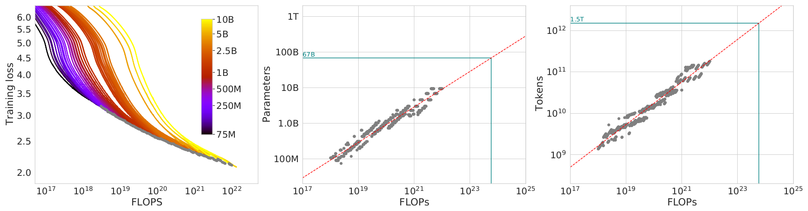

*图 2（原文 Figure 2，第 5 页）：训练曲线包络。左：全部运行。作者启动了从 70M 到 10B 的一系列模型大小，每个模型用 4 种不同的余弦周期长度。从这些曲线中提取“每个 FLOPs 下的最小损失”的包络，用这些点估计给定计算预算下的最优模型大小（中）和最优训练 token 数（右）。绿色标出按训练 Gopher 所用 FLOPs（$5.76\times10^{23}$）得到的最优模型大小和 token 数的外推值。*

**图中文字翻译与读法**：

- **左图**：横轴 FLOPS（训练 FLOPs，对数刻度，$10^{17}$ 到 $10^{22}$），纵轴 Training loss（训练损失，约 2.0 到 6.0）。每条彩色曲线是一次训练运行，颜色条表示模型参数量（75M、250M、500M、1B、2.5B、5B、10B）；灰色点是各 FLOPs 下损失最低的运行所形成的包络。同一模型大小的 4 条曲线对应 4 种余弦周期长度。各条曲线都先陡降、再变缓；大模型的曲线起初更高（同样 FLOPs 下还没训练多少步），随后交叉到包络上。
- **中图**：横轴 FLOPs，纵轴 Parameters（参数量，$10^{8}$ 到 $10^{12}$）。灰点是包络上各 FLOPs 对应的最优模型大小，红色虚线是幂律拟合；青绿色线标出 Gopher 的 FLOPs（$5.76\times10^{23}$）所对应的参数量，标注为 67B。
- **右图**：纵轴 Tokens（训练 token 数），同样的红色拟合线；青绿色线标出 Gopher 的 FLOPs 对应的最优 token 数，标注为 1.5T。
- **读图结论**：按方法 1 的拟合，用 Gopher 的计算预算，最优模型约为 67B 参数、训练 1.5T token；而 Gopher 实际是 280B 参数、300B token。

### 3.3 方法 2：IsoFLOP 曲线

方法 1 使用整条训练曲线上的点 $(N,D,L)$；方法 2 则固定一组 9 个不同的训练 FLOPs（从 $6\times10^{18}$ 到 $3\times10^{21}$），对每个 FLOPs 改变模型大小（模型最大到 16B；训练 token 数由模型大小和训练 FLOPs 决定），只看**最终训练损失**。这样能直接回答：给定 FLOPs 预算，最优参数量是多少？每次训练的余弦周期长度都设成与目标 token 数匹配（这按附录 B 是最优的）。

对每个 FLOPs 预算，把（平滑后的）最终损失对参数量作图，得到一条“谷”形曲线（图 3 左）；作者保证每条曲线上训练了足够多样的模型大小，以看到清晰的最小值。他们对每条 IsoFLOP 曲线拟合一条抛物线，直接估计取得最小损失的模型大小，再对 FLOPs 与最优模型大小、最优 token 数拟合幂律（图 3 中、右），得到 $a=0.49$、$b=0.51$。

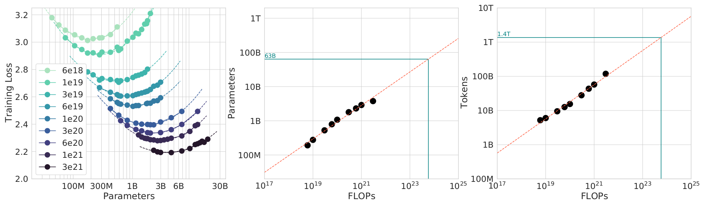

*图 3（原文 Figure 3，第 6 页）：IsoFLOP 曲线。对不同的模型大小，选择训练 token 数使最终 FLOPs 为常数；余弦周期长度设成与目标 FLOPs 匹配。可以看到清晰的损失谷：给定 FLOPs 预算，存在一个最优的训练模型（左）。用这些谷的位置，投影更大模型的最优模型大小和 token 数（中、右）。绿色标出按 Gopher 的计算预算得到的最优模型的参数量和 token 数估计。*

**图中文字翻译与读法**：

- **左图**：横轴 Parameters（参数量，对数刻度，刻度 100M、300M、1B、3B、6B、30B），纵轴 Training Loss（训练损失，2.0 到 3.2）。9 条曲线对应图例中的 9 个训练 FLOPs（6e18、1e19、3e19、6e19、1e20、3e20、6e20、1e21、3e21）；圆点是实验，虚线是抛物线拟合。预算越大，曲线整体越低，谷底（最优模型大小）越靠右。比如最小的预算（6e18）谷底约在 200M 参数（中图最左的黑点约 190M），最大的（3e21）约在 4B 参数（中图最右上的黑点约 3.8B）（均为图上读出的近似值）。作为对照，用表 A3 中方法 2 的数据做幂律内插，这两个预算对应的最优大小分别约为 230M 与 4.8B（自行验算），说明最大预算处的数据点略低于拟合线。
- **中图**：横轴 FLOPs，纵轴 Parameters；黑点是 9 条曲线的谷底（最优模型大小），红色虚线是幂律拟合，青绿色线标出 Gopher 的 FLOPs 对应的 63B。
- **右图**：纵轴 Tokens；黑点是谷底对应的最优训练 token 数，青绿色线标出 1.4T。
- **读图结论**：方法 2 在 Gopher 的预算下给出约 63B 参数、1.4T token，与方法 1 的 67B、1.5T 很接近。Chinchilla 取 70B 参数、1.4T token：位于原文估计的 40B 到 70B 区间的上端，其 token 数与方法 2 的估计相同。

### 3.4 方法 3：拟合参数化的损失函数

最后，作者把方法 1 和 2 实验得到的**所有最终损失**，建模成模型参数量和所见 token 数的参数化函数。依据经典的风险分解（附录 D.2），采用下面的函数形式：

$$
\hat L(N,D)\triangleq E+\frac{A}{N^{\alpha}}+\frac{B}{D^{\beta}}\tag{2}
$$

三项的含义：第一项 $E$ 是理想生成过程在该数据分布上的损失，应当对应自然文本的熵；第二项表示一个训练到完美的、有 $N$ 个参数的 Transformer 仍然差于理想生成过程；第三项表示 Transformer 没有训练到收敛，因为只在数据分布的一个样本上做了有限次优化步骤。

**拟合方法**：估计 $(A,B,E,\alpha,\beta)$ 时，最小化预测与观测的**对数损失**之间的 Huber 损失，用 L-BFGS 算法：

$$
\min_{A,B,E,\alpha,\beta}\ \sum_{\text{Runs }i}\operatorname{Huber}_{\delta}\Bigl(\log\hat L(N_i,D_i)-\log L_i\Bigr)\tag{3}
$$

用一组初始值网格取最佳拟合，以避免局部极小。Huber 损失（$\delta=10^{-3}$）对异常点稳健，作者发现这对在保留数据点上的预测很重要。附录 D.2 补充：初始网格为 $\alpha,\beta\in\{0,0.5,\dots,2\}$、$e\in\{-1,-0.5,\dots,1\}$、$a,b\in\{0,5,\dots,25\}$（这里 $a,b,e$ 是 $A,B,E$ 的对数，拟合时用 log-sum-exp 的写法使数值稳定）；使用更大的 $\delta$ 会让模型过拟合小计算量区域、对更大运行的预测变差，更小的 $\delta$ 则不影响结果。

**效率前沿**：在约束 $\mathrm{FLOPs}(N,D)\approx6ND$ 下最小化 $\hat L$，所得 $N_{opt}$ 与 $D_{opt}$ 平衡了 $\hat L$ 中依赖模型大小和依赖数据的两项，因此天然是幂律形式：

$$
N_{opt}(C)=G\left(\frac{C}{6}\right)^{a},\quad D_{opt}(C)=G^{-1}\left(\frac{C}{6}\right)^{b},\quad G=\left(\frac{\alpha A}{\beta B}\right)^{\frac{1}{\alpha+\beta}},\quad a=\frac{\beta}{\alpha+\beta},\quad b=\frac{\alpha}{\alpha+\beta}\tag{4}
$$

（自行推导验证：令 $D=C/(6N)$ 代入 $\hat L$，对 $N$ 求导并令其为零，即得式 (4)。）所以 $a$ 与 $b$ 只由两个指数 $\alpha,\beta$ 决定，且 $a+b=1$：损失里“参数项”的指数 $\alpha$ 越大，说明加参数收益越快，最优分配就越偏向把 token 加多，反之亦然。

作者在附录 D.2 里给出拟合后的结果：

$$
\hat L(N,D)=1.69+\frac{406.4}{N^{0.34}}+\frac{410.7}{D^{0.28}}\tag{10}
$$

即 $E=1.69$、$A=406.4$、$B=410.7$、$\alpha=0.34$、$\beta=0.28$。参数与数据的指数都小于 $1/2$：对数据效率指数这是预期的（随机优化的收敛速度下界为 $1/D^{1/2}$，作者认为这离已知的下界还很远），而对参数一项，两层网络的函数逼近误差预期为 $1/N^{1/2}$；作者希望未来的模型和训练方法能增大这些系数。附录 D.2 还给出了对应的损失分解：损失 $L(N,D)=$ 贝叶斯风险（即“自然文本的熵”）$+$ 函数逼近项（取决于模型大小 $N$）$+$ 随机逼近项（只做单个 epoch、有限步数带来的次优性）。

自行验算：把式 (10) 的取整常数代入，$\hat L$ 对 Chinchilla（$N=70\mathrm{B}$、$D=1.4\mathrm{T}$）约为 1.94，对 Gopher（$N=280\mathrm{B}$、$D=300\mathrm{B}$）约为 1.99，即参数化模型也预测 Chinchilla 的损失更低。但若直接用这些取整常数代入式 (4)，得到 $a\approx0.452$、Gopher 预算下 $N_{opt}\approx32\mathrm{B}$、$D_{opt}\approx3.0\mathrm{T}$，与图 4 标注的 40B 不一致：原文印出的是取整后的常数，而最优规模对指数很敏感，所以要复现方法 3，必须重新拟合，不能直接用这几个数。

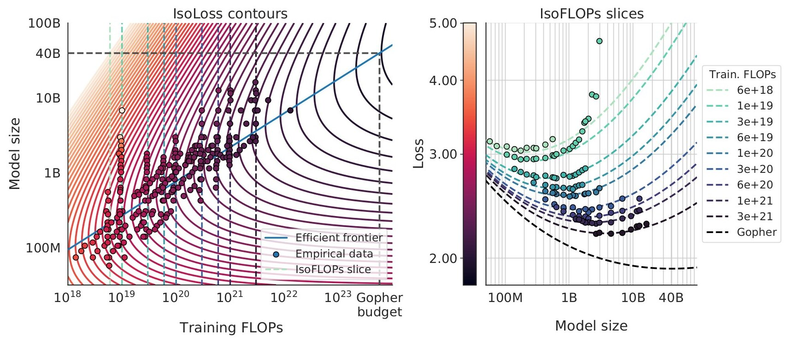

*图 4（原文 Figure 4，第 7 页）：参数化拟合。对损失 $\hat L(N,D)$ 做参数化建模，并显示等值线轮廓（左）与 IsoFLOP 切片（右）。对每个 IsoFLOP 切片，在左图中都有一条对应的虚线。左图中蓝色是效率前沿，在对数-对数空间里是一条直线：具体说，这条曲线在每条等损失轮廓上通过所需 FLOPs 最少的那个点。作者估计按 Gopher 的 FLOPs 预算，最优模型大小为 40B 参数。*

**图中文字翻译与读法**：

- **左图 “IsoLoss contours”（等损失轮廓）**：横轴 Training FLOPs（训练 FLOPs，对数刻度，$10^{18}$ 到 $10^{23}$，右端另标 Gopher budget 即 Gopher 的预算），纵轴 Model size（模型大小，约 50M 到 100B，标出 100M、1B、10B、40B、100B）。彩色曲线是 $\hat L$ 的等值线（颜色表示损失，由浅橙到深紫，对应右图颜色条由高到低），蓝色实线 “Efficient frontier”（效率前沿），圆点 “Empirical data”（实验数据），竖直虚线 “IsoFLOPs slice”（IsoFLOP 切片）。水平虚线在 40B 处，与 Gopher 预算的竖线相交于前沿。
- **右图 “IsoFLOPs slices”（IsoFLOP 切片）**：横轴 Model size（100M 到 40B），纵轴 Loss（约 1.8 到 5.0，对数刻度）；图例 Train. FLOPs（6e+18 到 3e+21 与 Gopher）。虚线是 $\hat L$ 在各个 FLOPs 预算下对模型大小的预测，圆点是实验。各条虚线都呈现“谷”，谷底随预算增大而右移、下移。最下面的黑色虚线是 Gopher 的预算，谷底在 40B 左右。
- **读图结论**：连续的 $\hat L$ 把方法 2 里一条条独立的 IsoFLOP 曲线统一了起来，并给出封闭形式的前沿；方法 3 给出的 $a=0.46$、$b=0.54$。

### 3.5 三种方法的结果比较

三种方法使用了不同的拟合方式（方法 1 与 2 用的是不同的训练运行，方法 3 则是对方法 1 与 2 的所有最终损失做统一拟合），却得到相近的预测：随着计算预算增加，模型大小与训练数据量应按大致相等的比例增长。方法 1 与 2 对最优模型大小的预测非常接近（图 1；附录图 A3 是同一结果的另一种画法，横轴为 token 数、纵轴为参数量，本文不重复放图），方法 3 预测在更大的计算预算下最优模型会更小。作者解释这个差别：低训练 FLOPs（$C\le10^{21}$）的观测点 $(L,N,D)$ 残差较大，Huber 损失会把它们自动当作离群点，拟合因此更看重高 FLOPs 的点；又由于前沿 $C\to N_{opt}$ 经验上有负曲率（附录 E），这就导致预测出比另外两种方法更低的 $N_{opt}$。

**表 2：随训练计算增加的参数和数据的估计缩放（原文表 2，第 8 页）**。列出的是指数 $a$ 与 $b$：$N_{opt}\propto C^{a}$、$D_{opt}\propto C^{b}$；括号内为通过自举（bootstrap，每次随机取 80% 数据，抽样 100 次）估计的第 10 与第 90 百分位数。

| 方法 | $a$（$N_{opt}\propto C^{a}$） | $b$（$D_{opt}\propto C^{b}$） |
|---|---|---|
| 1. 训练曲线的下包络（Minimum over training curves） | 0.50（0.488, 0.502） | 0.50（0.501, 0.512） |
| 2. IsoFLOP 曲线（IsoFLOP profiles） | 0.49（0.462, 0.534） | 0.51（0.483, 0.529） |
| 3. 损失的参数化建模（Parametric modelling of the loss） | 0.46（0.454, 0.455） | 0.54（0.542, 0.543） |
| Kaplan et al.（2020） | 0.73 | 0.27 |

读法：三种方法的 $a$ 都在 0.46 到 0.50，$b$ 都在 0.50 到 0.54，$a+b=1$；与 Kaplan 等的 0.73/0.27 形成鲜明对比，原文称“与此前关于这一问题的工作形成清晰对比，值得进一步研究”。注意各方法的自举区间都很窄（方法 3 仅 0.454 到 0.455），而方法之间的差别（0.46 对 0.50）远大于各自的区间宽度，所以自举区间只刻画“这批数据上的重采样稳定性”，并不能代表方法选择带来的不确定性；方法 2 的 $a$ 区间（0.462 到 0.534）则宽得多，已覆盖 0.5。

下图把三种方法与 Kaplan 等的预测画在同一张图上，并标出现有的几个大模型。

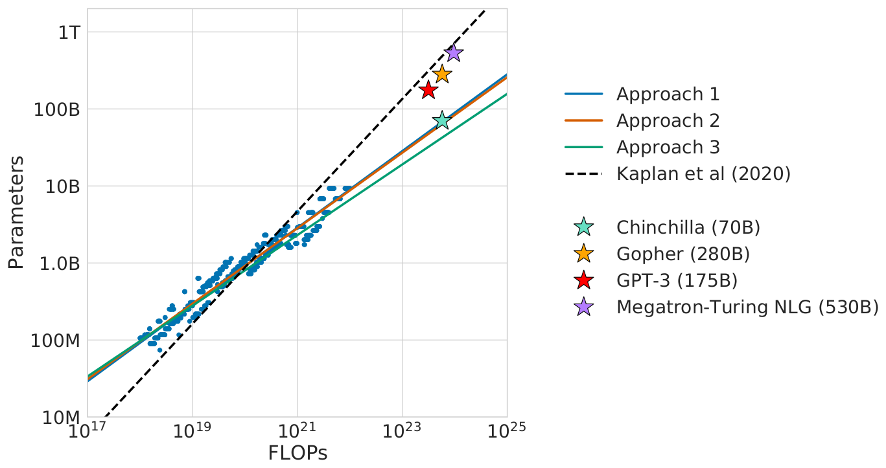

*图 1（原文 Figure 1，第 2 页）：叠加的预测。把三种方法的预测与 Kaplan 等（2020）的外推叠加。三种方法都预测：当前的大模型应当小得多，从而训练得比现在久得多。图 A3 用固定 FLOPs 预算下最优 token 数对最优参数量的形式展示了结果。Chinchilla 的表现优于 Gopher 等其他大模型（见原文 4.2 节）。*

**图中文字翻译与读法**：

- 横轴 FLOPs（训练 FLOPs，对数刻度，$10^{17}$ 到 $10^{25}$），纵轴 Parameters（参数量，10M 到 1T，对数刻度）。蓝、橙、绿三条实线是方法 1、2、3 的最优参数量预测（Approach 1、2、3），黑色虚线是 Kaplan 等（2020）的预测；蓝色小点是实验中位于前沿上的点（原文没有单独说明，位置与图 2 中图的点一致）。
- 五角星：Chinchilla（70B）、Gopher（280B）、GPT-3（175B）、Megatron-Turing NLG（530B）。
- **读图结论**：在实验覆盖的范围内（约 $10^{18}$ 到 $10^{22}$ FLOPs）几条线大致交汇（Kaplan 等的虚线约在 $10^{20}$ 到 $10^{21}$ FLOPs 处与新线相交），向右外推后分开：Kaplan 等的虚线明显更陡，三条新线则平缓得多。GPT-3、Gopher、MT-NLG 三颗星都落在新线的**上方**（模型比各自 FLOPs 下的最优值大），靠近 Kaplan 等的虚线；Chinchilla 则正好落在方法 1 与方法 2 的线上，即它是按新结论设计的。

### 3.6 最优分配的具体数字（表 3）

为了落地，作者给出：要让某个大小的模型落在计算最优前沿上，需要多少 FLOPs 和训练 token。

**表 3：不同模型大小的估计最优训练 FLOPs 与训练 token 数（原文表 3，第 8 页；方法 1 的预测，方法 2、3 的见表 A3）。第三列是以 Gopher 训练 FLOPs（$5.76\times10^{23}$）为单位的 FLOPs；最后一列“每参数 token 数”是自行计算的，原表没有**

| 参数量 | FLOPs | FLOPs（以 Gopher 为单位） | 训练 token 数 | 每参数 token 数（自行计算） |
|---:|---:|---:|---:|---:|
| 400 Million | 1.92e+19 | 1/29,968 | 8.0 Billion | 20.0 |
| 1 Billion | 1.21e+20 | 1/4,761 | 20.2 Billion | 20.2 |
| 10 Billion | 1.23e+22 | 1/46 | 205.1 Billion | 20.5 |
| 67 Billion | 5.76e+23 | 1 | 1.5 Trillion | 22.4 |
| 175 Billion | 3.85e+24 | 6.7 | 3.7 Trillion | 21.1 |
| 280 Billion | 9.90e+24 | 17.2 | 5.9 Trillion | 21.1 |
| 520 Billion | 3.43e+25 | 59.5 | 11.0 Trillion | 21.2 |
| 1 Trillion | 1.27e+26 | 221.3 | 21.2 Trillion | 21.2 |
| 10 Trillion | 1.30e+28 | 22515.9 | 216.2 Trillion | 21.6 |

读法：Gopher 的预算对应约 67B 参数、1.5T token。方法 1 下每个参数对应的 token 数几乎恒为 20 左右（因为 $a\approx b\approx0.5$）；业界后来常把它概括为“约 20 token/参数”，但论文本身并没有给出这个口号，这里只是从表 3 算出的比值。最后一列只对方法 1 成立：自行从表 A3 计算，方法 2 的比值在约 19 到 29 之间，方法 3 的比值则从 23 一路升到约 143，且随模型变大而显著增大。作者据此指出：当前这一代大语言模型相对于各自的计算预算都“大得过头”；一个 1T 参数的模型，除非计算预算达到 $10^{26}$ FLOPs，不太可能是最优的训练对象；所需的训练数据量远超当前用量，因此除了模型规模的工程改进，**数据集收集**同样重要。

**表 A3：方法 2 与方法 3 对不同模型大小的最优训练 FLOPs 与 token 数估计（原文表 A3，第 26 页）**

| 参数量 | 方法 2 的 FLOPs | 方法 2 的 token 数 | 方法 3 的 FLOPs | 方法 3 的 token 数 |
|---:|---:|---:|---:|---:|
| 400 Million | 1.84e+19 | 7.7 Billion | 2.21e+19 | 9.2 Billion |
| 1 Billion | 1.20e+20 | 20.0 Billion | 1.62e+20 | 27.1 Billion |
| 10 Billion | 1.32e+22 | 219.5 Billion | 2.46e+22 | 410.1 Billion |
| 67 Billion | 6.88e+23 | 1.7 Trillion | 1.71e+24 | 4.1 Trillion |
| 175 Billion | 4.54e+24 | 4.3 Trillion | 1.26e+24 | 12.0 Trillion |
| 280 Billion | 1.18e+25 | 7.1 Trillion | 3.52e+25 | 20.1 Trillion |
| 520 Billion | 4.19e+25 | 13.4 Trillion | 1.36e+26 | 43.5 Trillion |
| 1 Trillion | 1.59e+26 | 26.5 Trillion | 5.65e+26 | 94.1 Trillion |
| 10 Trillion | 1.75e+28 | 292.0 Trillion | 8.55e+28 | 1425.5 Trillion |

读法：方法 2 与表 3 的方法 1 接近；方法 3 在大模型处要求的 token 更多、对应的 FLOPs 也更高（即相同 FLOPs 下最优模型更小）。表中方法 3 的 175 Billion 行写作 1.26e+24，按 $6ND$（$6\times1.75\times10^{11}\times1.2\times10^{13}\approx1.26\times10^{25}$）应为 1.26e+25，应是原表笔误（自行验算）。

作者在正文还举了两个例子：175B 参数的模型应使用 $4.41\times10^{24}$ FLOPs、训练超过 4.2T token；一个 280B 参数的 Gopher 类模型，最优计算预算约为 $10^{25}$ FLOPs，应训练 6.8T token。这两个例子的数字与表 3、表 A3 的任何一行都不完全相同（见文末备查表）。

## 四、训练细节与分析的稳健性（附录）

### 4.1 训练数据：MassiveText（附录 A）

Chinchilla 与所有缩放实验都在 MassiveText（与 Gopher 同一个数据集）上训练，只是子集抽样比例略有不同（表 A1）。

**表 A1：MassiveText 数据构成（原文表 A1，第 22 页）。“抽样比例”一列括号内为 Rae 等（2021，即 Gopher）所用的比例；最后一列为在 1.4T token 中使用的 epoch 数**

| 子集 | 磁盘大小 | 文档数 | 抽样比例 | 1.4T token 中的 epoch 数 |
|---|---:|---:|---:|---:|
| MassiveWeb | 1.9 TB | 604M | 45%（48%） | 1.24 |
| Books | 2.1 TB | 4M | 30%（27%） | 0.75 |
| C4 | 0.75 TB | 361M | 10%（10%） | 0.77 |
| News | 2.7 TB | 1.1B | 10%（10%） | 0.21 |
| GitHub | 3.1 TB | 142M | 4%（3%） | 0.13 |
| Wikipedia | 0.001 TB | 6M | 1%（2%） | 3.40 |

读法：训练 1.4T token 时，MassiveWeb 被用了约 1.24 个 epoch，Wikipedia 约 3.40 个 epoch，其余子集都不足一个 epoch。原文因此注明 MassiveWeb 与 Wikipedia 用了不止一个 epoch；而缩放分析本身用的运行都没有超过一个 epoch（见第六节“局限”）。

### 4.2 余弦周期长度的选择（附录 B，图 A1）

分析里有一个关键假设：余弦周期长度以及对应的学习率下降（按照 Rae 等 2021，衰减 10 倍；脚注 9 说，衰减 10 倍与衰减到 0 相差很小，衰减 10 倍略好，衰减得更少如 5 倍则明显更差）。作者发现，把余弦周期长度设成比目标训练步数长太多，得到的模型就是次优训练的（图 A1）。因此他们假设最优训练的模型，其余弦周期长度要按计算预算所允许的最大步数校准，并在主分析中遵循这一规则。

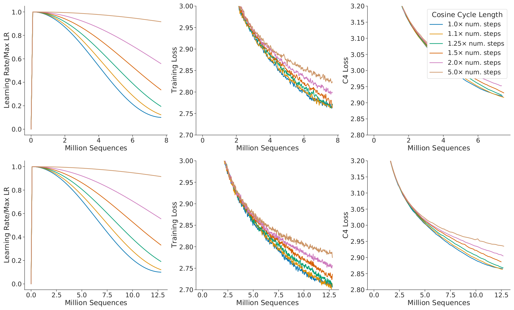

*图 A1（原文 Figure A1，第 23 页）：在余弦周期长度上的网格。展示 6 条曲线，余弦周期长度分别设为目标训练步数的 1、1.1、1.25、1.5、2、5 倍。当余弦周期长度过长、学习率没有适当地降下来时，性能受损。作者发现，高估训练步数超过 25% 会导致性能明显下降。上、下两行是把训练步数设为两个不同的值。*

**图中文字翻译与读法**：

- 每行三幅图：**左**为 Learning Rate/Max LR（学习率与最大学习率之比）随 Million Sequences（百万条序列）的变化；**中**为 Training Loss（训练损失）；**右**为 C4 Loss（在 C4 上的损失）。图例 Cosine Cycle Length：$1.0\times$ num. steps（步数的 1 倍）、1.1×、1.25×、1.5×、2.0×、5.0×。上行训练约 770 万条序列，下行约 1280 万条（图上读出的近似值）。
- 周期长度为 1 倍时，学习率在训练结束时降到最大值的 0.1；周期越长，结束时学习率越高（5 倍的结束时仍约 0.9，按余弦公式自行验算为 0.91）。
- **读图结论**：周期越长，同样步数处的训练损失越高、C4 损失也越高；周期为 1.25 倍及以内时差别很小，2 倍与 5 倍时明显更差：下行最终训练损失 1 倍约 2.71，5 倍约 2.78（图上读出的近似值，差约 0.07）。这支持“按预期训练长度设置学习率调度”的做法，也正是本文与 Kaplan 等不同的第一点。

### 4.3 在其他数据集上的一致性（附录 C，图 A2、表 A2）

在 C4 和 GitHub 代码上重复方法 2（IsoFLOP 分析）。两组实验都用 MassiveText 的子集，使用与 MassiveText 实验相同的分词器。

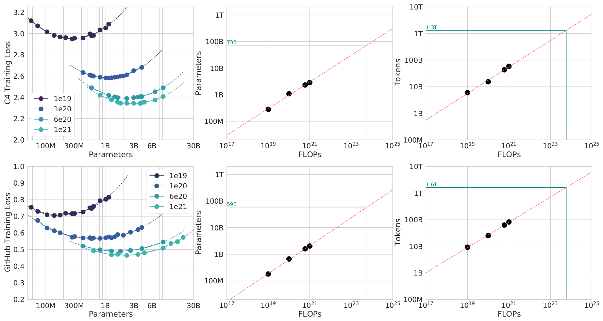

*图 A2（原文 Figure A2，第 23 页）：C4 与 GitHub 的 IsoFLOP 曲线。使用 C4 数据集（Raffel 等 2020b）和一个 GitHub 数据集（Rae 等 2021），各生成 4 条 IsoFLOP 剖面，并像图 3 一样展示参数量和 token 数的缩放。缩放系数见表 A2。*

**图中文字翻译与读法**：上行为 C4，下行为 GitHub；每行三幅图，结构与图 3 相同：左为 Training Loss 对 Parameters 的 IsoFLOP 曲线（4 个预算：1e19、1e20、6e20、1e21，C4 的纵轴 2.0 到 3.2，GitHub 的纵轴 0.2 到 1.0），中为最优参数量对 FLOPs，右为最优 token 数对 FLOPs。青绿色线标出 Gopher 预算下的外推：C4 约 73B 参数、1.3T token，GitHub 约 59B 参数、1.6T token。

**表 A2：两个替代数据集上，随训练计算增加的参数与数据缩放估计（原文表 A2，第 24 页；IsoFLOP 剖面）**

| 数据集 | $a$（$N_{opt}\propto C^{a}$） | $b$（$D_{opt}\propto C^{b}$） |
|---|---|---|
| C4 | 0.50 | 0.50 |
| GitHub | 0.53 | 0.47 |
| Kaplan et al.（2020） | 0.73 | 0.27 |

读法：在 C4 和 GitHub 上，指数同样接近 0.5。原文据此认为，只要训练不超过一个 epoch，结果与数据集无关。

### 4.4 与 Kaplan 等的小规模正面比较（附录 D.4，图 A4）

在 $10^{21}$ FLOPs 处，作者做了一次头对头比较：方法 1 预测的最优模型对 Kaplan 等预测的最优模型。两者都用 0.5M token 的 batch size、最大学习率 $1.5\times10^{-4}$、衰减 10 倍。按 Kaplan 等，最优模型是 46.8 亿参数；按方法 1，是 28.6 亿参数。作者训练了 47.4 亿和 28.0 亿参数的 Transformer 来检验（使用相同的深宽比，以避免尽可能多的混杂因素），结果是按本文预测的模型表现更好。

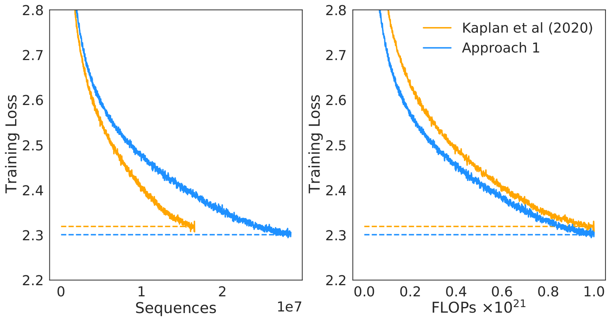

*图 A4（原文 Figure A4，第 27 页）：在 $10^{21}$ FLOPs 下与 Kaplan 等（2020）的比较。训练 28.0 亿与 47.4 亿参数的 Transformer，它们分别是方法 1 与 Kaplan 等预测的 $10^{21}$ FLOPs 最优模型。我们的预测在训练结束时给出表现更好的模型。*

**图中文字翻译与读法**：

- **左图**：横轴 Sequences（训练序列数，单位 $10^{7}$），纵轴 Training Loss（训练损失，2.2 到 2.8）。橙色为 Kaplan et al（2020）预测的 4.74B 模型，蓝色为 Approach 1（方法 1）预测的 2.80B 模型；两条水平虚线是它们各自的最终损失。大模型（橙）在同样序列数下损失更低，因此它用约 $1.7\times10^{7}$ 条序列就结束，而小模型（蓝）训练约 $2.8\times10^{7}$ 条序列才结束（图上读出的近似值）。
- **右图**：横轴改为 FLOPs（单位 $10^{21}$，0 到 1.0）。在相同的 FLOPs 下，蓝线始终在橙线下方，终点处蓝约 2.30、橙约 2.32（图上读出的近似值）。
- **读图结论**：同样的计算预算，较小但训练更久的模型最终损失更低，但差距不大（约 0.02）：这个比较是在“最优点附近”，损失对模型大小本来就比较平坦；它支持方法 1 的预测，但并不是一个大幅度的差距。

### 4.5 前沿的曲率（附录 E，图 A5）

作者观察到，随着模型变大，FLOPs-最小损失的前沿出现曲率。这意味着只用很小的模型做外推与用较大的模型做外推会得到不同的预测。图 A5 画出对前沿点的前、中、后三段分别做线性拟合的结果。主分析没有考虑这一点，留作未来工作，因为它暗示，在大的 FLOPs 预算下，最优模型可能还要更小。

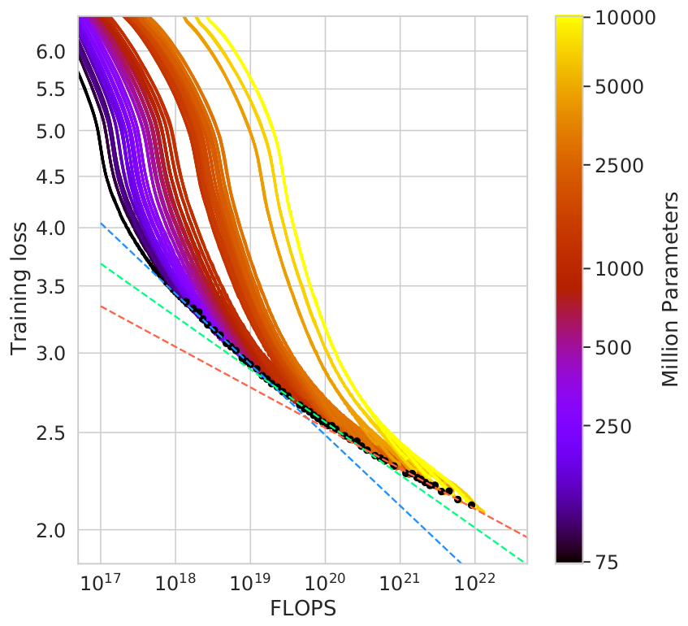

*图 A5（原文 Figure A5，第 28 页）：训练曲线的包络。分别对损失前沿上所有点的第一个三分之一（橙色）、中间三分之一（绿色）和最后三分之一（蓝色）做拟合；只画出点的一个子集。*

**图中文字翻译与读法**：横轴 FLOPS（$10^{17}$ 到 $10^{22}$），纵轴 Training loss（约 2.0 到 6.0，对数刻度），颜色条 Million Parameters（百万参数，75 到 10000）。彩色曲线是各模型的训练曲线，黑点是前沿上的点，三条虚线是对前沿上三段点的线性拟合。三条线的斜率明显不同：蓝色最陡、橙红色最平，说明前沿的斜率随计算量增大而变平。按线在图中的位置，蓝线贴合低 FLOPs 端的点，橙红线贴合高 FLOPs 端的点，与图题里颜色对应“第一段、最后一段”的说法相反（疑为图题笔误），读图请以线的位置为准。

### 4.6 FLOPs 的计算（附录 F、表 A4）

原文的 FLOPs 把所有训练 FLOPs（包括 embedding 矩阵）都计入，并在总参数量中也计入 embedding；乘加用因子 2 计。前向传播包括：embedding（$2\times\text{seq\_len}\times\text{vocab\_size}\times d_{\text{model}}$）；每层注意力（QKV 投影 $2\times3\times\text{seq\_len}\times d_{\text{model}}\times(\text{key\_size}\times\text{num\_heads})$，QK 打分 $2\times\text{seq\_len}^2\times(\text{key\_size}\times\text{num\_heads})$，softmax $3\times\text{num\_heads}\times\text{seq\_len}^2$，对 V 的加权求和与最终线性层）；每层前馈块；最终 logits（$2\times\text{seq\_len}\times d_{\text{model}}\times\text{vocab\_size}$）。反向传播假定为前向的两倍。作者把这一计算与常用近似 $C=6DN$ 做了比较（表 A4），差别很小，不影响分析。

**表 A4：FLOPs 比较（原文表 A4，第 28 页）。对不同模型大小，给出本文计算的每序列 FLOPs 与 $6ND$ 近似之比**

| 参数量 | 层数 | $d_{\text{model}}$ | ffw_size | 头数 | k/q 大小 | FLOPs 比值（本文计算 / $6ND$） |
|---|---:|---:|---:|---:|---:|---:|
| 73M | 10 | 640 | 2560 | 10 | 64 | 1.03 |
| 305M | 20 | 1024 | 4096 | 16 | 64 | 1.10 |
| 552M | 24 | 1280 | 5120 | 10 | 128 | 1.08 |
| 1.1B | 26 | 1792 | 7168 | 14 | 128 | 1.04 |
| 1.6B | 28 | 2048 | 8192 | 16 | 128 | 1.03 |
| 6.8B | 40 | 3584 | 14336 | 28 | 128 | 0.99 |

读法：比值在 0.99 到 1.10 之间。原文还说明，与 Rae 等（2021）的结果相比，本文采用了略为精确的计算，得到略有不同的值（$6.3\times10^{23}$ 对 $5.76\times10^{23}$）；原文没有明确说哪个数对应哪种口径，正文各处使用的 Gopher 预算是 $5.76\times10^{23}$。附录 J 的表 A9 列出了本研究训练的全部 50 个模型配置（参数量从 44M 到 16,183M，$d_{\text{model}}$ 从 512 到 5120，层数从 8 到 49，注意力头数从 8 到 40，key/value 大小 64 或 128），其中许多模型用不同的学习率调度或 token 数训练过多次；因为过长，本文不逐行转录。

## 五、Chinchilla：验证预测

### 5.1 模型与训练细节（第 4 节）

按原文第 3 节的分析，Gopher 的计算预算对应的最优模型大小在 40B 到 70B 之间。作者选择了范围上端的 70B 参数，训练 1.4T token（出于数据与计算效率两方面的考虑）。Chinchilla 与 Gopher 训练所用的 FLOPs 相同，差别在于模型大小与训练 token 数；它比 Gopher 小 4 倍，因此内存占用和推理成本也更小。

Chinchilla 沿用 Gopher 的模型架构与训练设置，只有以下不同：

- 在 MassiveText 上训练（与 Gopher 相同的数据集），但使用略有不同的子集分布（表 A1），以适应更多的训练 token；
- 用 AdamW（Loshchilov 与 Hutter 2019）而不是 Adam，这提升了语言建模损失以及微调后的下游任务表现；
- 用略有修改的 SentencePiece 分词器，不做 NFKC 规范化；词表与 Gopher 的相似，94.15% 的 token 相同；原文发现这对数学和化学的表示尤其有帮助（模型卡写明词表大小为 32,000）；
- 前向和反向用 bfloat16 计算，但在分布式优化器状态中保存一份 float32 的权重副本（见 Rae 等 2021 的 Lessons Learned）。

全部实验在 TPUv3/TPUv4 上用 JAX 和 Haiku 训练。附录 G 展示了这些优化器相关的改动：对 6.8 亿参数的模型，Chinchilla 的设置（AdamW、高精度权重副本）优于 Gopher 的设置（图 A6）；对 417M 与 1.4B 模型，AdamW 训练的最终表现优于 Adam（图 A7）；脚注 8 指出 AdamW 训练的模型要到余弦周期约 80% 处才在训练指标上超过 Adam，但最终表现更好。

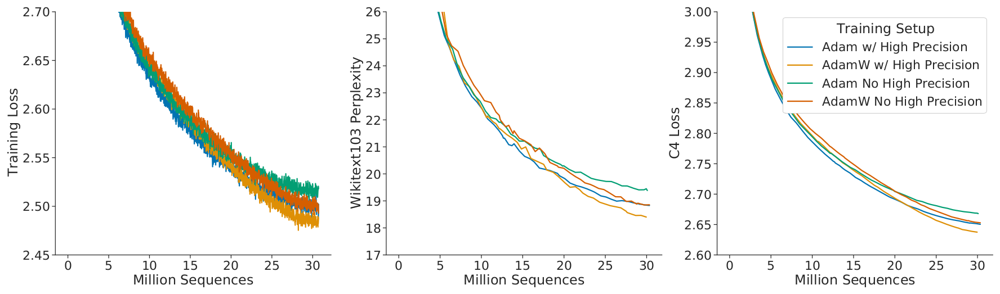

*图 A6（原文 Figure A6，第 29 页）：其他差异的比较。用一个 6.8 亿参数的模型，比较训练 Gopher 与 Chinchilla 所用的设置，即优化器的变化以及在优化器状态中使用更高精度的权重副本。Chinchilla 所用的设置（橙色）明显优于训练 Gopher 所用的设置（绿色）。*

**图中文字翻译与读法**：三幅图的横轴都是 Million Sequences（百万条序列，0 到约 30），纵轴依次是 Training Loss（训练损失）、Wikitext103 Perplexity（Wikitext103 困惑度）、C4 Loss（C4 损失）。图例 Training Setup（训练设置）四种：Adam w/ High Precision（Adam，有高精度权重副本，蓝）、AdamW w/ High Precision（AdamW，有高精度副本，橙）、Adam No High Precision（Adam，无高精度副本，绿，对应 Gopher 的设置）、AdamW No High Precision（AdamW，无高精度副本，红）。训练结束时（约 30M 条序列）：绿线最差，训练损失约 2.52、Wikitext103 困惑度约 19.4、C4 损失约 2.67；橙线（Chinchilla 的设置）最好，分别约 2.48、18.4、2.64（图上读出的近似值）。**读图结论**：在 6.8 亿参数的规模上，换成 AdamW 并保存 float32 权重副本，最终的三项指标都略有改善，这说明 Chinchilla 与 Gopher 的差距不全部来自模型大小与 token 数。差异的量级约 0.03 到 0.04 nat（训练损失与 C4 损失），原文没有把这一差异换算成下游任务指标，所以只能说它是 70B 对 280B 结果的一个混杂因素，而不是主要解释。

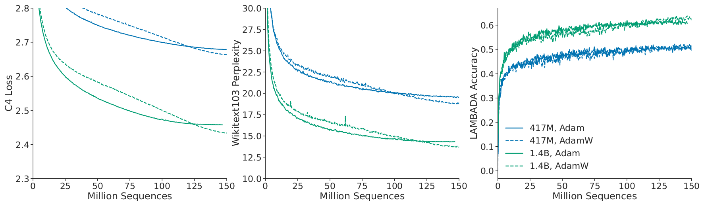

*图 A7（原文 Figure A7，第 29 页）：Adam 对 AdamW。对 417M 模型（蓝）和 1.4B 模型（绿），我们发现用 AdamW 训练比用 Adam 训练的表现更好。*

**图中文字翻译与读法**：横轴 Million Sequences（0 到 150），三幅图的纵轴依次是 C4 Loss（C4 损失）、Wikitext103 Perplexity（困惑度）、LAMBADA Accuracy（LAMBADA 准确率）。图例：417M, Adam（蓝实线）、417M, AdamW（蓝虚线）、1.4B, Adam（绿实线）、1.4B, AdamW（绿虚线）。前两幅图里，虚线（AdamW）在训练前大部分时间都在实线（Adam）之上，约在 80% 处交叉后降到更低：417M 终点 C4 损失约 2.665 对 2.678，困惑度约 18.8 对 19.5；1.4B 终点 C4 损失约 2.43 对 2.46，困惑度约 13.7 对 14.3（图上读出的近似值）。LAMBADA 准确率上两种优化器几乎重合（417M 约 0.5，1.4B 约 0.6）。**读图结论**：AdamW 带来的好处出现在余弦衰减的后期，因此要在完整的训练长度上比较，不能用中途的损失判断；LAMBADA 上看不出差别。

**表 4：Chinchilla 架构细节（原文表 4，第 9 页）。列出层数、key/value 大小、瓶颈激活大小 $d_{\text{model}}$、最大学习率和训练 batch size（以 token 计）；前馈层大小始终设为 $4\times d_{\text{model}}$；Chinchilla 与 Gopher 都在训练中途把 batch size 加倍**

| 模型 | 层数 | 头数 | key/value 大小 | $d_{\text{model}}$ | 最大学习率 | batch size |
|---|---:|---:|---:|---:|---:|---|
| Gopher 280B | 80 | 128 | 128 | 16,384 | $4\times10^{-5}$ | 3M → 6M |
| Chinchilla 70B | 80 | 64 | 128 | 8,192 | $1\times10^{-4}$ | 1.5M → 3M |

读法：Chinchilla 与 Gopher 层数相同，宽度（$d_{\text{model}}$ 与头数）减半，所以参数约为 1/4；最大学习率更大（$1\times10^{-4}$ 对 $4\times10^{-5}$），batch size 更小（1.5M→3M 对 3M→6M，都在训练中途加倍）。

### 5.2 评测任务总览（表 5）

评测任务大体与 Rae 等（2021）相同，以便与 Gopher 直接比较；评测细节也与 Rae 等一致。

**表 5：全部评测任务（原文表 5，第 10 页）**

| 类别 | 任务数 | 例子 |
|---|---:|---|
| 语言建模（Language Modelling） | 20 | WikiText-103、The Pile：PG-19、arXiv、FreeLaw 等 |
| 阅读理解（Reading Comprehension） | 3 | RACE-m、RACE-h、LAMBADA |
| 问答（Question Answering） | 3 | Natural Questions、TriviaQA、TruthfulQA |
| 常识（Common Sense） | 5 | HellaSwag、Winogrande、PIQA、SIQA、BoolQ |
| MMLU | 57 | High School Chemistry、Astronomy、Clinical Knowledge 等 |
| BIG-bench | 62 | Causal Judgement、Epistemic Reasoning、Temporal Sequences 等 |

### 5.3 语言建模（The Pile 与 Wikitext103）

原文强调：Chinchilla 比 Gopher 多训练 4 倍数据，因此在这些语言建模基准上，训练集与测试集的泄漏可能人为抬高结果，需要谨慎比较；所以后面更重视泄漏问题较小的任务，如 MMLU、BIG-bench、闭卷问答和常识分析。

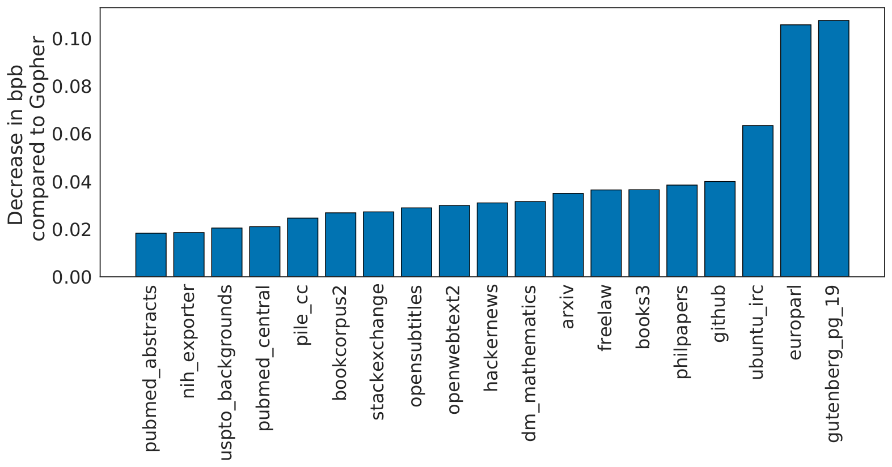

*图 5（原文 Figure 5，第 10 页）：The Pile 评测。对 The Pile（Gao 等 2020）的各个评测集，显示 Chinchilla 相对 Gopher 的每字节比特数（bits-per-byte，bpb）的改进（下降）。在所有子集上，Chinchilla 都优于 Gopher。*

**图中文字翻译与读法**：纵轴 Decrease in bpb compared to Gopher（相对 Gopher 的 bpb 下降量，0.00 到约 0.10，越高表示 Chinchilla 越好）；横轴是 19 个 Pile 子集，按下降量从小到大排序，依次为：pubmed_abstracts、nih_exporter、uspto_backgrounds、pubmed_central、pile_cc、bookcorpus2、stackexchange、opensubtitles、openwebtext2、hackernews、dm_mathematics、arxiv、freelaw、books3、philpapers、github、ubuntu_irc、europarl、gutenberg_pg_19。所有 19 根柱子都为正：下降量最小的约 0.02（pubmed_abstracts、nih_exporter），最大的 gutenberg_pg_19 和 europarl 约 0.11，ubuntu_irc 约 0.06。这些高度与表 A5 的差值一致（自行验算，例如 gutenberg_pg_19：0.656−0.548=0.108）。

**表 A5：The Pile 上的每字节比特数（原文表 A5，第 30 页；越小越好，粗体为每行最佳）**

| 子集 | Chinchilla（70B） | Gopher（280B） | Jurassic-1（170B） |
|---|---:|---:|---:|
| pile_cc | **0.667** | 0.691 | 0.669 |
| pubmed_abstracts | **0.559** | 0.578 | 0.587 |
| stackexchange | **0.614** | 0.641 | 0.655 |
| github | **0.337** | 0.377 | 0.358 |
| openwebtext2 | **0.647** | 0.677 | - |
| arxiv | **0.627** | 0.662 | 0.680 |
| uspto_backgrounds | **0.526** | 0.546 | 0.537 |
| freelaw | **0.476** | 0.513 | 0.514 |
| pubmed_central | **0.504** | 0.525 | 0.579 |
| dm_mathematics | 1.111 | 1.142 | **1.037** |
| hackernews | **0.859** | 0.890 | 0.869 |
| nih_exporter | **0.572** | 0.590 | 0.590 |
| opensubtitles | **0.871** | 0.900 | 0.879 |
| europarl | **0.833** | 0.938 | - |
| books3 | **0.675** | 0.712 | 0.835 |
| philpapers | **0.656** | 0.695 | 0.742 |
| gutenberg_pg_19 | **0.548** | 0.656 | 0.890 |
| bookcorpus2 | **0.714** | 0.741 | - |
| ubuntu_irc | 1.026 | 1.090 | **0.857** |

读法：Chinchilla 在所有子集上优于 Gopher；与 Jurassic-1 比，只在 dm_mathematics 和 ubuntu_irc 两个子集上落后（表中 “-” 表示原表没有数据）。另外，在 Wikitext103 上，Chinchilla 的困惑度为 7.16，Gopher 为 7.75。

### 5.4 MMLU（表 6、图 6）

MMLU（Massive Multitask Language Understanding）由一系列学术科目的考试式题目组成。表 6 报告 Chinchilla 在 57 个任务上的 5-shot 平均准确率。

**表 6：MMLU（原文表 6，第 11 页）。5-shot 平均准确率（57 个任务）；模型和人类的准确率比较取自 Hendrycks 等（2020）；另含 73 位有竞争力的人类预测者（Steinhardt 2021）对 2022 年 6 月与 2023 年 6 月最先进准确率的平均预测**

| 对象 | 平均准确率 |
|---|---:|
| 随机（Random） | 25.0% |
| 人类平均评分者（Average human rater） | 34.5% |
| GPT-3 5-shot | 43.9% |
| Gopher 5-shot | 60.0% |
| **Chinchilla 5-shot** | **67.6%** |
| 人类专家平均水平（Average human expert performance） | 89.8% |
| 2022 年 6 月预测（June 2022 Forecast） | 57.1% |
| 2023 年 6 月预测（June 2023 Forecast） | 63.4% |

读法：Chinchilla 比 Gopher 高 7.6 个百分点，甚至超过了人类预测者对 2023 年 6 月最先进水平的预测（63.4%）；但距离人类专家平均水平（89.8%）仍有很大差距。此外，Chinchilla 在 4 个单项任务上准确率超过 90%（high_school_gov_and_politics、international_law、sociology、us_foreign_policy），据原文所知，之前没有其他模型在某个子项上超过 90%。

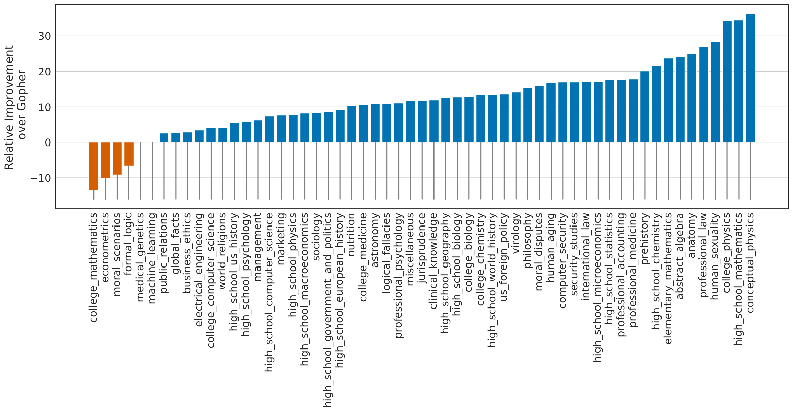

*图 6（原文 Figure 6，第 12 页）：MMLU 结果与 Gopher 的比较。Chinchilla 平均比 Gopher 好 7.6%（见表 6），并在 57 个任务中的 51 个上更好、2 个持平、仅 4 个更差。*

**图中文字翻译与读法**：纵轴 Relative Improvement over Gopher（相对 Gopher 的相对改进，单位 %，约 −13 到 +36），横轴是 57 个 MMLU 子任务，按改进幅度从小到大排列。蓝色柱为 Chinchilla 更好，橙色柱为更差，没有柱的是持平。橙色的 4 个任务是 college_mathematics、econometrics、moral_scenarios、formal_logic；持平（无柱）的 2 个是 medical_genetics、machine_learning；改进最大的几个是 conceptual_physics、high_school_mathematics、college_physics（约 +34% 到 +36%）。这里的“相对改进”是 Chinchilla 准确率相对 Gopher 的比值减 1；自行用表 A6 验算：conceptual_physics 为 67.2/49.4−1≈+36.0%，college_mathematics 为 32.0/37.0−1≈−13.5%，与图一致。

**MMLU 关键子项（节选自原文表 A6，第 31 页；准确率 %）**

| 子项 | Chinchilla | Gopher | 备注 |
|---|---:|---:|---|
| college_mathematics | 32.0 | 37.0 | 更差 |
| econometrics | 38.6 | 43.0 | 更差 |
| formal_logic | 33.3 | 35.7 | 更差 |
| moral_scenarios | 36.5 | 40.2 | 更差 |
| machine_learning | 41.1 | 41.1 | 持平 |
| medical_genetics | 69.0 | 69.0 | 持平 |
| high_school_gov_and_politics | 91.2 | 83.9 | 超过 90% |
| international_law | 90.9 | 77.7 | 超过 90% |
| sociology | 91.0 | 84.1 | 超过 90% |
| us_foreign_policy | 92.0 | 81.0 | 超过 90% |
| conceptual_physics | 67.2 | 49.4 | 相对改进最大（+36.0%） |
| high_school_mathematics | 31.9 | 23.7 | 相对改进第二（+34.6%） |
| college_physics | 46.1 | 34.3 | 相对改进第三（+34.4%） |

读法：Chinchilla 变差的 4 个科目是 college_mathematics、econometrics、formal_logic、moral_scenarios，其中三个偏数学或逻辑；原文没有分析原因。自行验算：把表 A6 的 57 个科目简单平均，Chinchilla 为 67.6，Gopher 为 60.6（表 6 与正文写 Gopher 为 60.0，二者口径可能不同，原文未说明；摘要则写 Chinchilla 为 67.5%，见文末备查表）。

### 5.5 阅读理解（表 7）

**表 7：阅读理解（原文表 7，第 12 页）。粗体为最佳。GPT-3 和 MT-NLG 530B 在 RACE-h/m 上使用了与本文不同的提示格式，因此与 Gopher、Chinchilla 的结果不可比**

| 任务 | Chinchilla | Gopher | GPT-3 | MT-NLG 530B |
|---|---:|---:|---:|---:|
| LAMBADA 零样本 | **77.4** | 74.5 | 76.2 | 76.6 |
| RACE-m 少样本 | **86.8** | 75.1 | 58.1 | - |
| RACE-h 少样本 | **82.3** | 71.6 | 46.8 | 47.9 |

读法：LAMBADA（最后一个词预测）上，Chinchilla 达到 77.4%，高于 Gopher 的 74.5% 与 MT-NLG 530B 的 76.6%；RACE-h 与 RACE-m 上，Chinchilla 比 Gopher 提高超过 10 个百分点（自行验算：11.7 与 10.7）。

### 5.6 BIG-bench（图 7）

作者在 Rae 等（2021）所报告的同一组 BIG-bench 任务上分析了 Chinchilla。与 MMLU 类似，它在绝大多数任务上超过 Gopher：平均性能提高 10.7%，准确率达到 65.1%，而 Gopher 为 54.4%；在所考虑的 62 个任务中，只有四个更差：crash_blossom、dark_humor_detection、mathematical_induction、logical_args。

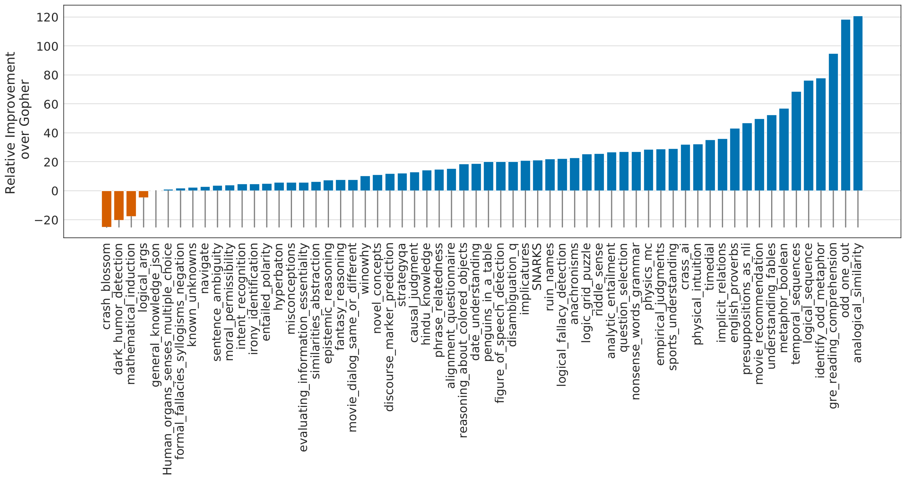

*图 7（原文 Figure 7，第 13 页）：BIG-bench 结果与 Gopher 的比较。在所考虑的 BIG-bench 任务里，除四个以外，Chinchilla 都优于 Gopher。完整结果见表 A7。*

**图中文字翻译与读法**：纵轴 Relative Improvement over Gopher（相对 Gopher 的相对改进，单位 %，约 −25 到 +121），横轴是 62 个 BIG-bench 任务，按改进幅度排序。橙色的四根柱是 crash_blossom（约 −25%）、dark_humor_detection（约 −20%）、mathematical_induction（约 −18%）、logical_args（约 −5%）；改进最大的是 analogical_similarity（约 +121%）、odd_one_out（约 +118%）、gre_reading_comprehension（约 +94%）。自行用表 A7 验算：analogical_similarity 为 38.1/17.2−1≈+121%，crash_blossom 为 47.6/63.6−1≈−25%。

**BIG-bench 关键子项（节选自原文表 A7，第 35 页；准确率 %）**

| 任务 | Chinchilla | Gopher | 备注 |
|---|---:|---:|---|
| crash_blossom | 47.6 | 63.6 | 更差 |
| dark_humor_detection | 66.2 | 83.1 | 更差 |
| mathematical_induction | 47.3 | 57.6 | 更差 |
| logical_args | 56.2 | 59.1 | 更差 |
| analogical_similarity | 38.1 | 17.2 | 相对改进最大 |
| odd_one_out | 70.9 | 32.5 | 相对改进第二 |
| gre_reading_comprehension | 53.1 | 27.3 | 相对改进第三 |
| movie_recommendation | 75.6 | 50.5 | 大幅提高 |
| metaphor_boolean | 93.1 | 59.3 | 大幅提高 |

读法：自行验算：把表 A7 的 62 个任务简单平均，Gopher 为 54.4（与正文一致），Chinchilla 为约 64.5，而正文写的是 65.1%（二者差约 0.6，原文未说明原因，见文末备查表）。

### 5.7 常识与 TruthfulQA（表 8）

作者在 PIQA、SIQA、Winogrande、HellaSwag 和 BoolQ 等常识基准上评测 Chinchilla。

**表 8：常识基准的零样本比较（原文表 8，第 13 页）。粗体为每行最佳；“-” 表示原表没有该数据**

| 任务 | Chinchilla | Gopher | GPT-3 | MT-NLG 530B | 有监督 SOTA |
|---|---:|---:|---:|---:|---:|
| HellaSWAG | **80.8%** | 79.2% | 78.9% | 80.2% | 93.9% |
| PIQA | 81.8% | 81.8% | 81.0% | **82.0%** | 90.1% |
| Winogrande | **74.9%** | 70.1% | 70.2% | 73.0% | 91.3% |
| SIQA | **51.3%** | 50.6% | - | - | 83.2% |
| BoolQ | **83.7%** | 79.3% | 60.5% | 78.2% | 91.4% |

读法：Chinchilla 与 Gopher、GPT-3 持平或更好；在有数据的任务上，除 PIQA 外都优于 530B 的 MT-NLG（SIQA 没有 MT-NLG 的数据）。原文正文写“在所有任务上优于 Gopher 和 GPT-3”，但表中 PIQA 与 Gopher 持平（均 81.8%），表题写的是“持平或更好”，以表为准。所有任务上与有监督 SOTA 都还有明显差距。

TruthfulQA（Lin 等 2021）上，Chinchilla 的 0-shot、5-shot、10-shot 准确率分别为 43.6%、58.5%、66.7%；Gopher 的 0-shot 为 29.5%、10-shot 为 43.7%。0-shot 提高了 14.1 个百分点。这与 Lin 等的发现形成鲜明对比，作者认为这说明仅靠更好地建模预训练数据，就能在这个基准上取得显著提升。

### 5.8 闭卷问答（表 9）

**表 9：闭卷问答（原文表 9，第 14 页）。准确率；Natural Questions 与 TriviaQA 上 Chinchilla 在所有设置下都优于 Gopher。TriviaQA 给出两个评测集，以便与 GPT-3 和开卷 SOTA（FiD + Distillation，Izacard 与 Grave 2020）比较**

| 数据集 | 设置 | Chinchilla | Gopher | GPT-3 | SOTA（开卷） |
|---|---|---:|---:|---:|---:|
| Natural Questions（dev） | 0-shot | 16.6% | 10.1% | 14.6% | 54.4% |
| | 5-shot | 31.5% | 24.5% | - | |
| | 64-shot | 35.5% | 28.2% | 29.9% | |
| TriviaQA（未过滤，test） | 0-shot | 67.0% | 52.8% | 64.3% | - |
| | 5-shot | 73.2% | 63.6% | - | |
| | 64-shot | 72.3% | 61.3% | 71.2% | |
| TriviaQA（过滤后，dev） | 0-shot | 55.4% | 43.5% | - | 72.5% |
| | 5-shot | 64.1% | 57.0% | - | |
| | 64-shot | 64.6% | 57.2% | - | |

读法：开卷 SOTA 一列在原表中是跨三行的合并单元格（Natural Questions 为 54.4%，未过滤 TriviaQA 为 “-”，过滤后 TriviaQA 为 72.5%），这里放在每组的第一行。Chinchilla 在 Natural Questions 上取得闭卷新 SOTA：5-shot 31.5%、64-shot 35.5%；在 TriviaQA 过滤集上，它只比开卷 SOTA 落后 7.9%（64-shot 64.6% 对 72.5%）；在未过滤集上则超过 GPT-3。

### 5.9 性别偏见与毒性（表 10）

原文强调这些评测不全面，仍有大量工作要做。由于 Chinchilla 与 Gopher 数据相同（只是相对权重略有不同）且架构相似，作者预期它携带与 Gopher 类似的风险。

**性别偏见（Winogender，零样本）**：Winogender 测试模型能否正确判断代词指代的是哪个职业词。表 10 左半是按代词性别分，右半是按“gotcha”例子（正确的指代消解与性别刻板印象相悖，依据劳动统计确定）分。

**表 10：Winogender 结果（原文表 10，第 15 页；正确率）**

| 分组 | Chinchilla | Gopher |
|---|---:|---:|
| 全部（All） | 78.3% | 71.4% |
| 男性代词（Male） | 71.2% | 68.0% |
| 女性代词（Female） | 79.6% | 71.3% |
| 中性代词（Neutral） | 84.2% | 75.0% |

| 分组 | Chinchilla | Gopher |
|---|---:|---:|
| 男性 gotcha（Male gotcha） | 62.5% | 59.2% |
| 男性 not gotcha（Male not gotcha） | 80.0% | 76.7% |
| 女性 gotcha（Female gotcha） | 76.7% | 66.7% |
| 女性 not gotcha（Female not gotcha） | 82.5% | 75.8% |

读法：Chinchilla 在所有分组上都比 Gopher 正确率更高；但提升幅度不均：男性代词只提升 3.2 个百分点，女性与中性代词分别提升 8.3 与 9.2 个百分点；提升最大的是女性 gotcha（10 个百分点）。作者据此认为，更计算最优的模型带来的改善可能是不均匀的，不同组之间的差异说明 Chinchilla 仍然表现出偏见。

**毒性**：按 Rae 等（2021）的方案，从 Chinchilla 生成 25,000 个无提示的样本，用 PerspectiveAPI 比较毒性分数分布。Gopher 的平均（中位数）毒性分数为 0.081（0.064），Chinchilla 为 0.087（0.066）；第 95 百分位分别为 0.230 与 0.238。也就是说，绝大多数生成样本被判为无毒，两个模型的差别可以忽略；这与此前的发现一致：无条件生成中的毒性水平大体独立于模型质量（以语言建模损失衡量），即对训练数据建模得更好并不一定更有毒。

## 六、讨论、局限与证据边界

**原文自述的局限**（第 5 节）：

- 由于训练大模型成本高，大尺度上只有两个可比较的训练运行（Chinchilla 与 Gopher），没有中间尺度的额外检验；
- 假设高效计算前沿能用计算预算、模型大小和 token 数之间的幂律关系描述；但在高计算预算处观察到 $\log N_{opt}$ 有凹性（附录 E），这暗示可能仍在高估大模型的最优大小；
- 分析里所有训练运行都不足一个 epoch；多 epoch 区间留给未来研究；
- 作者推测，扩大数据集只有在数据质量高时才有益，因此需要负责任地收集质量更高的更大数据集；更大的数据集需要格外注意训练集与测试集的重叠，不论是在语言建模损失还是下游任务上；万亿 token 的训练还带来许多伦理和隐私问题（网页抓取的数据含有毒语言、偏见和个人信息）；
- 作者还预期，其他模态里也有类似的“模型大小与数据量”的权衡，并认为所提方法易于在新的设定下复现。

**解读证据时需要注意的几点**：

- **Chinchilla 对 Gopher 不是单变量对照**：除了模型大小与 token 数，二者还在优化器（AdamW 对 Adam）、权重精度（float32 副本）、分词器（无 NFKC 规范化）和数据子集比例上不同（第 4.1 节）。原文在较小的模型上（6.8 亿；417M 与 1.4B）单独验证了优化器与精度改动本身就有益（图 A6、A7），所以 70B 对 280B 的差距不一定全部来自“参数/数据配比”，原文没有在全尺寸上把二者分开。
- **语言建模基准的泄漏风险**：Chinchilla 看了 4 倍的数据，原文自己提醒语言建模结果可能被泄漏抬高，所以更看重 MMLU、BIG-bench 等。
- **缩放估计本身的不确定性**：三种方法在大算力处是分叉的（方法 3 要求更小的模型）；原文承认大尺度上只有一次验证；而最优点附近损失本来就比较平坦（图 3 的谷底较平，图 A4 中两个模型的差距约 0.02）。
- **计算最优不等于推理最优**：本文优化的是“给定训练计算时的最低损失”。原文把推理成本的下降视为附带好处，但没有把推理成本放进目标函数。LLaMA 论文的引言明确指出，Hoffmann 等缩放律的目标忽略了推理预算，而在大规模部署时，给定目标性能，更合适的模型是推理最快的，而不是训练最快的；它的目标是在不同推理预算下取得最好的性能，做法是用比常规更多的 token 训练（见 [llama](../llama/论文中文解读.md)）。
- **模型未公开**：模型卡写明主要用户是 DeepMind 研究人员，不会公开该模型，因此结果无法被外部独立复核。

## 七、常见误读

- **误读一**：“Chinchilla 证明了模型越小越好。”不是：它说的是固定**训练计算**下，过大而训练不足的模型不如更小而训练更充分的模型；$a\approx b\approx0.5$ 也意味着算力增加时参数仍要增长，只是不再比数据增长得快。
- **误读二**：“每个参数训练 20 个 token 是论文给出的定律。”论文没有写这个数；它是表 3（方法 1）各行比值的概括，而方法 2 的比值约 19 到 29，方法 3 则更高并且随规模增大（见 3.6 节）。
- **误读三**：“Chinchilla 的结论说明数据质量无关紧要，token 越多越好。”原文只在不足一个 epoch 的设定下做分析，并明确说扩大数据集只有在高质量时才有益。
- **误读四**：“计算最优就是部署最优。”见上节。
- **误读五**：“三种方法给出同样的数。”它们的指数相近（0.46 到 0.50），但在 Gopher 预算处给出的最优参数量分别约为 67B、63B、40B（图 2、3、4），差别并不小。
- **误读六**：“Chinchilla 在所有任务上都全面优于 Gopher。”MMLU 有 4 个、BIG-bench 有 4 个任务更差；PIQA 持平；与 MT-NLG 相比在 PIQA 上略低。

## 八、复现检查

- 记录每次运行的唯一 token 数、重复采样与 epoch 数：名义 token 数不等于独立信息量；本文分析的运行都不超过一个 epoch。
- FLOPs 口径要写明：本文包含 embedding 与注意力的上下文相关项，$6ND$ 只是近似（表 A4 的比值在 0.99 到 1.10 之间）。
- 余弦周期长度要与训练步数匹配（图 A1：高估超过 25% 就会明显变差），否则“中间损失”会误导缩放拟合。
- sweep 要覆盖数据受限和参数受限两侧（IsoFLOP 谷两侧都要有点），才能稳定地拟合最优点；方法 2 需要足够多的模型大小以看清谷底。
- 方法 3 要用对数损失的 Huber 损失（$\delta=10^{-3}$）和 L-BFGS，并用网格初始化；报告拟合不确定性（自举区间）而不是只报一个比例；原文印出的取整常数不足以复现。
- 在换新数据或新分词器时，要重新拟合：原文只在 MassiveText、C4 和 GitHub 上验证了指数接近 0.5。

## 九、与相关论文的关系

- **Scaling Laws**（见 [scaling_laws](../scaling_laws/论文中文解读.md)）：Kaplan 等（2020）给出 $N\propto C^{0.73}$、$D\propto C^{0.27}$；本文用三种方法重新估计，得到近似 0.5/0.5，并在 $10^{21}$ FLOPs 处做了小规模的头对头验证（图 A4）。
- **GPT-3**（见 [openai_gpt3](../openai_gpt3/论文中文解读.md)）：GPT-3（175B 参数、300B token）是表 1 中“大模型少数据”这一类的代表；GPT-3 论文明确依据 Kaplan 等的分析，选择比常规做法更大的模型、更少的 token。
- **LLaMA**（见 [llama](../llama/论文中文解读.md)）：LLaMA 的出发点是推理预算，用比 Chinchilla 缩放律所建议的更多的 token 训练更小的模型，是对本文目标函数的补充，而不是反驳。

## 十、原文内部数字不一致备查

下面是核对原文时发现的、论文内部彼此不一致或笔误的地方。引用具体数值时请注明取自哪一处。

| 量 | 位置 A | 位置 B | 备注 |
|---|---|---|---|
| 实验的 token 范围 | 摘要：5 到 500 billion | 第 1 节：5B 到 400B 以上 | 摘要还写“70 million”，第 1 节为“under 70M”，表 A9 最小为 44M |
| MMLU 平均准确率 | 摘要：67.5% | 正文与表 6：67.6% | 自行用表 A6 简单平均得 67.6 |
| Gopher 的 MMLU 平均 | 表 6、正文：60.0% | 表 A6 逐科目简单平均：约 60.6% | 口径可能不同，原文未说明 |
| BIG-bench 平均准确率 | 正文：Chinchilla 65.1%（Gopher 54.4%，+10.7%） | 表 A7 逐任务简单平均：Chinchilla 约 64.5%（Gopher 54.4%） | 差约 0.6，原文未说明 |
| Natural Questions 的 Gopher | 正文：5-shot 为 21%、64-shot 为 28% | 表 9：24.5% 与 28.2% | 21% 与表 9 不符 |
| 常识任务 | 正文：Chinchilla 在所有任务上优于 Gopher 与 GPT-3 | 表 8：PIQA 与 Gopher 持平（81.8%）；表题为“持平或更好” | 以表为准 |
| 175B、280B 模型的最优预算 | 正文：175B 为 $4.41\times10^{24}$ FLOPs、4.2T token；280B 约 $10^{25}$ FLOPs、6.8T token | 表 3（方法 1）：$3.85\times10^{24}$、3.7T；$9.90\times10^{24}$、5.9T。表 A3（方法 2）：$4.54\times10^{24}$、4.3T；$1.18\times10^{25}$、7.1T | 正文数字自洽于 $6ND$，但不是任一表格行 |
| 表 A3 方法 3 的 175B 行 | FLOPs 写作 1.26e+24，token 12.0T | 按 $6ND$ 应为 1.26e+25 | 原表笔误 |
| $10^{26}$ FLOPs 相当于 Gopher 的倍数 | 正文：over 250× | $10^{26}/5.76\times10^{23}\approx174$；表 A3 方法 2 的 1T 行（$1.59\times10^{26}$）约 276 倍 | 自行验算 |
| 方法 3 的最优参数量 | 图 4：Gopher 预算处约 40B | 用附录式 (10) 的取整常数代入式 (4)：约 32B | 取整误差被指数放大，自行验算 |
| Jurassic-1 的参数量 | 表 1、正文：178B | 表 A5 列名：170B | |
| GPT-3 的参数量 | 表 1、图 1：175B | 第 5 节：170 billion | |
| 图 A5 图题 | 第一段橙色、最后一段蓝色 | 图中蓝线贴合低 FLOPs 端、橙红线贴合高 FLOPs 端 | 疑为图题笔误 |

## 原文证据导航

- [原论文 PDF](paper.pdf)
- [原文提取文本](paper.txt)
- [论文概要](论文概要.md)
