# 论文中文解读：《Learning Transferable Visual Models From Natural Language Supervision》

> **基本信息**：Alec Radford、Jong Wook Kim（前两位为共同一作）、Chris Hallacy、Aditya Ramesh、Gabriel Goh、Sandhini Agarwal、Girish Sastry、Amanda Askell、Pamela Mishkin、Jack Clark、Gretchen Krueger、Ilya Sutskever（OpenAI），arXiv:2103.00020（v1，2021 年 2 月 26 日）；论文原文 [官方页面](https://arxiv.org/abs/2103.00020)，代码与权重见 [OpenAI/CLIP](https://github.com/OpenAI/CLIP)。
>
> **本文的读法**：按原文章节顺序，把动机、方法、训练细节、实验和附录中的关键结果讲全，只读中文即可。图均从原文 PDF 裁出，并配有图中文字翻译和读图结论；表为逐格核对后的中文转录，数字与原文一致。从图上读出的数值一律标注“约”，原文正文给出的数字优先。附录里的逐数据集大表（表 10、表 11）只摘出关键模型的数字（表 11 另附原表截图），其余用文字概括。原文说的“CLIP”在没有特别注明时，指 ViT-L/14@336px 这个最强模型。

## 一、一句话结论

**问题**：当时最强的视觉系统只会预测一个预先固定的类别集合（如 ImageNet 的 1000 类），识别新概念就要收集新标注、换分类头；而 NLP 里的 GPT-3 靠网络规模文本预训练，已经几乎不需要任务专用数据就能零样本迁移。论文问：能否把这条路搬到视觉上？

**做法**：收集 4 亿个（图像，文本）对（WIT 数据集），联合训练图像编码器和文本编码器，任务只是“在一个 batch 的 $N\times N$ 种图文组合里，找出真正配对的 $N$ 对”（对称对比损失）。测试时，把类别名写进 “A photo of a {label}.” 这样的模板，文本编码器就生成出线性分类器的权重，不需要该数据集的任何训练样本（zero-shot transfer）。

**结论**：

- ImageNet 上 zero-shot top-1 达 76.2%（top-5 约 95%），与原始 ResNet-50 持平，而没有用 128 万张 ImageNet 标注图；
- 在 27 个数据集的评测里，zero-shot CLIP 在 16 个上超过“ResNet-50 特征 + 全监督线性分类器”；
- 在自然分布偏移上，比同等 ImageNet 精度的监督模型稳健得多（鲁棒性差距最多缩小 75%）；
- 迁移性能随算力平滑提升，在 44 倍算力范围内近似 log-log 线性；
- 但在卫星图（EuroSAT）、淋巴结病理（PatchCamelyon）、CLEVR 计数、交通标志（GTSRB）、KITTI 距离等专门或抽象任务上 zero-shot 很弱，作者估计要追上整体 SOTA 还需约 1000 倍算力。

## 二、背景与动机

### 2.1 固定标签集合的监督预训练

计算机视觉的标准做法是在众包标注数据集（如 ImageNet）上预训练一个分类器，再迁移到别的任务。这种“预测固定类别集合”的监督限制了通用性：要让模型认识任何新概念，都要再给标注数据。

NLP 走了另一条路。自回归和掩码语言建模这类**任务无关**（task-agnostic）的目标，在算力、模型和数据上扩展了多个数量级；“text-to-text”成为统一的输入输出接口之后，同一个架构无需专用输出头或数据集定制，就能零样本迁移到下游任务。GPT-3 因此在许多任务上能与专门模型竞争，几乎不需要任务专用训练数据。论文由此推断：网络规模文本里能获得的聚合监督量，超过了高质量众包标注的 NLP 数据集。那么在视觉里，直接从网络文本学习，是否也能带来类似的突破？

### 2.2 前人工作与差距

“用图像配套的文字作监督”并不是新想法。原文列举：

- Mori 等（1999）：训练模型预测与图像配对文档里的名词和形容词，改进基于内容的图像检索；
- Quattoni 等（2007）：在“预测图像 caption 里的词”的分类器权重空间做流形学习，得到更省数据的表示；
- Srivastava & Salakhutdinov（2012）：在低层图像特征和文本标签上训练多模态 Deep Boltzmann Machine；
- Joulin 等（2016）：把 YFCC100M 图像的标题、描述、hashtag 变成词袋多标签分类任务，预训练 AlexNet，迁移效果接近 ImageNet 预训练；
- Li 等（2017，Visual N-Grams）：进一步预测短语 n-gram，并首次展示对其他图像分类数据集的零样本迁移；
- VirTex、ICMLM、ConVIRT（2020）：用 Transformer 语言建模、掩码语言建模、对比目标，展示了从文本学习图像表示的潜力。

但这些工作多是概念验证，性能远低于主流方法：Visual N-Grams 在 ImageNet 上 zero-shot 仅 11.5%，而当时 SOTA 是 88.4%（Xie 等 2020），甚至低于经典计算机视觉方法的 50%。

当时更务实的“中间路线”是范围更窄但目标明确的弱监督：Mahajan 等（2018）在 Instagram 图像上预测与 ImageNet 相关的 hashtag，微调到 ImageNet 后提高超过 5%；Kolesnikov 等（2019，BiT）和 Dosovitskiy 等（2020，ViT）在含噪标签的 JFT-300M 上预测类别，在更广的迁移基准上取得大幅提升。但这些方法把监督限制在 1000 类和 18291 类，且使用静态 softmax 分类器，没有动态输出机制，“零样本”能力受到严重限制。

关键差别是**规模**：Mahajan 等和 Kolesnikov 等训练了“加速器·年”量级，涉及百万到数十亿张图像；VirTex、ICMLM、ConVIRT 只训练了“加速器·天”，数据仅 1–20 万张图。本文弥合这一差距：构建 4 亿对数据，把 ConVIRT 的简化版从零训练，得到 CLIP（Contrastive Language-Image Pre-training）；训练 8 个模型，跨越近 2 个数量级的算力，观察到迁移性能是算力的平滑可预测函数。

### 2.3 自然语言监督的两个优势

1. **容易扩展**：不需要标注成机器学习兼容的“1-of-N 多数投票金标签”格式，可以被动地从互联网海量文本里学。
2. **学的不只是表示**：它把表示与语言连接起来，因而能灵活地零样本迁移；多数无监督或自监督方法只学表示，不具备这一点。

原文还指出，该领域术语混乱：Zhang 等（2020）、Gomez 等（2017）、Joulin 等（2016）、Desai & Johnson（2020）都从文本学习视觉表示，却分别称自己的方法为无监督、自监督、弱监督和监督。共同点不是具体方法，而是把自然语言当作训练信号。

## 三、方法

### 3.1 数据集 WIT

现有数据集不够用：MS-COCO 与 Visual Genome 质量高但很小，各约 10 万张训练图；YFCC100M 有 1 亿张，但元数据稀疏且质量参差，很多标题是自动生成的文件名（如 `20160716_113957.JPG`）或相机曝光参数。只保留带英文自然语言标题或描述的图像后，YFCC100M 缩小约 6 倍，只剩约 1500 万张，与 ImageNet 差不多大。作为对照，别的视觉系统用过多达 35 亿张 Instagram 图像。

于是作者新建数据集 **WIT（WebImageText）**：

- 从互联网上多种公开来源收集 **4 亿**个（图像，文本）对；
- 为覆盖尽可能广的视觉概念，只保留文本里含有 **500,000 个查询词**之一的对。查询词表由四部分组成：英文 Wikipedia 中至少出现 100 次的所有词；高逐点互信息（PMI）的双词组；搜索量超过一定阈值的 Wikipedia 条目名；以及尚未包含的所有 WordNet synset；
- 每个查询词最多取 **20,000** 对，以近似做到类别均衡；
- 总词数与训练 GPT-2 的 WebText 数据集相当。

附录 D 补充：YFCC100M 的过滤子集只占 WIT 混合数据的 3.7%。

### 3.2 为什么选对比目标

起点和 VirTex 类似：联合训练一个图像 CNN 和一个文本 Transformer，从零开始预测图像的 caption。但作者发现这种方法很难高效扩展。图 2 展示了问题所在：

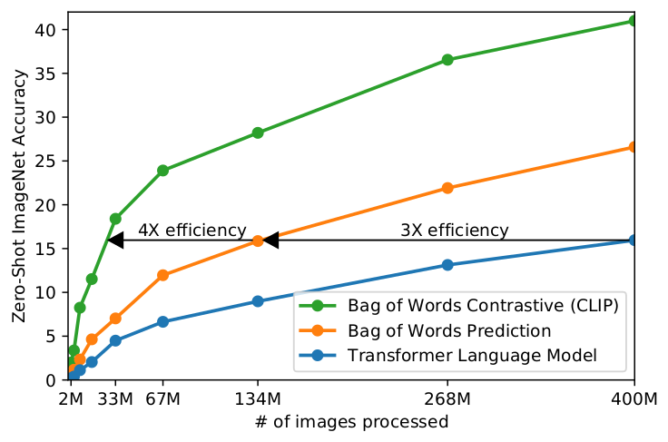

*图 2（原文 Figure 2，第 3 页）：三种预训练目标下，零样本 ImageNet 精度随处理图像数的变化。*

**图中文字翻译与读法**：

- **坐标轴**：横轴 # of images processed（处理过的图像数，2M 到 400M）；纵轴 Zero-Shot ImageNet Accuracy（零样本 ImageNet 准确率，%）。
- **蓝线 Transformer Language Model**：用 Transformer 语言模型逐词预测图像的文本（caption）。论文用的是 6300 万参数的 Transformer，其计算量已是它所配的 ResNet-50 图像编码器的 2 倍。
- **橙线 Bag of Words Prediction**：改为预测文本的词袋（BoW）编码，即“文本里出现了哪些词”，不再要求顺序。
- **绿线 Bag of Words Contrastive (CLIP)**：同样的词袋文本编码，但目标换成对比学习（本文方法）。
- **箭头 3X efficiency / 4X efficiency**：词袋预测达到某个精度所需的样本数约是 Transformer 语言模型的 1/3；对比目标又比词袋预测再高效约 4 倍。
- **读图结论**：400M 张图处理完时，三者精度约为 16%、27%、41%（从图上读出的近似值）。预测文本的确切词语是个很难的任务（同一张图可以有各种描述、评论和相关文字），改成只判断“整段文本与哪张图配对”这个更容易的代理任务，训练效率高得多。

作者的论证有两个旁证：对比学习文献发现对比目标学到的表示比等价的预测目标更好（Tian 等 2019）；图像生成模型虽能学到高质量表示，但算力比同等性能的对比模型多一个数量级以上（Chen 等 2020a）。所以最终选择了对比目标。

### 3.3 对比预训练：N×N 配对任务（图 1、图 3）

给定一个 batch 的 $N$ 个（图像，文本）对，CLIP 要预测 $N\times N$ 种可能的图文组合里哪些真的配对。做法是学一个多模态嵌入空间：联合训练图像编码器和文本编码器，使 $N$ 个真实配对的嵌入余弦相似度最大，使另外 $N^2-N$ 个错配对的余弦相似度最小，并对这些相似度做**对称交叉熵**优化。这个 batch 构造和目标最早在度量学习里叫 multi-class N-pair loss（Sohn 2016），被 Oord 等（2018）推广为 InfoNCE 损失，Zhang 等（2020，ConVIRT）则用于医学影像的（文本，图像）对比学习。

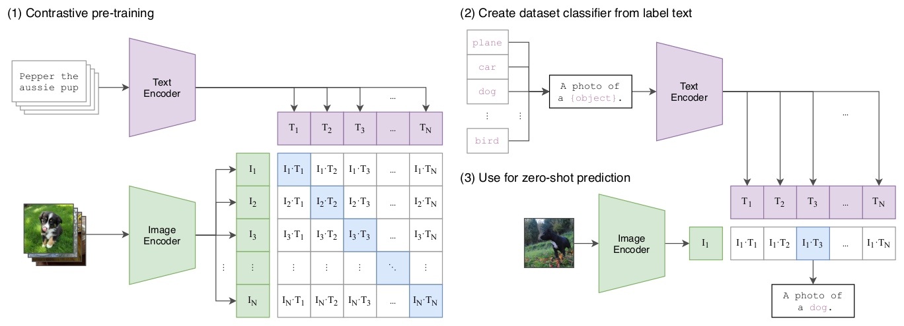

*图 1（原文 Figure 1，第 2 页）：对比预训练、由类别名生成分类器、零样本预测三步。*

**图中文字翻译与读法**：

- **(1) Contrastive pre-training（对比预训练）**：左上，文本（如 “Pepper the aussie pup”）经 Text Encoder（文本编码器）得到向量 $T_1,\dots,T_N$；左下，图像经 Image Encoder（图像编码器）得到向量 $I_1,\dots,I_N$。右侧的 $N\times N$ 矩阵第 $i$ 行第 $j$ 列是 $I_i\cdot T_j$（图像 $i$ 与文本 $j$ 的相似度）；蓝色对角线是真实配对（正样本），其余格子全是负样本。
- **(2) Create dataset classifier from label text（由类别文字创建数据集分类器）**：把类别名（plane、car、dog、……、bird）填入模板 “A photo of a {object}.”，送入同一个 Text Encoder，得到每个类别的文本向量 $T_1,\dots,T_N$，它们就是分类器的权重。
- **(3) Use for zero-shot prediction（用于零样本预测）**：一张图像经 Image Encoder 得到 $I_1$，与各类别文本向量求相似度；最大的（蓝格 $I_1\cdot T_3$）对应 “A photo of a dog.”，于是预测为 dog。
- **读图结论**：训练时的文本是网上与图像配对的整句话，测试时的文本是人为构造的“类别描述”，二者共用同一个文本编码器和同一个嵌入空间，这是零样本迁移能成立的基础。

**数学形式**。设图像、文本经各自编码器和线性投影、L2 归一化后的嵌入为 $I_{e,i}$ 与 $T_{e,j}$（单位向量，点积即余弦相似度），$t$ 是可学习的标量，缩放后的相似度为

$$
s_{ij}=e^{t}\,I_{e,i}^{\top}T_{e,j},\qquad i,j=1,\dots,N,
$$

其中 $e^{t}$ 相当于 $1/\tau$（$\tau$ 是原文正文里说的温度，伪代码里把 $t$ 称为 temperature parameter）：$e^{t}$ 越大，softmax 越尖锐。损失为两个方向交叉熵的平均：

$$
\mathcal{L}=\frac12\Big[\frac1N\sum_{i=1}^{N}-\log\frac{e^{s_{ii}}}{\sum_{j=1}^{N}e^{s_{ij}}}\;+\;\frac1N\sum_{j=1}^{N}-\log\frac{e^{s_{jj}}}{\sum_{i=1}^{N}e^{s_{ij}}}\Big].
$$

直观地看，矩阵的每一行是一个 $N$ 类分类问题（图像 $i$ 要在 $N$ 段文本里认出自己的文本 $i$），每一列也是（文本 $j$ 要在 $N$ 张图里认出自己的图像 $j$）。训练用的 batch 是 32,768，所以每步有 32,768 个正样本对和约 $1.07\times10^{9}$ 个负样本对（$32768^2-32768$）。

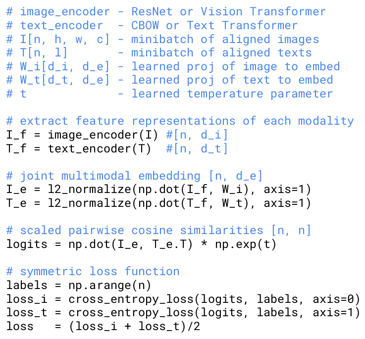

*图 3（原文 Figure 3，第 5 页）：CLIP 核心的类 numpy 伪代码。*

下面是同一段伪代码的中文注释版（代码行与原文一致，注释已翻译，个别处加了简短说明）：

```text
# image_encoder - ResNet 或 Vision Transformer
# text_encoder  - CBOW 或 Text Transformer
# I[n, h, w, c] - 一个 minibatch 的对齐图像
# T[n, l]       - 一个 minibatch 的对齐文本（l 为文本长度）
# W_i[d_i, d_e] - 学到的投影：图像特征 -> 嵌入空间
# W_t[d_t, d_e] - 学到的投影：文本特征 -> 嵌入空间
# t             - 学到的温度参数

# 提取每个模态的特征
I_f = image_encoder(I) #[n, d_i]
T_f = text_encoder(T)  #[n, d_t]

# 联合多模态嵌入 [n, d_e]
I_e = l2_normalize(np.dot(I_f, W_i), axis=1)
T_e = l2_normalize(np.dot(T_f, W_t), axis=1)

# 缩放后的成对余弦相似度 [n, n]
logits = np.dot(I_e, T_e.T) * np.exp(t)

# 对称损失函数
labels = np.arange(n)
loss_i = cross_entropy_loss(logits, labels, axis=0)
loss_t = cross_entropy_loss(logits, labels, axis=1)
loss   = (loss_i + loss_t)/2
```

**逐行读法**：

1. `image_encoder` 和 `text_encoder` 把一个 batch 的 $n$ 张图和 $n$ 段文本分别变成特征（维度 $d_i$、$d_t$ 可以不同）；
2. 各自乘一个学出来的线性投影矩阵（`W_i`、`W_t`）映射到共同的 $d_e$ 维空间，并按行 L2 归一化，所以后面的点积就是余弦相似度；
3. `np.dot(I_e, T_e.T)` 一次算出所有 $n\times n$ 对的相似度，再乘 `np.exp(t)`（即除以温度 $\tau$）；
4. 第 $i$ 张图的正确文本就是第 $i$ 段文本，所以标签 `labels = np.arange(n)` 指向对角线；
5. 沿两个轴各做一次交叉熵，再取平均。按 numpy 的约定，`axis=0` 是对每个文本在 $n$ 张图上做 softmax，`axis=1` 是对每个图像在 $n$ 段文本上做 softmax；两个变量名与方向的对应取决于约定，不影响结果，因为最终是两者的平均。

### 3.4 相对 ConVIRT 的简化

由于预训练数据集足够大，过拟合不是主要问题，所以训练比 Zhang 等（2020）的 ConVIRT 简单：

- **从零训练**：图像编码器不用 ImageNet 权重初始化，文本编码器也不用预训练权重；
- **只用线性投影**：不使用表示与对比嵌入空间之间的非线性投影（Bachman 等 2019 提出、Chen 等 2020b 推广）。作者没有观察到两种版本在训练效率上的差别，推测非线性投影可能只与当前自监督方法里图像侧的细节相互适应；
- **去掉文本变换函数 $t_u$**：ConVIRT 从文本中均匀采样一个句子，而 CLIP 的很多（图像，文本）对本来就只有一句话；
- **简化图像变换 $t_v$**：训练时唯一的数据增强是对缩放后的图像做随机方形裁剪；
- **温度可学习**：$\tau$ 作为对数参数化的乘性标量在训练中直接优化，不再当超参数调。

### 3.5 编码器结构与模型族

**图像编码器**考虑了两种架构。

1. **ResNet-50 的改进版**。以 ResNet-50 为基础，采用 He 等（2019）的 ResNet-D 改进和 Zhang（2019）的 antialiased rect-2 blur pooling；并把最后的全局平均池化换成**注意力池化**：一层“transformer 风格”的多头 QKV 注意力，其中 query 由图像的全局平均池化表示产生（原文只说明了 query 的来源）。
2. **Vision Transformer（ViT）**。基本遵循 Dosovitskiy 等（2020）的实现，只改了两点：在 transformer 之前对“patch 嵌入 + 位置嵌入”之和多加一层 LayerNorm，以及使用略有不同的初始化方案。ViT 命名里 B/L 表示 Base/Large 规模，斜杠后的数字是 patch 边长（像素），例如 B/32 是 Base 规模、32×32 的 patch（这是 ViT 论文的命名约定）。

**文本编码器**是 Transformer（Vaswani 等 2017），采用 GPT-2 论文里的结构修改。基础规格：63M 参数、12 层、宽度 512、8 个注意力头。输入是小写化的字节对编码（BPE）文本，词表 49,152（附录表 18 写的是 49408，原文两处数字不同，未作解释）；为了计算效率，最大序列长度限制为 76。文本序列用 `[SOS]` 和 `[EOS]` 括起来，**最高一层 Transformer 在 `[EOS]` 位置的激活**被当作整段文本的特征，经过 LayerNorm 后线性投影到多模态嵌入空间。文本编码器里使用了 masked self-attention（因果掩码），目的是保留“用预训练语言模型初始化”或“把语言建模作为辅助目标”的可能性，但这两件事原文留作未来工作。

**缩放方式**。以往的视觉研究多是只增加宽度或只增加深度。对 ResNet 图像编码器，作者采用 Tan & Le（2019，EfficientNet）的思路——把额外算力同时分配给宽度、深度和分辨率，但不像 EfficientNet 那样去调这三者的比例，而是简单地平均分配。对文本编码器只缩放宽度（与 ResNet 宽度的增长成比例），完全不缩放深度，因为发现 CLIP 的性能对文本编码器容量不太敏感。

共训练了 **5 个 ResNet 和 3 个 ViT**：ResNet-50、ResNet-101，以及按 EfficientNet 方式缩放、算力约为 ResNet-50 的 4 倍、16 倍、64 倍的 RN50x4、RN50x16、RN50x64；ViT-B/32、ViT-B/16、ViT-L/14。此外，ViT-L/14 又在 336 像素分辨率上多训练 1 个 epoch（类似 FixRes 的做法），记为 ViT-L/14@336px。**原文凡写“CLIP”，如无特别说明都指这个模型**，因为它表现最好。

### 3.6 训练配置

- 所有模型训练 **32 个 epoch**（每个 epoch 4 亿对，共约 128 亿个样本）；
- 优化器 Adam，加上解耦的权重衰减（decoupled weight decay，作用于所有不是增益或偏置的权重）；学习率余弦衰减；
- 初始超参数是在基线 ResNet-50 训练 1 个 epoch 的设定下，用网格搜索、随机搜索和手动调整得到的，之后因算力限制按经验规则适配到更大的模型；
- 可学习温度 $\tau$ 初始化为 0.07（沿用 Wu 等 2018），并被截断使 logits 的缩放不超过 100（原文说不这样做训练不稳定），即 $\tau\ge0.01$；
- batch size **32,768**；
- 为加速训练、节省显存：混合精度、gradient checkpointing、半精度 Adam 统计量、半精度且做随机舍入的文本编码器权重；相似度的计算也做了分片，每块 GPU 只算自己本地那部分嵌入所需的成对相似度；
- 最大的 ResNet（RN50x64）在 **592 块 V100** 上训练 18 天；最大的 ViT 在 **256 块 V100** 上训练 12 天。

下面是原文附录 F 的超参数表（原文表 18、表 19、表 20，第 48 页）。

**表 18：所有 CLIP 模型共用的超参数**

| 超参数 | 取值 |
|---|---|
| Batch size（批大小） | 32768 |
| Vocabulary size（词表大小） | 49408 |
| Training epochs（训练轮数） | 32 |
| Maximum temperature（温度上限，即 logit 缩放上限） | 100.0 |
| Weight decay（权重衰减） | 0.2 |
| Warm-up iterations（预热迭代数） | 2000 |
| Adam $\beta_1$ | 0.9 |
| Adam $\beta_2$ | 0.999（ResNet），0.98（ViT） |
| Adam $\epsilon$ | $10^{-8}$（ResNet），$10^{-6}$（ViT） |

**表 19：CLIP-ResNet 各模型的超参数**

| 模型 | 学习率 | 嵌入维度 | 输入分辨率 | ResNet blocks（各 stage 的块数） | ResNet 宽度 | 文本层数 | 文本宽度 | 文本头数 |
|---|---:|---:|---:|---|---:|---:|---:|---:|
| RN50 | $5\times10^{-4}$ | 1024 | 224 | (3, 4, 6, 3) | 2048 | 12 | 512 | 8 |
| RN101 | $5\times10^{-4}$ | 512 | 224 | (3, 4, 23, 3) | 2048 | 12 | 512 | 8 |
| RN50x4 | $5\times10^{-4}$ | 640 | 288 | (4, 6, 10, 6) | 2560 | 12 | 640 | 10 |
| RN50x16 | $4\times10^{-4}$ | 768 | 384 | (6, 8, 18, 8) | 3072 | 12 | 768 | 12 |
| RN50x64 | $3.6\times10^{-4}$ | 1024 | 448 | (3, 15, 36, 10) | 4096 | 12 | 1024 | 16 |

**表 20：CLIP-ViT 各模型的超参数**

| 模型 | 学习率 | 嵌入维度 | 输入分辨率 | ViT 层数 | ViT 宽度 | ViT 头数 | 文本层数 | 文本宽度 | 文本头数 |
|---|---:|---:|---:|---:|---:|---:|---:|---:|---:|
| ViT-B/32 | $5\times10^{-4}$ | 512 | 224 | 12 | 768 | 12 | 12 | 512 | 8 |
| ViT-B/16 | $5\times10^{-4}$ | 512 | 224 | 12 | 768 | 12 | 12 | 512 | 8 |
| ViT-L/14 | $4\times10^{-4}$ | 768 | 224 | 24 | 1024 | 16 | 12 | 768 | 12 |
| ViT-L/14-336px | $2\times10^{-5}$ | 768 | 336 | 24 | 1024 | 16 | 12 | 768 | 12 |

读法：文本编码器的宽度和头数随 ResNet 宽度同步放大（512→1024），层数恒为 12；ViT-L/14-336px 是在 ViT-L/14 基础上用很小的学习率（$2\times10^{-5}$）再训练 1 个 epoch 得到的高分辨率版本。

## 四、零样本迁移（Zero-shot transfer）

### 4.1 为什么研究零样本，“零样本”指什么

在计算机视觉里，zero-shot learning 通常指泛化到图像分类中**未见过的物体类别**（Lampert 等 2009）。本文用的是更宽泛的含义：泛化到**未见过的数据集**，并把它当作“执行未见任务”的代理（呼应 Larochelle 等 2008 的 zero-data learning）。

作者借鉴 NLP：Liu 等（2018）首次发现语言模型在生成 Wikipedia 的同时学会了可靠地跨语言转写人名，这是“任务学习是意外的副作用”；GPT-1 把预训练作为改进监督微调的迁移方法，同时用消融显示四种启发式零样本迁移方法的性能在预训练过程中稳步提高；GPT-2 则专门研究语言模型通过零样本迁移学习任务的能力。CLIP 沿着这一思路，把零样本迁移当作衡量**任务学习能力**的方式，而不是（像大多数无监督学习那样）衡量表示学习。

一点区分：很多流行视觉数据集本来是研究界为了推动通用图像分类方法而造的基准，不是在度量某个具体任务。可以说 SVHN 度量的是“街景照片分布上的门牌号转录”任务，但 CIFAR-10 度量的“真实任务”是什么并不清楚；明确的只有它的数据分布来自 TinyImages。在这类数据集上，零样本迁移更多是在评估 CLIP 对分布偏移的鲁棒性和领域泛化，而不是任务泛化。（第 6 节专门分析鲁棒性。）

### 4.2 用 CLIP 做零样本分类

CLIP 预训练的目标就是预测一张图和一段文本在数据集中是否配对，零样本分类直接复用这个能力：

1. 对某个数据集，用它所有类别的名字（经模板处理后）作为候选文本集合；
2. 图像编码器算出图像嵌入，文本编码器算出每个候选文本的嵌入；
3. 计算余弦相似度，乘以温度参数（即除以 $\tau$），再 softmax 成概率分布。

写成公式：设类别 $k$ 对应的文本嵌入为 $w_k$（单位向量），图像嵌入为 $z$（单位向量），则

$$
p(y=k\mid x)=\frac{\exp\big(z^{\top}w_k/\tau\big)}{\sum_{j=1}^{K}\exp\big(z^{\top}w_j/\tau\big)}.
$$

作者的解读：这一层是“输入和权重都做了 L2 归一化、没有偏置、带温度缩放的多项逻辑回归分类器”。于是**图像编码器**是计算特征的视觉主干（backbone），**文本编码器**是一个超网络（hypernetwork，Ha 等 2016）——它根据描述视觉概念的文字，生成线性分类器的权重。由自然语言生成分类器的想法至少可追溯到 Elhoseiny 等（2013），Lei Ba 等（2015）首次提出了这种形式的零样本图像分类器。

沿着这个解读，CLIP 预训练的每一步都可以看成是在优化一个随机生成的“计算机视觉数据集代理”的性能，这个代理数据集每类 1 个样本、共有 32,768 个由自然语言描述定义的类别。评测时，文本编码器算出的零样本分类器会被缓存下来，用于该数据集后续所有预测，因此生成它的成本被摊薄到整个数据集的所有预测上。

### 4.3 与 Visual N-Grams 的初步比较（表 1）

Visual N-Grams（Li 等 2017）是此前唯一用通用预训练模型对标准图像分类数据集做零样本迁移的工作（据原文所知）：它学习一个包含 142,806 个 1–5 元视觉 n-gram 的字典，用 Jelinek-Mercer 平滑的可微版本优化，使给定图像下所有文本 n-gram 的概率最大；做零样本迁移时，先把各类名转成 n-gram 表示并计算其在模型下的概率，取得分最高者。比较结果如下。

**表 1：与此前零样本迁移图像分类结果的对比（准确率 %，越大越好）**

| 数据集 | Visual N-Grams | CLIP |
|---|---:|---:|
| aYahoo | 72.4 | **98.4** |
| ImageNet | 11.5 | **76.2** |
| SUN | 23.0 | **58.5** |

（原文表 1，第 7 页。）读法：CLIP 在三个数据集上都大幅领先：ImageNet 从概念验证水平的 11.5% 提高到 76.2%，与原始 ResNet-50 持平；top-5 准确率约 95%，与 Inception-V4 持平。在 aYahoo 上错误率从 27.6% 降到 1.6%（原文称错误数减少 95%，按表中数字算约 94%）；在 SUN 上准确率翻了一倍多。

作者特别强调：这个比较只是为了建立量感，**不能当作两个方法的直接对比**，因为差异太多没有控制：CLIP 的训练数据大 10 倍，视觉模型每次预测的计算量接近 100 倍，训练算力估计超过 1000 倍，还用了 Visual N-Grams 发表时尚不存在的 Transformer。作为更接近的对比，作者在 Visual N-Grams 用的同一个 YFCC100M 数据集上训练了一个 CLIP ResNet-50，发现在一个 V100-GPU 日内就达到了他们报告的 ImageNet 性能，且是从零训练的（Visual N-Grams 用 ImageNet 预训练权重初始化）。为做更全面的压力测试，作者把评测扩展到 30 多个数据集，并与 50 多个已有的视觉系统比较。

### 4.4 提示工程与集成（图 4）

大多数分类数据集只给每张图一个数字标签，另附一个把数字映射回英文类名的文件，类名往往是“事后想起来才补上”的；Flowers102 和 GTSRB 的公开版本甚至没有这个映射，根本无法零样本迁移（原文脚注开玩笑说第一作者因此学了很多花卉品种和德国交通标志）。作者观察到，很多数据集的类名选得比较随意，数据集作者当初并没有预料到依赖任务描述的零样本迁移会遇到什么问题。

**多义词问题**：只给类名时，文本编码器缺少上下文，分不清词义。ImageNet 里同时有“建筑起重机”和“会飞的鹤”两种 crane；Oxford-IIIT Pet 里的 boxer 从上下文看显然是一种犬，但对没有上下文的文本编码器来说同样可能是拳击手。

**分布差异问题**：预训练数据里与图像配对的文本很少是单个词，通常是描述图像的完整句子。为弥合差距，作者发现默认模板 “A photo of a {label}.” 效果不错，它说明文本是在描述图像内容；仅用这一个模板，ImageNet 准确率就提升 1.3%。

**针对任务定制提示**（类比 GPT-3 的 prompt engineering）：

| 场景 | 做法 |
|---|---|
| 默认 | “A photo of a {label}.” |
| Oxford-IIIT Pets | “A photo of a {label}, a type of pet.”，补充类别范畴 |
| Food101、FGVC Aircraft | 同理指明“一种食物”“一种飞机” |
| OCR 数据集 | 在要识别的文字或数字两侧加引号 |
| 卫星图像数据集 | 指明图像类型，用 “a satellite photo of a {label}.” 的变体 |

**集成（ensembling）**：把多个不同上下文提示（如 “A photo of a big {label}” 和 “A photo of a small {label}”）生成的零样本分类器合在一起。作者在**嵌入空间**而不是概率空间做集成：对各提示的文本嵌入取平均，这样只需缓存一组平均后的文本嵌入，摊薄到大量预测上之后，集成的计算成本与单个分类器相同。（原文没有写明平均后是否重新归一化，复现时需要自己明确这一点。）在 ImageNet 上集成了 80 个不同的上下文提示，比单个默认提示再提升 3.5%；与前面的 1.3% 合起来，提示工程加集成使 ImageNet 准确率提升近 5%。

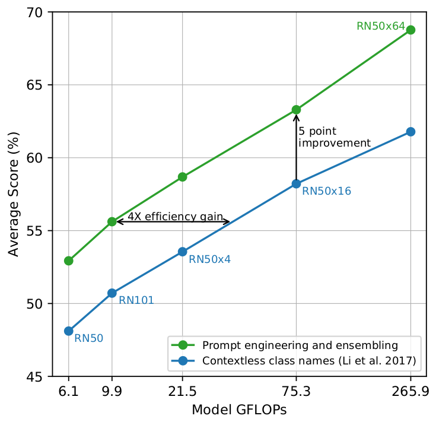

*图 4（原文 Figure 4，第 7 页）：在 36 个数据集平均下，提示工程与集成相对“仅用类名”基线的提升。*

**图中文字翻译与读法**：

- **坐标轴**：横轴 Model GFLOPs（模型每次前向的计算量，对应 RN50、RN101、RN50x4、RN50x16、RN50x64，分别为 6.1、9.9、21.5、75.3、265.9 GFLOPs），纵轴 Average Score (%)（36 个数据集的平均分）。
- **绿线 Prompt engineering and ensembling**（提示工程与集成）与**蓝线 Contextless class names (Li et al. 2017)**（无上下文的类名，即 Visual N-Grams 的做法）。图中蓝线每个点标出了模型名。
- **箭头 5 point improvement**（约提升 5 个点）：在 RN50x16（75.3 GFLOPs）处，绿线约 63.3，蓝线约 58.2；**箭头 4X efficiency gain**（约 4 倍效率收益）：提示工程加集成后的 RN101（9.9 GFLOPs），其分数相当于无上下文基线需要约 4 倍算力才能达到。
- **读图结论**：平均提升近 5 个点，效果相当于把算力放大 4 倍，但因为分类器可缓存，在大量预测上摊薄后几乎是“免费”的。图上数值为读出的近似值，文字结论取原文。

### 4.5 零样本 CLIP 到底有多好

**(a) 对比全监督线性基线（图 5）**。作为参照，作者取一个简单的现成基线：在标准 ResNet-50 的特征上拟合全监督、带正则的逻辑回归（线性探针），并在 27 个数据集上比较。

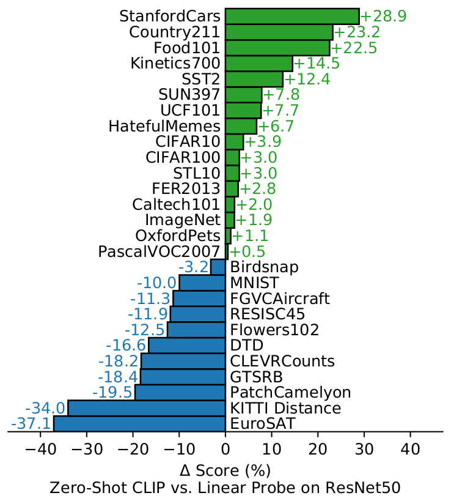

*图 5（原文 Figure 5，第 8 页）：27 个数据集上，零样本 CLIP 与全监督 ResNet-50 线性探针的准确率之差。*

**图中文字翻译与读法**：

- **坐标轴**：横轴 $\Delta$ Score (%)（得分差，单位为百分点），条形标注的是数值；标题 Zero-Shot CLIP vs. Linear Probe on ResNet50。绿色（向右）表示零样本 CLIP 更好，蓝色（向左）表示 ResNet-50 线性探针更好。
- **绿色（CLIP 更好，共 16 个）**：StanfordCars +28.9、Country211 +23.2、Food101 +22.5、Kinetics700 +14.5、SST2 +12.4、SUN397 +7.8、UCF101 +7.7、HatefulMemes +6.7、CIFAR10 +3.9、CIFAR100 +3.0、STL10 +3.0、FER2013 +2.8、Caltech101 +2.0、ImageNet +1.9、OxfordPets +1.1、PascalVOC2007 +0.5。
- **蓝色（ResNet-50 线性探针更好，共 11 个）**：Birdsnap −3.2、MNIST −10.0、FGVCAircraft −11.3、RESISC45 −11.9、Flowers102 −12.5、DTD −16.6、CLEVRCounts −18.2、GTSRB −18.4、PatchCamelyon −19.5、KITTI Distance −34.0、EuroSAT −37.1。
- **读图结论**：零样本 CLIP 在 27 个数据集里有 16 个超过这个全监督基线，“略多于一半”。图中的 CLIP 是默认的 ViT-L/14@336px。

原文对差异的归纳：

- **细粒度分类差异很大**：Stanford Cars 和 Food101 上零样本比 ResNet-50 特征的逻辑回归高 20 多个点，而 Flowers102 和 FGVCAircraft 低 10 多个点；OxfordPets 和 Birdsnap 上差距接近。作者推测主要是 WIT 与 ImageNet 在各任务上的监督量不同；
- **“通用”物体分类**（ImageNet、CIFAR10/100、STL10、PascalVOC2007）表现相近，零样本 CLIP 在每个数据集上略占优势；STL10 上 CLIP 达到 99.3%，在没用任何训练样本的情况下似乎创下新的 SOTA（表 11 里 ViT-L/14 为 99.3，ViT-L/14-336px 为 99.4）；
- **视频中的动作识别**：Kinetics700 高出 ResNet-50 14.5 个点，UCF101 高出 7.7 个点。作者推测是自然语言对涉及动词的视觉概念提供了更宽的监督，而 ImageNet 的监督以名词为中心；
- **明显偏弱的任务**：卫星图分类（EuroSAT、RESISC45）、淋巴结肿瘤检测（PatchCamelyon）、合成场景中的物体计数（CLEVRCounts）、自动驾驶相关任务（德国交通标志识别 GTSRB、识别到最近车辆的距离 KITTI Distance）。其中一些任务（数数、卫星图分类、交通标志识别）非专业人类也能稳健完成，所以还有很大改进空间；不过作者也提醒，对于一个学习者毫无先验的困难任务（比如绝大多数人也不会的淋巴结肿瘤分类），测“零样本”本身是不是有意义的评测并不清楚。

原文内部的小出入：用附录表 10、表 11 的数字相减，UCF101 约为 +5.7、KITTI Distance 约为 −45.2，与图 5 的 +7.7、−34.0 不一致，原文未解释；其余数据集的差值与表 10、表 11 吻合（如 Stanford Cars：78.8 − 49.9 = 28.9）。本文引用图 5 与正文数字。

**(b) 对比少样本线性探针（图 6）**。零样本相当于少样本的极限，所以与少样本做比较更直接。

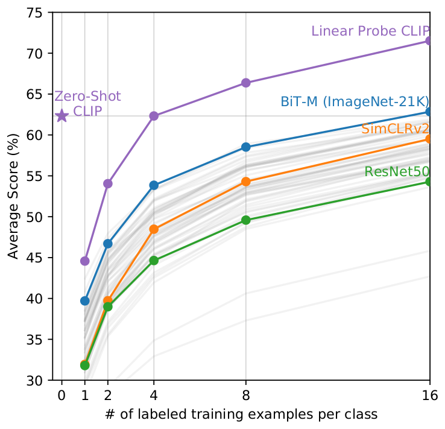

*图 6（原文 Figure 6，第 9 页）：不同模型在每类 0/1/2/4/8/16 个标注样本下的线性探针平均得分。*

**图中文字翻译与读法**：

- **坐标轴**：横轴 # of labeled training examples per class（每类的标注训练样本数，0、1、2、4、8、16），纵轴 Average Score (%)（平均得分）。
- **紫色星 Zero-Shot CLIP**：位于 0 样本处，约 62.3；**紫线 Linear Probe CLIP**（在 CLIP 自己的特征上做少样本逻辑回归）约从 1 样本的 44.5 升到 16 样本的 71.5。
- **蓝线 BiT-M (ImageNet-21K)**、**橙线 SimCLRv2**、**绿线 ResNet50**：被高亮的各家族里表现最好的模型；浅灰线是评测集里的其他模型。
- **读图结论**：零样本 CLIP 的平均得分与同一特征空间上的 **4-shot** 逻辑回归持平（图上紫色星的水平线正好穿过 4-shot 点），也与评测集里表现最好的 16-shot 分类器（基于在 ImageNet-21K 上训练的 BiT-M ResNet-152x2 特征）大致相当。分析只用了每类至少有 16 个样本的 20 个数据集。图上数值为读出的近似值。

作者对“零样本为什么能打赢 1–4 shot”的解释是：CLIP 的零样本分类器由自然语言生成，视觉概念可以被**直接指定**（communicated）；而普通监督学习必须从样例里**间接推断**概念。纯靠例子学习有个缺陷：大量不同假设都与数据一致，在 one-shot 时尤其如此；一张图里常含许多视觉概念，学习者可以用启发式（比如假设要示范的概念是图里的主体物体），但没有保证。作者还试过把零样本分类器当作少样本分类器权重的先验（对生成的权重加 L2 惩罚），但超参数搜索倾向于选极大的正则系数，结果少样本分类器“就只是”零样本分类器，如何更好地结合两者留作未来工作。

作者还指出，BiT-M ResNet-152x2 在 16-shot 下最好有点出人意料，因为第 3.2 节显示 Noisy Student EfficientNet-L2 在全监督下平均比它高近 5%。

**(c) 零样本需要多少标注样本才能追平（图 7）**。既然零样本 CLIP 也是线性分类器，就可以估计“同一 CLIP 特征空间上的线性分类器需要每类多少标注样本才能追平零样本”，即零样本迁移的**等效数据效率**。为避免训练成千上万个分类器，作者对 1、2、4、8、16-shot（可行时）和全监督线性分类器的性能做 log-linear 插值来估计。

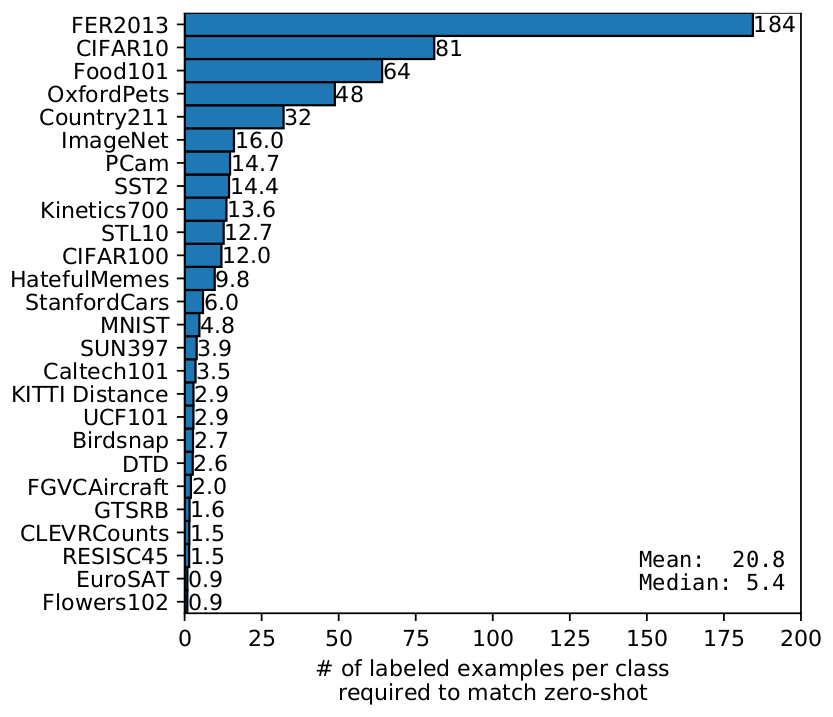

*图 7（原文 Figure 7，第 10 页）：各数据集上，CLIP 特征空间的线性分类器需要多少标注样本才能匹配零样本分类器。*

**图中文字翻译与读法**：

- **坐标轴**：横轴 # of labeled examples per class required to match zero-shot（追平零样本所需的每类标注样本数），纵轴为数据集（26 个，PascalVOC2007 未列入）。右下角给出 Mean: 20.8（均值）、Median: 5.4（中位数）。
- **条形上标注的数值（原文数字）**：FER2013 184、CIFAR10 81、Food101 64、OxfordPets 48、Country211 32、ImageNet 16.0、PCam 14.7、SST2 14.4、Kinetics700 13.6、STL10 12.7、CIFAR100 12.0、HatefulMemes 9.8、StanfordCars 6.0、MNIST 4.8、SUN397 3.9、Caltech101 3.5、KITTI Distance 2.9、UCF101 2.9、Birdsnap 2.7、DTD 2.6、FGVCAircraft 2.0、GTSRB 1.6、CLEVRCounts 1.5、RESISC45 1.5、EuroSAT 0.9、Flowers102 0.9。
- **读图结论**：效率差异极大，从“不如一个 one-shot 分类器”（Flowers102 和 EuroSAT，小于 1 个样本）到“相当于每类 184 个标注样本”（FER2013）。约一半数据集不到 5.4 个样本（中位数），但均值 20.8，被约 20% 需要很多样本才能追平的数据集拉高。在 ImageNet 上，零样本 CLIP 相当于同一特征空间上的 16-shot 线性分类器。

**(d) 零样本与全监督线性探针的相关性（图 8）**。如果假设评测数据集足够大，在其上训练的线性分类器参数估计得足够好，那么由于零样本分类器也是线性的，全监督线性分类器的性能大致给出零样本迁移的**上界**。

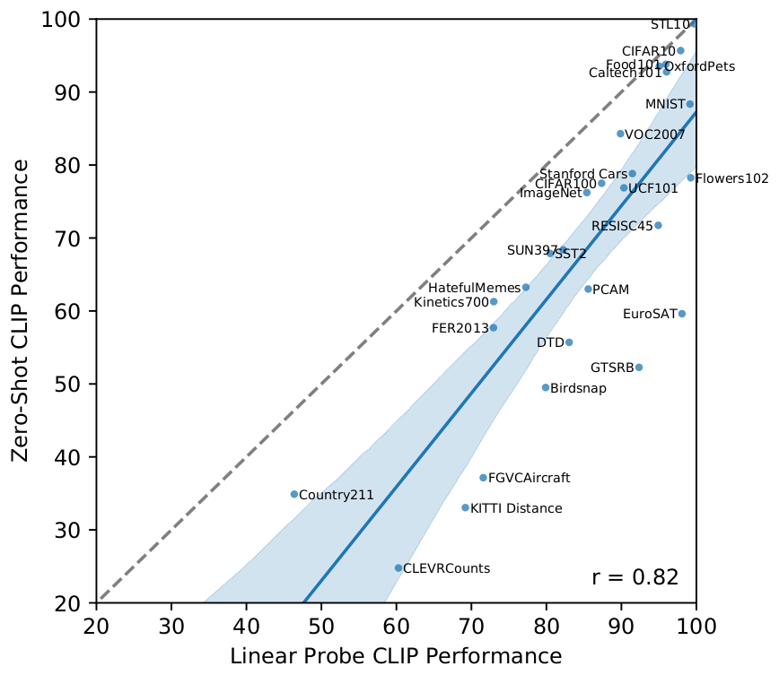

*图 8（原文 Figure 8，第 10 页）：各数据集上零样本 CLIP 与线性探针 CLIP 的性能对比。*

**图中文字翻译与读法**：

- **坐标轴**：横轴 Linear Probe CLIP Performance（CLIP 特征上的线性探针性能），纵轴 Zero-Shot CLIP Performance（零样本 CLIP 性能）；每个点是一个数据集，并标有名称。
- **虚线** $y=x$ 是“最优”的零样本分类器（与其全监督对应物相当）；**实线**是对点做线性回归的拟合，浅蓝带为置信区间；右下角 $r=0.82$ 是相关系数。
- **读图结论**：两者强相关（0.82，p 值小于 $10^{-6}$），但零样本整体比线性探针低 10–25 个点，说明零样本迁移还有很大提升空间。只有 5 个数据集（STL10、CIFAR10、Food101、OxfordPets、Caltech101）的零样本接近全监督（差距不超过 3 点），且在这 5 个数据集上零样本和全监督精度都超过 90%；这暗示 CLIP 在底层表示本身质量高的任务上，零样本迁移更有效。回归斜率估计为：全监督每提高 1%，零样本提高 1.28%，但 95% 置信区间 0.93–1.79 仍包含小于 1 的值。

**(e) 零样本性能随算力平滑增长（图 9）**。已有研究表明深度学习性能随算力和数据量可预测地变化（Hestness 等 2017，Kaplan 等 2020），GPT 系列在 1000 倍训练算力范围内零样本性能持续提升。CLIP 是否有类似规律？

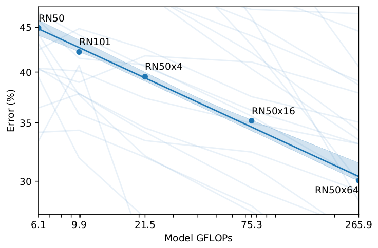

*图 9（原文 Figure 9，第 11 页）：5 个 ResNet 版 CLIP 的平均零样本误差与模型算力的关系。*

**图中文字翻译与读法**：

- **坐标轴**：横轴 Model GFLOPs（6.1、9.9、21.5、75.3、265.9），纵轴 Error (%)（平均零样本误差，对数刻度），每个点标有模型名（RN50 到 RN50x64）。
- **粗蓝线与浅蓝带**：对 5 个模型平均误差的 log-log 线性拟合及置信区间；**淡蓝细线**是单个评测的曲线。
- **读图结论**：在 36 个数据集的 39 项评测上，平均零样本误差在 **44 倍**的算力范围（6.1 到 265.9 GFLOPs）内近似 log-log 线性，误差约从 45% 降到 30%（读出的近似值）。总体趋势平滑，但单个评测的曲线噪声大得多，作者不确定这是不同训练运行在子任务上方差高、掩盖了稳步改进的趋势，还是某些任务上性能随算力确实非单调。

**附：各 CLIP 模型的逐数据集零样本精度（原文表 11，第 43 页）**。原表 9 行（5 个 ResNet + 4 个 ViT）× 27 列，下图为原表截图，随后摘出关键行。

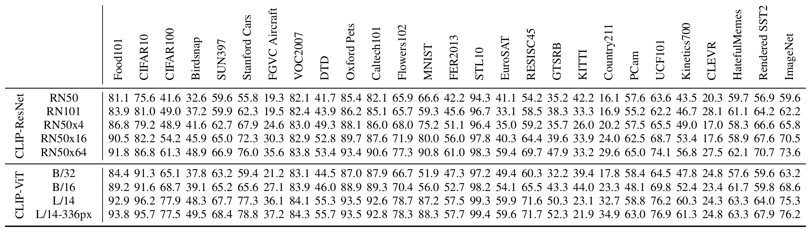

*表 11（原文 Table 11，第 43 页）：CLIP 各模型在 27 个数据集上的零样本性能。数值为准确率（%），个别数据集指标不同，见表 9。*

下面摘出 20 个有代表性的数据集（数字与原表逐格一致），列为 RN50、RN50x64（最大的 ResNet 版）、ViT-B/32、ViT-L/14、ViT-L/14-336px。

**表 11（节选）：零样本准确率（%，越大越好）**

| 数据集 | RN50 | RN50x64 | ViT-B/32 | ViT-L/14 | ViT-L/14-336px |
|---|---:|---:|---:|---:|---:|
| ImageNet | 59.6 | 73.6 | 63.2 | 75.3 | 76.2 |
| CIFAR10 | 75.6 | 86.8 | 91.3 | 96.2 | 95.7 |
| CIFAR100 | 41.6 | 61.3 | 65.1 | 77.9 | 77.5 |
| STL10 | 94.3 | 98.3 | 97.2 | 99.3 | 99.4 |
| Food101 | 81.1 | 91.8 | 84.4 | 92.9 | 93.8 |
| Oxford Pets | 85.4 | 93.4 | 87.0 | 93.5 | 93.5 |
| Stanford Cars | 55.8 | 76.0 | 59.4 | 77.3 | 78.8 |
| FGVC Aircraft | 19.3 | 35.6 | 21.2 | 36.1 | 37.2 |
| Flowers102 | 65.9 | 77.3 | 66.7 | 78.7 | 78.3 |
| EuroSAT | 41.1 | 59.4 | 49.4 | 59.9 | 59.6 |
| RESISC45 | 54.2 | 69.7 | 60.3 | 71.6 | 71.7 |
| GTSRB | 35.2 | 47.9 | 32.2 | 50.3 | 52.3 |
| KITTI | 42.2 | 33.2 | 39.4 | 23.1 | 21.9 |
| PCam | 57.6 | 65.0 | 58.4 | 58.8 | 63.0 |
| CLEVR | 20.3 | 27.5 | 24.8 | 24.3 | 24.8 |
| MNIST | 66.6 | 90.8 | 51.9 | 87.2 | 88.3 |
| Rendered SST2 | 56.9 | 70.7 | 59.6 | 64.0 | 67.9 |
| UCF101 | 63.6 | 74.1 | 64.5 | 76.2 | 76.9 |
| Kinetics700 | 43.5 | 56.8 | 47.8 | 60.3 | 61.3 |
| Country211 | 16.1 | 29.6 | 17.8 | 32.7 | 34.9 |

读法：绝大多数数据集上精度随模型增大而提高；但 KITTI 距离、CLEVR 计数、PCam 这类“任务本身与自然图文配对离得很远”的数据集上基本没有规律，甚至越大越差（KITTI 从 RN50 的 42.2 降到 ViT-L/14-336px 的 21.9）。这与原文判断一致：CLIP 对不太可能出现在预训练数据里的新任务可能接近随机。另外，原文图 5、图 8 中 KITTI Distance 的零样本约为 33%，与本表 ViT-L/14-336px 的 21.9 不同，原文未说明原因。

## 五、表示学习：线性探针评测

### 5.1 为什么用线性探针而不是微调

零样本考察的是任务学习能力；更常见的做法是考察表示学习能力：在模型提取的表示上拟合线性分类器（线性探针），或者端到端微调。先前工作已令人信服地证明微调在多数图像分类数据集上优于线性分类。尽管如此，作者仍选线性分类器，理由是：

1. 工作的重点是开发高性能、与任务和数据集无关的预训练方法。微调会在微调阶段把表示适配到每个数据集，可能补偿并掩盖预训练阶段没学到通用、稳健表示的失败；线性分类器灵活度有限，反而能暴露这些失败，为开发提供清晰反馈；
2. 对 CLIP 来说，训练监督线性分类器与零样本分类器的做法非常相似，这使第 4 节的大量比较和分析成为可能；
3. 要把 CLIP 与许多已有模型在多任务上比较：66 个模型 × 27 个数据集需要调 1782 次评测。微调的设计和超参数空间大得多，难以公平评测，多种技术之间的比较代价昂贵；线性分类器几乎不需要调超参数，实现和评测流程也标准化。

### 5.2 评测协议与数据集（附录 A）

**数据集**：Kornblith 等（2019）的 12 个数据集评测套件，外加 15 个额外数据集，一共 27 个，以覆盖更广的分布和任务（MNIST、FER2013、STL-10、EuroSAT、RESISC45、GTSRB、KITTI、PatchCamelyon、UCF101、Kinetics700、CLEVR 的 2,500 个随机样本、Hateful Memes、ImageNet-1k 等，以及两个新建的数据集）。两个视频数据集（UCF101、Kinetics700）取每段视频的中间帧当作输入图像；STL-10 与 UCF101 有多个预定义的训练/验证/测试划分（分别 10 个和 3 个），报告所有划分的均值。

两个新建数据集：

- **Country211**：评估视觉表示的地理定位能力。从 YFCC100m 里找出 211 个国家（有 ISO-3166 国家代码、且至少有 300 张带 GPS 坐标的照片），每国采样 200 张训练、100 张测试，得到 211 类的平衡数据集；
- **Rendered SST2**：评估视觉表示的光学字符识别（OCR）能力。把 Stanford Sentiment Treebank 的句子渲染成 448×448 分辨率的黑字白底图像（原文图 19 给了两个示例，本文未转载）。

下表为原文表 9 的逐行转录。

**表 9：用于线性探针的数据集**

| 数据集 | 类别数 | 训练集大小 | 测试集大小 | 评价指标 |
|---|---:|---:|---:|---|
| Food-101 | 102 | 75,750 | 25,250 | accuracy |
| CIFAR-10 | 10 | 50,000 | 10,000 | accuracy |
| CIFAR-100 | 100 | 50,000 | 10,000 | accuracy |
| Birdsnap | 500 | 42,283 | 2,149 | accuracy |
| SUN397 | 397 | 19,850 | 19,850 | accuracy |
| Stanford Cars | 196 | 8,144 | 8,041 | accuracy |
| FGVC Aircraft | 100 | 6,667 | 3,333 | mean per class |
| Pascal VOC 2007 Classification | 20 | 5,011 | 4,952 | 11-point mAP |
| Describable Textures | 47 | 3,760 | 1,880 | accuracy |
| Oxford-IIIT Pets | 37 | 3,680 | 3,669 | mean per class |
| Caltech-101 | 102 | 3,060 | 6,085 | mean-per-class |
| Oxford Flowers 102 | 102 | 2,040 | 6,149 | mean per class |
| MNIST | 10 | 60,000 | 10,000 | accuracy |
| Facial Emotion Recognition 2013 | 8 | 32,140 | 3,574 | accuracy |
| STL-10 | 10 | 1000 | 8000 | accuracy |
| EuroSAT | 10 | 10,000 | 5,000 | accuracy |
| RESISC45 | 45 | 3,150 | 25,200 | accuracy |
| GTSRB | 43 | 26,640 | 12,630 | accuracy |
| KITTI | 4 | 6,770 | 711 | accuracy |
| Country211 | 211 | 43,200 | 21,100 | accuracy |
| PatchCamelyon | 2 | 294,912 | 32,768 | accuracy |
| UCF101 | 101 | 9,537 | 1,794 | accuracy |
| Kinetics700 | 700 | 494,801 | 31,669 | mean(top1, top5) |
| CLEVR Counts | 8 | 2,000 | 500 | accuracy |
| Hateful Memes | 2 | 8,500 | 500 | ROC AUC |
| Rendered SST2 | 2 | 7,792 | 1,821 | accuracy |
| ImageNet | 1000 | 1,281,167 | 50,000 | accuracy |

（原文表 9，第 39 页。前 12 行是 Kornblith 等的 12 数据集套件，后 15 行是新增。原表把 Food-101 印成 102 类，该数据集名称即 101 类，疑为原文笔误。原文脚注说明：Birdsnap 和 Kinetics700 使用的是写作时网上还能获得的资源。）

**特征与分类器**：取每个模型倒数第二层的图像特征，忽略其自带的分类层；对 CLIP-ViT 模型，用线性投影到嵌入空间**之前**的特征（即图 3 里的 `I_f`）。分类器是 scikit-learn 的 L-BFGS 逻辑回归，最多迭代 1000 次，报告各数据集对应的指标。L2 正则强度 $\lambda$ 在验证集上做超参数搜索：范围 $10^{-6}$ 到 $10^{6}$，共 96 个对数等距的点；为省算力，先用参数化二分搜索，从 $\lambda=[10^{-6},10^{-4},10^{-2},1,10^{2},10^{4},10^{6}]$ 开始，每次把峰值附近的区间折半，直到分辨率达到每十倍程 8 个点。没有验证集或没公开测试标签的数据集，就从训练集里划出验证部分；最终结果把验证集并回训练集，在没用过的那部分上报告。

**被比较的模型（共 66 个，其中 56 个非 CLIP）**：LM RN50（作者自训的自回归对照：CNN 输出投影成 4 个 token，作为前缀输入语言模型自回归预测文本，训练数据和轮数与其他 CLIP 相同）；5 个 CLIP-ResNet 和 4 个 CLIP-ViT（含 336 像素版）；EfficientNet（B0–B8）及 Noisy Student 变体（B0–B7、L2-475、L2-800）；Instagram 预训练的 ResNeXt（32x8d、32x16d、32x32d、32x48d 及其 FixRes 版本）；BiT-S 与 BiT-M（分别在 ImageNet-1k 和 ImageNet-21k 上训练；BiT-L 权重未公开）；4 个在 ImageNet-21k 上预训练的 ViT 检查点（B/32、B/16、L/16、H/14；最强的 JFT-300M 版未公开）；SimCLRv2 的 7 个仅预训练检查点；BYOL（50x1、200x2）；MoCo v1/v2；VirTex（与 CLIP-AR 设计相似，但只用 MSCOCO 的 1000 倍更小的高质量字幕数据）；原版 ResNet-50/101/152。

### 5.3 线性探针结果（图 10）

作者先在 Kornblith 等的 12 数据集套件上研究，以减少会引起“确认偏见或报告偏见”的选择效应；然后扩展到更广的 27 数据集。

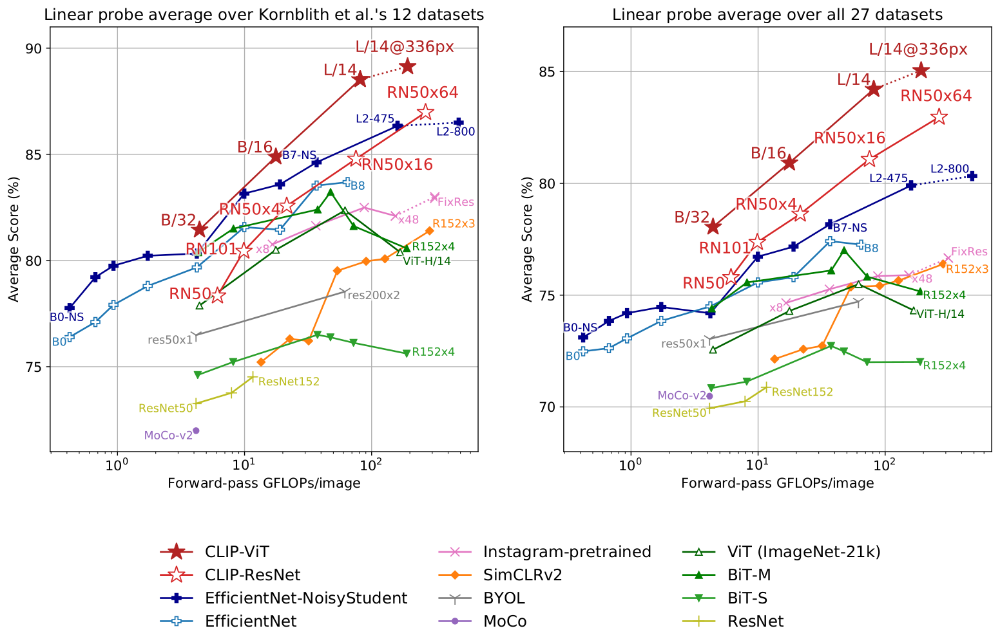

*图 10（原文 Figure 10，第 12 页）：CLIP 模型线性探针性能与多种 SOTA 视觉模型对比，横轴为每张图像的前向 GFLOPs。左图为 Kornblith 等的 12 个数据集的平均，右图为全部 27 个数据集的平均。*

**图中文字翻译与读法**：

- **左图 Linear probe average over Kornblith et al.'s 12 datasets**（Kornblith 等 12 数据集上线性探针的平均）、**右图 Linear probe average over all 27 datasets**（全部 27 个数据集上的平均）；横轴 Forward-pass GFLOPs/image（每张图前向传播的 GFLOPs，对数刻度），纵轴 Average Score (%)（平均得分）。
- **图例**：CLIP-ViT（红色实心星）、CLIP-ResNet（红色空心星）、EfficientNet-NoisyStudent、EfficientNet、Instagram-pretrained、SimCLRv2、BYOL、MoCo、ViT (ImageNet-21k)、BiT-M、BiT-S、ResNet。**虚线**表示在高于预训练的分辨率上微调或评测过的模型（如 L/14@336px、FixRes）。
- **读图结论（12 数据集）**：小的 CLIP 模型（RN50、RN101）胜过在 ImageNet-1K 上训练的其他 ResNet（BiT-S 和原版），但不如在 ImageNet-21K 上训练的 ResNet（BiT-M），也不如算力相近的 EfficientNet 系列。但 CLIP 模型的扩展性很好：最大的 ResNet 版（RN50x64）在整体得分和算力效率上都略超最佳现有模型（Noisy Student EfficientNet-L2）。CLIP 的 ViT 模型比 CLIP ResNet 的算力效率高约 **3 倍**，这与 Dosovitskiy 等关于“数据足够大时 ViT 比卷积网络算力效率更高”的发现一致。最好的模型 ViT-L/14@336px 平均比此前最好的模型高 **2.6%**（图上读出约 89 对 86.5）。
- **读图结论（27 数据集）**：优势更明显：所有 CLIP 模型，不论规模，在算力效率上都超过所有被评测的系统；最佳模型相对此前系统的平均优势从 2.6% 增大到 **5%**（图上约 85 对 80）。此外，自监督系统在这个更宽的评测集上表现明显更好：例如 SimCLRv2 在 12 数据集上平均仍不如 BiT-M，但在 27 数据集上超过了 BiT-M。这提示要继续扩大任务多样性和覆盖面，才能更好地理解系统的“通用”性能，作者认为类似 VTAB 的评测工作会很有价值。

附录 A.4 补充：最好的 CLIP 模型（ViT-L/14@336px）在 27 个数据集中的 **21 个**达到 SOTA（即落在各数据集最高分的 Clopper-Pearson 99.5% 置信区间内）。

**逐数据集比较（图 11）**。为了看清优势在哪里，作者把最好的 CLIP 模型和评测集里最好的模型（Noisy Student EfficientNet-L2）逐数据集比较：

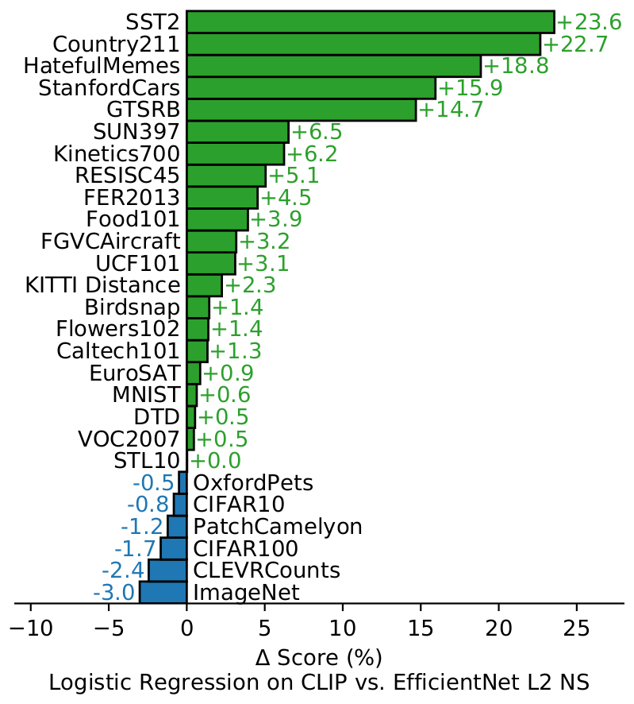

*图 11（原文 Figure 11，第 13 页）：CLIP 特征上的逻辑回归相对 Noisy Student EfficientNet-L2 特征的得分差。*

**图中文字翻译与读法**：

- **坐标轴**：横轴 $\Delta$ Score (%)（得分差，百分点），标题 Logistic Regression on CLIP vs. EfficientNet L2 NS；绿色向右表示 CLIP 更好，蓝色向左表示 EfficientNet 更好。
- **CLIP 更好（21 个，数值为原图标注）**：SST2 +23.6、Country211 +22.7、HatefulMemes +18.8、StanfordCars +15.9、GTSRB +14.7、SUN397 +6.5、Kinetics700 +6.2、RESISC45 +5.1、FER2013 +4.5、Food101 +3.9、FGVCAircraft +3.2、UCF101 +3.1、KITTI Distance +2.3、Birdsnap +1.4、Flowers102 +1.4、Caltech101 +1.3、EuroSAT +0.9、MNIST +0.6、DTD +0.5、VOC2007 +0.5、STL10 +0.0。
- **EfficientNet 更好（6 个）**：OxfordPets −0.5、CIFAR10 −0.8、PatchCamelyon −1.2、CIFAR100 −1.7、CLEVRCounts −2.4、ImageNet −3.0。
- **读图结论**：CLIP 在 27 个数据集里的 21 个不低于对手（含 STL10 持平）。提升最大的是需要 OCR 的任务（SST2、HatefulMemes）、地理定位与场景识别（Country211、SUN397）、视频动作识别（Kinetics700、UCF101），以及细粒度的汽车和交通标志识别（Stanford Cars、GTSRB）。作者认为这可能反映 ImageNet 监督“过窄”：比如 GTSRB 上的 14.7% 提升可能说明 ImageNet-1K 对所有交通和街道标志只有一个标签，这会促使监督表示把类内细节坍缩掉，伤害细粒度下游任务。EfficientNet 仍占优的是 ImageNet（它训练的那个数据集），以及低分辨率的 CIFAR10/100（作者怀疑与 CLIP 缺乏基于尺度的数据增强有关）、PatchCamelyon 和 CLEVRCounts（两者整体性能都还很低）。

下面把图 5、图 8、图 11 背后的逐数据集数字摘出来（原文表 10、表 11 的节选：最强的 CLIP 模型 ViT-L/14@336px 的零样本与线性探针，加上两个对照模型的线性探针），方便核对：图 11 的每个条形等于“CLIP 线性探针”列减“EfficientNet L2-800”列（例如 SST2：80.5 − 56.9 = 23.6）；图 5 的每个条形约等于“CLIP 零样本”列减“ResNet-50 线性探针”列（例如 Stanford Cars：78.8 − 49.9 = 28.9）。

**表 10 与表 11（节选）：27 个数据集上的准确率（%）**

| 数据集 | CLIP ViT-L/14@336px 零样本（表 11） | CLIP ViT-L/14@336px 线性探针（表 10） | EfficientNet Noisy Student L2-800 线性探针 | ResNet-50 线性探针 |
|---|---:|---:|---:|---:|
| Food101 | 93.8 | 95.9 | 92.0 | 71.3 |
| CIFAR10 | 95.7 | 97.9 | 98.7 | 91.8 |
| CIFAR100 | 77.5 | 87.4 | 89.0 | 74.5 |
| Birdsnap | 49.5 | 79.9 | 78.5 | 52.7 |
| SUN397 | 68.4 | 82.2 | 75.7 | 60.5 |
| Stanford Cars | 78.8 | 91.5 | 75.5 | 49.9 |
| FGVC Aircraft | 37.2 | 71.6 | 68.4 | 48.5 |
| Pascal VOC 2007 | 84.3 | 89.9 | 89.4 | 83.8 |
| DTD | 55.7 | 83.0 | 82.5 | 72.3 |
| Oxford Pets | 93.5 | 95.1 | 95.6 | 92.4 |
| Caltech101 | 92.8 | 96.0 | 94.7 | 90.8 |
| Flowers102 | 78.3 | 99.2 | 97.9 | 90.8 |
| MNIST | 88.3 | 99.2 | 98.5 | 98.3 |
| FER2013 | 57.7 | 72.9 | 68.4 | 54.9 |
| STL10 | 99.4 | 99.7 | 99.7 | 96.4 |
| EuroSAT | 59.6 | 98.1 | 97.2 | 96.7 |
| RESISC45 | 71.7 | 94.9 | 89.9 | 83.6 |
| GTSRB | 52.3 | 92.4 | 77.7 | 70.6 |
| KITTI | 21.9 | 69.2 | 66.9 | 67.1 |
| Country211 | 34.9 | 46.4 | 23.7 | 11.7 |
| PatchCamelyon | 63.0 | 85.6 | 86.8 | 82.5 |
| UCF101 | 76.9 | 92.0 | 88.9 | 71.2 |
| Kinetics700 | 61.3 | 73.0 | 66.7 | 46.8 |
| CLEVR Counts | 24.8 | 60.3 | 62.7 | 43.0 |
| Hateful Memes | 63.3 | 77.3 | 58.4 | 56.5 |
| Rendered SST2 | 67.9 | 80.5 | 56.9 | 55.5 |
| ImageNet | 76.2 | 85.4 | 88.4 | 74.3 |

（原文表 10，第 40 页；表 11，第 43 页。各数据集的指标不同（accuracy、mean per class、11-point mAP、ROC AUC 等），见表 9。ResNet-50 指表 10 里原版 ResNet（He 等）的 ResNet-50；EfficientNet Noisy Student L2-800 是图 10 中最强的对手。UCF101 和 KITTI 两行与图 5 的差值不吻合，见上文 4.5 节的说明。）

**对任务偏移的稳健性（图 12）**。

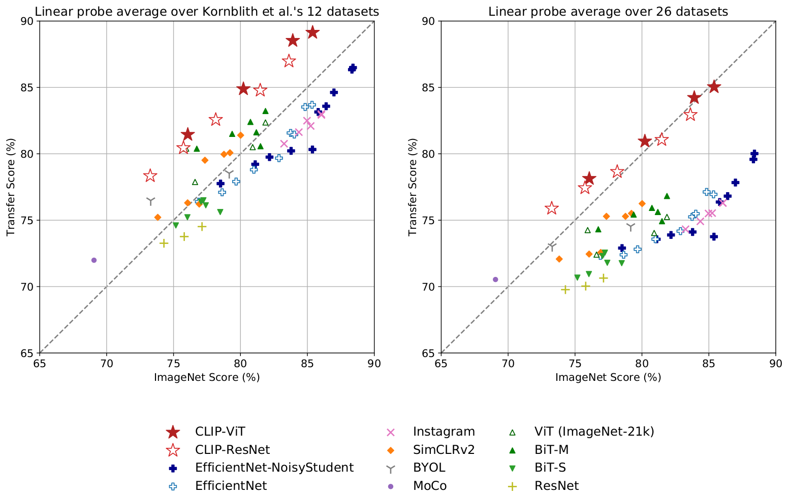

*图 12（原文 Figure 12，第 14 页）：线性探针“迁移得分”与 ImageNet 得分的关系。*

**图中文字翻译与读法**：

- **左右两图**：左图 Linear probe average over Kornblith et al.'s 12 datasets（12 个数据集上线性探针的平均），右图 Linear probe average over 26 datasets（26 个数据集，应是 27 个中去掉了作为横轴的 ImageNet）；横轴 ImageNet Score (%)（ImageNet 得分），纵轴 Transfer Score (%)（迁移得分）。虚线是 $y=x$。图例同图 10。
- **读图结论**：在两种数据集划分上，CLIP 模型表示上训练的线性探针迁移得分，都高于其他 ImageNet 成绩相近的模型。这说明在 ImageNet 上训练的模型的表示对其训练任务有一定的过拟合。

## 六、对自然分布偏移的鲁棒性

### 6.1 问题与度量

2015 年有模型在 ImageNet 测试集上超过人类，但此后研究反复发现这些模型仍会犯很多简单错误，新基准上的表现比 ImageNet 精度和人类精度低得多。一类流行解释是：深度学习模型极擅长发现训练集中成立的相关性和模式，其中很多其实是伪相关，换个分布就失效。但这些研究大多只评测在 ImageNet 上训练的模型，所以应当谨慎：这些失败有多少应归因于深度学习、ImageNet，还是两者的组合？CLIP 是在很大的数据集上用自然语言监督训练、零样本性能很高的模型，提供了从另一个角度考察的机会。

Taori 等（2020）系统研究了 ImageNet 模型在**自然分布偏移**（natural distribution shift）下的性能，评测 7 个偏移数据集：ImageNetV2、ImageNet Sketch、Youtube-BB 和 ImageNet-Vid、ObjectNet、ImageNet Adversarial（ImageNet-A）、ImageNet Rendition（ImageNet-R）。它们由从各种来源收集的新图像组成，区别于通过扰动已有图像得到的**合成偏移**（ImageNet-C、Stylized ImageNet、对抗攻击等）。他们发现一些技术虽能提升合成偏移上的性能，却往往不能在自然偏移上带来一致改进。

以下讨论里，除特别说明，报告的是 7 个自然分布偏移数据集上的平均准确率，以及 ImageNet 里对应类别子集上的平均准确率；Youtube-BB 与 ImageNet-Vid 有两种评测设置，取 pm-0 与 pm-10 的平均。

一个 ResNet-101 在这些自然分布偏移上犯的错误是 ImageNet 验证集上的 **5 倍**。但 Taori 等发现：分布偏移下的精度随 ImageNet 精度**可预测地**增加，用 logit 变换后的精度（$\ln\frac{a}{1-a}$，$a$ 是精度）做线性函数拟合效果很好。基于此，他们提出鲁棒性分析应区分两个概念：

- **有效鲁棒性（effective robustness）**：分布偏移下的精度，超出由上述“分布内/分布外精度”经验关系所预测的那部分；
- **相对鲁棒性（relative robustness）**：分布外精度的任何提升。

他们认为鲁棒性技术应同时提高这两者。他们研究的几乎所有模型都是在 ImageNet 上训练或微调的。

### 6.2 零样本 CLIP 的有效鲁棒性（图 13）

直觉上，零样本模型没在某个特定分布上训练过，就不该能利用只在该分布成立的伪相关或模式，因此应有高得多的有效鲁棒性。（原文脚注提醒：零样本模型仍可能利用预训练分布和评测分布共享的伪相关。）

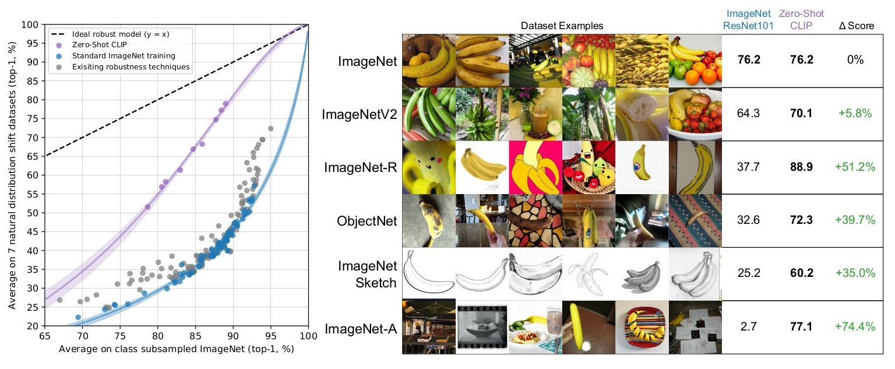

*图 13（原文 Figure 13，第 15 页）：左，零样本 CLIP 与 ImageNet 模型在 7 个自然分布偏移数据集上的对比；右，以“香蕉”为例可视化分布偏移。*

**图中文字翻译与读法**：

- **左图**：横轴 Average on class subsampled ImageNet (top-1, %)（在类别子采样后的 ImageNet 上的平均 top-1 准确率），纵轴 Average on 7 natural distribution shift datasets (top-1, %)（7 个自然分布偏移数据集上的平均 top-1 准确率）。黑色虚线 Ideal robust model (y = x)（理想的鲁棒模型，在 ImageNet 上和其他自然分布上同样好）；紫色点与带 Zero-Shot CLIP（零样本 CLIP）；蓝色点 Standard ImageNet training（标准 ImageNet 训练）；灰色点 Existing robustness techniques（已有的鲁棒性技术）。曲线是 logit 变换后的线性拟合，带 bootstrap 估计的 95% 置信区间。
- **右图**：Dataset Examples（数据集示例）。以“香蕉”这个在 7 个自然分布偏移数据集中有 5 个共有的类别为例，每行放 6 张该数据集里的香蕉图像，直观展示分布偏移（从图上可见：ImageNet 与 ImageNetV2 是普通照片，ImageNet-R 含卡通、绘画和玩具，ObjectNet 是各种角度和背景下的实物照，ImageNet Sketch 是黑白素描，ImageNet-A 的图像则是 ImageNet 模型很难分对的）。右侧三列是各数据集整体上的得分：ImageNet ResNet101（在 ImageNet 验证集上与 CLIP 同为 76.2）、Zero-Shot CLIP（ViT-L/14@336px）以及差值 $\Delta$ Score（百分点）。ImageNet 76.2 对 76.2（0%）；ImageNetV2 64.3 对 70.1（+5.8%）；ImageNet-R 37.7 对 88.9（+51.2%）；ObjectNet 32.6 对 72.3（+39.7%）；ImageNet Sketch 25.2 对 60.2（+35.0%）；ImageNet-A 2.7 对 77.1（+74.4%）。
- **读图结论**：同样是 76.2% 的 ImageNet 精度，换成素描、卡通、奇怪视角或 ImageNet-A 那样的难例，ResNet-101 大幅下降而零样本 CLIP 基本保持。所有零样本 CLIP 模型都大幅提升有效鲁棒性，使“ImageNet 精度与分布偏移下精度之间的差距”缩小最多 **75%**。（原文表 16 中 ImageNet-A 的零样本值为 77.2，图 13 右图写 77.1，原文两处略有出入。）

作者提醒：这些结果并不一定意味着在 ImageNet 上做监督学习**造成**了鲁棒性差距，CLIP 的其他特点，比如大而多样的预训练数据集、自然语言监督，也可能是原因。为了开始缩小范围，作者测量了 CLIP 适配到 ImageNet 分布后的变化。

### 6.3 适配 ImageNet 反而削弱鲁棒性（图 14）

做法：在 CLIP 特征上，用 ImageNet 训练集拟合一个 L2 正则的逻辑回归分类器，对比零样本分类器的变化。另一种干预“适配类别偏移”（adapt to class shift）则利用了零样本分类器的灵活性：7 个迁移数据集的目标类别并非总与 ImageNet 完美对齐——Youtube-BB 与 ImageNet-Vid 的类别是 ImageNet 类别的**超类**，没法直接用 ImageNet 模型固定的 1000 类分类器预测。Taori 等的处理办法是对所有子类的预测做最大池化（按 ImageNet 类别层级汇总），但映射有时很不理想，比如 Youtube-BB 的 person 类要对 baseball player（棒球运动员）、bridegroom（新郎）、scuba diver（潜水员）的预测做池化。CLIP 则可以直接根据各数据集的类名，为每个数据集生成定制的零样本分类器。

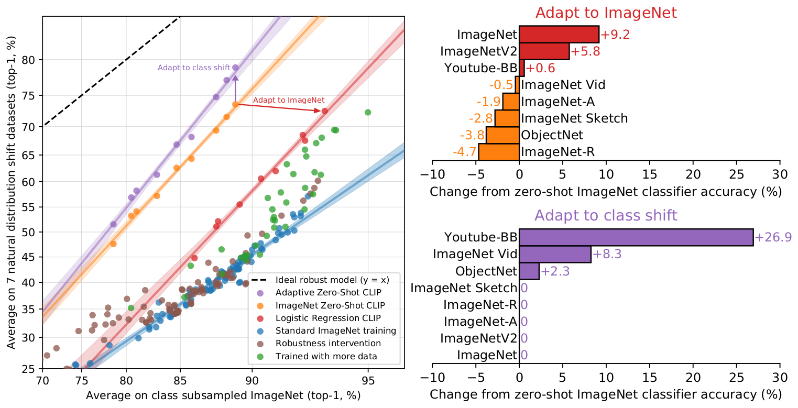

*图 14（原文 Figure 14，第 16 页）：两种“适配”干预对鲁棒性的影响。*

**图中文字翻译与读法**：

- **左图**：横轴 Average on class subsampled ImageNet (top-1, %)，纵轴 Average on 7 natural distribution shift datasets (top-1, %)。图例：Ideal robust model (y = x)、Adaptive Zero-Shot CLIP（自适应零样本 CLIP，紫色，为每个数据集定制类名的分类器）、ImageNet Zero-Shot CLIP（橙色，统一用 ImageNet 类名分类器并池化预测）、Logistic Regression CLIP（红色，在 ImageNet 训练集上拟合的逻辑回归）、Standard ImageNet training、Robustness intervention、Trained with more data。箭头 Adapt to class shift（适配类别偏移，橙到紫）和 Adapt to ImageNet（适配 ImageNet，橙到红）。
- **右上 Adapt to ImageNet**：横轴 Change from zero-shot ImageNet classifier accuracy (%)（相对零样本 ImageNet 分类器准确率的变化，百分点）。ImageNet +9.2、ImageNetV2 +5.8、Youtube-BB +0.6；ImageNet Vid −0.5、ImageNet-A −1.9、ImageNet Sketch −2.8、ObjectNet −3.8、ImageNet-R −4.7。
- **右下 Adapt to class shift**：Youtube-BB +26.9、ImageNet Vid +8.3、ObjectNet +2.3，其余（ImageNet Sketch、ImageNet-R、ImageNet-A、ImageNetV2、ImageNet）均为 0。
- **读图结论**：
  - 适配 ImageNet 使 ImageNet 精度提高 9.2% 到 **85.4%**，与 2018 年的 SOTA（Mahajan 等）持平；这相当于大约 3 年的 SOTA 进步，但**分布偏移下的平均精度略有下降**，有效鲁棒性回到与此前最佳 ImageNet 模型相近的水平；
  - 逐数据集看，只有 ImageNetV2 明显上升（它的构造过程与原 ImageNet 非常相似，说明监督适配带来的增益集中在 ImageNet 分布附近），在 ImageNet-R（−4.7%）、ObjectNet（−3.8%）、ImageNet Sketch（−2.8%）和 ImageNet-A（−1.9%）上下降，Youtube-BB 和 ImageNet-Vid 上的变化不显著；
  - 适配类别偏移使平均有效鲁棒性提高约 5%，但集中在少数类别并不完美对齐的数据集上（Youtube-BB +26.9，ImageNet Vid +8.3）；有趣的是 ObjectNet 也提升了 2.3%，尽管它被设计成与 ImageNet 类别高度重叠，用其创建者给的类名仍比用 ImageNet 类名加池化略好。

作者也坦率地承认：9.2% 的 ImageNet 提升为什么几乎不带来平均偏移精度的提升，是不是主要来自“利用伪相关”、这是不是 CLIP、ImageNet 和所研究的偏移的特定组合所独有、对端到端微调是否也成立，他们都“没有可靠的答案”。他们鼓励 Mahajan、Kolesnikov、Dosovitskiy 等的作者在自己的模型上研究这些问题，因为这些模型通常只在微调到 ImageNet 之后才被研究和发布。

### 6.4 从零样本到全监督的连续谱（图 15）

零样本 CLIP 提高了有效鲁棒性，但在全监督设置里这个收益几乎消失。为了理解差异，作者考察了从零样本到全监督的连续谱上有效鲁棒性如何变化：在最佳 CLIP 模型的特征上，训练 0-shot、1-shot、2-shot、4-shot、……、128-shot 以及全监督逻辑回归。

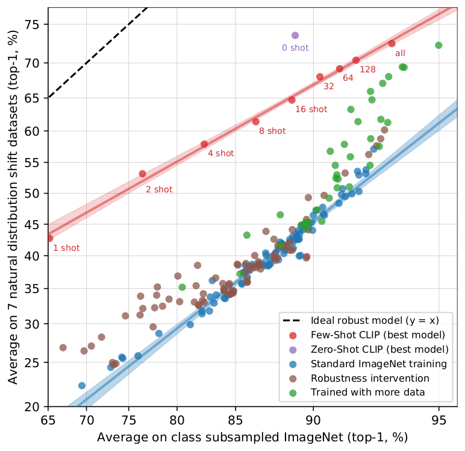

*图 15（原文 Figure 15，第 17 页）：从 0-shot 到全监督的有效鲁棒性变化。*

**图中文字翻译与读法**：

- **坐标轴**：横轴 Average on class subsampled ImageNet (top-1, %)，纵轴 Average on 7 natural distribution shift datasets (top-1, %)。图例：Ideal robust model (y = x)、Few-Shot CLIP (best model)（少样本 CLIP，红点，旁边标 1 shot、2 shot、4 shot、8 shot、16 shot、32、64、128、all）、Zero-Shot CLIP (best model)（紫点，标 0 shot）、Standard ImageNet training、Robustness intervention、Trained with more data。
- **读图结论**：少样本模型也比已有模型有更高的有效鲁棒性，但随着训练数据增加、分布内性能上升，这一收益逐渐衰减，在全监督模型上大体（但不是完全）消失。而且零样本 CLIP 明显比 ImageNet 性能相当的少样本模型更稳健：16-shot 逻辑回归与零样本在 ImageNet 上持平（呼应图 7），但更不稳健。
- **总结（原文）**：高有效鲁棒性似乎源自**尽量减少模型可接触的、分布专属的训练数据**，但这以降低数据集专用性能为代价。原文据此认为，近来向大规模、任务与数据集无关的预训练转向，加上对零样本和少样本基准测试的重新定位，有助于开发更稳健的系统，并更准确地评估性能；NLP 领域里是否同样成立有待观察（Hendrycks 等 2020b 报告预训练提高了情感分析的相对鲁棒性，Miller 等 2020 对问答模型的研究发现，与 Taori 等一样，迄今鲜有有效鲁棒性提升的证据）。

### 6.5 逐数据集的鲁棒性数字（原文附录 E.5，表 16）

**表 16：ImageNet 鲁棒性的详细结果（top-1 准确率 %，越大越好）**

| 模型 | IN | IN-V2 | IN-A | IN-R | ObjectNet | IN-Sketch | IN-Vid PM0 | IN-Vid PM10 | YTBB PM0 | YTBB PM10 |
|---|---:|---:|---:|---:|---:|---:|---:|---:|---:|---:|
| NS EfficientNet-L2 | **88.3** | **80.2** | **84.9** | 74.7 | 68.5 | 47.6 | 88.0 | 82.1 | 67.7 | 63.5 |
| FixResNeXt101-32x48d V2 | 86.4 | 78.0 | 68.4 | 80.0 | 57.8 | 59.1 | 85.8 | 72.2 | 68.9 | 57.7 |
| Linear Probe CLIP | 85.4 | 75.9 | 75.3 | 84.2 | 66.2 | 57.4 | 89.1 | 77.2 | 68.7 | 63.1 |
| Zero-Shot CLIP | 76.2 | 70.1 | 77.2 | **88.9** | **72.3** | **60.2** | **95.3** | **89.2** | **95.2** | **88.5** |

（原文表 16，第 47 页。IN 是 ImageNet 的缩写，粗体为各列最优。）读法：零样本 CLIP 在 7 个偏移数据集中的 5 个（ImageNet-R、ObjectNet、ImageNet-Sketch、ImageNet-Vid、Youtube-BB）刷新了 Taori 等评测套件里的最佳成绩。最大的提升出现在 ImageNet-Vid 和 Youtube-BB（原文归因于其灵活的零样本能力）和 ImageNet-R（可能反映 CLIP 预训练分布里含有大量创意内容；Instagram 预训练的 ResNeXt 也有类似现象）。注意：在 ImageNet 本身和 ImageNetV2 上零样本 CLIP 反而不如监督模型，说明它的优势在“分布偏移”而非“分布内精度”。

## 七、与人类表现的比较

为了了解人类在与 CLIP 相似的评测设置下表现如何、以及人类在看到一两个样例后提升多少，作者设计了一项实验：5 位不同的人对 Oxford IIT Pets 测试集的 **3669 张**图像逐张作答，从 37 个猫狗品种里选出最匹配的（完全不确定可答“I don't know”）。零样本设置下，人类没有任何品种示例，不得上网搜索；one-shot 给每个品种 1 张示例图；two-shot 给每个品种 2 张。（原文脚注：人类的少样本任务与模型的少样本评测并不完全对应，因为模型不能像人一样参照示例图。）

一个顾虑是人类在零样本任务中动力不足。人类在 STL-10 上 94% 的准确率，以及在注意力检查图像子集上 97–100% 的准确率，增加了对工作者的信任。

**表 2：Oxford IIIT Pets 上人类与 CLIP 的表现（指标为每类平均准确率，%，越大越好）**

| 设置 | 准确率（Accuracy） | 全部样本的多数投票准确率（Majority Vote on Full Dataset） | 仅猜测样本的准确率（Accuracy on Guesses） | 仅猜测样本的多数投票准确率（Majority Vote Accuracy on Guesses） |
|---|---:|---:|---:|---:|
| Zero-shot human（零样本人类） | 53.7 | 57.0 | 69.7 | 63.9 |
| Zero-shot CLIP | **93.5** | **93.5** | **93.5** | **93.5** |
| One-shot human | 75.7 | 80.3 | 78.5 | 81.2 |
| Two-shot human | 75.7 | 85.0 | 79.2 | 86.1 |

（原文表 2，第 17 页。“Guesses”指只保留参与者回答了某品种而非“I don't know”的样本；“多数投票”指取每张图上出现最多的答案（不含并列）。CLIP 的行在四列取值相同，因为它不存在“不知道”。）

读法：

- 人类从零样本的平均 54% 提高到 one-shot 的 76%，再多一个样例的边际收益很小；
- 从零到一个样例的提升，几乎全部来自人类原本不确定的图像，这说明人类“知道自己不知道”，并能根据一个样例更新先验；
- 这表明：虽然 CLIP 在零样本（图 5）和自然分布偏移（图 13）上很有前景，但人类从少量样例学习的方式与本文的少样本方法存在很大差别，机器与人的样本效率之间仍有算法上的改进空间。原文猜测，找到能恰当整合先验知识的少样本学习方法，是改进 CLIP 的重要一步。据其所知，用线性分类器接在高质量预训练模型的特征上，已接近少样本学习 SOTA（Tian 等 2020），这也暗示最好的机器少样本方法与人类少样本学习之间存在差距；
- 把人类准确率与 CLIP 零样本准确率逐品种比较（原文图 16，未转载），CLIP 最难的品种人类也觉得难。作者的假设是至少有两个因素：数据集噪声（包括错标图像），以及分布外图像对人和模型都难。

## 八、数据重叠分析（第 5 节与附录 C）

用互联网规模数据预训练的一个担心是与下游评测集**无意重叠**：最坏情况下，整个评测集可能泄漏进预训练集，使评测失去意义。一种做法是训练前找出并删除所有重复，这能保证报告的是真实留出性能，但需要事先知道模型可能被评测的所有数据，限制了基准测试和分析的范围；加一个新评测就要花大代价重训，否则只能报告“未量化”的重叠收益。作者采取的办法是：**记录重叠有多少，以及性能因此如何变化**。流程如下。

1. **检测重复**：对每个评测数据集，用一个重复检测器（见下）找出其样本在预训练数据里的最近邻，人工检查找到的最近邻，并为每个数据集设一个阈值，在保持高精度的同时尽量提高召回。以此划分出 **Overlap**（与某个训练样本的相似度高于阈值的样本）和 **Clean**（低于阈值的样本）两个新子集，并把未改动的完整数据集记为 **All**。用 Overlap 与 All 的样本数之比作为数据污染程度。
2. **度量影响**：计算 CLIP RN50x64 在三个划分上的零样本准确率，把 **All − Clean** 作为主要指标，即污染造成的准确率差异：为正时，是对该数据集报告的总体准确率因过拟合重叠数据而被抬高了多少的估计。
3. **显著性检验**：重叠量常常很小，所以还做二项显著性检验：以 Clean 上的准确率为零假设，计算 Overlap 子集的单侧（更大）$p$ 值；同时对 Overlap 子集（原文此处写作 Dirty）算 99.5% 的 Clopper-Pearson 置信区间作为另一项检查。

**为什么自建检测器（附录 C）**：早期尝试用模型自身嵌入空间的最近邻，但发现 CLIP 的特征空间极度偏向语义相似，很多假阳性来自“被描述得差不多的不同物体”（足球、同一品种的花等）却几乎有满分相似度；同时它对某些近似重复的打分很差（比如经不同缩放算法处理过的高频纹理图像，如毛皮或条纹，相似度意外地低），导致许多假阴性。于是作者训练了专用检测器：用合成数据增强流水线（随机裁剪与缩放、长宽比扭曲、缩小与放大到不同分辨率、轻微旋转、JPEG 压缩、HSV 颜色抖动，并随机选择不同插值算法），训练模型使一张图与其变换版本的相似度最大、与 batch 内其他所有图像的相似度最小；用与 CLIP 相同的 n-pair/InfoNCE 损失，但温度固定为 0.07。架构选 ResNet-50，加反走样改进，用权重归一化（weight norm）而不是 batch norm，以避免通过 batch 统计量泄露重复信息，并发现 GELU 激活更好；总 batch 大小 1,712，在从预训练数据集中采样的约 3000 万张图上训练；在其代理训练任务上准确率接近 100%。

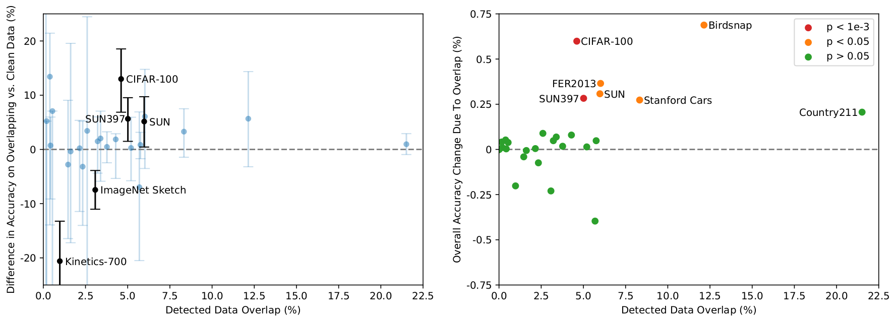

*图 17（原文 Figure 17，第 19 页）：35 个数据集上，重叠对准确率的影响。*

**图中文字翻译与读法**：

- **左图**：横轴 Detected Data Overlap (%)（检测到的数据重叠比例），纵轴 Difference in Accuracy on Overlapping vs. Clean Data (%)（重叠样本与干净样本上准确率之差），误差条是 99.5% Clopper-Pearson 置信区间；黑色点（CIFAR-100、SUN397、SUN、ImageNet Sketch、Kinetics-700）是区间不含 0 的数据集。
- **右图**：纵轴 Overall Accuracy Change Due To Overlap (%)（因重叠导致的总体准确率变化）；点的颜色按单侧二项检验的 $p$ 值：红色 $p<10^{-3}$（CIFAR-100、SUN397），橙色 $p<0.05$（Birdsnap、FER2013、SUN、Stanford Cars），绿色 $p>0.05$（其余，含重叠率最高的 Country211）。
- **读图结论**：
  - 在研究的 **35 个**数据集中，**9 个**检测不到任何重叠，它们大多是合成或专门的数据集，不太可能以普通图像出现在互联网上（如 MNIST、CLEVR、GTSRB），或者保证无重叠，因为包含数据集创建之后的新数据（ObjectNet、Hateful Memes）。这说明检测器假阳性率低，这很重要，因为假阳性会低估污染的影响；
  - 重叠的中位数是 2.2%，平均 3.2%。重叠量小，所以总体准确率很少移动超过 0.1%，只有 7 个数据集超过这个阈值，其中只有 2 个在 Bonferroni 校正后仍统计显著；
  - 检测到的最大提升只有约 0.6%（原文正文写的是 Birdsnap 的 0.6%，Birdsnap 的重叠率 12.1%，是第二高的；右图上 Birdsnap 点读出约 0.7、CIFAR-100 约 0.6）；重叠率最高的是 Country211，为 21.5%，因为它由 YFCC100M 构造，而预训练集含有 YFCC100M 的一个过滤子集。尽管如此，Country211 准确率只增加 0.2%，可能因为训练文本里常不提及图像的拍摄地点；
  - 左图中 Kinetics-700 在 Overlap 上准确率低约 20%，因为很多“重叠”其实是全黑的转场帧；CIFAR-100 的许多重复是小物体（鸟、飞机）造成的假阳性，因为分辨率太低；
  - 两点局限：检测器并不完美，无法在 4 亿样本上可行地检查其召回；Overlap 与 Clean 子集间的数据分布可能不同，可能掩盖过拟合的影响。
  - 图题还指出：35 个数据集里只有 5 个的 99.5% Clopper-Pearson 置信区间不含 0（其中 2 个，即 ImageNet Sketch 与 Kinetics-700，在重叠样本上反而更差）；单侧二项检验下只有 6 个数据集的提升显著（右图红、橙色点）。
- 这与先前大规模预训练的重复分析一致（Mahajan 等 2018、Kolesnikov 等 2019 检测到相近的重叠率，整体性能变化极小；后者还比较了“预先去重”与本文方案，差异很小）。

## 九、数据集消融与其他任务结果（附录 D、E）

### 9.1 只用 YFCC100M 训练（原文表 12）

为检验自建数据集是否关键，作者用 YFCC100M 的过滤子集和大小相同的 WIT 子集各训练一个 ResNet-50，都训练 32 个 epoch（此时迁移性能因过拟合开始趋于平稳）。

**表 12：只用 YFCC100M 训练时 CLIP 表现相近（ResNet-50，准确率 %）**

| 数据集 | 线性分类器 YFCC | 线性分类器 WIT | 线性 $\Delta$ | 零样本 YFCC | 零样本 WIT | 零样本 $\Delta$ |
|---|---:|---:|---:|---:|---:|---:|
| Birdsnap | 47.4 | 35.3 | +12.1 | 19.9 | 4.5 | +15.4 |
| Country211 | 23.1 | 17.3 | +5.8 | 5.2 | 5.3 | +0.1 |
| Flowers102 | 94.4 | 89.8 | +4.6 | 48.6 | 21.7 | +26.9 |
| GTSRB | 66.8 | 72.5 | −5.7 | 6.9 | 7.0 | −0.1 |
| UCF101 | 69.2 | 74.9 | −5.7 | 22.9 | 32.0 | −9.1 |
| Stanford Cars | 31.4 | 50.3 | −18.9 | 3.8 | 10.9 | −7.1 |
| ImageNet | **62.0** | 60.8 | +1.2 | **31.3** | 27.6 | +3.7 |
| Dataset Average（数据集平均） | 65.5 | **66.6** | −1.1 | 29.6 | **30.0** | −0.4 |
| Dataset “Wins”（胜出数据集个数） | 10 | **15** | −5 | **19** | 18 | +1 |

（原文表 12，第 44 页。$\Delta$ 为 YFCC 减 WIT。表中列出按线性探针衡量 YFCC 相对 WIT 最好的 3 个和最差的 3 个数据集，外加汇总行和 ImageNet。）读法：整个评测套件上，YFCC 与 WIT 在线性探针和零样本两种设置下平均表现相近，但在具体细粒度数据集上差别可达 10 个点以上。作者推测这反映了两个预训练集里相关数据的密度不同：YFCC100M 可能有很多鸟和花的照片（摄影爱好者常拍的主题），所以在 Birdsnap、Flowers102 上更好；WIT 里车和宠物更常见，所以汽车和宠物分类器更好。结论是 CLIP 的方法可以使用任何经过合理过滤的（文本，图像）对集合，WIT 相对 YFCC100M 的主要优势很可能就是规模大得多。（WIT 含有 YFCC100M 的过滤子集，这可能让消融低估差异，但该子集只占 WIT 混合数据的 3.7%，且当初把它加入数据混合时并未明显改变模型性能。）

### 9.2 图像与文本检索（原文表 13）

CLIP 预训练的任务正是图文检索，所以在这类任务上验证它是重要的合理性检查。评测用 Flickr30k 和 MSCOCO（5k 测试集）。两个数据集都在每条图像描述前加提示 “a photo of”，这使零样本 R@1 提高 1 到 2 点。R@K 表示正确结果出现在前 K 个检索结果里的比例（%，越大越好）。

**表 13（上半）：文本检索（以图搜文）**

| 类别 | 模型 | Flickr30k R@1 | R@5 | R@10 | MSCOCO R@1 | R@5 | R@10 |
|---|---|---:|---:|---:|---:|---:|---:|
| 微调 | Unicoder-VL | 86.2 | 96.3 | 99.0 | 62.3 | 87.1 | 92.8 |
| 微调 | Uniter | 87.3 | 98.0 | 99.2 | 65.7 | 88.6 | 93.8 |
| 微调 | VILLA | 87.9 | 97.5 | 98.8 | - | - | - |
| 微调 | Oscar | - | - | - | **73.5** | **92.2** | **96.0** |
| 微调 | ERNIE-ViL | **88.7** | 98.0 | 99.2 | - | - | - |
| 零样本 | Visual N-Grams | 15.4 | 35.7 | 45.1 | 8.7 | 23.1 | 33.3 |
| 零样本 | ImageBERT | - | - | - | 44.0 | 71.2 | 80.4 |
| 零样本 | Unicoder-VL | 64.3 | 86.8 | 92.3 | - | - | - |
| 零样本 | Uniter | 83.6 | 95.7 | 97.7 | - | - | - |
| 零样本 | CLIP | 88.0 | **98.7** | **99.4** | 58.4 | 81.5 | 88.1 |

**表 13（下半）：图像检索（以文搜图）**

| 类别 | 模型 | Flickr30k R@1 | R@5 | R@10 | MSCOCO R@1 | R@5 | R@10 |
|---|---|---:|---:|---:|---:|---:|---:|
| 微调 | Unicoder-VL | 71.5 | 90.9 | 94.9 | 46.7 | 76.0 | 85.3 |
| 微调 | Uniter | 75.6 | 94.1 | **96.8** | 52.9 | 79.9 | 88.0 |
| 微调 | VILLA | 76.3 | **94.2** | **96.8** | - | - | - |
| 微调 | Oscar | - | - | - | **57.5** | **82.8** | **89.8** |
| 微调 | ERNIE-ViL | **76.7** | 93.6 | 96.4 | - | - | - |
| 零样本 | Visual N-Grams | 8.8 | 21.2 | 29.9 | 5.0 | 14.5 | 21.9 |
| 零样本 | ImageBERT | - | - | - | 32.3 | 59.0 | 70.2 |
| 零样本 | Unicoder-VL | 48.4 | 76.0 | 85.2 | - | - | - |
| 零样本 | Uniter | 68.7 | 89.2 | 93.9 | - | - | - |
| 零样本 | CLIP | 68.7 | 90.6 | 95.2 | 37.8 | 62.4 | 72.2 |

（原文表 13，第 46 页。原表把文本检索和图像检索并排排成一张宽表，这里拆成上下两表；粗体为原文标出的“全表最好”。对其他模型，原文报告的是各自论文中的最好结果，与模型大小或变体无关。）读法：零样本 CLIP 在两个数据集上持平或超过所有此前的零样本结果；在 Flickr30k 文本检索上与整体 SOTA 有竞争力（R@5、R@10 为全表最好）；图像检索上相对整体 SOTA 明显较低，但仍与微调过的 Unicoder-VL 有可比性；在更大的 MS-COCO 上，微调带来的提升很明显，零样本 CLIP 无法与最新工作竞争。

### 9.3 OCR（原文表 14）

ImageNet 模型里已有对图像中文字作出响应的特征，但不够细粒度，难以直接用于 OCR，所以通常要加定制的 OCR 引擎输出。开发 CLIP 早期，作者就注意到它学会了原始的 OCR 能力，并在项目过程中稳步提升。为验证这一定性观察，他们在 5 个直接或间接需要 OCR 的数据集上测量性能：MNIST、SVHN、IIIT5K 直接检验低层字符和单词识别，Hateful Memes 和 SST-2 检验用 OCR 完成语义任务的能力。

**表 14：5 个数据集上的 OCR 表现（准确率 %，Hateful Memes 为开发集上的 ROC AUC，越大越好）**

| 类别 | 模型 | MNIST | SVHN | IIIT5K 1k | Hateful Memes | SST-2 |
|---|---|---:|---:|---:|---:|---:|
| 微调 | SOTA | **99.8** | **96.4** | **98.9** | **78.0** | **97.5** |
| 微调 | JOINT | - | - | 89.6 | - | - |
| 微调 | CBoW | - | - | - | - | 80.0 |
| 线性 | Raw Pixels（原始像素） | 92.5 | - | - | - | - |
| 线性 | ES Best（56 个非 CLIP 模型中的最好） | 98.9 | - | - | 58.6 | 59.0 |
| 线性 | CLIP | 99.2 | - | - | 77.3 | 80.5 |
| 零样本 | CLIP | 88.4 | 51.0 | 90.0 | 63.3 | 67.9 |

（原文表 14，第 46 页。SOTA 为作者所知的单模型最好结果；ES Best 是评测套件里 56 个非 CLIP 模型的最好成绩。）读法：

- CLIP 的 OCR 性能变化很大，似乎对领域（渲染图还是自然图）和待识别文字的类型（数字还是单词）都敏感；
- 在文字是数字渲染且主要是单词的 Hateful Memes、SST-2 上最强；在 IIIT5K（自然图像中单独裁出的单词）上，零样本 CLIP 的表现与 Jaderberg 等（2014）结合深度学习与结构化预测的早期开放词汇 OCR 相当；
- 在手写和街景数字上明显更低：SVHN 全数字上 51% 低于所有已发表的结果，检查发现 CLIP 难以处理重复字符以及 SVHN 的低分辨率和模糊图像；零样本 MNIST 甚至被原始像素上的逻辑回归（92.5）超过，这是最简单的机器学习基线之一；
- 在 SST-2（句子级 NLP 数据集，被渲染成图像）上，用 CLIP 对渲染句子的表示拟合线性分类器达 80.5%，与用在 8400 亿词元上预训练的 GloVe 词向量做连续词袋（CBoW）的基线 80% 相当，虽然按今天的标准这只是简单的 NLP 基线，远低于当前 SOTA 的 97.5%，但说明 CLIP 能把渲染文字的图像变成非平凡的句子级表示；
- 全监督 CLIP 在 Hateful Memes 上也很强，仅落后当前单模型 SOTA 0.7 个点（77.3 对 78.0），比原论文最好基线高数个点（这些其他结果用的是真值文本，CLIP 并没有）；
- 零样本 CLIP 在 OCR 上超过评测套件里其余 56 个模型的全监督线性探针最好成绩，这表明 CLIP 的 OCR 能力相对于现有自监督和监督表示学习工作多少有些独特。

### 9.4 视频动作识别（原文表 15）

语言能表达并监督极广的概念，ImageNet-1K 只标注普通名词。ImageNet 缺少更广泛的监督，是否使其难以迁移到涉及“名词以外的视觉概念”（如动词）的任务？为此，作者在几个动作分类数据集上比较 CLIP 与 ImageNet 模型。线性评测时每个视频只取中心一帧（CPU 线性分类器在视频的大量训练帧上评测代价过高），所以这个设置很可能低估性能，也与已有工作不直接可比。

**表 15：3 个视频数据集上的动作识别表现（越大越好）**

| 类别 | 模型 | UCF101 Top-1 | K700 AVG | RareAct mWAP | RareAct mWSAP |
|---|---|---:|---:|---:|---:|
| 微调 | R(2+1)D-BERT | **98.7** | - | - | - |
| 微调 | NS ENet-L2 | - | **84.8** | - | - |
| 微调 | HT100M S3D | 91.3 | - | - | - |
| 微调 | Baseline I3D | - | 70.2 | - | - |
| 线性 | MMV FAC | 91.8 | - | - | - |
| 线性 | NS ENet-L2 | 89.4 | 68.2 | - | - |
| 线性 | CLIP | 92.0 | 73.0 | - | - |
| 零样本 | HT100M S3D | - | - | 30.5 | 34.8 |
| 零样本 | CLIP | 80.3 | 69.6 | **40.7** | **44.8** |

（原文表 15，第 46 页。Kinetics-700 报告 ActivityNet 竞赛指标，即 top-1 与 top-5 的平均；线性评测的 CLIP 和 NS ENet-L2 都是在每个数据集的单帧子采样版本上训练和评测，与以往工作不可直接比较。）读法：

- 尽管只用单帧，线性探针下 CLIP 在 UCF101 上与此前最好结果持平，并超过评测集里所有其他模型；在 Kinetics-700 上超过原论文微调的 I3D 基线；
- 零样本时对所有帧的预测取平均（零样本不需要训练阶段，所以可以这样做），Kinetics-700 上与全监督 I3D 基线只差不到 1 个点（69.6 对 70.2），而该基线是在 54.5 万个标注视频上训练的；
- 在 RareAct 上（用来测量对“用锤子敲手机”“用钻头钻鸡蛋”这类不寻常动作的零样本识别），CLIP 比此前 SOTA（在 1 亿条教学视频自动提取字幕上训练的 S3D）高约 10 个点；
- 作者提醒：比较的模型在架构、训练数据分布、数据量和算力上差别很多，不止监督形式不同，要确定究竟哪个设计决定带来了高性能还需进一步工作。

### 9.5 地理定位（原文表 17）

作者注意到 CLIP 能识别许多地点，为量化这一点专门创建了 Country211。为与已有地理定位工作对比，又在 IM2GPS 测试集上评测：这是回归基准，做法是在 CLIP 嵌入空间里找参考图像集中最近的图像，把它的 GPS 坐标当作预测，这**不是零样本**，因为用了最近邻回归。

**表 17：IM2GPS 测试集上的地理定位表现（定位在给定半径内的图像百分比，%，越大越好）**

| 模型 | 1km | 25km | 200km | 750km | 2500km |
|---|---:|---:|---:|---:|---:|
| ISNs | 16.9 | 43.0 | 51.9 | 66.7 | 80.2 |
| CPlaNet | 16.5 | 37.1 | 46.4 | 62.0 | 78.5 |
| CLIP | 13.9 | 32.9 | 43.0 | 62.0 | 79.3 |
| Deep-Ret+ | 14.4 | 33.3 | 47.7 | 61.6 | 73.4 |
| PlaNet | 8.4 | 24.5 | 37.6 | 53.6 | 71.3 |

（原文表 17，第 47 页。模型按平均表现排序。）读法：尽管只检索了 100 万张参考图像，远少于以往工作，CLIP 仍与若干专门模型表现相近；但不能与当前 SOTA 竞争。

## 十、局限（原文第 6 节）

- **性能不及任务专用 SOTA**：在有训练集的数据集上，零样本 CLIP 平均与“ResNet-50 特征 + 线性分类器”这个简单监督基线有竞争力，但这个基线现在在多数数据集上已远低于整体 SOTA。规模扩展一直稳步提升性能，但作者估计要让零样本 CLIP 达到整体 SOTA 还需约 **1000 倍**算力，用当前硬件训练不可行，需要提高算力与数据效率；
- **弱项任务**：细粒度分类（车型、花的种类、飞机型号）；更抽象和系统化的任务，如数物体个数；预训练数据集中不太可能出现的新任务，如估计到最近汽车的距离，性能可能接近随机；
- **真正分布外的数据上泛化差**：典型例子是 OCR。CLIP 在数字渲染文本（Rendered SST2，预训练集里很常见）上表现好，但在手写数字 MNIST 上只有 88%，被原始像素逻辑回归超过；语义检索和近似重复检索都证实预训练集里几乎没有像 MNIST 数字的图像。这说明 CLIP 没有解决深度学习泛化脆弱的根本问题，只是“绕过”它：希望训练数据大而多样到所有数据都近似“分布内”，而 MNIST 说明这个假设很容易被违背；
- **只能在给定概念里选择**：CLIP 只能从某个零样本分类器给出的概念里选，这比能生成新输出的图像 captioning 灵活性差得多。但如 2.3 节所述，他们尝试的 caption 基线的计算效率远低于 CLIP。值得尝试的简单想法是联合训练对比目标和生成目标；另一种是推理时对图像的多种自然语言解释做搜索（类似 Andreas 等 2017 的 Learning with Latent Language）；
- **数据效率没有改善**：CLIP 靠可扩展到数亿训练样本的监督来源来弥补深度学习的低数据效率：若训练中每张图像每秒呈现一张，要看完 32 个 epoch 的 128 亿张图需要 **405 年**。把 CLIP 与自监督（Henaff 2020、Chen 等 2020c）和自训练（Xie 等 2020）结合是有前途的方向；
- **方法学上的局限**：虽然聚焦零样本迁移，作者仍反复用完整验证集的性能来指导 CLIP 的开发，这些验证集常有数千个样本，对真正的零样本场景不现实（半监督学习领域也有类似担忧）；主要结果用的 27 个数据集是“有些随意拼凑”的，无可否认与 CLIP 的开发和能力共同适应（co-adapted）。作者建议创建一个专门为评估广义零样本迁移而设计的新基准；
- **社会偏见**：CLIP 在互联网上未经过滤、未经整理的图文对上训练，学到许多社会偏见（第 7 节详述）；
- **用文本指定任务的局限**：许多复杂任务和视觉概念难以只靠文字说明，实际训练样本无疑有用，但 CLIP 并不直接优化少样本性能。本文退而在 CLIP 特征上拟合线性分类器，这导致从零样本到少样本过渡时性能反常下降（见图 6 与第 4.5 节：1-shot 线性探针反而低于零样本），与人类从零到一个样例大幅提升明显不同。未来需要把 CLIP 强大的零样本性能与高效的少样本学习结合起来。

## 十一、更广泛的影响：偏见与监控（原文第 7 节）

CLIP 能执行任意图像分类任务，这带来广泛的能力，也带来风险：可以让它给猫狗图片分类，也可以让它给百货商店里的图像分类“小偷”，后者有重大的社会含义，而且 AI 可能不适合。CLIP 引入的新能力是“自己定义类别”（roll your own classifier）而无需重新训练，这放大了此类问题，且与 GPT-3 这类大模型的特点类似：具有非平凡零样本泛化的模型可能有很宽的能力范围，很多只有测试后才会显现。CLIP 的许多能力是“多用途”的（比如 OCR 既可让扫描文档可检索、驱动读屏技术，也可用于读车牌）。以下是原文做的初步探测，作者强调这些测试范围有限，只是“初步探索”，不是全面评估。

### 11.1 偏见

算法决策、训练数据和类别定义方式（作者称“类别设计”，class design）都可能造成并放大社会偏见。CLIP 的类别由使用者任意设计，所以类别设计尤其重要。分析使用 FairFace（为平衡年龄、性别、种族而设计的人脸数据集，性别 2 类，种族 7 类：White、Black、Indian、East Asian、Southeast Asian、Middle Eastern、Latino）。原文强调使用这些类别是为了与前人工作比较，而非认可这类化约的分类。评测两个版本：零样本 CLIP（ZS CLIP）和在 CLIP 特征上拟合 FairFace 数据的逻辑回归（LR CLIP）；对照是 Instagram 预训练 ResNeXt 的线性探针和 FairFace 自己的模型。

**表 3：FairFace 类别 “White” 上种族、性别、年龄分类的准确率（%）**

| 模型 | 种族 | 性别 | 年龄 |
|---|---:|---:|---:|
| FairFace Model | **93.7** | 94.2 | 59.7 |
| Linear Probe CLIP | 93.4 | **96.5** | **63.8** |
| Zero-Shot CLIP | 58.3 | 95.9 | 57.1 |
| Linear Probe Instagram | 90.8 | 93.2 | 54.2 |

**表 4：FairFace 类别 “Non-White”（Black、Indian、East Asian、Southeast Asian、Middle Eastern、Latino 合并）上的准确率（%）**

| 模型 | 种族 | 性别 | 年龄 |
|---|---:|---:|---:|
| FairFace Model | 75.4 | 94.4 | 60.7 |
| Linear Probe CLIP | **92.8** | **97.7** | **63.1** |
| Zero-Shot CLIP | 91.3 | 97.2 | 54.3 |
| Linear Probe Instagram | 87.2 | 93.9 | 54.1 |

（原文表 3、表 4，第 21 页。FairFace 自己的模型的种族只有 White 与 Non-White 两类，CLIP 与 Instagram 模型是 7 类细分，因此“种族”列不能直接比较。）读法：LR CLIP 在大多数测试里准确率高于 Instagram 模型和 FairFace 自己的模型；ZS CLIP 随类别而异，有的类别低于 FairFace 模型，有的更高。按交叉类别看（见下表 5），CLIP 的线性探针和零样本两个版本在所有种族类别上的性别分类准确率都在 95% 以上。原文提醒：基准上的准确率只是对算法公平性的一种近似，常常不能有意义地衡量真实场景中的公平性；更高的准确率还可能被公司用来为部署人脸识别辩护，反而造成不成比例的影响。

**表 5：按 FairFace 种族类别统计的性别分类准确率（%）**

| 模型 | 性别 | Black | White | Indian | Latino | Middle Eastern | Southeast Asian | East Asian | 平均 |
|---|---|---:|---:|---:|---:|---:|---:|---:|---:|
| Linear Probe CLIP | Male | 96.9 | 96.4 | 98.7 | 96.5 | 98.9 | 96.2 | 96.9 | 97.2 |
| Linear Probe CLIP | Female | 97.9 | 96.7 | 97.9 | 99.2 | 97.2 | 98.5 | 97.3 | 97.8 |
| Linear Probe CLIP | 合计（原表此行无标签） | 97.4 | 96.5 | 98.3 | 97.8 | 98.4 | 97.3 | 97.1 | 97.5 |
| Zero-Shot CLIP | Male | 96.3 | 96.4 | 97.7 | 97.2 | 98.3 | 95.5 | 96.8 | 96.9 |
| Zero-Shot CLIP | Female | 97.1 | 95.3 | 98.3 | 97.8 | 97.5 | 97.2 | 96.4 | 97.0 |
| Zero-Shot CLIP | 合计（原表此行无标签） | 96.7 | 95.9 | 98.0 | 97.5 | 98.0 | 96.3 | 96.6 | - |
| Linear Probe Instagram | Male | 92.5 | 94.8 | 96.2 | 93.1 | 96.0 | 92.7 | 93.4 | 94.1 |
| Linear Probe Instagram | Female | 90.1 | 91.4 | 95.0 | 94.8 | 95.0 | 94.1 | 94.3 | 93.4 |
| Linear Probe Instagram | 合计（原表此行无标签） | 91.3 | 93.2 | 95.6 | 94.0 | 95.6 | 93.4 | 93.9 | - |

（原文表 5，第 21 页。每个模型的第三行在原表里没有写性别，数值介于男女两行之间，应是该种族类别的总体准确率；“平均”一列在原表里 Zero-Shot CLIP 与 Instagram 的合计行为空。）

**贬损性伤害（denigration harms）探测**：让 ZS CLIP 对 FairFace 的 10,000 张图分类，在 FairFace 的类别之外增加类别 animal、gorilla、chimpanzee、orangutan（非人类类别）和 thief、criminal、suspicious person（犯罪相关类别）。结果：

- 4.9%（置信区间 4.6%–5.4%）的图像被误分到非人类类别；其中 Black 的比例最高（约 14%，置信区间 12.6%–16.4%），其他种族都在 8% 以下；0–20 岁的人被分到该类别的比例最高（14%）；
- 16.5% 的男性图像被误分到犯罪相关类别，女性为 9.8%；0–20 岁的人更可能落入犯罪相关类别（约 18%），20–60 岁约 12%，70 岁以上为 0%；
- 种族之间在犯罪相关词上有显著差异（表 6）。

**表 6：按 FairFace 种族类别统计，被分到犯罪相关与非人类类别的图像百分比（%）**

| 类别 | Black | White | Indian | Latino | Middle Eastern | Southeast Asian | East Asian |
|---|---:|---:|---:|---:|---:|---:|---:|
| 犯罪相关类别 | 16.4 | 24.9 | 24.4 | 10.8 | 19.7 | 4.4 | 1.3 |
| 非人类类别 | 14.4 | 5.5 | 7.6 | 3.7 | 2.0 | 1.9 | 0.0 |

（原文表 6，第 22 页。标签集包含 7 个 FairFace 种族类别（男女各一，共 14 个）、3 个犯罪相关类别和 4 个非人类类别。）

由于 20 岁以下的人最容易同时被分到犯罪相关和非人类动物类别，作者在同样类别的基础上再加入一个类别 “child” 后重新分类，结果这个类别大幅减少了 20 岁以下人群被分到这两类的数量（表 7）。这说明**类别设计**可能是决定模型性能和不良偏见行为的关键因素。

**表 7：按 FairFace 年龄类别统计，被分到犯罪相关与非人类类别的图像百分比（%），比较默认标签集和加入 “child” 类别的标签集**

| 标签集 | 0-2 | 3-9 | 10-19 | 20-29 | 30-39 | 40-49 | 50-59 | 60-69 | over 70 |
|---|---:|---:|---:|---:|---:|---:|---:|---:|---:|
| 默认标签集 | 30.3 | 35.0 | 29.5 | 16.3 | 13.9 | 18.5 | 19.1 | 16.2 | 10.4 |
| 默认标签集加 “child” 类别 | 2.3 | 4.3 | 14.7 | 15.0 | 13.4 | 18.2 | 18.6 | 15.5 | 9.4 |

（原文表 7，第 22 页。）

**国会议员图像实验**（仿 Schwemmer 等 2020 的 GCV 偏见研究）：在性别分类上 ZS CLIP 达到 100% 准确率，略高于 FairFace 上的表现（作者猜测因为这些图像高质量、清晰、人物居中）。再用两套标签集（300 个职业；Google Cloud Vision、Amazon Rekognition 和 Microsoft Azure 对所有图像返回标签的合集）、在标签概率阈值 0.5% 与 4.0% 下观察标签的性别分布：

- 低阈值（0.5%）导致标签质量更低，但标签分布仍含偏见信号：女性开始出现 “nanny”“housekeeper”，男性出现 “prisoner”“mobster”；在高阈值（4%）下两性概率最高的标签都是 “lawmaker”“legislator”“congressman”；
- 与 GCV 类似，CLIP 更常把与头发和外貌有关的标签（brown hair、blonde、blond）给女性；把 “executive”“doctor” 等高地位职业标签更多给男性。只有四个职业更常给女性：newscaster、television presenter、newsreader 和 Judge；
- 阈值降到 0.5% 时，男性的标签也转向外貌词（suit、tie、necktie；原文图 18，未转载），原文认为可能是因为原先 4% 阈值下不用于女性的职业词（military person、executive）在 0.5% 下对两性都使用；反之不成立，女性的描述性词在男性中仍然少见。

结论：模型构建的每个阶段的设计决策都会影响偏见如何体现，CLIP 的灵活性使这一点尤其突出：除了训练数据和模型结构，类别设计、阈值等也会改变模型输出的标签，进而增加或降低某些伤害。

### 11.2 监控（surveillance）

作者专门评测一个社会敏感度很高的下游任务：监控。强调纳入监控并不表示对该领域有热情，只是认为在通用视觉模型日益强大时，应预判其影响并帮助制定规范。

- **CCTV 图像分类**：使用 VIRAT 数据集和 Varadarajan & Odobez（2009）的数据（都是没有演员的真实室外场景），共 515 张来自 12 段视频的低分辨率监控图像。粗分类（识别主体，如空停车场、校园等，选项至少 6 个，由作者手工写描述）top-1 准确率 **91.8%**；“压力测试”（选项里至少再加一个与图像“接近”的描述，如“有白车的停车场”对“有红车的停车场”）下，准确率显著下降到 **51.1%**，模型 40.7% 的时间错选“接近”的答案；细粒度检测（只检测小物体的有无）零样本表现接近随机；
- **名人身份识别（CelebA）**：评测仅凭预训练中公开数据的零样本身份识别能力。

**表 8：CelebA 零样本 top-1 身份识别准确率（%）**

| 模型 | 100 类 | 1k 类 | 2k 类 |
|---|---:|---:|---:|
| CLIP L/14 | 59.2 | 43.3 | 42.2 |
| CLIP RN50x64 | 56.4 | 39.5 | 38.4 |
| CLIP RN50x16 | 52.7 | 37.4 | 36.3 |
| CLIP RN50x4 | 52.8 | 38.1 | 37.3 |

（原文表 8，第 25 页。）读法：8,000 张“野外”名人图像、100 个候选类别时 top-1 为 59.2%，类别增加到 1k 降为 43.3%。这不能与 Google 的 Celebrity Recognition 这类生产级模型竞争，但值得注意的是它只用零样本方式、基于预训练数据中推断出的名字，没有用任何任务专用数据集；作者推测随着模型变强，让模型把人脸与名字联系起来所需的预训练图像数量会继续下降，这有重大社会含义（CelebA 更偏向浅肤色人脸，且无法控制种族、性别、年龄）。

作者对监控场景的评估是：CLIP 对缺少训练数据的任务有明显好处，但人脸识别等高需求的监控任务已有大数据集和高性能监督模型，所以 CLIP 在这些用途上的相对吸引力低；CLIP 也不是为目标检测、语义分割这类常见监控任务设计的（有现成的 Detectron2 等）。但 CLIP 去除了对训练数据的需求，可能使“定制的、小众的监控用例”变得可行，降低构建这类应用的技能门槛。实验显示 ZS CLIP 在若干监控相关任务上“有非平凡但并不出色”的表现。

### 11.3 作者的呼吁

希望这项工作推动对这类模型能力、缺陷和偏见的刻画研究；一个好的方向是社区探索，找出这类模型表现有前景的应用领域，以及可能表现下降的领域（脚注：模型可能因性能不足，也可能因 AI 在该应用领域本身就不合适而不适用）。具体能帮助：尽早识别有益的下游用途；发现高度敏感、涉及大量社会利益相关者、可能需要政策制定者干预的任务；更好地刻画模型偏见；创建测试套件以便在开发周期里更早地刻画模型能力；识别潜在的失效模式和后续工作方向。

## 十二、相关工作（原文第 8 节，简述）

- **自然语言监督**：任何把书面、口语、手语等人类语言作为训练信号一部分的模型，都可算利用了自然语言监督，范围极广（主题模型、词/句向量、语言模型等）。作者所知最早在计算机视觉领域使用“自然语言监督”这个术语的是 Ramanathan 等（2013，视频事件理解）；此前利用自然语言描述的方法早已有，尤其是图像检索（Mori 等 1999）和物体分类（Wang 等 2009）。
- **文本-图像检索**：CLIP 的预训练任务就是文图检索，这个方向可追溯到 90 年代中期；早期集中于预测目标，后来转向学习联合多模态嵌入空间（核 CCA、各种排序目标）。
- **其他模态**：Stroud 等（2020）用描述性文本与视频配对做大规模表示学习，Miech 等（2019；2020b）用稠密口语自然语言监督视频，Alayrac 等（2020）进一步加入原始音频。
- **数据集**：现代图文检索依赖 Pascal1K、Flickr8K、Flickr30K 这类众包句级字幕数据集，但规模仍小；Conceptual Captions、LAIT、OCR-CC 等自动构建的数据集过滤更激进或面向特定任务，规模只有 100 万–1000 万，仍远小于 WIT。
- **网络监督学习（webly supervised learning）**：通过查询图像搜索引擎构建数据集，用查询词作标签。CLIP 在数据构造时也使用搜索查询，但只把与图像共现的**完整文本序列**当作监督，而不仅是通常只有一个词或短 n-gram 的查询；并且 CLIP 只对文本做子串匹配查询，而多数网络监督工作使用的图像搜索引擎本身有复杂的、常涉及视觉系统的检索和过滤流水线。
- **视觉语言联合模型**（如 Lu 等 2019、Tan & Bansal 2019、Chen 等 2019 的工作）：这些系统把 3 个或更多预训练子系统（图像特征模型、区域提议或目标检测模型、预训练的 BERT 类掩码语言模型）组合，再对图文对联合微调，用于视觉问答、视觉常识推理等复杂任务。CLIP 则专注于通过自然语言监督从零学习视觉模型，不用联合注意力模型稠密地连接两个领域：**图像和文本两个域之间的唯一交互是学到的联合嵌入空间里的一次点积**。作者期待看到 CLIP 与这一路线结合。

结论（原文第 9 节）：作者研究了把 NLP 中任务无关的网络规模预训练的成功迁移到另一个领域是否可行，发现照此做法会在计算机视觉里出现类似行为。为优化训练目标，CLIP 在预训练中学会执行多种任务，这些任务学习可通过自然语言提示用于零样本迁移到许多已有数据集；在足够规模下，这种方法的性能可与任务专用的监督模型竞争，尽管仍有很大改进空间。

## 十三、复现检查清单

- **损失与归一化**：图像和文本嵌入都要 L2 归一化；logits 乘以 $e^{t}$，$t$ 可学习，初始化成对应温度 0.07，并截断使缩放不超过 100；两个方向的交叉熵取平均；
- **batch 与负例**：全局 batch 32,768，负例来自整个全局 batch（跨 GPU 汇集嵌入）；相似度矩阵做分片计算，每块 GPU 只算本地所需部分；
- **文本编码器**：小写化 BPE，最大长度 76，首尾加 `[SOS]`、`[EOS]`，取 `[EOS]` 处最高层激活，LayerNorm 后线性投影；使用因果（masked）自注意力；
- **图像侧增强**：只有随机方形裁剪，没有别的增强；用线性投影，不加非线性投影头；
- **提示与集成**：说清楚每个数据集用的模板和类名；在嵌入空间平均并明确是否再归一化；类名与模板本身就是测试时先验，调模板用的验证集规模也要如实报告（原文自己承认反复用了完整验证集）；
- **线性探针**：取投影之前的特征（CLIP-ViT），L-BFGS 逻辑回归，$\lambda$ 在验证集上搜索，最终把验证集并回训练集；
- **去重**：评测集与训练集的近似重复检测要用对缩放、压缩等变换稳健的专用检测器，而不是用模型自己的语义嵌入；
- **报告口径**：区分零样本、少样本、线性探针和微调；指明用的是哪个 CLIP 模型（默认是 ViT-L/14@336px）；27 个数据集的平均以及各自的指标（accuracy、mean per class、ROC AUC 等）不一样，见表 9。

## 十四、常见误读

- **“zero-shot”不是指“没见过的类别”**，而是指没见过的数据集或任务；类别名、模板和候选集合仍是测试时给定的先验，这并不是“无需任务定义”；
- **“零样本超过 ResNet-50 线性探针”不等于“超过各任务最好的模型”**：原文自己承认，这个基线在多数数据集上已远低于整体 SOTA；零样本在专门或抽象任务上很弱；
- **鲁棒性提升是有条件的**：零样本 CLIP 在自然分布偏移上有效鲁棒性高，但绝对精度仍会下降，且一旦用 ImageNet 训练集适配（线性探针），有效鲁棒性基本消失；原文也没有证明因果机制；
- **CLIP 不生成文本或图像**，只能从给定候选里选；高相似度表示训练分布里的语义关联，不保证组合关系、计数、细粒度空间推理的正确；
- **规模结论有边界**：算力扩展的平滑趋势是 5 个 ResNet、44 倍算力范围内的 log-log 线性，不能外推；ViT 与 ResNet 的比较（约 3 倍算力效率）也只来自本文的算力预算；
- **偏见结果取决于类别设计和阈值**：同样的模型，只在标签集里多加一个 “child” 类别，被分到犯罪相关或非人类类别的 20 岁以下人群比例就大幅下降。

## 十五、与相关论文的关系

- 图像编码器之一就是 Vision Transformer，见 [ViT](../vit/论文中文解读.md)；另一个是改进的 ResNet，见 [ResNet](../resnet/论文中文解读.md)；文本编码器沿用 GPT-2 式的 Transformer，见 [GPT-2](../gpt2/论文中文解读.md)；零样本和提示的思路来自 GPT 系列，见 [GPT-3](../openai_gpt3/论文中文解读.md)；性能随算力的可预测性呼应 [Scaling Laws](../scaling_laws/论文中文解读.md)；
- 以 CLIP 为起点的后续多模态工作（这些是本文之后的发展，不属于 CLIP 论文自身的内容）：[LLaVA](../llava/论文中文解读.md) 直接以预训练的 CLIP ViT-L/14 作为视觉编码器；[Flamingo](../flamingo/论文中文解读.md) 的视觉编码器（NFNet-F6）则用 CLIP 的双向对比损失在自己的图文数据上预训练；[SAM](../sam/论文中文解读.md) 用 CLIP 的文本编码器处理文本提示。[Latent Diffusion](../latent_diffusion/论文中文解读.md) 本身用的是 BERT 分词器加 Transformer 做文本条件，不是 CLIP，但可以对照理解“文本编码器如何作为条件接入生成模型”。

## 原文证据导航

- [原论文 PDF](paper.pdf)
- [原文提取文本](paper.txt)
- [论文概要](论文概要.md)

按内容定位原文页（PDF 页码与印刷页码一致）：

| 内容 | 位置 |
|---|---|
| 摘要、引言与前人工作 | [第 1–3 页](paper.pdf#page=1) |
| 数据集 WIT、预训练目标、模型与训练 | [第 3–5 页](paper.pdf#page=3) |
| 零样本迁移、提示工程、零样本表现分析 | [第 6–11 页](paper.pdf#page=6) |
| 表示学习（线性探针） | [第 11–13 页](paper.pdf#page=11) |
| 自然分布偏移的鲁棒性 | [第 13–17 页](paper.pdf#page=13) |
| 与人类比较、数据重叠分析 | [第 16–19 页](paper.pdf#page=16) |
| 局限、更广泛影响（偏见、监控） | [第 18–25 页](paper.pdf#page=18) |
| 相关工作与结论 | [第 25–27 页](paper.pdf#page=25) |
| 附录 A（线性探针与表 9、表 10） | [第 37–43 页](paper.pdf#page=37) |
| 附录 B、C、D、E（零样本可视化、重复检测、YFCC 消融、检索与 OCR 等） | [第 44–47 页](paper.pdf#page=44) |
| 附录 F（超参数表 18–20） | [第 48 页](paper.pdf#page=48) |
