# 论文中文解读：《CuTe Layout Representation and Algebra》

> **基本信息**：Cris Cecka（NVIDIA Research），arXiv:2603.02298v2 [cs.MS]（PDF 页边标注日期为 2026 年 7 月 29 日），论文自标 “A Preprint”，共 35 页；官方页面 [arXiv:2603.02298](https://arxiv.org/abs/2603.02298)；论文附带的纯 Python 参考实现 PyCuTe 公开在 github.com/NVlabs/CuTe。
>
> **本文的读法**：这是一篇纯数学与表示方法的论文，**没有任何性能实验**。本文把全部 12 张图从 PDF 裁成原图，4 段代码（COPY、GEMM、thread-value 分块、`zipped_divide`）也放原图，7 张表逐格转录为中文表；每张图后有中文图题、图中文字翻译和读图结论。论文里的整数例子，本文用自己编写的暴力验算程序（不在仓库中）逐项核对了：图 3、图 4(c)、图 5、图 10、图 11，表 4–7 的整数行，以及正文里各个 coalesce、composition、complement、logical divide 的例子；结果以“本文验算”标出，其中发现图 3(e) 有两格数字与它的 layout 公式不符。凡是本文自己补充的归纳、例子或论文之外的背景，都会标明。

## 一、一句话结论

CuTe 把传统的“shape（形状）加 stride（步长）”这种平坦的张量描述，推广成可以**层次嵌套**的 layout 函数：shape 规定可以用哪些坐标去访问，stride 规定每个坐标分量怎样贡献到输出；输出可以是整数偏移，也可以是坐标，或是 $\mathbb{F}_2$（异或）意义下的 swizzle 偏移。在 layout 之上，论文定义了一套代数：concatenate（拼接）、coalesce（合并化简）、composition（复合）、inverse（右逆与左逆）、complement（补）、logical product（逻辑积）、logical divide（逻辑除），以及它们逐 mode 作用的版本。

这套代数的用途是：把 Tensor Core、TMA、TMEM 等现代 GPU 指令规定的**线程到数据的分工**和**数据在存储里的排布**写成可以组合、验证、静态推导的对象，而不是散落在手写的下标计算里。论文自称它是 NVIDIA CUTLASS v3/v4 和 CuTe DSL 的数学基础，并指出一个具体的代码量对比：CUTLASS v2 里近 300 个各自手写的 layout 分布在 87 个文件、约 55,000 行代码中，而 CuTe 的核心表示加代数约 3,000 行，能表示这 300 个 layout 及更多（原文 2.6 节，作者自述，论文没有给出统计方法）。

先给出几个必须记住的边界：

- 这不是 CuTe DSL 编译器的说明，也不是 CuTe DSL 对 Triton 的性能对比；论文只比较“layout 抽象”，而且是定性的。
- 论文没有任何基准测试数据。结论里“CuTe 的抽象不引入性能开销”只是转述 CUTLASS 和 FlashAttention 上的评测，论文自己没有给出数据。
- layout 的运算不是处处有定义的：composition 在除法条件不满足时没有结果（原文 3.3.3 节明说 CuTe layout 对 composition “not strictly closed”），这被作者当成优点，因为它把概念错误和硬件不匹配暴露在编译期。

## 二、先分清四个名字

| 名字 | 是什么 | 在这篇论文里的位置 |
|---|---|---|
| CuTe | 本论文定义的 layout 表示与代数（数学规范）；原文称其含义是 CUDA Tensors 或 Compute Unified Tensors | 全文 |
| C++ CuTe | CUTLASS v3/v4 中的模板头文件实现 | 只被引用，已“被独立工作用来分析 CuTe layout 与代数运算” |
| PyCuTe | 论文附带的纯 Python 参考实现，“mirrors the definitions and post-conditions of this paper” | 引用 [1]；用于研究、实验与验证论文中的定义 |
| CuTe DSL | NVIDIA 的 Python 前端、对 CUDA kernel 做 JIT 编译的 DSL，以 CuTe 抽象为基础 | 只被引用 [21] |

## 三、背景与动机（原文第 1 节）

### 3.1 为什么 layout 从性能问题变成了正确性问题

原文第 1 节开头的论证：

- 从 Volta 起 GPU 内置 Tensor Core，能直接在硬件里做小矩阵乘；Turing 与 Ampere 为在存储层次内搬运结构化矩阵增加了专门指令；Hopper 与 Blackwell 进一步引入了在全局内存与共享内存之间高效搬运**秩为 5 的张量**的拷贝指令，并扩展了 Tensor Core 的能力。
- 这些硬件的好坏**取决于多维数据在多级存储层次、多级并行层次里怎样被存放和访问**。数据存储布局一直影响性能（决定访存何时发生、怎样发生）；但当硬件指令变大，并且**对输入输出规定了固定的布局**时，布局还决定**正确性**：布局必须贯穿整条执行流水线传递下去，才能正确调用硬件指令并获得优化的访存模式。

### 3.2 论文的两项创新与三个好处

1. **新的 tensor layout 表示**：CuTe 的 shape、layout、tensor 天然是层次化的，由更小的嵌套实例构成；这个层次能表示现代张量指令需要的复杂映射，同时仍是 BLAS、`torch.tensor`、`numpy.ndarray`、MATLAB 等库里“平坦 shape 加平坦 stride”表示的**严格扩展**。
2. **layout 上的新代数**：concatenation、coalescence、composition、complementation、division、tiling、inversion，其结果仍然是 CuTe layout。

两者带来的好处（原文）：

- **支持复杂 layout 与分块**：能表示特定应用的数据模式，以及专用张量指令要求的复杂分块模式；
- **关注点分离**：数据 layout 与算法逻辑分开声明，更清晰、更模块化；
- **静态分析与优化**：用代数手段按架构约束去检查、重排、划分张量参数。

### 3.3 相关工作（原文 1.1 节）

- **BLAS、BLIS 与 strided-batched GEMM**：传统张量缩并靠“矩阵化”（matricization）——逻辑上或显式地重排数据，再调用 BLAS。BLIS 允许行、列两个方向同时有非单位步长，避免显式拷贝；strided-batched GEMM 让更多缩并能用一个原语完成。CuTe 受到的关键启发是：利用张量记号里的多重下标，把任意张量缩并变换为标准的 batched-GEMM 原语。
- **平坦 shape 加平坦 stride** 的主流表示：Python 的 `numpy.ndarray` 与 `torch.tensor`、C++ 的 `std::mdspan`。原文给出的例子：形状 $(3,7,5)$ 的 NumPy `float64` 数组 `strides` 为 `(280, 40, 8)`（以字节计），PyTorch 的 `stride()` 为 `(35, 5, 1)`（以元素计）；`std::mdspan` 的 `stride(0..2)` 为 35、5、1。CuTe 支持这些表示，并严格推广到层次化 shape 与 stride、非整数步长、非整数 codomain。
- **其他对稠密张量表示的推广**：HeLayers（据参考文献 [10] 题名，是面向加密数据上大型神经网络的 tile tensors 框架）、ThunderKittens（为寄存器、共享内存、行主序或列主序 tile、tile 的 tile 等写了一批定制类型，表示能力受限于已有类型和模式）、以及 OpenAI Triton 编译器采用的 **Linear Layouts**（基于 $\mathbb{F}_2$ 线性代数，表示更一般，也提供分析与生成 layout 的途径）。原文对 Linear Layouts 的评价：严格依赖 $\mathbb{F}_2$ 使一些运算难以让人检查，且把工作限制在 2 的幂的 shape 与 stride，这对很多应用是“unacceptable”（这是作者的判断，论文没有对比实验）。
- **同样基于 $\mathbb{F}_2$ 的 layout 分析**：Edelman 等、Cormen 等、Bouverot 等人的工作，是理论基础，但受各自应用背景限制。
- **已有的对 CuTe 的独立研究**：Bhaskaracharya 等用整数集合关系（ISL）分析 CuTe 与 Linear Layouts，但省去了能把 Linear Layouts 表示成 CuTe layout 的 stride 抽象；LEGO 在代码生成器里用受限的 CuTe layout 与初级的 composition 生成复杂下标；Carlisle 等从范畴论角度分析。本文的目标是给出更权威、更形式化的处理，并给出 Python 参考实现。
- **已有应用**：Graphene 张量编译器、Stream-K 算法、CUTLASS v3，以及 FlashAttention 各代的实现，还有 CuTe DSL。

### 3.4 规范循环：循环嵌套与 Shape:Stride 是一回事（原文 1.2 节）

作者的出发点：高性能线性代数 kernel 里“显式算循环下标”既难写对又难维护，所以希望算法逻辑只用矩阵、向量**坐标**来写，把数据访问模式抽象到数据 layout 里。

**标准循环形式**：只有一个下标、从 0 开始、上界为常数、每次加 1。

例 1：

```c
for (int m = 2; m <= 50; m += 3)
    A[m] = e(m);
```

它依次写 $A[2],A[5],A[8],\dots,A[50]$，共 17 次。变成规范形式：

```c
for (int i = 0; i < 17; ++i)
    (A + 2)[3*i] = g(i);
```

指针偏移 `A + 2` 是循环不变量，步长归一为 1，下界归一为 0，上界为紧的开区间，纯表达式变为 $g(i)=e(3i+2)$。这就等价于“在基地址 `A + 2` 上，对一个逻辑上 17 个元素的向量以步长 3 取数”，用数据表示为：

```text
Accessor: A + 2
   Shape: 17
  Stride: 3
```

例 2（二维循环）：

```c
for (int n = 3; n < 43; n += 2)
    for (int m = 4; m <= 22; m += 5)
        A[p*m + q*n] = e(m, n);
```

规范化后：

```c
for (int j = 0; j < 20; ++j)
    for (int i = 0; i < 4; ++i)
        (A + 4*p + 3*q)[5*p*i + 2*q*j] = g(i, j);
```

即逻辑上的 $4\times20$ 矩阵：行坐标 $i$ 的步长是 $5p$，列坐标 $j$ 的步长是 $2q$，基地址 $A+4p+3q$：

```text
Accessor: A + 4p + 3q
   Shape: ( 4, 20)
  Stride: (5p, 2q)
```

（本文核对：外层 $n$ 取 $3,5,\dots,41$ 共 20 个，内层 $m$ 取 $4,9,14,19$ 共 4 个，与 $4\times20$ 一致。）

**关键观察**：这个 $4\times20$ 矩阵也可以看作 80 个元素的向量，带“非均匀的半仿射”步长：

```c
for (int k = 0; k < 80; ++k)
    (A + 4*p + 3*q)[5*p*(k%4) + 2*q*(k/4)] = f(k);
```

其中 `%` 是取模，`/` 是整数向下取整除法；这就是一维坐标 $k$ 与二维坐标 $(i,j)$ 之间的 **colexicographical（余字典序）双射** $(i,j)=(k\bmod4,\ \lfloor k/4\rfloor)$，它可以直接从 shape 导出。所以 shape 既可以接受二维坐标，也可以接受一维坐标，是“与秩无关”的下标框架。

最一般的规范循环：

```c
for (int in = 0; in < Nn; ++in)
    ...
      for (int i1 = 0; i1 < N1; ++i1)
          for (int i0 = 0; i0 < N0; ++i0)
              A[d0*i0 + d1*i1 + ... + dn*in] = e(i0, i1, ..., in);
```

对应 `Accessor: A`、`Shape: (N0,...,Nn)`、`Stride: (d0,...,dn)`。因为 Shape:Stride 与循环嵌套**一一对应**，对循环做拆分、转置、拼接、置换、截断、向量化等变换，就等价于问：“Shape:Stride 有哪些合法的变换，用什么算子给出这些变换？”若 $L=\text{Shape}:\text{Stride}$ 表示数据访问和循环嵌套，那么存在哪些函数 $P$，使得

$$
L'=P(L)=L\circ P
$$

是一个有意义的、新的循环嵌套 $L'=\text{Shape}':\text{Stride}'$？论文的回答是：$P$ 本身也可以取成 $\text{Shape}^{*}:\text{Stride}^{*}$，就是用来表示数据访问的同一种对象；这些变换可复合、可求逆，还能对命令式循环给出类似函数式编程的控制。这就是后面 composition 一节的由来。

### 3.5 张量折叠：把多个 mode 合并成一个 mode（原文 1.3 节，图 1）

记号：张量用粗体，下标用小写字母，下标的上界用对应的大写字母；**秩**（rank）是张量的维数，也叫 **mode** 数（下文保留英文 mode）。标量是秩 0，向量秩 1，矩阵 $A_{mn}$ 秩 2，三路数组 $A_{mnp}$ 秩 3。在一个式子里，只出现在一侧的重复下标默认求和（爱因斯坦记号）。一个张量缩并的例子（原文式 (1)）：

$$
C_{stqp}=A_{stupr}\,B_{qtru},
$$

秩 5 的 $A$ 与秩 4 的 $B$ 缩并成秩 4 的 $C$。把各 mode 分成四类、并按组写成：

$$
C_{(sp)(q)(t)}=A_{(sp)(ur)(t)}\,B_{(q)(ur)(t)}.
$$

四类 mode：

- **行 mode**（$\hat m$）：出现在 $A$ 和 $C$、不出现在 $B$（这里是 $s,p$）；
- **列 mode**（$\hat n$）：出现在 $B$ 和 $C$、不出现在 $A$（这里是 $q$）；
- **归约 mode**（$\hat k$）：出现在 $A$ 和 $B$、不出现在 $C$（这里是 $u,r$）；
- **批 mode**（$\hat\ell$）：同时出现在 $A,B,C$（这里是 $t$）。

这种分组叫**张量折叠（tensor folding）**。折叠不需要真的拷贝数据，只是换一种看数据的视角。

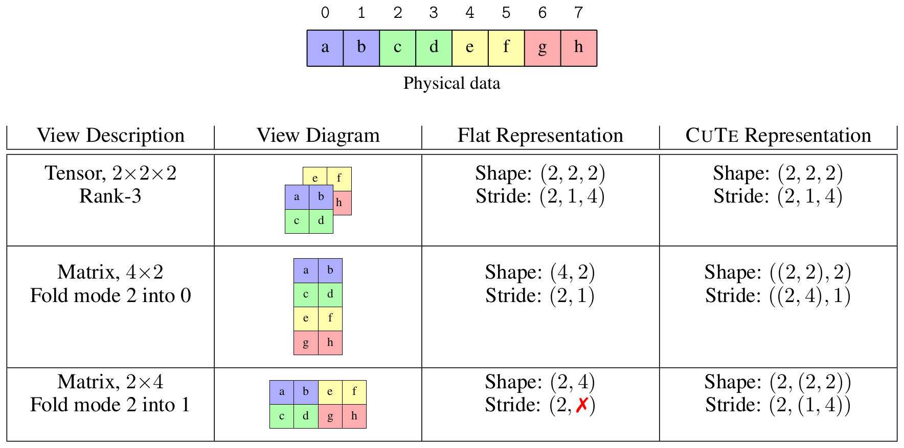

*图 1（原文 Figure 1，第 7 页）：8 个元素的物理数组被看成秩 3 的张量，并折叠成两个矩阵。*

**图中文字翻译与读法**：

- 顶部 Physical data（物理数据）：位置 0–7 依次存放 `a b c d e f g h`。
- 下表列：View Description（视图说明）、View Diagram（视图示意）、Flat Representation（平坦表示）、CuTe Representation（CuTe 表示）。
- 第一行 Tensor, 2×2×2, Rank-3（秩 3 的 $2\times2\times2$ 张量）：shape $(2,2,2)$，stride $(2,1,4)$，平坦表示与 CuTe 表示相同。含义：第 0 维步长 2，第 1 维步长 1，第 2 维步长 4：`a` 在 $(0,0,0)$ 处偏移 0，`b` 在 $(0,1,0)$ 处偏移 1，`c` 在 $(1,0,0)$ 处偏移 2，`e` 在 $(0,0,1)$ 处偏移 4，依此类推。
- 第二行 Matrix, 4×2, Fold mode 2 into 0（把第 2 维折进第 0 维，得到 $4\times2$ 矩阵）：行依次是 `ab`、`cd`、`ef`、`gh`。平坦表示 shape $(4,2)$、stride $(2,1)$；CuTe 表示 shape $((2,2),2)$、stride $((2,4),1)$。行坐标 $(m_0,m_1)$ 里 $m_0$ 是原第 0 维（步长 2），$m_1$ 是原第 2 维（步长 4）。原文说：平坦表示正是 CuTe 表示的 **coalesced（合并）版本**。
- 第三行 Matrix, 2×4, Fold mode 2 into 1（把第 2 维折进第 1 维，得到 $2\times4$ 矩阵）：行是 `a b e f` 与 `c d g h`。平坦表示：shape $(2,4)$，stride $(2,\ \times)$——**没有**合法的平坦步长，因为第二个 mode 的偏移是 $0,1,4,5$，不是等差数列；CuTe 表示：shape $(2,(2,2))$、stride $(2,(1,4))$，列坐标 $n=n_0+2n_1$ 的偏移是 $n_0\cdot1+n_1\cdot4$。

**读图结论**：张量折叠就是“把若干个 mode 分组”。平坦表示做不到的折叠（第三行），CuTe 的层次化表示可以表示，并且不需要拷贝数据。

**规范缩并形式（原文式 (2)）**：每个 mode 可以是单个 mode，也可以是一组 mode（论文称 **multi-mode**）：

$$
C_{\hat m\hat n\hat\ell}=A_{\hat m\hat k\hat\ell}\,B_{\hat n\hat k\hat\ell}.
$$

因为 shape 可以用一维坐标索引，不论 $\hat m$ 的 shape 是 $M$ 还是 $(M_0,M_1)$，都可以用一维坐标 $m$ 遍历。于是任何张量缩并都可以折叠成一个规范的 batched-GEMM，用四重循环这个平凡的参考实现来求值：

```c
for (int l = 0; l < L; ++l)
    for (int m = 0; m < M; ++m)
        for (int n = 0; n < N; ++n)
            for (int k = 0; k < K; ++k)
                C(m,n,l) += A(m,k,l) * B(n,k,l);
```

只要构造合适的折叠 layout，这个实现可以覆盖矩阵乘（GEMM）、张量缩并（GETT）和卷积（CONV）（详见原文 2.6.2 节，本文 5.3 节）。之后的优化——循环重排、分块（tiling）、向量化等——就是变换循环嵌套的次序与秩，而这类变换往往可以表示成作用在算法坐标空间上的**置换 layout**；这些变换 layout 与数据 layout 做函数复合，得到保证与原问题一致的新循环嵌套（见 composition 一节）。

## 四、Layout 的表示（原文第 2 节）

### 4.1 Tuple 与 HTuple；congruent 与 weakly congruent（原文 2.1 节）

- **Tuple**$(T)$：取自集合 $T$ 的元素构成的有限有序列表；有 **rank**（长度）与访问操作 $X_i$。
- **HTuple**$(T)$（hierarchical tuple，层次化元组）：要么是 $T$ 的一个元素，要么是 $\text{Tuple}(\text{HTuple}(T))$。操作：rank（若是 Tuple 则为其长度，否则为 1）、访问 $X_i$、**depth**（若是 Tuple 则为 $1+\max(\text{depth}(X_0),\text{depth}(X_1),\dots)$，否则为 0）。原文给出的整数 HTuple 例子：

$$
31,\quad(16,32),\quad(3,-8,7),\quad(2,(4,1),-1),\quad((4,6),(3,(2,2),8)).
$$

（本文代入：它们的 depth 依次为 0、1、1、2、3，rank 依次为 1、2、3、3、2。）

**Congruence（结构一致，记作 $\sim$）**：两个 HTuple 要么都是叶子，要么都是元组、rank 相同且对应分量逐个结构一致；也说它们有相同的 **profile（轮廓）**。例：

$$
(4,8)\sim(5,7),\qquad(4,(2,4))\sim(7,(3,2)),\qquad(v,((p,3)))\sim(0,((0,0))),
$$

但 $(4,8)$ 与 $(4,(2,4))$ 不一致，$(4,(2,4))$ 与 $(0,((0,0)))$ 也不一致。关键：只看括号结构，不看数值。

**Weak congruence（弱结构一致，记作 $P\lesssim S$）**：$P$ 是叶子，或两者都是元组、rank 相同且对应分量逐个弱一致。读作“$P$ 粗化了 $S$ 的轮廓，$S$ 细化了 $P$ 的轮廓”。例：

$$
30\lesssim(a,b)\lesssim(v,(0,\alpha)),\qquad30\lesssim(a,b,c)\lesssim((0,0),0,0),
$$

但 $(a,b)$ 与 $(a,b,c)$ 不弱一致，$(v,(0,\alpha))$ 与 $((0,0),0)$ 也不弱一致。直观：叶子可以“压扁”任意子结构，所以一维可以代表任何更细的层次结构。

### 4.2 Shape（原文 2.2 节）

**Shape** 是由正整数构成的 HTuple，即 $\text{HTuple}(\mathbb{Z}^{+})$。shape $S$ 的 rank 是该 HTuple 的 rank；**size** 是全部叶子整数之积，记 $\lvert S\rvert$。$M\times N$ 矩阵的二维 shape 是 $(M,N)$，自然地用坐标 $(m,n)$（$0\le m<M,\ 0\le n<N$）索引。

层次化 shape 的关键性质是：**同一个 shape 可以被多种坐标系索引**。二维 shape $(M,N)$ 也可以看作 $MN$ 个元素，用一个整数坐标 $i$（$0\le i<MN$）索引，只要给定一个双射

$$
S:\mathbb{Z}_{MN}\longleftrightarrow\mathbb{Z}_M\times\mathbb{Z}_N
$$

在一维整数坐标与二维自然坐标之间互转。同样，二维 shape $(M,NP)$ 可看作层次化 shape $(M,(N,P))$，用自然坐标 $(m,(n,p))$ 索引，对应双射 $\mathbb{Z}_M\times\mathbb{Z}_{NP}\leftrightarrow\mathbb{Z}_M\times(\mathbb{Z}_N\times\mathbb{Z}_P)$。

后果：**算法可以按它最自然的 shape 来写**——COPY 用一维 shape 写向量，GEMM 用二维 shape 写矩阵，batched-GEMM 用三维 shape——同时仍然接受折叠后与算法规格弱一致的层次化张量。因为每个 mode 还带 stride，这种折叠使得能表示的数据 layout 远超“连续数组”（COPY）或“行主序、列主序矩阵”（BLAS GEMM）。

### 4.3 坐标集与相容性（原文 2.2.1 节）

**坐标集**：$\mathbb{Z}_N=\{0,1,\dots,N-1\}$，或坐标集的笛卡尔积 $\mathbb{Z}_N\times\mathbb{Z}_M=\mathbb{Z}_{(N,M)}$。原文给出的例子（注意列表按“第一个分量变化最快”排序）：

- $\mathbb{Z}_6=\{0,1,2,3,4,5\}$；
- $\mathbb{Z}_{(3,4)}=\{(0,0),(1,0),(2,0),(0,1),(1,1),(2,1),(0,2),(1,2),(2,2),(0,3),(1,3),(2,3)\}$；
- $\mathbb{Z}_{((2,1),3)}=\{((0,0),0),((1,0),0),((0,0),1),((1,0),1),((0,0),2),((1,0),2)\}$。

一个 shape $S$ 对应的坐标集 $\mathbb{Z}_S$ 恰是它的**自然坐标**的集合。

**Compatibility（相容性，记作 $P\preceq S$）**：$P$ 是正整数且 $P=\lvert S\rvert$；或两者都是元组、rank 相同且 $P_i\preceq S_i$ 对每个 $i$ 成立。读作“$P$ 粗化 $S$，$S$ 细化 $P$”。相容要求两个 shape **大小一样**，所以整数数值是有意义的：

$$
30\preceq(2,15)\preceq(2,(3,5)),\qquad30\preceq(6,5)\preceq((3,2),5),
$$

但 $(2,(3,5))$ 与 $((3,2),5)$ 虽然大小都是 30，却**不相容**；不过它们有共同的相容 shape 30。

**相容坐标集**（式 (3)）：shape $S$ 的“全部相容坐标集”是所有粗化 $S$ 的 shape 的坐标集：

$$
\mathbb{Z}(S)=\{\mathbb{Z}_{S'}\mid S'\preceq S\}.
$$

每个 shape 都有一个**整数坐标集** $\mathbb{Z}_{\lvert S\rvert}\in\mathbb{Z}(S)$，每个 rank 为 $r$ 的 shape 都有一个 rank 为 $r$ 的坐标集 $\mathbb{Z}_{(\lvert S_0\rvert,\dots,\lvert S_{r-1}\rvert)}\in\mathbb{Z}(S)$。若 $P$ 粗化 $S$，则 $\mathbb{Z}(P)\subseteq\mathbb{Z}(S)$——$P$ 里的任何坐标也是 $S$ 里的坐标。

### 4.4 坐标、colex 顺序与 idx2crd、crd2idx（原文 2.2.2 节，图 2）

三类坐标：

- **in-bounds coordinate（界内坐标）**：属于 $S$ 的某个坐标集 $\mathbb{Z}_{S'}\in\mathbb{Z}(S)$ 的元素，总是 $\text{HTuple}(\mathbb{N})$；
- **integral coordinate（整数坐标）**：$\bar c\in\mathbb{Z}_{\lvert S\rvert}$，总是一个整数；
- **natural coordinate（自然坐标）**：$\tilde c\in\mathbb{Z}_S$，是与 shape 结构一致的 $\text{HTuple}(\mathbb{N})$，即 $\tilde c\sim S$。

要在不同的界内坐标之间转换，需要在坐标集上取定一个枚举顺序。论文取 **colexicographical（余字典序）**：

$$
(a_0,\dots,a_n)<(b_0,\dots,b_n)\iff a_n<b_n\ \text{ 或 }\ \big(a_n=b_n\ \text{且}\ (a_0,\dots,a_{n-1})<(b_0,\dots,b_{n-1})\big),
$$

必要时递归地应用。直观：**第一个分量变化最快**，所以对二维坐标就是“列主序”的枚举。由此得到两个互逆的映射：

$$
\mathrm{idx2crd}(i)=\Big(i\bmod\lvert S_0\rvert,\ \Big\lfloor\tfrac{i}{\lvert S_0\rvert}\Big\rfloor\bmod\lvert S_1\rvert,\ \dots,\ \Big\lfloor\tfrac{i}{\prod_{k=0}^{r-3}\lvert S_k\rvert}\Big\rfloor\bmod\lvert S_{r-2}\rvert,\ \Big\lfloor\tfrac{i}{\prod_{k=0}^{r-2}\lvert S_k\rvert}\Big\rfloor\Big)\qquad(\text{式 }(4))
$$

$$
\mathrm{crd2idx}(c_0,c_1,\dots,c_{r-1})=c_0+c_1\lvert S_0\rvert+\dots+c_{r-1}\prod_{k=0}^{r-2}\lvert S_k\rvert\qquad(\text{式 }(5))
$$

注意式 (4) 的**最后一个分量不取模**，这使得 `idx2crd` 对所有整数都有定义；当 $i\ge\lvert S\rvert$ 时它返回一个越界坐标。若两个 shape 相容 $P\preceq S$，则 $\mathbb{Z}_P$ 的坐标可通过反复应用 `idx2crd` 映射到 $\mathbb{Z}_S$，反向用 `crd2idx`。

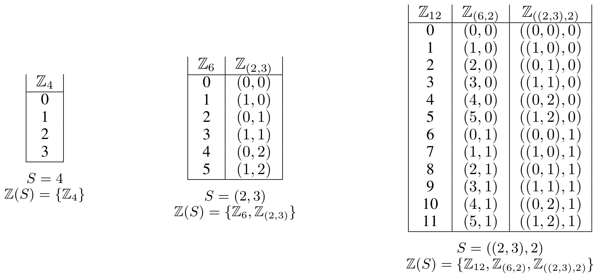

*图 2（原文 Figure 2，第 11 页）：几个 shape $S$ 的坐标集，按余字典序列出从整数坐标到各相容坐标集的映射。*

**图中文字翻译与读法**：从左到右三个小表，每行对应一个整数坐标，右边各列是它在更细的相容坐标集里的坐标。

- $S=4$：只有 $\mathbb{Z}(S)=\{\mathbb{Z}_4\}$，整数坐标 0–3；
- $S=(2,3)$：$\mathbb{Z}(S)=\{\mathbb{Z}_6,\mathbb{Z}_{(2,3)}\}$，整数 $0,1,2,3,4,5$ 对应 $(0,0),(1,0),(0,1),(1,1),(0,2),(1,2)$；
- $S=((2,3),2)$：$\mathbb{Z}(S)=\{\mathbb{Z}_{12},\mathbb{Z}_{(6,2)},\mathbb{Z}_{((2,3),2)}\}$，三列分别是整数坐标、二维坐标 $(6,2)$ 的坐标、层次化的自然坐标。

读例子（本文代入）：取整数坐标 7。在 $\mathbb{Z}_{(6,2)}$ 里它是 $(7\bmod6,\lfloor7/6\rfloor)=(1,1)$；再把第一个分量 1 按 shape $(2,3)$ 展开，$(1\bmod2,\lfloor1/2\rfloor)=(1,0)$，得到自然坐标 $((1,0),1)$，与图中第 7 行一致。

**界外坐标**：为了描述“越界”，原文再定义三类：

- **admissible coordinate**：与 shape 弱一致的任意 $\text{HTuple}(\mathbb{Z})$，即 $c\lesssim S$；
- **out-of-bounds coordinate**：admissible 但不在界内的坐标；
- **congruent coordinate**：与 shape 结构一致的任意 $\text{HTuple}(\mathbb{Z})$，记 $\mathbb{Z}^{S}=\{c\in\text{HTuple}(\mathbb{Z})\mid c\sim S\}$。

所以 $\mathbb{Z}_S$ 是被 $S$ 限定的**有限**坐标集，$\mathbb{Z}^{S}$ 是所有与 $S$ 结构一致的坐标构成的**无限**集合。因为 shape 里的数值对 $\mathbb{Z}^{S}$ 不起作用，有时用 $(\ast,\ast)$ 做轮廓占位，如 $\mathbb{Z}^{(\ast,\ast)}=\{(a,b)\mid a,b\in\mathbb{Z}\}$。注意：`crd2idx` 对越界输入不保证给出越界输出，所以 `crd2idx` 与 `idx2crd` 只在界内坐标上互为逆。

### 4.5 Stride 与 integer-semimodule（原文 2.3 节）

要为数据、线程等对象构造 layout，需要一个从 shape 内坐标到“偏移”的映射。

**Stride（步长）**：shape $S$ 的 stride $D$ 是一个与 $S$ 结构一致的 $\text{HTuple}(\mathcal{D})$，即 $S\sim D$。它定义了从自然坐标 $\tilde c\in\mathbb{Z}_S$ 到 codomain $\mathcal{D}$ 的映射，用 `inner_product` 给出（式 (6)）：

$$
\mathrm{inner\_product}(c,d)=c\,d\ \ (\text{整数 }c\text{ 对元素 }d),\qquad\mathrm{inner\_product}(c,d)=\sum_i\mathrm{inner\_product}(c_i,d_i)\ \ (\text{HTuple 逐分量求和}).
$$

多数情形 stride 是整数 HTuple，$\mathcal{D}=\mathbb{Z}$，得到的整数解释为数组里的偏移。但“stride 元素”可以推广为任意 **integer-semimodule**（整数半模）的元素，这极大地扩展了 layout 能表示的函数。

**Integer-semimodule**（原文定义 2.16）：集合 $M$ 配上结合的加法 $M+M\to M$ 与标量乘法 $\mathbb{Z}\cdot M\to M$，对 $a,b\in\mathbb{Z}$、$m,n,p\in M$ 满足：

- 乘法单位元：$1\cdot m=m$；
- 加法结合律：$m+(n+p)=(m+n)+p$；
- 乘法结合律：$a\cdot(b\cdot m)=(ab)\cdot m$。

**不要求加法单位元和逆元**，所以 $(M,+)$ 只是半群。例子：整数 $\mathbb{Z}$；有理数 $\mathbb{Q}$；有限域 $\mathbb{F}_2=(\{0,1\},\mathrm{XOR},\mathrm{AND})$；任何半模的笛卡尔积或 HTuple（逐元素加法与标量乘法）。**最有用的**一个是 $(\mathbb{Z}^{S},+,\cdot)$——与 $S$ 结构一致的全部 HTuple，用来做“坐标 stride”：例如二维算术元组的基 $e_0=(1,0)$、$e_1=(0,1)$，$\mathbb{Z}^{(\ast,\ast)}=\{a\,e_0+b\,e_1\}$，并有 $a\,e_0+b\,e_1=(a,b)$。于是 $e_0,e_1$ 及其线性组合都能做 layout 的 stride，通过 `inner_product` 生成某个 shape 的自然坐标。

### 4.6 Layout（原文 2.4 节）

**Layout** 由 shape $S$ 与 stride $D$ 定义：shape 决定 layout 函数的**定义域**，stride 决定**值域（codomain）**。shape 可以看作一个“从所有坐标列表到自然坐标”的双射（即 `idx2crd` 与 `crd2idx`），stride 则是“从自然坐标到某个 codomain”的映射（即 `inner_product`）：

$$
S:\mathbb{Z}\longleftrightarrow\mathbb{Z}_S\ (\forall\,\mathbb{Z}\in\mathbb{Z}(S)),\qquad D:\mathbb{Z}_S\to\mathcal{D}.
$$

**定义 2.17**：$L=D\circ S$ 是 shape 与 stride 的函数复合（$S\sim D$），对每个 $\mathbb{Z}\in\mathbb{Z}(S)$ 定义一个映射 $\mathbb{Z}\to\mathcal{D}$。书写方式（原文）：

$$
\frac{(4,(3,2))}{(2,(8,1))}\quad\text{或}\quad(4,(3,2)):(2,(8,1))=S:D\quad\text{或}\quad(2,(8,1))\circ(4,(3,2))=D\circ S .
$$

本文的行文里用 $S:D$（左边 shape，冒号，右边 stride）。因为定义域由 shape 决定，layout 的很多性质直接取自 shape：对 $L=S:D$、$U=X:Y$——$\text{rank}(L)=\text{rank}(S)$；$\text{depth}(L)=\text{depth}(S)$；$\lvert L\rvert=\lvert S\rvert$；第 $i$ 个子 layout $L_i=S_i:D_i$；$\mathbb{Z}(L)=\mathbb{Z}(S)$；$L\sim U\Leftrightarrow S\sim X$；$L\preceq U\Leftrightarrow S\preceq X$。

**求值例子（原文）**：取图 3(e) 的 layout $L=((2,2),(4,2)):((1,8),(2,16))$ 和整数坐标 $22\in\mathbb{Z}_{32}$：

$$
L(22)=L(2,5)=L\big((0,1),(1,1)\big)=0\cdot1+1\cdot8+1\cdot2+1\cdot16=26 .
$$

依次展示的是：整数坐标 22；等价的二维坐标 $(2,5)$（$22=2+4\cdot5$）；等价的自然坐标（$2\to(0,1)$ 按 shape $(2,2)$，$5\to(1,1)$ 按 shape $(4,2)$）；最后与 stride 做内积得到偏移 26。

**定义域、扩展定义域、codomain 与 image**：界内定义域 $\mathbb{Z}(L)$ 是有限的；layout 也可以在越界坐标上求值（就像数组可以用越界下标求值，行为未定义），所以有**扩展定义域** $\mathbb{Z}^{L}$——所有与 $S$ 弱一致的 $\text{HTuple}(\mathbb{Z})$，是无限集。**codomain** 是 $\mathcal{D}$（常常是无限的，如 $\mathbb{Z}$），**image** 是有限的、layout 在所有坐标上实际取到的值：

$$
\mathrm{image}(L)=L(\mathbb{Z}(L))=L(\mathbb{Z}_{\lvert L\rvert})\subseteq\mathrm{codomain}(L).
$$

### 4.7 Layout 的例子（原文 2.4.2 节，图 3、图 4）

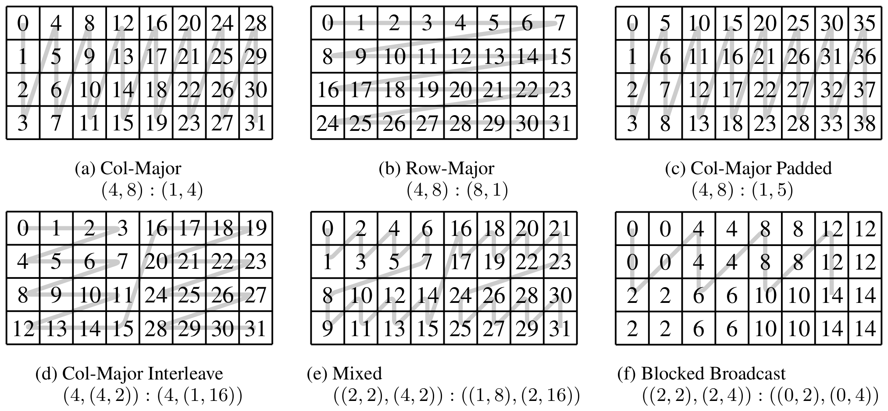

*图 3（原文 Figure 3，第 13 页）：与 shape $(4,8)$ 相容的几个 layout，画成 $4\times8$ 的矩阵；这些 layout 用整数 stride 与层次化 shape 定义对数据张量有用的函数。图中细线大致沿着 layout 偏移的次序。*

**图中文字翻译与读法**：每个格子里的数字是该坐标 $(m,n)\in\mathbb{Z}_{(4,8)}$ 的偏移 $k$（可用来索引数据数组）。六个 layout 的含义（偏移公式由本文按 colex 坐标推出，并与图上每一格核对）：

| 子图 | 名称 | layout | 偏移公式 | 含义 |
|---|---|---|---|---|
| (a) | Col-Major | $(4,8):(1,4)$ | $m+4n$ | 列主序，列内连续 |
| (b) | Row-Major | $(4,8):(8,1)$ | $8m+n$ | 行主序，行内连续 |
| (c) | Col-Major Padded | $(4,8):(1,5)$ | $m+5n$ | 列主序且每列留出 1 个空位（leading dimension 为 5）；本文补充：这种 padding 常被用来错开共享内存的 bank |
| (d) | Col-Major Interleave | $(4,(4,2)):(4,(1,16))$ | $4m+n_0+16n_1$（$n=n_0+4n_1$） | 8 列拆成 $(4,2)$：两个行主序的 $4\times4$ 小块，块间距 16 |
| (e) | Mixed | $((2,2),(4,2)):((1,8),(2,16))$ | $m_0+8m_1+2n_0+16n_1$（$m=m_0+2m_1,\ n=n_0+4n_1$） | 行、列都做了层次拆分的混合 layout |
| (f) | Blocked Broadcast | $((2,2),(2,4)):((0,2),(0,4))$ | $2m_1+4n_1$（$m=m_0+2m_1,\ n=n_0+2n_1$） | stride 为 0：同一个 $2\times2$ 块内的偏移相同，即广播 |

原文的读法：行主序、列主序与带填充的布局用 CuTe layout 平凡地表示；交错与混合布局表明，用嵌套的 shape 与 stride，可表示的 layout 集合被**严格扩大**；特别地，“数据块的网格”（grids-of-tiles-of-data）可以立刻被 CuTe layout 表示。

**本文验算**：用程序按 layout 公式算出这六个 $4\times8$ 矩阵，并与论文图中印的数字逐格比较：(a)(b)(c)(d)(f) 全部一致；**(e) 有两格不一致**：公式给出 $(0,6),(0,7),(1,6),(1,7)$ 四处依次是 20、22、21、23，而图上印的是 20、21、22、23，即位置 $(0,7)$ 与 $(1,6)$ 的 22 与 21 对调了。公式本身是对的：它与正文的求值例子 $L(22)=26$（对应格子 $(2,5)$，图上为 26）一致，其余 30 格也与公式一致，所以这是图中数字的笔误。

**图 3 的小例子（本文代入）**：对 (d) 取整数坐标 13：二维坐标 $(13\bmod4,\lfloor13/4\rfloor)=(1,3)$，自然坐标 $(1,(3,0))$，偏移 $4\cdot1+1\cdot3+16\cdot0=7$，对应图中第 1 行第 3 列的 7。

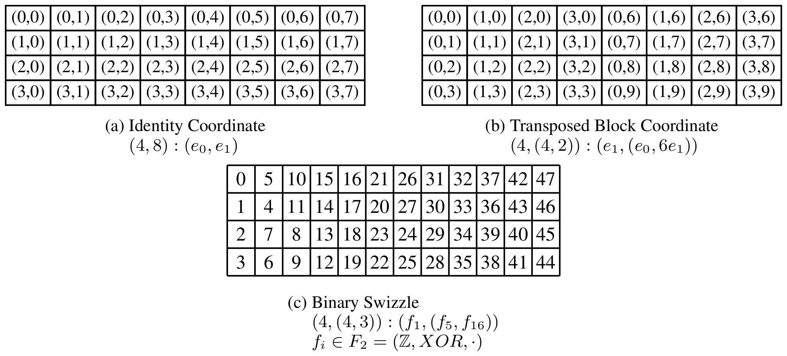

*图 4（原文 Figure 4，第 14 页）：用二维坐标画出的 layout。这些 layout 用 integer-semimodule 的 stride，定义出对记录坐标和对非仿射的“swizzle”偏移有用的函数。*

**图中文字翻译与读法**：

- **(a) Identity Coordinate**（恒等坐标）：$(4,8):(e_0,e_1)$。格子 $(m,n)$ 里存的就是坐标 $(m,n)$ 本身。
- **(b) Transposed Block Coordinate**（转置块坐标）：$(4,(4,2)):(e_1,(e_0,6e_1))$。列号 $n=n_0+4n_1$，格子里是坐标 $(n_0,\ m+6n_1)$：第一个坐标是列的内层下标，第二个坐标是行号加上块号乘 6。例如第 0 行第 4 列 $(n_0=0,n_1=1)$ 里是 $(0,6)$，第 3 行第 7 列里是 $(3,9)$，与图一致。
- **(c) Binary Swizzle**（二进制 swizzle）：$(4,(4,3)):(f_1,(f_5,f_{16}))$，其中 $f_i\in\mathbb{F}_2=(\mathbb{Z},\mathrm{XOR},\cdot)$。这里加法换成按位异或，标量乘法是普通整数乘法，格子 $(m;n_0,n_1)$ 里的偏移是 $m\oplus5n_0\oplus16n_1$。例如第 1 行：1、4、11、14、17、20、…：$1\oplus5=4$，$1\oplus10=11$，$1\oplus15=14$。

**读图结论**：原文指出，(a)(b) 这类“生成坐标”的 layout，在后文会发现它们与对应的数据 layout **对称地变换**，常用来检测与屏蔽对数据张量的越界访问；坐标张量对 Hopper 与 Blackwell 的 TMA 这类“以坐标而不是地址为指令参数”的指令很有用。(c) 把群加法换成 XOR，可以生成所谓的 **swizzle 模式**，原文说它可以用来避免共享内存读写时的 bank conflict。本文观察：图中每一列的 4 个数恰好是 4 个连续偏移的一个排列（第 1 列 5,4,7,6 是 4–7 的排列，第 2 列 10,11,8,9 是 8–11 的排列），而每一行里 $n_0=0,\dots,3$ 对应的 4 个数的低 2 位互不相同（第 0 行 0,5,10,15，第 1 行 1,4,11,14）。若把 bank 简化成“偏移 mod 4”，则按列访问与按行访问都落在 4 个不同的 bank 上（这个 4 bank 的玩具模型是本文补充，不是原文的论证）。（本文验算：整个 $4\times12$ 矩阵按 XOR 语义算出来与图完全一致。）这些例子说明 CuTe layout 概念的统一性：同一个 `Shape:Stride` 表示，既能写数据 layout，也能写坐标 layout，还能写 swizzle。

### 4.8 完备性（原文 2.4.3 节）

论文断言：**每个满足 $f(0)=0$、定义域有限 $\mathbb{Z}_N$ 的函数 $f$，都可以写成有限个 CuTe layout 的函数复合**，即 CuTe layout 是函数复合下的**生成集**：

$$
f\equiv(2,2,2,\dots):(f(1),f(2),f(3),\dots)\ \circ\ (3,1):(1,4)\ \circ\ (4,1):(1,6)\ \circ\ \cdots\ \circ\ (N-1,1):(1,2(N-2)).
$$

对所有 $i\in\mathbb{Z}_N\setminus\{0\}$，最右边的 $N-3$ 个 layout 把 $i$ 映射成 $2^{i-1}$，最左边的那个二进制 layout 再把 $2^{i-1}$ 映射成 $f(i)$。原文提醒：中间的各个 layout 用的是**扩展定义域** $\mathbb{Z}$ 而非界内定义域 $\mathbb{Z}_N$ 求值。

（本文代入 $N=5$：$i=1,2,3,4$ 要变成 $1,2,4,8$。先过 $(4,1):(1,6)$：$1,2,3,4\mapsto1,2,3,6$（$4$ 落到第二个 mode，偏移 $1\cdot6$）；再过 $(3,1):(1,4)$：$1,2,3,6\mapsto1,2,4,8$；最后 $(2,2,2,2):(f(1),f(2),f(3),f(4))$ 把单个二进制位 $2^{i-1}$ 映射成 $f(i)$。本文用随机的 $f$ 对 $N=3,\dots,9$ 验算过这个链条。）这只是**理论上的完备性**：单个 layout 当然不能表示任意函数，layout 集合是所有函数的真子集。

### 4.9 半线性与线性形式（原文 2.4.4 节，表 1）

layout 的“shape 加 stride”定义，配合 semimodule 的 stride，给出一个很有用的线性代数视角（式 (7)）：

$$
L(c)=(D\circ S)(c)=d\cdot S(c)=d\cdot\tilde c .
$$

shape 函数是到自然坐标 $\tilde c\in\mathbb{Z}^{S}$ 的方便的**半仿射双射**，stride 函数是自然坐标的**线性函数**。因此对两个自然坐标 $\tilde c_0,\tilde c_1$，layout 是线性的：

$$
L(\alpha\tilde c_0+\beta\tilde c_1)=d\cdot(\alpha\tilde c_0+\beta\tilde c_1)=\alpha L(\tilde c_0)+\beta L(\tilde c_1),
$$

因为 shape 函数是恒等、stride 函数线性。但对任意界内坐标 $c_0,c_1\in\mathbb{Z}(S)$，layout 并不线性，因为 shape 函数不线性：$\tilde c=S(c_0+c_1)\ne S(c_0)+S(c_1)=\tilde c_0+\tilde c_1$。所以 layout 对自然坐标 $\tilde c$ 线性，对任意坐标 $c$ 非线性。在自然坐标下，$d\cdot\tilde c$ 可理解为广义的矩阵向量乘 $L(c)=\mathbf{D}\,\tilde c$，其中 $\mathbf{D}$ 的元素取自 semimodule $\mathcal{D}$：

- 整数 stride（$\mathcal{D}=\mathbb{Z}$）：$\mathbf{D}\in\mathbb{Z}^{1\times n}$；
- 坐标 stride（$\mathcal{D}=(\mathbb{Z}^{S},+,\cdot)$）：$\mathbf{D}\in\mathbb{Z}^{m\times n}$；
- 二进制 stride（$\mathcal{D}=\mathbb{F}_2^{m}=(\mathbb{Z}_{2^m},\mathrm{XOR},\cdot)$）：$\mathbf{D}\in\mathbb{F}_2^{m\times n}$。

**表 1：layout 及其对应的线性形式**（$r$ 是输出，$\tilde c$ 是自然坐标；矩阵写在下面单独的公式里）：

| layout | 线性形式 | 评注 |
|---|---|---|
| $((2,2),(4,2)):((1,8),(2,16))$ | $r=[1\ 8\ 2\ 16]\,\tilde c$（$\tilde c$ 为 4 维列向量） | 整数 stride 是 $1\times n$ 整数矩阵的各列 |
| $(4,(4,2)):(e_1,(e_0,6e_1))$ | $2\times3$ 整数矩阵 | 坐标 stride 是 $m\times n$ 整数矩阵的各列 |
| $(4,4):(f_1,f_5)\equiv((2,2),(2,2)):((f_1,f_2),(f_5,f_{10}))$ | $4\times4$ 的 $\mathbb{F}_2$ 矩阵 | 二进制 stride 是 $m\times n$ $\mathbb{F}_2$ 矩阵的各列 |

（原文表 1，第 15 页。）第二、三行的矩阵（与原文逐项一致）：

$$
\begin{bmatrix}r_0\\ r_1\end{bmatrix}=\begin{bmatrix}0&1&0\\1&0&6\end{bmatrix}\begin{bmatrix}\tilde c_0\\ \tilde c_1\\ \tilde c_2\end{bmatrix},\qquad
\begin{bmatrix}r_0\\ r_1\\ r_2\\ r_3\end{bmatrix}=\begin{bmatrix}1&0&1&0\\0&1&0&1\\0&0&1&0\\0&0&0&1\end{bmatrix}\begin{bmatrix}\tilde c_0\\ \tilde c_1\\ \tilde c_2\\ \tilde c_3\end{bmatrix}.
$$

读法（本文推导）：第二行矩阵的三列分别是 $e_1=(0,1)^\top$、$e_0=(1,0)^\top$、$6e_1=(0,6)^\top$，即各个 stride；第三行里 $f_1,f_2,f_5,f_{10}$ 的二进制位向量是 $(1,0,0,0),(0,1,0,0),(1,0,1,0),(0,1,0,1)$（低位在上），它们正是矩阵的四列。$(4,4):(f_1,f_5)$ 把每个 4 大小的 mode 拆成两个二进制位 mode，这正是原文 1.1 节所说“把 Linear Layouts 表示成 CuTe layout 的 stride 抽象”的一种具体形态：power-of-two shape 加 $\mathbb{F}_2$ stride。

**BCP 与 BMMC**：$\mathbb{F}_2$ 线性形式里被充分研究的变换有 Bit Permute Complement（原文缩写为 BCP）与 Bit Matrix Multiply Complement（BMMC）变换 [Edelman、Cormen、Bouverot 等]，最近被 Linear Layouts 用到 SIMT GPU 编程中。那些工作考虑的变换是（式 (8)）

$$
f(v)=Av+b,
$$

其中 $A$ 是 $m\times n$ 的二元矩阵，$v$ 是长为 $n$ 的二元向量，$b$ 是长为 $m$ 的二元向量，一切运算模 2（有限域 $\mathbb{F}_2$）。后文在 CuTe layout 上定义的运算，是从线性代数**推广**来的：layout 的 group composition 可以解释为矩阵乘法的推广；右逆和左逆可解释为 Moore–Penrose 伪逆；BCP 与 BMMC 分析里的分解、求逆、矩阵积也都有类似表达。CuTe layout 代数可以看成是对 $\mathbb{F}_2$ 线性代数 BCP/BMMC 运算在 $\mathbb{F}_2$ 之外的推广，主要动机是张量中奇特数据布局里的一般整数 stride。

### 4.10 Tensor：accessor 与 layout 的复合（原文 2.5 节）

**Accessor（访问器）**（定义 2.18）是一个支持偏移与解引用的类似随机访问指针的对象：

- $e+d\to e'$：把访问器 $e$ 偏移 $d\in\mathcal{D}$，得到另一个访问器 $e'$；
- $*e\to v$：解引用，得到值 $v$；
- $e[d]\to*(e+d)$：下标运算，便利写法。

当 $\mathcal{D}=\mathbb{Z}$ 时，常见实现有原始指针 `T*`、数组 `T[N]`、随机访问迭代器（`thrust::counting_iterator`、`thrust::transform_iterator` 等）；当 $\mathcal{D}$ 是更奇特的 semimodule 时，访问器必须与该半群的加法相容。

**Tensor**（定义 2.19）是 accessor $e$ 与 layout $L$ 的复合 $T=e\circ L$：先用 layout 把坐标 $c\in\mathbb{Z}(L)$ 映射到 codomain，再偏移 accessor 并解引用（式 (9)）：

$$
T(c)=(e\circ L)(c)=*(e+L(c))=e[L(c)] .
$$

大多数 tensor 是以内存地址为 accessor 的**数据张量**：指针 $\{p\}$ 满足 $\{p\}+b\to\{p+b\}$、$*\{p\}\to*p$，$T=\{p\}\circ L$。此外，图 3 里的所有 layout 都可以与**计数迭代器** $\{a\}$（偏移后得 $\{a+b\}$、解引用得到存的偏移 $a$）复合，变成“隐式 tensor”（值就是偏移）；图 4(a)(b) 的坐标 layout 可以与“以坐标为偏移、解引用得到存的坐标 $(a,b)$”的访问器 $\{(a,b)\}$ 复合，变成坐标 tensor。

### 4.11 Slicing（切片，原文 2.5.1 节，图 5）

CuTe 的 Tensor 可以看成**带偏移的 layout**，所以能沿自然坐标的任意 mode 切片：

- 完整求值：用完整坐标应用式 (9)，得到一个值；
- **部分求值（切片）**：用不完整的坐标 $c=c'+c_{\ast}$（$c_{\ast}$ 是未指定部分）求值，得到一个新 tensor（式 (10)）：

$$
T(c)=(e\circ L)(c'+c_{\ast})=(e+L(c'))\circ L(c_{\ast})=e'\circ L(c_{\ast})=T'(c_{\ast}),
$$

其中 $L(c')$ 被完整求值并累加到 accessor 里，$L(c_{\ast})$ 是 $L$ 中尚未求值的子 layout。**切片不拷贝数据**，只是累加偏移并确定 layout 剩余的未求值部分。

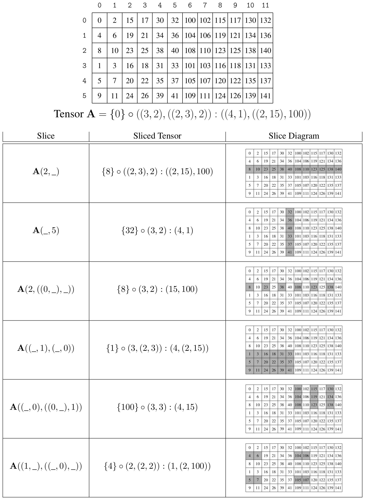

*图 5（原文 Figure 5，第 17 页）：对一个 $6\times12$ 的张量沿逻辑子边界切片，提取子张量。*

**图中文字翻译与读法**：顶部是被切的张量 $A=\{0\}\circ((3,2),((2,3),2)):((4,1),((2,15),100))$（accessor 是偏移 0 的计数迭代器 $\{0\}$，用 $\{a\}$ 表示偏移 $a$），先画出它的 $6\times12$ 数值（本文验算：与公式逐格一致，如第 0 行 $0,2,15,17,30,32,100,\dots$）。下表三列：Slice（切片）、Sliced Tensor（切出的 tensor）、Slice Diagram（切片示意，灰格是被取出的元素）。记号 `_` 表示“该位置不指定、保留”。

| 切片 | 取出什么 | 切出的 tensor |
|---|---|---|
| $A(2,\_)$ | 第 2 行（12 个元素） | $\{8\}\circ((2,3),2):((2,15),100)$ |
| $A(\_,5)$ | 第 5 列（6 个元素） | $\{32\}\circ(3,2):(4,1)$ |
| $A(2,((0,\_),\_))$ | 第 2 行，列坐标 $((n_0,n_1),n_2)$ 中固定 $n_0=0$（6 个元素：第 0、2、4、6、8、10 列） | $\{8\}\circ(3,2):(15,100)$ |
| $A((\_,1),(\_,0))$ | 行坐标 $(m_0,m_1)$ 中 $m_1=1$（第 3–5 行），列坐标 $((n_0,n_1),n_2)$ 中 $n_2=0$（第 0–5 列）：$3\times6$ 子矩阵 | $\{1\}\circ(3,(2,3)):(4,(2,15))$ |
| $A((\_,0),((0,\_),1))$ | $m_1=0$（第 0–2 行），$n_0=0$、$n_2=1$（第 6、8、10 列）：$3\times3$ 子矩阵 | $\{100\}\circ(3,3):(4,15)$ |
| $A((1,\_),((\_,0),\_))$ | $m_0=1$（第 1、4 行），$n_1=0$（第 0、1、6、7 列）：$2\times4$ 子矩阵 | $\{4\}\circ(2,(2,2)):(1,(2,100))$ |

**读图结论**：切片可以深入嵌套的 mode，取出的不一定是“连续的行列区间”；原文指出，最后一个例子（第 1、4 行与第 0、1、6、7 列）无法只靠对行和列的范围切片得到。例如 $A(2,\_)$：第 2 行对应 $m=2\to(2,0)$，累加偏移 $2\times4=8$，剩下的是列方向的整个子 layout。（本文验算：六个切片的 accessor 偏移与子 layout，都与按公式直接取出元素的结果一致。）

**CuTe 为什么不支持“范围切片”**：NumPy、PyTorch、MATLAB 支持 `my_matrix[2:4,1:3]` 这类范围切片，CuTe 不支持，理由有三（原文）：

1. 范围切片表达不了图 5 所有的切片，最后一个例子无法只靠对行和列的范围切片得到。
2. 范围切片会鼓励这类写法，把静态常量和动态下标混在一起：

   ```python
   # Extract a TILE_SIZE of data for each thr_id
   thr_data = my_data[thr_id * TILE_SIZE : (thr_id + 1) * TILE_SIZE]
   ```

   这里 `TILE_SIZE` 往往是程序想优化的静态常量，`thr_id` 则是每个线程本地的动态下标。CuTe 倾向“两步法：先置换并重塑，再切片”：

   ```python
   # Permute and reshape my_data tensor into shape (TILE_SIZE, NumTiles)
   # This is a wrapper around the more general composition (my_data, Transform_Layout)
   tiled_data = logical_divide(my_data, TILE_SIZE)  # (TILE_SIZE, NumTiles)
   assert size[1](tiled_data) == NumThrs            # Verify NumTiles == NumThrs
   # Slice tiled tensor to retrieve TILE_SIZE local to thr_id
   thr_data = thr_tile_data[None, thr_id]           # TILE_SIZE
   ```

   这种方式把分开的参数 `TILE_SIZE` 和 `thr_id` 区分开，更易于编译器推理并传播静态信息（如 `thr_data` 的大小是 `TILE_SIZE`），灵活性相同（见原文 3.3.4 与 3.5.2 节，即本文 6.3.4 与 7.7 节）。（代码为论文原文的转录；原文把最后一行的变量写成 `thr_tile_data`，与上一行的 `tiled_data` 不一致，疑为笔误。）
3. 范围切片能表达**无法用 CuTe layout 表示**的切片。对图 5 的 $A$：$A(0,0\!:\!2\!:\!12)$（第 0 行的偶数列）得到 $\{0\}\circ(3,2):(15,100)$；而 $A(0\!:\!2\!:\!6,0)$（第 0、2、4 行的第 0 列）无法表示，因为所请求的切片与 $A$ 的 layout 不相容。（本文代入：这三个元素是 $0,8,5$，不是等差序列，确实无法写成 layout。）作者宁愿在“置换并重塑”（composition）阶段而不是切片阶段发现并暴露这类错误；composition 的可行性条件见原文 3.3.2 节（本文 6.3.2 节）。

## 五、应用：通用的 COPY 与 GEMM（原文 2.6 节）

### 5.1 为什么需要通用算法

原文的对比：CUTLASS v2 与 ThunderKittens 对每种 layout 都单独手工实现，费力、易错、开发周期长；CUTLASS v2 近 300 个单独实现的 layout 分布在 87 个文件、约 55,000 行代码中，许多算法只支持其中一个子集。CuTe 的核心表示加代数只有约 3,000 行，却能表示这 300 个 layout 及更多。用 CuTe 实现的算法可以对输入的秩或 shape 施加约束，但兼容任何满足这些前置条件的 layout，数据与线程 layout 与算法逻辑解耦，代码更灵活、更可组合。CuTe 现在是 CUTLASS v3、v4 与 CuTe DSL 的基础，这一套单一、一致、可组合的表示，在多代 NVIDIA 指令集架构上都保持稳健。

### 5.2 COPY

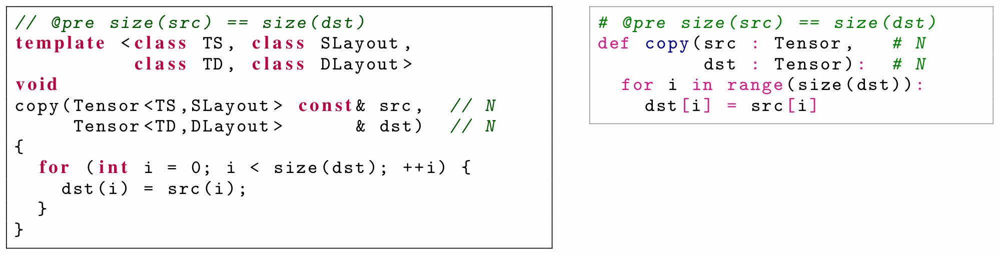

*原文 2.6.1 节的代码（第 18 页）：用 CuTe tensor 写成的通用 COPY，左为 C++ 版，右为 Python 版。*

**读法**：前置条件是两个 tensor 的**大小相等**（`@pre size(src) == size(dst)`），参数注释里写的 `N` 表示两者都与 shape $N$ 相容；循环对一维坐标 `i` 逐个拷贝：`dst(i) = src(i)`。Python 版（逐行转录）：

```python
# @pre size(src) == size(dst)
def copy(src : Tensor,    # N
         dst : Tensor):   # N
  for i in range(size(dst)):
    dst[i] = src[i]
```

因为每个 tensor 用自己的 shape 去解释一维整数坐标 $i$（colex 序），只要改变源和目的的 layout，这个简单实现就覆盖很多应用：

**表 2：COPY 的应用及示例源 layout 与目的 layout**

| 应用 | 源 layout | 目的 layout |
|---|---|---|
| 一维数组（1D Arrays） | $8:1$ | $8:1$ |
| N 维数组（ND Arrays） | $(8,2,3):(1,16,32)$ | $(8,2,3):(1,16,32)$ |
| Gather（收集） | $(2,3,2):(42,1,128)$ | $12:1$ |
| Scatter（分散） | $12:1$ | $(2,3,2):(42,1,128)$ |
| Broadcast（广播） | $7:0$ | $7:1$ |
| Constant（常量） | $7:0$ | $7:0$ |
| Transpose（转置） | $(8,3):(1,8)$ | $(8,3):(3,1)$ |
| Tensor Transpose（张量转置） | $(8,(3,5)):(1,(57,8))$ | $(8,15):(1,8)$ |

（原文表 2，第 19 页，逐格核对。）读法（本文）：Gather 把按 $42a+b+128c$ 散布的 12 个元素收集到 12 个连续位置，Scatter 反之；Broadcast 的源 stride 为 0，把同一个元素复制到 7 个连续位置；Transpose 里源是列主序 $8\times3$，目的是行主序 $8\times3$（偏移 $3m+n$），逻辑坐标不变而物理排布转置；Tensor Transpose 的 15 列被拆成 $(3,5)$ 两个 mode，源里 3 的那一层步长 57、5 的那一层步长 8，目的是紧凑的列主序 $8\times15$。Constant 的源与目的 stride 都是 0，原文没有展开说明，字面意思是 7 次访问都落在同一个偏移上。

原文还强调：

- **任意秩的 tensor 可以拷贝到任意其他秩的 tensor**：COPY 无论参数的秩是多少，都是“秩 1”的算法，这是一种秩无关编程（rank-agnostic programming）；
- 当源和目的的 `idx2crd` 开销很小（如 shape 静态已知）时，上面的实现**根本不会生成动态的坐标变换**：循环可展开，`idx2crd` 可静态地作用于循环下标 `i`，`inner_product` 的偏移计算开销极小，这是静态分析与优化的一个版本；
- 即使 `idx2crd` 有运行时开销，这个实现仍可作为**参考实现**，用来校验更优化的版本（那些版本可以用原文第 3 节的运算，即本文第六、七节，检查定义域、变换 layout）。

### 5.3 GEMM

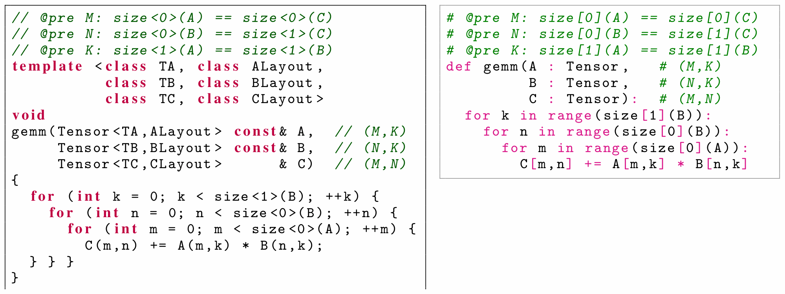

*原文 2.6.2 节的代码（第 19 页）：用 CuTe tensor 写成的通用 GEMM，左为 C++ 版，右为 Python 版。*

**读法**：$A$ 的 shape 是 $(M,K)$，$B$ 是 $(N,K)$，$C$ 是 $(M,N)$，计算 $C(m,n)\mathrel{+}=A(m,k)\,B(n,k)$，即 $C=AB^{\top}$ 的约定；前置条件：`M: size<0>(A) == size<0>(C)`、`N: size<0>(B) == size<1>(C)`、`K: size<1>(A) == size<1>(B)`，其中 `size<i>(X)` 是第 $i$ 个 mode 的大小，任何 mode 是单个 mode 还是 multi-mode 都无所谓。Python 版（逐行转录，下标记号沿用原文）：

```python
# @pre M: size[0](A) == size[0](C)
# @pre N: size[0](B) == size[1](C)
# @pre K: size[1](A) == size[1](B)
def gemm(A : Tensor,   # (M,K)
         B : Tensor,   # (N,K)
         C : Tensor):  # (M,N)
  for k in range(size[1](B)):
    for n in range(size[0](B)):
      for m in range(size[0](A)):
        C[m,n] += A[m,k] * B[n,k]
```

这个简单的 GEMM（以及它的 batched 扩展）通过改变各 tensor 的 layout，可以涵盖很多应用。

**表 3：GEMM 的应用及示例 layout**（`lda`、`ldb`、`ldc` 是 BLAS 的 leading dimension；`dma`、`dka` 等是 BLIS 的步长）

| 应用 | A 的 layout | B 的 layout | C 的 layout |
|---|---|---|---|
| NT GEMM | $(M,K):(1,\mathtt{lda})$ | $(N,K):(1,\mathtt{ldb})$ | $(M,N):(1,\mathtt{ldc})$ |
| TN GEMM | $(M,K):(\mathtt{lda},1)$ | $(N,K):(\mathtt{ldb},1)$ | $(M,N):(1,\mathtt{ldc})$ |
| NTT GEMM | $(N,K):(1,\mathtt{ldb})$ | $(M,K):(1,\mathtt{lda})$ | $(N,M):(1,\mathtt{ldc})$ |
| BLIS GEMM | $(M,K):(\mathtt{dma},\mathtt{dka})$ | $(N,K):(\mathtt{dnb},\mathtt{dkb})$ | $(M,N):(\mathtt{dmc},\mathtt{dnc})$ |
| GETT | $((M_1,M_2),K):((1,W),X)$ | $(N,K):(K,1)$ | $((M_1,M_2),N):((1,Y),Z)$ |
| GETT | $(M,(K_1,K_2)):(1,(W,X))$ | $(N,(K_1,K_2)):(Y,(1,Z))$ | $(M,N):(1,M)$ |
| CONV | $(K,(C,T,R,S)):D_A$ | $((N,Z,P,Q),(C,T,R,S)):D_B$ | $(K,(N,Z,P,Q)):D_C$ |

（原文表 3，第 20 页，逐格核对。）读法：前三行覆盖 BLAS GEMM 的各种“是否转置”变体（NT：$A$ 沿 $M$ 连续、$B$ 沿 $N$ 连续；TN：$A$、$B$ 都沿 $K$ 连续；NTT：把 $A$、$B$ 的角色对换，输出 $C$ 也随之转置）；BLIS 行允许行、列同时有任意步长；GETT（generalized tensor-tensor contraction，广义张量缩并）行把若干 mode 折叠成 multi-mode，如 $M$ 被折叠成 $(M_1,M_2)$，$W,X,Y,Z$ 是原文没有展开说明的步长；CONV 行里 $D_A,D_B,D_C$ 是原文没有展开的 stride。原文说：构造一个（用 CuTe layout 复合出来的）实现 im2col 变换的 layout，GEMM 就能实现 CONV，这是很多现代机器学习应用的核心；把融合乘加操作抽象出来，再加上足够强的分块工具，这个算法可以递归地应用于体系结构层次的每一级。

## 六、Layout 代数（原文第 3 节）

第 3 节定义的是 **layout 同态**（layout homomorphisms）：输入一个或多个 CuTe layout，输出一个满足某些函数性质的 CuTe layout。全部运算概览（本文整理）：

| 运算 | 记号 | 性质 | 在 GPU 编程中的典型用途 |
|---|---|---|---|
| concatenate（拼接） | $L=(L_0,L_1,\dots)$ | $L(c)=\sum_iL_i(c_i)$ | 把多个子 layout 组成多 mode layout |
| coalesce（合并化简） | $\text{coalesce}(A)$ | 整数坐标上的函数不变，rank 尽量小 | 化简、判断连续性 |
| composition（复合） | $A\circ B$ | $(A\circ B)(c)=A(B(c))$ | 置换、重塑、分块、切出子 layout；thread-value 分块 |
| right-inverse（右逆） | $L^{\ddagger}$ | $L(L^{\ddagger}(k))=k$ | 求两个 layout 的最大公共连续子向量，决定向量化拷贝宽度 |
| left-inverse（左逆） | $L^{\dagger}$ | $L(L^{\dagger}(L(k)))=L(k)$（单射时即 $L^{\dagger}(L(k))=k$） | 判断某个偏移是否在 layout 的 image 里及其位置，校验指令 layout 的合法性 |
| complement（补） | $L^{*}$ | 补出 codomain 中 image 之外的有序元素 | logical product 与 logical divide 的基础 |
| logical product（逻辑积） | $A\otimes B$ | $(A,\ A^{*}\circ B)$ | 把 tile 在 grid 上重复（blocked、raked） |
| logical divide（逻辑除） | $A\oslash B$ | $A\circ(B,\ B^{*})$ | 把 layout 切成 tile 与 grid 两部分 |

### 6.1 Concatenate（拼接）与逐 mode 运算（原文 3.1 节）

一个 layout 可以表示为其子 layout 的拼接：

$$
L=S:D=(S_0,\dots,S_n):(D_0,\dots,D_n)=(S_0:D_0,\dots,S_n:D_n)=(L_0,\dots,L_n),
$$

并满足（式 (11)）：对所有 $c=(c_0,\dots,c_n)\in\mathbb{Z}(L)$，$L(c)=L_0(c_0)+L_1(c_1)+\dots+L_n(c_n)$。拼接的**可行性**要求所有子 layout 的 codomain 属于同一个 integer-semimodule：两个整数 stride 的 layout 可以拼接，但 $4:2$ 与 $3:e_0$ 不能。

因为每个子 layout 本身也是 layout，任何作用在 layout 上的代数运算都可以作用在单个子 layout 上，这叫**逐 mode 运算（by-mode operations）**；第 3 节的每个运算（coalesce、composition、complement、logical divide 等）都有逐 mode 版本。组合子（式 (12)）：

$$
A\star\langle B,C\rangle=(A_0,A_1)\star\langle B,C\rangle=(A_0\star B,\ A_1\star C),
$$

其中 $\star$ 是某个二元 layout 运算，$\langle\rangle$ 表示 layout 的元组，用来与 layout 的拼接区分开。

### 6.2 Coalesce（合并化简，原文 3.2 节）

给定 layout $A$，**coalesced layout** $R$ 满足三条：

- 一致的整数定义域：$\lvert R\rvert=\lvert A\rvert$（式 (13)）；
- 平坦或整数 shape：$\text{depth}(R)\le1$（式 (14)）；
- 一致的整数求值：$\forall c\in\mathbb{Z}_{\lvert A\rvert},\ R(c)=A(c)$（式 (15)）。

coalesce 把 $A$ 当成整数上的函数来“简化”，可能合并多个 mode，并去掉 rank 与层次信息、修改坐标集，但保证在整数坐标上的函数完全等价。通常说“coalesced layout”指 rank 最小的那个。

原文例子：

- $(2,(1,6)):(1,(6,2))$ coalesce 成 $12:1$；若逐 mode coalesce（把 coalesce 对每个 mode 独立应用），得到 $(2:1,\ 6:2)=(2,6):(1,2)$；
- $((4,3),5):((15,1),3)$ coalesce 成 $(4,15):(15,1)$，而逐 mode 的结果仍是 $((4,3),5):((15,1),3)$，因为行与列 layout 各自单独 coalesce 时不变；
- $(4,(3,5)):(15,(1,3))$ 也 coalesce 成 $(4,15):(15,1)$，逐 mode 的结果是 $(4,15):(15,1)$，因为第二个 mode 单独就能 coalesce 成 $15:1$。

**本文归纳（原文只给出定义与例子，没有写算法）**：对整数 stride，反复做两件事：丢掉 size 为 1 的 mode；把相邻两个 mode $s_0:d_0$、$s_1:d_1$ 在 $d_1=s_0d_0$ 时合并成 $s_0s_1:d_0$。本文据此写了程序，对上述三个例子给出与原文一致的结果，并验证了合并前后在整数坐标上的函数相同。例如 $(4,3):(15,1)$ 里 $d_1=1\ne4\cdot15$，不能合并；而 $(3,5):(1,3)$ 里 $d_1=3=3\cdot1$，合并成 $15:1$。

### 6.3 Composition（复合，原文 3.3 节）

给定 layout $A$ 与 $B$，**group composition** $R=A\circ B$ 满足：

- **定义域相容**（式 (16)）：$B\preceq R$；
- **函数复合**（式 (17)）：$\forall c\in\mathbb{Z}(B),\ R(c)=A(B(c))$。

即由 $B$ 决定结果的 shape 与坐标集（定义域），由 $A$ 决定结果的 codomain。相容条件保证 $B$ 的所有坐标也能当 $R$ 的坐标。要使 group 复合与函数复合都可行，$B$ 的 codomain 必须与 $A$ 的定义域相容，通常意味着 $B$ 的 codomain 是与 $\mathbb{Z}(A)$ 中某个坐标集结构一致的坐标。

#### 6.3.1 复合的性质

**恒等 layout**：对任意 shape $S$，恒等 layout $I_S$ 满足 $\forall c\in\mathbb{Z}^{S}:\ I_S(c)=c$；$I_S$ 可以取任何满足 $S\preceq P$ 的 shape $P$。例如以下都是 $I_{24}$（对所有 $i\in\mathbb{Z}_{24}$ 有 $L(i)=i$）：

$$
24:1,\qquad(4,6):(1,4),\qquad(3,(4,2)):(1,(3,12)),
$$

以下两个都是 $I_{(4,6)}$（满足 $L(i,j)=(i,j)$）：$(4,6):(e_0,e_1)$、$(4,(3,2)):(e_0,(e_1,3e_1))$。对 codomain 为 $\mathbb{Z}_D$ 的 $B$，任何 $I_D$ 是复合的左恒等：$I_D\circ B=B$；对定义域为 $\mathbb{Z}_S$ 的 $A$，shape 为 $S$ 的 $I_S$ 是右恒等：$A\circ I_S=A$。

**结合律**：若 $\mathrm{image}(C)\subseteq\mathbb{Z}(B)$ 且 $\mathrm{image}(B)\subseteq\mathbb{Z}(A)$（式 (18)），则 $A\circ(B\circ C)=(A\circ B)\circ C$。条件不满足时复合往往仍可行，但结合律可能丢失，例如：

$$
(5,3):(1,7)\circ[4:1\circ2:5]=(5,3):(1,7)\circ2:5=2:7,\qquad[(5,3):(1,7)\circ4:1]\circ2:5=4:1\circ2:5=2:5,
$$

两个结果不同，因为 $2:5$ 的取值范围（$\{0,5\}$）不在 $4:1$ 的定义域 $\mathbb{Z}_4$ 里；但借助 `idx2crd` 与 `inner_product` 的越界行为，两个表达式都能正常求值。（本文验算：两条链路的结果与原文一致。）

#### 6.3.2 求值与限制：复合是怎么算出来的

原文从式 (4)、(6) 的求值操作**构造性地**推导复合，并给出使复合存在的**可行性条件**。

**函数相容性**：$B$ 的 codomain 必须与 $A$ 的 shape 弱一致。最常见的情形是 $B$ 的 codomain 是整数，而所有 layout $A$ 都接受整数坐标；更一般地，当 $B$ 产生坐标时，这些坐标必须与 $\mathbb{Z}(A)$ 里的某个坐标结构一致。

原文的策略：分析最简单的 $B=s:d$ 这个**基本情形**，把其他情形约化到它。

**基本情形**：设 $B=s:d$（$s\in\mathbb{Z}^{+}$，$d\in\mathbb{N}$）；$A=S:D=(S_0,\dots,S_n):(D_0,\dots,D_n)$。（原文把最后一个下标也记作 $R$，本文改记 $n$，以免与结果 layout $R$ 混淆。）定义**排除式前缀积**

$$
\bar S_r=\prod_{k=0}^{r-1}S_k\qquad(\bar S_0=1).
$$

则 $R=A\circ B$ 对 $i=0,1,\dots,s-1$ 求值为（式 (19)）：

$$
R(i)=A(i\cdot d)=\sum_{r=0}^{n-1}\Big(\Big\lfloor\frac{i\cdot d}{\bar S_r}\Big\rfloor\bmod S_r\Big)\cdot D_r+\Big\lfloor\frac{i\cdot d}{\bar S_n}\Big\rfloor\cdot D_n .
$$

这就是 `idx2crd` 再 `inner_product` 的展开：先把 $i\cdot d$ 按 $A$ 的各 mode 拆成坐标，再乘 stride 求和。目标是把它写成新 layout $S':D'$ 的同样形式，并找出这样做存在的条件。

**化简的几个步骤**（原文）：

1. 因为 $B$ 的 codomain 是整数，可先假定 $A$ 已被 coalesce（这不改变复合的取值）。
2. 若 $(s-1)\cdot d<\bar S_r$，则对所有 $i<s$ 和 $q>r$ 有 $\lfloor i\cdot d/\bar S_q\rfloor=0$，即 $A$ 的 mode $q>r$ 对结果没有贡献。不失一般性，假设 $(s-1)\cdot d\ge\bar S_n$，这总可以通过**截断**或**扩展** $A$ 的 shape 做到（扩展的含义是最后一个 mode 视为不设上界，对应式 (19) 最后一项不取模）。
3. 施加**步长整除条件**（式 (20)）：

$$
\bar S_r\mid d\ \ \text{或}\ \ d\mid\bar S_r\qquad(r=0,\dots,n),
$$

并定义

$$
\delta_r=\Big\lceil\frac{d}{\bar S_r}\Big\rceil,\qquad\rho_r=\Big\lceil\frac{\bar S_r}{d}\Big\rceil .
$$

于是 $\lfloor i\cdot d/\bar S_r\rfloor=\lfloor i\cdot\delta_r/\rho_r\rfloor$（二者中必有一个为 1），再用恒等式 $(ab)\bmod(nb)=(a\bmod n)\cdot b$，得到新 layout 的 shape 与 stride：

$$
S'_r=\frac{S_r}{\delta_r},\qquad D'_r=D_r\cdot\delta_r .
$$

（原文写成除法；当 $\delta_r\ge S_r$ 时该 mode 被整体“除掉”，对应 $S'_r=1$，所以严格地应取 $\lceil S_r/\delta_r\rceil$；论文推导里的乘积式 $\prod_k\lceil S_k/\delta_k\rceil=\bar S'_r$ 也用了上取整。）

4. 为使结果 layout 的大小等于 $s$（满足相容条件 (16)，即 $\lvert S'\rvert=s$），再施加**形状整除条件**（式 (21)）：

$$
\Big\lceil\frac{\bar S_r}{d}\Big\rceil\ \Big|\ s\qquad(r=0,\dots,n),
$$

（左边恰是 $\rho_r$），并把最后一个 mode 改成 $S'_n=s/\rho_n$（$D'_n=D_n\cdot\delta_n$ 不变），其中 $s/\rho_n$ 起到把结果截断或扩展到大小 $s$ 的作用。

条件 (20)、(21) 都满足时，结果 $R=S':D'$ 存在。

**一般的 $B$（还原到基本情形）**：

- **分配律**：当 $B=(B_0,B_1,\dots)$ 是子 layout 的拼接时（式 (22)）

$$
A\circ B=A\circ(B_0,B_1,\dots)=(A\circ B_0,\ A\circ B_1,\dots).
$$

  这在 $A$ 的 shape $S$ 对 $B$ 各子 layout 的和有分配性时成立（式 (23) 推导：$D(S(\sum_iB_i(c_i)))=\sum_iD(S(B_i(c_i)))$，用到 $D$ 的线性）。下面任一条件足够：(1) $B$ 的 codomain 与 shape $S$ 结构一致，这时作用 $S$ 是恒等变换，自然满足分配；(2) $S$ 不是恒等时，需要对每个 $r$ 有 $\lfloor\sum_ic_id_i/\bar S_r\rfloor\bmod S_r=\sum_i\lfloor c_id_i/\bar S_r\rfloor\bmod S_r$，并且 $\lfloor\sum_ic_id_i/\bar S_n\rfloor=\sum_i\lfloor c_id_i/\bar S_n\rfloor$，这在 (i) 所有基本子 layout 的 stride $d_i$ 都满足步长整除条件 (20)，并且 (ii) 所有基本子 layout $s_i:d_i$ 的 image 互相**分隔**（$\forall i,j:\ s_id_i\le d_j$ 或 $s_jd_j\le d_i$）时成立。
- **坐标情形**：当 $B$ 产生坐标时，这些坐标必须与 $\mathbb{Z}(A)$ 里的某个坐标结构一致，且 $B$ 的每个 stride 必须是坐标半模的某个标度基元素 $d=a\cdot e_i$（$S'\preceq A$）；满足时 $A\circ B=A\circ(a\cdot e_i)\circ s=A_i\circ a\circ s=A_i\circ B'$，回到 $B'=s:a$ 是 rank 1、depth 0、整数 codomain 的基本情形。对于其他半模 stride 的 $B$，需要特别小心地把 $B$ 的 codomain 映到 $A$ 的定义域，可能还需要对 $A$、$B$ 加额外限制。

#### 6.3.3 直观理解、整除条件的违反与表观违反（原文 3.3.3 节）

**rank 为 1 的左边**很平凡，因为 $S_n$ 不出现在式 (19) 里：

$$
(S_0):(D_0)\circ s:d=s:D_0\cdot d .
$$

此时没有非平凡的整除检查（$n=0$，$\bar S_0=1$，$\delta_0=d$，$\rho_0=1$）。所以即使 $\mathrm{image}(B)\not\subseteq\mathbb{Z}(A)$ 复合仍然可行，例如 $7:11\circ3:4=3:44$；而且 $B$ 的各部分不必互相分隔也能分配：$7:11\circ(3,5):(6,3)=(3,5):(66,33)$。（本文验算：两式与暴力求值一致。）

**对更高 rank 的 $A$**，直观策略分两步：

- 从 $A$ 里“**除掉**”（divide out）前 $d$ 个元素，得到一个每 $d$ 个取一个的中间 layout；
- 把这个带步长的中间 layout 的大小固定为 $s$，即“**保留**”（keep）前 $s$ 个元素。

例子（原文）：

$$
(4,6,8,10):(2,3,5,7)\circ6:12=(1,2,8,10):(X,9,5,7)\circ6:1=(2,3):(9,5),
$$

其中第一步“除掉前 12 个元素”后，stride 相应放大（$X$ 表示大小为 1 的 mode，其 stride 无关紧要），再“保留前 6 个”。也可以先“保留前 $6\cdot12=72$ 个”再“除掉 12 个”：$(4,6,8,10):(2,3,5,7)\circ6:12=(4,6,3):(2,3,5)\circ6:12=(2,3):(9,5)$。

**本文代入公式，逐步算这个例子**：$s=6$，$d=12$，前缀积 $\bar S=(1,4,24,192)$。$(s-1)d=60$，所以只有 $\bar S_r\le60$ 的前三个 mode 起作用（$n=2$，第四个 mode 被截断）。步长整除：$1\mid12$，$4\mid12$，$12\mid24$，满足。$\delta=(12,3,1)$，$\rho=(1,1,2)$；形状整除：$\rho_r\mid6$，满足。$S'=(\lceil4/12\rceil,\lceil6/3\rceil,6/2)=(1,2,3)$，$D'=(2\cdot12,\ 3\cdot3,\ 5\cdot1)=(24,9,5)$。去掉大小为 1 的 mode，得到 $(2,3):(9,5)$，与原文一致。验证：$R(3)$：$B(3)=36$，在 shape $(4,6,8,10)$ 里坐标是 $(0,3,1,0)$，偏移 $3\cdot3+1\cdot5=14$；而 $(2,3):(9,5)$ 在 $i=3$ 即 $(1,1)$ 处为 $9+5=14$。

**违反整除条件**（原文）：

- $(4,6,8):(2,3,5)\circ6:3$ 违反步长整除条件（20），因为 $\bar S_1=4$ 与 $d=3$ 互不整除，**没有任何 layout 能表示“$(4,6,8):(2,3,5)$ 的每第三个元素”**。（本文核对：这六个元素的偏移是 $0,6,7,8,9,15$；大小为 6 的 layout 只有 $6$、$2\times3$、$3\times2$ 这几种分解，由前几项反推 stride 都得不到这个序列，所以确实不存在。）
- $(4,6,8):(2,3,5)\circ6:1$ 违反形状整除条件（21），因为 $\lceil\bar S_1/d\rceil=\lceil4/1\rceil=4$ 不整除 $s=6$，**没有 layout 能表示它的前 6 个元素**。

所以 CuTe layout 对 group composition **不是严格封闭的**。但作者强调，违反整除条件的情形往往源于概念上的应用错误、layout 与硬件不兼容、程序员错误等，这些错误常常可以在**编译期**被抓住，有助于程序的安全性与开发速度。

**表观违反**：$(4,2,8):(3,12,97)\circ3:3$ 乍看违反步长整除（$\bar S_1=4$ 与 $d=3$ 不整除），但先 coalesce $A$（$(4,2):(3,12)\to8:3$，得 $(8,8):(3,97)$），再按 $(s-1)d=6<8$ 截断掉第二个 mode，得到

$$
(4,2,8):(3,12,97)\circ3:3=(8,8):(3,97)\circ3:3=8:3\circ3:3=3:9 .
$$

而下面两个才是真正失败的：$(4,2,8):(3,12,97)\circ4:3$（$(s-1)d=9\ge8$，截断不了）与 $(4,2,8):(3,15,97)\circ3:3$（$4\cdot3=12\ne15$，coalesce 不了）。（本文验算：我的实现对以上四个例子给出与原文一致的“成功或失败”。）

**本文补充一点**：两个整除条件只是组合存在的**充分条件**，不是必要条件。例如 $(2,2):(1,3)\circ2:3$ 违反步长整除（$\bar S_1=2$ 与 $d=3$ 互不整除），但结果 $[0,\ 1+3]=[0,4]$ 当然可以写成 $2:4$。所以“违反条件”应读成“按本节公式算不出 layout”，不等于“不存在表示”；原文只对给出的那几个例子断言了不存在。（本文还随机生成了 30,500 个“$B$ 的取值落在 $A$ 定义域内”的整数 stride 复合：公式条件满足的 14,566 个，结果与暴力求值全部一致，说明对公式的这种读法是对的；条件不满足的 15,934 个由公式直接拒绝。越界复合依赖越界求值约定，不在此列。）

#### 6.3.4 应用：用 thread-value 模式分块数据（原文 3.3.4 节，图 6、表 4）

composition 是 CuTe layout 代数的核心，使得重塑、重定步长、置换、分块、取子 layout 这类操作成为可能。这一节演示怎样用一个任意的 **thread-value（线程-值）模式**去划分一个数据 tensor。

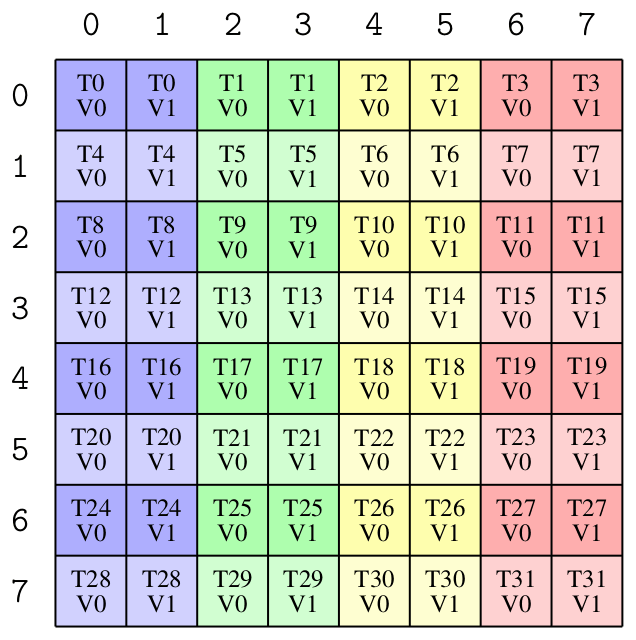

*图 6（原文 Figure 6，第 25 页）：Ampere FP64 Tensor Core 要求的 $8\times8$ C 矩阵的线程-值（thread-value）划分。*

**图中文字翻译与读法**：$8\times8$ 的网格，行、列号 0–7；每个格子里写着“`T?`（线程号）”与“`V?`（该线程内的第几个值）”。每个线程持有 2 个值：同一行里相邻两列属于同一个线程。例如第 0 行：列 0、1 属于 T0（V0、V1），列 2、3 属于 T1，列 4、5 属于 T2，列 6、7 属于 T3；第 1 行从 T4 开始；共 32 个线程 T0–T31，$32\times2=64$ 个元素。

这个线程-值模式可以用 layout 表示（原文）：

$$
\text{ThrValLayoutC}:\ ((4,8),2):((16,1),8),
$$

它是一个从 `(thread_idx, value_idx)` 到 $8\times8$ 矩阵内一维坐标的映射。线程号 $t=t_0+4t_1$（shape $(4,8)$：$t_0\in[0,4)$ 的步长是 16，$t_1\in[0,8)$ 的步长是 1），值号 $v\in\{0,1\}$ 的步长是 8；一维坐标 $x=16t_0+t_1+8v$，对 $8\times8$ 列主序矩阵来说，行 $=x\bmod8=t_1$，列 $=\lfloor x/8\rfloor=2t_0+v$。（本文验算：T0 在 $(0,0),(0,1)$，T1 在 $(0,2),(0,3)$，T4 在 $(1,0),(1,1)$，T31 在 $(7,6),(7,7)$，与图 6 一致。）原文特别指出：**图 6 画的实际是它的逆**，因为图显示的是从矩阵内二维坐标到 `(thread_idx, value_idx)` 的映射，便于人阅读。`ThrValLayoutC` 被视为 Ampere Tensor Core 指令的**静态元数据**，是指令与硬件功能固有的，在 CuTe 之前只在 ISA 文档里以图 6 这样的图片描述。

**任何 $8\times8$ 的数据 layout 都可以通过与 `ThrValLayoutC` 复合来重新排列**。每个复合产生一个与 shape $(32,2)$ 相容的 layout，定义 `(thread_idx, value_idx)` 到数据偏移的映射。

**表 4：数据 layout 与 TV layout 复合的例子**（TV layout 均为 $((4,8),2):((16,1),8)$）

| 数据名称 | 数据 layout $8\times8$（$A$） | 复合结果 $32\times2$（$R=A\circ B$） |
|---|---|---|
| ColMajor | $(8,8):(1,8)$ | $((4,8),2):((16,1),8)$ |
| RowMajor | $(8,8):(8,1)$ | $((4,8),2):((2,8),1)$ |
| Padded | $(8,8):(1,9)$ | $((4,8),2):((18,1),9)$ |
| ColInterleaved | $((4,2),(2,4)):((2,16),(1,8))$ | $((4,(4,2)),2):((8,(2,16)),1)$ |
| Swizzled | $(8,8):(f_1,f_9)$ | $((4,8),2):((f_{18},f_1),f_9)$ |
| Coordinate | $(8,8):(e_0,e_1)$ | $((4,8),2):((2e_1,e_0),e_1)$ |

（原文表 4，第 25 页，逐格核对；原表还有一列“TV layout $32\times2$（$B$）”，六行都是 $((4,8),2):((16,1),8)$，已并入表题。）

**本文验算**：用程序对前四行做 $A\circ B$，结果与上表完全一致，并逐点验证了 $R(i)=A(B(i))$；Swizzled 与 Coordinate 两行按 XOR 与坐标语义逐点验证也一致。**读法例子**：RowMajor 一行里，线程 T5（$t_0=1,t_1=1$）的值偏移是 $2\cdot1+8\cdot1+v=10+v$，即 10 与 11；在行主序 $8\times8$ 数组里就是第 1 行第 2、3 列，与图 6 里 T5 的位置一致。

原文给出一个常见的使用模式：

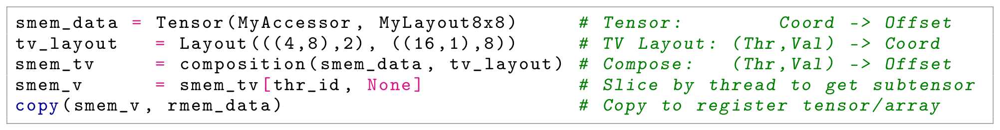

*原文 3.3.4 节的代码（第 25 页）：用 thread-value 模式划分数据并拷贝到寄存器。*

**读法**：`smem_data` 是共享内存里的数据 tensor（坐标到偏移）；`tv_layout` 是 `(Thr, Val)` 到坐标的 TV layout；`composition(smem_data, tv_layout)` 得到 `(Thr, Val)` 到偏移的 tensor；`smem_tv[thr_id, None]` 按线程号切片，得到该线程所有值构成的子 tensor（`None` 表示该位置不指定）；最后 `copy` 到寄存器 tensor 或数组。这种模式在 SIMD 编程里极为常见：每个处理单元拿到父数据的一个对称划分。原文的一般结论：**任意的划分都可以定义为 composition（置换与重塑）再加 slicing**。这种“先复合、再切片”的模式把**划分模式**（`ThrValLayoutC`）与**切出的数据片**（按 `thr_id` 切片）分开。划分模式往往是编译期元数据（与指令或优化参数有关），切片则往往是运行时的程序标识下标，所以这个模式能更好地传播静态信息、减少运行时开销。

#### 6.3.5 逐 mode 复合与 Tiler（原文 3.3.5 节，图 7）

group composition 可以逐 mode 应用，用于对 layout 的子定义域操作。例如常常需要对矩阵的行与列独立地做复合。用式 (12) 的组合子，把 $\star$ 取成复合 $\circ$，就能对一个 layout 的独立子 layout 各做各的复合。式 (12) 里的 layout 元组叫 **Tiler**：

**定义 3.1**：**Tiler** 是一个 $\text{HTuple}(\text{Tile})$，其中每个 Tile 是一个 layout $S:D$，或者一个整数 $S$（等价地看作 layout $S:1$）。

这意味着：所有 layout 都是 tiler，所有整数都是 tiler，shape 如 $(4,8)$ 也可以当 tiler 用。

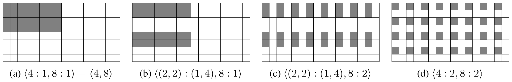

*图 7（原文 Figure 7，第 26 页）：几个 tiler $T$ 的例子，它们通过 $L\circ T$ 从任意 $8\times16$ 的 layout $L$ 中提取一个 $4\times8$ 的子 layout（灰格是被取出的元素）。*

**图中文字翻译与读法**：每个子图是 $8\times16$ 的格子（8 行、16 列），灰色是 tiler 选中的 $4\times8$ 个元素，tiler 用元组 $\langle\text{行 tile},\ \text{列 tile}\rangle$ 表示：

- **(a)** $\langle4:1,8:1\rangle\equiv\langle4,8\rangle$：取前 4 行、前 8 列，即左上角一个连续的 $4\times8$ 块；
- **(b)** $\langle(2,2):(1,4),\ 8:1\rangle$：行取 $\{0,1,4,5\}$（两组各 2 行、间隔 4），列取前 8 列；
- **(c)** $\langle(2,2):(1,4),\ 8:2\rangle$：行取 $\{0,1,4,5\}$，列取每隔一列（$0,2,\dots,14$）；
- **(d)** $\langle4:2,\ 8:2\rangle$：行取每隔一行（$0,2,4,6$），列取每隔一列。

**读图结论**：（原文）例如 tiler $\langle4:1,8:1\rangle$ 提取每列的前 4 个元素和每行的前 8 个元素，得到与 shape $(4,8)$ 相容的子 layout。此外，tiler 的复合与坐标 layout 的复合等价：对 $L=(M,N):(X,Y)$ 与 tiler $T=\langle T_0,T_1\rangle$，

$$
L\circ T\equiv L\circ\big((M,N):(e_0,e_1)\big)\circ T,
$$

即 $(M,N):(e_0,e_1)\circ T$ 对 $L$ 的作用与 $T$ 相同；这里 $(M,N):(e_0,e_1)$ 是把二维自然坐标映射到二维坐标的恒等 layout。这一表述强化了“shape 可以看作从坐标到自然坐标的映射”这一观点；于是在复合里，下面这些对象应被视为等价：

$$
(4,8)\equiv\langle4,8\rangle\equiv(4:1,\ 8:1)\equiv(4,8):(e_0,e_1).
$$

## 七、逆、补与由它们构造的运算

### 7.1 右逆（原文 3.4.1 节，表 5）

layout 可能是单射、满射或双射，因此有右逆、左逆、全逆与拟逆。把 layout 看成从坐标到偏移的函数，逆 layout 就是从偏移到坐标的函数；逆 layout 对判断某个偏移在 layout 的什么位置、取出一组特定偏移、求两个 layout 的公共子 layout 都很有用。

**右（伪）逆**：layout $L:\mathbb{Z}_{\lvert L\rvert}\to\mathcal{D}$ 的右伪逆是一个**单射** layout $L^{\ddagger}:\mathcal{D}_{L^{\ddagger}}\to\mathbb{Z}_{\lvert L\rvert}$，满足（式 (24)）

$$
\forall k\in\mathcal{D}_{L^{\ddagger}}:\quad L^{\ddagger}\big(L(L^{\ddagger}(k))\big)=L^{\ddagger}(k).
$$

这个一般定义在 $L$ 有一般 integer-semimodule codomain $\mathcal{D}$ 时用来确定 $L^{\ddagger}$ 的性质。常见情形 $\mathcal{D}=\mathbb{Z}$，恢复了通常的右逆定义：

$$
\forall k\in\mathbb{Z}_{\lvert L^{\ddagger}\rvert}:\quad L\big(L^{\ddagger}(k)\big)=k;
$$

对更一般的 codomain 如 $\mathcal{D}=\mathbb{Z}^{(\ast,\ast)}$，由 (24) 可知 $\mathcal{D}\lesssim L^{\ddagger}$：右逆的定义域粗化 $L$ 的 codomain 的轮廓，这样它才能接受 $L$ 产生的偏移。若 $L$ 有右逆，则 $\lvert L^{\ddagger}\rvert\le\lvert L\rvert$；平常说“右逆”指**尺寸最大**的那个。当 $L$ 在 $\mathbb{Z}_{\lvert L\rvert}$ 上是双射时，右逆也就是**逆** $L^{-1}$，满足 $L(L^{-1}(k))=k=L^{-1}(L(k))$；有全逆的 layout 称为 **compact（紧致）**。

**表 5：layout 右逆的例子**（对图 3、图 4 里各 layout 的最大尺寸右逆，加上几个补充例子）

| $L$ | $L^{\ddagger}$ | 评注 |
|---|---|---|
| $(4,8):(1,4)$ | $32:1$ | |
| $(4,8):(8,1)$ | $(8,4):(4,1)$ | |
| $(3,7,5):(5,15,1)$ | $(5,21):(21,1)$ | 非 2 的幂的大小与步长没有问题 |
| $(4,8):(1,5)$ | $4:1$ | 对 image 不连续的 layout，结果更小 |
| $(4,(4,2)):(4,(1,16))$ | $(4,4,2):(4,1,16)$ | 结果的定义域与 codomain $\mathbb{Z}$ 结构一致 |
| $((2,2),(4,2)):((1,8),(2,16))$ | $(2,4,2,2):(1,4,2,16)$ | |
| $((2,2),(2,4)):((0,1),(0,2))$ | $(2,4):(2,8)$ | stride 为 0 的 mode 不起作用 |
| $((2,2),(2,4)):((0,2),(0,4))$ | $1:0$ | 平凡的右逆 |
| $(4,8):(e_0,e_1)$ | $(4,8):(1,4)$ | 结果的定义域与 codomain $\mathbb{Z}^{(\ast,\ast)}$ 结构一致 |
| $(4,(4,2)):(e_1,(e_0,6e_1))$ | $(4,4):(4,1)$ | 结果更小，且定义域相容 |
| $(4,(4,3)):(f_1,(f_5,f_{16}))$ | $(4,4,3):(f_1,f_5,f_{16})$ | 对 integer-module stride 也可以定义 |

（原文表 5，第 27 页，逐格核对。）

**本文验算**：对表中全部整数行验证 $L(L^{\ddagger}(k))=k$ 对 $k<\lvert L^{\ddagger}\rvert$ 成立；并验证了“最大”的含义，如 $(4,8):(1,5)$ 的 image 里连续的前缀只有 $\{0,1,2,3\}$（4 不在 image 里，下一个元素是 5），所以右逆大小只能是 4；$((2,2),(2,4)):((0,2),(0,4))$ 的 image 只含偶数，连续前缀只有 $\{0\}$，右逆是 $1:0$。原文指出：$(4,8):(1,4)$ 与 $(4,8):(8,1)$ 的右逆分别是 $32:1$ 与 $(8,4):(4,1)$，大小都是 32，说明它们索引 32 个连续的物理元素。

### 7.2 应用：用右逆发现可向量化的公共子向量（原文 3.4.2 节，图 8）

COPY 里一种常见模式叫 **vectorizing-copy**：尝试找出两个 tensor 之间一次最多能拷贝多少个元素。右逆能让 CuTe 确定两个 layout 的**最大公共子 layout**；再结合硬件能力和指针、步长的物理对齐，就能用代数方式确定可安全向量化的元素数量及位置。

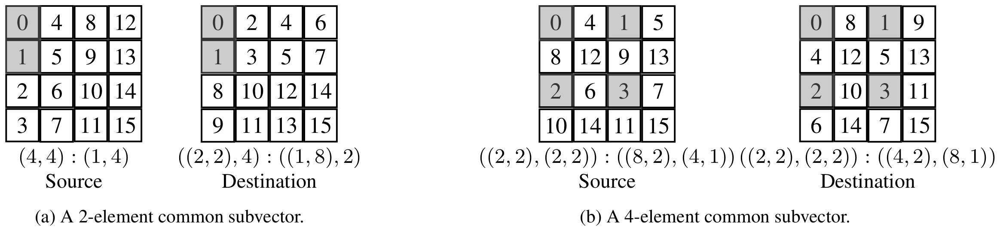

*图 8（原文 Figure 8，第 27 页）：两个 layout 之间公共子向量的例子（灰格是源与目的在同一偏移处对应同一逻辑元素的那些元素）。*

**图中文字翻译与读法**：每个子图左边是 Source（源）、右边是 Destination（目的），格子里是偏移。

- **(a) 2 元素公共子向量**：源 $(4,4):(1,4)$（列主序，偏移 $0..15$），目的 $((2,2),4):((1,8),2)$。灰格是偏移 0、1：在源与目的里，逻辑坐标 $c=0,1$ 对应的偏移都是 0、1，所以拷贝宽度可以扩展到每条指令 2 个元素（前提是访问器、数据类型与对齐允许）。
- **(b) 4 元素公共子向量**：源 $((2,2),(2,2)):((8,2),(4,1))$，目的 $((2,2),(2,2)):((4,2),(8,1))$。灰格是偏移 0、1、2、3：源与目的里这四个偏移对应的逻辑坐标相同，$c=\{0,2,8,10\}$，所以拷贝宽度可以扩展到每条指令 4 个元素。

**一般方法**：对 layout $A:\mathbb{Z}(A)\to\mathbb{Z}_{\alpha}$ 与 $B:\mathbb{Z}(B)\to\mathbb{Z}_{\beta}$，$\lvert A\rvert=\lvert B\rvert$，要找最大的整数 $K$ 使两者的坐标匹配：$\forall k\in\mathbb{Z}_K:\ A^{\ddagger}(k)=B^{\ddagger}(k)$。这等价于找 $K$ 使

$$
\forall k\in\mathbb{Z}_K:\quad k=A\big(B^{\ddagger}(k)\big)=(A\circ B^{\ddagger})(k)\quad\text{或}\quad k=B\big(A^{\ddagger}(k)\big)=(B\circ A^{\ddagger})(k),
$$

也就是 $A\circ B^{\ddagger}=(I_K,X)$ 或 $B\circ A^{\ddagger}=(I_K,Y)$ 里**恒等部分**（stride 为 1 的 mode）的大小。这些互相连续元素的整数坐标由（式 (25)）

$$
A^{\ddagger}\circ B\circ\lfloor A^{\ddagger}\rfloor_K=A^{\ddagger}\circ I_K=\lfloor A^{\ddagger}\rfloor_K:\mathbb{Z}_K\to\mathbb{Z}_{\lvert A\rvert},\qquad B^{\ddagger}\circ A\circ\lfloor B^{\ddagger}\rfloor_K=B^{\ddagger}\circ I_K=\lfloor B^{\ddagger}\rfloor_K:\mathbb{Z}_K\to\mathbb{Z}_{\lvert B\rvert}
$$

给出，其中 $\lfloor\cdot\rfloor_K$ 表示“截断到大小 $K$”。这个 layout 给出数据中**前 $K$ 个物理元素的逻辑坐标**，可通过 logical divide 或 zipped divide（见本文 7.7 节）把公共子向量从源与目的里取出。

**本文代入图 8(a)**：目的 $B=((2,2),4):((1,8),2)$ 的右逆为 $B^{\ddagger}=(2,4,2):(1,4,2)$（本文推得，并验证 $B(B^{\ddagger}(k))=k$），$B^{\ddagger}(0..3)=0,1,4,5$；源是 $A=(4,4):(1,4)$，$A^{\ddagger}=16:1$，$A^{\ddagger}(0..3)=0,1,2,3$。两者在 $k=0,1$ 相等，在 $k=2$ 开始分叉（4 对 2），所以 $K=2$。

**结论**：把 COPY 参考实现里的迭代顺序按式 (25) 对应的 layout 做一致置换（等价于对源和目的的 layout 施加同样的置换，不改变可观察行为），所有连续元素就被置换到第一个 mode，供向量化指令专门处理；这个过程不仅能检测要向量化的元素是否存在和在哪里，还能给出可以安全向量化的最大元素数。这提供了 **AutoVectorization**（自动向量化）优化的框架。

### 7.3 左逆（原文 3.4.3 节，表 6）

**左（伪）逆**：layout $L:\mathbb{Z}_{\lvert L\rvert}\to\mathcal{D}$ 的左伪逆是 layout $L^{\dagger}:\mathcal{D}_{L^{\dagger}}\to\mathbb{Z}_{\lvert L\rvert}$，满足（式 (26)）

$$
\forall k\in\mathbb{Z}_{\lvert L\rvert}:\quad L\big(L^{\dagger}(L(k))\big)=L(k).
$$

左逆**不一定唯一**，对不在 $L$ 的 image 里的输入可以取任何值。当 $L$ 是单射时，恢复通常的左逆定义 $\forall k:\ L^{\dagger}(L(k))=k$。

**表 6：layout 左逆的例子**

| $L$ | $L^{\dagger}$ | 评注 |
|---|---|---|
| $(4,8):(1,4)$ | $32:1$ | |
| $(4,8):(8,1)$ | $(8,4):(4,1)$ | 对 image 连续的 layout，与右逆相同 |
| $(3,7,5):(5,15,1)$ | $(5,21):(21,1)$ | 非 2 的幂的大小与步长没有问题 |
| $(4,8):(1,5)$ | $(5,8):(1,4)$ | 对 image 不连续的 layout，结果更大 |
| $(4,(4,2)):(4,(1,16))$ | $(4,4,2):(4,1,16)$ | 结果的定义域与 codomain $\mathbb{Z}$ 结构一致 |
| $((2,2),(4,2)):((1,8),(2,16))$ | $(2,4,2,2):(1,4,2,16)$ | |
| $((2,2),(2,4)):((0,2),(0,4))$ | $(2,2,4):(0,2,8)$ | 结果不唯一，mode 0 的 stride 可以任取 |
| $((2,2),(2,4)):((0,1),(0,2))$ | $(2,4):(2,8)$ | |
| $(4,8):(e_0,e_1)$ | $(4,8):(1,4)$ | 结果的定义域与 codomain $\mathbb{Z}^{(\ast,\ast)}$ 结构一致 |
| $(4,(4,2)):(e_1,(e_0,6e_1))$ | $(4,(6,2)):(4,(1,16))$ | 结果更大，且定义域相容 |
| $(4,(4,3)):(f_1,(f_5,f_{16}))$ | $(4,4,3):(f_1,f_5,f_{16})$ | 对 integer-module stride 也可以定义 |

（原文表 6，第 28 页，逐格核对。）**本文验算**：整数行都满足 $L(L^{\dagger}(L(k)))=L(k)$；单射的行还满足 $L^{\dagger}(L(k))=k$；两个含 stride 0 的行不是单射，只满足前者。读法（本文）：$(4,8):(1,5)$ 的 image 是 $\{5j+c\mid0\le c\le3\}$，左逆 $(5,8):(1,4)$ 把偏移 $k=c+5j$ 映射回 $c+4j$，即原来的整数坐标，所以结果比右逆“大”：定义域覆盖了 image 中非连续的部分。

### 7.4 应用：用左逆做“可接受性”检查（原文 3.4.4 节，图 9）

左逆可用来判断某个数据 layout 产生的偏移里是否包含特定偏移、以及在哪里。例子：向 Blackwell 的“tensor memory”（TMEM）读写数据的指令只访问 TMEM 里一组**预先规定的特定偏移**。

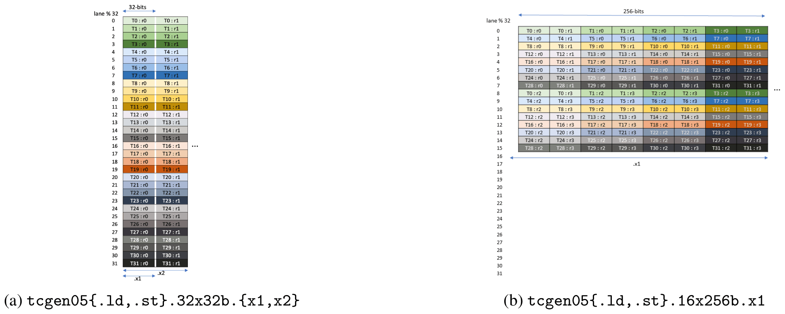

*图 9（原文 Figure 9，第 29 页）：TMEM 加载与存储指令访问特定偏移，并把数据分给线程本地的寄存器（图取自 PTX ISA 文档 [29]）。*

**图中文字翻译与读法**：纵轴是 lane（`lane % 32`，一个 warp 的 32 条 lane），横轴是 TMEM 的 32 位“列”；每格形如 `T?:r?`，表示第几个线程的第几个寄存器。

- **(a) `tcgen05{.ld,.st}.32x32b.{x1,x2}`**：32 个线程各占一条 lane，T0 在第 0 行、T1 在第 1 行……；`.x1` 取每行第一个 32 位列（寄存器 `r0`），`.x2` 取前两个 32 位列（`r0`、`r1`）。
- **(b) `tcgen05{.ld,.st}.16x256b.x1`**：只用 16 条 lane、每行 256 位（8 个 32 位列）：第 0 行从左到右依次是 `T0:r0 T0:r1 T1:r0 T1:r1 T2:r0 T2:r1 T3:r0 T3:r1`，第 1 行是 T4–T7，……，第 7 行是 T28–T31；第 8–15 行重复这些线程但寄存器换成 `r2`、`r3`。右侧的省略号表示图案向右继续。

原文补充：图里是一个 warp 的访问图案，但每条指令实际用 **4 个 warp**，图案每隔 32 条 lane 重复 4 次。物理 TMEM 地址是最多 512“列”（col）与 128“行”（lane）的二维网格：沿着 32 位的 col 方向走，地址加 1；沿着 lane 方向走，地址加 16384。据此，每条指令访问的全部物理偏移可以用 layout 记录：

| 指令 | $(\text{InstrCOL},\text{InstrLANE})\to\text{TMEM 偏移}$ |
|---|---|
| `tcgen05{.ld,.st}.32x32b.x1` | $(1,128):(1,16384)$ |
| `tcgen05{.ld,.st}.32x32b.x2` | $(2,128):(1,16384)$ |
| `tcgen05{.ld,.st}.16x256b.x1` | $(8,(16,4)):(1,(16384,\ 32\cdot16384))$ |

读法（本文）：第一行是 1 列、128 条 lane（4 个 warp $\times$ 32），列方向步长 1、lane 方向步长 16384；第三行 8 列，lane 部分是 $(16,4)$：每个 warp 的 32 条 lane 里取前 16 条（步长 16384），4 个 warp 之间相隔 32 条 lane（步长 $32\cdot16384$）。这些 layout 是指令专有的，可用来确切知道每条指令会访问 TMEM 的哪些偏移。

注意：尽管 TMEM 是二维寻址，并被用作形状 $(M,N)$ 的 MMA 的累加器，TMEM 的 lane 与 col **并不总对应逻辑矩阵的行与列**；与任何寻址一样，物理偏移可以经任意 CuTe layout 折叠成任意 shape。因此，给定一个数据 layout 与一条 TMEM 指令，需要确定：

1. 数据 layout 是否包含该指令要访问的**所有**偏移；
2. 这些偏移在数据 layout 的逻辑坐标里**位于何处**。

一般地，设数据 layout $A:\mathbb{Z}(A)\to\mathbb{Z}_{\alpha}$ 把逻辑坐标映射到数据偏移，指令 layout $T:\mathbb{Z}(T)\to\mathbb{Z}_{\beta}$ 把指令坐标映射到数据偏移，要确定的是

$$
\forall i\in\mathbb{Z}_{\lvert T\rvert},\ \exists c\in\mathbb{Z}(A)\ \text{使得}\ T(i)=A(c),
$$

可以高效地通过计算 $A$ 的左逆并检查下式来完成：

$$
A\big(A^{\dagger}(T(i))\big)=T(i).
$$

即：所有偏移 $T(i)$ 都在 $A^{\dagger}$ 的定义域里；所有坐标 $A^{\dagger}(T(i))$ 都**互不相同**并且在 $A$ 的定义域里。满足这两条，就可以说每个偏移 $T(i)$ 都出现在 $A$ 的 image 里，位于坐标 $A^{\dagger}(T(i))$。layout $A^{\dagger}\circ T$ 把指令坐标映射成逻辑数据坐标，例如通过 `zipped_divide` 就可以把数据 layout $A$ 划分成与指令所访问偏移相对应的子 layout。

### 7.5 补（Complement，原文 3.5 节，表 7）

layout $L:\mathbb{Z}(L)\to\mathcal{D}$ 的**补**是满足下列条件的 layout $L^{*}:\mathbb{Z}(L^{*})\to\mathcal{D}$：

- **与 codomain 弱一致**（式 (27)）：$\mathcal{D}\lesssim L^{*}$；
- **image 不相交**（式 (28)）：$\forall b\in\mathbb{Z}(L),\ \forall a\in\mathbb{Z}^{L^{*}}\setminus\{0\},\ L(b)\ne L^{*}(a)$；
- **image 有序**（式 (29)）：$\forall a\in\mathbb{Z}_{\lvert L^{*}\rvert}\setminus\{0\},\ L^{*}(a-1)<L^{*}(a)$。

补是一个**生成 codomain 里、但不在原 layout 的 image 里的元素**的 layout。在 composition 里，layout $L$ 常被当作进入另一个 layout 的间接索引，所以补 $L^{*}$ 就是指向 $L$ 所遗漏元素的 layout。补让通过 logical divide 拆分 layout、通过 logical product 重复与扩展 layout 成为可能。这里只关心 codomain 是 $\text{HTuple}(\mathbb{Z})$（整数或坐标）的 layout。(28) 里对原 layout 取有限定义域 $\mathbb{Z}(L)$，对补取无限的扩展定义域 $\mathbb{Z}^{L^{*}}$，这保证补的 shape 不论被截断还是被扩展（比如与右边的 layout 复合），生成的值都与 $L$ 的互不相同；(29) 建立补的唯一性。

**表 7：layout 补的例子**

| $L$ | $L^{*}$ | 评注 |
|---|---|---|
| $(4,8):(1,4)$ | $1:32$ | 对所有 $i\in\mathbb{Z}^{+}$，$L^{*}(i)>\max_jL(j)$ |
| $(4,8):(8,1)$ | $1:32$ | 输入的顺序不重要 |
| $(4,(4,2)):(4,(1,16))$ | $1:32$ | 输入的层次不重要 |
| $(4,8):(1,5)$ | $1:40$ | |
| $(4,8):(1,8)$ | $(2,1):(4,64)$ | 仍然不相交，但“填补”了 codomain 里的空洞 |
| $((2,2),(2,4)):((0,1),(0,2))$ | $1:8$ | stride 为 0 的 mode 不起作用 |
| $((2,2),(2,4)):((0,2),(0,4))$ | $(2,1):(1,16)$ | |
| $(4,8):(e_0,e_1)$ | $(1,1):(4e_0,8e_1)$ | 结果的定义域与 codomain $\mathbb{Z}^{(\ast,\ast)}$ 结构一致 |
| $(4,(4,2)):(e_1,(e_0,12e_1))$ | $(1,(3,1)):(4e_0,(4e_1,24e_1))$ | 弱一致、不相交且有序 |

（原文表 7，第 30 页，逐格核对。）**读法（本文）**：

- $(4,8):(1,4)$ 的 image 是 $0..31$，补是 $1:32$：从 32 开始，每隔 32 一个，与原 layout 的 image 不相交并有序。
- $(4,8):(1,8)$ 的 image 是 $\{0..3\}+8j$（$j<8$），共 32 个，最大偏移 59；补 $(2,1):(4,64)$ 依次生成 $0,4,64,68,128,132,\dots$（第二个 mode 大小为 1，是为了在越过 64 之后继续生成下一个块的起点）。除 $a=0$ 外，这些值都不在 $L$ 的 image 里，而且正好是平移 $L$ 的副本时互不重叠的起点：$L$ 平移 4 后补上每组里的空洞 $\{4..7\}$，$L$ 与平移 4 的副本一起不重不漏地覆盖 $0..63$，再平移 64、68 就覆盖 $64..127$（本文验算）。这就是表中“填补空洞”的含义：补列出的是副本的起点，而不是 image 之外的每一个元素。
- 对 $(4,8):(1,5)$，原文给出 $1:40$，其中 40 恰是最后一个 mode 的 $\text{size}\times\text{stride}=8\times5$。本文验算：$L$ 的 image 最大是 38；按所列三条条件，$1:d$ 在 $d=24,29,34$ 以及所有 $d\ge39$ 时都满足（不相交、有序），所以条件 (28)(29) 单独并不能像原文所说“建立唯一性”；表中的 $1:40$ 隐含了“取最后一个 mode 的 size 乘 stride 作为下一块起点”之类的约定，原文没有明说。

**本文验算**：对表 7 里全部整数行，用程序检查了补与 $L$ 的 image 不相交（在扩展定义域的 $a=1..59$ 上）且有序，并确认了上述填补空洞的覆盖性质。

### 7.6 应用一：逻辑积（Logical Product，原文 3.5.1 节，图 10、图 11）

两个 layout $A$ 与 $B$ 的**逻辑积**是这样一个 layout $R$：“$B$ 的每个元素都被替换成 $A$ 的一个唯一平移的版本”。具体定义为一个 rank-2 layout：

$$
A\otimes B=(A,\ A^{*}\circ B),
$$

其中 $A^{*}$ 是 $A$ 的补。结果的**第一个 mode 恰是输入的 layout $A$**，第二个 mode 与输入 layout $B$ 在 shape 与元素顺序上相容。第一个 mode（即 $A$）通常叫 **tile（块）**，在“网格（grid）”layout $B$ 上被重复。

**例 1**：把行主序 layout $(3,4):(4,1)$ 的 tile 在列主序 layout $(2,5):(1,2)$ 的 grid 上重复。$1:12$ 是 $(3,4):(4,1)$ 的补，所以

$$
\frac{(3,4)}{(4,1)}\otimes\frac{(2,5)}{(1,2)}=\Big(\frac{(3,4)}{(4,1)},\ \frac{1}{12}\circ\frac{(2,5)}{(1,2)}\Big)=\frac{((3,4),(2,5))}{((4,1),(12,24))}.
$$

结果第一个 mode 里是原来的 tile，第二个 mode 以 $2\times5$ 的列主序把这个 tile 唯一地重复了 10 次（本文：第 $(i,j)$ 个副本的偏移平移 $12i+24j$）。

**例 2**：把 layout $(4,8):(20,2)$ 的 tile 在行主序 layout $(3,2):(2,1)$ 的 grid 上重复。$(4,8):(20,2)$ 的补是 $(2,1):(1,80)$，所以

$$
\frac{(4,8)}{(20,2)}\otimes\frac{(3,2)}{(2,1)}=\Big(\frac{(4,8)}{(20,2)},\ \frac{(2,1)}{(1,80)}\circ\frac{(3,2)}{(2,1)}\Big)=\frac{((4,8),(3,2))}{((20,2),(80,1))}.
$$

这里 grid 把各个 tile **交错**起来，使结果的 codomain 最小：补告诉结果怎样给 $B$ 加步长，$B$ 告诉结果怎样给补排序和定形。（本文验算：例 1、例 2 的结果与程序一致；例 2 里 $(4,8):(20,2)$ 的 image 都是偶数，所以补 $(2,1):(1,80)$ 的第一个 mode 用偏移 1 把另一份 tile 放在奇数位置上。）

**相关的积**：逻辑积对 $A$ 与 $B$ 的 rank 和相容性没有限制，生成 rank-2 layout。更直观的版本是 `blocked_product`，它用输入的 rank 来构造结果的 shape，要求 $\text{rank}(A)=\text{rank}(B)$，然后做 **zip**，把逻辑的行 mode 与行 mode 合并，列 mode 与列 mode 合并。例如把上例的各 mode 重新排列：

$$
\frac{((3,4),(2,5))}{((4,1),(12,24))}\ \Longrightarrow\ \frac{((3,2),(4,5))}{((4,12),(1,24))},
$$

得到一个 $6\times20$ 的 layout。

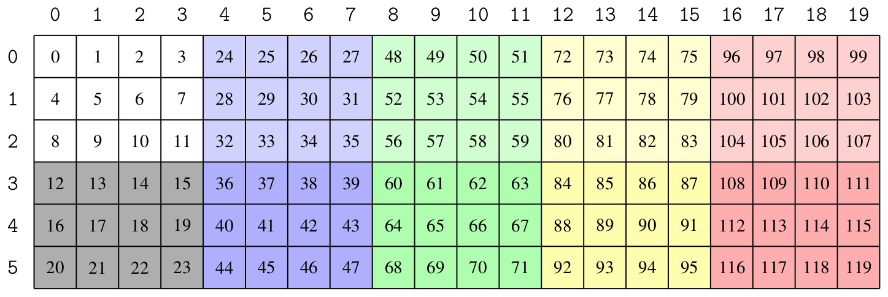

*图 10（原文 Figure 10，第 31 页）：行主序 $(3,4):(4,1)$ 的 tile 与列主序 $(2,5):(1,2)$ 的 tiling 的 blocked_product（每个 $3\times4$ 的 tile 用一种颜色标出）。*

**图中文字翻译与读法**：$6\times20$ 矩阵，格子里是偏移；每个 $3\times4$ 的色块是原 tile 的一份平移拷贝，共 $2\times5=10$ 块（行方向 2 块，列方向 5 块）。第 0 行是 `0 1 2 3 | 24 25 26 27 | 48 49 50 51 | 72 73 74 75 | 96 97 98 99`；第 3 行起（行方向的第二块）是 `12 13 14 15 | 36 37 38 39 | …`。块内是原行主序 tile（偏移 $4a+b$），块的位置平移 $12i+24j$。之所以叫“blocked”，是因为结果里每个 $3\times4$ 块恰好是原 tile 的一份平移版本（本文验算：用 $((3,2),(4,5)):((4,12),(1,24))$ 算出的整个 $6\times20$ 矩阵，与图中每个数字完全一致）。

`raked_product` 类似于 blocked，只是 mode 反过来 zip：

$$
\frac{((3,4),(2,5))}{((4,1),(12,24))}\ \Longrightarrow\ \frac{((2,3),(5,4))}{((12,4),(24,1))},
$$

结果是把 $3\times4$ 的 tile “**耙**”在 $2\times5$ 的 tile 之上，而不是“分块”。

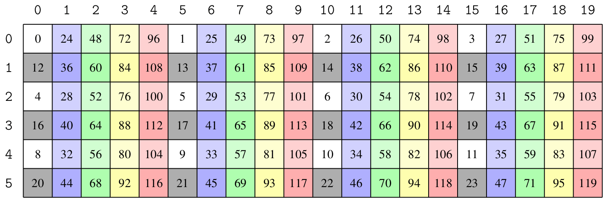

*图 11（原文 Figure 11，第 31 页）：行主序 $(3,4):(4,1)$ 的 tile 与列主序 $(2,5):(1,2)$ 的 tiling 的 raked_product（每个 $3\times4$ 的 tile 用一种颜色标出）。*

**图中文字翻译与读法**：同样是 $6\times20$ 矩阵、10 份 tile，但同一份 tile 的元素不再相邻，而是**交错分布**：行下标 $m=(m_0,m_1)$（$m_0\in[0,2)$ 选 tile 所在的行块，$m_1\in[0,3)$ 是 tile 内的行），列下标 $n=(n_0,n_1)$（$n_0\in[0,5)$ 选 tile 所在的列块，$n_1\in[0,4)$ 是 tile 内的列）。例如第 0 行是 `0 24 48 72 96 | 1 25 49 73 97 | 2 26 …`：相邻 5 列依次属于 5 个不同的 tile，同一个 tile 的相邻列相隔 5。（本文验算：用 $((2,3),(5,4)):((12,4),(24,1))$ 算出的整个矩阵与图完全一致。）

**读图结论**：blocked 与 raked 的差别就是 tile 的元素在结果里是“聚在一起”还是“间隔散开”；在 GPU 里，后者对应把一份线程-值 tile 以交错的方式覆盖在更大的数据块上（本文的联想，原文只说 “other versions of logical product can be produced that additionally group and rearrange modes”）。

### 7.7 应用二：逻辑除（Logical Divide，原文 3.5.2 节，图 12）

两个 layout $A$ 与 $B$ 的**逻辑除**是这样一个 layout $R$：“layout $A$ 被一分为二：被 $B$ 指向的元素，以及没被 $B$ 指向的元素”。具体定义为一个 rank-2 layout：

$$
A\oslash B=A\circ\big(B,\ B^{*}_{\lvert A\rvert}\big)=A\circ B^{\star},
$$

其中 $B^{*}_{\lvert A\rvert}$ 是 $B$ 相对于 $A$ 的大小取的补。因为这个运算意在**保留 $A$ 的所有元素**，只是把 $A$ 一分为二，要求 $B^{\star}=(B,B^{*}_{\lvert A\rvert})$ 满射到 $\mathbb{Z}_{\lvert A\rvert}$，这常常需要扩展 $B^{*}$ 的大小使 $\lvert B^{\star}\rvert\ge\lvert A\rvert$。并且要求补 $B^{*}$ 把 $B$“补全”，使 $B^{\star}$ 有一个自反的广义逆 $B^{+}$，满足（式 (30)、(31)）

$$
B^{\star}B^{+}B^{\star}=B^{\star},\qquad B^{+}B^{\star}B^{+}=B^{+}.
$$

类似逻辑积，结果的第一个 mode $A\circ B$ 常叫 **tile**，在“grid”（或 tiling）layout $A\circ B^{*}_{\lvert A\rvert}$ 上重复；参数 $B$ 叫 **tiler**，可以像本文 6.3.5 节那样不限于 layout。

**例（原文）**：先用 composition 取每第三个元素：

$$
\frac{24}{3}\circ\frac{8}{3}=\frac{8}{9},\qquad\frac{(6,2,2)}{(2,1,20)}\circ\frac{8}{3}=\frac{(2,2,2)}{(6,1,20)}.
$$

两例都是 24 个元素的 layout 与 $8:3$ 复合，得到每隔三个取一个的 layout。但左边 layout 里**其余**的元素呢？逻辑除把左边的 layout 分成两块：被右边“击中”的与“其余”的：

$$
\frac{24}{3}\oslash\frac{8}{3}=\frac{24}{3}\circ\frac{(8,3)}{(3,1)}=\frac{(8,3)}{(9,3)},\qquad
\frac{(6,2,2)}{(2,1,20)}\oslash\frac{8}{3}=\frac{(6,2,2)}{(2,1,20)}\circ\frac{(8,3)}{(3,1)}=\frac{((2,2,2),3)}{((6,1,20),2)},
$$

其中 $3:1$ 是 $8:3$ 在大小 24 下的补。结果的第一个 mode 再次是所要求的每隔三个取一个的元素；第二个 mode 是这样的“tile”在原 layout 里共有多少个（这里是 3）以及它们之间的步长。补被用来确定缺失了哪些元素以及按什么顺序保留。（本文代入第一个：$24:3$ 的偏移是 $0,3,\dots,69$；tile 0 取逻辑位置 $0,3,\dots,21$，偏移 $0,9,\dots,63$；tile 1 取逻辑位置 $1,4,\dots$，偏移 $3,12,\dots$；tile 2 偏移 $6,15,\dots$；三个 tile 恰好不重不漏地覆盖这 24 个元素，与 $(8,3):(9,3)$ 一致。本文验算了两个例子。）

**逐 mode 的 divide**：同样可以逐 mode 应用（记号与上面一致）：

$$
A\oslash\langle B,C\rangle=(A_0,A_1)\oslash\langle B,C\rangle=(A_0\oslash B,\ A_1\oslash C).
$$

直观：能对行和列独立地做这些运算，再把得到的 mode 重新排列，构造新的 layout，就像各种 layout 的积一样。回到本文 6.3.5 节的那些 tiler，用逻辑除代替复合，得到“被 tiler 指向的 $4\times8$ 子 layout 构成的 $2\times2$ layout”。

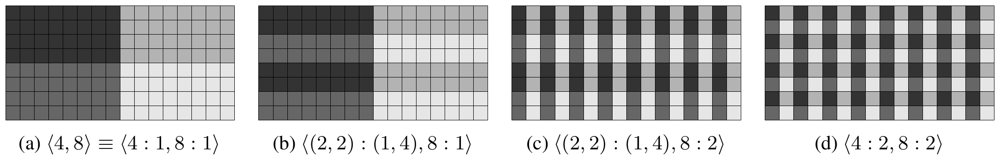

*图 12（原文 Figure 12，第 32 页）：把 $8\times16$ 的 layout 切成 $4\times8$ 的 tile、共 $2\times2$ 个 tile 的 tiler 例子。*

**图中文字翻译与读法**：四个子图使用与图 7 **同样的** tiler——(a) $\langle4,8\rangle\equiv\langle4:1,8:1\rangle$，(b) $\langle(2,2):(1,4),8:1\rangle$，(c) $\langle(2,2):(1,4),8:2\rangle$，(d) $\langle4:2,8:2\rangle$——但这次不仅标出被选中的 tile，还把其余部分分成另外三个同样大小的 $4\times8$ tile，共 4 个 tile，用 4 种灰度区分。最深色是 tiler 选中的 tile（与图 7 的灰色区域相同），其余三种灰度是 tile 的另外三个副本；可以想象有一个 $2\times2$ 的 layout，映射到各个有色的 tile。

**读图结论**：逻辑除把整个 $8\times16$ 的 layout 完整地分割成 4 个 tile，没有遗漏元素，而复合只取出其中一个。

**例（原文）**：对 layout $(8,16):(20,1)$，想提取一个“tile”：每列取连续 4 个元素、每行取每隔一个元素。逐 mode 逻辑除（tiler 为 $\langle4:1,\ 8:2\rangle$）：

$$
\frac{(8,16)}{(20,1)}\oslash\Big\langle\frac{4}{1},\frac{8}{2}\Big\rangle=\frac{(8,16)}{(20,1)}\circ\Big\langle\frac{(4,2)}{(1,4)},\frac{(8,2)}{(2,1)}\Big\rangle=\frac{((4,2),(8,2))}{((20,80),(2,1))},
$$

结果仍是 $8\times16$，但 tiler 所指的元素已被置换到最前面的 $4\times8$ 块。（本文验算：行 mode $8:20\circ(4,2):(1,4)=(4,2):(20,80)$，列 mode $16:1\circ(8,2):(2,1)=(8,2):(2,1)$。）

**`zipped_divide`** 是逐 mode 的逻辑除，再把相同类别的 mode 合并（zip）起来：

$$
\frac{((4,8),(2,2))}{((20,2),(80,1))}.
$$

它产生一个“tile”mode（恰是 tiler 所指向的子 layout，$(4,8):(20,2)$）和一个“rest”mode（遍历各个 tile 的子 layout，$(2,2):(80,1)$）。`zipped_divide` 总是返回 rank 2 的结果，其中第一个 mode 恰是与 tiler 的复合，第二个 mode 是与补的复合。

软件里一个很常见的模式是：把数据 layout 切成 tile 的网格，再给每个处理单元选一个 tile。在 PyCuTe 里写作：

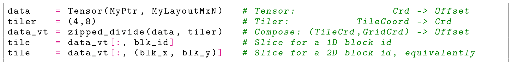

*原文 3.5.2 节的代码（第 33 页）：用 `zipped_divide` 把数据切成 tile 网格，再按 block 号切片。*

**读法**：`data` 是 `坐标→偏移` 的 tensor；`tiler = (4,8)` 是 `TileCoord→Crd` 的 tiler；`zipped_divide(data, tiler)` 得到 `(TileCrd, GridCrd)→Offset` 的 tensor；`data_vt[:, blk_id]` 对一维 block 号切片，`data_vt[:, (blk_x, blk_y)]` 对二维 block 号切片（等价），取出该 block 对应的 tile。原文指出：这个模式与本文 6.3.4 节的 thread-value 划分非常相似，区别是这里**只指定了 tile 这个 mode**，缺少的“Grid”mode 由 tiler 的补自动计算；“补全”后的 tiler 以 $(\text{Tile},\text{Grid})$ 的形状与数据复合，得到 tile 网格，再用 block 号对第二个 mode 切片，取出某个处理单元负责的 tile。其他版本的 logical divide 还可以对 mode 做进一步的分组与重排，得到更方便的结果。

## 八、原文结论与论文自述的证据（第 4 节）

原文结论（要点）：

- CuTe 是一个表示与操纵张量 layout 的数学框架，用于应对现代 GPU 架构日益增加的复杂性。
- 层次化 layout 表示提供了书写与管理专用张量指令所需复杂数据布局与分块模式的通用方法；丰富的代数运算提供了操纵并生成新 layout 的原则性方法；两者合在一起带来：支持复杂 layout 与分块、关注点分离、静态分析与优化。
- 它在若干关键应用里很有表达力：用 GEMM 的实例表示 GETT 与 CONV，促进代码复用与算法一致性；让矩阵不论具体数据 layout 都可以用 $(m,n)$ 坐标索引，使通用算法保持与具体 layout 正交，而需要特定 layout 的算法或指令可以静态地检查、验证并推理它们的 tensor 参数。
- layout 代数使**静态分析与变换**成为可能：推导 COPY 的最大向量化机会、校验 MMA 与 COPY 指令的输入输出 layout、推导最优的共享内存 layout 并带有避免 bank conflict 的 swizzle 模式（原文列出的能力）。这把 layout 管理从易错的手工过程变成系统化、可验证的方法。为支持研究和验证，提供了纯 Python 参考实现 PyCuTe。
- 实际影响：已成功用于生产系统，最突出的是作为 CUTLASS v3 与 v4 的基础。“CUTLASS 与 FlashAttention 等应用的性能评估表明，CuTe 的抽象**不引入性能开销**，同时显著加快软件开发”；框架的采用验证了它的双重承诺：保持手工优化代码的性能特征，同时大幅降低开发复杂度与时间。
- 展望：数学基础与代数方法使它成为适应未来架构创新的可持续框架。

**本文对证据的评估**：

- 本文自己**没有任何性能数据**；关于“无性能开销”“显著加快软件开发”的说法，论文只是引用 CUTLASS 与 FlashAttention 的使用经验，没有给出可检验的数据。
- 唯一的量化对比是代码量：CUTLASS v2 约 300 个单独实现的 layout、87 个文件、约 55,000 行，对比 CuTe 核心约 3,000 行（作者自述）。
- 结论里列出的“推导最优共享内存 layout 并带 swizzle”，正文只给出了二进制 swizzle 作为 layout 的表示例子（图 4(c)、表 4 的 Swizzled 行），并没有给出推导算法。

## 九、局限、证据边界与常见误读

**局限与证据边界**：

1. **没有实验**，是表示与数学规范；对 Linear Layouts、Triton 的比较只是定性的，“unacceptable to many applications”是作者的判断。
2. **运算不处处有定义**：composition 要满足步长整除与形状整除两个条件（本文 6.3.2 节），否则没有结果；这是特性也是限制。本文补充：这两个条件是充分条件而非必要条件。
3. **算法没有给出**：论文给出了 inverse、complement、logical product 与 divide 的**定义、性质与例子**，没有写出构造它们的算法，也没有分析复杂度和编译期成本；实现可参考 PyCuTe 与 CUTLASS。
4. **补的唯一性**：条件 (27)–(29) 本身不足以唯一确定补（如 $(4,8):(1,5)$ 的 $1:40$，而 $1:24$、$1:39$ 也满足三条条件），表中的取值还依赖未写明的实现约定（本文 7.5 节的验算）。
5. **一般 semimodule 上的运算**主要靠例子说明（表 5–7 的最后几行），很多性质（如 $\mathcal{D}$ 不是整数时的复合、补）论文只简略说明。
6. **主要面向整数与 $\mathbb{F}_2$ stride**；其他半模的使用论文只作了提示（如组合时“需要特别小心，可能还需要额外限制”）。
7. **论文自身的小瑕疵**见第十节。
8. 学习与使用成本、跨厂商可移植性不在论文讨论范围，论文面向 NVIDIA/CUDA 生态（这一点来自论文用到的指令与库，而不是论文的明确陈述）。

**常见误读**：

- **“CuTe 是一种新的 tensor 存储格式”**：不是。它首先是映射与表示，同一块物理存储可以被不同 CuTe layout 解释（图 1）。
- **“layout 一定是置换（单射）”**：不是。stride 为 0 的 mode 表示广播（图 3(f)），layout 可以多对一；这时右逆可能只有平凡解（如图 3(f) 的 $1:0$），左逆也不唯一（表 5、表 6）。
- **“Layout 代数会在运行时做很多数学”**：论文的目标是借助静态信息在编译期化简（COPY 一节说 shape 已知时不会生成动态坐标变换）；最终 kernel 里只应保留必要的下标与指令。运行时是否真的零开销取决于编译器与具体实现，论文没有给出数据。
- **“composition 总是存在”**：不是，见整除条件；CuTe layout 对 composition 不封闭。
- **“coalesce 保持 layout 的所有信息”**：不是，它只保证整数坐标上的函数不变，会丢掉 rank 与层次信息、改变坐标集。
- **“complement 把 codomain 里所有空洞都填满”**：不是。补给出的是一串在 $L$ 的 image 之外、递增的偏移，在 logical product 与 logical divide 里被当作平移 $L$ 副本的起点；它并不枚举 image 之外的每一个元素（见本文 7.5 节 $(4,8):(1,8)$ 的例子）。
- **“这篇论文证明 CuTe DSL 比 Triton 快”**：没有。它论述的是 CuTe 抽象，性能要看具体 kernel、GPU 与编译器版本的实现证据，例如 [PyTorch CuTeDSL 报告](../cutedsl_torchinductor/论文中文解读.md)。

## 十、本文验算记录与原文瑕疵

以下为本文对照 PDF 与独立程序验算后发现的问题，原文没有说明，引用时需谨慎：

| 位置 | 问题 |
|---|---|
| 原文图 3(e) | 格子 $(0,7)$ 与 $(1,6)$ 的 21、22 与 layout 公式 $((2,2),(4,2)):((1,8),(2,16))$ 不符，公式给出 22、21（其余 30 格与公式一致，正文的 $L(22)=26$ 也与公式一致） |
| 原文 2.5.1 节代码 | 切片示例里最后一行用了变量 `thr_tile_data`，而上一行定义的是 `tiled_data`，疑为笔误 |
| 原文 3.3.2 节 | 末位下标与结果 layout 都记作 $R$，且 $S'_r=S_r/\delta_r$ 在 $\delta_r\ge S_r$ 时应理解为上取整 |
| 原文 3.5 节（表 7） | $(4,8):(1,5)$ 的补 $1:40$ 之外，$1:24$、$1:29$、$1:34$、$1:39$ 等也满足所列三条条件，与原文“条件 (29) 建立唯一性”的说法不符 |
| 原文 3.3.3 节 | 整除条件是充分而非必要条件（本文给出反例 $(2,2):(1,3)\circ2:3=2:4$） |
| 原文第 4 节与摘要 | “推导最优共享内存 layout 并带 swizzle”“无性能开销”在正文没有算法或数据支持 |

## 十一、复现与学习路线

**复现检查**（本文做法，可直接照做）：

- 用 PyCuTe 或自己写的暴力实现，对每个例子检查 $R(i)=A(B(i))$ 对所有整数坐标 $i$ 成立；
- 对 composition 的结果检查两件事：大小等于 $B$ 的大小，且逐点等于 $A(B(i))$；对违反整除条件的情形，确认公式拒绝而不是给出错误结果；
- 对 inverse 检查 $L(L^{\ddagger}(k))=k$（右逆）与 $L(L^{\dagger}(L(k)))=L(k)$（左逆）；
- 对 complement 检查 $L$ 的 image 与 $L^{*}$ 的取值（扩展定义域）不相交且 $L^{*}$ 有序；
- 对 swizzle 类的半模 layout，明确 $f_i$ 的加法是 XOR、标量乘法是整数乘法，再逐点验算。

**学习顺序**（读者向的建议，不是论文的结论）：

1. shape、coordinate、stride，以及 colex 的 `idx2crd`、`crd2idx`；
2. layout 求值（图 3、图 4）；
3. composition 与 coalesce（先看 rank 1 的 $A$，再看整除条件）；
4. tensor 与 slice（图 5）；
5. COPY 与 GEMM 的通用实现（表 2、表 3）；
6. 右逆、左逆、补；
7. logical product 与 logical divide；
8. 最后再去读 MMA、TMA、TMEM 相关的指令 layout 与 FlashAttention 的 CuTe 代码。

直接从复杂的 CuTe 代码反推概念，通常会被嵌套元组与 mode 记号淹没。

## 十二、与相关论文的关系

| 维度 | CuTe（本篇） | Triton 与 Linear Layouts | 依据 |
|---|---|---|---|
| layout 的数学基础 | 层次化 shape 与 stride；stride 可以取整数、坐标或 $\mathbb{F}_2$ 元素 | Linear Layouts 基于 $\mathbb{F}_2$ 线性代数 | 原文 1.1 节、表 1 |
| 非 2 的幂的 shape | 原文表 5、表 6 里有 $(3,7,5)$ 这样的 shape | 原文称 Linear Layouts 限于 2 的幂的 shape 与 stride（这是作者的评价，没有对比实验） | 原文 1.1 节、表 5 |
| 程序员面对的抽象 | 显式写出 layout 与 thread-value 模式，再用代数变换与检查 | Triton 的编程模型是 tile 级 SPMD，线程分工与共享内存使用由编译器决定 | 原文 3.3.4 节；[Triton 中文解读](../triton_compiler/论文中文解读.md) |

- [Linear Layouts 中文解读](../linear_layouts/论文中文解读.md)：Triton 编译器里基于 $\mathbb{F}_2$ 线性映射的 layout 表示；按本篇原文 1.1 节的说法，它可以表示成带 $\mathbb{F}_2$ stride 的 CuTe layout，本篇表 1 第三行给出这类 layout 的矩阵形式。
- [Triton 中文解读](../triton_compiler/论文中文解读.md)、[TileLang 中文解读](../tilelang/论文中文解读.md)、[Hidet 中文解读](../hidet/论文中文解读.md)：同为 GPU kernel 的抽象。TileLang 的 `Layout` 与 `Fragment`、Hidet 的 task mapping 也要回答“哪个线程处理哪块数据、数据怎样排布”；CuTe 的特点是把这类映射写成可复合、可求逆的代数对象（这是本文的对比，不是 CuTe 论文自己的论断）。
- [CuTeDSL 与 TorchInductor 中文解读](../cutedsl_torchinductor/论文中文解读.md)：以 CuTe 抽象为基础的 DSL 的具体工程使用。
- [FlashAttention 中文解读](../flash_attention/论文中文解读.md)：本篇原文称 FlashAttention 各代的实现都以 CuTe 为核心组件。
- 整体脉络见 [AI 编译器与运行时演进索引](../AI编译器与运行时演进索引.md)。

## 原文证据导航

- [原论文 PDF](paper.pdf)（官方页面：[arXiv:2603.02298](https://arxiv.org/abs/2603.02298)）
- [原文提取文本](paper.txt)
- [论文概要](论文概要.md)
