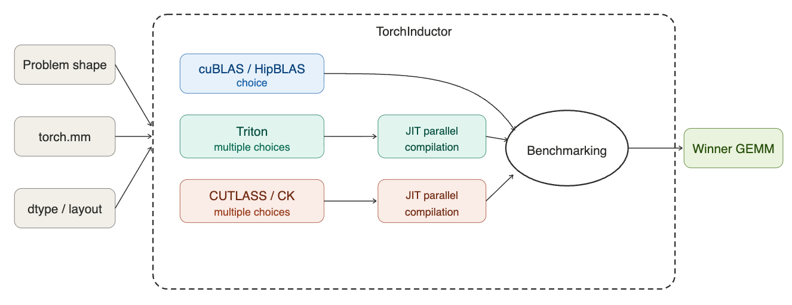
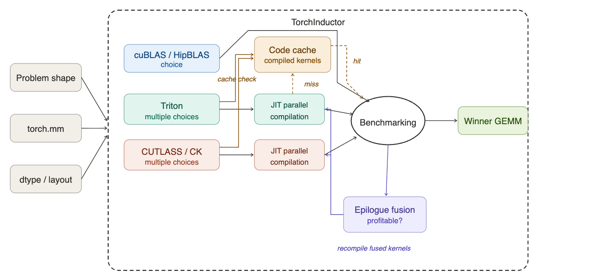
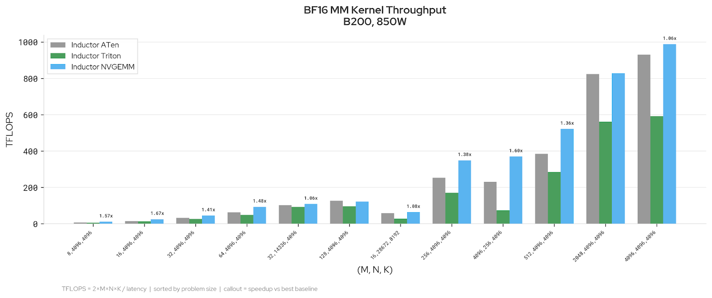
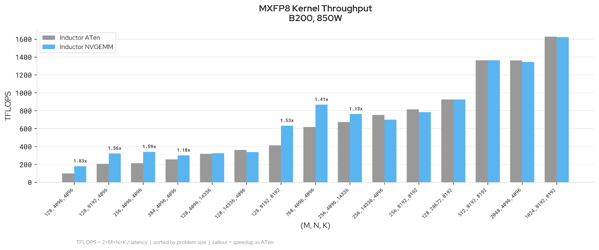
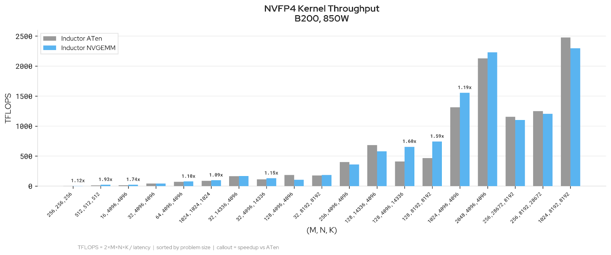
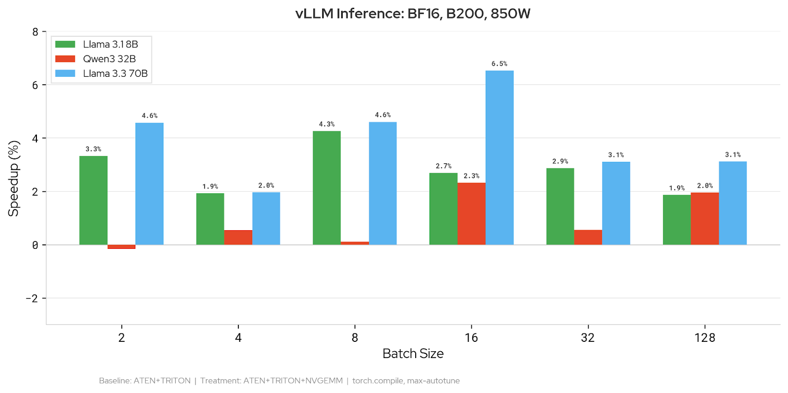
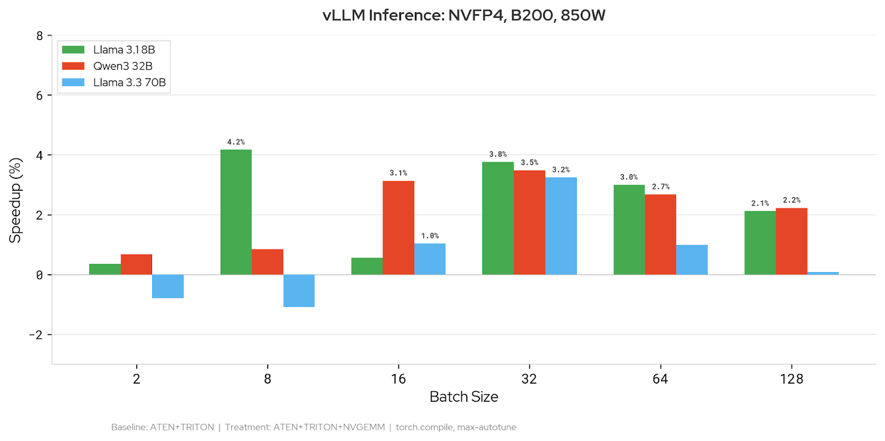

# 论文中文解读：《Generating State-of-the-Art GEMMs with TorchInductor’s CuteDSL backend》

> **基本信息**：Nikhil Patel、Michael Lazos、Driss Guessous、Elias Ellison（Meta），PyTorch 官方工程博客，2026 年 4 月 7 日发布（页面元数据显示 4 月 13 日有修改）；原文 [官方页面](https://pytorch.org/blog/gemms-torchinductor-cutedsl-backend/)。这是官方工程博客，不是同行评审论文，没有页码，也没有图表编号。
>
> **本文的读法**：`paper.pdf` 只是网页文字的 5 页打印件，不含图片，所以本文的图取自 `source.html` 里引用的博客原图（pytorch.org 上的 PNG），表是逐格核对后的中文转录。博客共 10 张插图，其中 3 张是表格截图（编译时间、softmax 基准、支持特性），本文转录成表 1–表 3；其余 7 张作为图 1–图 7 放入。图号、表号都是本文按出现顺序自编的。从图上读出的数值一律写“约”，并说明是读图所得；正文里明确写出的数字优先使用原文数字。博客里有几处“正文数字”和“图上标注”不一致，本文在对应位置逐条指出。

## 一、一句话结论

TorchInductor 为矩阵乘法（GEMM）新增了第四个 autotuning 后端 NVGEMM，底层用 NVIDIA 的 CuteDSL（Python 写的 CUTLASS 风格 kernel DSL，经 MLIR 编译）。它不替代 Triton，也不替代 cuBLAS：Triton 继续负责 pointwise/reduction 等访存受限算子，CuteDSL 只对 GEMM、低精度 GEMM（MXFP8、NVFP4）以及将来的 epilogue fusion 提供额外候选。候选 kernel 来自 NVIDIA 维护的 `cutlass_api`，先用解析性能模型 `nvMatmulHeuristics` 把数百个配置筛到默认 5 个，再和 ATen、Triton 候选一起在目标 GPU 上实测，赢者进入缓存；没赢或不支持就自动回退。在单张 B200（850 W）上，kernel 级别最高约 1.7–1.9 倍（见第七节对图文差异的说明），vLLM 端到端 BF16 最多降低 6.5% 延迟，NVFP4 单模型最多约 3.3%–4.2%。

## 二、背景知识：读这篇博客需要先懂什么

### 2.1 GEMM 的形状与 TFLOPS

GEMM 是 $C=AB$，其中 $A$ 为 $M\times K$、$B$ 为 $K\times N$、$C$ 为 $M\times N$。博客所有 kernel 图都用 $(M,N,K)$ 标注形状，吞吐按 $\mathrm{TFLOPS}=2MNK/\text{latency}$ 计算（图脚注原文）。在 LLM 推理里：

- **decode（逐 token 生成）**：每个序列每步只处理一个 token，线性层的 $M$ 约等于同时解码的序列数，所以 $M$ 很小（本博客用 8–64、2–128 等）；权重矩阵（$N\times K$ 很大）要整块读入，但每个权重元素只参与很少的乘加，算术强度低，对 kernel 的数据搬运流水线（TMA、shared memory 多级缓冲、cluster 等）特别敏感。
- **prefill（处理整段提示词）**：$M$ 是提示词 token 总数，可达数百到数千，GEMM 很大，更接近 compute-bound，成熟库（cuBLAS）已经接近峰值。
- 图中常见的 $N,K$ 取值 4096、8192、14336、28672 对应 Llama 系列 8B/70B 模型的隐藏维度与 FFN 维度（这是解读者的背景补充，博客只称“LLM-relevant GEMM shapes”）。

### 2.2 autotuning

GPU GEMM kernel 有大量设计选择：tile 大小、warp specialization、MMA 指令形状、是否使用异步访存（Hopper 与 Blackwell 上的 TMA）等。博客指出 `torch.compile` 是 JIT 编译器，在运行时能看到模型实际的问题形状，因此可以对每个形状自动挑选最优配置，这个过程叫 autotuning（把“针对具体 workload 调 kernel”自动化）。

### 2.3 epilogue fusion

GEMM 的 epilogue 是矩阵乘累加完成后对输出 tile 做的后处理（加 bias、激活、逐元素运算、写回等）。epilogue fusion 把紧跟在 GEMM 之后的 pointwise 算子并进 GEMM kernel 的收尾阶段，省掉一次写回再读出的 pointwise kernel。TorchInductor 在调度阶段判断这种融合是否划算。

### 2.4 名词对照

| 名词 | 在本博客中的含义 |
|---|---|
| ATen | PyTorch 自带算子路径；GEMM 上对应 cuBLAS（图 1 中的 cuBLAS / HipBLAS choice，图 3–5 中的 Inductor ATen 基线；这一对应是解读者整理） |
| Triton 后端 | Inductor 自己维护的 Triton GEMM 模板，参数（tile、warp 数等）不同的多个候选 |
| CUTLASS（C++）后端 | 用 CUTLASS C++ 模板生成候选，每个变体都要一次完整的 nvcc 编译；通过 Epilogue Visitor Tree（EVT）支持 epilogue fusion |
| CuteDSL / CuTe DSL | NVIDIA 的 Python DSL，与 CUTLASS C++ 同一套抽象（tile 代数、内存层次原语、epilogue 融合模型），由定制的 Python→MLIR 编译器编译 |
| NVGEMM | Inductor 里 CuteDSL 后端的名字，用 `max_autotune_gemm_backends` 里的 `NVGEMM` 开启 |
| `cutlass_api` | NVIDIA 维护的 Python 库，包含全部 CuTeDSL GEMM kernel 配置（tile 形状、cluster 大小、调度参数） |
| `nvMatmulHeuristics` | NVIDIA 的解析性能模型，按估计硬件吞吐给配置打分 |
| MultiTemplate buffer | Inductor 里为 Triton 实现 epilogue fusion 的机制：携带 top N 候选进入调度阶段，把“选哪个 kernel”推迟到融合之后 |

## 三、TorchInductor 现有的 GEMM autotuning 流程

### 3.1 基本流水线（图 1）



*图 1（博客第 3 张插图）：TorchInductor 对一个 `torch.mm` 的候选生成、编译、benchmark 与选优。*

**图中文字翻译与读法**：

- **左侧三个输入框**：Problem shape（问题形状）、`torch.mm`（算子）、dtype / layout（数据类型与布局），汇入虚线大框 TorchInductor。
- **虚线框内三条候选来源**：蓝色 cuBLAS / HipBLAS choice（库实现，一个选择，不需要编译）；绿色 Triton multiple choices（多个 Triton 模板候选）→ JIT parallel compilation（JIT 并行编译）；红色 CUTLASS / CK multiple choices（CUTLASS，或 AMD 的 CK 库，多个候选）→ JIT parallel compilation。
- **椭圆 Benchmarking（基准测试）**：三路候选都汇入这里，选出右侧绿色框 Winner GEMM（胜出的 GEMM kernel）。

**读图结论**：这是博客称作“Triton autotuning 系统”的基础流程。博客正文的文字说明：编译器在 lowering 时遇到矩阵乘，先问每个已启用的后端是否支持该形状、布局、数据类型，不支持的后端被过滤；对每个符合条件的后端，从它的模板库生成候选 kernel（候选在 tile 大小、warp 配置等后端相关参数上不同），全部在目标硬件上 benchmark，选最快的。选中的 kernel 及其编译产物写入 TorchInductor 的缓存，下次遇到同样的问题配置可以完全跳过 benchmark；缓存分两层：kernel 级（编译好的代码）和选择级（某个问题规模与后端集合下哪个候选赢了）。

### 3.2 epilogue fusion 与缓存（图 2）



*图 2（博客第 4 张插图）：在图 1 基础上加入代码缓存和 epilogue fusion 的判断。*

**图中文字翻译与读法**：

- 输入、三条候选来源、Benchmarking、Winner GEMM 与图 1 相同；新增的是：
- **Code cache / compiled kernels（代码缓存，已编译的 kernel）**（棕色）：Triton 与 CUTLASS 候选先做 cache check（缓存检查）；命中（hit，虚线）则直接进入 Benchmarking，未命中（miss）才走 JIT parallel compilation。
- **Epilogue fusion / profitable?（epilogue 融合是否有收益？）**（紫色）：Benchmarking 之后判断把后续 pointwise 算子并进 GEMM 是否划算；若要尝试，则 recompile fused kernels（重新编译融合后的 kernel），回到编译与 benchmark 环节比较。

**读图结论**：博客说明这一步在 Triton 上是通过 MultiTemplate buffer 实现的：lowering 阶段得到的 top N 个 GEMM 候选一路带到调度阶段，在那里 benchmark 各种可能的融合，比较“融合后的 kernel”与“未融合的 GEMM 加一个单独的 pointwise kernel”，最终的 kernel 选择推迟到所有融合 pass 完成之后。CUTLASS C++ 后端通过 Epilogue Visitor Tree（EVT）也支持 epilogue fusion，但每个变体都要 nvcc 编译，限制了实际能评估的配置数量；这个编译时间约束正是引入 CuteDSL 的主要动机之一。

**重要边界**：博客明确写道，**CuteDSL 后端目前不支持 epilogue fusion**，这项工作列在 Future Work 里。因此下文所有性能结果都只是“单个 GEMM kernel”的结果，不含融合收益。

## 四、动机：为什么引入 CuteDSL，又为什么只做 GEMM

### 4.1 引入新后端的三条标准

博客说，Triton、Helion、Gluon、CuTile、CuteDSL 这些 kernel DSL 各自占据“抽象程度—性能”权衡上的不同位置。是否把一个新后端接入 TorchInductor，Inductor 团队用三条标准：

1. 不给团队带来很大的维护负担，或者厂商有长期承诺的投入；
2. 相对已有后端，不增加编译时间或 benchmark 时间；
3. 在目标 workload 上带来更好的性能。

博客称 CuteDSL 三条都满足：NVIDIA 正在积极开发 CuteDSL 并提供优化过的 kernel 模板，限制了维护负担；编译时间与其他后端持平，相比需要完整 nvcc 调用的 CUTLASS C++ 路径有显著改善。

### 4.2 编译时间对比（表 1）

表 1 是博客第 1 张插图（一张表格截图）的转录。设置：单个 kernel、冷编译（cold compile）、GB200。“相对 CuTe DSL”一列是该编译器耗时除以 CuTe DSL 耗时。

| 编译器 | 时间（秒） | 相对 CuTe DSL |
|---|---:|---|
| CuTe DSL | 0.29 | 1.0x |
| Triton JIT | 0.74 | 2.6x slower（慢 2.6 倍） |
| nvcc（vec_add） | 2.90 | 10x slower |
| nvcc（CUTLASS 3.x GEMM，sm90 WGMMA） | 13.25 | 46x slower |
| nvcc（CUTLASS 4.x GEMM，sm100 UMMA） | 14.41 | 50x slower |

（博客第 1 张插图，标题 Compile time comparison。）读法：同样是“一个 kernel 的冷编译”，nvcc 编译 CUTLASS GEMM 要 13–14 秒，而 CuTe DSL 只要不到 0.3 秒，相差约 50 倍，这使得 autotuning 时可以实际 benchmark 大量候选，也使“在调度阶段 benchmark epilogue fusion”变得可行。需要注意的限制：表里没有说明 CuTe DSL 与 Triton JIT 这两行编译的是哪个 kernel，与 nvcc 的对比也不是同一个 kernel（有一行是简单的 vec_add），所以这张表只能作为数量级证据；而且博客正文说的是“与其他后端持平”，表中 CuTe DSL 的数字其实比 Triton JIT 还小。

### 4.3 pointwise 与 reduction 为什么留给 Triton（表 2）

博客的论点：对于访存受限算子（逐元素运算、激活、归约），Triton 的 block 级编程模型只需要向量化访存就够，Triton 与手写 kernel 的差距很小；CuteDSL 虽然也能表达 pointwise 与 reduction，但它是低层语言，自动从零生成 CuteDSL kernel 很复杂。实践中两种 DSL 生成的 kernel 性能相当，多出来的复杂度换不来收益。作者用 softmax 做了验证：在逐步增大的输入规模上分别跑 Triton 与 CuteDSL 的 softmax kernel，两者都逼近 GB200 的终端带宽。

表 2：softmax kernel 基准，Triton 对 CuTe DSL，FP16，GB200。“Size”为输入方阵边长，N 为元素总数，时间单位 µs（越小越好），“加速比 = Triton / CuTe DSL”，小于 1.0 表示 Triton 更快。

| Size | N | Triton（µs） | CuTe DSL（µs） | BW（GB/s） | 加速比 |
|---|---:|---:|---:|---:|---:|
| 3096² | 9.6M | 18.63 | 18.57 | ~6.2K | 1.00x |
| 4096² | 16.8M | 30.16 | 30.64 | ~6.6K | 0.98x |
| 6144² | 37.7M | 66.28 | 67.64 | ~6.8K | 0.98x |
| 8192² | 67.1M | 115.21 | 116.29 | ~7.0K | 0.99x |
| 10240² | 104.9M | 177.63 | 178.73 | ~7.1K | 0.99x |
| 12288² | 151.0M | 253.94 | 255.10 | ~7.1K | 1.00x |
| 16384² | 268.4M | 447.87 | 450.15 | ~7.2K | 0.99x |

（博客第 2 张插图，标题 Softmax kernel benchmark；表中第一行 3096² 按原图照录，其 N=9.6M 与 3096² 相符。）读法：七个规模上两种实现的耗时差都在 1% 到 2% 以内，Triton 略快；这就是博客“不值得为 pointwise 引入 CuteDSL”的证据。BW 一列的计算口径博客没有说明：若只按 FP16 一读一写（每元素 4 字节）折算，数值只有约 2 TB/s，与表中的 6–7 TB/s 不符，所以这一列只能作为“两者都在同一量级且随规模趋于饱和”的定性参考，不宜当作已核实的带宽占峰值比例。这是一个只有 7 个点、单一算子的小实验，不能外推到其他 memory-bound 算子。

### 4.4 GEMM 为什么不同

博客的论述：矩阵乘法主导 Transformer 模型的算力需求，LLM 前向中 attention 投影、FFN 和输出头里的 GEMM 占了大多数 GPU 周期。要接近峰值利用率，需要对每代新 GPU 引入的硬件特性有精确控制：与 tensor core 流水线匹配的 tile 大小、显式管理 shared memory 分级、warp 级调度，以及 B200 这类新架构上的 thread block cluster 与 distributed shared memory。这些恰恰是高层语言为了易用而抽象掉的部分。

为了简化低层代码的生成，Inductor 不从零生成 kernel，而是从手工优化的模板出发，模板暴露出可调参数，用来适配不同的问题形状。

### 4.5 CuteDSL 的三个具体优势

博客把“为什么选 CuteDSL”归纳为三点：

1. **完整的线程与内存层次暴露**：CuteDSL 提供同步、warp 级控制、thread block cluster 和完整线程/内存层次的原语，可以用到架构专属特性，如 H100 与 B200 上的 distributed shared memory。
2. **编译时间**：CUTLASS C++ 路径每个变体一次完整 nvcc 调用，使 benchmark fusion（调度时评估带不同 epilogue 融合的多个 GEMM 候选）不现实；CuteDSL 的编译速度与其他后端相当，解除了这个限制。
3. **NVIDIA 的优化 GEMM 模板**：NVIDIA 有专门团队开发 CuteDSL，提供 GEMM 与 epilogue fusion 的优化模板，目标是与 CUTLASS C++ 后端性能持平；对未来硬件，CuteDSL 能更早拿到最新硬件的支持，在硬件相关优化上有先发优势。

### 4.6 长期战略

博客还把这件事放在长期战略里：CuteDSL 与 CUTLASS C++ 建立在同一套抽象之上（CUTLASS C++ 在 FP8 GEMM 与 epilogue fusion 上表现很强），但用 Python 写，编译更快，维护更简单。随着 NVIDIA 持续投入，CuteDSL 有望在较新的硬件代际上成为 CUTLASS C++ 集成的最终替代，从而简化 TorchInductor 代码库。作者列举的“利益一致、开源采用增长”的例子是 Tri Dao 的 Quack 库和 Colfax International 的 Jay Shah。

博客对这一节的总结：Triton 已经把 pointwise 处理得很好，所以 CuteDSL 后端的重点放在性能余量最大的地方，即最新硬件上的 GEMM、attention 与 epilogue fusion。注意其中 attention 与 epilogue fusion 在本博客里都还没有结果。

## 五、CuteDSL 后端的架构

### 5.1 三步流程

CuteDSL 后端接在上面的 autotuning 流水线里。Inductor 在 lowering 遇到矩阵乘时，后端分三步：

1. 向 `cutlass_api` 查询与该问题兼容的全部 kernel 配置；
2. 用 `nvMatmulHeuristics` 对它们排序，选出 top 候选；
3. 把这些候选与 ATen、Triton 候选一起，在目标硬件上编译并 benchmark。

下面是解读者根据正文整理的流程示意（不是博客的原始代码）：

```text
输入：形状 (M,N,K)、dtype、布局、scaling 模式、GPU compute capability
1. configs = cutlass_api.query(输入)            # 可能有数百个兼容配置
2. top = nvMatmulHeuristics.rank(configs)[:5]   # 默认 5，nvgemm_max_profiling_configs 可改，None 表示全部
3. 逐个 cute.compile(top)，与 ATen、Triton 候选一起在目标 GPU 上实测
4. 最快者胜出；编译产物缓存在内存，后续调用直接调用已编译函数
   - 若 configs 为空（dtype/布局/硬件不支持）：不产生 NVGEMM 候选，照常用 ATen 与 Triton
   - 若 NVGEMM 候选输掉 benchmark：自动选更快的后端
```

### 5.2 与 Triton、CUTLASS C++ 的两点区别

**区别一：通过 `cutlass_api` 选 kernel。** Triton 后端的候选来自 Inductor 内部维护的模板；CuteDSL 后端则向 `cutlass_api` 查询，这是 NVIDIA 维护的 Python 库，包含 CuTeDSL GEMM kernel 配置的全空间（tile 形状、cluster 大小、调度参数）。Inductor 把问题描述成 shape、dtype、layout、scaling mode 和 GPU compute capability，API 返回所有兼容的 kernel。NVIDIA 新增 kernel 配置或硬件支持时，直接进入 `cutlass_api`，不需要改 Inductor。这个 API 也可扩展：TorchInductor 可以向同一个库注册自己的 kernel 类。作者用这个办法在上游提供之前就加入了 FP4 GEMM 支持（NVFP4、MXF4），这些自己引入（vendored）的 kernel 与 NVIDIA 的 kernel 走同样的“过滤、排序、profile”流水线。

**区别二：用解析模型缩小搜索空间。** 对一个给定问题，`cutlass_api` 可能返回数百个兼容配置，全部 benchmark 代价太高。后端因此接入 `nvMatmulHeuristics`，这是 NVIDIA 的解析性能模型，按估计的硬件吞吐给每个配置打分（考虑 tile 效率、内存带宽、occupancy），把数百个候选压到少数几个（默认 5 个，可用 `nvgemm_max_profiling_configs` 调整）。只有排名靠前的配置才会真正编译并在目标硬件上 benchmark。博客强调，Triton 与 CUTLASS 都没有这样使用解析模型，它们依靠在较小的、模板定义的搜索空间里做 benchmark。

### 5.3 缓存与“纯加法”的含义

autotuning 选出胜出 kernel 之后，编译产物缓存在内存里，后续调用直接调用已编译函数，没有重复编译开销。注意这里说的是“内存中缓存”：磁盘上的持久缓存在 Future Work 里，目前尚未实现。

博客强调 CuteDSL 后端是“纯加法”（purely additive）：

- 问题与 NVGEMM 不兼容（dtype、布局或硬件不支持）时，不产生 NVGEMM 候选，autotune 照常用 ATen 与 Triton；
- 产生了 NVGEMM 候选但输掉 benchmark 时，自动选择更快的后端；
- 因此“开启 NVGEMM 不会造成性能回退”。

这句话的准确边界：它说的是被选中的 steady-state kernel 不会比原来更慢（因为选择靠实测），并不意味着没有成本：首次编译、候选 benchmark、依赖安装与版本约束都是额外开销，见第十节。

## 六、实验设置

博客给出的设置：

- **硬件与软件**：单张 NVIDIA B200 GPU，850 W，动态时钟（dynamic clocking），无张量并行，PyTorch nightly，CUDA 13.1。
- **kernel 级结果**：通过 Inductor autotuning 测量孤立 GEMM 的延迟；对比 Inductor 已有后端，覆盖三种数据类型体系（BF16、MXFP8、NVFP4）和有代表性的 LLM GEMM 形状；图中给出 kernel 吞吐（TFLOPS）。
- **端到端结果**：测量 vLLM V1 的 decode 延迟，模型为 Llama 3.1 8B、Qwen3 32B、Llama 3.3 70B，输入提示词 32 个 token，生成 128 个 token，串行执行（serial execution），每次运行之间清空缓存。
- **batch 维度的处理**：vLLM 的 batch 维度是动态形状，Inductor 在编译时不知道真实 batch size。作者用 `autotune_batch_hint` 指定目标 batch size，使 Inductor 在运行时将要使用的形状上 benchmark 候选，这很重要，因为最优 kernel 配置随形状变化。

## 七、kernel 级结果（图 3、图 4、图 5）

三张图的共同读法：每个形状三根或两根柱，分别是 Inductor ATen、Inductor Triton（仅 BF16 有）与 Inductor NVGEMM 的吞吐；柱子上方的标注是 NVGEMM 的加速比。博客没有逐字说明每根柱是什么，按图意理解为各后端单独的 autotune 结果；因为有不少形状 NVGEMM 柱低于 ATen 柱，所以 NVGEMM 柱不可能是三个后端合在一起选出的胜者。实际使用时由 autotuner 在这些后端里挑胜者，于是这些形状不会回退，只是 NVGEMM 没被选中。形状按 $M\times N\times K$ 由小到大排序（图脚注原文：sorted by problem size）。

**一处必须说明的图文不一致**：博客正文给出的各数据类型最大加速比（BF16 为 1.73×，MXFP8 为 1.78×，NVFP4 为 1.6×）与图中标注的最大值（BF16 为 1.67×，MXFP8 为 1.83×，NVFP4 为 1.74×，另有 512×512×512 的 1.93×）并不一致，博客没有解释原因。下面各节分别给出“正文数字”和“图上标注”，读者引用时应注明出处。

### 7.1 BF16（图 3）



*图 3（博客第 5 张插图）：BF16 GEMM 在 Inductor 三个后端上的吞吐（TFLOPS）。*

**图中文字翻译与读法**：

- **标题 BF16 MM Kernel Throughput, B200, 850W**：BF16 矩阵乘 kernel 吞吐，B200，850 W。
- **纵轴 TFLOPS**（0–1000）；**横轴 (M, N, K)**，共 12 个形状。
- **图例**：灰色 Inductor ATen、绿色 Inductor Triton、蓝色 Inductor NVGEMM。
- **脚注原文**：TFLOPS = 2×M×N×K / latency | sorted by problem size | callout = speedup vs best baseline（标注为相对最佳基线的加速比，BF16 图的基线是 ATen 与 Triton 中较快者）。

博客正文的结论：NVGEMM 改善了 decode 区间的形状（$M=8$ 到 $M=64$，最高 1.73×），以及 (4096, 256, 4096) 这类“又高又瘦”的形状（1.54×）；prefill 规模的形状与基线持平。

下表是逐形状的图上标注与读图所得的近似吞吐。“无标注”表示图上没有写加速比，从柱高看是持平或 NVGEMM 更低（(2048,4096,4096) 的 NVGEMM 柱高约 0.6%，同样没有标注）。近似吞吐的单位是 TFLOPS，按柱顶位置读出，误差约 ±3；前三个形状的柱子太短，无法从图上读数，写“—”。

| (M, N, K) | 图上标注（相对最佳基线） | ATen 约 | Triton 约 | NVGEMM 约 |
|---|---:|---:|---:|---:|
| (8, 4096, 4096) | 1.57× | — | — | — |
| (16, 4096, 4096) | 1.67× | — | — | — |
| (32, 4096, 4096) | 1.41× | — | — | — |
| (64, 4096, 4096) | 1.48× | 60 | 45 | 90 |
| (32, 14336, 4096) | 1.06× | 100 | 90 | 110 |
| (128, 4096, 4096) | 无标注 | 125 | 95 | 120 |
| (16, 28672, 8192) | 1.08× | 55 | 25 | 60 |
| (256, 4096, 4096) | 1.38× | 250 | 170 | 345 |
| (4096, 256, 4096) | 1.60× | 230 | 70 | 370 |
| (512, 4096, 4096) | 1.36× | 385 | 280 | 520 |
| (2048, 4096, 4096) | 无标注 | 820 | 560 | 825 |
| (4096, 4096, 4096) | 1.06× | 930 | 590 | 985 |

（博客第 5 张插图；标注数字为图上文字，近似吞吐为读图所得。）

**读图结论**：

- 收益集中在小 $M$（decode）：$M=8$–64 的图上标注为 1.41×–1.67×，图上最大的是 (16, 4096, 4096) 的 1.67×，正文写的是 1.73×，这个 1.73× 在图上找不到；(4096, 256, 4096) 的图上标注是 1.60×，正文写 1.54×。
- 中等 $M$（256、512）仍有 1.36×–1.38×；到 $M\ge 2048$ 基本持平：(4096, 4096, 4096) 约 985 对 930 TFLOPS，标注 1.06×。
- 在这批 BF16 形状上，Triton 柱几乎总是最低（如 (4096,4096,4096) 约 590 TFLOPS），ATen（cuBLAS）是更强的基线；NVGEMM 的 1.06× 是对着 ATen 取得的。
- (128, 4096, 4096) 与 (2048, 4096, 4096) 上 NVGEMM 与 ATen 基本持平，无加速。

### 7.2 MXFP8（图 4）



*图 4（博客第 6 张插图）：MXFP8 GEMM 在 Inductor ATen 与 NVGEMM 上的吞吐（TFLOPS）。*

**图中文字翻译与读法**：

- **标题 MXFP8 Kernel Throughput, B200, 850W**；纵轴 TFLOPS（0–1600），横轴 (M, N, K)，共 15 个形状。
- **图例**：灰色 Inductor ATen，蓝色 Inductor NVGEMM（没有 Triton 柱）。
- **脚注原文**：TFLOPS = 2×M×N×K / latency | sorted by problem size | callout = speedup vs ATen（标注为相对 ATen 的加速比）。

博客正文的结论：NVGEMM 在中等形状上改善（最高 1.78×），大形状持平；宽 N 的长方形形状（wide-N rectangular）偏向 ATen。

| (M, N, K) | 图上标注（相对 ATen） | ATen 约 | NVGEMM 约 |
|---|---:|---:|---:|
| (128, 4096, 4096) | 1.83× | 95 | 175 |
| (128, 8192, 4096) | 1.56× | 200 | 320 |
| (256, 4096, 4096) | 1.59× | 210 | 340 |
| (384, 4096, 4096) | 1.18× | 250 | 295 |
| (128, 4096, 14336) | 无标注 | 315 | 320 |
| (128, 14336, 4096) | 无标注 | 360 | 335 |
| (128, 8192, 8192) | 1.53× | 410 | 630 |
| (768, 4096, 4096) | 1.41× | 615 | 865 |
| (256, 4096, 14336) | 1.13× | 670 | 760 |
| (256, 14336, 4096) | 无标注 | 750 | 700 |
| (256, 8192, 8192) | 无标注 | 810 | 780 |
| (128, 28672, 8192) | 无标注 | 925 | 925 |
| (512, 8192, 8192) | 无标注 | 1360 | 1360 |
| (2048, 4096, 4096) | 无标注 | 1360 | 1340 |
| (1024, 8192, 8192) | 无标注 | 1625 | 1620 |

（博客第 6 张插图；近似吞吐为读图所得，误差约 ±5 TFLOPS。）

**读图结论**：

- 收益出现在 $M\le 768$、$N$ 与 $K$ 都不太大的形状上：图上标注最高是 (128, 4096, 4096) 的 1.83×，正文写“最高 1.78×”，两者不一致。
- N 很宽（14336）的形状 NVGEMM 反而略低于 ATen（如 (128,14336,4096) 约 335 对 360，(256,14336,4096) 约 700 对 750），与正文“宽 N 偏向 ATen”一致。
- 大形状（$M\ge 512$ 的 8192 方阵类）两者几乎重合，吞吐达到约 1360–1625 TFLOPS，没有收益，也没有回退。

### 7.3 NVFP4（图 5）



*图 5（博客第 7 张插图）：NVFP4 GEMM 在 Inductor ATen 与 NVGEMM 上的吞吐（TFLOPS）。*

**图中文字翻译与读法**：

- **标题 NVFP4 Kernel Throughput, B200, 850W**；纵轴 TFLOPS（0–2500），横轴 (M, N, K)，共 19 个形状，图例与脚注同图 4（灰色 ATen，蓝色 NVGEMM，标注相对 ATen）。

博客正文的结论：NVGEMM 在 decode 规模形状（$M\le256$）上提升吞吐，相对更快的已有后端最高 1.6×；在较大的 $M$（$\ge512$）上 ATen 已经调得很好，各后端收敛。

| (M, N, K) | 图上标注（相对 ATen） | ATen 约 | NVGEMM 约 |
|---|---:|---:|---:|
| (256, 256, 256) | 1.12× | — | — |
| (512, 512, 512) | 1.93× | — | — |
| (16, 4096, 4096) | 1.74× | — | — |
| (32, 4096, 4096) | 无标注 | — | — |
| (64, 4096, 4096) | 1.10× | — | — |
| (1024, 1024, 1024) | 1.09× | — | — |
| (32, 14336, 4096) | 无标注 | 160 | 165 |
| (32, 4096, 14336) | 1.15× | 110 | 125 |
| (128, 4096, 4096) | 无标注 | 180 | 100 |
| (32, 8192, 8192) | 无标注 | 170 | 180 |
| (256, 4096, 4096) | 无标注 | 390 | 360 |
| (128, 14336, 4096) | 无标注 | 680 | 580 |
| (128, 4096, 14336) | 1.60× | 410 | 650 |
| (128, 8192, 8192) | 1.59× | 460 | 740 |
| (1024, 4096, 4096) | 1.19× | 1310 | 1550 |
| (2048, 4096, 4096) | 无标注 | 2120 | 2220 |
| (256, 28672, 8192) | 无标注 | 1150 | 1100 |
| (256, 8192, 28672) | 无标注 | 1240 | 1200 |
| (1024, 8192, 8192) | 无标注 | 2470 | 2290 |

（博客第 7 张插图；近似吞吐为读图所得，误差约 ±6 TFLOPS，前六个形状的柱子太短无法读数，写“—”。）

**读图结论**：

- 图上标注的最大值是 (512, 512, 512) 的 1.93×、(16, 4096, 4096) 的 1.74×，都高于正文的“最高 1.6×”；其中 512³ 的 $M=512$ 也不在正文所说的 $M\le256$ 区间内。(128, 4096, 14336) 的 1.60× 与 (128, 8192, 8192) 的 1.59× 才与正文数字吻合。
- NVGEMM 并非在所有 $M\le256$ 的形状上都更快：(128, 4096, 4096) 约 100 对 180（NVGEMM 只有 ATen 的约 0.55），(128, 14336, 4096) 约 580 对 680，(256, 4096, 4096) 约 360 对 390，ATen 都明显更好。这正是需要 autotuning 逐形状实测挑选，而不是固定指定后端的原因。
- 较大 $M$ 上情况混杂：(1024, 4096, 4096) NVGEMM 高约 19%，(2048, 4096, 4096) 约高 5%，但 (1024, 8192, 8192) 约 2290 对 2470，ATen 反而高约 8%；因此正文“收敛”只是粗略概括。
- 绝对水平：最大的两个形状上 NVFP4 吞吐约 2.1–2.5 PFLOPS，是三张图里最高的。

## 八、端到端 vLLM 结果（图 6、图 7）

### 8.1 BF16（图 6）



*图 6（博客第 8 张插图）：加入 NVGEMM 后各模型各 batch size 的端到端提升。*

**图中文字翻译与读法**：

- **标题 vLLM Inference: BF16, B200, 850W**；纵轴 Speedup (%)（提升百分比，正值表示加入 NVGEMM 后更快；博客没有给出精确公式，正文称为 latency 降低），横轴 Batch Size（2、4、8、16、32、128）。
- **图例**：绿色 Llama 3.1 8B，红色 Qwen3 32B，蓝色 Llama 3.3 70B。
- **脚注原文**：Baseline: ATEN+TRITON | Treatment: ATEN+TRITON+NVGEMM | torch.compile, max-autotune（基线是 ATen 加 Triton，实验组再加 NVGEMM，使用 `torch.compile` 的 max-autotune）。注意基线不含 Inductor 的 CUTLASS C++ 后端。

表：BF16 端到端提升（%），数值为图上数据标签；带“约”的是无标签的柱子，按柱高读出。

| batch size | Llama 3.1 8B | Qwen3 32B | Llama 3.3 70B |
|---:|---:|---:|---:|
| 2 | 3.3 | 约 -0.1 | 4.6 |
| 4 | 1.9 | 约 0.5 | 2.0 |
| 8 | 4.3 | 约 0.1 | 4.6 |
| 16 | 2.7 | 2.3 | **6.5** |
| 32 | 2.9 | 约 0.5 | 3.1 |
| 128 | 1.9 | 2.0 | 3.1 |

（博客第 8 张插图。）博客正文：加入 NVGEMM 使 90% 的配置延迟下降（21 个数据点中的 19 个）；最大提升是 Llama 3.3 70B 在 batch size 16 上的 6.5%；Llama 3.1 8B 在各 batch size 上有稳定的 2%–4% 提升；Qwen3 32B 提升较小，0.5%–2.4%。

**读图结论**：

- 70B 模型收益最大且最稳定（2.0%–6.5%），8B 次之（1.9%–4.3%），Qwen3 32B 最小且不稳定（图上从约 -0.1% 到 2.3%）。
- 图中只画出 batch size 为 2、4、8、16、32、128 的 6 组（18 个点），而正文的口径是 21 个点（19 个提升），图中缺少的 3 个点博客没有交代；图上能看到的唯一负值是 Qwen3 32B 在 batch size 2（约 -0.1%），所以“19/21”这个统计我们无法从图上完全复核。
- 正文说 Qwen3 32B 为 0.5%–2.4%，而图上其最大标签为 2.3%，且有约 -0.1%、约 0.1% 的点落在该区间之外。

### 8.2 NVFP4（图 7）



*图 7（博客第 9 张插图）：NVFP4 下加入 NVGEMM 的端到端提升。*

**图中文字翻译与读法**：标题、坐标轴、图例、脚注与图 6 相同，只是数据类型是 NVFP4，横轴 batch size 为 2、8、16、32、64、128（没有 4）。

表：NVFP4 端到端提升（%），同上，带“约”的为无标签柱子的读图值。

| batch size | Llama 3.1 8B | Qwen3 32B | Llama 3.3 70B |
|---:|---:|---:|---:|
| 2 | 约 0.4 | 约 0.7 | 约 -0.8 |
| 8 | **4.2** | 约 0.8 | 约 -1.1 |
| 16 | 约 0.6 | 3.1 | 1.0 |
| 32 | 3.8 | 3.5 | 3.2 |
| 64 | 3.0 | 2.7 | 约 1.0 |
| 128 | 2.1 | 2.2 | 约 0.1 |

（博客第 9 张插图。）博客正文：胜率 89%（18 个数据点中的 16 个）；Llama 3.1 8B 最高提升 4.2%，Qwen3 32B 最高 3.5%，Llama 3.3 70B 最高 3.3%；收益在 batch size 16–64 最稳定。

**读图结论**：

- 图上 18 个点里，两个负值都在 Llama 3.3 70B（batch size 2 约 -0.8%，batch size 8 约 -1.1%），与“16/18”吻合。
- batch size 32 三个模型全部为 3.2%–3.8%，是最好的一列；batch size 16–64 里每个点都为正，与正文的“16–64 最稳定”一致。
- 正文写 70B 最高 3.3%，而图上标签是 3.2%，差 0.1 个百分点，疑为取整差异。

### 8.3 为什么 kernel 最高近 1.8 倍，端到端只有个位数百分比

博客没有给出各模型 GEMM 时间占比、NVGEMM 的命中率，也没有拆解，因此以下只是解读者的定性分析，并非原文结论：

- 端到端延迟里还有 attention、KV cache、sampling、调度器等不变部分；
- 只有 NVGEMM 获胜的那些 GEMM 形状才受益，ATen 或 Triton 赢的形状没有变化（图 4、图 5 中就有不少这类形状）；
- decode 的 batch size 越大，$M$ 越接近 NVGEMM 与 ATen 持平的区间，收益越被稀释。

## 九、支持的功能范围（表 3）

表 3 是博客第 10 张插图的转录，列出 CuteDSL 后端目前支持的 PyTorch 算子与数据类型。

| PyTorch 算子 | A/B 数据类型 | 输出数据类型 | scale 数据类型 | block 大小 | 布局 |
|---|---|---|---|---|---|
| `mm` / `bmm` | fp16、bf16、fp8、int8、uint8 | fp32、fp16、bf16、fp8、int32、int8、uint8 | – | – | any（任意） |
| `_scaled_mm` | （以下三行为子类型） | | | | |
| ↳ MXFP8 | fp8（e4m3 / e5m2） | fp32、fp16、bf16、fp8 | e8m0fnu | 1×32 | any（任意） |
| ↳ MXF4 | fp4（e2m1fn） | fp32、fp16、bf16、fp8 | e8m0fnu | 1×32 | TN only（仅 TN） |
| ↳ NVF4 | fp4（e2m1fn） | fp32、fp16、bf16、fp8 | e8m0fnu / e4m3fn | 1×16 | TN only（仅 TN） |
| `_grouped_mm` | fp16、bf16、fp8 | fp32、fp16、bf16 | – | – | TN only（仅 TN） |

（博客第 10 张插图。）读法：

- `mm`、`bmm` 覆盖常规稠密 GEMM；`_scaled_mm` 是带分块缩放因子的低精度 GEMM，三个子类型是 MXFP8（FP8 数据、每 1×32 个元素一个 e8m0 scale）、MXF4（FP4 数据、1×32）、NVF4（FP4 数据、1×16、scale 可以是 e8m0 或 e4m3）；`_grouped_mm` 是分组矩阵乘。
- 布局一列中，“TN only”表示该类型只支持 TN 布局。博客没有解释这个缩写；按 BLAS/CUTLASS 的惯例，TN 一般指两个输入都沿 $K$ 维连续存放（这一条是解读者的背景补充）。
- 正文说 FP4（NVFP4、MXF4）支持是 TorchInductor 自己通过 `cutlass_api` 的扩展接口先行加入的，上游当时还没有提供。

## 十、使用方法与版本边界

博客给出的安装步骤（`cutlass_api` 目前要从 CUTLASS 仓库的特定分支安装，预计将来合入主分支，那时就不需要这一步）：

```bash
# 安装 CuTeDSL 与 matmul heuristics 库
pip install nvidia-cutlass-dsl==4.3.5
pip install nvidia-matmul-heuristics

# 克隆并安装 cutlass_api 分支
git clone --branch cutlass_api https://github.com/NVIDIA/cutlass.git
cd cutlass/python/cutlass_api
pip install -e ".[torch]"
```

此外还需要 PyTorch 2.11 及以上（核心 NVGEMM 支持 `mm`、`bmm`、`scaled_mm`、`grouped_mm`）；FP4 kernel（NVFP4、MXF4）和多项性能优化需要 PyTorch nightly。注意 `cutlass_api` 当前要求 CuTeDSL 版本不高于 4.3.5。

开启方式：把 NVGEMM 加入 Inductor autotuning 后端列表。博客的最小可运行示例：

```python
import torch
import torch._inductor.config as config

config.max_autotune_gemm_backends = "ATEN,TRITON,NVGEMM"

A = torch.randn(128, 4096, device="cuda", dtype=torch.bfloat16)
B = torch.randn(4096, 4096, device="cuda", dtype=torch.bfloat16)

@torch.compile(mode="max-autotune-no-cudagraphs")
def f(a, b):
    return a @ b

out = f(A, B)  # 第一次调用触发 autotuning
```

同样的配置也可以用环境变量设置：`TORCHINDUCTOR_MAX_AUTOTUNE_GEMM_BACKENDS="ATEN,TRITON,NVGEMM" python my_script.py`；控制每个 GEMM profile 多少个候选：`config.nvgemm_max_profiling_configs = 10`（默认 5，设为 `None` 表示全部）。NVGEMM 不支持的算子自动回退到其他后端。

这些版本条件变化很快，复现时应锁定容器与 commit，而不是只记包名。

## 十一、Future Work：博客列出的路线图

1. **benchmark epilogue fusion**：CuteDSL 编译时间不再是瓶颈后，Inductor 可以 benchmark GEMM 的 epilogue 融合决策。作者特别指出这一点的价值：单独替换某个 GEMM 的 cuBLAS 不一定总划算，而 epilogue fusion 提供了持续超过 cuBLAS 的途径，因为 cuBLAS 不能做任何融合。工作内容包括把最终 kernel 选择推迟到融合 pass 之后，评估跨后端的融合与未融合变体，选出全局最优配置。`cutlass_api` 已提供支持 epilogue 融合的 kernel（EFC），能做辅助张量的读写、逐元素运算（加、乘、减、除）和激活（relu、sigmoid、tanh）；剩下的工作在 Inductor 一侧，即把 Inductor 的融合决策映射到 EFC kernel 接口并接进调度流水线。`cutlass_api` 还计划加入归约和行/列广播这类 epilogue 操作。
2. **异步并行预编译与持久缓存**：目前候选 kernel 通过 `cute.compile()` 在线程内顺序编译；计划加入跨子进程的并行预编译，以及编译产物的磁盘持久缓存，使 warm autotuning 可以完全跳过编译。
3. **可导出的配置缓存**：用可读的可移植格式（JSON 或 protobuf）保存 autotune 出的 GEMM 配置，并提供导入导出 API。
4. **FlexAttention 风格的 matmul API**：允许用户在 matmul 调用处指定后端偏好、tile 配置和 epilogue。
5. **Quack GEMM 集成**：Tri Dao 的 Quack 库有优化过的 Blackwell GEMM 实现，将评估其与当前模板的性能对比，更快就集成。
6. **AOT 编译支持**：推理部署时在导出阶段预编译 CuteDSL kernel，消除 autotuning 开销；依赖 CuteDSL 4.4 计划提供的 precompile API，还需研究 AOTI 所需的 C++ 可访问性。
7. **替换 CUTLASS C++ 后端**：在较新硬件代际上，CuteDSL 预计与 C++ 后端完全持平，那时用单一的基于 Python 的路径统一 CUTLASS 集成，简化代码库。

结论一句话（博客原意）：这是该工作的首次公开介绍，还有很多事要做；有问题可以在 GitHub 提 issue 并 @ 作者。

## 十二、证据边界与常见误读

### 12.1 证据边界

- 只测了单张 B200（850 W）与特定的 PyTorch nightly、CUDA 13.1，且使用的是 NVIDIA 提供的模板与启发式；结论不能直接外推到 A100、H100 或其他功耗/时钟设置。
- 基线不含 Inductor 自己的 CUTLASS C++ 后端：kernel 图的对手是 ATen 与 Triton，端到端的基线是 ATEN+TRITON，所以本博客并没有给出“CuteDSL 对 CUTLASS C++”的性能对比，只给了编译时间对比（表 1）。
- 不同数据类型的基线并不一样：BF16 图相对 ATen 与 Triton 中较快者，MXFP8 与 NVFP4 图只相对 ATen。
- 正文数字与图上标注多处不一致（见第七、八节），博客没有解释；图上的数值是逐形状的单次测量，没有给出误差条或重复次数。
- 只有 kernel 吞吐和 vLLM 的 decode 延迟，没有精度评估（MXFP8、NVFP4 的数值误差、缩放因子处理）；也没有编译时间的端到端报告（冷启动 autotune 总耗时）。
- epilogue fusion、attention 在本博客里都没有结果。

### 12.2 常见误读

- **“CuteDSL 全面取代 Triton”**：博客明确保留 Triton，认为 pointwise 与 reduction 上额外的 CuteDSL 复杂度换不来收益；CuteDSL 在这里只是 GEMM 的一个额外候选来源。
- **“开启 NVGEMM 不会回退，所以没有成本”**：不回退指的是稳态选出的 kernel；首次编译、候选 benchmark、依赖与版本约束（如 `cutlass_api` 要求 CuteDSL 不高于 4.3.5）仍然是成本，而且目前候选是顺序编译、缓存只在内存里。
- **“kernel 最高 1.8 倍就意味着端到端也快 1.8 倍”**：端到端最高 6.5%（BF16）和约 4.2%（NVFP4 单点），见第 8.3 节。
- **“B200 上的结果可以外推到 A100/H100”**：不能。博客说的优势和 Blackwell 上的 FP4、cluster 与特定 tensor core 流水线紧密相关。
- **“NVGEMM 总比 ATen 快”**：图 4、图 5 里有不少形状 NVGEMM 低于 ATen，最终性能来自 autotuner 的逐形状选择。

## 十三、复现检查清单

- 锁定 B200 的功耗与时钟设置、CUDA 13.1、PyTorch nightly 的 commit，以及 `nvidia-cutlass-dsl==4.3.5`、`nvidia-matmul-heuristics`、`cutlass_api` 分支。
- 明确“胜出者的对比基线”是 ATen、Triton 还是两者较快者，并和图脚注一致（BF16 为较快基线，MXFP8/NVFP4 为 ATen）。
- 分别报告冷启动与热启动的编译时间，说明缓存状态；目前候选是顺序编译、编译产物只缓存在内存里。
- 动态 batch 时记录 `autotune_batch_hint`；端到端实验按“32 token 提示词、生成 128 token、串行执行、每次运行前清缓存”复现。
- 报告每类 GEMM 的后端命中率和占 decode 时间的比例，否则无法解释 kernel 加速与端到端提升之间的差距。
- 对 MXFP8/NVFP4 另行验证缩放因子处理与数值精度，博客没有给出精度评估。

## 十四、与仓库中其他资料的关系

- [Triton 论文](../triton_compiler/论文中文解读.md)：解释 block 级 tile 编程模型的初衷，对应本博客里“pointwise 留给 Triton”的论点。
- [Linear Layouts](../linear_layouts/论文中文解读.md)：解释现代 Triton 的 layout 代码生成。
- [CuTe Layout Algebra](../cute_layout_algebra/论文中文解读.md)：解释 CuTeDSL 底层的 layout 与线程映射抽象，对应博客所说的“同一套 tile 代数”。

## 原文证据导航

- [原论文 PDF](paper.pdf)（网页文字的打印件，不含图片）
- [原文提取文本](paper.txt)
- [博客网页快照](source.html)（图片引用自此文件）
- [论文概要](论文概要.md)
