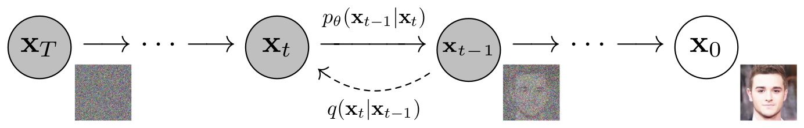
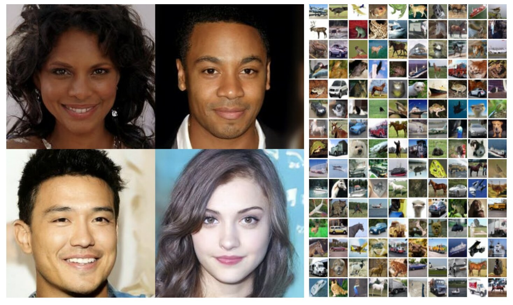
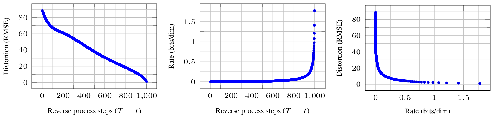
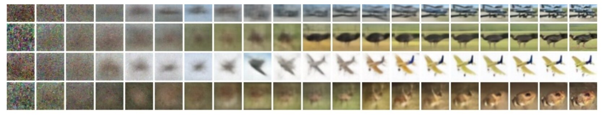
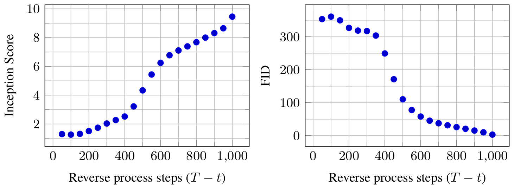
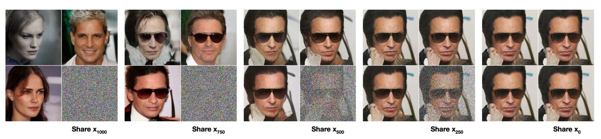
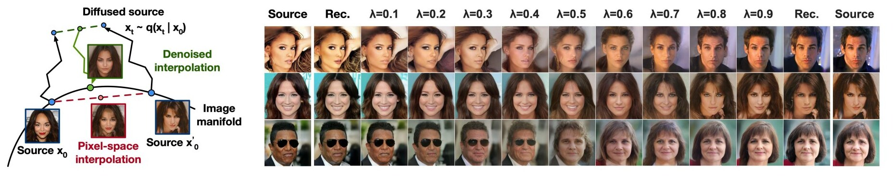
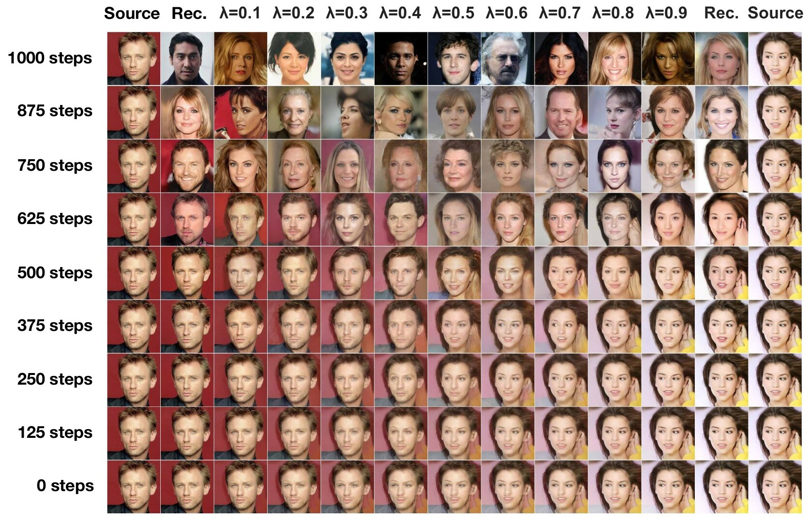
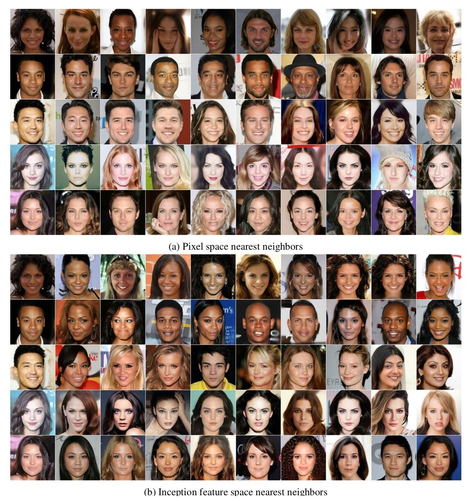

# 论文中文解读：《Denoising Diffusion Probabilistic Models》

> **基本信息**：Jonathan Ho、Ajay Jain、Pieter Abbeel（UC Berkeley），arXiv:2006.11239（本地 PDF 为 2020 年 12 月的 v2，NeurIPS 2020 论文）；论文原文 [官方页面](https://arxiv.org/abs/2006.11239)；作者代码见 `https://github.com/hojonathanho/diffusion`。
>
> **本文的读法**：本文按“背景 → 扩散模型的定义与变分下界 → 反向过程的参数化与简化目标 → 实现细节 → 实验（样本质量、消融、渐进编码与生成、插值）→ 局限”的顺序，把原文的公式推导、算法、表格和图逐项讲清楚。图均取自论文原文（从 PDF 按图裁出，照片类用 JPEG），每张图后有中文图题、图中文字翻译和读图结论；表为逐格核对后的中文转录，数字与原文一致，粗体沿用原文。原文公式编号（1）–（26）与 Algorithm 1–4 在本文中沿用，推导中的补充步骤会标明“补充”。

## 一、一句话结论

扩散概率模型是一类受非平衡热力学启发的隐变量模型：固定一条逐步给数据加高斯噪声的**前向链**，学习它的**反向链**（每一步是条件高斯），用变分下界训练。DDPM 做了三件事：

1. 证明这类模型**能生成高质量样本**；
2. 发现一种参数化（让网络预测所加的噪声 $\epsilon$），使变分下界化简成类似“多噪声尺度 denoising score matching”的目标，采样过程则类似 annealed Langevin dynamics；去掉权重后的简化目标 $L_{\mathrm{simple}}$ 样本质量最好；
3. 给出渐进有损压缩的解释，并指出高斯扩散的采样是对自回归解码的推广。

结果：无条件 CIFAR10 上 Inception score 9.46、FID 3.17（表 1 无条件模型中 FID 最低，条件 StyleGAN2 + ADA 的 FID 2.67 更低）；256×256 LSUN 上样本质量与 ProgressiveGAN 相当。但对数似然（3.75 bits/dim）不具竞争力，无损码长的大部分花在人眼无法察觉的细节上。

## 二、背景与动机

### 2.1 论文要回答的问题（原文第 1 节，第 1–2 页）

各类深度生成模型（GAN、自回归模型、flow、VAE）都已经能合成惊人的图像和音频样本，能量模型与 score matching 也有进展。扩散概率模型（Sohl-Dickstein 等 2015，原文称 “diffusion probabilistic model”，简称“扩散模型”）定义简单、训练高效，但据作者所知，此前没有人证明它们能生成高质量样本。本文要证明：它们可以，有时甚至优于其他类型生成模型已发表的结果（第 4 节）。

### 2.2 扩散模型是什么

扩散模型是一个**参数化的马尔可夫链**，用变分推断训练，使它在有限步之后产生与数据匹配的样本。链的转移被学习成**逆转扩散过程**；扩散过程则是沿采样的反方向、逐步给数据加噪声直到信号被破坏的马尔可夫链。当每步只加少量高斯噪声时，把采样链的转移也取为条件高斯就足够了，这使神经网络参数化特别简单。

### 2.3 论文的三点主要贡献（原文第 1 节）

1. 展示扩散模型确实能生成高质量样本；
2. 展示某一种参数化揭示了扩散模型与“训练时的多噪声水平 denoising score matching”和“采样时的 annealed Langevin dynamics”的等价（原文 3.2 节）。最佳样本质量就来自这种参数化（4.2 节），所以作者把这个等价当作主要贡献之一；
3. 坦白指出：尽管样本质量高，模型的对数似然与其他基于似然的模型相比没有竞争力（但优于文献中用 annealed importance sampling 得到的能量模型与 score matching 的偏大估计）；无损码长的大部分用来描述不可察觉的图像细节（4.3 节）。作者用有损压缩的语言对此做了更细的分析，并说明扩散模型的采样过程是一种渐进解码，类似沿着一个远比常见自回归模型所能表达的更一般的比特顺序做自回归解码。

## 三、方法

### 3.1 符号

本文用到的符号如下（整理自原文，非原文表格）：

| 符号 | 含义 |
|---|---|
| $x_0\sim q(x_0)$ | 数据（图像） |
| $x_1,\dots,x_T$ | 隐变量，与数据维度相同；$x_t$ 是第 $t$ 步加噪后的结果，$T$ 是扩散总步数 |
| $\beta_1,\dots,\beta_T$ | 前向过程的方差调度（variance schedule） |
| $\alpha_t:=1-\beta_t$，$\bar\alpha_t:=\prod_{s=1}^t\alpha_s$ | 常用的派生量 |
| $q(x_t\mid x_{t-1})$ | 前向过程（扩散过程）的一步，固定、无参数 |
| $p_\theta(x_{t-1}\mid x_t)$ | 反向过程的一步，神经网络参数化 |
| $\mu_\theta,\ \Sigma_\theta=\sigma_t^2I$ | 反向一步高斯的均值与（本文固定的）协方差 |
| $\tilde\mu_t,\ \tilde\beta_t$ | 前向过程后验 $q(x_{t-1}\mid x_t,x_0)$ 的均值与方差 |
| $\epsilon\sim\mathcal N(0,I)$，$\epsilon_\theta(x_t,t)$ | 所加的噪声，以及预测它的网络 |
| $L_T,\ L_{t-1},\ L_0$ | 变分下界分解出的三类项 |

### 3.2 反向过程与前向过程（原文第 2 节，第 2 页；图 2）

扩散模型是形如 $p_\theta(x_0):=\int p_\theta(x_{0:T})\,dx_{1:T}$ 的隐变量模型，其中 $x_1,\dots,x_T$ 是与数据 $x_0\sim q(x_0)$ 同维度的隐变量。联合分布 $p_\theta(x_{0:T})$ 称为**反向过程**（reverse process），定义为从 $p(x_T)=\mathcal N(x_T;0,I)$ 出发、带学习到的高斯转移的马尔可夫链：

$$
p_\theta(x_{0:T}):=p(x_T)\prod_{t=1}^{T}p_\theta(x_{t-1}\mid x_t),\qquad p_\theta(x_{t-1}\mid x_t):=\mathcal N\big(x_{t-1};\mu_\theta(x_t,t),\Sigma_\theta(x_t,t)\big).\qquad\text{(1)}
$$

扩散模型区别于其他隐变量模型之处在于：近似后验 $q(x_{1:T}\mid x_0)$，称为**前向过程**或扩散过程，被固定为一条按方差调度 $\beta_1,\dots,\beta_T$ 逐步给数据加高斯噪声的马尔可夫链：

$$
q(x_{1:T}\mid x_0):=\prod_{t=1}^{T}q(x_t\mid x_{t-1}),\qquad q(x_t\mid x_{t-1}):=\mathcal N\big(x_t;\sqrt{1-\beta_t}\,x_{t-1},\beta_tI\big).\qquad\text{(2)}
$$



*图 2（原文 Figure 2，第 2 页）：本文考虑的有向图模型。*

**图中文字翻译与读法**：

- **节点**：从左到右依次是 $x_T$、……、$x_t$、$x_{t-1}$、……、$x_0$。灰色圆圈 $x_T,x_t,x_{t-1}$ 是隐变量，右端白色圆圈 $x_0$ 是数据。节点下方的小图示意各步的图像：$x_T$ 是纯噪声，$x_{t-1}$ 是带噪的人脸，$x_0$ 是清晰的人脸。
- **箭头**：上方实线箭头 $p_\theta(x_{t-1}\mid x_t)$ 是**反向过程**，从噪声走向数据（生成方向）；下方虚线箭头 $q(x_t\mid x_{t-1})$ 是**前向过程**，从数据走向噪声（加噪方向）。
- **读图结论**：生成时沿实线方向由 $x_T$ 一步步还原到 $x_0$，训练时用固定的虚线方向制造各个噪声水平的训练样本。

**前向过程的两个性质**：

1. 方差 $\beta_t$ 可以通过重参数化学习，也可以当作常数超参数。反向过程的表达能力部分由 $p_\theta(x_{t-1}\mid x_t)$ 里选高斯来保证：当 $\beta_t$ 很小时，前向与反向两个过程具有相同的函数形式（原文引用 Sohl-Dickstein 等 2015）。
2. 前向过程允许在**任意时间步 $t$ 以闭式直接采样 $x_t$**。记 $\alpha_t:=1-\beta_t$，$\bar\alpha_t:=\prod_{s=1}^t\alpha_s$，则

$$
q(x_t\mid x_0)=\mathcal N\big(x_t;\sqrt{\bar\alpha_t}\,x_0,(1-\bar\alpha_t)I\big),\qquad\text{即}\quad x_t=\sqrt{\bar\alpha_t}\,x_0+\sqrt{1-\bar\alpha_t}\,\epsilon,\ \ \epsilon\sim\mathcal N(0,I).\qquad\text{(4)}
$$

**补充推导**（原文只给出结果）：由式（2），$x_t=\sqrt{\alpha_t}\,x_{t-1}+\sqrt{1-\alpha_t}\,\epsilon_{t-1}$。把 $x_{t-1}=\sqrt{\alpha_{t-1}}\,x_{t-2}+\sqrt{1-\alpha_{t-1}}\,\epsilon_{t-2}$ 代入，得到 $x_t=\sqrt{\alpha_t\alpha_{t-1}}\,x_{t-2}+\sqrt{\alpha_t(1-\alpha_{t-1})}\,\epsilon_{t-2}+\sqrt{1-\alpha_t}\,\epsilon_{t-1}$。后两项是独立高斯噪声，相加后方差为 $\alpha_t(1-\alpha_{t-1})+(1-\alpha_t)=1-\alpha_t\alpha_{t-1}$。对 $t$ 归纳即得式（4）。

这个性质使训练不必真的把链跑完：对每个训练样本随机抽一个 $t$，用式（4）一步得到 $x_t$ 即可。

### 3.3 训练目标：变分下界（原文第 2 节，第 2–3 页）

训练是优化负对数似然的常规变分界：

$$
\mathbb E\big[-\log p_\theta(x_0)\big]\ \le\ \mathbb E_q\!\left[-\log\frac{p_\theta(x_{0:T})}{q(x_{1:T}\mid x_0)}\right]=\mathbb E_q\!\left[-\log p(x_T)-\sum_{t\ge1}\log\frac{p_\theta(x_{t-1}\mid x_t)}{q(x_t\mid x_{t-1})}\right]=:L.\qquad\text{(3)}
$$

由于式（4），可以用随机梯度下降优化 $L$ 中的随机项，实现高效训练。进一步通过方差缩减，把 $L$ 重写成：

$$
L=\mathbb E_q\Big[\underbrace{D_{\mathrm{KL}}\big(q(x_T\mid x_0)\,\Vert\,p(x_T)\big)}_{L_T}+\sum_{t>1}\underbrace{D_{\mathrm{KL}}\big(q(x_{t-1}\mid x_t,x_0)\,\Vert\,p_\theta(x_{t-1}\mid x_t)\big)}_{L_{t-1}}\ \underbrace{-\log p_\theta(x_0\mid x_1)}_{L_0}\Big].\qquad\text{(5)}
$$

式（5）用 KL 散度直接比较 $p_\theta(x_{t-1}\mid x_t)$ 与前向过程的**后验**，而后验在以 $x_0$ 为条件时是可解的：

$$
q(x_{t-1}\mid x_t,x_0)=\mathcal N\big(x_{t-1};\tilde\mu_t(x_t,x_0),\tilde\beta_tI\big),\qquad\text{(6)}
$$

$$
\tilde\mu_t(x_t,x_0):=\frac{\sqrt{\bar\alpha_{t-1}}\,\beta_t}{1-\bar\alpha_t}\,x_0+\frac{\sqrt{\alpha_t}\,(1-\bar\alpha_{t-1})}{1-\bar\alpha_t}\,x_t,\qquad\tilde\beta_t:=\frac{1-\bar\alpha_{t-1}}{1-\bar\alpha_t}\,\beta_t.\qquad\text{(7)}
$$

因此式（5）里的所有 KL 都是两个高斯之间的比较，可以用闭式表达式以 Rao-Blackwell 方式计算，而不必做方差很大的 Monte Carlo 估计。

**补充：式（5）的推导**（原文附录 A，式（17）–（22），第 13–14 页；这部分来自 Sohl-Dickstein 等 2015，原文仅为完整性而收录）。主要步骤：

1. 把 $t=1$ 的项单独拿出来，$L=\mathbb E_q\big[-\log p(x_T)-\sum_{t>1}\log\frac{p_\theta(x_{t-1}\mid x_t)}{q(x_t\mid x_{t-1})}-\log\frac{p_\theta(x_0\mid x_1)}{q(x_1\mid x_0)}\big]$（式（19））。
2. 由马尔可夫性 $q(x_t\mid x_{t-1})=q(x_t\mid x_{t-1},x_0)$，再用 Bayes 公式得 $q(x_t\mid x_{t-1})=\dfrac{q(x_{t-1}\mid x_t,x_0)\,q(x_t\mid x_0)}{q(x_{t-1}\mid x_0)}$，代入（式（20））。
3. 对 $t>1$ 求和时，比值 $\frac{q(x_{t-1}\mid x_0)}{q(x_t\mid x_0)}$ 逐项相消，只剩 $\frac{q(x_1\mid x_0)}{q(x_T\mid x_0)}$。其中的 $q(x_1\mid x_0)$ 与第 1 步里的 $-\log\frac{p_\theta(x_0\mid x_1)}{q(x_1\mid x_0)}$ 抵消，留下 $-\log\frac{p(x_T)}{q(x_T\mid x_0)}$（式（21））。
4. 把对数比写成 KL 散度，即得式（22）= 式（5）。

### 3.4 前向过程与 $L_T$（原文 3.1 节，第 3 页）

作者忽略“前向过程方差 $\beta_t$ 可通过重参数化学习”这一事实，把它们**固定为常数**（具体取值见第四节）。于是近似后验 $q$ 没有可学习参数，$L_T$ 在训练中是一个常数，可以忽略。

### 3.5 反向过程与 $L_{1:T-1}$（原文 3.2 节，第 3–4 页）

这一节讨论对 $1<t\le T$ 的 $p_\theta(x_{t-1}\mid x_t)=\mathcal N(x_{t-1};\mu_\theta(x_t,t),\Sigma_\theta(x_t,t))$ 的选择。

**第一，方差。** 取 $\Sigma_\theta(x_t,t)=\sigma_t^2I$，是**不训练**的、随时间变化的常数。实验中 $\sigma_t^2=\beta_t$ 与 $\sigma_t^2=\tilde\beta_t=\frac{1-\bar\alpha_{t-1}}{1-\bar\alpha_t}\beta_t$ 两种取法结果相近。第一种对 $x_0\sim\mathcal N(0,I)$ 最优，第二种对 $x_0$ 确定地取一个点时最优；对每个坐标单位方差的数据，这两个极端分别对应反向过程熵的上界和下界。

**第二，均值。** 作者提出一种由下面对 $L_t$ 的分析所启发的参数化。取 $p_\theta(x_{t-1}\mid x_t)=\mathcal N(x_{t-1};\mu_\theta(x_t,t),\sigma_t^2I)$，可以写出

$$
L_{t-1}=\mathbb E_q\left[\frac{1}{2\sigma_t^2}\,\big\lVert\tilde\mu_t(x_t,x_0)-\mu_\theta(x_t,t)\big\rVert^2\right]+C,\qquad\text{(8)}
$$

其中 $C$ 是不依赖 $\theta$ 的常数（来自两个高斯协方差不同产生的项）。可见最直接的参数化是让 $\mu_\theta$ 去预测前向过程后验均值 $\tilde\mu_t$。

不过还可以进一步展开式（8）：用式（4）把 $x_t$ 重参数化为 $x_t(x_0,\epsilon)=\sqrt{\bar\alpha_t}\,x_0+\sqrt{1-\bar\alpha_t}\,\epsilon$（$\epsilon\sim\mathcal N(0,I)$，从而 $x_0=\frac{1}{\sqrt{\bar\alpha_t}}\big(x_t-\sqrt{1-\bar\alpha_t}\,\epsilon\big)$），再代入后验公式（7）：

$$
L_{t-1}-C=\mathbb E_{x_0,\epsilon}\left[\frac{1}{2\sigma_t^2}\Big\lVert\tilde\mu_t\Big(x_t(x_0,\epsilon),\ \tfrac{1}{\sqrt{\bar\alpha_t}}\big(x_t(x_0,\epsilon)-\sqrt{1-\bar\alpha_t}\,\epsilon\big)\Big)-\mu_\theta\big(x_t(x_0,\epsilon),t\big)\Big\rVert^2\right]\qquad\text{(9)}
$$

$$
=\mathbb E_{x_0,\epsilon}\left[\frac{1}{2\sigma_t^2}\Big\lVert\frac{1}{\sqrt{\alpha_t}}\Big(x_t(x_0,\epsilon)-\frac{\beta_t}{\sqrt{1-\bar\alpha_t}}\,\epsilon\Big)-\mu_\theta\big(x_t(x_0,\epsilon),t\big)\Big\rVert^2\right].\qquad\text{(10)}
$$

**补充：从式（9）到式（10）的代数**（原文直接给出结果）。因为 $\bar\alpha_t=\bar\alpha_{t-1}\alpha_t$，所以 $\sqrt{\bar\alpha_{t-1}}/\sqrt{\bar\alpha_t}=1/\sqrt{\alpha_t}$。$\tilde\mu_t$ 中 $x_t$ 的系数是 $\frac{\beta_t}{(1-\bar\alpha_t)\sqrt{\alpha_t}}+\frac{\sqrt{\alpha_t}(1-\bar\alpha_{t-1})}{1-\bar\alpha_t}=\frac{\beta_t+\alpha_t(1-\bar\alpha_{t-1})}{\sqrt{\alpha_t}\,(1-\bar\alpha_t)}=\frac{1-\bar\alpha_t}{\sqrt{\alpha_t}\,(1-\bar\alpha_t)}=\frac1{\sqrt{\alpha_t}}$（用到 $\beta_t=1-\alpha_t$）；$\epsilon$ 的系数是 $-\frac{\sqrt{\bar\alpha_{t-1}}\,\beta_t}{1-\bar\alpha_t}\cdot\frac{\sqrt{1-\bar\alpha_t}}{\sqrt{\bar\alpha_t}}=-\frac{\beta_t}{\sqrt{\alpha_t}\sqrt{1-\bar\alpha_t}}$。所以

$$
\tilde\mu_t=\frac{1}{\sqrt{\alpha_t}}\Big(x_t-\frac{\beta_t}{\sqrt{1-\bar\alpha_t}}\,\epsilon\Big).
$$

式（10）说明：给定 $x_t$，$\mu_\theta$ 必须预测 $\frac{1}{\sqrt{\alpha_t}}\big(x_t-\frac{\beta_t}{\sqrt{1-\bar\alpha_t}}\epsilon\big)$。因为 $x_t$ 本来就是模型的输入，只有 $\epsilon$ 未知，所以可以选择这样的参数化：

$$
\mu_\theta(x_t,t)=\tilde\mu_t\Big(x_t,\tfrac{1}{\sqrt{\bar\alpha_t}}\big(x_t-\sqrt{1-\bar\alpha_t}\,\epsilon_\theta(x_t)\big)\Big)=\frac{1}{\sqrt{\alpha_t}}\Big(x_t-\frac{\beta_t}{\sqrt{1-\bar\alpha_t}}\,\epsilon_\theta(x_t,t)\Big),\qquad\text{(11)}
$$

其中 $\epsilon_\theta$ 是旨在**从 $x_t$ 预测 $\epsilon$** 的函数逼近器（网络）。从 $p_\theta(x_{t-1}\mid x_t)$ 采样 $x_{t-1}$ 就是计算 $x_{t-1}=\frac{1}{\sqrt{\alpha_t}}\big(x_t-\frac{\beta_t}{\sqrt{1-\bar\alpha_t}}\epsilon_\theta(x_t,t)\big)+\sigma_tz$，$z\sim\mathcal N(0,I)$。完整的采样过程（Algorithm 2）类似 Langevin 动力学，$\epsilon_\theta$ 起着学到的数据密度梯度的作用。并且在参数化（11）下，式（10）简化为

$$
\mathbb E_{x_0,\epsilon}\left[\frac{\beta_t^2}{2\sigma_t^2\alpha_t(1-\bar\alpha_t)}\,\Big\lVert\epsilon-\epsilon_\theta\big(\sqrt{\bar\alpha_t}\,x_0+\sqrt{1-\bar\alpha_t}\,\epsilon,\ t\big)\Big\rVert^2\right],\qquad\text{(12)}
$$

它类似于在多个由 $t$ 索引的噪声尺度上的 denoising score matching。由于式（12）等于 Langevin 式反向过程（11）的变分界中的（一项），可见**优化一个类似 denoising score matching 的目标，等价于用变分推断去拟合一条类似 Langevin 动力学的采样链的有限时间边缘分布**。

**补充说明**（与 score 的关系，原文只说“类似”）：对 $x_t=\sqrt{\bar\alpha_t}x_0+\sqrt{1-\bar\alpha_t}\epsilon$，有 $\nabla_{x_t}\log q(x_t\mid x_0)=-\dfrac{x_t-\sqrt{\bar\alpha_t}x_0}{1-\bar\alpha_t}=-\dfrac{\epsilon}{\sqrt{1-\bar\alpha_t}}$。所以预测 $\epsilon$ 等价于预测条件 score，只差一个与 $t$ 有关的因子 $-\sqrt{1-\bar\alpha_t}$。

**小结：三种预测目标。** 可以训练均值函数逼近器 $\mu_\theta$ 去预测 $\tilde\mu_t$，也可以通过改变参数化让它预测 $\epsilon$。（原文还说：也可能预测 $x_0$，但早期实验发现这会导致更差的样本质量；没有给出对应的表。）$\epsilon$-预测参数化既类似 Langevin 动力学，又把扩散模型的变分界化成类似 denoising score matching 的目标；但它只是 $p_\theta(x_{t-1}\mid x_t)$ 的另一种参数化，因此作者在第 4 节的消融里比较了预测 $\epsilon$ 与预测 $\tilde\mu$。

**Algorithm 1：训练**（译自原文，使用 3.7 节的简化目标）

```text
1: repeat
2:     x_0 ~ q(x_0)                              （从数据中取一个样本）
3:     t ~ Uniform({1, ..., T})                  （均匀随机抽一个时间步）
4:     ε ~ N(0, I)                               （抽噪声）
5:     对 θ 做一步梯度下降：
           ∇_θ ‖ ε − ε_θ( √ᾱ_t · x_0 + √(1−ᾱ_t) · ε , t ) ‖²
6: until 收敛
```

**Algorithm 2：采样**（译自原文）

```text
1: x_T ~ N(0, I)
2: for t = T, ..., 1 do
3:     z ~ N(0, I)  若 t > 1，否则 z = 0
4:     x_{t−1} = (1/√α_t) · ( x_t − ((1−α_t)/√(1−ᾱ_t)) · ε_θ(x_t, t) ) + σ_t · z
5: end for
6: return x_0
```

**逐行解释**：

1. **训练**：每一步只抽一个时间步 $t$，用式（4）一步造出 $x_t$，网络 $\epsilon_\theta(x_t,t)$ 回归所加的噪声 $\epsilon$，损失是均方误差。不需要运行整条前向链，也不需要把网络展开 $T$ 步。同一个网络参数共享于所有 $t$，$t$ 作为条件输入。
2. **采样**：从纯噪声 $x_T$ 出发，反复用 $\epsilon_\theta$ 估计噪声、按式（11）算出均值，再加上方差为 $\sigma_t^2$ 的高斯噪声（$1-\alpha_t=\beta_t$）。**最后一步（$t=1$）不加噪声**。采样需要 $T$ 次网络前向。

### 3.6 数据缩放、反向过程解码器与 $L_0$（原文 3.3 节，第 4 页）

假设图像数据由 $\{0,1,\dots,255\}$ 的整数构成，并**线性缩放到 $[-1,1]$**。这保证神经网络反向过程从标准正态先验 $p(x_T)$ 出发时，输入的尺度一致。为了得到离散数据的对数似然，反向过程的最后一项设为一个独立的**离散解码器**，由高斯 $\mathcal N(x_0;\mu_\theta(x_1,1),\sigma_1^2I)$ 导出：

$$
p_\theta(x_0\mid x_1)=\prod_{i=1}^{D}\int_{\delta_-(x_0^i)}^{\delta_+(x_0^i)}\mathcal N\big(x;\mu_\theta^i(x_1,1),\sigma_1^2\big)\,dx,\qquad\text{(13)}
$$

$$
\delta_+(x)=\begin{cases}\infty&x=1\\ x+\frac1{255}&x<1\end{cases},\qquad
\delta_-(x)=\begin{cases}-\infty&x=-1\\ x-\frac1{255}&x>-1\end{cases}
$$

其中 $D$ 是数据维度，上标 $i$ 表示取一个坐标。直观上：把 $[-1,1]$ 分成 256 个宽度 $2/255$ 的格子，每个像素值的概率等于高斯落在对应格子里的积分，两端的格子延伸到 $\pm\infty$。原文说可以换成更强大的解码器（例如条件自回归模型），留作未来工作。这样的选择与 VAE 解码器和自回归模型中使用的离散化连续分布类似，保证了变分界是离散数据的**无损码长**，而无需给数据加噪声，也无需把缩放操作的 Jacobian 计入对数似然。采样结束时，作者**无噪声地**显示 $\mu_\theta(x_1,1)$。

### 3.7 简化训练目标（原文 3.4 节，第 4–5 页）

有了上面定义的反向过程与解码器，由式（12）和（13）导出的各项组成的变分界显然对 $\theta$ 可微，可以直接训练。但作者发现，训练如下的**变体**对样本质量更有利（实现也更简单）：

$$
L_{\mathrm{simple}}(\theta):=\mathbb E_{t,x_0,\epsilon}\Big[\big\lVert\epsilon-\epsilon_\theta\big(\sqrt{\bar\alpha_t}\,x_0+\sqrt{1-\bar\alpha_t}\,\epsilon,\ t\big)\big\rVert^2\Big],\qquad\text{(14)}
$$

其中 $t$ 在 1 与 $T$ 之间均匀取值。

- $t=1$ 的情形对应 $L_0$：把离散解码器定义（13）中的积分近似为高斯概率密度函数乘以格子宽度，忽略 $\sigma_1^2$ 和边缘效应。
- $t>1$ 的情形对应式（12）的**不加权**版本，类似 NCSN 去噪 score matching 模型使用的损失权重。
- $L_T$ 不出现，因为前向过程方差 $\beta_t$ 固定。
- Algorithm 1 展示了使用这个简化目标的完整训练过程。

由于简化目标（14）**丢弃了式（12）中的权重**，它是一个加权变分界，与标准变分界相比强调重构的不同方面。具体而言，第 4 节的扩散过程设置使简化目标**降低了对应小 $t$ 的损失项的权重**。这些项训练网络对噪声很小的数据去噪，降低它们的权重可以让网络集中精力处理 $t$ 较大的、更难的去噪任务。实验显示这种重新加权带来更好的样本质量。

**补充计算：被丢弃的权重有多大**（用第四节的线性 $\beta$ 调度和 $T=1000$ 计算，$\sigma_t^2=\beta_t$；原文没有给这个表）。式（12）里的权重是 $w_t=\frac{\beta_t^2}{2\sigma_t^2\alpha_t(1-\bar\alpha_t)}=\frac{\beta_t}{2\alpha_t(1-\bar\alpha_t)}$，而 $L_{\mathrm{simple}}$ 对每个 $t$ 的权重都取 1：

| $t$ | $\beta_t$ | $\bar\alpha_t$ | 真变分界的权重 $w_t$ |
|---:|---:|---:|---:|
| 1 | $1.0\times10^{-4}$ | 0.9999 | 约 0.500 |
| 10 | $2.8\times10^{-4}$ | 0.998 | 约 0.074 |
| 100 | $2.07\times10^{-3}$ | 0.897 | 约 0.0101 |
| 500 | $1.004\times10^{-2}$ | 0.0786 | 约 0.0055 |
| 1000 | $2.0\times10^{-2}$ | $4.0\times10^{-5}$ | 约 0.0102 |

可见真变分界对小 $t$ 的项给了大得多的权重（$t=1$ 约为 $t=500$ 的 90 倍），$L_{\mathrm{simple}}$ 把它们拉平，相当于相对地降低了小 $t$ 的权重。这正是原文所说“降低小 $t$ 项权重”的量化解释。

## 四、实现细节（原文第 4 节与附录 B，第 5、14–15 页）

下表整理自原文第 4 节开头与附录 B（非原文表格）：

| 项目 | 设置 |
|---|---|
| 扩散步数 | $T=1000$（使采样所需的网络求值次数与以往工作一致） |
| 前向方差调度 | 常数，从 $\beta_1=10^{-4}$ **线性**增加到 $\beta_T=0.02$。相对于缩放到 $[-1,1]$ 的数据，这些常数足够小，保证反向与前向过程近似具有相同的函数形式，同时让 $x_T$ 处信噪比尽可能小（$L_T=D_{\mathrm{KL}}(q(x_T\mid x_0)\Vert\mathcal N(0,I))\approx10^{-5}$ bits/dim） |
| 调度的选择 | 在常数、线性、二次调度里选择，都要求 $L_T\approx0$；$T=1000$ 没有扫描 |
| 主干网络 | 类似 PixelCNN++ 的 U-Net（基于 Wide ResNet），**无掩码**；用 group normalization 取代 weight normalization 使实现更简单 |
| 分辨率层级 | 32×32 的模型有 4 个特征图分辨率（32×32 到 4×4）；256×256 的模型有 6 个 |
| 残差块 | 每个分辨率层级 2 个卷积残差块；16×16 分辨率上卷积块之间有 self-attention 块 |
| 时间条件 | 参数在各时间步之间共享；时间 $t$ 通过 Transformer 的正弦位置嵌入加到**每个残差块**里 |
| 参数量 | CIFAR10：35.7M；LSUN 与 CelebA-HQ：114M；更大的 LSUN Bedroom：约 256M（增加滤波器数） |
| 硬件 | 全部实验用 TPU v3-8（约相当于 8 块 V100） |
| 训练速度 | CIFAR10：批大小 128 下 21 步/秒（训练 800k 步约 10.6 小时）；256×256：批大小 64 下 2.2 步/秒 |
| 采样速度 | CIFAR10：采样一批 256 张图像 17 秒；CelebA-HQ/LSUN（256×256）：一批 128 张 300 秒（按每张折算，约 0.07 秒与 2.3 秒） |
| 训练步数 | CelebA-HQ 0.5M；LSUN Bedroom 2.4M；LSUN Cat 1.8M；LSUN Church 1.2M；更大的 Bedroom 模型 1.15M |
| Dropout | CIFAR10 为 0.1（在 {0.1, 0.2, 0.3, 0.4} 里扫描；不用 dropout 时样本较差，类似未正则化 PixelCNN++ 的过拟合伪影）；其他数据集为 0（未扫描） |
| 数据增强 | CIFAR10 随机水平翻转（试过有无翻转，翻转略微提升样本质量）；其他数据集也用，**LSUN Bedroom 除外** |
| 优化器 | Adam（早期也试过 RMSProp，选了 Adam），超参数取默认值；学习率 $2\times10^{-4}$（未扫描），256×256 降为 $2\times10^{-5}$（较大学习率下似乎训练不稳定） |
| 批大小 | CIFAR10 为 128，更大图像为 64（未扫描） |
| EMA | 对模型参数做指数滑动平均，衰减 0.9999（未扫描） |
| 评估 | CIFAR10 的 IS 与 FID 用 50000 个样本，分别用 OpenAI 与 TTUR 的原始代码；LSUN 的 FID 用 50000 个样本，用 StyleGAN2 仓库代码；FID 对训练集计算（对测试集为 5.24）；最终实验只训练一次，**在训练过程中评估，报告训练期间的最小 FID 值**对应的样本质量和对数似然 |

作者说明：除了早期为让网络大小放得进内存而做的初始选择外，大部分超参数搜索都是为优化 CIFAR10 样本质量而做的，然后把结果设置迁移到其他数据集。

## 五、实验

### 5.1 样本质量（原文 4.1 节，第 5–6 页）

**CIFAR10（表 1）**。表 1 给出 CIFAR10 上的 Inception score（IS，越大越好）、FID（越小越好）和负对数似然（NLL，无损码长，单位 bits/dim，越小越好；括号内为训练集上的值）。

| 模型 | IS | FID | NLL 测试（训练） |
|---|---:|---:|---:|
| **条件生成（Conditional）** | | | |
| EBM [11] | 8.30 | 37.9 | |
| JEM [17] | 8.76 | 38.4 | |
| BigGAN [3] | 9.22 | 14.73 | |
| StyleGAN2 + ADA (v1) [29] | **10.06** | **2.67** | |
| **无条件生成（Unconditional）** | | | |
| Diffusion (original) [53] | | | ≤ 5.40 |
| Gated PixelCNN [59] | 4.60 | 65.93 | 3.03 (2.90) |
| Sparse Transformer [7] | | | **2.80** |
| PixelIQN [43] | 5.29 | 49.46 | |
| EBM [11] | 6.78 | 38.2 | |
| NCSNv2 [56] | | 31.75 | |
| NCSN [55] | 8.87±0.12 | 25.32 | |
| SNGAN [39] | 8.22±0.05 | 21.7 | |
| SNGAN-DDLS [4] | 9.09±0.10 | 15.42 | |
| StyleGAN2 + ADA (v1) [29] | **9.74** ± 0.05 | 3.26 | |
| 本文（$L$，固定各向同性 $\Sigma$） | 7.67±0.13 | 13.51 | ≤ 3.70 (3.69) |
| **本文（$L_{\mathrm{simple}}$）** | 9.46±0.11 | **3.17** | ≤ 3.75 (3.72) |

（原文表 1，第 5 页；空格表示原文该格为空。方括号里是原文参考文献编号。粗体沿用原文。）

**读法**：

- **样本质量**：无条件的 $L_{\mathrm{simple}}$ 模型 FID 3.17，是表中所有无条件模型里最低的；表中只有条件的 StyleGAN2 + ADA (v1)（2.67）比它更低，BigGAN（14.73）等其他条件模型都高得多。IS 方面，无条件的 StyleGAN2 + ADA（9.74）高于本文的 9.46。原文的措辞是“**优于文献中的大多数模型，包括类条件模型**”。
- **FID 的计算**：FID 是对训练集计算的（标准做法）；对测试集计算则为 5.24，仍然优于文献中许多对训练集计算的 FID。
- **训练目标的取舍**：用真正的变分界（$L$，固定各向同性 $\Sigma$）训练得到更好的码长（≤ 3.70），符合预期；用简化目标得到最好的样本质量（FID 3.17，码长 ≤ 3.75）。
- **似然**：CIFAR10 的码长（3.70–3.75 bits/dim）好于原始扩散模型（≤ 5.40）及文献里能量模型和 score matching 的偏大估计，但不及 Gated PixelCNN（3.03）和 Sparse Transformer（2.80）这类基于似然的模型。

### 5.2 样本展示（图 1、图 3、图 4）



*图 1（原文 Figure 1，第 1 页）：CelebA-HQ 256×256（左）和无条件 CIFAR10（右）上的生成样本。*

**图中文字翻译与读法**：左边 2×2 是四张 CelebA-HQ 256×256 人脸，右边是一大片 32×32 的 CIFAR10 无条件样本（从图上可以辨认出汽车、船、马、青蛙、鸟、卡车等类别）。人脸的皮肤、头发、牙齿和背景细节都很真实。原文没有说明图 1 是否经过挑选；附录图 11、13、16–19 才明确是 uncurated 样本。这张图是论文“扩散模型能生成高质量样本”的第一个直观证据。


*图 3、图 4（原文 Figure 3 与 Figure 4，第 6 页）：左，LSUN Church 样本，FID=7.89；右，LSUN Bedroom 样本，FID=4.90。*

**图中文字翻译与读法**：两个子图都是 256×256 的 LSUN 样本（每个子图里有若干大图和一些缩小的小图）。左边的教堂有带圆顶的、尖塔式的、石砌塔楼式的等多种建筑样式，背景有山地、天空和街道；右边的卧室有床、窗、灯和地毯。FID=4.90 来自更大的 Bedroom 模型（约 256M 参数，见表 3 与附录图 17）。从图上还能看到左上角那张教堂样本带有 “shutterstock” 水印字样，说明模型连训练数据里的水印也学到了；这是读图所见，原文没有评论。

**LSUN（表 3）**。表 3 给出 LSUN 256×256 数据集上的 FID（越小越好）。标 \* 的分数由 StyleGAN2 论文作为基线报告，其余分数由各自作者报告。

| 模型 | LSUN Bedroom | LSUN Church | LSUN Cat |
|---|---:|---:|---:|
| ProgressiveGAN [27] | 8.34 | 6.42 | 37.52 |
| StyleGAN [28] | **2.65** | 4.21\* | 8.53\* |
| StyleGAN2 [30] | - | **3.86** | **6.93** |
| 本文（$L_{\mathrm{simple}}$） | 6.36 | 7.89 | 19.75 |
| 本文（$L_{\mathrm{simple}}$，large） | 4.90 | - | - |

（原文表 3，第 13 页。）

**读法**：与 ProgressiveGAN 相比，本文模型在 Bedroom（6.36 对 8.34，大模型 4.90）和 Cat（19.75 对 37.52）上更好，在 Church 上更差（7.89 对 6.42），所以摘要的措辞是“样本质量与 ProgressiveGAN 相似”。与 StyleGAN、StyleGAN2 相比，本文在三个数据集上都落后。

### 5.3 反向过程参数化与训练目标的消融（原文 4.2 节，表 2）

表 2 比较无条件 CIFAR10 上反向过程的参数化与训练目标（第 3.5 节）对样本质量的影响。空白（“–”）表示该设置训练不稳定，生成的样本很差，分数超出正常范围。

| 目标函数 | IS | FID |
|---|---:|---:|
| **预测 $\tilde\mu$（基线）** | | |
| $L$，学习的对角 $\Sigma$ | 7.28±0.10 | 23.69 |
| $L$，固定的各向同性 $\Sigma$ | 8.06±0.09 | 13.22 |
| $\lVert\tilde\mu-\tilde\mu_\theta\rVert^2$ | – | – |
| **预测 $\epsilon$（本文）** | | |
| $L$，学习的对角 $\Sigma$ | – | – |
| $L$，固定的各向同性 $\Sigma$ | 7.67±0.13 | 13.51 |
| $\lVert\epsilon-\epsilon_\theta\rVert^2$（$L_{\mathrm{simple}}$） | **9.46±0.11** | **3.17** |

（原文表 2，第 5 页。原文最后一行写作 $\lVert\tilde\epsilon-\epsilon_\theta\rVert^2$，$\epsilon$ 上的波浪号是排版符号，含义同 $\epsilon$。$L$ 指真正的变分界，$\lVert\cdot\rVert^2$ 指不加权的均方误差。）

**读法**（对应原文 4.2 节的三条结论）：

1. 基线“预测 $\tilde\mu$”只有在用**真正的变分界**训练时才可行；改用不加权均方误差（类似式（14）的简化目标）则不稳定（表中空白）。
2. **学习反向过程方差**（在变分界里加入参数化的对角 $\Sigma_\theta(x_t)$）会导致训练不稳定，样本质量比固定方差更差：预测 $\tilde\mu$ 时 FID 从 13.22 恶化到 23.69，预测 $\epsilon$ 时则整行为空白。
3. **预测 $\epsilon$**（本文的做法）：在变分界加固定方差下，与预测 $\tilde\mu$ 表现差不多（FID 13.51 对 13.22）；但在简化目标下好得多（FID 3.17，IS 9.46）。

### 5.4 渐进式编码：率失真分析（原文 4.3 节，图 5、表 4）

**似然与码长**。表 1 同样给出 CIFAR10 模型的码长：训练集与测试集之间差距最多 0.03 bits/dim（$L_{\mathrm{simple}}$ 模型为 3.75 对 3.72），与其他基于似然的模型报告的差距相当，说明扩散模型没有过拟合（最近邻可视化见附录，本文图 12）。然而，虽然无损码长好于使用 annealed importance sampling 的能量模型与 score matching 的偏大估计，却不及其他类型的基于似然的生成模型。

**扩散模型是出色的有损压缩器**。既然样本质量高，作者的结论是：扩散模型的归纳偏置使它们成为出色的有损压缩器。把变分界项 $L_1+\cdots+L_T$ 当作**码率**（rate），把 $L_0$ 当作**失真**（distortion），样本质量最高的 CIFAR10 模型的码率为 1.78 bits/dim，失真为 1.97 bits/dim，对应 0 到 255 尺度上的均方根误差（RMSE）0.95。（两者之和 1.78 + 1.97 = 3.75，正是 $L_{\mathrm{simple}}$ 模型的测试码长。）**无损码长的一半以上用来描述不可察觉的失真**。

**渐进有损压缩**。作者构造了一个镜像式（5）形式的渐进有损码（Algorithm 3 与 4），它们假设有一个能以平均约 $D_{\mathrm{KL}}(q(x)\Vert p(x))$ bits 传输样本 $x\sim q(x)$ 的过程（例如 minimal random coding），其中接收方事先只知道 $p$：

```text
Algorithm 3  发送 x_0                              Algorithm 4  接收
1: 用 p(x_T) 发送 x_T ~ q(x_T | x_0)               1: 用 p(x_T) 接收 x_T
2: for t = T−1, ..., 2, 1 do                       2: for t = T−1, ..., 1, 0 do
3:     用 p_θ(x_t | x_{t+1}) 发送                  3:     用 p_θ(x_t | x_{t+1}) 接收 x_t
          x_t ~ q(x_t | x_{t+1}, x_0)              4: end for
4: end for                                         5: return x_0
5: 用 p_θ(x_0 | x_1) 发送 x_0
```

应用到 $x_0\sim q(x_0)$ 时，Algorithm 3 与 4 依次传输 $x_T,\dots,x_0$，总期望码长等于式（5）。接收方在任意时刻 $t$ 都已经完全掌握部分信息 $x_t$，并可以由式（4）渐进地估计

$$
x_0\approx\hat x_0=\Big(x_t-\sqrt{1-\bar\alpha_t}\,\epsilon_\theta(x_t)\Big)\Big/\sqrt{\bar\alpha_t}.\qquad\text{(15)}
$$

（随机重构 $x_0\sim p_\theta(x_0\mid x_t)$ 也成立，但作者没有考虑，因为这使失真更难评估。）原文强调，这个有损压缩论证**只是概念验证**：Algorithm 3、4 依赖 minimal random coding 这类过程，而它对高维数据不可行；这些算法只是对 Sohl-Dickstein 等变分界（5）的压缩解释，还不是实用的压缩系统。



*图 5（原文 Figure 5，第 7 页）：无条件 CIFAR10 测试集上，率失真随时间的变化。失真用 $[0,255]$ 尺度上的均方根误差衡量。具体数值见表 4。*

**图中文字翻译与读法**：

- **左图**：横轴 Reverse process steps $(T-t)$（反向过程步数，0 到 1000），纵轴 Distortion (RMSE)（失真，均方根误差）。失真从约 88 一路下降到约 0，前约 100 步降得最快（降到约 67），之后近似线性下降。
- **中图**：横轴同上，纵轴 Rate (bits/dim)（累计码率）。码率在前约 800 步几乎为 0，在最后百来步才急剧上升，终点 1.78 bits/dim。
- **右图**：横轴 Rate (bits/dim)，纵轴 Distortion (RMSE)，即率失真曲线。曲线在码率很小的区域陡降。
- **读图结论**：原文给出的结论是“失真在率失真图的低码率区域陡降，表明大多数比特确实分配给了不可察觉的失真”。结合表 4：码率只用到 0.12 bits/dim 时，RMSE 已从约 88 降到约 12；剩下的约 1.66 bits/dim 只是把 RMSE 从约 12 降到 0.95。

下表给出图 5 对应的数值。

| 反向过程时间（$T-t+1$） | 码率（bits/dim） | 失真（RMSE，$[0,255]$ 尺度） |
|---:|---:|---:|
| 1000 | 1.77581 | 0.95136 |
| 900 | 0.11994 | 12.02277 |
| 800 | 0.05415 | 18.47482 |
| 700 | 0.02866 | 24.43656 |
| 600 | 0.01507 | 30.80948 |
| 500 | 0.00716 | 38.03236 |
| 400 | 0.00282 | 46.12765 |
| 300 | 0.00081 | 54.18826 |
| 200 | 0.00013 | 60.97170 |
| 100 | 0.00000 | 67.60125 |

（原文表 4，第 13 页，无条件 CIFAR10 测试集的率失真数值，对应图 5。码率是到该时刻为止累计收到的比特数。）

### 5.5 渐进式生成（原文 4.3 节，图 6、图 10、图 7）

作者还运行了一个渐进的无条件生成过程，即从随机比特做渐进解压：用 Algorithm 2 从反向过程采样的同时，预测反向过程的结果 $\hat x_0$。结论是：**大尺度的图像特征先出现，细节最后出现**。



*图 6（原文 Figure 6，第 7 页）：无条件 CIFAR10 的渐进生成（$\hat x_0$ 随时间变化，从左到右）。扩展的样本和样本质量随时间变化的指标见附录（图 10 与 14）。*

**图中文字翻译与读法**：共四行，每行是一次生成过程，从左到右（共 20 列）是反向过程的推进。最左边是几乎纯噪声；随后先出现模糊的整体色块和轮廓（例如天空与地面的分界、物体的大致位置和颜色），后面的列才逐渐出现物体的形状，最右边才补全细节（如第三行飞机的机翼与尾翼、最后一行青蛙的眼睛）。读图结论：反向过程是由粗到细地“绘制”图像，这与 5.4 节“大部分比特花在不可察觉的细节上”相呼应。



*图 10（原文附录 Figure 10，第 16 页）：无条件 CIFAR10 的渐进采样质量随时间变化。*

**图中文字翻译与读法**：横轴 Reverse process steps $(T-t)$（反向过程步数）。左图纵轴 Inception Score，右图纵轴 FID；每个点是在该时刻用 $\hat x_0$ 计算的指标。从图上读出（近似值）：IS 在前 100 步附近约 1.3，约 500 步时约 4.3，之后稳步上升，在 1000 步达到 9.46；FID 开始时约 350，约 500 步时约 110，约 700 步时约 40，最后降到 3.17。读图结论：质量主要在反向过程的中后段（约 400–700 步）快速改善，之后是缓慢打磨细节。



*图 7（原文 Figure 7，第 7 页）：以同一个隐变量为条件时，CelebA-HQ 256×256 样本共享高层属性。每组 2×2 里，右下象限是 $x_t$，其余象限是从 $p_\theta(x_0\mid x_t)$ 采的样本。*

**图中文字翻译与读法**：五组从左到右依次标记 Share $x_{1000}$、Share $x_{750}$、Share $x_{500}$、Share $x_{250}$、Share $x_0$（共享 $x_t$）。做法（原文附录 D）：先从先验抽一次 $x_T$ 并运行一条反向链，在中间时间步 $t\in\{1000,750,500,250\}$ 把链**分叉**，从同一个 $x_t$ 出发采多个 $x_0$。

- **Share $x_{1000}$**：$x_{1000}$ 是纯噪声，分叉后三个样本是完全不同的人脸。
- **Share $x_{750}$**：$x_{750}$ 里肉眼已看不出内容，但三个样本共享了墨镜等高层属性。
- **Share $x_{500}$、$x_{250}$**：样本越来越接近，$x_{250}$ 之后几乎只在细节上有差别。
- **Share $x_0$**：完全相同。
- **读图结论**：作者的结论是，在分叉发生得较晚时，样本共享性别、发色、眼镜、饱和度、姿态和面部表情等高层属性，这表明像 $x_{750}$ 这样的中间隐变量编码了这些属性，尽管它们肉眼不可见。作者推测这也许是 conceptual compression 的苗头。

### 5.6 与自回归解码的联系（原文 4.3 节末，式（16））

变分界（5）还可以改写成（推导见附录 A，式（23）–（26））：

$$
L=D_{\mathrm{KL}}\big(q(x_T)\,\Vert\,p(x_T)\big)+\mathbb E_q\Big[\sum_{t\ge1}D_{\mathrm{KL}}\big(q(x_{t-1}\mid x_t)\,\Vert\,p_\theta(x_{t-1}\mid x_t)\big)\Big]+H(x_0).\qquad\text{(16)}
$$

（补充：这一形式用 $q(x_t\mid x_{t-1})=\frac{q(x_{t-1}\mid x_t)\,q(x_t)}{q(x_{t-1})}$，使边缘分布 $q(x_{t-1})/q(x_t)$ 在求和中相消，最后只剩 $-\log q(x_0)$，其期望就是数据熵 $H(x_0)$；这一形式不便估计，但便于讨论。）

现在考虑把扩散过程长度 $T$ 设为数据维度，并定义前向过程使 $q(x_t\mid x_0)$ 把全部概率质量放在“前 $t$ 个坐标被遮住的 $x_0$”上（即 $q(x_t\mid x_{t-1})$ 遮住第 $t$ 个坐标），令 $p(x_T)$ 把全部质量放在空白图像上，并且为了论证，取 $p_\theta(x_{t-1}\mid x_t)$ 为完全表达力的条件分布。这时 $D_{\mathrm{KL}}(q(x_T)\Vert p(x_T))=0$，最小化 $D_{\mathrm{KL}}(q(x_{t-1}\mid x_t)\Vert p_\theta(x_{t-1}\mid x_t))$ 就训练 $p_\theta$ 原样复制坐标 $t+1,\dots,T$，并根据坐标 $t+1,\dots,T$ 预测第 $t$ 个坐标。因此用这种特殊扩散训练 $p_\theta$ 就是训练一个**自回归模型**。

因此可以把高斯扩散模型（2）解释为一种具有**广义比特顺序**的自回归模型，这种顺序无法通过重排数据坐标来表达。已有工作表明这种重排会引入影响样本质量的归纳偏置，所以作者推测高斯扩散起着类似的作用，而且或许效果更好，因为高斯噪声比遮盖噪声更适合加到图像上。此外，高斯扩散的长度不必等于数据维度，例如本文取 $T=1000$，小于 32×32×3 或 256×256×3 的图像维度；高斯扩散可以做短以便快速采样，也可以做长以提高模型表达力。

### 5.7 插值（原文 4.4 节，图 8、图 9）

可以把 $q$ 当作随机编码器，在隐空间里对源图像 $x_0,x_0'\sim q(x_0)$ 做插值：先得到 $x_t,x_t'\sim q(x_t\mid x_0)$，再把线性插值后的隐变量 $\bar x_t=(1-\lambda)x_t+\lambda x_t'$ 通过反向过程解码回图像空间 $\bar x_0\sim p(x_0\mid\bar x_t)$。（原文此处把 $\bar x_t$ 的式子印成了 $(1-\lambda)x_0+\lambda x_0'$，下标应为 $t$，这里按原文意思更正。）效果上，是用反向过程去除对被破坏的源图像做线性插值时产生的伪影（图 8 左）。对不同 $\lambda$ 固定噪声，使 $x_t$ 与 $x_t'$ 保持不变。



*图 8（原文 Figure 8，第 8 页）：CelebA-HQ 256×256 图像在 500 个扩散时间步下的插值。*

**图中文字翻译与读法**：

- **左图（示意）**：黑色曲线是 Image manifold（图像流形），上面有两张源图 Source $x_0$ 和 Source $x_0'$。红色虚线是 Pixel-space interpolation（像素空间插值）：直接在两张源图的像素之间做线性混合，相当于连接两点的一条弦，不在图像流形上；绿色是 Denoised interpolation（去噪插值）：先对两张源图扩散得到 Diffused source $x_t\sim q(x_t\mid x_0)$，在这个带噪空间里插值，再用反向过程去噪，结果回到流形上的一张自然人脸。
- **右图**：三行各是一对源图（$t=500$）。每行从左到右依次是 Source（左源图）、Rec.（重构）、$\lambda=0.1,\dots,0.9$ 的插值、Rec.（右源图的重构）、Source（右源图）。
- **读图结论**：反向过程能产生高质量的重构，以及合理的插值，平滑地改变姿态、肤色、发型、表情和背景等属性，但**不改变眼镜**（原文原话：“but not eyewear”）。更大的 $t$ 得到更粗、更多样的插值，$t=1000$ 时得到全新的样本（附录图 9）。



*图 9（原文附录 Figure 9，第 16 页）：在隐空间混合之前改变扩散步数的由粗到细插值。*

**图中文字翻译与读法**：行标 1000 steps、875 steps、……、0 steps 是插值前对两张源图做的扩散步数；每行的列与图 8 相同（Source、Rec.、$\lambda=0.1\ldots0.9$、Rec.、Source）。

- **0 steps（最下一行）**：没有扩散，插值直接在像素空间混合两张源图，出现典型的叠加重影。
- **250–500 steps**：保留了源图的整体布局与姿态，但五官、发型等细节由反向过程“补全”，从男士渐变成女士。
- **625–875 steps**：中间帧已经是源图中没有的新面孔，只残留少量颜色与轮廓信息。
- **1000 steps（最上一行）**：源信息全部丢失，包括 Rec. 在内的各列都是与源图无关的全新样本。
- **读图结论**：扩散步数控制插值的粒度：步数越小越细、越接近像素混合，步数越大越粗、越多样。这是“由粗到细”（coarse-to-fine）插值的含义。

### 5.8 最近邻检查（原文附录 D，图 12）

为了检验模型有没有记住训练集，附录图 12 给出 CelebA-HQ 的最近邻（图 15 给出 CIFAR10 的）。



*图 12（原文附录 Figure 12，第 18 页）：CelebA-HQ 256×256 的最近邻，在围绕人脸的 100×100 裁剪区域上计算。生成样本在最左一列，训练集中的最近邻在其余各列。*

**图中文字翻译与读法**：(a) Pixel space nearest neighbors（像素空间的最近邻）；(b) Inception feature space nearest neighbors（Inception 特征空间的最近邻）。每行的最左边是一张生成的人脸，右边 9 张是训练集中的最近邻。读图结论：最近邻与生成样本在姿态、发型、肤色上相似，但是不同的人，没有出现逐像素复制训练图像的情形。这与 5.4 节“训练与测试码长差距小”是一致的证据，不过最近邻可视化只能排除明显的记忆，不是严格的隐私或记忆性检验。

## 六、相关工作与差别（原文第 5 节与附录 C）

- **与 flow、VAE 的相似与区别**：扩散模型可能看起来像 flow 和 VAE，但它的设计使得 $q$ **没有参数**，且顶层隐变量 $x_T$ 与数据 $x_0$ 的互信息几乎为零。
- **与 denoising score matching、Langevin 动力学的联系**：$\epsilon$-预测参数化建立了扩散模型与多噪声水平 denoising score matching 的联系，以及与用于采样的 annealed Langevin dynamics 的联系。不同的是扩散模型允许直接评估对数似然，且训练过程用变分推断显式训练 Langevin 采样器。反过来，这个联系说明某种加权形式的 denoising score matching 等同于用变分推断训练一个类似 Langevin 的采样器。
- **与能量模型的关系**：由 score matching 与能量模型之间已知的联系，这项工作可能对近期的能量模型研究有启发。
- **其他学习马尔可夫链转移算子的方法**：infusion training、variational walkback、generative stochastic networks 等。
- **码率-失真曲线**：本文的码率-失真曲线是在一次变分界评估中沿时间算出的，让人想起用一次 annealed importance sampling 沿失真惩罚算出码率-失真曲线；渐进解码的论证也可见于 convolutional DRAW 及相关模型，并可能引出更一般的自回归模型子尺度排序或采样策略设计。

**与 NCSN 的差别（附录 C，第 15 页）**：本文的模型结构、前向过程定义和先验与 NCSN 在细微但重要的方面不同，这些改进了样本质量；而且本文把采样器作为隐变量模型直接训练，而不是训练后再事后添加。具体：

1. 本文用带 self-attention 的 U-Net，NCSN 用带空洞卷积的 RefineNet；本文把 Transformer 正弦位置嵌入加到所有层来对 $t$ 做条件，而不是只在归一化层（NCSNv1）或只在输出处（v2）。
2. 扩散模型每个前向步把数据缩小 $\sqrt{1-\beta_t}$ 倍，使加噪时方差不增长，从而给神经网络反向过程提供尺度一致的输入；NCSN 没有这个缩放因子。
3. 与 NCSN 不同，本文的前向过程会破坏信号（$D_{\mathrm{KL}}(q(x_T\mid x_0)\Vert\mathcal N(0,I))\approx0$），保证 $x_T$ 的先验与聚合后验匹配；而且本文的 $\beta_t$ 非常小，保证前向过程可以被条件高斯的马尔可夫链逆转。这两点都防止采样时的分布漂移。
4. 本文类似 Langevin 的采样器的系数（学习率、噪声尺度等）严格地由前向过程的 $\beta_t$ 推出，所以训练过程直接训练采样器，使它在 $T$ 步后匹配数据分布，即把采样器当作隐变量模型用变分推断来训练；NCSN 的采样器系数是事后手工设定的，其训练过程不保证直接优化其采样器的质量指标。

## 七、局限、证据边界与常见误读

**原文自己交代的局限与影响**：

- **似然不具竞争力**（CIFAR10 上 ≤ 3.75 bits/dim，对比 Sparse Transformer 的 2.80）。这是原文明确承认的。
- **渐进压缩只是概念验证**，依赖对高维数据不可行的 minimal random coding。
- **采样慢**：$T=1000$ 步，每步一次网络前向。CIFAR10 采样一批 256 张需要 17 秒，256×256 的一批 128 张需要 300 秒（TPU v3-8）。原文说高斯扩散可以做短以便快速采样，但没有在本文里实现。
- **Broader impact（原文）**：生成模型可被用于制作政治用途的虚假图像和视频；生成模型会反映训练数据集中的偏见；另一方面，扩散模型可能对数据压缩、无标签原始数据上的表示学习、以及艺术摄影音乐等创作用途有用。

**证据边界**：

- **报告的是最小 FID**：最终实验只训练一次，并在训练过程中评估样本质量；报告的样本质量分数与对数似然取的是训练期间 FID 最小的那个点。也就是说，表里的 FID 带有对评估指标本身做选择的成分，复现时要注意。
- **超参数主要为 CIFAR10 调**，再迁移到其他数据集（附录 B）。
- **CelebA-HQ 只有图和插值，没有 FID 表**；LSUN 的 FID 与 StyleGAN 系列比较并不占优（表 3）。
- **FID 对训练集计算**，对测试集为 5.24；跨论文比较 FID 要统一样本数、特征提取器和参考集。
- **“state-of-the-art FID” 的范围**：摘要里说的是无条件 CIFAR10；表 1 里条件的 StyleGAN2 + ADA (v1) 的 FID 是 2.67，更低。

**常见误读**：

- 扩散模型不是“一次去噪”，而是 $T$ 步的马尔可夫链；训练却不需要跑完整条链，每次只抽一个 $t$。
- **前向加噪无需学习，学习的是反向去噪**。
- $L_{\mathrm{simple}}$ **不是**真正的变分下界，它是丢掉权重的加权变分界：样本质量更好，但码长比用真正变分界训练的更差（3.75 对 3.70）。
- 预测 $\epsilon$、预测 $\tilde\mu$ 只是 $p_\theta(x_{t-1}\mid x_t)$ 的两种参数化，在同一个变分界下表现相近（FID 13.51 对 13.22）；差别主要出现在简化目标下。
- 高质量不等于高似然，两者在这篇论文里明显分离。
- DDIM、latent diffusion、现代 solver 等加速方法是后续工作，不在本文里。

## 八、复现检查清单

- 数据缩放到 $[-1,1]$；$T=1000$，$\beta_t$ 从 $10^{-4}$ 线性到 $0.02$；$\alpha_t=1-\beta_t$，$\bar\alpha_t=\prod\alpha_s$。时间步索引和 $\beta_t$、$\bar\alpha_t$ 的 off-by-one 错误最常见：下标是从 1 到 $T$ 还是从 0 到 $T-1$，以及 $t=1$ 时 $\bar\alpha_{t-1}=\bar\alpha_0$ 如何取值（按 $\bar\alpha_t=\prod_{s=1}^t\alpha_s$ 的空乘积应为 1；原文的式（6）（7）只用于 $t>1$，$t=1$ 对应 $L_0$ 的离散解码器），都要与官方实现对齐。
- 训练：每个样本均匀抽 $t\in\{1,\dots,T\}$，用式（4）造 $x_t$，对 $\epsilon$ 做 MSE（Algorithm 1）。不要对 $t$ 加权，除非你有意改成真变分界。
- 采样：$x_T\sim\mathcal N(0,I)$，按 Algorithm 2；**$t=1$ 时不加噪声**（$z=0$）；方差取 $\sigma_t^2=\beta_t$（或 $\tilde\beta_t$，两者结果相近）。
- 网络：带 self-attention（16×16 分辨率）的 U-Net，GroupNorm，$t$ 的正弦嵌入加到每个残差块；CIFAR10 约 35.7M 参数，dropout 0.1。
- 优化：Adam，学习率 $2\times10^{-4}$（256×256 为 $2\times10^{-5}$），批大小 128（更大图像 64），EMA 衰减 0.9999，CIFAR10 随机水平翻转。原文只说对模型参数做 EMA，没有逐字说明评估用的是否为 EMA 权重，以官方代码为准。
- 评估：IS/FID 用 50000 个样本，FID 对训练集统计量；说明所用 FID 实现与取点策略（原文取训练期间的最小 FID）。
- 对数似然（bits/dim）：用离散解码器（式（13））并包含所有 $L_t$ 项，用真正的变分界，而不是简化目标。

## 九、与相关论文的关系

- [VAE](../vae/论文中文解读.md)：扩散模型同样用变分下界训练，只是隐变量是整条逐步加噪链，近似后验 $q$ 固定且无参数。
- [GAN](../gan/论文中文解读.md)：同样追求高质量样本，但用对抗博弈；DDPM 的每一步只做小幅去噪，避免对抗训练。
- [Latent Diffusion](../latent_diffusion/论文中文解读.md)：把去噪扩散移到预训练自编码器的压缩潜空间，降低像素空间扩散的计算成本。
- [DiT](../dit/论文中文解读.md)：用 Transformer 替换 U-Net 作为扩散模型的主干。

## 原文证据导航

- [原论文 PDF](paper.pdf)
- [原文提取文本](paper.txt)
- [论文概要](论文概要.md)
- 关键位置（PDF 页码）：摘要与引言、图 1 在第 1 页；图 2、背景与式（1）–（4）在第 2 页；式（5）–（10）与 3.1–3.2 节在第 3 页；Algorithm 1、2 与式（11）–（13）在第 4 页；式（14）、表 1、表 2、第 4 节开头在第 5 页；图 3、4、Algorithm 3、4、4.2–4.3 节在第 6 页；式（15）、图 5–7、式（16）在第 7 页；图 8、插值与相关工作在第 8 页；结论与 Broader Impact 在第 9 页；表 3、表 4、附录 A 在第 13–14 页；附录 B（实验细节）在第 14–15 页；附录 C、D 在第 15 页；图 9、10 在第 16 页；图 12 在第 18 页。
