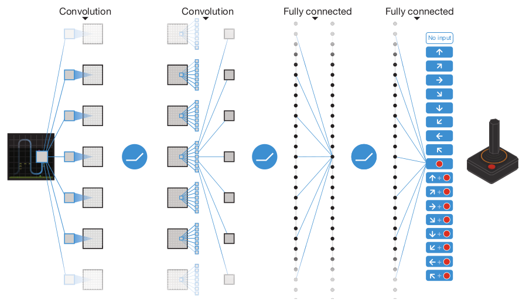
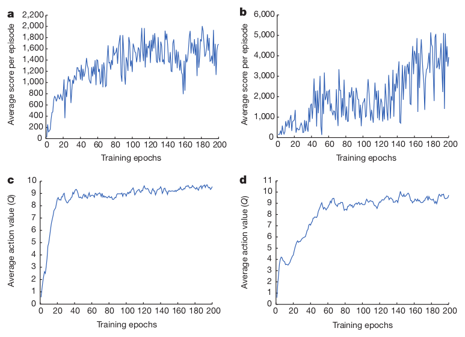
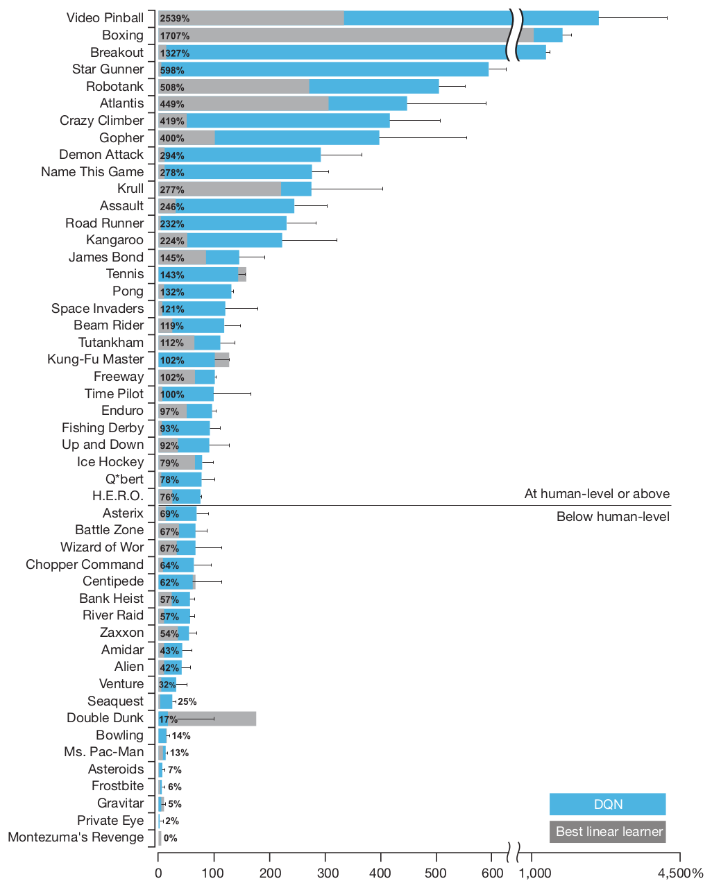
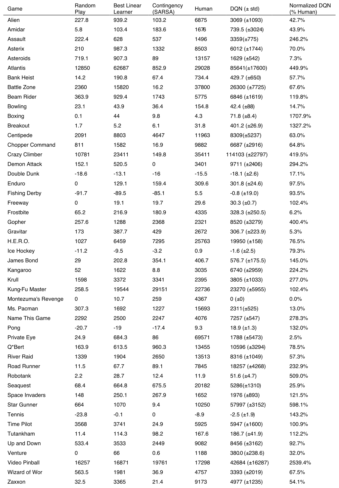
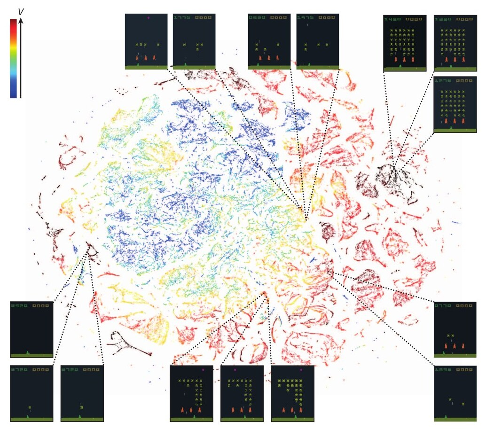
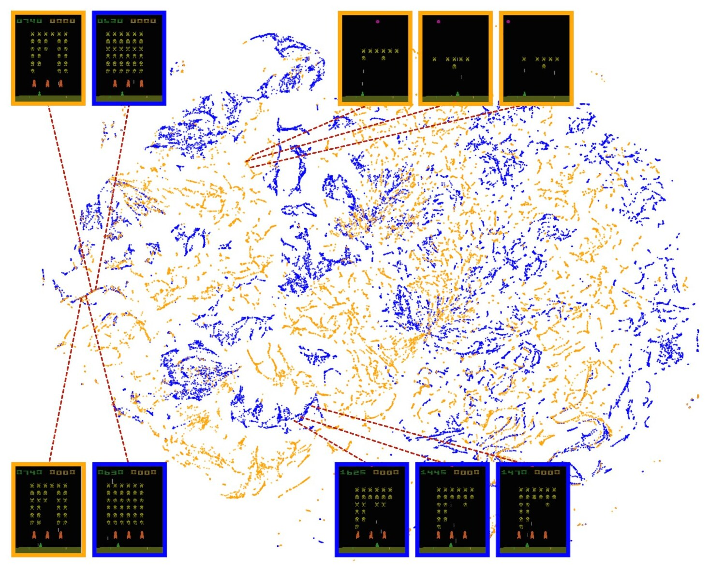
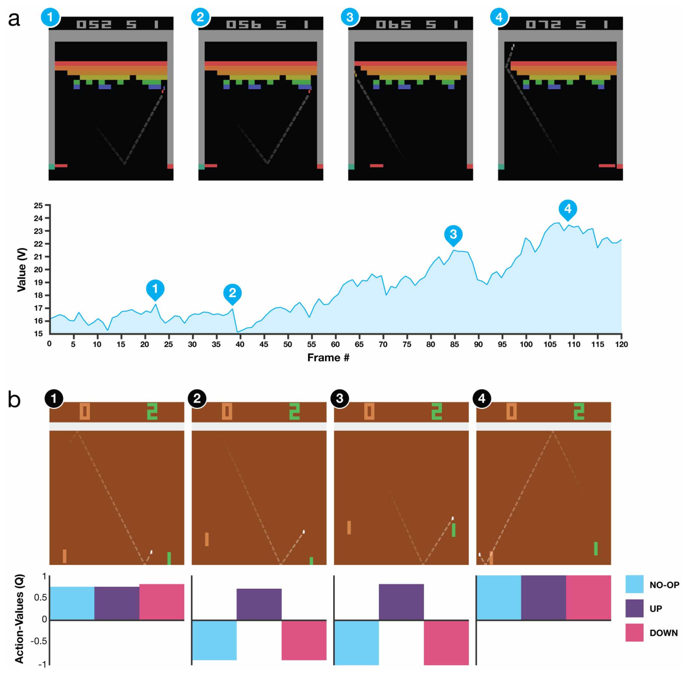

# 论文中文解读：《Human-level control through deep reinforcement learning》

> **基本信息**：Volodymyr Mnih、Koray Kavukcuoglu、David Silver 等 19 位作者（Google DeepMind），Nature 518, 529–533，2015 年 2 月 26 日，doi:10.1038/nature14236；[论文官方页面](https://www.nature.com/articles/nature14236)。本文精读的是 Nature 正式版（常称 Nature DQN），不是只评测 7 个游戏的 2013 年早期预印本。
>
> **本文的读法**：图取自论文 PDF 的原图（Figure 1–4，Extended Data Figure 1–2），表为逐格核对后的中文转录（Extended Data Table 1、3、4 全部转录；49 个游戏的 Extended Data Table 2 附原表截图，并摘录关键行）。文中“第 N 页”指 PDF 页码。每张图后都有中文图题、图中文字翻译和读图结论，因此不必再翻英文原文。凡是我自己推算、而论文没有直接写出的数字，都会明确标注“推算”。

## 一、一句话结论

DQN（deep Q-network）用一个卷积神经网络，从原始像素直接估计每个动作的长期价值（Q 值），再用 Q-learning 训练它。直接这样做会发散，论文用两个关键设计压住了不稳定：**经验回放**（experience replay，把历史转移存进缓冲区、随机抽样训练）和**目标网络**（target network，用一个只每隔 $C$ 次更新才同步一次的旧参数副本来算 TD 目标）。结果是：同一套算法、同一个网络结构、同一组超参数，只以屏幕像素和游戏分数为输入，在 49 个 Atari 2600 游戏上各训练一个智能体，其中 29 个游戏达到职业人类测试员 75% 以上的分数；论文称在 43 个游戏上优于此前最好的强化学习方法（这个“43”的统计口径见 5.2 节）。同时，需要长时间无奖励探索的游戏（如 Montezuma's Revenge）上它几乎完全失败。

## 二、背景与动机

### 2.1 强化学习的设定与记号

智能体（agent）在每个时间步 $t$ 从合法动作集合 $\mathcal{A}=\{1,\dots,K\}$ 中选一个动作 $a_t$，交给环境（这里是 Atari 模拟器）。模拟器据此改变自己的内部状态和游戏分数。智能体看不到模拟器的内部状态，只看到一幅屏幕图像 $x_t\in\mathbb{R}^d$（像素值向量），并收到奖励 $r_t$，即游戏分数的变化量。游戏分数可能取决于此前整个动作和观测序列，一个动作的反馈可能要等几千个时间步之后才出现。

目标是选择动作使未来奖励最大。论文设每一步未来奖励按 $\gamma$ 折扣（全文取 $\gamma=0.99$），时刻 $t$ 的折扣回报为

$$
R_t=\sum_{t'=t}^{T}\gamma^{\,t'-t}\,r_{t'},
$$

其中 $T$ 是游戏结束的时间步。最优动作价值函数 $Q^*(s,a)$ 定义为：看到序列 $s$ 并采取动作 $a$ 之后，遵循任意策略所能得到的最大期望回报：

$$
Q^*(s,a)=\max_{\pi}\ \mathbb{E}\big[R_t\mid s_t=s,\ a_t=a,\ \pi\big],
$$

其中 $\pi$ 是把序列映射为动作（或动作分布）的策略。

**Bellman 最优方程**是这个函数满足的恒等式。直觉是：如果下一时刻序列 $s'$ 对每个动作 $a'$ 的最优价值 $Q^*(s',a')$ 已知，那么最优做法就是选使 $r+\gamma Q^*(s',a')$ 期望最大的 $a'$：

$$
Q^*(s,a)=\mathbb{E}_{s'}\Big[r+\gamma\max_{a'}Q^*(s',a')\ \Big|\ s,a\Big].
$$

许多强化学习算法把它当作迭代更新：$Q_{i+1}(s,a)=\mathbb{E}_{s'}\big[r+\gamma\max_{a'}Q_i(s',a')\mid s,a\big]$，这种值迭代在 $i\to\infty$ 时收敛到 $Q^*$。但在实际问题里，这个做法对每个序列单独估计价值，没有任何泛化，不可行。所以通常改用函数逼近器 $Q(s,a;\theta)\approx Q^*(s,a)$。强化学习社区一般用线性函数逼近器，有时用神经网络；论文把权重为 $\theta$ 的神经网络逼近器称为 **Q-network**。

### 2.2 Atari 2600：为什么是一个困难的测试台

- 输入是 $210\times160$ 的彩色画面（128 色调色板），60 Hz，维度很高，且游戏种类差别很大（射击、拳击、赛车……）。
- 智能体每次只看到当前屏幕，任务是**部分可观测**的：很多模拟器状态在屏幕上看起来一样（perceptual aliasing），只看一帧无法完全判断局面（比如球往哪个方向运动）。因此论文把状态定义成动作与观测的序列 $s_t=x_1,a_1,x_2,\dots,a_{t-1},x_t$，并假设所有序列都在有限步内终止。这样就得到一个很大但有限的马尔可夫决策过程（MDP），其中每个序列是一个不同的状态，标准的 MDP 方法都可以直接套用。
- 论文使用的 49 个游戏，是已有可比方法（Bellemare 等人的 Arcade Learning Environment 及后续工作）有结果可对照的那些。

### 2.3 为什么“Q-learning + 神经网络”会不稳定

论文引用已有结论：当用非线性函数逼近器（如神经网络）表示 Q 函数时，强化学习不稳定，甚至会发散。原因有三个：

1. 观测序列内部存在强相关（相邻帧几乎相同），数据不是独立同分布；
2. 对 Q 的小更新可能显著改变策略，从而改变后续收集到的数据分布；
3. Q 值与目标值 $r+\gamma\max_{a'}Q(s',a')$ 之间存在相关：目标由同一个网络产生，更新一次 $Q$ 的同时也挪动了目标。

DQN 的两个核心设计分别对付这三件事：经验回放对付前两件（打乱相关性、平滑数据分布的变化），目标网络对付第三件（让目标变化得更慢）。

### 2.4 此前的做法为什么不够

- 以往在强化学习中稳定训练神经网络的方法，如 neural fitted Q-iteration，需要把网络在数百轮迭代里反复从头重新训练，对大型神经网络来说太低效。
- 以往的强化学习成功案例要么依赖手工设计的特征，要么局限于全观测、低维状态的领域。Atari 基线（论文中的 Best Linear Learner）就是在手工设计特征上训练的线性函数逼近器。
- 此前一些方法把“历史 + 动作”一起作为网络输入，每评估一个动作就要做一次前向传播，计算量随动作数线性增加。

## 三、方法

### 3.1 输入预处理 $\phi$

直接处理原始帧在计算和内存上都很吃力，所以先做基本预处理：

1. 编码一帧时，对每个像素的每个颜色值，取“当前帧与上一帧”的最大值。原因是有些游戏中某些物体只出现在偶数帧、另一些只出现在奇数帧（Atari 2600 同时能显示的 sprite 数量有限造成的闪烁），不这样处理会丢物体；
2. 从 RGB 图像取 Y 通道（亮度，luminance），再缩放到 $84\times84$；
3. 函数 $\phi$ 对最近 $m=4$ 帧做上述处理并堆叠，得到 Q 函数的输入，形状为 $84\times84\times4$。论文说算法对 $m$ 的取值不敏感（如 3 或 5）。

堆叠 4 帧让网络能够从相邻帧的差异推断物体的速度和运动方向，部分弥补部分可观测问题。

训练时还有两个预处理之外的细节：（a）奖励被裁剪（见 3.6 节）；（b）带生命数的游戏里，模拟器会同时给出剩余生命数，论文说训练时用它来标记 episode 的结束（实现上一般理解为每失去一条命就记一次终止）。

### 3.2 网络结构（图 1）



*图 1（原文 Figure 1，第 2 页）：DQN 的卷积神经网络示意图。输入是预处理得到的 $84\times84\times4$ 图像，经三个卷积层和两个全连接层，输出层为每个合法动作给一个输出。*

**图中文字翻译与读法**：

- **从左到右**：最左侧是一幅 Atari 游戏画面，画面上的小方块和蓝色锥形/蛇形线条表示一个卷积滤波器在输入图像上滑动。第一个 Convolution（卷积）后得到一组特征图，两层之间的蓝色圆形图标是整流线性单元 ReLU（$\max(0,x)$）；第二个 Convolution 之后是 Fully connected（全连接）层，再经 ReLU 到第二个 Fully connected 层，也就是输出层。
- **输出层（最右）**：一列手柄动作按钮，从上到下依次是 No input（无输入）、上、右上、右、右下、下、左下、左、左上、红色“开火”键，以及 8 个方向与开火键的组合（上+开火、右上+开火……左上+开火），共 18 个，对应论文所说的“最多 18 个合法动作”。每个游戏实际可用的合法动作数不同，在 4 到 18 之间。
- **与图注、正文的对应**：图中只标了两处 Convolution，是示意性画法。以图注和 Methods 的文字为准，网络包含三个卷积层和两个全连接层（其中最后一个全连接层就是输出层），每个隐藏层后面都跟一个整流非线性。

**读图结论**：网络把“状态”作为唯一输入，输出的是该状态下所有动作的 Q 值，因此一次前向传播就能得到全部动作的价值，选动作只需取最大值。

论文 Methods 给出的具体层配置如下（“输出尺寸”与“参数量”两列是我按无填充卷积推算的，论文没有直接写出）：

| 层 | 配置（论文原文） | 输出尺寸（推算） | 参数量（推算） |
|---|---|---:|---:|
| 输入 | 预处理 $\phi$ 输出的 $84\times84\times4$ 图像 | $84\times84\times4$ | - |
| 卷积 1 | 32 个 $8\times8$ 滤波器，步长 4，ReLU | $20\times20\times32$ | 8,224 |
| 卷积 2 | 64 个 $4\times4$ 滤波器，步长 2，ReLU | $9\times9\times64$ | 32,832 |
| 卷积 3 | 64 个 $3\times3$ 滤波器，步长 1，ReLU | $7\times7\times64$ | 36,928 |
| 全连接 | 512 个 ReLU 单元 | 512 | 1,606,144 |
| 输出 | 全连接线性层，每个合法动作一个输出（4 至 18 个） | 4 至 18 | 2,052（4 个动作）至 9,234（18 个动作） |

合计约 169 万个参数。这个规模在今天看很小，也说明 DQN 的突破不靠大模型。

### 3.3 从 Bellman 方程到 DQN 损失

用 Q-network 训练时，在第 $i$ 次迭代调整参数 $\theta_i$，让网络的输出去拟合 Bellman 方程右边的目标。最优目标 $r+\gamma\max_{a'}Q^*(s',a')$ 未知，用近似目标 $y=r+\gamma\max_{a'}Q(s',a';\theta_i^-)$ 代替，其中 $\theta_i^-$ 是某个更早迭代的参数。这给出一列随迭代 $i$ 变化的损失函数：

$$
L_i(\theta_i)=\mathbb{E}_{s,a,r}\Big[\big(\mathbb{E}_{s'}[y\mid s,a]-Q(s,a;\theta_i)\big)^2\Big]
=\mathbb{E}_{s,a,r,s'}\Big[\big(y-Q(s,a;\theta_i)\big)^2\Big]+\mathbb{E}_{s,a,r}\Big[\mathbb{V}_{s'}[y]\Big].
$$

第二项是目标的方差。它不依赖当前正在优化的 $\theta_i$，所以可以忽略。主文中的形式就是：

$$
L_i(\theta_i)=\mathbb{E}_{(s,a,r,s')\sim U(D)}\Big[\Big(r+\gamma\max_{a'}Q(s',a';\theta_i^-)-Q(s,a;\theta_i)\Big)^2\Big].
$$

符号逐项解释：

- $D$：回放内存（replay memory）；$(s,a,r,s')\sim U(D)$ 表示从中**均匀随机**抽取一个转移；
- $Q(s,a;\theta_i)$：在线网络（参数 $\theta_i$，每一步都在被梯度更新）对当前状态 $s$、动作 $a$ 的预测；
- $\theta_i^-$：目标网络的参数，每隔 $C$ 步才从 $\theta_i$ 复制一次，两次复制之间固定不动；
- $r+\gamma\max_{a'}Q(s',a';\theta_i^-)$：一步 TD 目标 $y$，即即时奖励加上折扣后的“下一状态最优动作价值”。

注意：这里的目标依赖网络权重，这与监督学习不同（监督学习的标签在训练开始前就固定了）。论文的处理是：优化第 $i$ 个损失时，把上一阶段的参数 $\theta_i^-$ 固定，于是每一阶段都是一个定义明确的回归问题。

对 $\theta_i$ 求梯度得到：

$$
\nabla_{\theta_i}L_i(\theta_i)=\mathbb{E}_{s,a,r,s'}\Big[\Big(r+\gamma\max_{a'}Q(s',a';\theta_i^-)-Q(s,a;\theta_i)\Big)\nabla_{\theta_i}Q(s,a;\theta_i)\Big].
$$

补充说明（我的推导，不是论文的话）：严格对平方损失求导还会多出常数 $-2$，论文的式子省略了它，因为常数可以并进学习率；实际更新方向是沿 $+(y-Q)\nabla_\theta Q$ 调整 $\theta$，让 $Q(s,a)$ 靠近 $y$。

不去精确计算期望，而是用随机梯度下降（SGD）在抽到的小批量上优化即可。如果每走一步就更新一次权重、用单个样本代替期望，并令 $\theta_i^-=\theta_{i-1}$，就恢复出经典的 Q-learning 算法。DQN 因此是：

- **model-free**：直接用模拟器的样本解决强化学习问题，不显式估计奖励和转移动力学 $P(r,s'\mid s,a)$；
- **off-policy**：学习的是贪心策略 $a=\arg\max_{a'}Q(s,a';\theta)$，而产生数据的是另一个能保证充分探索的行为分布。实践中常用 $\epsilon$-greedy：以概率 $1-\epsilon$ 走贪心动作，以概率 $\epsilon$ 随机选动作。

### 3.4 稳定化技术之一：经验回放（experience replay）

做法：把智能体在每个时间步的经验 $e_t=(s_t,a_t,r_t,s_{t+1})$ 存进数据集 $D_t=\{e_1,\dots,e_t\}$，跨多个 episode 汇集成回放内存。训练时在内层循环里对随机抽取的样本做 Q-learning 更新（小批量更新）。实际上算法只保存最近 $N$ 条转移，更新时从 $D$ 中均匀随机抽样。

论文列出相对标准在线 Q-learning 的三个优点：

1. **数据效率**：每一步经验可能被用于许多次权重更新；
2. **降低方差**：直接从连续样本学习效率低，因为样本之间强相关；随机抽样打破这种相关；
3. **避免反馈环**：在 on-policy 学习中，当前参数决定下一个训练样本。例如若最大化动作是“向左”，训练样本就会被左侧样本支配；最大化动作转向右侧后，训练分布也跟着转向右侧。这种反馈环可能让参数卡在糟糕的局部极小值，甚至灾难性发散。使用经验回放后，行为分布是对许多旧状态取的平均，学习变得平滑，避免参数震荡或发散。

因为使用回放时必须 off-policy 地学习（当前参数与产生样本的参数不同），这也是论文选择 Q-learning 的原因之一。

局限（论文自己指出）：缓冲区不区分重要转移，因容量有限总会用新转移覆盖旧转移；均匀采样对所有转移一视同仁。更精细的采样策略可以强调“学到东西最多”的转移，类似强化学习里的 prioritized sweeping。

### 3.5 稳定化技术之二：目标网络（target network）

每 $C$ 次更新，就克隆在线网络 $Q$ 得到目标网络 $\hat Q$，之后的 $C$ 次更新都用 $\hat Q$ 来产生 Q-learning 目标 $y_j$。这比标准在线 Q-learning 更稳定：在标准在线 Q-learning 里，一次让 $Q(s_t,a_t)$ 变大的更新常常也会让 $Q(s_{t+1},a)$ 对所有 $a$ 变大，从而让目标 $y_j$ 也变大，可能导致策略振荡或发散。用较旧的参数生成目标，在“更新 $Q$”和“更新影响目标”之间加入了延迟，使发散和振荡大大减少。

Extended Data Table 1 给出 $C=10000$（以参数更新次数计）。

### 3.6 误差裁剪与奖励裁剪

两种裁剪不要混淆：

- **误差裁剪**：把更新项 $r+\gamma\max_{a'}Q(s',a';\theta_i^-)-Q(s,a;\theta_i)$ 限制在 $[-1,1]$ 之内。绝对值损失 $\lvert x\rvert$ 的导数在 $x<0$ 时是 $-1$，在 $x>0$ 时是 $1$，所以把平方误差的梯度裁到 $[-1,1]$ 相当于：误差在 $(-1,1)$ 内用平方损失，之外用绝对值损失。论文说这种形式进一步提高了稳定性。在梯度层面，这等价于后来常说的 Huber 损失（$\delta=1$）。
- **奖励裁剪**：训练时，把所有正奖励裁到 $+1$，所有负奖励裁到 $-1$，0 不变。因为各游戏分数量纲差别很大，这样做限制了误差导数的尺度，使同一个学习率可以用于所有游戏。代价是智能体无法区分不同大小的奖励，可能影响性能。注意**评测时用的是未修改的游戏**，只有训练时改了奖励。

### 3.7 Algorithm 1 逐行解释

下面按原文 Algorithm 1 的顺序（原文第 7 页）逐行转写，行号是我加的：

```text
Algorithm 1: deep Q-learning with experience replay
 1  Initialize replay memory D to capacity N
 2  Initialize action-value function Q with random weights theta
 3  Initialize target action-value function Q_hat with weights theta_minus = theta
 4  For episode = 1, M do
 5      Initialize sequence s_1 = {x_1} and preprocessed sequence phi_1 = phi(s_1)
 6      For t = 1, T do
 7          With probability epsilon select a random action a_t
 8          otherwise select a_t = argmax_a Q(phi(s_t), a; theta)
 9          Execute action a_t in emulator and observe reward r_t and image x_{t+1}
10          Set s_{t+1} = s_t, a_t, x_{t+1} and preprocess phi_{t+1} = phi(s_{t+1})
11          Store transition (phi_t, a_t, r_t, phi_{t+1}) in D
12          Sample random minibatch of transitions (phi_j, a_j, r_j, phi_{j+1}) from D
13          Set y_j = r_j                                          if episode terminates at step j+1
                    = r_j + gamma * max_{a'} Q_hat(phi_{j+1}, a'; theta_minus)   otherwise
14          Perform a gradient descent step on (y_j - Q(phi_j, a_j; theta))^2 with respect to the network parameters theta
15          Every C steps reset Q_hat = Q
16      End For
17  End For
```

逐行讲解：

1. 回放内存 $D$ 容量为 $N$（实际取 100 万帧）。
2. 在线 Q 网络 $Q$ 用随机权重 $\theta$ 初始化。
3. 目标网络 $\hat Q$ 初始权重 $\theta^-=\theta$，即一开始两个网络相同。
4. 外循环：共 $M$ 个 episode（一局游戏）。
5. 每局开始时，序列 $s_1=\{x_1\}$ 只含第一帧，预处理后的 $\phi_1=\phi(s_1)$。
6. 内循环：一局内的每个时间步 $t$，直到游戏结束（共 $T$ 步）。
7. 以概率 $\epsilon$ 选随机动作（探索）。训练时 $\epsilon$ 在前 100 万帧里从 1.0 线性退火到 0.1，之后固定 0.1。
8. 否则选使在线网络 $Q$ 最大的动作（利用）。注意这里是 $\phi(s_t)$：输入是 4 帧堆叠，不是单帧。
9. 在模拟器里执行 $a_t$，观察奖励 $r_t$（分数变化，训练时裁剪）和新图像 $x_{t+1}$。
10. 把 $a_t$ 和 $x_{t+1}$ 接到序列后面得到 $s_{t+1}$，再预处理得到 $\phi_{t+1}$。
11. 把转移 $(\phi_t,a_t,r_t,\phi_{t+1})$ 存进 $D$；容量满了就覆盖最旧的。
12. 从 $D$ 中均匀随机抽一个小批量（实际大小 32）。
13. 计算每个样本的目标 $y_j$：如果该转移是 episode 的终止（训练时用生命数标记结束），目标只有即时奖励 $r_j$，因为之后没有未来；否则目标是 $r_j$ 加上折扣后目标网络 $\hat Q$ 给出的下一状态最大 Q 值。注意这里用的是 $\hat Q$（参数 $\theta^-$），而不是在线网络。
14. 对 $(y_j-Q(\phi_j,a_j;\theta))^2$ 做一步梯度下降，只更新在线网络参数 $\theta$（目标 $y_j$ 视为常数）。网络虽然对所有动作都输出 Q 值，但损失只涉及被执行动作 $a_j$ 对应的那个输出，其他输出头没有直接梯度。梯度的误差项按 3.6 节裁剪到 $[-1,1]$。
15. 每 $C$ 步把在线网络复制给目标网络，$\hat Q\leftarrow Q$。
16. 结束内循环（一局游戏结束）。
17. 结束外循环（$M$ 个 episode 全部完成）。

伪代码与实际设置的差别：伪代码每一步都更新一次，而 Extended Data Table 1 的实际设置是 update frequency = 4，即智能体每选 4 个动作才做一次 SGD 更新；另外学习开始前要先用均匀随机策略跑 5 万帧填充回放内存（replay start size）。

一个数值例子（说明用的虚构数字，不是论文数据）：设 $r_j=1$，$\gamma=0.99$，目标网络给出 $\max_{a'}\hat Q=9.5$，在线网络对 $(\phi_j,a_j)$ 的预测是 $9.0$。则 $y_j=1+0.99\times9.5=10.405$，误差 $y_j-Q=1.405$，超出 $[-1,1]$，裁剪后梯度按 $1$ 算，在线网络朝着让 $Q(\phi_j,a_j)$ 变大的方向走一小步；$\hat Q$ 在下一次同步前不变。

### 3.8 行为策略与帧跳过

- 行为策略：训练时 $\epsilon$-greedy，$\epsilon$ 从 1.0 线性退火到 0.1 用 100 万帧；评测时用 $\epsilon=0.05$。
- 帧跳过（frame-skipping）：沿用此前 Atari 工作的做法，智能体只在每第 $k$ 帧看画面并选动作，在被跳过的帧上重复上一个动作。因为让模拟器前进一步比让智能体选一次动作便宜得多，这样可让智能体多玩约 $k$ 倍的游戏而运行时间没有显著增加。全部游戏取 $k=4$。

## 四、训练与评测细节

### 4.1 超参数（Extended Data Table 1）

所有超参数是在 Pong、Breakout、Seaquest、Space Invaders、Beam Rider 这 5 个游戏上做非正式搜索选出来的。由于计算代价高，没有做系统的网格搜索，作者承认系统调参可能得到更好结果。这些参数随后固定不变地用于其他所有游戏。

下表是原文 Extended Data Table 1（第 10 页）的中文转录，数值与原文一致：

| 超参数 | 值 | 含义 |
|---|---:|---|
| minibatch size（小批量大小） | 32 | 每次 SGD 更新所用的训练样本数 |
| replay memory size（回放内存大小） | 1000000 | SGD 更新从最近的 100 万帧里采样 |
| agent history length（智能体历史长度） | 4 | 作为 Q 网络输入的最近帧数 |
| target network update frequency（目标网络更新频率） | 10000 | 以参数更新次数计，对应算法 1 里的 $C$ |
| discount factor（折扣因子） | 0.99 | Q-learning 更新中的 $\gamma$ |
| action repeat（动作重复） | 4 | 每个动作重复执行的次数；取 4 时智能体只看到每第 4 个输入帧 |
| update frequency（更新频率） | 4 | 两次 SGD 更新之间智能体选择的动作数；取 4 即每选 4 个动作更新一次 |
| learning rate（学习率） | 0.00025 | RMSProp 使用的学习率 |
| gradient momentum（梯度动量） | 0.95 | RMSProp 使用的梯度动量 |
| squared gradient momentum（平方梯度动量） | 0.95 | RMSProp 使用的平方梯度（分母）动量 |
| min squared gradient（最小平方梯度） | 0.01 | 加到 RMSProp 更新分母里平方梯度上的常数 |
| initial exploration（初始探索） | 1 | $\epsilon$-greedy 中 $\epsilon$ 的初值 |
| final exploration（最终探索） | 0.1 | $\epsilon$ 的终值 |
| final exploration frame（最终探索帧） | 1000000 | $\epsilon$ 从初值线性退火到终值所用的帧数 |
| replay start size（回放起始大小） | 50000 | 学习开始前先用均匀随机策略跑这么多帧，用得到的经验填充回放内存 |
| no-op max（最大空操作数） | 30 | 每个 episode 开始时智能体最多执行的“什么都不做”动作数 |

（原文 Extended Data Table 1，第 10 页。）

### 4.2 训练规模与单位换算

论文说总共训练 5000 万帧（“约 38 天的游戏体验”），回放内存保存最近 100 万帧。下面的换算是我按超参数推算的，用来理解“帧”“步”“更新”各自的量级，论文没有逐条写出：

| 量 | 论文原文 | 推算 |
|---|---|---|
| 训练总量 | 5000 万帧，约 38 天游戏体验 | 若一个“帧”是智能体看到的帧（action repeat = 4，每 4 个模拟器帧看 1 帧），则对应 2 亿个模拟器帧；2 亿除以 60 Hz 约 38.6 天，与论文“约 38 天”吻合 |
| SGD 更新次数 | - | update frequency = 4，故约 1250 万次更新；每次 32 个样本，共约 4 亿次样本抽取；对 5000 万条存入的转移，平均每条被采样约 8 次 |
| $\epsilon$ 退火 | 前 100 万帧从 1.0 线性降到 0.1 | 同一单位下，即前 100 万个智能体步 |
| 目标网络同步 | $C=10000$ 次参数更新 | 约每 4 万个智能体步同步一次 |

### 4.3 评测协议

- **智能体**：每个游戏单独训练一个网络（同一结构、同一学习算法、同一超参数）。评测时每个游戏玩 30 次，每次最多 5 分钟，起始条件各不相同（开局最多 30 个随机“空操作”，即 no-op），策略为 $\epsilon=0.05$ 的 $\epsilon$-greedy。论文说这样做是为了降低评测过拟合的可能。
- **随机基线**：每隔 6 帧（10 Hz）随机选一个动作，在中间帧重复上一个动作。10 Hz 大约是人类按“开火”键的最快速度，把随机智能体设为这个频率，可避免在少数游戏里出现虚高的基线分数。论文另外测过每帧（60 Hz）都随机选动作的版本，只在 6 个游戏（Boxing、Breakout、Crazy Climber、Demon Attack、Krull、Robotank）上使归一化 DQN 性能变化超过 5%，并且在这些游戏里 DQN 仍大幅超过人类专家。
- **人类基线**：一位专业游戏测试员，使用与智能体相同的模拟器引擎，在受控条件下游戏；不允许暂停、存档或重载；模拟器以 60 Hz 运行，音频关闭，因此人与智能体的感官输入相同。人类成绩是每个游戏约 20 个 episode（每个最多 5 分钟）的平均奖励，每个游戏先练习约 2 小时。
- **使用的先验知识**：只有输入是视觉图像（因此用卷积网络）、游戏分数（不做修改）、动作的个数（但不知道它们的含义，比如哪个是“上”键），以及生命数。
- **归一化分数**：论文把 DQN 分数按人类测试员（100%）与随机策略（0%）线性归一化：

$$
\text{归一化分数}=100\times\frac{S_{\text{DQN}}-S_{\text{random}}}{S_{\text{human}}-S_{\text{random}}}.
$$

## 五、实验结果

### 5.1 训练曲线：学习稳定吗（图 2）

论文开头的难点是“深度网络加强化学习容易发散”，所以这张图的作用是展示：在训练过程中，分数和 Q 值都在稳定地改善，没有发散。



*图 2（原文 Figure 2，第 2 页）：上排为平均每局得分，下排为在预留状态集上的平均预测动作价值 Q；左列是 Space Invaders，右列是 Seaquest。*

**图中文字翻译与读法**：

- **a（Space Invaders）**：横轴 Training epochs（训练 epoch，0 到 200），纵轴 Average score per episode（平均每局得分，0 到 2,200）。每个点是智能体以 $\epsilon=0.05$ 的 $\epsilon$-greedy 策略运行 52 万帧（520k frames）得到的平均每局得分。
- **b（Seaquest）**：纵轴 0 到 6,000，其余同 a。
- **c（Space Invaders）**：纵轴 Average action value (Q)（平均动作价值），每个点是在一个预留（held-out）状态集上计算的动作价值 Q 的平均值。注意 Q 值是缩放过的，因为奖励被裁剪过。
- **d（Seaquest）**：同 c，纵轴 0 到 11。
- 从图上读出的近似趋势：a 在前 20 个 epoch 内升到约 700–800，之后在约 1,000–2,000 之间波动，后期约 1,600；b 起伏更大，前 140 个 epoch 左右多在约 500–3,000 之间波动，后期升到约 2,000–5,000；c 在约 20–25 个 epoch 内升到约 8.5–9，之后在约 8.5–9.7 之间缓慢上移；d 在前几个 epoch 先升到约 4，到约 60 个 epoch 升到约 9，后面在约 9–10 之间。（这些是从图上读出的近似值，不是论文给出的数字。）

**读图结论**：分数曲线噪声很大，而预留状态上的平均 Q 值上升得平滑得多，没有出现发散。这说明网络并非只记住最近一段轨迹。但这张图不能证明 Q 值的校准是否正确：奖励被裁剪到 $[-1,1]$，纵轴已不对应原始游戏分数；bootstrap 估计还可能整体偏高。它能支持的是较弱的结论：训练没有明显发散，价值估计与行为改善大致同向。

### 5.2 49 个游戏的总体结果（图 3 与 Extended Data Table 2）

论文把 DQN 与已有最好的强化学习方法（Bellemare 等人的基线）、职业人类测试员、随机策略比较。要看的就是逐游戏的分布，而不是单个平均数。



*图 3（原文 Figure 3，第 3 页）：DQN（蓝色条）与文献中最佳强化学习方法（灰色条）在 49 个 Atari 游戏上的比较，按 DQN 的归一化分数从高到低排列。*

**图中文字翻译与读法**：

- **纵轴**：49 个游戏名，按 DQN 得分从高（Video Pinball）到低（Montezuma's Revenge）排列。
- **横轴**：相对人类测试员的归一化性能（%），$0$ 为随机策略、$100$ 为专业人类测试员；刻度从 0 到 600 每隔 100，之后断轴，再接 1,000，最右端为 4,500%；Video Pinball（约 2539%）、Boxing（约 1707%）、Breakout（约 1327%）三条最长的条在断轴处被折断，用来容纳这些极端值。
- **图例**：DQN（蓝）；Best linear learner（灰，已有方法）。条内标注的百分数是 DQN 的归一化分数。
- **分隔线**：线上方 At human-level or above（达到或超过人类水平），线下方 Below human-level（低于人类水平）。线的位置在 H.E.R.O.（76%）与 Asterix（69%）之间，即论文把“75% 以上”视为“与人类相当或更好”。线上方共 29 个游戏。
- **误差线**：黑色细线为 30 个评测 episode（起始条件不同）的标准差。
- 说明：图上条内的百分数比 Table 2 的一位小数值略小（例如 Asterix 图上标 69%，表中为 70.0%），应是取整方式不同（图上看起来是截断取整），以 Table 2 为准。

**读图结论**：

- 达到人类水平的游戏很多，而且差距巨大：Video Pinball、Boxing、Breakout、Star Gunner、Robotank、Atlantis、Crazy Climber、Gopher 的归一化分数都在 400% 以上；Montezuma's Revenge、Private Eye、Gravitar、Frostbite、Asteroids 的归一化分数都低于 10%。
- 论文指出，DQN 表现好的游戏性质极不相同，从横向卷轴射击（River Raid）、拳击（Boxing）到三维赛车（Enduro）。注意这里的“表现好”主要是相对已有方法而言：River Raid 的归一化分数只有 57.3%，Enduro 为 97.5%。
- 灰色条（已有方法）按图例是 Best linear learner。我把条长与 Table 2 对照，发现灰条长度等于两个已有方法（Best Linear Learner 与 Contingency SARSA）中较好的那个：例如 Enduro 灰条约 51%，对应 SARSA 的 159.4 分（线性学习器的 129.1 分对应约 42%）；Kung-Fu Master 灰条约 128%，对应 SARSA 的 29151 分。这是我从图上读出并对照表得到的推断，论文没有明说。

下表摘录 Extended Data Table 2 的关键行（完整 49 行见下面的原表截图）。含义：随机策略（Random Play）、最佳线性学习器（Best Linear Learner）、Contingency（SARSA）智能体、职业人类测试员（Human）、DQN 的平均得分（括号内为 30 个评测 episode 的标准差），最后一列为 DQN 相对人类的归一化分数。游戏得分越大越好。

| 游戏 | 随机 | 最佳线性学习器 | Contingency（SARSA） | 人类 | DQN（±标准差） | DQN 归一化（%人类） |
|---|---:|---:|---:|---:|---:|---:|
| Pong | -20.7 | -19 | -17.4 | 9.3 | 18.9 (±1.3) | 132.0% |
| Breakout | 1.7 | 5.2 | 6.1 | 31.8 | 401.2 (±26.9) | 1327.2% |
| Space Invaders | 148 | 250.1 | 267.9 | 1652 | 1976 (±893) | 121.5% |
| Beam Rider | 363.9 | 929.4 | 1743 | 5775 | 6846 (±1619) | 119.8% |
| Seaquest | 68.4 | 664.8 | 675.5 | 20182 | 5286 (±1310) | 25.9% |
| Boxing | 0.1 | 44 | 9.8 | 4.3 | 71.8 (±8.4) | 1707.9% |
| Video Pinball | 16257 | 16871 | 19761 | 17298 | 42684 (±16287) | 2539.4% |
| Enduro | 0 | 129.1 | 159.4 | 309.6 | 301.8 (±24.6) | 97.5% |
| Q*Bert | 163.9 | 613.5 | 960.3 | 13455 | 10596 (±3294) | 78.5% |
| Kung-Fu Master | 258.5 | 19544 | 29151 | 22736 | 23270 (±5955) | 102.4% |
| Double Dunk | -18.6 | -13.1 | -16 | -15.5 | -18.1 (±2.6) | 17.1% |
| Tennis | -23.8 | -0.1 | 0 | -8.9 | -2.5 (±1.9) | 143.2% |
| Ms. Pacman | 307.3 | 1692 | 1227 | 15693 | 2311 (±525) | 13.0% |
| Frostbite | 65.2 | 216.9 | 180.9 | 4335 | 328.3 (±250.5) | 6.2% |
| Private Eye | 24.9 | 684.3 | 86 | 69571 | 1788 (±5473) | 2.5% |
| Montezuma's Revenge | 0 | 10.7 | 259 | 4367 | 0 (±0) | 0.0% |

（原文 Extended Data Table 2，第 11 页，从 49 行中摘录。前 5 行 Pong、Breakout、Space Invaders、Beam Rider、Seaquest 正是做超参数搜索的那 5 个游戏；Double Dunk 和 Tennis 的得分为负，人类与随机之间的分差很小，归一化分母小，百分比对小的分数差很敏感。）

下面是原表的完整截图（49 个游戏，列含义同上表）：



*原文 Extended Data Table 2，第 11 页：Game=游戏；Random Play=随机策略；Best Linear Learner=最佳线性学习器；Contingency (SARSA)=Contingency 感知的 SARSA 智能体；Human=职业人类测试员；DQN (± std)=DQN 平均得分及标准差；Normalized DQN (% Human)=DQN 相对人类的归一化得分。*

表下的说明：Best Linear Learner 是线性函数逼近器在不同类型手工设计特征上取得的最好结果；Contingency（SARSA）的数字来自 Bellemare 等人 2012 年的工作。最后一列按 4.3 节的公式计算。

**我对这张表所做的核对与统计**（不是论文给出的结论，是我用表中数字重新计算的）：

- 用表中的随机、人类、DQN 三列重新计算归一化分数，与最后一列吻合（个别游戏有 0.2–1.0 个百分点的差异，应是表中显示的得分经过四舍五入造成的，如 Double Dunk：按显示值算为 16.1%，表上为 17.1%）。
- 归一化分数 $\ge 75\%$ 的游戏有 29 个，与论文所说“在超过一半的游戏（29 个）上达到人类分数的 75% 以上”一致；$\ge100\%$ 的有 23 个。归一化分数的中位数为 93.5%，均值为 241.1%（均值被 Video Pinball 的 2539.4%、Boxing 的 1707.9%、Breakout 的 1327.2% 等极端值大幅拉高，所以看分布比看均值更有意义）。
- 关于论文说的“43 个游戏优于现有最好方法”：对表中 Best Linear Learner 一列，DQN 在 43 个游戏上更高（没有更高的 6 个是 Bowling、Centipede、Double Dunk、Gravitar、Montezuma's Revenge、Tennis）；如果逐游戏同时与两个已有方法取较高者比较，则为 42 个，因为 Kung-Fu Master 上 SARSA 的 29151 高于 DQN 的 23270。论文没有说明“43”的统计口径。
- 人类归一化百分比对分母敏感：Boxing 的人类分数只有 4.3、随机 0.1，所以 DQN 的 71.8 分就是 1707.9%；Video Pinball 里人类（17298）与随机（16257）只差约 1041 分，所以 DQN 比人类多约 25000 分就成了 2539.4%。这些极端值会支配均值，跨游戏比较应看中位数和逐游戏分布。

**结论**：在这套协议下，DQN 的结果是“同一配方在大量视觉游戏上有效”，而不是“每个游戏都有效”。失败的游戏（Montezuma's Revenge 为 0 分，Private Eye 只有 2.5%）说明：能稳定拟合像素的价值函数，不等于能发现稀疏奖励下的策略。

### 5.3 DQN 学到了什么表示（图 4、图 A1、图 A2）

为了检验网络内部的表示是否有意义，论文在 Space Invaders 上让智能体玩 2 小时，取最后一个隐藏层（512 单元）对每个游戏状态给出的表示，用 t-SNE 降到二维。



*图 4（原文 Figure 4，第 4 页）：DQN 在 Space Invaders 中经历的游戏状态，其最后隐藏层表示的二维 t-SNE 嵌入，点的颜色表示 DQN 预测的状态价值 $V$。*

**图中文字翻译与读法**：

- **颜色条 V**：左上角颜色条，箭头向上表示 $V$ 增大，从深蓝（最低）、青、绿、黄、橙到红、深红（最高 $V$）。$V$ 是 DQN 预测的状态价值，即该状态下“最大期望回报”。
- **点云**：每个点是智能体玩 2 小时（真实游戏时间）中的一个状态，位置由 t-SNE 对最后隐藏层表示降维得到，颜色是 DQN 对该状态预测的价值。
- **周围的游戏截图**：用虚线连到点云里的对应位置。图注给出的读法：DQN 对“满屏敌机”（右上角截图）和“几乎清完的屏幕”（左下角截图）都预测出较高的状态价值，因为它学到了“清完一屏之后会出现一屏新的满敌机”；清了一半的屏幕（下方截图）价值较低，因为可立即拿到的奖励少。右下、左上和中间的截图在画面上差别较大，但被映射到相近的位置、给出相近的价值，因为接近关卡末尾时橙色掩体已不重要。

**读图结论**：t-SNE 倾向于把感知上相似的状态映射到相邻的点，这是预期之内的；有意思的是，也出现了画面差异较大、但预期回报相近的状态被放到一起的情形，这与“表示由控制目标（价值）塑形，而不是由像素重建塑形”的解释一致。

这张图的局限：t-SNE 是非线性二维投影，会扭曲全局距离；颜色又直接取自同一网络预测的价值，所以“价值相近的点靠近”有一部分是循环论证。它不能单独证明网络形成了可迁移的对象、规则或因果状态变量。

论文再用 30 分钟人类游戏和 2 小时 DQN 游戏的状态一起做 t-SNE，检验表示是否能泛化到别的策略产生的数据：



*图 A1（原文 Extended Data Figure 1，第 8 页）：把人类游戏（30 分钟，橙色点）与 DQN 游戏（2 小时，蓝色点）所经历状态的最后隐藏层表示一起做 t-SNE。*

**图中文字翻译与读法**：橙色点和橙色边框的截图来自人类游戏，蓝色点和蓝色边框的截图来自 DQN 游戏；虚线把选出的截图连到嵌入中的位置。图注指出：人类和 DQN 的状态在二维嵌入里有相似的结构，并且有相互重叠的簇，说明 DQN 表示的数据分布并不局限于自己策略产生的状态，同时表明 DQN 经历的状态序列与人类游戏中的相似。

**读图结论**：论文据此认为，DQN 学到的表示能泛化到自己策略之外产生的数据，并且 DQN 经历的状态序列与人类游戏中的相似。我的补充：这只是二维投影的定性对照，论文没有给出重叠程度的定量指标，因此只能算较弱的证据，不能推出“DQN 的玩法像人”。

接着，论文用两个游戏展示价值函数怎样随游戏进程变化：



*图 A2（原文 Extended Data Figure 2，第 9 页）：a，Breakout 上状态价值随帧变化；b，Pong 上三个动作的价值在四个时刻的变化。*

**图中文字翻译与读法**：

- **a（Breakout）**：上方四幅截图对应下方价值曲线上的四个标记点 1–4。曲线横轴 Frame #（帧号，0–120），纵轴 Value (V)（状态价值，约 15–25）。点 1、2 时价值约 17，智能体正在清除最底层砖块；曲线上每个小峰对应清除一块砖获得的奖励。点 3 时智能体即将打穿到最上层砖块，价值升到约 21，预期随后能清掉一大片砖。点 4 时价值超过 23，智能体已经打通，之后球会在砖块上方反弹，自己清掉许多砖。
- **b（Pong）**：四幅截图（点 1–4）下方的柱状图是三个动作 NO-OP（不动，浅蓝）、UP（上，紫）、DOWN（下，粉红）的动作价值 Q，纵轴 Action-Values (Q)，范围 -1 到 1。点 1：球正向智能体控制的右侧挡板（绿色）飞来，三个动作的价值都约 0.7，反映这个状态按以往经验的期望价值。点 2：智能体开始向球移动挡板，UP 的价值仍高，DOWN 降到约 -0.9，因为按 DOWN 会丢球、得到 -1 的奖励（NO-OP 的价值同样为负）。点 3：智能体按 UP 击中球，期望奖励持续上升。点 4：球到达屏幕左缘，所有动作的价值都反映即将得到 +1 奖励（柱子都接近 1）。图中的虚线是球的过去轨迹，仅为说明用，游戏中不显示。

**读图结论**：学到的 Q 值有可读的语义（临近得分时升高，错误动作被判为负值），支持“网络估计的是与行为相关的价值”。注意这是挑选出来的两个游戏、少数几个时刻的定性例子，不是系统性的统计证据。

### 5.4 消融：回放、目标网络与深度网络各自有多重要

论文通过逐个关闭核心组件来检验它们的作用。

下表是 Extended Data Table 3 的转录。设置：DQN 智能体训练 1000 万帧（主结果是 5000 万帧），对“回放开/关”“独立目标网络用/不用”的全部组合、各使用 3 个不同学习率；每 25 万个训练帧评测一次，每次 13.5 万个验证帧，表中报告最高的平均每局得分。数值越大越好。

| 游戏 | 有回放，有目标网络（完整 DQN） | 有回放，无目标网络 | 无回放，有目标网络 | 无回放，无目标网络 |
|---|---:|---:|---:|---:|
| Breakout | 316.8 | 240.7 | 10.2 | 3.2 |
| Enduro | 1006.3 | 831.4 | 141.9 | 29.1 |
| River Raid | 7446.6 | 4102.8 | 2867.7 | 1453.0 |
| Seaquest | 2894.4 | 822.6 | 1003.0 | 275.8 |
| Space Invaders | 1088.9 | 826.3 | 373.2 | 302.0 |

（原文 Extended Data Table 3，第 12 页。）注：这里的评测 episode 没有按 5 分钟截断，所以 Enduro 的分数高于 Table 2 里的数字；训练帧数也只有 1000 万，而不是主结果的 5000 万。

读法：在这 5 个游戏上，完整 DQN 都是四种组合里最高的。以下倍数由表中数字相除得到：去掉回放（保留目标网络）时，Breakout 从 316.8 降到 10.2（约 1/31），Enduro 约降到 1/7，River Raid、Seaquest、Space Invaders 约降到 1/2.6 至 1/2.9；只去掉目标网络（保留回放）时，下降幅度小一些但方向一致，约为 1/1.2 至 1/1.8，唯独 Seaquest 例外（2894.4 对 822.6，约 3.5 倍）。所以除 Seaquest 外，去掉回放的损失都大于去掉目标网络。

解释这组结果要小心：

- 只训练 1000 万帧，主结果为 5000 万帧；
- 游戏只有 5 个，Breakout、Seaquest、Space Invaders 与做超参数搜索的 5 个游戏（Pong、Breakout、Seaquest、Space Invaders、Beam Rider）重合，但 Enduro、River Raid 不在其中，Pong、Beam Rider 又不在消融表里，所以不能简单说成“同一批验证游戏”；
- 表里每个格子是各学习率和各评测检查点中的最高平均得分，选择最好检查点有乐观偏差；
- 学习率与机制存在交互，单个格子的差异不能当作普适的效应量。

然后是 Extended Data Table 4：把深卷积网络换成单个线性层（同样使用回放和目标网络），其余设置同 Table 3（1000 万训练帧、三个学习率、报告最高平均得分）。

| 游戏 | DQN（卷积网络） | Linear（单层线性网络） |
|---|---:|---:|
| Breakout | 316.8 | 3.00 |
| Enduro | 1006.3 | 62.0 |
| River Raid | 7446.6 | 2346.9 |
| Seaquest | 2894.4 | 656.9 |
| Space Invaders | 1088.9 | 301.3 |

（原文 Extended Data Table 4，第 13 页；DQN 一列与 Table 3 的“完整 DQN”一列相同。）读法：卷积网络在 5 个游戏上都明显优于线性网络，倍数（由表中数字相除）从约 3.2 倍（River Raid）到约 106 倍（Breakout，316.8 对 3.00）不等，支持“端到端层级表示对视觉控制很重要”。

三项消融合起来，对应论文正文的说法：回放内存、独立的目标 Q 网络、深度卷积网络结构这三个核心组件，关闭其中任何一个都会损害性能。

### 5.5 学到的长期策略与失败案例

DQN 在某些游戏里能发现相对长时程的策略。典型例子是 Breakout：智能体学会先在砖墙侧面打出一条通道，让球从砖墙后面绕上去，一次消灭大量砖块。图 A2a 中点 3 到点 4 价值升高，正是智能体预期“打通之后会得很多分”。

但需要更长时间规划的游戏，对包括 DQN 在内的所有已有智能体仍是重大挑战，论文以 Montezuma's Revenge 为例（DQN 得 0 分）。这类任务需要长时间无奖励探索、记住钥匙和房间状态，或执行多阶段计划；$\epsilon$-greedy 的随机探索很难偶然碰到奖励。因此 Breakout 的例子不应被泛化成“DQN 具备规划能力”：它更像是在反馈密集、时间跨度相对短的情形下，bootstrap 的价值被传播出了一个有效技巧。

## 六、局限、证据边界与常见误读

论文自己承认的局限：

- 均匀回放不区分重要转移，有限容量会覆盖旧经验（后续工作如 prioritized replay）；
- 奖励裁剪让智能体无法区分不同大小的奖励；
- 需要更长时程规划的游戏仍是主要难题。

证据边界：

- 每个游戏单独训练一个网络。“同一架构、同一超参数”不等于一个模型同时玩 49 个游戏，也不意味着游戏之间有知识迁移或对新游戏的零样本泛化；
- 评测只用最多 30 个随机 no-op 的起始，而 Atari 模拟器本质上是确定性的，后来的 sticky actions、human starts 等协议更严格；
- 人类归一化分数对人类样本（约 20 个 episode）、随机基线和游戏量纲敏感，跨游戏平均会被极端分数支配；
- 超参数是在 5 个游戏上非正式搜索选定的，没有系统调参；
- 结果来自模拟器，不能直接推到真实机器人的数据效率、安全性或 sim-to-real 能力。

常见误读：

- target network 不是第二个独立学习的 critic，而是在线 Q 网络的延迟副本；
- 经验回放不会消除 off-policy 偏差，而是因为 Q-learning 本身可以 off-policy，才允许对旧行为产生的数据反复学习；
- DQN 的“通用”只指同一接口（屏幕、分数）、同一算法和超参数、能分别在 49 个游戏上训练，不指跨游戏共享一个模型；
- 论文说“与人类相当”的操作定义是 75% 以上的人类归一化分数，不是全面超过人类；
- 复现只实现“一个卷积 Q 网络”不等于复现论文：预处理、帧跳过、奖励与误差裁剪、回放预热、$\epsilon$ 退火、RMSProp 设置都影响结果。

## 七、复现检查清单

- 预处理：取相邻两帧逐像素最大值，取 Y 通道，缩放到 $84\times84$，堆叠最近 4 帧；
- 动作重复 4 次（每 4 个模拟器帧选一次动作），每选 4 个动作做一次 SGD 更新；
- 回放内存 100 万帧，更新前先用均匀随机策略跑 5 万帧；小批量 32，均匀采样；
- 目标网络每 10000 次参数更新复制一次；$\gamma=0.99$；
- 训练 $\epsilon$ 在前 100 万帧从 1 退火到 0.1；评测 $\epsilon=0.05$，每个游戏 30 个 episode、每个最多 5 分钟、起始最多 30 个随机 no-op；
- 奖励裁剪到 $\{-1,0,1\}$，TD 误差裁剪到 $[-1,1]$；用生命数标记训练 episode 的结束；
- RMSProp：学习率 0.00025，梯度动量与平方梯度动量均为 0.95，最小平方梯度 0.01；
- 区分“环境帧”“智能体步”“训练更新”三种计数；论文的 5000 万帧不能和别处的 timesteps 直接比；
- 同时报告原始分数、人类归一化分数、逐游戏结果与随机种子，不要只报均值；
- 对稀疏奖励任务单独检查探索失败，而不是把所有失败归为网络容量不足。

## 八、与本仓库其他论文的关系

- DQN 把“深度表示 + 价值学习”做成可训练的配方，其中回放缓冲与目标网络成了后来大量 off-policy、value-based 算法的基本组件；[Soft Actor-Critic](../soft_actor_critic/论文中文解读.md) 把回放缓冲区和缓慢更新的目标价值网络（用指数滑动平均，而不是 DQN 的周期拷贝）用到连续动作的 off-policy actor-critic 上。
- 论文用同一算法分别训练 49 个游戏，这正好引出多任务问题：[Policy Distillation](../policy_distillation/论文中文解读.md) 把多个已学策略压进一个网络，[Distral](../distral/论文中文解读.md) 让共享的蒸馏策略在学习过程中反过来指导各任务。
- DQN 在稀疏奖励和长时程规划上的失败，与后来把搜索引入强化学习的 [AlphaZero](../alphazero/论文中文解读.md) 和在学到的隐空间里搜索的 [MuZero](../muzero/论文中文解读.md) 形成对照。
- 后续对 DQN 的改进（Double DQN、prioritized replay、distributional RL 等）不在本论文内，这里只作背景提示：原始 DQN 的 $\max$ 算子会带来过估计偏差，后来被 Double DQN 通过把“选动作”和“评价动作”分开来缓解。

## 原文证据导航

- [原论文 PDF](paper.pdf)
- [原文提取文本](paper.txt)
- [论文概要](论文概要.md)
- 说明：本地 PDF 只含 Nature 正文、Methods 和 Extended Data，不含在线版的 Supplementary Discussion 与补充视频，所以图 2 中 epoch 的精确定义、预留状态集的构造等细节无法在这里核对。
