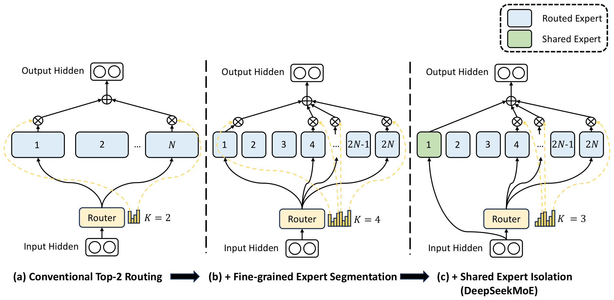
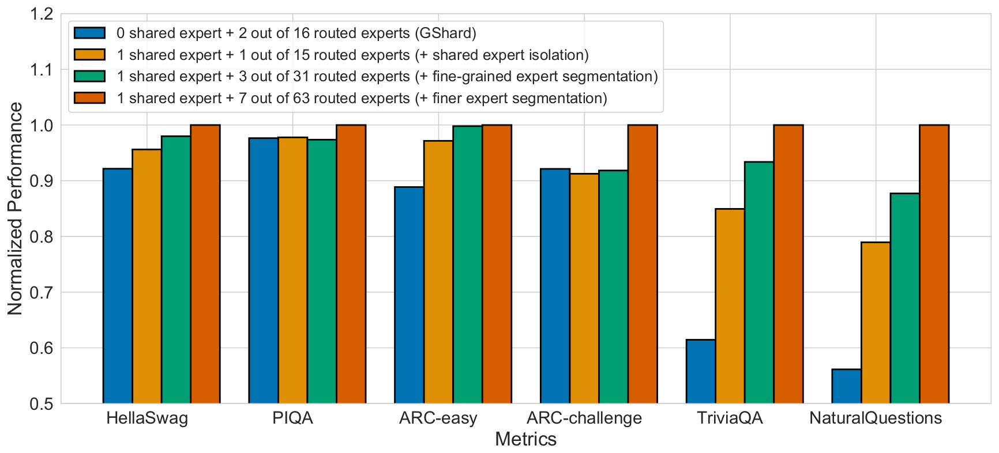
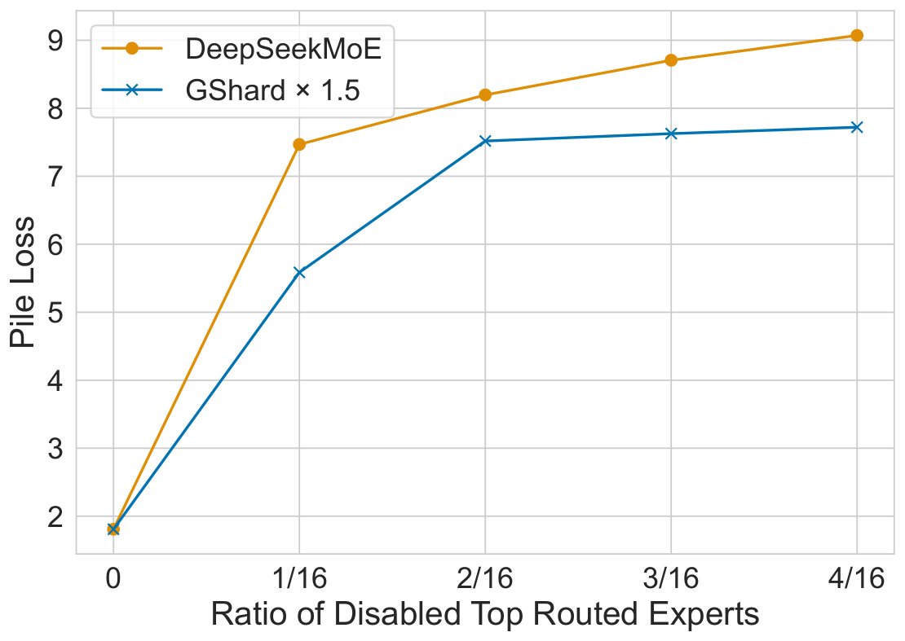
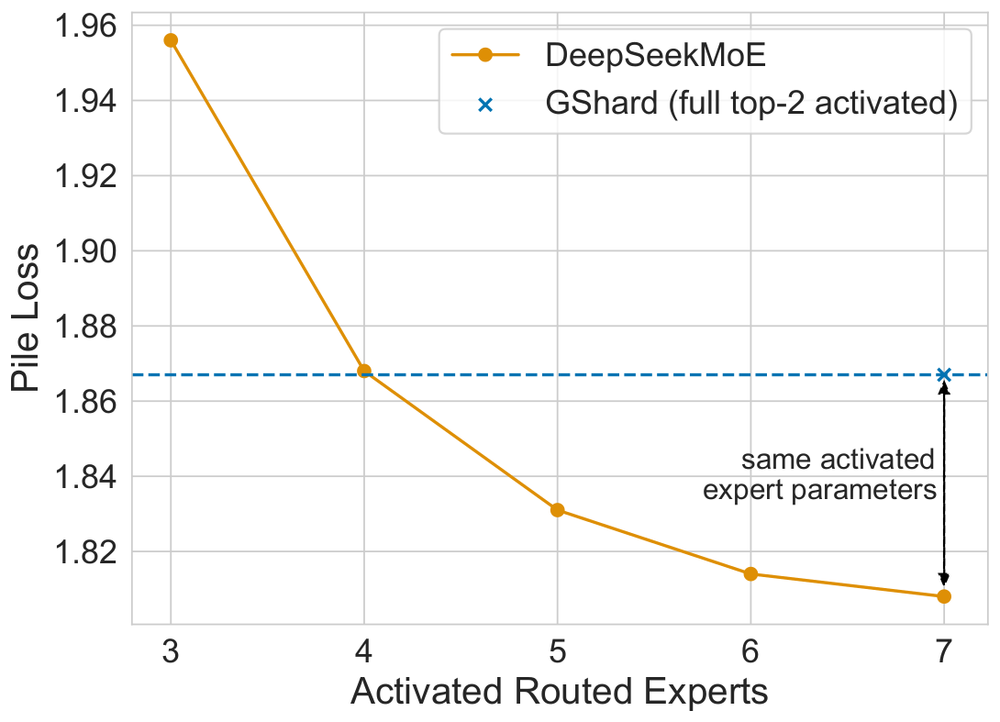
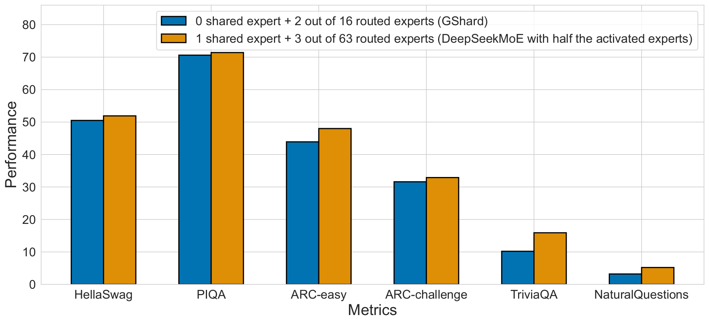
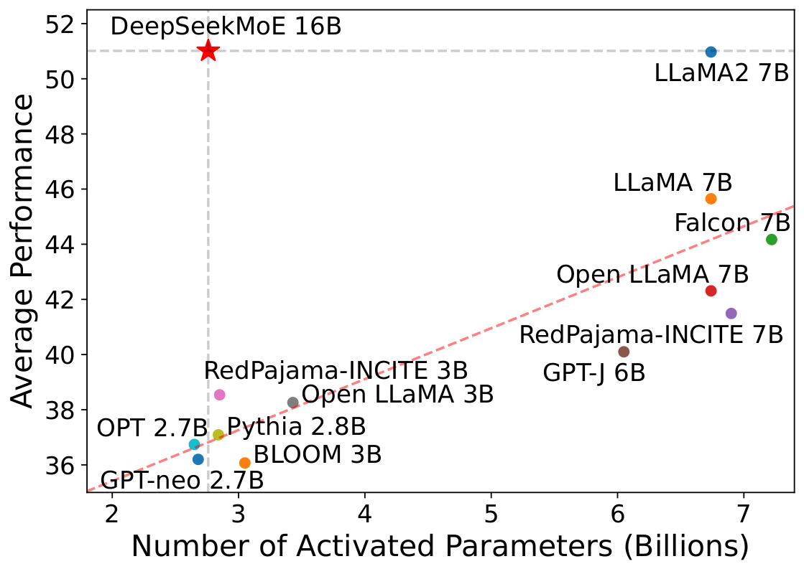
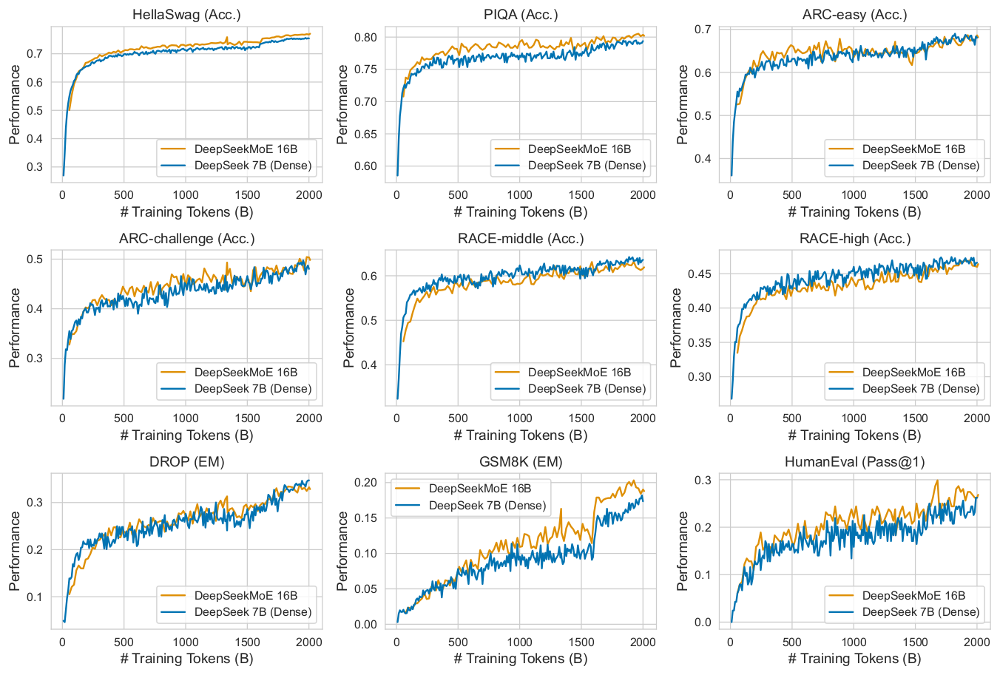
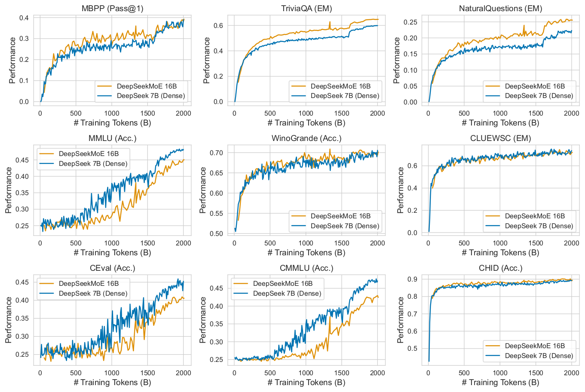

# 论文中文解读：《DeepSeekMoE: Towards Ultimate Expert Specialization in Mixture-of-Experts Language Models》

> **基本信息**：Damai Dai、Chengqi Deng、Chenggang Zhao、R.X. Xu、Huazuo Gao、Deli Chen、Jiashi Li、Wangding Zeng、Xingkai Yu、Y. Wu、Zhenda Xie、Y.K. Li、Panpan Huang、Fuli Luo、Chong Ruan、Zhifang Sui、Wenfeng Liang（DeepSeek-AI；部分作者另属北京大学、清华大学、南京大学，其中 Damai Dai、Chenggang Zhao、Xingkai Yu 的工作完成于 DeepSeek-AI 实习期间），arXiv:2401.06066（v1，2024 年 1 月 11 日）；论文原文 [arXiv 页面](https://arxiv.org/abs/2401.06066)；[官方仓库](https://github.com/deepseek-ai/DeepSeek-MoE)。
>
> **本文的读法**：图均为从论文 PDF 中按图裁出的原图；表 1–表 10 为逐格核对后的中文转录（数字与原文一致，原文粗体的“最优或接近最优”标记照录，表头和行名译成中文，基准名、模型名保持原样）。每张图后有中文图题、图例与坐标轴翻译和读图结论；“约”表示从图上读出的近似值，正文给出的数字优先使用原文数字。凡是笔者自己推导、举的例子或发现的原文不一致之处，都会明确标注。表中 Acc. 为准确率、EM 为精确匹配率、Pass@1 为单次生成通过率，均为越高越好；Pile 的 Loss 与 BPB 越低越好。

## 一、一句话结论

传统 MoE（例如 GShard）从 $N$ 个与标准 FFN 同样大小的专家里，为每个 token 选 top-$K$ 个。DeepSeekMoE 认为这会妨碍**专家专业化**（expert specialization，即每个专家学到彼此不重叠、聚焦的知识），原因有二：专家太少、太大，分给同一个专家的 token 涵盖多种知识，专家被迫把差异很大的知识塞进同一组参数（知识混杂，knowledge hybridity）；不同专家都需要通用知识，于是各自在参数里重复学一遍（知识冗余，knowledge redundancy）。对应的两条做法：

1. **细粒度专家切分**（Fine-Grained Expert Segmentation）：把每个专家 FFN 的中间维度缩小为原来的 $1/m$，专家数从 $N$ 变成 $mN$，每个 token 激活的专家数从 $K$ 变成 $mK$；专家参数总量和每 token 的计算量都不变，但可选的专家组合数急剧增加。
2. **共享专家隔离**（Shared Expert Isolation）：固定拿出 $K_s$ 个专家作为共享专家，对所有 token 始终激活、不经过路由器，用来承载公共知识；其余路由专家只需激活 $mK-K_s$ 个，计算量仍不变。

主要结果（数字均来自论文表格）：

- **2B 验证实验**（总参数 2.0B，激活 0.3B，训练 100B token）：Pile 损失 1.808，对比 GShard 1.867、Switch 1.881、Hash Layer 1.932、稠密 0.2B 模型 2.060（表 1）。它与专家参数量和计算量都是自己 1.5 倍的 GShard×1.5 打平（Pile 均为 1.808），并逼近“把 16 个 FFN 全部常开”的稠密模型 Dense×16（1.806）（表 2）。
- **16B**（总参数 16.4B，激活 2.8B，训练 2T token）：每 4K token 的 FLOPs 为 74.4T，是 DeepSeek 7B（稠密，183.5T）的 40.5%、LLaMA2 7B（187.9T）的 39.6%。对 LLaMA2 7B，20 项内部基准中领先 16 项、平手 1 项、落后 3 项（ARC-easy、DROP、MMLU）；对 DeepSeek 7B 领先 12 项、落后 8 项，落后的是 MMLU、CEval、CMMLU 三个多选题，以及 RACE-middle、RACE-high、DROP、WinoGrande、CLUEWSC（表 3、表 4，领先与落后的项数为笔者按表逐项统计）。
- **145B 初步实验**（总参数 144.6B，激活 22.2B，只训练 245B token）：显著优于同样规模的 GShard 137B，用 28.5% 的计算量与 DeepSeek 67B 稠密接近；激活减半的 142B 版本只用 18.2% 的计算量，也大体持平（表 6）。

## 二、背景与动机

### 2.1 Transformer 里的 MoE 层（式 1–5）

标准的 Transformer 语言模型由 $L$ 个相同的块堆叠而成，一个块可写成（论文省略了层归一化）：

$$
\mathbf{u}_{1:T}^{l}=\text{Self-Att}\big(\mathbf{h}_{1:T}^{l-1}\big)+\mathbf{h}_{1:T}^{l-1}\qquad(\text{式 }1)
$$

$$
\mathbf{h}_{t}^{l}=\operatorname{FFN}\big(\mathbf{u}_{t}^{l}\big)+\mathbf{u}_{t}^{l}\qquad(\text{式 }2)
$$

其中 $T$ 是序列长度，$\mathbf{u}_{1:T}^{l}\in\mathbb{R}^{T\times d}$ 是第 $l$ 个注意力模块之后所有 token 的隐状态，$\mathbf{h}_{t}^{l}\in\mathbb{R}^{d}$ 是第 $l$ 个块输出的第 $t$ 个 token 的隐状态，两个式子里的 “+” 都是残差连接。

构造 MoE 语言模型的常见做法是每隔一定层数，把 FFN 换成 MoE 层；MoE 层由多个与标准 FFN 结构相同的专家组成，每个 token 被分给一个（Switch，Fedus 等人 2021）或两个（GShard，Lepikhin 等人 2021）专家。若第 $l$ 层的 FFN 被换成 MoE 层，其输出为：

$$
\mathbf{h}_{t}^{l}=\sum_{i=1}^{N}\big(g_{i,t}\,\operatorname{FFN}_{i}(\mathbf{u}_{t}^{l})\big)+\mathbf{u}_{t}^{l}\qquad(\text{式 }3)
$$

$$
g_{i,t}=\begin{cases}s_{i,t}, & s_{i,t}\in\operatorname{Topk}\big(\{s_{j,t}\mid 1\le j\le N\},K\big),\\ 0, & \text{otherwise},\end{cases}\qquad(\text{式 }4)
$$

$$
s_{i,t}=\operatorname{Softmax}_{i}\big({\mathbf{u}_{t}^{l}}^{\top}\mathbf{e}_{i}^{l}\big)\qquad(\text{式 }5)
$$

符号：$N$ 是专家总数；$\operatorname{FFN}_i(\cdot)$ 是第 $i$ 个专家；$g_{i,t}$ 是第 $i$ 个专家对第 $t$ 个 token 的**门控值**（gate value）；$s_{i,t}$ 是 token 与专家的**亲和度**（token-to-expert affinity）；$\operatorname{Topk}(\cdot,K)$ 表示第 $t$ 个 token 对全部 $N$ 个专家算出的亲和度里最高的 $K$ 个；$\mathbf{e}_{i}^{l}$ 是第 $l$ 层第 $i$ 个专家的**质心**（centroid），可以理解为路由器线性层里对应专家的那一行权重。$g_{i,t}$ 是稀疏的，$N$ 个门控值里只有 $K$ 个非零，所以每个 token 只会被分配到并只在 $K$ 个专家里计算。

几点读法（笔者整理，帮助与本仓库 Sparsely-Gated MoE、Switch Transformer 两篇对照）：

- 式 5 先对所有专家做 softmax，式 4 再取 top-$K$，**保留 softmax 原值，不再重新归一化**，所以 $\sum_i g_{i,t}$ 一般小于 1。这和 [Sparsely-Gated MoE](../sparsely_gated_moe/论文中文解读.md)“先取 top-$k$ 再对保留项做 softmax”的顺序不同；$K=1$ 时门控值是 $s_{i,t}$（一般小于 1），与 [Switch Transformer](../switch_transformers/论文中文解读.md) 一样，路由器可以从门控值得到梯度。论文没有写 softmax 的归一化范围（全部专家还是只含路由专家）和是否对 top-$K$ 重新归一化，这里按式字面理解。
- **玩具例子（笔者举例，不是论文数据）**：$N=4$、$K=2$，设 $\mathbf{u}^{\top}\mathbf{e}_{i}=(2.0,\,1.0,\,0.5,\,-1.0)$，则 softmax 为 $(0.6095,\,0.2242,\,0.1360,\,0.0303)$，top-2 是专家 1、2，门控值为 $(0.6095,\,0.2242,\,0,\,0)$（和为 0.8337，不是 1），输出为 $\mathbf{h}=0.6095\operatorname{FFN}_{1}(\mathbf{u})+0.2242\operatorname{FFN}_{2}(\mathbf{u})+\mathbf{u}$。

### 2.2 现有 MoE 的两个问题

论文在引言里指出，GShard 这类架构（只用 8 个或 16 个这样少量的、与标准 FFN 同样大的专家）可能同时有两个问题，它们共同妨碍专家专业化，使模型达不到 MoE 的理论上界性能：

- **知识混杂**（Knowledge Hybridity）：专家数量有限，分给某个专家的 token 很可能涵盖多种不同的知识。于是这个专家要在自己的参数里同时装下差异很大的几类知识，而这些知识很难被同时利用。
- **知识冗余**（Knowledge Redundancy）：被分给不同专家的 token 可能都需要某些通用知识，多个专家便会各自在参数里学习这些共同知识，造成专家参数冗余。

### 2.3 术语速查

| 术语 | 含义 |
|---|---|
| 路由专家（routed expert） | 需要经过路由器、按 token 选择是否激活的专家 |
| 共享专家（shared expert） | 对所有 token 始终激活、不经过路由器的专家 |
| 激活参数 / 激活专家 | 处理一个 token 时实际参与计算的参数 / 专家；总参数则包含全部专家 |
| 相对专家大小 | 一个专家的参数量相对一个标准 FFN 的倍数（表中 0.25 表示 $m=4$） |
| FLOPs per 2K / 4K tokens | 表中给出的每 2048（或 4096）个 token 的浮点运算量；论文没有说明具体计数方式 |
| Dense×16 | 论文构造的稠密对照：16 个与标准 FFN 同样大的专家全部常开（相当于 FFN 参数为标准的 16 倍），用作“同总参数的 MoE 上界” |
| GShard×1.5 | 把 GShard 每个专家的大小放大 1.5 倍，专家参数量与专家计算量都是 GShard 的 1.5 倍 |

## 三、方法：DeepSeekMoE 架构

### 3.1 细粒度专家切分（图 2(a)→(b)，式 6–8）

专家很少时，分到某个专家的 token 难免涵盖多种知识。如果每个 token 能被路由到更多专家，多种知识就有机会被拆开、分别由不同专家学习，每个专家仍可保持高度专业化。为此论文在**保持专家参数总量和计算量不变**的前提下，把专家切得更细：把每个专家 FFN 切成 $m$ 个更小的专家，办法是把 FFN 的中间隐层维度缩小到原来的 $1/m$；因为每个专家变小了，为保持同样的计算量，每个 token 激活的专家数也相应增加到 $m$ 倍。切分之后，MoE 层的输出为：

$$
\mathbf{h}_{t}^{l}=\sum_{i=1}^{mN}\big(g_{i,t}\,\operatorname{FFN}_{i}(\mathbf{u}_{t}^{l})\big)+\mathbf{u}_{t}^{l}\qquad(\text{式 }6)
$$

$$
g_{i,t}=\begin{cases}s_{i,t}, & s_{i,t}\in\operatorname{Topk}\big(\{s_{j,t}\mid 1\le j\le mN\},mK\big),\\ 0, & \text{otherwise},\end{cases}\qquad(\text{式 }7)
$$

$$
s_{i,t}=\operatorname{Softmax}_{i}\big({\mathbf{u}_{t}^{l}}^{\top}\mathbf{e}_{i}^{l}\big)\qquad(\text{式 }8)
$$

专家参数总量仍等于 $N$ 个标准 FFN 的参数量，$mN$ 是细粒度专家的总数，非零门控值的个数增加到 $mK$。

**为什么说这是“更细的组合”**（笔者的理解，非论文原文）：一个 FFN 可以写成对隐层神经元的求和 $\operatorname{FFN}(\mathbf{u})=\sum_{j=1}^{d_{ff}}\mathbf{w}^{\text{out}}_{j}\,\sigma\big({\mathbf{w}^{\text{in}}_{j}}^{\top}\mathbf{u}\big)$，把 $d_{ff}$ 个隐层神经元平分成 $m$ 组，各组单独成为一个小 FFN，则全部 $m$ 个小 FFN 的输出直接相加就等于原 FFN。传统 top-$K$ MoE 以整个 FFN 为单位选择，细粒度切分后以 $1/m$ 个 FFN 为单位选择：路由器相当于在每个 token 上挑一小批隐层神经元。（论文里每个细粒度专家是各自独立初始化、从头训练的，上述等价只是帮助理解，不是实际做法。）

**组合数的对比**：论文用组合数说明灵活性。设 $N=16$：典型的 top-2 路由有 $\binom{16}{2}=120$ 种组合；如果每个专家切成 4 个更小的专家（$m=4$），细粒度路由有 $\binom{64}{8}=4{,}426{,}165{,}368$ 种潜在组合（笔者复算两个数字无误，后者约为前者的 $3.7\times10^{7}$ 倍）。论文认为组合灵活性的大幅提高，增加了更准确、更有针对性地获取知识的潜力。

下表是同一计算法则套到论文实际配置上的结果（笔者计算，论文只给了前两行的例子；组合数大不等于表达能力强，它只说明路由能选出更多种专家子集）：

| 配置 | 路由选择 | 可选的专家子集数 |
|---|---|---:|
| GShard（$N=16$，top-2） | 从 16 个选 2 个 | 120 |
| 切分 $m=4$（论文示例，不含共享专家） | 从 64 个选 8 个 | 4,426,165,368 |
| DeepSeekMoE 2B（1 共享 + 63 路由） | 从 63 个路由专家选 7 个 | 553,270,671 |
| DeepSeekMoE 16B（2 共享 + 64 路由） | 从 64 个路由专家选 6 个 | 74,974,368 |
| DeepSeekMoE 145B（4 共享 + 128 路由） | 从 128 个路由专家选 12 个 | 约 $2.37\times10^{16}$ |

### 3.2 共享专家隔离（图 2(c)，式 9–11）

常规路由下，分给不同专家的 token 可能需要某些共同的知识，于是多个专家各自在参数里学共同知识。如果专门有共享专家来捕捉并巩固跨上下文的共同知识，其他路由专家之间的参数冗余就会减轻，得到参数效率更高、专家更专业化的模型。具体做法：在细粒度切分的基础上，再把 $K_s$ 个专家隔离出来做共享专家。**不论路由器输出如何，每个 token 都被确定性地分给这些共享专家**；为保持计算量不变，其余路由专家里激活的个数相应减少 $K_s$。完整的 DeepSeekMoE 层为：

$$
\mathbf{h}_{t}^{l}=\sum_{i=1}^{K_s}\operatorname{FFN}_{i}(\mathbf{u}_{t}^{l})+\sum_{i=K_s+1}^{mN}\big(g_{i,t}\,\operatorname{FFN}_{i}(\mathbf{u}_{t}^{l})\big)+\mathbf{u}_{t}^{l}\qquad(\text{式 }9)
$$

$$
g_{i,t}=\begin{cases}s_{i,t}, & s_{i,t}\in\operatorname{Topk}\big(\{s_{j,t}\mid K_s+1\le j\le mN\},mK-K_s\big),\\ 0, & \text{otherwise},\end{cases}\qquad(\text{式 }10)
$$

$$
s_{i,t}=\operatorname{Softmax}_{i}\big({\mathbf{u}_{t}^{l}}^{\top}\mathbf{e}_{i}^{l}\big)\qquad(\text{式 }11)
$$

逐项解读：

- 式 9 第一项是共享专家：编号 $1,\dots,K_s$ 的专家**没有门控值**，输出直接相加（图 2(c) 里绿色专家的输出不经过 ⊗ 乘法节点）。第二项是路由专家，只对编号 $K_s+1,\dots,mN$ 的专家求和。最后一项仍是残差。
- 式 10：top-$K$ 只在路由专家（$j\ge K_s+1$）里取，取 $mK-K_s$ 个。
- 最终，共享专家有 $K_s$ 个，路由专家共 $mN-K_s$ 个，非零门控值有 $mK-K_s$ 个。
- 计算量核对：共享专家 $K_s$ 个加上被激活的路由专家 $mK-K_s$ 个，共 $mK$ 个小专家，每个是标准 FFN 的 $1/m$，合计相当于 $K$ 个标准 FFN，与传统 top-$K$ 相同。
- 论文指出，共享专家隔离的雏形可以归功于 Rajbhandari 等人（2022，DeepSpeed-MoE）；关键区别在于他们是从工程角度得到这一策略，而本文是从算法角度出发。

**例子一：2B 配置的计数（笔者举例）**：$N=16$、$K=2$、$m=4$，共 $mN=64$ 个小专家，$K_s=1$：1 个共享专家永远激活，另外 63 个路由专家里每个 token 选 $mK-K_s=7$ 个，因此每个 token 共用 $1+7=8$ 个小专家，等价于 2 个标准 FFN 的计算量。

**例子二：最小的数值演示（笔者举例，不是论文数据）**：1 个共享专家加 3 个路由专家，每个 token 只选 1 个路由专家。设 3 个路由专家的原始打分为 $(1.0,\,0.0,\,-1.0)$；假设 softmax 在路由专家上归一化，则 $s=(0.6652,\,0.2447,\,0.0900)$，top-1 是路由专家 1，输出为 $\operatorname{FFN}_{\text{shared}}(\mathbf{u})+0.6652\operatorname{FFN}_{1}(\mathbf{u})+\mathbf{u}$；共享专家不参与竞争，也没有门控缩放。

### 3.3 各配置的参数与计算核算（笔者整理）

下表把论文各规模的专家配置放在一起（专家数、激活数、相对专家大小来自表 2、表 6、表 7，最后两列由笔者按“专家数 × 相对大小”算出，单位是标准 FFN 的个数）：

| 模型 | 共享 + 路由专家数 | 每专家相对大小 | 激活（共享 + 路由） | 每层专家总量（标准 FFN 的倍数） | 每 token 激活（标准 FFN 的倍数） |
|---|---|---:|---|---:|---:|
| GShard（2B 验证） | 0 + 16 | 1 | 0 + 2 | 16 | 2 |
| DeepSeekMoE 2B | 1 + 63 | 0.25 | 1 + 7 | 16 | 2 |
| DeepSeekMoE 16B | 2 + 64 | 0.25 | 2 + 6 | 16.5 | 2 |
| GShard 137B | 0 + 16 | 1 | 0 + 2 | 16 | 2 |
| DeepSeekMoE 145B | 4 + 128 | 0.125 | 4 + 12 | 16.5 | 2 |
| DeepSeekMoE 142B（Half Activated） | 2 + 128 | 0.125 | 2 + 6 | 16.25 | 1 |

读法：不同规模的 DeepSeekMoE 都遵守“每层专家总量约 16 个标准 FFN、每 token 激活约 2 个标准 FFN”（半激活版本为 1 个）；16B 与 145B 因为共享专家数大于 1，总量略超过 16。切得越细（相对大小从 0.25 到 0.125），路由器要在更多的专家里选、各专家的矩阵乘也更小。论文也说，16B 没有采用更细的粒度，是顾虑过小的专家会降低计算效率；更大的规模上仍可采用更细的粒度（145B 就用了 0.125）。另外论文指出，145B 把每个专家的中间隐层维度对齐到 64 的倍数以提高计算效率，所以模型比 GShard 137B 大 6%（144.6B 对 136.5B，核对：$144.6/136.5=1.059$）。



*图 2（原文 Figure 2，第 5 页）：DeepSeekMoE 示意。子图 (a) 为采用传统 top-2 路由的 MoE 层；子图 (b) 展示细粒度专家切分；子图 (c) 在此基础上加入共享专家隔离，构成完整的 DeepSeekMoE 架构。值得注意的是，这三种架构的专家参数量和计算成本保持不变。*

**图中文字翻译与读法**：

- 右上角图例：蓝色方块 Routed Expert（路由专家），绿色方块 Shared Expert（共享专家）。每个子图自下而上：Input Hidden（输入隐状态，两个圆圈的小方块）→ Router（路由器，黄色框，旁边的黄色柱状图是各专家的得分）→ 专家们 → ⊗（乘法节点，把门控值乘到专家输出上，黄色虚线箭头表示得分送到这里）→ ⊕（求和节点）→ Output Hidden（输出隐状态）。
- **(a) Conventional Top-2 Routing（传统 top-2 路由）**：$N$ 个与标准 FFN 同大小的专家（标号 1、2、…、$N$），路由器标 $K=2$，选出得分最高的两个专家（图中为 1 和 $N$），各自乘以门控值后求和。
- **(b) + Fine-grained Expert Segmentation（加上细粒度专家切分）**：专家变成 $2N$ 个、每个窄了一半（图中取 $m=2$），路由器标 $K=4$，选出 4 个专家（图中为 1、4、中间一个“…”、$2N$）。
- **(c) + Shared Expert Isolation (DeepSeekMoE)（再加上共享专家隔离）**：专家 1 变为绿色的共享专家，输入隐状态直接送给它（不经过路由器，输出也不经过 ⊗），其余专家 2 到 $2N$ 是路由专家，路由器标 $K=3$，选出 3 个（图中为 4、中间一个“…”、$2N$）。
- **读图结论**：三个子图的激活量相同：(a) 是 2 个全尺寸专家，(b) 是 4 个半尺寸专家，(c) 是 1 个共享加 3 个路由、共 4 个半尺寸专家。变化只在“可选专家的颗粒度”与“有一部分专家不再参与竞争”。

### 3.4 负载均衡（式 12–17）

自动学习的路由策略可能出现负载不均衡，带来两类问题：一是**路由塌缩**（routing collapse，Shazeer 等人 2017），即模型总是只选少数几个专家，让其他专家得不到充分训练；二是专家分布在多个设备上时，负载不均衡会加剧计算瓶颈。论文为此设计两个辅助损失。

**专家级均衡损失**（Expert-Level Balance Loss），用来缓解路由塌缩：

$$
\mathcal{L}_{\text{ExpBal}}=\alpha_{1}\sum_{i=1}^{N'}f_{i}P_{i}\qquad(\text{式 }12)
$$

$$
f_{i}=\frac{N'}{K'T}\sum_{t=1}^{T}\mathbb{1}\big(\text{Token }t\text{ selects Expert }i\big)\qquad(\text{式 }13)
$$

$$
P_{i}=\frac{1}{T}\sum_{t=1}^{T}s_{i,t}\qquad(\text{式 }14)
$$

其中 $\alpha_{1}$ 是专家级均衡系数，$N'=mN-K_s$（路由专家总数），$K'=mK-K_s$（每个 token 激活的路由专家数），$\mathbb{1}(\cdot)$ 是指示函数，$T$ 是 batch 里的 token 数。

**设备级均衡损失**（Device-Level Balance Loss）：为了缓解计算瓶颈，不必在专家层面强加严格的均衡约束，因为过强的负载均衡约束会损害模型性能；主要目标是保证各设备上的计算均衡。把全部路由专家分成 $D$ 组 $\{\mathcal{E}_{1},\dots,\mathcal{E}_{D}\}$，每组部署在一个设备上：

$$
\mathcal{L}_{\text{DevBal}}=\alpha_{2}\sum_{i=1}^{D}f'_{i}P'_{i}\qquad(\text{式 }15)
$$

$$
f'_{i}=\frac{1}{\lvert\mathcal{E}_{i}\rvert}\sum_{j\in\mathcal{E}_{i}}f_{j}\qquad(\text{式 }16)
$$

$$
P'_{i}=\sum_{j\in\mathcal{E}_{i}}P_{j}\qquad(\text{式 }17)
$$

其中 $\alpha_{2}$ 是设备级均衡系数。实践中，论文设**较小**的专家级系数以缓解路由塌缩，同时设**较大**的设备级系数以促进设备间的计算均衡。

**怎么理解这两个损失**（笔者推导）：

- **与 Switch 同形**：令 $K'=1$、$N'=N$，式 13 变成 $f_i=N\cdot\frac{1}{T}\sum_t\mathbb{1}(\cdot)$，式 12 就是 [Switch Transformer](../switch_transformers/论文中文解读.md) 的 $\alpha N\sum_i f_iP_i$（那里的 $f_i$ 是 token 比例，$N$ 在外面）。这里把 $N'$ 放进 $f_i$，并用 $K'T$ 而不是 $T$ 做归一化，使它适用于每个 token 选 $K'$ 个专家的情形。
- **均匀时恒为 $\alpha_1$**：若路由完全均匀，每个专家被选中 $K'T/N'$ 次，所以 $f_i=1$；若 softmax 在 $N'$ 个路由专家上归一化，则 $P_i=1/N'$，$\sum_i f_iP_i=N'\cdot1\cdot\frac{1}{N'}=1$。设备级损失在各组大小相同时也是 $f'_i=1$、$P'_i=1/D$，求和仍为 1。偏离均匀会使和大于 1。
- **梯度怎么走**：$f_i$ 由计数得到，不可导；$P_i$ 由 softmax 得分平均得到，可导。所以梯度经 $P_i$ 回传到路由器：被分到 token 多（$f_i$ 大）的专家，其得分被压低。
- **$f'$ 取平均，$P'$ 取求和**：式 16 对组内专家的 $f_j$ 取平均，式 17 对 $P_j$ 求和，这个不对称是原文的写法；只要各组专家数相同，二者差一个常数因子。

**数值例子（笔者举例，不是论文数据）**：$T=4$ 个 token，$N'=4$ 个路由专家，每个 token 选 $K'=2$ 个。设选择结果为 token 1 选 $\{1,2\}$、token 2 选 $\{1,3\}$、token 3 选 $\{1,2\}$、token 4 选 $\{3,4\}$，则各专家被选 $(3,2,2,1)$ 次，$f_i=\frac{4}{8}\times(3,2,2,1)=(1.5,\,1.0,\,1.0,\,0.5)$。设 4 个 token 的 softmax 得分依次为 $(0.40,0.30,0.20,0.10)$、$(0.35,0.15,0.30,0.20)$、$(0.45,0.25,0.20,0.10)$、$(0.10,0.15,0.40,0.35)$（它们的 top-2 与上面的选择一致），则 $P=(0.325,\,0.2125,\,0.275,\,0.1875)$，$\sum_i f_iP_i=1.06875$，即 $\mathcal{L}_{\text{ExpBal}}=1.06875\,\alpha_1$，比完全均衡的 $\alpha_1$ 大。若分成 $D=2$ 组（$\mathcal{E}_1=\{1,2\}$、$\mathcal{E}_2=\{3,4\}$），则 $f'=(1.25,\,0.75)$，$P'=(0.5375,\,0.4625)$，$\mathcal{L}_{\text{DevBal}}=1.01875\,\alpha_2$。若所有 token 都只选专家 1、2（塌缩），则 $f=(2,2,0,0)$，设 $P=(0.45,0.45,0.05,0.05)$，$\sum f_iP_i=1.8$，损失明显更大。

**各规模实际使用的系数与放置方式**（论文第 4、5、7 节）：

| 规模 | 专家级系数 $\alpha_1$ | 设备级系数 $\alpha_2$ | 专家放置与 token 丢弃 |
|---|---:|---|---|
| 2B 验证实验 | 0.01 | 不使用 | 全部参数（含专家）放在单个 GPU 上以避免计算不均衡；不丢任何 token |
| 16B | 0.001 | 不使用 | 流水线并行，不同层放在不同设备，每层的所有专家放在同一设备；不丢任何 token |
| 145B | 0.003 | 0.05 | 流水线并行；每层的路由专家均匀放在 4 个设备上（专家并行结合数据并行） |

16B 采用很小的专家级系数，是因为论文发现在它们的并行策略下，更大的专家级系数不能提高计算效率，反而损害模型性能。论文全文没有使用“专家容量/容量因子”，2B 与 16B 明确不丢 token；145B 一节没有提到是否有容量限制。

### 3.5 一次前向计算的步骤（笔者整理）

1. 输入：注意力模块之后第 $t$ 个 token 的隐状态 $\mathbf{u}_t^{l}$。
2. 共享专家：对 $K_s$ 个共享专家各算 $\operatorname{FFN}_i(\mathbf{u}_t^{l})$，**无门控**直接相加。
3. 路由打分：用 $mN-K_s$ 个路由专家的质心算亲和度 $s_{i,t}$（式 11）。
4. 选择：在路由专家里取最高的 $mK-K_s$ 个，其余门控值置 0（式 10）。
5. 路由专家计算：只对被选中的专家算 $\operatorname{FFN}_i(\mathbf{u}_t^{l})$，乘各自的 $g_{i,t}$ 后相加。
6. 合并：共享专家之和、路由专家加权和与残差 $\mathbf{u}_t^{l}$ 相加，得到 $\mathbf{h}_t^{l}$（式 9）。
7. 训练时：在语言建模损失之外加专家级均衡损失 $\mathcal{L}_{\text{ExpBal}}$（145B 另加设备级 $\mathcal{L}_{\text{DevBal}}$）。

## 四、实验设置

### 4.1 数据与分词

训练数据采样自 DeepSeek-AI 构建的大规模多语种语料，以中英文为主，也包含其他语言，来源涵盖网页文本、数学材料、代码、已出版文献和各种其他文本。验证实验从中抽取 100B token 的子集训练模型；用 HuggingFace Tokenizers 在语料的一个较小子集上训练 BPE 分词器，验证实验的词表大小为 8K，训练更大模型时会加大词表（16B 与 145B 为 100K）。16B 使用同一语料的 2T token 样本（与 LLaMA2 7B 的训练 token 数对齐）。

### 4.2 基础设施

实验基于 HAI-LLM（High-Flyer 2023）训练框架，集成多种并行策略：张量并行、ZeRO 数据并行、PipeDream 流水线并行，以及通过结合数据并行与张量并行实现的专家并行。为优化性能，作者用 CUDA 与 Triton 为门控算法以及跨专家线性层的计算融合开发了 GPU kernel。所有实验在装有 NVIDIA A100 或 H800 GPU 的集群上进行：每个节点 8 张 GPU，A100 节点内通过 NVLink 桥两两互连，H800 节点内用 NVLink 与 NVSwitch；节点之间都用 InfiniBand。

### 4.3 各规模的模型与训练超参数

表 7 设置：DeepSeekMoE 各规模的超参数一览；相对专家大小是相对标准 FFN 而言。

| 参数量 | 层数 | 隐层维度 | 注意力头数 | 共享专家数 | 路由专家数 | 相对专家大小 | 序列长度 | 批大小（序列数） | 学习率 |
|---:|---:|---:|---:|---:|---|---:|---:|---:|---:|
| 2.0B | 9 | 1280 | 10 | 1 | 63（激活 7） | 0.25 | 2048 | 2048 | 1.08e-3 |
| 16.4B | 28 | 2048 | 16 | 2 | 64（激活 6） | 0.25 | 4096 | 4608 | 4.2e-4 |
| 144.6B | 62 | 4096 | 32 | 4 | 128（激活 12） | 0.125 | 4096 | 4608 | 3.0e-4 |

（原文表 7，第 31 页。）

**2B 验证实验**：9 层 Transformer，隐层维度 1280，10 个注意力头（每头 128 维）；所有可学习参数用标准差 0.006 的随机初始化；所有 FFN 都换成 MoE 层，专家参数总量为标准 FFN 的 16 倍，激活的专家参数（含共享专家）为标准 FFN 的 2 倍；这样每个 MoE 模型约 2B 总参数，激活参数约 0.3B。优化器 AdamW（$\beta_1=0.9$，$\beta_2=0.95$，weight decay 0.1）；学习率先在前 2K 步从 0 线性升到最大值 $1.08\times10^{-3}$，之后在训练进行到 80% 与 90% 时各乘 0.316；梯度裁剪范数 1.0；batch 为 2K 个序列、最大序列长度 2K，即每个 batch 约 4M token，共训练 25,000 步以达到 100B token；数据充足所以不用 dropout。（笔者核对：$2048\times2048=4{,}194{,}304$，25,000 步约 105B token，论文取整为 4M 与 100B。）

**16B**：28 层，隐层维度 2048，16 个注意力头（每头 128 维）；同样标准差 0.006 初始化；除第一层外所有 FFN 换成 MoE 层，因为论文观察到第一层的负载均衡收敛特别慢；每个 MoE 层有 2 个共享专家和 64 个路由专家，每个专家是标准 FFN 的 0.25 倍；每个 token 被路由到 2 个共享专家加 64 个路由专家里的 6 个。论文没有采用更细的专家粒度，因为过小的专家可能降低计算效率；更大规模上仍可以采用更细的粒度。在这个配置下，DeepSeekMoE 16B 约 16.4B 总参数，激活约 2.8B。优化器同上，学习率调度同样是“线性升温加两次 0.316 阶梯衰减”，最大学习率 $4.2\times10^{-4}$，梯度裁剪 1.0；batch 为 4.5K 个序列、最大长度 4K，每个 batch 约 18M token，共 106,449 步，达到 2T token；不使用 dropout。（笔者核对：表 7 里批大小是 4608 个序列，$4608\times4096\approx18.87$M token，$106{,}449\times18.87\text{M}\approx2.0$T；正文 “18M” 是取整。）

**145B**：62 层，隐层维度 4096，32 个注意力头（每头 128 维）；除第一层外 FFN 都换成 MoE；每个 MoE 层有 4 个共享专家和 128 个路由专家，每个专家是标准 FFN 的 0.125 倍；每个 token 路由到 4 个共享专家加 128 个路由专家里的 12 个；约 144.6B 总参数、约 22.2B 激活参数。训练只是初步研究：优化器同上，采用“升温加常数”的学习率（前 2K 步线性升到 $3.0\times10^{-4}$，之后保持不变），梯度裁剪 1.0，batch 4.5K 个序列、长度 4K（每 batch 约 18M token），训练 13,000 步，共 245B token，不用 dropout。（笔者核对：$13{,}000\times18.87\text{M}\approx245$B，与 245B 吻合。）

### 4.4 评测基准

| 类别 | 基准（指标） | 出现位置 |
|---|---|---|
| 语言建模 | Pile 测试集（2B 与 145B 用交叉熵损失 Loss；16B 因分词器不同改用 BPB，即每字节比特数） | 表 1–4、6、8、9 |
| 语言理解与推理 | HellaSwag、PIQA、ARC-easy、ARC-challenge（准确率） | 全部 |
| 阅读理解 | RACE-high、RACE-middle（准确率）；16B 起另加 DROP（EM） | 全部 |
| 代码生成 | HumanEval、MBPP（Pass@1） | 全部 |
| 闭卷问答 | TriviaQA、NaturalQuestions（EM） | 全部 |
| 数学推理（16B 起） | GSM8K、MATH（EM） | 表 3–6 |
| 多学科多选（16B 起） | MMLU（准确率） | 表 3–6 |
| 消歧（16B 起） | WinoGrande（准确率） | 表 3–6 |
| 中文（16B 起） | CLUEWSC（EM）、CEval 与 CMMLU（准确率）、CHID（成语填空，准确率） | 表 3–6 |
| 聊天模型 | 在上述基础上另加 BBH（EM）；去掉 Pile（聊天模型很少用于纯语言建模）和 CHID（结果不稳定，难以得出可靠结论） | 表 5 |
| Open LLM Leaderboard | HuggingFace 公开榜单，含 ARC、HellaSwag、MMLU、TruthfulQA、Winogrande、GSM8K 六项 | 图 1 |

## 五、验证实验：2B 规模（100B token）

### 5.1 基线与设置

共比较五个模型：**Dense** 是总参数 0.2B 的标准稠密 Transformer；**Hash Layer**（Roller 等人 2021）基于 top-1 哈希路由（不学习路由函数），总参数 2.0B、激活 0.2B，与稠密基线对齐；**Switch Transformer**（Fedus 等人 2021）基于 top-1 可学习路由，总参数与激活参数同 Hash Layer；**GShard**（Lepikhin 等人 2021）采用 top-2 可学习路由，总参数 2.0B，因为比 top-1 多激活一个专家，激活参数为 0.3B；**DeepSeekMoE** 有 1 个共享专家和 63 个路由专家，每个专家是标准 FFN 的 0.25 倍。所有模型共用同一训练语料和训练超参数；所有 MoE 模型总参数相同，GShard 与 DeepSeekMoE 的激活参数相同。报告的是训练 100B token 之后的最终结果。

### 5.2 主结果（表 1）

表 1 设置：验证实验的评测结果（粗体为最优）。

| 指标 | 样本数（# Shot） | Dense | Hash Layer | Switch | GShard | DeepSeekMoE |
|---|---|---:|---:|---:|---:|---:|
| 总参数量（# Total Params） | N/A | 0.2B | 2.0B | 2.0B | 2.0B | 2.0B |
| 激活参数量（# Activated Params） | N/A | 0.2B | 0.2B | 0.2B | 0.3B | 0.3B |
| 每 2K token 的 FLOPs | N/A | 2.9T | 2.9T | 2.9T | 4.3T | 4.3T |
| 训练 token 数（# Training Tokens） | N/A | 100B | 100B | 100B | 100B | 100B |
| Pile（Loss，越低越好） | N/A | 2.060 | 1.932 | 1.881 | 1.867 | **1.808** |
| HellaSwag (Acc.) | 0-shot | 38.8 | 46.2 | 49.1 | 50.5 | **54.8** |
| PIQA (Acc.) | 0-shot | 66.8 | 68.4 | 70.5 | 70.6 | **72.3** |
| ARC-easy (Acc.) | 0-shot | 41.0 | 45.3 | 45.9 | 43.9 | **49.4** |
| ARC-challenge (Acc.) | 0-shot | 26.0 | 28.2 | 30.2 | 31.6 | **34.3** |
| RACE-middle (Acc.) | 5-shot | 38.8 | 38.8 | 43.6 | 42.1 | **44.0** |
| RACE-high (Acc.) | 5-shot | 29.0 | 30.0 | 30.9 | 30.4 | **31.7** |
| HumanEval (Pass@1) | 0-shot | 0.0 | 1.2 | 2.4 | 3.7 | **4.9** |
| MBPP (Pass@1) | 3-shot | 0.2 | 0.6 | 0.4 | 0.2 | **2.2** |
| TriviaQA (EM) | 5-shot | 4.9 | 6.5 | 8.9 | 10.2 | **16.6** |
| NaturalQuestions (EM) | 5-shot | 1.4 | 1.4 | 2.5 | 3.2 | **5.7** |

（原文表 1，第 10 页。）论文的三点观察：

1. 稀疏架构有更多总参数，因此 Hash Layer 与 Switch 显著强于激活参数相同的稠密基线（Pile 2.060 到 1.932 与 1.881）。
2. GShard 比 Hash Layer 和 Switch 激活参数更多，略好于 Switch。（笔者逐项核对：Pile 1.867 对 1.881；11 项里 GShard 在 7 项上更好，在 ARC-easy 43.9 对 45.9、RACE-middle 42.1 对 43.6、RACE-high 30.4 对 30.9、MBPP 0.2 对 0.4 上更差。）
3. 在总参数与激活参数都相同的条件下，DeepSeekMoE 对 GShard 有压倒性优势。（笔者统计：11 项指标全部领先，Pile 损失低 0.059，HellaSwag +4.3、ARC-easy +5.5、TriviaQA +6.4、NaturalQuestions +2.5。）

笔者提醒：2B 小模型的代码指标很低（HumanEval 0–5、MBPP 0–2.2），差距容易落在随机波动里；论文没有报告多次运行的方差。

### 5.3 逼近 MoE 的“上界”：对比更大的 GShard 与稠密模型（表 2、表 8、表 9）

为更精确地理解 DeepSeekMoE 的水平，论文把它与参数更多或激活更多的基线比较，以估计 GShard 或稠密模型需要多大才能达到同样性能。

**对比 GShard×1.5**：GShard×1.5 的专家大小是 GShard 的 1.5 倍，因此专家参数和专家计算都是 1.5 倍。**对比 Dense×16**：为公平起见，不采用常见的注意力与 FFN 参数 1:2 的比例，而是配置 16 个共享专家，每个专家与标准 FFN 参数一样多，这个结构模拟的是 FFN 参数为标准 16 倍的稠密模型；它在总容量上给 MoE 设了一个严格的上界（论文原话 strict upper bound，下文 5.4 说明这是启发式的）。

表 2 设置：DeepSeekMoE、更大的 GShard 模型与更大的稠密模型的对比；“专家数”一行里 $a+b$ 表示 $a$ 个共享专家加 $b$ 个路由专家，“激活专家数”里 $a+b$ 表示激活 $a$ 个共享、$b$ 个路由。该表原文没有粗体。

| 指标 | 样本数（# Shot） | GShard×1.5 | Dense×16 | DeepSeekMoE |
|---|---|---:|---:|---:|
| 相对专家大小（相对标准 FFN） | N/A | 1.5 | 1 | 0.25 |
| 专家数（共享 + 路由） | N/A | 0 + 16 | 16 + 0 | 1 + 63 |
| 激活专家数（共享 + 路由） | N/A | 0 + 2 | 16 + 0 | 1 + 7 |
| 专家总参数量（# Total Expert Params） | N/A | 2.83B | 1.89B | 1.89B |
| 激活的专家参数量（# Activated Expert Params） | N/A | 0.35B | 1.89B | 0.24B |
| 每 2K token 的 FLOPs | N/A | 5.8T | 24.6T | 4.3T |
| 训练 token 数（# Training Tokens） | N/A | 100B | 100B | 100B |
| Pile（Loss，越低越好） | N/A | 1.808 | 1.806 | 1.808 |
| HellaSwag (Acc.) | 0-shot | 54.4 | 55.1 | 54.8 |
| PIQA (Acc.) | 0-shot | 71.1 | 71.9 | 72.3 |
| ARC-easy (Acc.) | 0-shot | 47.3 | 51.9 | 49.4 |
| ARC-challenge (Acc.) | 0-shot | 34.1 | 33.8 | 34.3 |
| RACE-middle (Acc.) | 5-shot | 46.4 | 46.3 | 44.0 |
| RACE-high (Acc.) | 5-shot | 32.4 | 33.0 | 31.7 |
| HumanEval (Pass@1) | 0-shot | 3.0 | 4.3 | 4.9 |
| MBPP (Pass@1) | 3-shot | 2.6 | 2.2 | 2.2 |
| TriviaQA (EM) | 5-shot | 15.7 | 16.5 | 16.6 |
| NaturalQuestions (EM) | 5-shot | 4.7 | 6.3 | 5.7 |

（原文表 2，第 11 页。）读法：

- 与 GShard×1.5：Pile 损失相同（1.808），DeepSeekMoE 在 7 项上领先（HellaSwag +0.4、PIQA +1.2、ARC-easy +2.1、ARC-challenge +0.2、HumanEval +1.9、TriviaQA +0.9、NaturalQuestions +1.0，共 7 项），在 RACE-middle（−2.4）、RACE-high（−0.7）、MBPP（−0.4）上落后（差值为笔者按表相除）。论文称之为“相当”。注意论文说 GShard×1.5 的“专家计算是 1.5 倍”，指专家部分；整模型 FLOPs 是 5.8T 对 4.3T，约 1.35 倍（笔者计算）。
- 与 Dense×16：Pile 损失 1.808 对 1.806，几乎相等；个别基准仍有差距（ARC-easy 49.4 对 51.9、RACE-middle 44.0 对 46.3），也有反超（PIQA +0.4、ARC-challenge +0.5、HumanEval +0.6）。FLOPs 只有 Dense×16 的 17.5%（4.3T 对 24.6T，笔者计算）。论文结论：至少在约 2B 参数与 100B 训练 token 的规模上，DeepSeekMoE 的表现与 MoE 理论上界高度吻合。

附录 B 补充了两组对比。表 8 设置：与 GShard×1.2 和 GShard×1.5 的对比（专家参数量分别是 GShard 的 1.2 倍与 1.5 倍）。

| 指标 | 样本数（# Shot） | GShard×1.2 | GShard×1.5 | DeepSeekMoE |
|---|---|---:|---:|---:|
| 相对专家大小（相对标准 FFN） | N/A | 1.2 | 1.5 | 0.25 |
| 专家数（共享 + 路由） | N/A | 0 + 16 | 0 + 16 | 1 + 63 |
| 激活专家数（共享 + 路由） | N/A | 0 + 2 | 0 + 2 | 1 + 7 |
| 专家总参数量（# Total Expert Params） | N/A | 2.3B | 2.8B | 1.9B |
| 激活的专家参数量（# Activated Expert Params） | N/A | 0.28B | 0.35B | 0.24B |
| 训练 token 数（# Training Tokens） | N/A | 100B | 100B | 100B |
| Pile（Loss，越低越好） | N/A | 1.824 | **1.808** | **1.808** |
| HellaSwag (Acc.) | 0-shot | 53.7 | 54.4 | **54.8** |
| PIQA (Acc.) | 0-shot | 71.8 | 71.1 | **72.3** |
| ARC-easy (Acc.) | 0-shot | 46.8 | 47.3 | **49.4** |
| ARC-challenge (Acc.) | 0-shot | 31.7 | **34.1** | **34.3** |
| RACE-middle (Acc.) | 5-shot | 43.7 | **46.4** | 44.0 |
| RACE-high (Acc.) | 5-shot | 31.9 | **32.4** | 31.7 |
| HumanEval (Pass@1) | 0-shot | 3.7 | 3.0 | **4.9** |
| MBPP (Pass@1) | 3-shot | 2.4 | **2.6** | 2.2 |
| TriviaQA (EM) | 5-shot | 15.2 | 15.7 | **16.6** |
| NaturalQuestions (EM) | 5-shot | 4.5 | 4.7 | **5.7** |

（原文表 8，第 31 页。）读法：GShard×1.2 的 Pile 损失为 1.824，GShard×1.5 与 DeepSeekMoE 均为 1.808；DeepSeekMoE 的专家总参数 1.9B、激活专家参数 0.24B，都小于 GShard×1.2（2.3B、0.28B）。表 2 与表 8 里 GShard×1.5 与 DeepSeekMoE 两列数字完全一致（笔者核对）。

表 9 设置：与 Dense×4 和 Dense×16 的对比。

| 指标 | 样本数（# Shot） | Dense×4 | Dense×16 | DeepSeekMoE |
|---|---|---:|---:|---:|
| 相对专家大小（相对标准 FFN） | N/A | 1 | 1 | 0.25 |
| 专家数（共享 + 路由） | N/A | 4 + 0 | 16 + 0 | 1 + 63 |
| 激活专家数（共享 + 路由） | N/A | 4 + 0 | 16 + 0 | 1 + 7 |
| 专家总参数量（# Total Expert Params） | N/A | 0.47B | 1.89B | 1.89B |
| 激活的专家参数量（# Activated Expert Params） | N/A | 0.47B | 1.89B | 0.24B |
| 训练 token 数（# Training Tokens） | N/A | 100B | 100B | 100B |
| Pile（Loss，越低越好） | N/A | 1.908 | **1.806** | **1.808** |
| HellaSwag (Acc.) | 0-shot | 47.6 | **55.1** | **54.8** |
| PIQA (Acc.) | 0-shot | 70.0 | 71.9 | **72.3** |
| ARC-easy (Acc.) | 0-shot | 43.9 | **51.9** | 49.4 |
| ARC-challenge (Acc.) | 0-shot | 30.5 | 33.8 | **34.3** |
| RACE-middle (Acc.) | 5-shot | 42.4 | **46.3** | 44.0 |
| RACE-high (Acc.) | 5-shot | 30.7 | **33.0** | 31.7 |
| HumanEval (Pass@1) | 0-shot | 1.8 | 4.3 | **4.9** |
| MBPP (Pass@1) | 3-shot | 0.2 | **2.2** | **2.2** |
| TriviaQA (EM) | 5-shot | 9.9 | **16.5** | **16.6** |
| NaturalQuestions (EM) | 5-shot | 3.0 | **6.3** | 5.7 |

（原文表 9，第 32 页。）读法：Dense×4（4 个标准 FFN 常开，激活专家参数 0.47B）的 Pile 损失 1.908，明显差于 DeepSeekMoE 的 1.808，尽管后者激活的专家参数只有它的一半（0.24B）。

更大规模：论文把 DeepSeekMoE 的总参数增加到 13.3B，与总参数 15.9B 的 GShard×1.2 和 19.8B 的 GShard×1.5 比较，发现在更大规模下 DeepSeekMoE 甚至能明显超过 GShard×1.5。

表 10 设置：更大规模下的 DeepSeekMoE 与更大的 GShard 模型对比（原文没有 Pile 行）。

| 指标 | 样本数（# Shot） | GShard×1.2 | GShard×1.5 | DeepSeekMoE |
|---|---|---:|---:|---:|
| 相对专家大小（相对标准 FFN） | N/A | 1.2 | 1.5 | 0.25 |
| 专家数（共享 + 路由） | N/A | 0 + 16 | 0 + 16 | 1 + 63 |
| 激活专家数（共享 + 路由） | N/A | 0 + 2 | 0 + 2 | 1 + 7 |
| 专家总参数量（# Total Expert Params） | N/A | 15.9B | 19.8B | 13.3B |
| 激活的专家参数量（# Activated Expert Params） | N/A | 2.37B | 2.82B | 2.05B |
| 训练 token 数（# Training Tokens） | N/A | 100B | 100B | 100B |
| HellaSwag (Acc.) | 0-shot | 66.6 | 67.7 | **69.1** |
| PIQA (Acc.) | 0-shot | 75.6 | **76.0** | **75.7** |
| ARC-easy (Acc.) | 0-shot | 56.8 | 56.8 | **58.8** |
| ARC-challenge (Acc.) | 0-shot | **39.9** | 37.6 | 38.5 |
| RACE-middle (Acc.) | 5-shot | 51.6 | 50.6 | **52.4** |
| RACE-high (Acc.) | 5-shot | 37.4 | 36.3 | **38.5** |
| HumanEval (Pass@1) | 0-shot | 6.1 | 6.1 | **9.8** |
| MBPP (Pass@1) | 3-shot | 7.0 | **11.6** | 10.6 |
| TriviaQA (EM) | 5-shot | 36.5 | 36.7 | **38.2** |
| NaturalQuestions (EM) | 5-shot | 12.6 | 12.1 | **13.7** |

（原文表 10，第 32 页。）读法：10 项里 DeepSeekMoE 有 7 项数值最高（HellaSwag、ARC-easy、RACE-middle、RACE-high、HumanEval、TriviaQA、NaturalQuestions）；GShard×1.5 在 PIQA（76.0 对 75.7）与 MBPP（11.6 对 10.6）上略好，GShard×1.2 在 ARC-challenge（39.9 对 38.5）上更好。**笔者发现的标注疑点**：表 10 前两行的数字与专家数不成比例，例如 DeepSeekMoE 的 64 个专家里每 token 激活 8 个，13.3B 的 $8/64$ 约为 1.66B，而表给出 2.05B；GShard×1.2 的 16 个专家里激活 2 个，15.9B 的 $2/16$ 约 1.99B，而表给出 2.37B。正文称这三个数字为 total parameters；按此反推，三个模型都含约 0.4B 的非专家参数（笔者推算，论文未说明），表中行名“专家总参数量”很可能不准确。论文也没有给出这一规模的层数、隐层维度等结构细节。

### 5.4 “上界”该怎么读

“Dense×16 是 MoE 的严格上界”是一个启发式的参照：总参数相同时，MoE 因为每个 token 只用部分参数，直觉上不会超过把这些参数全部用上的稠密模型。论文没有证明这一点。证据边界：Dense×16 刻意不遵守常规的注意力与 FFN 参数 1:2 的比例（论文原话），它是为了对比而构造的、FFN 参数占比极高的模型；结论只在约 2B 总参数、100B token 的规模上有经验支持。

## 六、消融与专业化分析

### 6.1 消融实验（图 3）

为证明细粒度切分与共享专家隔离的作用，论文在“总参数与激活参数都相同”的前提下比较四个模型。从 GShard（0 共享 + 16 路由，激活 2）出发，**逐步叠加**：先隔离出 1 个共享专家（1 共享 + 15 路由，激活 1 个路由），再把每个专家切成 2 个更小的专家（1 共享 + 31 路由，激活 3 个），最后切成 4 个（1 共享 + 63 路由，激活 7 个）。



*图 3（原文 Figure 3，第 12 页）：DeepSeekMoE 的消融实验。为清晰起见，成绩按各基准上的最佳成绩做了归一化。所有比较的模型总参数与激活参数相同。可以看到细粒度专家切分和共享专家隔离都有助于提升总体表现。*

**图中文字翻译与读法**：

- 纵轴 Normalized Performance（归一化成绩，约 0.5 到 1.2）；横轴 Metrics（指标）：HellaSwag、PIQA、ARC-easy、ARC-challenge、TriviaQA、NaturalQuestions，每个基准四根柱子。图例（自左向右四根柱）：蓝 “0 shared expert + 2 out of 16 routed experts (GShard)”（0 个共享专家加 16 个路由专家里选 2 个，即 GShard）；橙 “1 shared expert + 1 out of 15 routed experts (+ shared expert isolation)”（加上共享专家隔离）；绿 “1 shared expert + 3 out of 31 routed experts (+ fine-grained expert segmentation)”（加上细粒度专家切分）；红 “1 shared expert + 7 out of 63 routed experts (+ finer expert segmentation)”（加上更细的专家切分）。
- 约数值（从图上读出，蓝 / 橙 / 绿 / 红）：HellaSwag 0.92 / 0.96 / 0.98 / 1.00；PIQA 0.98 / 0.98 / 0.97 / 1.00；ARC-easy 0.89 / 0.97 / 1.00 / 1.00；ARC-challenge 0.92 / 0.91 / 0.92 / 1.00；TriviaQA 0.61 / 0.85 / 0.93 / 1.00；NaturalQuestions 0.56 / 0.79 / 0.88 / 1.00。红柱在每个基准上都是 1.00，说明最细的配置在六个基准上都是最优。蓝柱与表 1 对得上（笔者核对：GShard 与 DeepSeekMoE 的比值 50.5/54.8=0.92、10.2/16.6=0.61、3.2/5.7=0.56）。
- **读图结论**：论文的结论是细粒度切分和共享专家隔离都有贡献：加共享专家后在大多数基准上提升；专家切分越细，总体表现持续提升。笔者补充：提升并非处处单调，ARC-challenge 上加共享专家（0.91）与切成 31 个（0.92）都不比 GShard（0.92）好，PIQA 上基本持平，主要增益集中在 TriviaQA 与 NaturalQuestions 这类知识密集型任务上。

**共享与路由专家的比例**：在 64 个专家、激活 8 个的最细粒度下，保持专家总数与激活数不变，分别隔离 1、2、4 个共享专家，Pile 损失依次为 1.808、1.806、1.811，差别不显著。考虑到 1:3 的比例（即 2 个共享加 6 个激活的路由专家）的 Pile 损失略好，放大 DeepSeekMoE 时，论文把共享专家与激活路由专家的比例保持在 1:3：16B 为 2 + 6，145B 为 4 + 12。

### 6.2 专家专业化分析

下面四个分析都针对表 1 里的 DeepSeekMoE 2B（总参数 2.0B，1 个共享专家，63 个路由专家里激活 7 个）。

**（1）路由专家之间的冗余更低（图 4）**：为评估路由专家之间的冗余，论文禁用不同比例的“最高概率”路由专家，并评估 Pile 损失。具体做法：对每个 token，把路由概率最高的一定比例的专家屏蔽掉，再从剩余的路由专家里选 top-$K$。为公平起见，与 GShard×1.5 比较，因为二者在不禁用任何专家时的 Pile 损失相同（1.808）。



*图 4（原文 Figure 4，第 13 页）：禁用不同比例的最高概率路由专家时的 Pile 损失。值得注意的是，DeepSeekMoE 对禁用最高概率路由专家的比例更敏感，说明其路由专家之间的冗余更低。*

**图中文字翻译与读法**：

- 横轴 Ratio of Disabled Top Routed Experts（被禁用的最高概率路由专家比例：0、1/16、2/16、3/16、4/16），纵轴 Pile Loss（Pile 损失，约 2 到 9）。橙色圆点线 DeepSeekMoE；蓝色叉号线 GShard × 1.5。
- 约数值（从图上读出）：DeepSeekMoE 约 1.81（0）、7.5（1/16）、8.2（2/16）、8.7（3/16）、9.1（4/16）；GShard×1.5 约 1.81、5.6、7.5、7.6、7.7。
- **读图结论**：两个模型的损失都因禁用而急剧上升，但 DeepSeekMoE 上升得更多。论文的解读：这种敏感性说明 DeepSeekMoE 的参数冗余更低，每个路由专家更“不可替代”；而 GShard×1.5 的专家参数冗余更高，能缓冲禁用最高概率专家带来的性能下降。（笔者提醒：两条曲线的损失都升到 5–9，量级上接近随机猜测：论文说验证实验的词表为 8K，若按 8192 计，均匀随机预测的损失约为 $\ln8192\approx9.0$，这是笔者的估算。所以这个实验检验的是“强行拿掉最关键专家”这种极端干预下的敏感程度，不是正常使用情形。）

**（2）共享专家不可被路由专家替代**：把共享专家禁用、改为多激活一个路由专家（计算量不变），Pile 损失从 1.808 显著上升到 2.414。论文据此认为共享专家捕获了与路由专家不共有的基础而关键的知识，无法被路由专家取代。

**（3）DeepSeekMoE 能更准确地获取知识（图 5）**：为验证“激活专家的组合更灵活有助于更准确、更有针对性地获取知识”，论文考察 DeepSeekMoE 能否用更少的激活专家获得所需知识：把激活的路由专家数从 3 变到 7，评估 Pile 损失。



*图 5（原文 Figure 5，第 14 页）：DeepSeekMoE 中激活不同数量路由专家时的 Pile 损失。只激活 4 个路由专家时，DeepSeekMoE 的 Pile 损失就与 GShard 相当。*

**图中文字翻译与读法**：

- 横轴 Activated Routed Experts（激活的路由专家数：3 到 7），纵轴 Pile Loss（约 1.80 到 1.96）。橙色圆点线 DeepSeekMoE；蓝色虚线与叉号 “GShard (full top-2 activated)”（完整激活 top-2 的 GShard，Pile 损失 1.867，来自表 1）；竖直双向箭头旁的 “same activated expert parameters”（相同的激活专家参数）标在 7 处，即激活 7 个路由专家（加 1 个共享专家）时与 GShard 的激活专家参数相同。
- 约数值（从图上读出）：激活 3 / 4 / 5 / 6 个路由专家时 Pile 损失约 1.956 / 1.868 / 1.831 / 1.814，激活 7 个时为 1.808（表 1）。
- **读图结论**：激活 4 个路由专家时（连同共享专家共 5 个 0.25 倍专家，相当于 1.25 个标准 FFN，笔者计算，仅为 GShard 激活量 2 个 FFN 的 62.5%），Pile 损失 1.868 已与 GShard（1.867）相当。

**（4）半数激活、从头训练（图 6）**：受上述发现的鼓舞，为更严格地验证，论文**从头训练**一个新模型：1 个共享专家加 63 个路由专家，但只激活 3 个路由专家（共 4 个 0.25 倍专家，约为 GShard 激活专家参数的一半）。



*图 6（原文 Figure 6，第 14 页）：GShard 与激活专家减半的 DeepSeekMoE 的对比（从头训练）。在专家总参数相同、激活的专家参数只有一半的条件下，DeepSeekMoE 仍优于 GShard。*

**图中文字翻译与读法**：

- 横轴 Metrics（指标）：HellaSwag、PIQA、ARC-easy、ARC-challenge、TriviaQA、NaturalQuestions；纵轴 Performance（成绩，0 到约 80，不是归一化值）。蓝柱 “0 shared expert + 2 out of 16 routed experts (GShard)”；橙柱 “1 shared expert + 3 out of 63 routed experts (DeepSeekMoE with half the activated experts)”（DeepSeekMoE，激活专家减半）。
- 约数值（从图上读出，蓝 / 橙）：HellaSwag 50.5 / 52；PIQA 70.6 / 71.4；ARC-easy 44 / 48；ARC-challenge 31.6 / 33；TriviaQA 10.2 / 16；NaturalQuestions 3.2 / 5.2。蓝柱与表 1 中 GShard 的数字一致；橙柱论文没有给表。
- **读图结论**：六个基准上橙柱都不低于蓝柱，其中知识密集型的 TriviaQA 与 NaturalQuestions 差距最大。论文的结论是 DeepSeekMoE 能更高效地利用专家参数，即其激活专家里“有效参数”的占比远高于 GShard。

## 七、扩展到 16B（2T token）

DeepSeekMoE 16B 的配置见 4.3 节。论文先与内部训练的稠密模型 DeepSeek 7B（总参数 6.9B，用同样的 2T token 语料训练，从而排除数据差异的影响）比较，再与开源模型 LLaMA2 7B 比较。

### 7.1 对比 DeepSeek 7B（表 3）

表 3 设置：内部基准上 DeepSeek 7B（稠密）与 DeepSeekMoE 16B 的对比；粗体表示最优或接近最优；Pile 用 BPB。

| 指标 | 样本数（# Shot） | DeepSeek 7B (Dense) | DeepSeekMoE 16B |
|---|---|---:|---:|
| 总参数量（# Total Params） | N/A | 6.9B | 16.4B |
| 激活参数量（# Activated Params） | N/A | 6.9B | 2.8B |
| 每 4K token 的 FLOPs | N/A | 183.5T | 74.4T |
| 训练 token 数（# Training Tokens） | N/A | 2T | 2T |
| Pile（BPB，越低越好） | N/A | 0.75 | **0.74** |
| HellaSwag (Acc.) | 0-shot | 75.4 | **77.1** |
| PIQA (Acc.) | 0-shot | 79.2 | **80.2** |
| ARC-easy (Acc.) | 0-shot | **67.9** | **68.1** |
| ARC-challenge (Acc.) | 0-shot | 48.1 | **49.8** |
| RACE-middle (Acc.) | 5-shot | **63.2** | 61.9 |
| RACE-high (Acc.) | 5-shot | **46.5** | **46.4** |
| DROP (EM) | 1-shot | **34.9** | 32.9 |
| GSM8K (EM) | 8-shot | 17.4 | **18.8** |
| MATH (EM) | 4-shot | 3.3 | **4.3** |
| HumanEval (Pass@1) | 0-shot | 26.2 | **26.8** |
| MBPP (Pass@1) | 3-shot | **39.0** | **39.2** |
| TriviaQA (EM) | 5-shot | 59.7 | **64.8** |
| NaturalQuestions (EM) | 5-shot | 22.2 | **25.5** |
| MMLU (Acc.) | 5-shot | **48.2** | 45.0 |
| WinoGrande (Acc.) | 0-shot | **70.5** | **70.2** |
| CLUEWSC (EM) | 5-shot | **73.1** | 72.1 |
| CEval (Acc.) | 5-shot | **45.0** | 40.6 |
| CMMLU (Acc.) | 5-shot | **47.2** | 42.5 |
| CHID (Acc.) | 0-shot | **89.3** | **89.4** |

（原文表 3，第 17 页；表注写明“只用 40.5% 的计算量”，核对：$74.4/183.5=0.405$。）论文的三点观察：

1. 总体上，仅用约 40% 的计算量，DeepSeekMoE 16B 就与 DeepSeek 7B 表现相当。笔者逐项统计：20 项里领先 12 项，落后 8 项。
2. 在语言建模与知识密集型任务（Pile、HellaSwag、TriviaQA、NaturalQuestions）上优势明显（笔者核对：HellaSwag +1.7、TriviaQA +5.1、NaturalQuestions +3.3，Pile 的 BPB 只差 0.01）。论文解释：MoE 模型里 FFN 参数远多于注意力参数，这与“Transformer 的 FFN 具备知识记忆能力”（Dai 等人 2022a）的命题吻合。
3. 在多选题任务上有局限（MMLU 45.0 对 48.2、CEval 40.6 对 45.0、CMMLU 42.5 对 47.2）。论文把它归因于 DeepSeekMoE 16B 的注意力参数有限：约 0.5B，而 DeepSeek 7B 为 2.5B；论文早先对 DeepSeek 7B 的研究发现注意力容量与多选题表现正相关，例如采用多查询注意力（MQA，Shazeer 2019）的 DeepSeek 7B MQA 也在 MMLU 类任务上吃力。这是论文给出的解释，没有对 16B 做专门的消融验证。

此外，论文称 DeepSeekMoE 16B 参数量适中，可以在一张 40GB 显存的 GPU 上单卡部署，经过适当的算子优化，推理速度可达 7B 稠密模型的约 2.5 倍（原文没有给出这一推理速度的实验细节）。

### 7.2 对比 LLaMA2 7B（表 4、图 1）

表 4 设置：与 LLaMA2 7B（总参数 6.7B，同样训练 2T token）的对比；DeepSeekMoE 16B 总参数是它的 245%（16.4/6.7），计算量只有 39.6%（74.4/187.9）。

| 指标 | 样本数（# Shot） | LLaMA2 7B | DeepSeekMoE 16B |
|---|---|---:|---:|
| 总参数量（# Total Params） | N/A | 6.7B | 16.4B |
| 激活参数量（# Activated Params） | N/A | 6.7B | 2.8B |
| 每 4K token 的 FLOPs | N/A | 187.9T | 74.4T |
| 训练 token 数（# Training Tokens） | N/A | 2T | 2T |
| Pile（BPB，越低越好） | N/A | 0.76 | **0.74** |
| HellaSwag (Acc.) | 0-shot | 75.6 | **77.1** |
| PIQA (Acc.) | 0-shot | 78.0 | **80.2** |
| ARC-easy (Acc.) | 0-shot | **69.1** | 68.1 |
| ARC-challenge (Acc.) | 0-shot | 49.0 | **49.8** |
| RACE-middle (Acc.) | 5-shot | 60.7 | **61.9** |
| RACE-high (Acc.) | 5-shot | 45.8 | **46.4** |
| DROP (EM) | 1-shot | **34.0** | 32.9 |
| GSM8K (EM) | 8-shot | 15.5 | **18.8** |
| MATH (EM) | 4-shot | 2.6 | **4.3** |
| HumanEval (Pass@1) | 0-shot | 14.6 | **26.8** |
| MBPP (Pass@1) | 3-shot | 21.8 | **39.2** |
| TriviaQA (EM) | 5-shot | 63.8 | **64.8** |
| NaturalQuestions (EM) | 5-shot | **25.5** | **25.5** |
| MMLU (Acc.) | 5-shot | **45.8** | 45.0 |
| WinoGrande (Acc.) | 0-shot | 69.6 | **70.2** |
| CLUEWSC (EM) | 5-shot | 64.0 | **72.1** |
| CEval (Acc.) | 5-shot | 33.9 | **40.6** |
| CMMLU (Acc.) | 5-shot | 32.6 | **42.5** |
| CHID (Acc.) | 0-shot | 37.9 | **89.4** |

（原文表 4，第 18 页。）论文的四点观察：（1）约 40% 的计算量，在大多数基准上优于 LLaMA2 7B（笔者统计：20 项里领先 16 项、平手 1 项、落后 3 项：ARC-easy、DROP、MMLU）；（2）数学推理与代码生成强于 LLaMA2 7B（GSM8K 18.8 对 15.5、MATH 4.3 对 2.6、HumanEval 26.8 对 14.6、MBPP 39.2 对 21.8），论文归因于预训练语料里数学与代码文本更丰富；（3）预训练语料含中文，所以在中文基准上优势很大（CLUEWSC 72.1 对 64.0、CEval 40.6 对 33.9、CMMLU 42.5 对 32.6、CHID 89.4 对 37.9）；（4）虽然英文训练文本更少，在英文理解或知识密集型基准上仍达到相当或更好的表现。读这张表时要记住，两个模型的**训练数据不同**，所以不能把差距全部归于架构（论文自己也用数据差异解释数学、代码与中文上的优势）。

除内部评测外，论文还在 HuggingFace 的 Open LLM Leaderboard 上评测，并与其他开源模型比较。



*图 1（原文 Figure 1，第 2 页）：DeepSeekMoE 16B 与开源模型在 Open LLM Leaderboard 上的对比。红色虚线由除 DeepSeekMoE 16B 之外所有模型的数据点线性拟合得到。DeepSeekMoE 16B 以很大优势持续优于激活参数量相近的模型，并与激活参数约为其 2.5 倍的 LLaMA2 7B 表现相当。*

**图中文字翻译与读法**：

- 横轴 Number of Activated Parameters (Billions)（激活参数量，十亿，约 2 到 7），纵轴 Average Performance（平均成绩，约 36 到 52；按论文说明，榜单含六项任务，纵轴应是它们的平均，图上只写了 Average Performance）。每个点是一个模型。红色五角星是 DeepSeekMoE 16B，灰色虚线标出它的横纵坐标；红色虚线是其余模型的线性拟合。
- 约数值（从图上读出）：DeepSeekMoE 16B 约在（2.8B，51）；LLaMA2 7B 约（6.7B，51）；LLaMA 7B 约（6.7B，45.6）；Falcon 7B 约（7.2B，44.2）；Open LLaMA 7B 约（6.7B，42.3）；RedPajama-INCITE 7B 约（6.9B，41.5）；GPT-J 6B 约（6.1B，40.1）；激活参数 3B 左右的模型（RedPajama-INCITE 3B、Open LLaMA 3B、Pythia 2.8B、OPT 2.7B、BLOOM 3B、GPT-neo 2.7B）约在 36–38.5。
- **读图结论**：同样约 3B 激活参数的模型只有约 36–38.5 分，DeepSeekMoE 16B 约 51 分，远在拟合线之上，与激活参数约 2.5 倍的 LLaMA2 7B 持平。注意横轴是**激活**参数，DeepSeekMoE 16B 的总参数是 16.4B。

### 7.3 训练过程中的基准曲线（附录 C，图 7）

论文在附录 C 给出 DeepSeekMoE 16B 与 DeepSeek 7B（稠密）在训练过程中的基准曲线，供参考（原图是 18 个小图的网格，这里按行拆成上下两部分）。





*图 7（原文 Figure 7，第 33 页）：DeepSeekMoE 16B 与 DeepSeek 7B（稠密）训练过程中的基准曲线。*

**图中文字翻译与读法**：

- 每个小图一个基准，横轴 \# Training Tokens (B)（已训练 token 数，单位十亿，0 到约 2000），纵轴 Performance（成绩）。橙色 DeepSeekMoE 16B，蓝色 DeepSeek 7B (Dense)。上半部分依次为 HellaSwag、PIQA、ARC-easy；ARC-challenge、RACE-middle、RACE-high；DROP、GSM8K、HumanEval。下半部分依次为 MBPP、TriviaQA、NaturalQuestions；MMLU、WinoGrande、CLUEWSC；CEval、CMMLU、CHID。
- **读图结论**（近似读图）：训练末端的成绩与表 3 一致。TriviaQA、NaturalQuestions 上橙线在大部分训练时间里高于蓝线；GSM8K、HumanEval、MBPP 上橙线整体也略高；MMLU、CEval、CMMLU 上橙线在整个训练过程中大部分时间低于蓝线，并且在前约 1000B token 内都徘徊在四选一随机水平（约 25%）附近，之后才抬升，到 2T 时仍落后约 3–5 个点；其余基准上两条线交织在一起。这与论文把多选题落后归因于注意力参数较少的说法方向一致，但曲线本身并不能证明这个原因。

## 八、对齐：DeepSeekMoE Chat 16B（表 5）

以往研究认为 MoE 模型通常不能从微调中得到明显收益（Artetxe 等人 2022；Fedus 等人 2021），而 Shen 等人（2023）则发现 MoE 模型确实能从指令微调中受益。为检验 DeepSeekMoE 16B 能否从微调中受益，论文对它做监督微调（SFT）得到聊天模型。

**训练数据与超参数**：在内部整理的数据上做 SFT，共 140 万条训练样本，涵盖数学、代码、写作、问答、推理、摘要等类别，大多是中英文数据。batch 为 1024 个样本，训练 8 个 epoch，AdamW 优化器；最大序列长度 4K，把训练样本尽可能紧密地打包到长度上限；不用 dropout；固定学习率 $10^{-5}$，不使用学习率调度。

**对比对象**：用完全相同的 SFT 数据分别微调 LLaMA2 7B、DeepSeek 7B 与 DeepSeekMoE 16B，得到 LLaMA2 SFT 7B（用 SFT 一词以区别于官方的 LLaMA2 Chat）、DeepSeek Chat 7B 和 DeepSeekMoE Chat 16B；前两个稠密模型的 FLOPs 约为 MoE 的 2.5 倍。

表 5 设置：三个聊天模型的对比（均用同一份 SFT 数据微调）。

| 指标 | 样本数（# Shot） | LLaMA2 SFT 7B | DeepSeek Chat 7B | DeepSeekMoE Chat 16B |
|---|---|---:|---:|---:|
| 总参数量（# Total Params） | N/A | 6.7B | 6.9B | 16.4B |
| 激活参数量（# Activated Params） | N/A | 6.7B | 6.9B | 2.8B |
| 每 4K token 的 FLOPs | N/A | 187.9T | 183.5T | 74.4T |
| HellaSwag (Acc.) | 0-shot | 67.9 | 71.0 | **72.2** |
| PIQA (Acc.) | 0-shot | 76.9 | 78.4 | **79.7** |
| ARC-easy (Acc.) | 0-shot | 69.7 | **70.2** | **69.9** |
| ARC-challenge (Acc.) | 0-shot | **50.8** | 50.2 | 50.0 |
| BBH (EM) | 3-shot | 39.3 | **43.1** | 42.2 |
| RACE-middle (Acc.) | 5-shot | 63.9 | **66.1** | 64.8 |
| RACE-high (Acc.) | 5-shot | 49.6 | **50.8** | **50.6** |
| DROP (EM) | 1-shot | 40.0 | **41.7** | 33.8 |
| GSM8K (EM) | 0-shot | **63.4** | 62.6 | 62.2 |
| MATH (EM) | 4-shot | 13.5 | 14.7 | **15.2** |
| HumanEval (Pass@1) | 0-shot | 35.4 | 45.1 | **45.7** |
| MBPP (Pass@1) | 3-shot | 27.8 | 39.0 | **46.2** |
| TriviaQA (EM) | 5-shot | 60.1 | 59.5 | **63.3** |
| NaturalQuestions (EM) | 0-shot | **35.2** | 32.7 | **35.1** |
| MMLU (Acc.) | 0-shot | **50.0** | 49.7 | 47.2 |
| WinoGrande (Acc.) | 0-shot | 65.1 | 68.4 | **69.0** |
| CLUEWSC (EM) | 5-shot | 48.4 | 66.2 | **68.2** |
| CEval (Acc.) | 0-shot | 35.1 | **44.7** | 40.0 |
| CMMLU (Acc.) | 0-shot | 36.9 | **51.2** | 49.3 |

（原文表 5，第 20 页。）论文的观察：（1）用约 40% 的计算量，在语言理解与推理（PIQA、ARC、BBH）、阅读理解（RACE）、数学（GSM8K、MATH）与知识密集型任务（TriviaQA、NaturalQuestions）上，与 7B 稠密模型相当；（2）代码生成上显著优于 LLaMA2 SFT 7B（HumanEval 45.7 对 35.4、MBPP 46.2 对 27.8），也超过 DeepSeek Chat 7B；（3）多选题（MMLU、CEval、CMMLU）上仍落后于 DeepSeek Chat 7B，与基座模型的观察一致，但论文称微调后 DeepSeekMoE 16B 与 DeepSeek 7B 的差距缩小；（4）得益于双语预训练，在所有中文基准上明显优于 LLaMA2 SFT 7B（CLUEWSC 68.2 对 48.4、CEval 40.0 对 35.1、CMMLU 49.3 对 36.9）。

笔者核对两处：一是“差距缩小”并非处处成立：MMLU 差距由基座的 3.2（5-shot）缩到 2.5（0-shot 聊天），CMMLU 由 4.7 缩到 1.9，CEval 却由 4.4 略扩到 4.7，而且基座表与聊天表的 shot 设置不同，不能严格比较；二是论文的观察 (1) 提到阅读理解只举 RACE，没有提 DROP，而 DROP 上 MoE 聊天模型明显更低（33.8 对 DeepSeek Chat 7B 的 41.7 与 LLaMA2 SFT 7B 的 40.0）。

## 九、DeepSeekMoE 145B 初步实验（表 6）

论文受 16B 结果鼓舞，对 145B 做了初步尝试（“Ongoing”，只训练 245B token），显示出对 GShard 架构的持续优势，并有望匹配或超过 DeepSeek 67B（稠密）；论文说最终版本完成全部训练后会公开发布。

**基线**：DeepSeek 67B（稠密）总参数 67.4B；**GShard 137B** 与 DeepSeekMoE 145B 隐层维度与层数相同，但采用 GShard 架构；**DeepSeekMoE 142B（Half Activated）** 与 145B 结构相近，但只有 2 个共享专家，128 个路由专家里只激活 6 个。所有 MoE 模型都从头训练，使用相同的训练超参数，所有对比模型共用训练语料。

表 6 设置：DeepSeek 67B（稠密）与约 140B 总参数规模的 MoE 模型对比；粗体表示最优或接近最优（不含最后一列）；“专家数”里 $a+b$ 表示 $a$ 个共享专家加 $b$ 个路由专家。

| 指标 | 样本数（# Shot） | DeepSeek 67B (Dense) | GShard 137B | DeepSeekMoE 145B | DeepSeekMoE 142B (Half Activated) |
|---|---|---:|---:|---:|---:|
| 总参数量（# Total Params） | N/A | 67.4B | 136.5B | 144.6B | 142.3B |
| 激活参数量（# Activated Params） | N/A | 67.4B | 21.6B | 22.2B | 12.2B |
| 相对专家大小（相对标准 FFN） | N/A | N/A | 1 | 0.125 | 0.125 |
| 专家数（共享 + 路由） | N/A | N/A | 0 + 16 | 4 + 128 | 2 + 128 |
| 激活专家数（共享 + 路由） | N/A | N/A | 0 + 2 | 4 + 12 | 2 + 6 |
| 每 4K token 的 FLOPs | N/A | 2057.5T | 572.7T | 585.6T | 374.6T |
| 训练 token 数（# Training Tokens） | N/A | 245B | 245B | 245B | 245B |
| Pile（Loss，越低越好） | N/A | 1.905 | 1.961 | **1.876** | 1.888 |
| HellaSwag (Acc.) | 0-shot | 74.8 | 72.0 | **75.8** | 74.9 |
| PIQA (Acc.) | 0-shot | 79.8 | 77.6 | **80.7** | 80.2 |
| ARC-easy (Acc.) | 0-shot | 69.0 | 64.0 | **69.7** | 67.9 |
| ARC-challenge (Acc.) | 0-shot | **50.4** | 45.8 | 48.8 | 49.0 |
| RACE-middle (Acc.) | 5-shot | **63.2** | 59.2 | 62.1 | 59.5 |
| RACE-high (Acc.) | 5-shot | **46.9** | 43.5 | 45.5 | 42.6 |
| DROP (EM) | 1-shot | **27.5** | 21.6 | **27.8** | 28.9 |
| GSM8K (EM) | 8-shot | **11.8** | 6.4 | **12.2** | 13.8 |
| MATH (EM) | 4-shot | 2.1 | 1.6 | **3.1** | 2.8 |
| HumanEval (Pass@1) | 0-shot | **23.8** | 17.7 | 19.5 | 23.2 |
| MBPP (Pass@1) | 3-shot | **33.6** | 27.6 | **33.2** | 32.0 |
| TriviaQA (EM) | 5-shot | 57.2 | 52.5 | **61.1** | 59.8 |
| NaturalQuestions (EM) | 5-shot | 22.6 | 19.0 | **25.0** | 23.5 |
| MMLU (Acc.) | 5-shot | **45.1** | 26.3 | 39.4 | 37.5 |
| WinoGrande (Acc.) | 0-shot | 70.7 | 67.6 | **71.9** | 70.8 |
| CLUEWSC (EM) | 5-shot | 69.1 | 65.7 | **71.9** | 72.6 |
| CEval (Acc.) | 5-shot | **40.3** | 26.2 | 37.1 | 32.8 |
| CMMLU (Acc.) | 5-shot | **40.6** | 25.4 | 35.9 | 31.9 |
| CHID (Acc.) | 0-shot | 88.5 | 86.9 | **90.3** | 88.3 |

（原文表 6，第 23 页。）论文的观察：

1. 总参数与计算量相近时，DeepSeekMoE 145B 明显优于 GShard 137B（Pile 1.876 对 1.961，HellaSwag 75.8 对 72.0，GSM8K 12.2 对 6.4 等）。
2. 总体上，仅用 28.5% 的计算量（585.6T 对 2057.5T），DeepSeekMoE 145B 与 DeepSeek 67B（稠密）相当；与 16B 的发现一致，它在语言建模与知识密集型任务上优势明显，在多选题任务上有局限（MMLU 39.4 对 45.1，CEval 37.1 对 40.3，CMMLU 35.9 对 40.6）。
3. 在更大规模上，142B（Half Activated）相对 145B 并没有落后太多；它只有一半的激活专家参数，仍能匹敌 DeepSeek 67B，计算量只有 18.2%（374.6T 对 2057.5T），也优于 GShard 137B，这与 6.2 节的结论一致。

笔者提醒：（1）这是“初步研究”，只训练了 245B token；GShard 137B 的 MMLU、CEval、CMMLU（26.3、26.2、25.4）接近四选一的随机水平，说明 245B token 的训练还不足以让这类能力充分显现，因此这组对比在多选题上的分辨力有限（笔者的解读）。（2）表 6 把 DeepSeek 67B 的训练 token 也记为 245B，论文没有说明这一列是怎样得到的（新训还是同 token 数的检查点）。（3）计算量比 28.5% 与 18.2% 由表中 FLOPs 相除得到（585.6/2057.5=0.2846；374.6/2057.5=0.1821），摘要里“28.5%（maybe even 18.2%）”的措辞即指这两个数。

## 十、局限、证据边界与常见误读

### 10.1 局限与证据边界

1. **验证规模小**：核心的消融与“逼近上界”结论来自 9 层、总参数 2B、激活 0.3B、100B token 的模型；外推到更大规模靠 16B 与 145B 的实验，其中 145B 只训练了 245B token，论文自称初步研究。
2. **“上界”是启发式参照**：Dense×16 的注意力与 FFN 比例不是常规的 1:2；“严格上界”没有证明，只在该规模上有经验支持（5.4 节）。
3. **对手是作者自己训练的**：Hash Layer、Switch、GShard 及其放大版本都在同一语料与超参数下由作者训练，没有为各基线单独调参的说明；论文没有报告多次运行的方差，小模型的代码指标（HumanEval 0–5、MBPP 0–2.2）差距可能落在噪声里。
4. **专业化的证据是间接的**：禁用最高概率专家（图 4）、少激活专家仍能匹敌（图 5、图 6）都是对“专家是否更专业、更不冗余”的间接检验；论文没有对专家做语义或因果层面的分析，也没有展示每个专家学到了什么。
5. **FLOPs 不等于墙钟时间**：论文报告的是参数量与 FLOPs（计数方式未说明），没有对比训练吞吐、通信开销或延迟；“推理速度约 2.5 倍”只有一句话、没有实验细节。路由、dispatch/combine、跨设备通信、填充和负载不均都不在 FLOPs 里（笔者补充）。切得更细会增加路由器的专家数与通信对象数量，论文自己也因计算效率的顾虑没有在 16B 上继续切细。
6. **总参数仍要存储**：16B 只激活 2.8B，但 16.4B 参数必须全部驻留（论文称可放进一张 40GB 的 GPU）。
7. **多选题偏弱的解释是推测**：论文把 MMLU、CEval、CMMLU 的落后归因于注意力参数少，这是基于其早先对 DeepSeek 7B 的观察，没有在 16B 上做专门验证。
8. **与 LLaMA2 7B 的对比混有数据差异**：两者训练数据不同，数学、代码、中文上的优势论文本身就归因于语料。
9. **原文的不一致或疑点（笔者发现）**：表 10 前两行与专家数不成比例，行名可能不准确（5.3 节）；正文写每 batch “18M token”，但按表 7 的批大小实际约 18.87M（4.3 节）；表 6 的 DeepSeek 67B 也标 245B token，来源未说明；聊天模型“差距缩小”的说法不是处处成立（第八节）。

### 10.2 常见误读

- **“DeepSeekMoE 只是多放专家。”** 不是：专家参数总量和每 token 的激活计算量与基线相同，变化在于专家被切得更小、可选组合更多，并拿出一部分专家固定常开。
- **“共享专家是路由失败时的兜底。”** 不是：它对所有 token 始终激活，不经过路由器、没有门控；禁用它（改为多激活一个路由专家）会使 Pile 损失从 1.808 升到 2.414。结构上它就是并联在路由专家旁的一个常开小 FFN，雏形来自 DeepSpeed-MoE（论文第 3.2 节）。
- **“禁用最高概率专家后掉得更多就是更差。”** 论文的解读恰好相反：掉得更多说明专家间冗余更低、每个专家更不可替代；这不是在评价模型质量，而是在检验冗余。
- **“论文设置了专家容量并丢 token。”** 不是：2B 与 16B 都不丢任何 token；均衡靠专家级（和 145B 的设备级）辅助损失。
- **“16B 在所有任务上都优于 7B 稠密。”** 不是：对 DeepSeek 7B 在 MMLU、CEval、CMMLU、RACE-middle、DROP 等上落后；对 LLaMA2 7B 在 ARC-easy、DROP、MMLU 上落后。
- **“40% 计算量意味着 40% 的训练或推理时间。”** 不是：这里指表中的 FLOPs，通信、路由等开销不在其中。
- **“激活 2.8B 就等于只要 2.8B 的显存。”** 不是：16.4B 参数都要放进显存。

## 十一、复现检查清单

- 明确并记录 $N$、$m$、$K$、$K_s$，同时报告总参数、激活参数、每层专家总量与激活量（以标准 FFN 的倍数计），以及 FLOPs 的计数方式。
- 确认门控的写法：式 4、式 10 里门控值直接用 softmax 原值，不重新归一化；softmax 在哪些专家上归一化论文没有写，需要自行约定并在报告里说明。
- 专家的中间隐层维度要整除并对齐（论文在 145B 上对齐到 64 的倍数）；16B 与 145B 的第一层保持稠密 FFN。
- 辅助损失按规模取值：2B 为 $\alpha_1=0.01$，16B 为 $\alpha_1=0.001$，145B 为 $\alpha_1=0.003$ 与 $\alpha_2=0.05$；监控每个专家的负载直方图与是否出现路由塌缩；若使用专家并行，设备级损失才有意义。
- 比较时固定语料、超参数与训练 token 数；2B 验证实验用 Pile 损失，16B 起因分词器不同改用 BPB；shot 数、指标（Acc./EM/Pass@1）要与表 1–6 对齐。
- 复现专业化分析：对每个 token 屏蔽路由概率最高的一定比例专家再选 top-$K$（图 4）；禁用共享专家并多激活一个路由专家（Pile 损失 1.808 到 2.414）；改变激活的路由专家数（图 5）；从头训练激活减半的模型（图 6）。
- 报告墙钟指标：训练吞吐、all-to-all 字节量、专家 GEMM 形状与 token 数、负载分布，而不只给 FLOPs（笔者建议）。

## 十二、相关工作与相邻论文

**论文自述的相关工作（第 8 节）**：MoE 由 Jacobs 等人（1991）与 Jordan 和 Jacobs（1994）提出，用独立的专家模块处理不同样本；Shazeer 等人（2017）把 MoE 引入语言模型训练（基于 LSTM 的大规模 MoE）；Transformer 流行后，许多工作把 Transformer 的 FFN 扩展成 MoE 层，GShard（Lepikhin 等人 2021）与 Switch Transformer（Fedus 等人 2021）是用可学习 top-2 或 top-1 路由把 MoE 语言模型扩展到极大规模的先驱；Hash Layer（Roller 等人 2021）与 StableMoE（Dai 等人 2022b）用固定路由以获得更稳定的路由与训练；Zhou 等人（2022）提出专家选择路由，每个 token 可以被分给不同数量的专家；Zoph（2022）针对 MoE 的训练不稳定与微调困难提出 ST-MoE。论文总结说，以往大多数 MoE 模型基于传统的 top-1 或 top-2 路由，在专家专业化上还有很大改进空间，DeepSeekMoE 即为此而设计。

**与本仓库其他论文的关系**：

- [Sparsely-Gated MoE](../sparsely_gated_moe/论文中文解读.md)：MoE 层的起点，提出路由塌缩问题与 importance、load 两个均衡损失；本文把路由改为“先 softmax 再取 top-$K$”，均衡损失改为专家级与设备级两种。
- [Switch Transformer](../switch_transformers/论文中文解读.md)：本文的基线之一；本文的专家级均衡损失与它同形（3.4 节）。Switch 用固定容量并丢溢出 token，本文的训练设置不丢 token。
- [MegaBlocks](../megablocks/论文中文解读.md)：解决动态、负载不均的专家 batch 如何高效算；DeepSeekMoE 把专家切得更小更多后，每个专家的 token 数与矩阵乘都变小，对这类 kernel 的粒度提出新的要求（笔者推断，两篇论文没有直接讨论）。
- [DeepSeek-V2](../deepseek_v2/论文中文解读.md)：沿用 DeepSeekMoE，并加入 MLA 压缩 KV cache，同时用设备受限路由等机制控制 MoE 的通信。
- [DeepSeek-V3](../deepseek_v3/论文中文解读.md)：继续使用共享加路由专家的结构，把依赖辅助损失的均衡改为无辅助损失的偏置调节，并采用节点受限路由等通信共设计；阅读 V3 时，专家结构的核心来源就是本文。

```text
DeepSeekMoE
  ├─ 细粒度路由专家
  └─ 共享专家隔离
          ↓
DeepSeek-V2：延续 DeepSeekMoE，加入 MLA
          ↓
DeepSeek-V3：无辅助损失负载均衡、节点受限路由、MTP、DualPipe、FP8
```

## 原文证据导航

- [原论文 PDF](paper.pdf)
- [原文提取文本](paper.txt)
- [论文概要](论文概要.md)
