# 论文中文解读：《DeepSeek-R1: Incentivizing Reasoning Capability in LLMs via Reinforcement Learning》

> **基本信息**：DeepSeek-AI（核心贡献者与全部作者名单见原文第 11–12 页），arXiv:2501.12948，首次公开于 2025 年 1 月；本文依据本地 PDF，即 arXiv v2（2026 年 1 月 4 日版，共 86 页，含正文与补充材料）。官方入口：[arXiv](https://arxiv.org/abs/2501.12948)、[GitHub](https://github.com/deepseek-ai/DeepSeek-R1)、[Hugging Face](https://huggingface.co/deepseek-ai)。
>
> **本文的读法**：图为从 PDF 中按图裁出的原图，表为逐格核对后的中文转录（模型名、数据集名、数字保持原样，表头与行名译成中文）。每张图后有中文图题、图中文字翻译和读图结论，因此不必再翻英文版。从图上读出的近似数值一律写作“约”。原文表里的粗体表示“统计显著”（t 检验，p &lt; 0.01），并不一定是该行最高值；本文保留原文粗体，并在相关表后说明。凡是论文没有写、由本文推算或补充的内容，都标明“推算”或“背景说明”。

## 一、一句话结论

DeepSeek-R1 不是新的网络结构，而是在 DeepSeek-V3-Base（671B 总参数、37B 激活的 MoE 模型）之上的一套后训练方法。核心发现是：只要有足够强的基座、足够难的推理题和**可靠的自动验证器**，仅用“最终答案对不对”这一种奖励做大规模强化学习（算法为 GRPO），就不需要人工标注的推理过程，模型会自发地把回答越写越长，并出现自我检查、反思、换思路等行为。论文在结论中把关键因素概括为三点：困难的推理题、可靠的验证器、足够的 RL 算力，而不是大规模人工标注。这个纯 RL 模型 DeepSeek-R1-Zero 在 AIME 2024 上的 `pass@1` 从起点的 15.6% 升到 77.9%（16 次采样多数投票的 `cons@16` 为 86.7%）。

R1-Zero 的可读性差、中英文混杂、通用能力弱，所以正式的 DeepSeek-R1 采用四阶段流水线：冷启动 SFT，面向推理的 RL（加语言一致性奖励），拒绝采样后与非推理数据一起做约 80 万条的 SFT，最后做兼顾推理与通用偏好的全场景 RL。最终 R1 在 AIME 2024 上 `pass@1` 为 79.8%，Codeforces 评级 2029（超过 96.3% 的人类参赛者），GPQA Diamond 71.5%，在多数推理基准上与 OpenAI o1-1217 接近。同一批 80 万条数据还用来蒸馏 Qwen、Llama 系列 1.5B–70B 的 dense 模型；在 32B 规模上，蒸馏模型的 AIME 2024 `pass@1` 为 72.6%，而直接对 Qwen2.5-32B 做大规模 RL 只有 47.0%。论文给出的训练成本（R1-Zero、SFT 数据构造、R1 三项）合计约 147K H800 GPU 小时，按每 GPU 小时 2 美元折算约 29.4 万美元，不含 V3-Base 的预训练。

## 二、背景与动机

### 2.1 论文想解决什么问题

大模型配合思维链（chain-of-thought，CoT）提示——给几个带推理过程的示例，或只说一句 “Let’s think step by step”——就能在复杂任务上明显变好；在后训练阶段用高质量多步推理轨迹微调也有收益。论文在引言中指出这条路有两个问题：

1. 依赖人工标注的推理轨迹，难以规模化，还会引入人的认知偏差；
2. 让模型复刻人类的思考方式，性能上限被人类示范封住，模型没有机会发现“非人类式”的更好推理路径。

论文的假设是：人为规定的推理模式可能反而限制探索，不加约束的 RL 更能激励新的推理能力涌现。所以它的做法有两个关键点：奖励只看最终预测是否与标准答案一致，不对推理过程本身施加任何约束；并且跳过 RL 之前的 SFT 阶段（这就是 R1-Zero）。

### 2.2 常规后训练范式，以及论文为什么质疑 SFT（附录 A.2）

常规做法是两阶段：先 SFT，再 RL。

- **监督微调（SFT）**：在人工整理的“输入—输出”对上最小化交叉熵。优点是任务对齐精确、依赖预训练权重所以算力开销小、学习过程可解释；缺点是效果取决于数据质量与多样性，目标是固定的、难以反映变化的人类偏好，高质量数据的整理又很费人力。
- **强化学习（RL）**：用奖励信号优化模型输出，典型形式是基于人类反馈的 RL（RLHF），奖励函数编码人类偏好。RL 不需要为每个输入标注完整答案，只需较少的人类评价、一个训练出来的奖励模型，甚至一个基于规则的奖励，因此标注负担更轻。
- 两者串联（SFT 打底，RL 再对齐更广泛的人类目标）已被证明有效，论文举的例子是 InstructGPT。

论文的论点是：对推理任务，SFT 这一步可能妨碍模型自己探索有效的推理策略，因为人类写的回答往往省略了关键的推理成分，例如显式的反思和验证步骤。R1-Zero 因此让模型在不依赖人类先验的情况下直接探索；这些自我探索得到的推理轨迹之后再被蒸馏，用来训练其他模型。

### 2.3 R1 建立在哪个模型之上（附录 A.1）

| 名称 | 含义 |
|---|---|
| DeepSeek-V3-Base | 预训练基座。MoE 架构，总参数 671B，每个 token 激活 37B；在 14.8T token 上预训练；采用 MLA（Multi-head Latent Attention）、无辅助损失的负载均衡策略和 MTP（Multi-Token Prediction） |
| DeepSeek-V3 | 在 V3-Base 上经 SFT 与 RL 得到的非推理指令模型（2024 年 12 月发布） |
| DeepSeek-R1-Zero | 直接在 V3-Base 上只做 RL，没有 SFT |
| DeepSeek-R1-Dev1 / Dev2 / Dev3 | R1 流水线中第 1、2、3 阶段之后的中间检查点 |
| DeepSeek-R1 | 最终模型；训练中使用了 V3 的非推理 SFT 数据 |

关于 V3-Base 的预训练数据，论文特别交代了三点：

- 只用普通网页和电子书，没有刻意加入合成数据。但有些网页含有大量 OpenAI 模型生成的回答，基座可能因此间接学到其他强模型的知识；论文称并未在预训练冷却阶段刻意加入 OpenAI 的合成数据。
- 语料含大量数学与代码内容，意味着 V3-Base 已经见过大量推理轨迹类数据，能生成“看起来合理的解题候选”，RL 的作用是从中识别并强化高质量输出。这一点对理解“RL 激发推理”很重要：RL 激发的是基座里已有的潜力，不是凭空创造知识。
- 语料以中英文为主，这可能是 R1-Zero 在没有语言一致性奖励时出现语言混杂的原因。

### 2.4 术语速查

- **rollout**：用当前策略对一批题目实际生成回答的过程。
- **规则奖励（rule-based reward）与验证器（verifier）**：不用神经网络打分，而用程序判断，例如数学题对比最终答案、代码题运行测试用例、格式用规则检查。
- `pass@1`：每题采样 $k$ 次，第 $i$ 次是否正确记为 $p_i$，则 $\text{pass@1}=\frac{1}{k}\sum_{i=1}^{k}p_i$，即单次作答的平均正确率（原文 D.1）。
- `cons@k`（consensus，多数投票）：每题采样 $k$ 次，取出现次数最多的答案作为最终答案，再判对错。
- **优势（advantage）**：某个输出比“平均水平”好多少；为正就应增大该输出的概率，为负就应减小。
- **KL 散度**：衡量两个概率分布差异的量；这里用来限制新策略偏离参考策略太远。

## 三、GRPO：不需要价值网络的策略优化

### 3.1 先回顾 PPO 在大模型 RL 中的样子

PPO（Proximal Policy Optimization）是 RLHF 中最常用的算法，同时涉及四个模型：被训练的**策略模型**（policy）、冻结的**参考模型**（reference，用来算 KL 惩罚）、冻结的**奖励模型**（reward），以及被训练的**价值模型**（value，也叫 critic，预测“从当前位置往后还能拿到多少累计奖励”）。优势由 GAE（Generalized Advantage Estimation）根据奖励和价值估计算出。价值模型通常与策略模型一样大，带来可观的显存和计算开销。GRPO（Group Relative Policy Optimization）最初就是为了简化训练、降低 PPO 的资源消耗而提出的，R1-Zero 和 R1 都用它。

### 3.2 目标函数（原文式 (1)–(3)）

对每个问题 $q$，GRPO 先用旧策略 $\pi_{\theta_{old}}$ 采样一组输出 $\{o_1,o_2,\cdots,o_G\}$，再通过最大化下面的目标来优化策略 $\pi_\theta$（原文第 3 页式 (1)–(3)；附录 A.3 的式 (11)–(13) 完全相同）：

$$
\mathcal{J}_{\mathrm{GRPO}}(\theta)=\mathbb{E}\Big[q\sim P(Q),\ \{o_i\}_{i=1}^{G}\sim\pi_{\theta_{old}}(O\mid q)\Big]\ \frac{1}{G}\sum_{i=1}^{G}\Big(\min\Big(\frac{\pi_\theta(o_i\mid q)}{\pi_{\theta_{old}}(o_i\mid q)}A_i,\ \mathrm{clip}\Big(\frac{\pi_\theta(o_i\mid q)}{\pi_{\theta_{old}}(o_i\mid q)},\,1-\varepsilon,\,1+\varepsilon\Big)A_i\Big)-\beta\,\mathbb{D}_{KL}\big(\pi_\theta\,\Vert\,\pi_{ref}\big)\Big)
$$

$$
\mathbb{D}_{KL}\big(\pi_\theta\,\Vert\,\pi_{ref}\big)=\frac{\pi_{ref}(o_i\mid q)}{\pi_\theta(o_i\mid q)}-\log\frac{\pi_{ref}(o_i\mid q)}{\pi_\theta(o_i\mid q)}-1
$$

$$
A_i=\frac{r_i-\operatorname{mean}\big(\{r_1,r_2,\cdots,r_G\}\big)}{\operatorname{std}\big(\{r_1,r_2,\cdots,r_G\}\big)}
$$

每个符号的含义：

- $q$：一个训练问题（prompt）；$q\sim P(Q)$ 表示从训练问题分布 $P(Q)$ 中抽取。
- $G$：组大小，即对同一个问题一次采样多少个输出。R1-Zero 与 R1 的推理 RL 中取 16。
- $o_i$（$i=1,\dots,G$）：旧策略对问题 $q$ 采样出的第 $i$ 个完整输出，包含思考过程和答案。
- $\pi_\theta$：正在优化的当前策略；$\pi_{\theta_{old}}$：采样这批输出时的旧策略；$\pi_{ref}$：参考策略，用于 KL 约束。
- $r_i$：第 $i$ 个输出的奖励；$A_i$：它的优势。
- $\varepsilon$：clip 阈值；$\beta$：KL 惩罚系数（R1-Zero 与 R1 的第一阶段 RL 均取 0.001）。
- $\mathbb{D}_{KL}$：当前策略相对参考策略的 KL 散度，用式 (2) 的单样本估计。

**怎么读这个目标**。式 (3) 把同一问题下 $G$ 个奖励做组内标准化（减均值、除以标准差），所谓“组内相对”就是以这组输出的平均奖励当基线，不再训练价值模型。这样做的动机在附录 A.3 里说得很清楚：价值模型要根据已生成的 token 预测最终累计奖励，只有最终结果奖励时本来就难；长 CoT 里更难，因为模型会在生成中途反思、修正，前面写的内容后面可能被推翻，很难从不完整的回答预测最终奖励。

一个示意性的数值例子（数字是本文为说明而设，不是论文数据）：某题采样 $G=4$ 个输出，只有第 1 个答对，奖励 $r=(1,0,0,0)$。均值为 0.25，总体标准差约为 0.433，于是优势约为 $A=(+1.73,\,-0.58,\,-0.58,\,-0.58)$：稀少的成功样本得到大的正优势，每个失败样本得到较小的负优势。如果四个输出全对或全错，每个 $r_i$ 都等于均值，分子为 0，$A_i$ 全为 0，这道题这一轮不产生梯度。这是式 (3) 直接推出的性质；原文没有讨论标准差为 0 时的实现细节，也没有说明 std 取总体还是样本标准差。

**min 与 clip 部分**。记 $\rho_i=\pi_\theta(o_i\mid q)/\pi_{\theta_{old}}(o_i\mid q)$，即当前策略相对采样时旧策略给出的概率比。这部分是 PPO 的保守更新（以下是对式 (1) 的代数化简，不是原文文字）：

- 当 $A_i>0$（该输出比同组平均好）时，目标等于 $\min(\rho_i,\,1+\varepsilon)\,A_i$：鼓励提高该输出的概率，但比值一旦超过 $1+\varepsilon$ 就不再有额外收益；
- 当 $A_i<0$ 时，目标等于 $\max(\rho_i,\,1-\varepsilon)\,A_i$：鼓励降低该输出的概率，但比值一旦低于 $1-\varepsilon$ 就不再继续压低。

为什么需要比值：一次 rollout 采样出的数据会被拆成多个 mini-batch 依次更新（见 3.4 节），后面的 mini-batch 训练时策略已经和采样时的 $\pi_{\theta_{old}}$ 有差别，需要用概率比做重要性修正，并用 clip 限制偏离（这是对训练配置的推算解释，原文未专门说明）。

**KL 项为什么写成这样**。记 $\rho_{ref}=\pi_{ref}(o_i\mid q)/\pi_\theta(o_i\mid q)$，式 (2) 就是 $\rho_{ref}-\log\rho_{ref}-1$。对从 $\pi_\theta$ 采出的样本，$\mathbb{E}[\rho_{ref}]=\sum_o\pi_{ref}(o\mid q)=1$，而 $\mathbb{E}[-\log\rho_{ref}]=\mathrm{KL}(\pi_\theta\Vert\pi_{ref})$，所以它的期望恰好是 KL（无偏）；又因为 $x-1-\log x\ge 0$，每个样本上的取值都非负。（这段推导是本文补充，原文只说它是 Schulman（2020）的 KL 无偏估计器，并直接加在损失里。）

背景说明（非本文内容）：原文把 $\pi_\theta(o_i\mid q)$ 写成整条输出的概率；最早提出 GRPO 的 DeepSeekMath 论文（Shao et al., 2024）把概率比、优势和 KL 项逐 token 展开，并对每条输出的 token 数取平均。读开源实现时可对照该论文。

### 3.3 GRPO 与 PPO 的对比（附录 A.3）

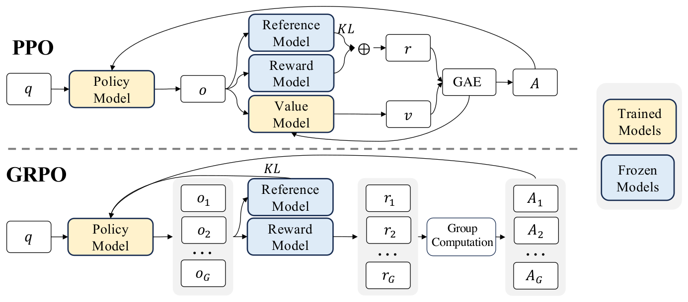

*图 3（原文 Figure 3，第 15 页）：PPO 与 GRPO 的流程对比。*

**图中文字翻译与读法**：

- **上半 PPO**：问题 $q$ 经策略模型（Policy Model）得到输出 $o$；$o$ 同时送入参考模型（Reference Model）、奖励模型（Reward Model）和价值模型（Value Model）。参考模型给出 KL，与奖励模型的输出相加（$\oplus$）得到每个 token 的奖励 $r$；价值模型给出价值估计 $v$；$r$ 与 $v$ 一起经 GAE 算出优势 $A$，再反馈去更新策略模型和价值模型。
- **下半 GRPO**：问题 $q$ 经策略模型得到一组输出 $o_1,\dots,o_G$；参考模型提供 KL；奖励模型给出 $r_1,\dots,r_G$；“Group Computation（组内计算）”把它们转成 $A_1,\dots,A_G$，反馈更新策略模型。没有价值模型，也没有 GAE。
- **图例**：黄色为被训练的模型（Trained Models，PPO 中是策略模型和价值模型），蓝色为冻结的模型（Frozen Models，参考模型和奖励模型）。
- **读图结论**：GRPO 把需要训练的模型从两个（策略加价值）减到一个（策略）；优势直接来自组内奖励的统计量。

两者还有一个重要差别：KL 的放置方式。GRPO 把 KL 的无偏估计直接加在损失里（式 (1) 中的 $-\beta\,\mathbb{D}_{KL}$）；PPO 则把逐 token 的 KL 惩罚作为稠密奖励加到每个 token 上。因为 RL 的目标是累计奖励最大化，PPO 的做法等于惩罚累计 KL，论文认为这可能隐含地惩罚回答长度，阻碍回答变长。此外，长 CoT 训练可能持续数千步，策略会离初始参考策略越来越远，所以论文在实际训练中周期性地把参考策略更新为最新策略，以平衡可探索的范围与训练的稳定。

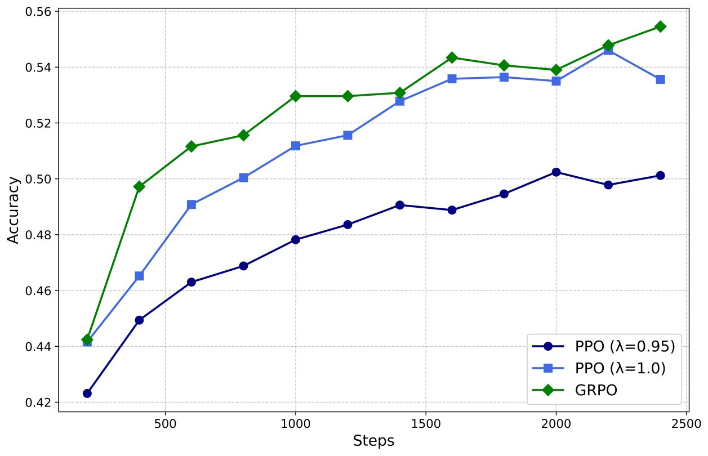

*图 4（原文 Figure 4，第 16 页）：用 DeepSeek-Coder-V2-Lite（16B MoE，2.4B 激活参数）在 MATH 任务上比较 PPO 与 GRPO。*

**图中文字翻译与读法**：

- 横轴 Steps（训练步数，200 到 2,400），纵轴 Accuracy（准确率）。绿色菱形 GRPO；蓝色方块 PPO（$\lambda=1.0$）；深蓝色圆点 PPO（$\lambda=0.95$）。这里的 $\lambda$ 是 PPO 中 GAE 的系数。
- **读图结论**：GRPO 全程最高，最终约 0.55；PPO 对 $\lambda$ 很敏感：$\lambda=0.95$（多数开源 PPO 实现的默认值）时明显更差，最终约 0.50；仔细调到 $\lambda=1.0$ 后接近 GRPO，约 0.54（以上数值是从图上读出的近似值）。论文的结论是 PPO 调好后可以接近 GRPO，但需要额外的超参数调优，再加上价值模型的显存和计算开销，GRPO 在资源受限地训练大模型时更实用。

### 3.4 R1-Zero 的训练设置（2.1 节与附录 B.4.4）

- 基座 DeepSeek-V3-Base，算法 GRPO；规则奖励覆盖数学、代码和逻辑推理数据（原文没有单独列出 R1-Zero 的训练题目构成，附录 Table 4 描述的是 R1 的 RL 数据）。
- 学习率 3e-6，KL 系数 $\beta=0.001$，rollout 采样温度 1。
- 每个问题采样 16 个输出，最大长度在前 8.2k 步为 32,768 token，之后提高到 65,536 token。原文明确说，性能和回答长度都在第 8.2k 步出现明显跳变。
- 共训练 10,400 步，约 1.6 个 epoch。每步包含 32 个不同的问题（$32\times16=512$ 条输出，即训练批大小 512）。
- 每 400 步把 reference 模型换成最新的策略模型。
- 为加速训练，每次 rollout 生成 8,192 条输出，随机分成 16 个 mini-batch，只训练 1 个 inner epoch。$8192=16\times512$，所以一次 rollout 对应 16 次策略更新；一个 training step 指一次策略更新（图 1 图题）。
- 硬件与耗时：64×8 = 512 张 H800，约 198 小时（附录 B.4.4）。

**把以上组件串起来：一次 rollout 与随后的更新做了什么**（按原文设置整理，不是原文的伪代码）：

1. 从训练集取一批问题，用当前策略（此刻即 $\pi_{\theta_{old}}$）对每个问题采样 $G=16$ 个完整输出（先思考、后回答），一次 rollout 共 8,192 条；
2. 规则奖励模块给每个输出打分：答案对不对（准确率奖励）加格式对不对（格式奖励），得到 $r_i$；
3. 对同一问题的 16 个奖励做组内标准化，得到每个输出的优势 $A_i$；
4. 把这 8,192 条输出随机分成 16 个 mini-batch，对每个 mini-batch（512 条）按式 (1) 计算损失并更新一次 $\theta$，每个 mini-batch 只用一遍；
5. 每满 400 步，把参考策略 $\pi_{ref}$ 换成当前策略；回到第 1 步，直到训练结束（R1-Zero 共 10,400 步）。

### 3.5 训练模板（原文 Table 1，第 3 页）

R1-Zero 用一个很简单的模板，要求模型先思考、后回答，其中 `prompt` 在训练时替换为具体的推理问题：

```text
A conversation between User and Assistant. The user asks a question, and the Assistant solves
it. The assistant first thinks about the reasoning process in the mind and then provides the user
with the answer. The reasoning process and answer are enclosed within <think>...</think>
and <answer>...</answer> tags, respectively, i.e., <think> reasoning process here </think>
<answer> answer here </answer>. User: prompt. Assistant:
```

中文大意：“User 与 Assistant 之间的对话。用户提问，Assistant 解答。Assistant 先在头脑中思考推理过程，再把答案给用户。推理过程与答案分别包在 `<think>…</think>` 和 `<answer>…</answer>` 标签中……”

论文有意把约束限制在这种**结构格式**上，避免任何针对具体内容的偏置（例如不要求反思、不规定解题策略），以便准确观察模型在 RL 中自然演化的轨迹。

### 3.6 奖励设计：规则奖励，不用神经奖励模型（2.2 节）

奖励是训练信号的来源，决定 RL 的优化方向。R1-Zero 使用基于规则的奖励，主要由两类组成：

$$
\mathrm{Reward}_{rule}=\mathrm{Reward}_{acc}+\mathrm{Reward}_{format}
$$

- **准确率奖励（accuracy reward）**：判断回答是否正确。数学题有确定结果，要求模型把最终答案按指定格式（例如放在方框内，即 `\boxed{}`）给出，从而可以用规则可靠地验证；代码竞赛题则用编译器对照一组预先定义的测试用例判断，得到客观反馈。数据部分的描述（附录 B.3.1）：数学题答案与参考答案匹配记 1，否则记 0；选择题（STEM）同样是答对选项给二值奖励。
- **格式奖励（format reward）**：要求模型把思考过程放在指定的标签 `<think>` 与 `</think>` 之间，使思考过程被明确分隔，便于解释与后续分析。
- 两者以相同权重相加。原文没有给出格式奖励的具体取值。

论文有意**不对推理任务使用神经奖励模型**，无论是结果奖励模型还是过程奖励模型。理由是：作者观察到神经奖励模型在大规模 RL 中容易被 reward hacking（策略钻奖励模型的漏洞）；而且重训奖励模型需要大量算力，使整个训练流程更复杂。

## 四、R1-Zero 的结果：纯 RL 下推理如何自发涌现

### 4.1 准确率与回答长度（图 1）

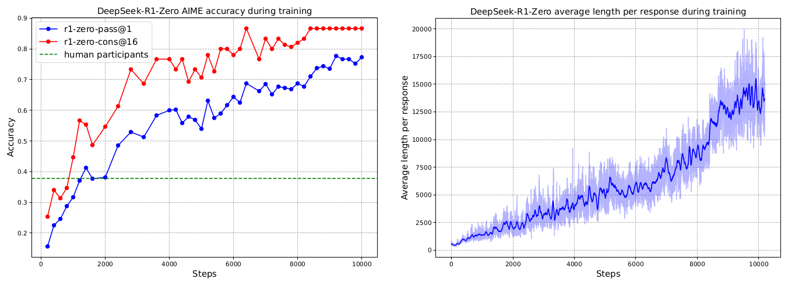

*图 1（原文 Figure 1，第 4 页）：左，R1-Zero 在 AIME 2024 上的准确率随训练步数的变化；右，训练集上平均回答长度随训练步数的变化。*

**图中文字翻译与读法**：

- **左图 DeepSeek-R1-Zero AIME accuracy during training（R1-Zero 训练期间的 AIME 准确率）**：横轴 Steps（训练步数，0–10,000），纵轴 Accuracy（准确率）。蓝线 r1-zero-pass@1 是单次采样的平均正确率；红线 r1-zero-cons@16 是 16 次采样多数投票的正确率；绿色虚线 human participants 是 AIME 竞赛人类参赛者的平均成绩（约 0.378，即图 10 里的 37.8%）。
- **右图 DeepSeek-R1-Zero average length per response during training（训练期间每条回答的平均长度）**：纵轴 Average length per response（每条回答的平均长度，单位为 token），深蓝线是平均值，浅蓝带是波动范围。
- **读图结论**：正文给出的数字是 `pass@1` 从起点的 15.6% 升到 77.9%，用 `cons@16` 多数投票可到 86.7%，明显高于人类参赛者的平均水平。从图上读，`pass@1` 约在 2,000–2,400 步以后稳定高于人类平均线。平均回答长度基本随训练持续变长，从起点约 500 token 增长到约 1.3 万 token（读图近似）。在约 8,000 步处有一次明显跳升；原文解释为此时最大输出长度由 32,768 提高到 65,536 token，因此这次跳变既包含训练的效果，也包含长度上限放宽的影响，不能全部归因于“自发变长”。论文把长度增长解读为模型“学会用更多思考时间解题”，并指出这种增长完全由模型自身适应驱动，没有外部强制。

这个实验支持的结论是：基座已经含有潜在推理能力，结果奖励能改变生成策略，把更长的搜索变成更高的成功率。它不能证明模型“从零”学会了数学知识，知识来自预训练（见 2.3 节）。

R1-Zero 的最终成绩（原文表 3 与图 10）：AIME 2024 `pass@1` 77.9%、Codeforces 80.4 百分位、GPQA Diamond 75.8%、MATH-500 95.9%、CNMO 2024 88.1%。论文称它在编程竞赛和博士级生物、物理、化学题上同样表现出色。

### 4.2 “顿悟时刻”（原文 Table 2，第 5 页）

训练过程中，论文在 R1-Zero 的一个中间版本里观察到一段典型回答：模型用拟人化的口吻学会了“重新思考”。下面是该回答的节选（中间的 ⋯ 是原文省略处）：

> **问题**：If $a>1$, then the sum of the real solutions of $\sqrt{a-\sqrt{a+x}}=x$ is equal to
>
> **回答**：`<think>`
>
> To solve the equation $\sqrt{a-\sqrt{a+x}}=x$, let’s start by squaring both ⋯
>
> $\left(\sqrt{a-\sqrt{a+x}}\right)^{2}=x^{2}\Longrightarrow a-\sqrt{a+x}=x^{2}.$
>
> Rearrange to isolate the inner square root term:
>
> $(a-x^{2})^{2}=a+x\Longrightarrow a^{2}-2ax^{2}+(x^{2})^{2}=a+x\Longrightarrow x^{4}-2ax^{2}-x+(a^{2}-a)=0$
>
> ⋯
>
> Wait, wait. Wait. That’s an aha moment I can flag here.
>
> Let’s reevaluate this step-by-step to identify if the correct sum can be ⋯
>
> We started with the equation: $\sqrt{a-\sqrt{a+x}}=x$
>
> First, let’s square both sides: $a-\sqrt{a+x}=x^{2}\Longrightarrow\sqrt{a+x}=a-x^{2}$
>
> Next, I could square both sides again, treating the equation: ⋯

**怎么读**：问题是求根式方程所有实数解之和。模型先两边平方、整理出一个四次方程，然后中途打断自己（“Wait, wait. Wait. That’s an aha moment I can flag here.”），宣布要重新逐步审视，并回到原方程重新推导。论文把这一现象称为“顿悟时刻”（aha moment），并用词频来量化：在反思时使用 “wait” 的次数在训练中突然上升（见 4.4 节图 9(b)）。论文说这标志着推理模式的明显转变，清楚地展示了 R1-Zero 的自我进化过程，也是作者自己的“顿悟”。

**证据边界**：这只是一个被挑选出来的样例，加上词频曲线；论文没有做“把这类反思去掉后性能是否下降”的因果实验。附录 B.3.2 还提醒：这类生动的、像人一样的推理表现主要反映 DeepSeek 设计的启发式，不代表模型真的获得了类人智能或自主解题能力；这类表述也可能让用户产生不应有的信任。

### 4.3 按难度看提升（附录 C.1，图 8）

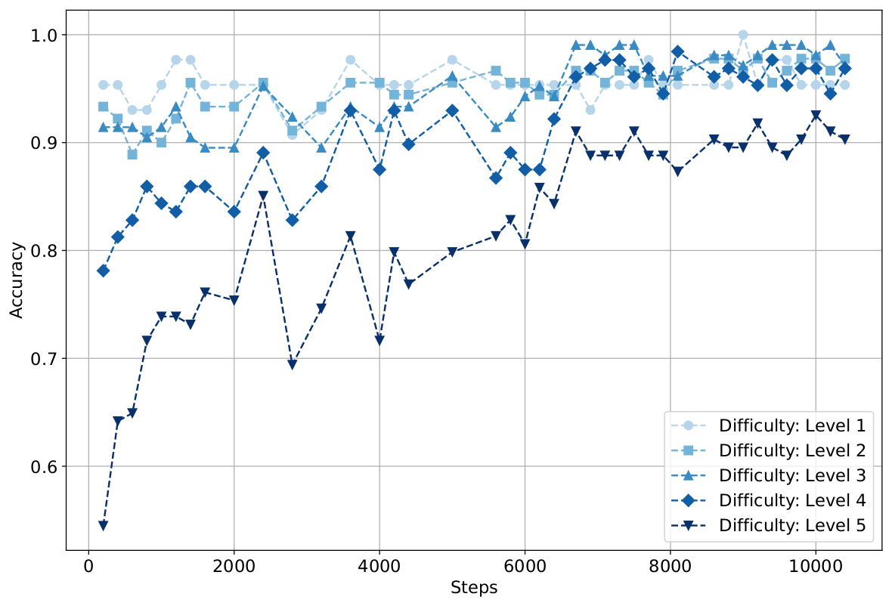

*图 8（原文 Figure 8，第 38 页）：R1-Zero 在 MATH 数据集不同难度级别（Level 1–5）问题上的训练曲线。*

**图中文字翻译与读法**：

- 横轴 Steps（训练步数），纵轴 Accuracy（准确率）。五条线从浅到深依次是 Difficulty: Level 1 到 Level 5（难度级别 1–5，数字越大越难）。
- **读图结论**：简单题（Level 1–3）很快达到 0.90–0.95 并保持稳定；难题进步显著：Level 4 从约 0.78 升到约 0.95，最难的 Level 5 从约 0.55 升到约 0.90（以上是原文正文给出的近似值，与图一致）。
- **一个反直觉现象及原文解释**：Level 3–4 的准确率有时略高于 Level 1。原因是 MATH-500 里各级别题数不均：Level 1 只有 43 道题，更高级别各约 100 道，所以 Level 1 的 95–97% 只对应 1–2 道没做对的题（主要是几何）；各难度的数学类别分布不同；难度标签本身是按人的感知标注的，不是按机器学习的视角。论文因此强调看趋势：对人类而言简单的任务很早学会，而复杂推理（Level 3–5）的能力随训练显著提高。

### 4.4 反思行为如何演化（附录 C.2，图 9）

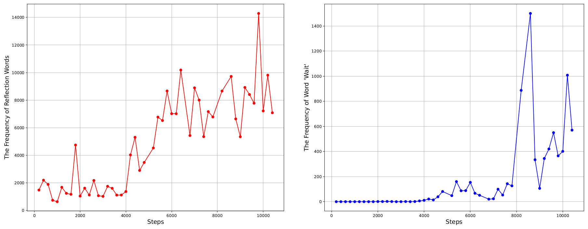

*图 9（原文 Figure 9，第 39 页）：训练过程中推理行为的演化。左 (a)，代表性反思词的出现频率；右 (b)，单词 “wait” 的出现频率。*

**图中文字翻译与读法**：

- **左图 (a) The Frequency of Reflection Words（反思词频率）**：横轴 Steps（训练步数），纵轴为反思词出现的次数（原文没有说明统计的语料规模）。反思词表由 3 位人类专家各自想出若干词再合并而成，包括 “wait”“mistake”“however”“but”“retry”“error”“verify”“wrong”“evaluate”“check”。
- **右图 (b) The Frequency of Word ‘Wait’（单词 wait 的频率）**：同样的横轴，纵轴为 “wait” 的出现次数。
- **读图结论**：(a) 反思词频率随训练逐步上升，比训练开始时增加 5 到 7 倍（原文数字），说明 RL 对生成长链中间 token 起了关键作用；从图上读，起点约 1,500，后期大多在 5,000–10,000 之间，最高约 14,000（读图近似），波动很大。(b) “wait” 在早期几乎不出现，在 4,000–7,000 步之间偶尔出现（读图约几十到一百多次），8,000 步之后出现显著尖峰（读图最高约 1,500 次，位于约 8,600 步附近）。论文据此认为模型在训练的不同阶段学会不同形式的反思。
- **一个需要同时记住的事实**：“wait” 的尖峰出现在 8,000 步之后，而最大输出长度正是在约 8.2k 步从 32,768 提高到 65,536（见 3.4 节）。论文没有分离这两个因素。

### 4.5 R1-Zero 的问题：为什么还需要 R1

尽管推理能力很强，R1-Zero 有两类问题（引言与第 3 节）：

1. **可读性差、语言混杂**：同一条思维链里偶尔中英文夹杂。论文认为原因之一是 V3-Base 以中英文为主要训练语料。
2. **能力偏窄**：基于规则的 RL 只聚焦推理任务，在写作、开放域问答等更广的领域表现有限。原文表 12 能看到其代价：R1-Zero 的 IF-Eval（Prompt Strict）只有 46.6（V3-Base 为 58.6，V3 为 86.1），AlpacaEval 2.0 的 LC-winrate 为 24.7（V3 为 70.0），ArenaHard 为 53.6（V3 为 85.5）。

DeepSeek-R1 正是为了解决这两个问题，同时保留 R1-Zero 的推理能力而设计的。

## 五、DeepSeek-R1：四阶段流水线

### 5.1 总览（图 2）

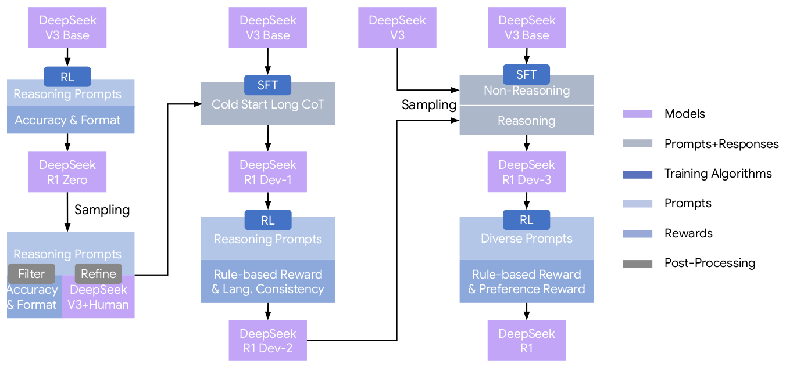

*图 2（原文 Figure 2，第 6 页）：DeepSeek-R1 的多阶段流水线。Dev1、Dev2、Dev3 是流水线中的中间检查点。*

**图中文字翻译与读法**：

图例（右侧）：Models（模型，紫色）、Prompts+Responses（提示加回答，灰色）、Training Algorithms（训练算法，深蓝）、Prompts（提示，浅蓝）、Rewards（奖励，蓝色）、Post-Processing（后处理，深灰）。

- **左列（R1-Zero，以及冷启动数据的来源）**：DeepSeek V3 Base，用推理提示（Reasoning Prompts）和准确率与格式奖励（Accuracy & Format）做 RL，得到 DeepSeek R1 Zero；再对它采样（Sampling），经过滤（Filter，按准确率与格式）和润色（Refine，由 DeepSeek V3 加人工）。
- **中列（阶段 1、2）**：DeepSeek V3 Base 用冷启动长思维链（Cold Start Long CoT）做 SFT，得到 R1 Dev-1；再做 RL（推理提示；规则奖励加语言一致性奖励 Rule-based Reward & Lang. Consistency），得到 R1 Dev-2。
- **右列（阶段 3、4）**：从 Dev-2 采样得到推理数据（Reasoning），从 DeepSeek V3 采样得到非推理数据（Non-Reasoning），合成一份“提示加回答”的数据；用它对 DeepSeek V3 Base 做 SFT，得到 R1 Dev-3；再做 RL（多样提示 Diverse Prompts；规则奖励加偏好奖励 Rule-based Reward & Preference Reward），得到 DeepSeek R1。
- **读图结论**：（1）冷启动数据来自 R1-Zero 的输出，经过滤和润色，而不是凭空人工撰写；（2）按图 2 与附录 B.4.2，两次 SFT 的起点都是 V3-Base，而不是接着上一阶段的 RL 检查点继续微调；（3）Dev-2 的作用是产生推理数据（拒绝采样的来源），最终的 R1 是“V3-Base 加 80 万条 SFT”得到的 Dev-3 再做一轮全场景 RL 的结果。

用文字概括，论文第 3 节的流程是：

1. **冷启动**：收集数千条体现对话式、与人类对齐的思考过程的数据，对 V3-Base 做 SFT；
2. **面向推理的 RL**：在此基础上做 RL，提升推理表现，同时改善对话式思考过程和语言一致性；
3. **拒绝采样加 SFT**：再做一轮拒绝采样和 SFT，同时纳入推理数据与非推理数据，使模型既擅长推理又有较强的写作能力；
4. **全场景 RL**：第二轮 RL，提升有用性与无害性，同时继续打磨推理能力。

### 5.2 阶段 1：冷启动 SFT（附录 B.3.2）

**动机**。论文把冷启动的动机主要归为产品体验：用户觉得推理过程若采用第一人称的思考方式会更直观、更有吸引力（R1-Zero 倾向于用 “we” 或干脆回避第一人称，R1 则更多用 “I”）；同时必须保持语言一致，否则回答会无视提问所用的语言而混用多种语言，降低使用体验。论文也承认 R1-Zero 的原始 CoT 可能具有超出当前人类先验的潜力。因此冷启动数据偏好这样的思考过程：先理解问题，再展开含反思与验证的详细推理，全程第一人称，语言与问题一致。

**数据构造流程**：

1. 收集数千条高质量、多样的推理提示。
2. 用 R1-Zero 在较高温度 1.0 下为每个提示生成多条推理轨迹。
3. 过滤，只保留最终答案正确且格式可读的轨迹：数学输出用 `sympy` 解析并比较表达式；格式上用规则做重复检测和语言混杂过滤。
4. 让 DeepSeek-V3 润色推理和总结，使格式规范、表达友好；为解决语言混杂，指示它“把思考过程翻译成与问题相同的语言”。R1-Zero 的“总结”部分只有最终答案，所以再用原文 Listing 1 的提示让 V3 依据思考过程写出清晰、易读的解答，要求包括：忠实于给定的思考过程、不添加新的推理步骤或结论；用 LaTeX 写出关键步骤；最终答案用 `\boxed{}`；简洁、避免口语化；直接以解答开头。
5. 人工标注员先把推理轨迹改写成更自然的对话式风格；改写后的数据对被用作示例，提示 LLM 批量改写更多数据；所有 LLM 产出再经第二轮人工核验。
6. 代码数据（原文放在冷启动一节）：从在线评测平台收集竞赛编程题，共 5,151 道 Codeforces 题和 2,504 道 AtCoder 题。平台不公开原始测试用例，所以让 DeepSeek-V2.5 按每题要求写 Python 输入生成器来产生候选测试用例（原文 Listing 2 示例包含：同长度的多组大数据、不同长度的多组大数据、单组最大规模数据，以及单字符重复、两字符交替等对抗性输入）。再做两阶段过滤：先用正确提交剔除输出错误的无效用例，再挑选能识别出错误提交缺陷的用例子集，使最终测试集能区分每题的正确解与错误解。
7. 对 “1 + 1 = ?” 这类简单数学题，用 few-shot 提示 DeepSeek-V3 生成简短且结构恰当的回答（原文 Listing 3 的示例是一段很短的 `<think>` 加分步解答和 `\boxed{}`）。

**SFT 设置**（附录 B.4.2，冷启动与第二阶段 SFT 共用）：对 DeepSeek-V3-Base 微调 2–3 个 epoch；余弦衰减学习率，从 $5\times10^{-5}$ 降到 $5\times10^{-6}$；最大上下文长度 32,768 token；批大小 128。

冷启动之后得到 Dev1。原文表 3 显示它的指令遵循大幅提升，但推理有所退化，论文把退化归因于冷启动数据量有限（见 5.7 节）。

### 5.3 阶段 2：面向推理的 RL（3.2.1 节）

在 Dev1 上继续用 GRPO 做 RL，奖励仍是数学、代码、STEM、逻辑数据上的规则奖励（数据见 5.6 节），再加一项语言一致性奖励。第一阶段 RL 的设置：

- 学习率 3e-6，KL 系数 0.001，GRPO 的 clip 比例 $\varepsilon=10$，rollout 温度 1；
- 每题采样 16 个输出，最大长度 32,768；每步 32 个不同问题，批大小 512；
- 每 400 步把 reference 模型换成最新的策略模型；
- 每次 rollout 生成 8,192 条输出，随机拆成 16 个 mini-batch，只训练一个 inner epoch。

**关于 $\varepsilon=10$**。这是原文的原话（作者贡献说明里也提到有人提出了“大的 PPO clip 策略”来增强 GRPO），远大于常见的 0.1–0.2。按公式推算（本文推算，非原文），clip 区间为 $[1-\varepsilon,\,1+\varepsilon]=[-9,\,11]$，而概率比 $\rho_i\ge0$，所以下界永远不起作用，上界只在概率比超过 11 时才起作用，也就是几乎不剪裁。原文强调 clip 比例在训练中起关键作用：取值太低会让大量 token 的梯度被截断而损害性能，取值太高则可能让训练不稳定。论文没有给出这个取值的敏感性实验。

**语言一致性奖励**。为缓解 CoT 里的语言混杂，训练中加入语言一致性奖励，定义为思维链中目标语言单词所占的比例（原文式 (7)）：

$$
\mathrm{Reward}_{language}=\frac{\mathrm{Num}(\mathrm{Words}_{target})}{\mathrm{Num}(\mathrm{Words})}
$$

它同时作用于推理数据和非推理数据，直接加到最终奖励上。论文承认这种对齐会使模型性能略有下降，但认为它符合人类偏好、输出更可读。附录 B.6 给出了消融：

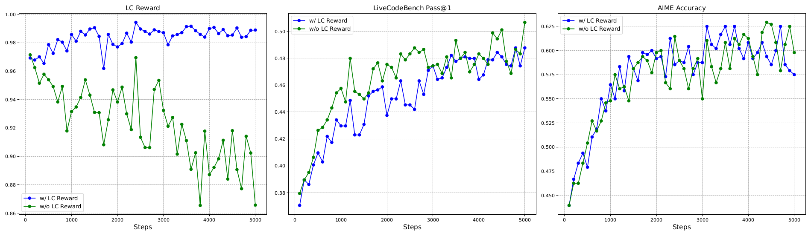

*图 7（原文 Figure 7，第 37 页）：强化学习中语言一致性（LC）奖励的消融实验。*

**图中文字翻译与读法**：

- **设置**：消融在 DeepSeek-R1-Distill-Qwen-7B 上进行；原文说明该模型使用与 R1 相同的冷启动数据，并且在 RL 过程中同样出现语言混杂。
- 三个子图的横轴都是 Steps（训练步数，0–5,000）；蓝线 w/ LC Reward 表示有语言一致性奖励，绿线 w/o LC Reward 表示没有。
- **左图 LC Reward（语言一致性奖励值，0–1，越高越一致）**：有 LC 奖励时一直在约 0.97–0.99；没有时从约 0.97 逐步下降，波动很大，最低约 0.865（读图近似）。
- **中图 LiveCodeBench Pass@1**：两条线都从约 0.37–0.38 升到约 0.49–0.51，没有 LC 奖励的那条在多数步数略高（读图近似）。
- **右图 AIME Accuracy**：两条线都从约 0.44 升到约 0.58–0.63，差异不明显。
- **读图结论**：没有 LC 奖励，语言一致性随训练步数增加逐渐恶化；加上 LC 奖励则全程保持稳定。代价是数学基准性能相当，代码基准略有下降（原文表述）。

### 5.4 阶段 3：拒绝采样加 SFT，构造约 80 万条数据（附录 B.3.3）

这一阶段先造数据，再对 V3-Base 重新做 SFT。

**推理数据（约 60 万条）**。从第一阶段 RL 的检查点（即 Dev2）对大量推理提示做拒绝采样生成推理轨迹。与前一阶段只用规则奖励可评判的数据不同，这里扩充了数据范围：一部分数据用生成式奖励模型判断，即把标准答案和模型预测一起交给 DeepSeek-V3 评判（原文 Listing 4 的评判提示：把答案分为 correct 与 incorrect 两档，要求以 JSON 输出分析和结论）。因为模型输出有时混乱、难读，还过滤掉了含混合语言、过长段落和代码块的 CoT。对每个提示采样多个回答，只保留正确的。合计约 60 万条推理相关样本。

**非推理数据（约 20 万条）**。包括写作、事实问答、自我认知（self-cognition）、翻译等，沿用 DeepSeek-V3 的流水线并复用其部分 SFT 数据；另外加入以软件工程为主的数据（程序修复、前端网页开发），以增强解决真实问题的能力。对某些非推理任务，调用 DeepSeek-V3 在回答之前先生成一段可能的 CoT；但对 “hello” 这类简单查询不给 CoT。合计约 20 万条与推理无关的样本。

**思考过程的风格原则**：（1）每段简短易读；（2）口吻自然、像对话，避免使用 Markdown 之类的技术格式；（3）最重要的是，思考过程从理解完整的用户语境开始，即分析用户是谁、处于什么情境、真正需要什么，包括请求表面之下未明说的需求。模型生成这些思考过程后，由人工标注员仔细核验。论文发现这些人工构造的推理轨迹能提高模型对用户问题的理解精度，具体体现在：突出格式约束、澄清用户意图、说明所需的输出结构。

**数据统计**（原文表 5，第 27 页）：约 80 万条监督样本的领域构成（含平均对话轮数与平均 token 数）。

| 领域 | 样本数 | 平均轮数 | 平均 token 数 |
|---|---:|---:|---:|
| 数学（Math） | 395285 | 1.0 | 6094.2 |
| 代码（Code） | 211129 | 1.1 | 7435.7 |
| STEM | 10124 | 1.0 | 4928.8 |
| 逻辑（Logic） | 10395 | 1.0 | 2739.0 |
| 通用（General） | 177812 | 1.1 | 1419.8 |
| 合计 | 804745 | 1.0 | 5355.3 |

读法：数学约占 49%、代码约占 26%、通用约占 22%；STEM 与逻辑各约 1%。前四项（数学、代码、STEM、逻辑）合计 626933 条，对应正文说的“约 60 万条推理样本”；通用 177812 条对应“约 20 万条非推理样本”（原文用的是约数）。代码与数学回答最长（平均 7436 与 6094 token）。原文还指出：数据以单轮交互为主，这可能限制 R1 的多轮对话能力，扩展到多轮数据留作未来工作；数学数据主要为中英文，题目可验证（规则或标准答案）；代码数据不仅有竞赛编程，还有调试和项目导向的编码问题。

**阶段 3 的 SFT**：用这 80 万条数据对 DeepSeek-V3-Base 微调（2–3 个 epoch，设置同 5.2 节），得到 Dev3。同一批 80 万条数据也被用于蒸馏小模型（见第八章）。

### 5.5 阶段 4：全场景 RL（3.1 与 3.2.2 节）

目标是在保持推理能力的同时，让模型更有用、更无害，并对齐人类偏好。为此需要两类奖励：推理数据继续用规则奖励；通用数据用奖励模型。

**有用性奖励模型（helpful RM）**：

- 偏好对的构造：用 arena-hard 的提示格式（附录 B.2）提示 DeepSeek-V3，每个偏好对由一个用户问题和两个候选回答组成；对每一对，让 V3 评判 4 次，并随机把回答分配为 A 或 B 以缓解位置偏差；最终偏好分是 4 次独立评判的平均，只保留分差 $\Delta>1$ 的偏好对，保证区分有意义；为减小长度偏差，保证整个数据集中被选与被拒回答长度相当。共整理出 66,000 对偏好数据。这些提示全部是非推理问题，来自公开开源数据集，或来自明确同意为改进模型而共享数据的用户。
- 模型：架构与 DeepSeek-R1 一致，另加一个预测标量偏好分的奖励头（reward head）。训练批大小 256，学习率 6e-6，在训练数据上只训练 1 个 epoch，训练时最大序列长度 8192 token，推理（打分）时不设长度限制。
- 有用性只评估最终总结（summary），使评估聚焦于回答对用户的效用与相关性，尽量不干扰底层推理过程。

$$
\mathrm{Reward}_{helpful}=\mathrm{RM}_{helpful}\big(\mathrm{Response}_A,\ \mathrm{Response}_B\big)
$$

**安全奖励模型（safety RM）**：整理了 106,000 条提示，配上模型生成的回答，按预先定义的安全准则标注为“安全”或“不安全”；与有用性模型的成对损失不同，安全模型用逐点（point-wise）方式训练，用来区分安全与不安全回答，训练超参数与有用性模型相同。无害性评估针对整条回答，包括推理过程和总结，以识别和缓解生成中可能出现的风险、偏见或有害内容。

$$
\mathrm{Reward}_{safety}=\mathrm{RM}_{safety}\big(\mathrm{Response}\big)
$$

对通用查询，每个样本要么属于安全数据集，要么属于有用性数据集，其奖励 $\mathrm{Reward}_{General}$ 取所属数据集中定义的奖励。

**第二阶段 RL 的总奖励**（原文式 (8)–(10)）：

$$
\mathrm{Reward}=\mathrm{Reward}_{reasoning}+\mathrm{Reward}_{general}+\mathrm{Reward}_{language}
$$

$$
\mathrm{Reward}_{reasoning}=\mathrm{Reward}_{rule},\qquad \mathrm{Reward}_{general}=\mathrm{Reward}_{reward\_model}+\mathrm{Reward}_{format}
$$

**训练设置**：保留第一阶段的大部分参数，关键差别是把采样温度降到 0.7，因为作者发现这一阶段更高的温度会导致生成不连贯。共训练 1,700 步，其中通用指令数据和基于偏好的奖励只在最后 400 步加入。原因是：用基于模型的偏好奖励训练更多步可能导致 reward hacking（见下图）。训练中还观察到，当 RL 提示涉及多种语言时，CoT 常出现语言混杂；这一阶段的总奖励式里保留了语言奖励项。

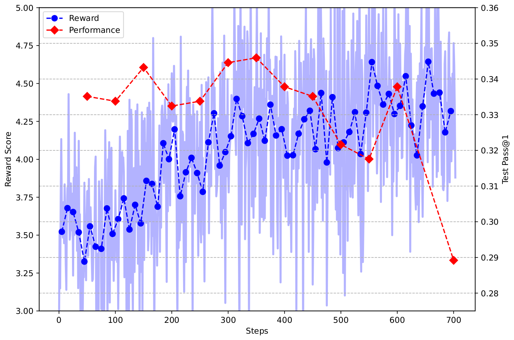

*图 6（原文 Figure 6，第 36 页）：Reward hacking：训练中奖励上升，而在 CodeForces 上的性能下降。*

**图中文字翻译与读法**：

- 横轴 Steps（训练步数，0–700）。左纵轴 Reward Score（奖励分数，约 3–5）：蓝色圆点虚线是平滑后的奖励，浅蓝色细线是原始逐步奖励。右纵轴 Test Pass@1（测试集 pass@1，约 0.28–0.36）：红色菱形虚线，标为 Performance（性能）。
- **读图结论**：奖励分数从约 3.5 缓慢升到约 4.3；而 CodeForces 上的 pass@1 在前 350 步左右处于约 0.335–0.346，之后一路降到 700 步的约 0.289（中间 600 步附近有一次回升到约 0.338；以上为读图近似）。奖励越来越高、真实能力却在下降，就是典型的 reward hacking。
- **原文解释**（附录 B.5）：reward hacking 指模型利用奖励函数的缺陷或偏差，在没有真正对齐人类意图的情况下拿到高分。作者在使用有用性奖励模型时观察到这种行为：若奖励模型含有系统性偏差或不准确，LLM 可能学会生成被模型打高分、但偏离真实人类偏好的回答，表现为需要复杂推理的任务性能下降。

### 5.6 RL 使用的数据（附录 B.3.1，原文表 4）

| 数据类型 | 提示数量 | 题型 | 输出类型 |
|---|---:|---|---|
| 数学（Math） | 26K | 定量推理 | 数值 / 表达式 / 方程 |
| 代码（Code） | 17K | 算法与修 bug | 代码解答 |
| STEM | 22K | 多项选择 | 选项 |
| 逻辑（Logic） | 15K | 选择 / 定量推理 | 选项 / 数值 |
| 通用（General） | 66K | 有用性 / 无害性 | 排序的回答 |

（原文表 4，第 19 页。）所有问题均为中文或英文。逐类说明：

- **数学 26K**：数学考试题和竞赛题，平均提示长度 122 token；覆盖代数、微积分、概率、几何等，难度从地区性竞赛到国际奥赛。模型需要写出逐步推理并给出最终答案，答案可以是数值（如 “5”）、表达式（如 “$x^2+3x-2$”）或方程（如 “$y=2x+1$”）。数学证明题被排除，因为难以判断对错。奖励为答案与参考答案匹配记 1，否则记 0。
- **代码 17K**：17K 道算法竞赛题（类似 Codeforces、LeetCode；有详细题面、约束和多个输入输出样例，要求写出完整函数或程序，通过考察正确性与性能的隐藏测试用例），另有 8K 道 bug 修复题（取自真实 GitHub issue：给出 issue 描述、含缺陷的源码和部分或全部失败的单元测试，目标是定位并修复缺陷使全部单元测试通过）。表 4 的 Code 行写 17K，而正文是“17k 竞赛题加 8k 修 bug 题”，原文没有解释两者口径是否一致。
- **STEM 22K**：物理、化学、生物选择题，每题 4 到 8 个选项，平均提示长度 161 token；构成为物理 15.5%、生物 30.7%、化学 46.5%、其他（健康、医学等）7.3%。全是多选题，答对选项给二值奖励。
- **逻辑 15K**：覆盖广泛的逻辑挑战，既有真实世界题目也有合成题，全部支持自动评估，平均提示长度约 420 token。真实部分来自网络，包括脑筋急转弯、经典逻辑谜题和知识密集型问题，用选择题形式保证客观；合成部分主要是两类：code-IO 题（用 Li et al.（2025）的数据管线，把竞赛编程题及其输入输出测试用例转成可验证的逻辑推理题）和谜题（如考察识别密码模式的密码学谜题、斑马谜题式的演绎推理逻辑谜题、概率题和 24 点之类的算术谜题）。
- **通用 66K**：衡量有用性，涵盖创意写作、编辑、事实问答、角色扮演等类别；另含 12,000 道评估无害性的问题（原文未说明是否计入 66K）。用两个奖励模型验证，分别基于有用性和无害性的排序回答数据训练。注意第 5.5 节说有用性奖励模型用了 66,000 对偏好数据，与这里的 66K 提示数相同，原文没有说明二者是否同一批数据。

### 5.7 各阶段结果（原文表 3、表 14）

先看每个阶段对各项能力的影响。下表是原文表 3（第 9 页），列出 R1-Zero 与四个 R1 阶段检查点在各基准上的成绩；指标含义在括号中，数值越大越好（Codeforces 评级是平台的评级分，同样越大越强）。粗体是原文标注的统计显著（t 检验 p < 0.01）。

| 类别 | 基准（指标） | R1-Zero | R1-Dev1 | R1-Dev2 | R1-Dev3 | R1 |
|---|---|---:|---:|---:|---:|---:|
| 英文 | MMLU（EM） | 88.8 | 89.1 | **91.2** | 91.0 | 90.8 |
| 英文 | MMLU-Redux（EM） | 85.6 | 90.0 | 93.0 | 93.1 | 92.9 |
| 英文 | MMLU-Pro（EM） | 68.9 | 74.1 | 83.8 | 83.1 | **84.0** |
| 英文 | DROP（3-shot F1） | 89.1 | 89.8 | 91.1 | 88.7 | **92.2** |
| 英文 | IF-Eval（Prompt Strict） | 46.6 | 71.7 | 72.0 | 78.1 | **83.3** |
| 英文 | GPQA Diamond（Pass@1） | **75.8** | 66.1 | 70.7 | 71.2 | 71.5 |
| 英文 | SimpleQA（Correct） | 30.3 | 17.8 | 28.2 | 24.9 | 30.1 |
| 英文 | FRAMES（Acc.） | 82.3 | 78.5 | 81.8 | 81.9 | **82.5** |
| 英文 | AlpacaEval2.0（LC-winrate） | 24.7 | 50.1 | 55.8 | 62.1 | **87.6** |
| 英文 | ArenaHard（GPT-4-1106） | 53.6 | 77.0 | 73.2 | 75.6 | **92.3** |
| 代码 | LiveCodeBench（Pass@1-COT） | 50.0 | 57.5 | 63.5 | 64.6 | **65.9** |
| 代码 | Codeforces（Percentile，百分位） | 80.4 | 84.5 | 90.5 | 92.1 | **96.3** |
| 代码 | Codeforces（Rating，评级） | 1444 | 1534 | 1687 | 1746 | **2029** |
| 代码 | SWE Verified（Resolved） | 43.2 | 39.6 | 44.6 | 45.6 | **49.2** |
| 代码 | Aider-Polyglot（Acc.） | 12.2 | 6.7 | 25.6 | 44.8 | **53.3** |
| 数学 | AIME 2024（Pass@1） | 77.9 | 59.0 | 74.0 | 78.1 | **79.8** |
| 数学 | MATH-500（Pass@1） | 95.9 | 94.2 | 95.9 | 95.4 | **97.3** |
| 数学 | CNMO 2024（Pass@1） | **88.1** | 58.0 | 73.9 | 77.3 | 78.8 |
| 中文 | CLUEWSC（EM） | 93.1 | 92.8 | 92.6 | 91.6 | 92.8 |
| 中文 | C-Eval（EM） | **92.8** | 85.7 | 91.9 | 86.4 | 91.8 |
| 中文 | C-SimpleQA（Correct） | 66.4 | 58.8 | 64.2 | 66.9 | 63.7 |

（原文表 3，第 9 页。）逐阶段读法：

- **R1-Zero 到 Dev1（冷启动 SFT）**：指令遵循大幅提升（IF-Eval 46.6 到 71.7，ArenaHard 53.6 到 77.0，AlpacaEval 2.0 24.7 到 50.1）；但推理指标下降，最明显是 AIME 2024（77.9 到 59.0），CNMO 2024（88.1 到 58.0）与 GPQA Diamond（75.8 到 66.1）也明显下降。论文把这种“部分退化”归因于冷启动数据集规模有限。
- **Dev1 到 Dev2（面向推理的 RL）**：需要高级推理的基准明显提升，涉及代码生成、数学和 STEM：AIME 59.0 到 74.0，LiveCodeBench 57.5 到 63.5，Codeforces 评级 1534 到 1687，GPQA Diamond 66.1 到 70.7，MMLU-Pro 74.1 到 83.8；而通用类基准（如 AlpacaEval 2.0，50.1 到 55.8）只有边际提升。论文的结论是：面向推理的 RL 显著增强推理能力，对偏好导向的基准影响有限。
- **Dev2 到 Dev3（80 万条 SFT）**：加入大规模非推理语料和代码工程数据，AlpacaEval 2.0（55.8 到 62.1）和 Aider-Polyglot（25.6 到 44.8）显著提升（论文的归因）。
- **Dev3 到 R1（全场景 RL）**：论文说数学和代码只有边际提升，因为前面阶段已做过大量推理专用的 RL，主要进步在通用指令遵循和用户偏好基准：AlpacaEval 2.0 提升 25%、ArenaHard 提升 17%——按表中数字，这是 62.1 到 87.6（+25.5 分）和 75.6 到 92.3（+16.7 分），即百分点而非相对百分比。IF-Eval 78.1 到 83.3。
- **两处与正文不完全吻合**：（1）正文说代码只有边际提升，但表中 Codeforces 评级由 1746 升到 2029（+283），Aider-Polyglot 由 44.8 升到 53.3（+8.5），并不算小，原文未解释；（2）最终的 R1 并非处处优于 R1-Zero：GPQA Diamond（75.8 对 71.5）、CNMO 2024（88.1 对 78.8）、C-Eval（92.8 对 91.8）上 R1-Zero 更高，原文也没有解释。

**按难度拆分**。附录 E.5 在 LiveCodeBench 上按难度（Easy、Medium、Hard）拆分各阶段成绩，用来看提升来自哪里：

| 难度 | R1-Zero | R1-Dev1 | R1-Dev2 | R1-Dev3 | R1 |
|---|---:|---:|---:|---:|---:|
| 简单（Easy） | 98.07 | 99.52 | 100.00 | 100.00 | **100.00** |
| 中等（Medium） | 58.78 | 73.31 | 81.76 | 81.42 | **83.45** |
| 困难（Hard） | 17.09 | 23.21 | 30.36 | 33.16 | **34.44** |

（原文表 14，第 60 页，LiveCodeBench 各难度的正确率；只有 R1 一列在原文中加粗。）读法：简单题基本都能做对，各阶段的提升主要来自中等和困难题（困难题从 17.09 升到 34.44，约翻倍）；论文据此认为每个阶段都对复杂的编码推理问题带来显著提升。

## 六、RL 基础设施（附录 B.1）

对大模型做 RL 对基础设施要求很高。论文的 RL 框架采用解耦、可扩展的结构，便于接入不同的模型和算法，并结合模块内与模块间的优化来保证效率与可扩展性。

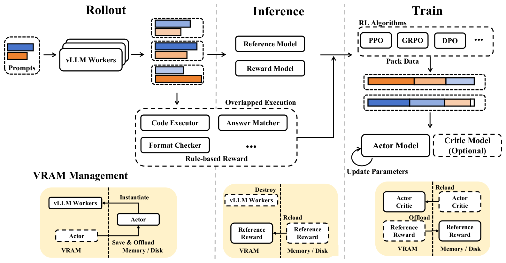

*图 5（原文 Figure 5，第 17 页）：RL 框架总览。*

**图中文字翻译与读法**：

- **上半部分的三栏**：Rollout（采样）、Inference（推理打分）、Train（训练）。Rollout 栏：Prompts（提示）分发给 vLLM Workers（vLLM 采样进程），生成多个回答；其下是 Rule-based Reward（规则奖励）模块，包括 Code Executor（代码执行器）、Answer Matcher（答案匹配器）、Format Checker（格式检查器）等，与前后模块 Overlapped Execution（重叠执行）。Inference 栏：Reference Model（参考模型）和 Reward Model（奖励模型）。Train 栏：RL Algorithms（RL 算法，PPO、GRPO、DPO 等）、Pack Data（数据打包）、Actor Model（执行者即策略模型）与可选的 Critic Model（评论者即价值模型），Update Parameters（更新参数）。
- **下半部分 VRAM Management（显存管理）**：每个阶段结束后，该阶段用到的模型会被保存并卸载（Save & Offload）到内存或磁盘，为下一阶段腾出显存，需要时再重新加载（Reload）；Rollout 阶段实例化（Instantiate）vLLM workers，Inference 阶段销毁（Destroy）它们并重新加载参考与奖励模型；Train 阶段把 Actor 与 Critic 加载回显存，同时卸载参考与奖励模型。
- **读图结论**：整套系统用显存换时间的分阶段调度，避免多个大模型同时驻留显存。

框架分为与 RL 流水线各阶段一一对应的四个模块：

- **Rollout 模块**：从训练集加载提示，均匀分发给多个装有 actor 模型的 vLLM 工作进程，对每个提示采样多个回答。对 DeepSeek-V3 的 MoE 架构，采用跨节点的专家并行（expert parallelism）以减少访存开销，并为热点专家部署冗余副本来平衡各专家的计算负载；还利用 MTP 组件做自推测解码（self-speculative decoding），显著加快解码速度，缩短最长样本的完成时间。
- **Inference 模块**：加载奖励模型和参考模型，对 rollout 阶段生成的样本做前向计算，得到基于模型的奖励和其他必要信息。
- **规则奖励模块**：计算模型生成回答的规则奖励，接口统一，可容纳不同实现（代码执行器、答案匹配器、格式检查器等）。它不需要把模型载入 GPU 显存，但执行往往很耗时；为此采用异步调度，与 Rollout 和 Inference 模块重叠执行，从而隐藏其延迟。
- **Training 模块**：加载 actor 模型（需要时加载 critic），计算损失并更新参数，灵活支持 PPO、GRPO、DPO 等多种算法。为减少序列填充造成的计算浪费并平衡设备间负载，采用如下数据打包策略：先把全局 batch 内的数据按长度排序，分发给数据并行组内的各进程；每个进程内用 Best-Fit 策略把数据打包成填充最少的定长块；最后调整块数，使各进程块数相等。还集成了 DeepSeek-V3 训练中使用的 DualPipe 算法以实现高效的流水线并行。

除规则奖励模块外，每个模块完成后，该阶段使用的模型实例会自动从显存卸载到系统内存或磁盘，为后续阶段腾出显存。

## 七、评测设置与主要结果

### 7.1 评测基准与协议（附录 D.1）

**基准**（原文的分类）：

- 通用知识（多选，考察知识广度）：MMLU、MMLU-Redux、MMLU-Pro、C-Eval、CMMLU（CMMLU 出现在文字列表中，但原文各结果表里没有）。
- 长尾知识：SimpleQA、C-SimpleQA；博士级理科题：GPQA Diamond；格式遵循：IFEval；长文档处理与推理：FRAMES、DROP。
- 开放式生成：AlpacaEval 2.0、Arena-Hard，按原协议用 GPT-4-Turbo-1106 做成对比较；为减轻长度偏差，只把最终总结部分交给评判模型。
- 算法竞赛：LiveCodeBench（2024 年 8 月至 2025 年 1 月的数据，CoT 格式）和 Codeforces（取 10 场 Div.2 比赛的题目，配专家编写的测试用例，据此计算期望评级和百分位）。
- 真实软件工程：SWE-Bench Verified（通过 agentless 框架）、Aider（“diff” 格式）。
- 数学：AIME 2024、MATH-500、CNMO 2024（中国高中数学奥林匹克）。

**提示与设置**：沿用 DeepSeek-V3 的做法，MMLU、DROP、GPQA Diamond、SimpleQA 用 simple-evals 框架的提示；MMLU-Redux 用 Zero-Eval 的提示格式（零样本）；MMLU-Pro、C-Eval、CLUE-WSC 原本是 few-shot 提示，被改成零样本，因为 few-shot 的 CoT 可能损害 R1 的表现；其他数据集按各自创建者的默认提示和原始协议。每个基准的输出上限为 32,768 token。数学类（AIME、MATH、CNMO）的提示是 “Please reason step by step, and put your final answer within `\boxed{}`.”，评分时解析 `\boxed{}` 里的最终答案，用基于规则的评分器配合 SymPy 判断是否与标准答案相等（原文 Table 32）。

**基线**：DeepSeek-V3、Claude-Sonnet-3.5-1022、GPT-4o-0513、OpenAI-o1-mini、OpenAI-o1-1217。由于在中国大陆难以访问 o1-1217 的 API，其成绩取自官方报告（不是作者自己测的）。蒸馏模型还与 QwQ-32B-Preview 比较。

**解码与指标**：作者发现，用贪心解码评测长输出推理模型会带来更高的重复率和各检查点之间的显著波动，所以默认采用 `pass@k` 评测，用非零温度报告 `pass@1`：采样温度 0.6、top-$p$ 0.95，每题生成 $k$ 个回答（4 到 64 个，取决于测试集大小），具体为 AIME 与 GPQA 取 $k=64$，MATH 与 CodeForces 取 $k=16$，LiveCodeBench 取 $k=8$；`pass@1` 是这 $k$ 个回答正确性的平均。AIME 2024 还报告 64 个样本的多数投票结果 `cons@64`。

**去污染**（decontamination）：DeepSeek-V3-Base 的知识截止日期是 2024 年 7 月，早于 CNMO 2024 等评测基准；预训练与后训练数据都做了处理：过滤掉任何包含与评测题或参考解答 10-gram 序列匹配的文本片段（含网页和 GitHub 文件）。仅数学领域，就识别并删除了约 600 万条潜在的预训练文本。后训练阶段，数学 SFT 数据和 RL 提示只取自 2023 年以前的竞赛，并经过同样的 n-gram 过滤。论文自己承认：基于 n-gram 的去污染无法防住对测试题的改写，所以 2024 年之前发布的基准仍可能有污染问题。

### 7.2 与其他模型的主结果（原文表 8，第 41 页）

架构一行：DeepSeek-V3 与 DeepSeek-R1 均为 MoE，激活参数 37B，总参数 671B；其他模型原文用 “-” 表示未公开。以下数值均越大越好（Codeforces 评级与百分位也是越大越好）；“-” 表示原文没有该数。粗体是原文标注的统计显著（t 检验 p < 0.01）。

| 类别 | 基准（指标） | Claude-3.5-Sonnet-1022 | GPT-4o 0513 | DeepSeek V3 | OpenAI o1-mini | OpenAI o1-1217 | DeepSeek R1 |
|---|---|---:|---:|---:|---:|---:|---:|
| 英文 | MMLU（EM） | 88.3 | 87.2 | 88.5 | 85.2 | **91.8** | 90.8 |
| 英文 | MMLU-Redux（EM） | 88.9 | 88.0 | 89.1 | 86.7 | - | **92.9** |
| 英文 | MMLU-Pro（EM） | 78.0 | 72.6 | 75.9 | 80.3 | - | **84.0** |
| 英文 | DROP（3-shot F1） | 88.3 | 83.7 | 91.6 | 83.9 | 90.2 | **92.2** |
| 英文 | IF-Eval（Prompt Strict） | **86.5** | 84.3 | 86.1 | 84.8 | - | 83.3 |
| 英文 | GPQA Diamond（Pass@1） | 65.0 | 49.9 | 59.1 | 60.0 | **75.7** | 71.5 |
| 英文 | SimpleQA（Correct） | 28.4 | 38.2 | 24.9 | 7.0 | **47.0** | 30.1 |
| 英文 | FRAMES（Acc.） | 72.5 | 80.5 | 73.3 | 76.9 | - | **82.5** |
| 英文 | AlpacaEval2.0（LC-winrate） | 52.0 | 51.1 | 70.0 | 57.8 | - | **87.6** |
| 英文 | ArenaHard（GPT-4-1106） | 85.2 | 80.4 | 85.5 | 92.0 | - | 92.3 |
| 代码 | LiveCodeBench（Pass@1-COT） | 38.9 | 32.9 | 36.2 | 53.8 | 63.4 | **65.9** |
| 代码 | Codeforces（Percentile，百分位） | 20.3 | 23.6 | 58.7 | 93.4 | 96.6 | 96.3 |
| 代码 | Codeforces（Rating，评级） | 717 | 759 | 1134 | 1820 | 2061 | 2029 |
| 代码 | SWE Verified（Resolved） | **50.8** | 38.8 | 42.0 | 41.6 | 48.9 | 49.2 |
| 代码 | Aider-Polyglot（Acc.） | 45.3 | 16.0 | 49.6 | 32.9 | **61.7** | 53.3 |
| 数学 | AIME 2024（Pass@1） | 16.0 | 9.3 | 39.2 | 63.6 | 79.2 | 79.8 |
| 数学 | MATH-500（Pass@1） | 78.3 | 74.6 | 90.2 | 90.0 | 96.4 | 97.3 |
| 数学 | CNMO 2024（Pass@1） | 13.1 | 10.8 | 43.2 | 67.6 | - | **78.8** |
| 中文 | CLUEWSC（EM） | 85.4 | 87.9 | 90.9 | 89.9 | - | **92.8** |
| 中文 | C-Eval（EM） | 76.7 | 76.0 | 86.5 | 68.9 | - | **91.8** |
| 中文 | C-SimpleQA（Correct） | 55.4 | 58.7 | **68.0** | 40.3 | - | 63.7 |

（原文表 8，第 41 页。）读法与论文的结论：

- **知识类**：在 MMLU、MMLU-Pro、GPQA Diamond 这类教育导向的知识基准上，R1 优于 V3（MMLU 90.8 对 88.5；MMLU-Pro 84.0 对 75.9；GPQA Diamond 71.5 对 59.1），论文把提升主要归因于 STEM 题准确率的提高。FRAMES（依赖长上下文的问答）上 R1 为 82.5，高于 V3 的 73.3 与 GPT-4o 的 80.5，论文认为这体现了较强的文档分析能力，也说明推理模型在 AI 搜索与数据分析类任务中的潜力。
- **指令遵循与开放式任务**：IF-Eval 上 R1（83.3）低于 V3（86.1）和 Claude-3.5-Sonnet（86.5）；论文把相对 R1-Zero 的大幅提升（46.6 到 83.3）归因于最后阶段 SFT 与 RL 加入的指令遵循数据。AlpacaEval 2.0（87.6）与 ArenaHard（92.3）显示其写作和开放域问答很强。
- **数学**：与 o1-1217 相当（AIME 2024 79.8 对 79.2；MATH-500 97.3 对 96.4），大幅领先其他模型。
- **代码**：算法类任务（LiveCodeBench、Codeforces）上推理模型占优势（R1 的 LiveCodeBench 65.9 对 V3 的 36.2，Codeforces 评级 2029 对 1134）。工程类任务上，o1-1217 在 Aider 上超过 R1（61.7 对 53.3），在 SWE Verified 上相当（48.9 对 49.2）；论文认为相关 RL 训练数据目前很有限，下一版会改进。
- **注意**：这张表里粗体表示统计显著，不是“最优”：例如 ArenaHard 一行没有粗体，尽管 R1（92.3）与 o1-mini（92.0）接近；AIME 与 MATH-500 一行也都没有粗体。o1-1217 的数字来自官方报告而非自测。

### 7.3 与人类成绩的比较（图 10）

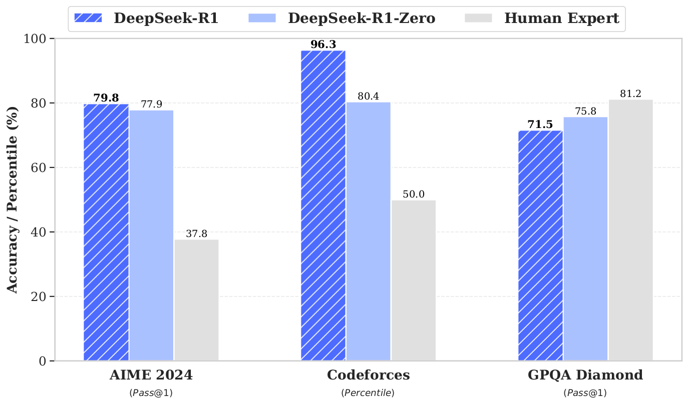

*图 10（原文 Figure 10，第 42 页）：DeepSeek-R1 与 DeepSeek-R1-Zero 在不同数据集上与人类成绩的对比。*

**图中文字翻译与读法**：

- 纵轴 Accuracy / Percentile (%)（准确率或百分位，%）。三组柱子：AIME 2024（Pass@1）、Codeforces（Percentile，百分位）、GPQA Diamond（Pass@1）。每组三根柱：斜线蓝色 DeepSeek-R1、浅蓝色 DeepSeek-R1-Zero、灰色 Human Expert（人类）。
- 图上标注的数字：AIME 2024 为 R1 79.8、R1-Zero 77.9、人类 37.8；Codeforces 为 96.3、80.4、50.0；GPQA Diamond 为 71.5、75.8、81.2。
- **人类基线的含义**（原文图题）：AIME 与 Codeforces 的人类分数是所有人类参赛者的平均表现；GPQA 的人类分数对应可上网查资料作答的博士级人群。
- **读图结论**：AIME 是面向高中生的数学竞赛，R1 超过人类参赛者的平均成绩；在 Codeforces 上 R1 超过 96.3% 的人类参赛者；GPQA 上人类专家仍更高（81.2 对 71.5），论文预期若允许 R1 联网，差距可能缩小甚至消失（这是论文的预期，没有做实验）。Codeforces 的 “Human Expert” 柱是 50.0，即平均参赛者的百分位，并不是专家水平。

### 7.4 人类偏好评测：Chatbot Arena（图 11、图 12）

作者用 ChatbotArena（LMSYS 与 UC Berkeley SkyLab 的开放众包平台）展示人类偏好：两个匿名模型对同一用户提示作答，用户投票选更好的一个、判平局或都不好；平台用 Elo 评分系统排名，并用打乱投票数据的 bootstrap 式方法让评分更稳定，也已开始采用 Bradley-Terry 模型。**风格控制**（style control）用来把回答风格（长度、格式、语气）与实质内容（准确性、相关性、推理）的影响分开，回应“模型是否能靠更长、更漂亮的回答来迎合人类偏好”的疑问。

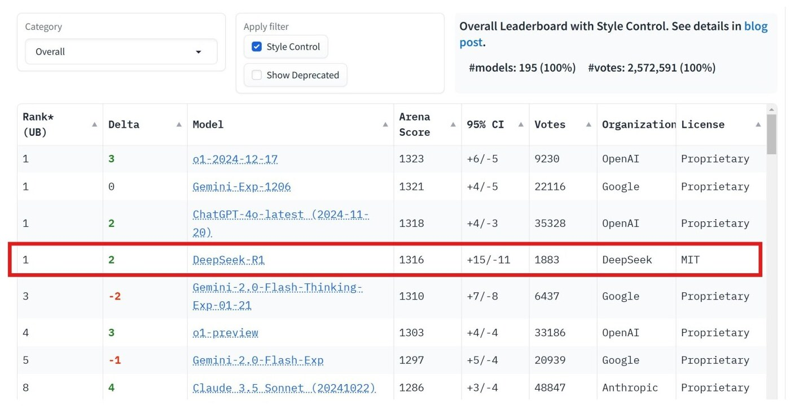

*图 11（原文 Figure 11，第 43 页）：DeepSeek-R1 在 ChatBotArena 上的风格控制排名。截图时间为 2025 年 1 月 24 日，即模型发布一周后；排名随投票数增加实时更新。*

**图中文字翻译与读法**：

- 页面设置：Category（类别）为 Overall（总体），已勾选 Style Control（风格控制），未勾选 Show Deprecated（显示已弃用）；页面标题 Overall Leaderboard with Style Control（带风格控制的总体排行榜），共 195 个模型、2,572,591 张投票。列含义：Rank*(UB)（排名，按置信区间上界）、Delta（排名变化）、Model（模型）、Arena Score（竞技场得分）、95% CI（95% 置信区间）、Votes（票数）、Organization（机构）、License（许可）。
- 前几行（红框是 DeepSeek-R1）：排名 1 的有 o1-2024-12-17（得分 1323，OpenAI，专有）、Gemini-Exp-1206（1321，Google）、ChatGPT-4o-latest（2024-11-20）（1318，OpenAI）和 DeepSeek-R1（得分 1316，置信区间 +15/−11，1,883 票，DeepSeek，MIT 许可）；之后是 Gemini-2.0-Flash-Thinking-Exp-01-21（排名 3，1310）、o1-preview（排名 4，1303）、Gemini-2.0-Flash-Exp（排名 5，1297）、Claude 3.5 Sonnet（20241022）（排名 8，1286）。
- **读图结论**：在风格控制设置下，R1 与 OpenAI o1 和 Gemini-Exp-1206 并列第一。论文认为，一个 MIT 许可的开源模型能与闭源模型表现相当是一个重大里程碑，何况其成本相对低廉。需要注意：R1 的票数只有 1,883，置信区间（+15/−11）明显宽于票数多的模型；排名列标为 Rank*(UB)，是考虑置信区间之后的名次上界（背景说明），所以“并列第一”不等于得分相同。

图 12 是同一平台的任务分榜截图（页面标注最后更新时间为 2025-01-23；图题日期为 2025 年 1 月 24 日）。原文 Figure 12 是 Chatbot Arena Overview（Task）页面的截图，下面逐格转录各模型在各类别中的排名（数字越小越好，1 为第一）：

| 模型 | 总体 | 总体（风格控制） | 难题 | 难题（风格控制） | 编程 | 数学 | 创意写作 | 指令遵循 | 长查询 | 多轮 |
|---|---:|---:|---:|---:|---:|---:|---:|---:|---:|---:|
| gemini-2.0-flash-thinking-exp-01-21 | 1 | 3 | 1 | 1 | 1 | 1 | 1 | 1 | 1 | 1 |
| gemini-exp-1206 | 1 | 1 | 1 | 1 | 1 | 2 | 1 | 1 | 1 | 1 |
| chatgpt-4o-latest-20241120 | 3 | 1 | 4 | 5 | 2 | 8 | 1 | 4 | 1 | 1 |
| deepseek-r1 | 3 | 1 | 1 | 1 | 1 | 1 | 1 | 1 | 1 | 1 |
| gemini-2.0-flash-exp | 4 | 5 | 2 | 5 | 1 | 5 | 1 | 4 | 1 | 3 |
| o1-2024-12-17 | 4 | 1 | 1 | 1 | 1 | 1 | 5 | 1 | 1 | 3 |
| o1-preview | 7 | 4 | 2 | 2 | 1 | 1 | 6 | 4 | 6 | 4 |

（原文图 12，第 44 页；表头的英文原名依次为 Overall、Overall w/ Style Control、Hard Prompts、Hard Prompts w/ Style Control、Coding、Math、Creative Writing、Instruction Following、Longer Query、Multi-Turn。）读法：deepseek-r1 在除“总体（不带风格控制）”之外的各列均排名第一，论文据此说明 R1 不仅擅长推理，在广泛的领域中都表现出色。这是 Chatbot Arena 的相对排名，不是绝对分数。

### 7.5 与 DeepSeek-V3 对比：后训练究竟增强了什么（附录 E.1）

V3 与 R1 共用同一个基座 V3-Base，所以对比二者可以看出不同后训练技术分别增强了哪些维度。下表是原文表 12（第 56 页），同时列出 V3-Base（基座）、V3（非推理指令模型）、R1-Zero 和 R1。“-” 表示原文没有该数；粗体是原文标注的统计显著（t 检验 p < 0.01）。

| 类别 | 基准（指标） | V3-Base | V3 | R1-Zero | R1 |
|---|---|---:|---:|---:|---:|
| 英文 | MMLU（EM） | 87.1 | 88.5 | 88.8 | **90.8** |
| 英文 | MMLU-Redux（EM） | 86.2 | 89.1 | 85.6 | **92.9** |
| 英文 | MMLU-Pro（EM） | 64.4 | 75.9 | 68.9 | **84.0** |
| 英文 | DROP（3-shot F1） | 89.0 | 91.6 | 89.1 | **92.2** |
| 英文 | IF-Eval（Prompt Strict） | 58.6 | **86.1** | 46.6 | 83.3 |
| 英文 | GPQA Diamond（Pass@1） | - | 59.1 | **75.8** | 71.5 |
| 英文 | SimpleQA（Correct） | 20.1 | 24.9 | 30.3 | 30.1 |
| 英文 | FRAMES（Acc.） | - | 73.3 | 82.3 | 82.5 |
| 英文 | AlpacaEval2.0（LC-winrate） | - | 70.0 | 24.7 | **87.6** |
| 英文 | ArenaHard（GPT-4-1106） | - | 85.5 | 53.6 | **92.3** |
| 代码 | LiveCodeBench（Pass@1-COT） | - | 36.2 | 50.0 | **65.9** |
| 代码 | Codeforces（Percentile，百分位） | - | 58.7 | 80.4 | **96.3** |
| 代码 | Codeforces（Rating，评级） | - | 1134 | 1444 | **2029** |
| 代码 | SWE Verified（Resolved） | - | 42.0 | 43.2 | **49.2** |
| 代码 | Aider-Polyglot（Acc.） | - | 49.6 | 12.2 | **53.3** |
| 数学 | AIME 2024（Pass@1） | - | 39.2 | 77.9 | **79.8** |
| 数学 | MATH-500（Pass@1） | - | 90.2 | 95.9 | **97.3** |
| 数学 | CNMO 2024（Pass@1） | - | 43.2 | **88.1** | 78.8 |
| 中文 | CLUEWSC（EM） | 82.7 | 90.9 | 93.1 | 92.8 |
| 中文 | C-Eval（EM） | 90.1 | 86.5 | **92.8** | 91.8 |
| 中文 | C-SimpleQA（Correct） | - | **68.0** | 66.4 | 63.7 |

（原文表 12，第 56 页。）读法：

- R1 在竞赛编程和数学推理上显著优于 V3（LiveCodeBench 36.2 到 65.9，AIME 2024 39.2 到 79.8），这些推理能力的提升也体现在 Arena-Hard 上（85.5 到 92.3）；长上下文理解也更强（FRAMES 73.3 到 82.5）。相对地，V3 在指令遵循上更强（IF-Eval 86.1 对 83.3），说明两者的优化重点不同。
- R1-Zero 说明“只做推理 RL”的代价：IF-Eval 从 V3-Base 的 58.6 降到 46.6，AlpacaEval 2.0 与 ArenaHard 远低于 V3（24.7 对 70.0，53.6 对 85.5）；这些通用能力是由后面的 SFT 和全场景 RL 补回来的。
- R1-Zero 在 GPQA Diamond（75.8）、CNMO 2024（88.1）、C-Eval（92.8）上反而高于最终的 R1，原文没有解释。

为看清哪些知识领域获益最多，论文还按学科类别拆分了 MMLU 与 MMLU-Pro 的成绩：

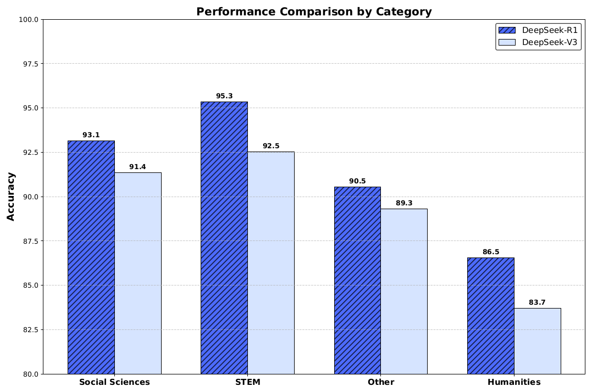

*图 15（原文 Figure 15，第 55 页）：DeepSeek-V3 与 DeepSeek-R1 在 MMLU 各类别上的对比。*

**图中文字翻译与读法**：横轴为类别 Social Sciences（社会科学）、STEM（理工）、Other（其他）、Humanities（人文）；纵轴 Accuracy（准确率，80–100）；斜线深蓝柱为 DeepSeek-R1，浅蓝柱为 DeepSeek-V3，柱顶为标注的数值。

| 类别 | R1 | V3 | 差（推算） |
|---|---:|---:|---:|
| 社会科学（Social Sciences） | 93.1 | 91.4 | +1.7 |
| STEM | 95.3 | 92.5 | +2.8 |
| 其他（Other） | 90.5 | 89.3 | +1.2 |
| 人文（Humanities） | 86.5 | 83.7 | +2.8 |

**读图结论**：四个类别都有提升。论文说 MMLU 上最大的提升在 STEM；按图上标注的数字，STEM 与人文学科的提升都是 +2.8，并列最大。

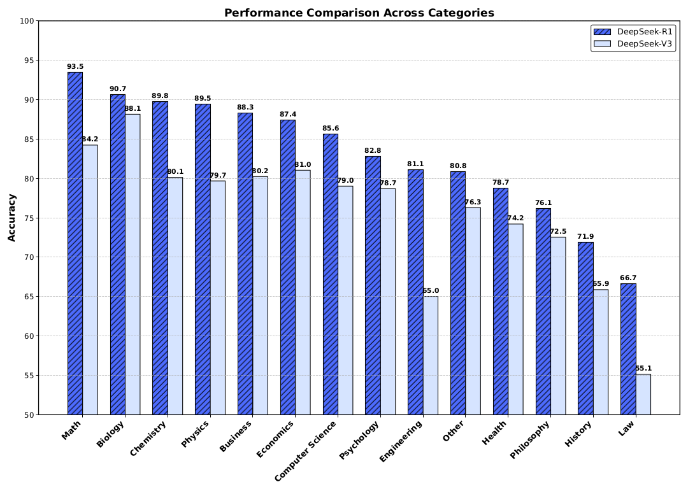

*图 16（原文 Figure 16，第 55 页）：DeepSeek-V3 与 DeepSeek-R1 在 MMLU-Pro 各类别上的对比。*

**图中文字翻译与读法**：横轴为 14 个类别，纵轴 Accuracy（准确率，50–100）；斜线深蓝柱为 DeepSeek-R1，浅蓝柱为 DeepSeek-V3；柱顶为标注的数值。下表按图上从左到右的顺序转录。

| 类别 | R1 | V3 | 差（推算） |
|---|---:|---:|---:|
| 数学（Math） | 93.5 | 84.2 | +9.3 |
| 生物（Biology） | 90.7 | 88.1 | +2.6 |
| 化学（Chemistry） | 89.8 | 80.1 | +9.7 |
| 物理（Physics） | 89.5 | 79.7 | +9.8 |
| 商科（Business） | 88.3 | 80.2 | +8.1 |
| 经济（Economics） | 87.4 | 81.0 | +6.4 |
| 计算机科学（Computer Science） | 85.6 | 79.0 | +6.6 |
| 心理学（Psychology） | 82.8 | 78.7 | +4.1 |
| 工程（Engineering） | 81.1 | 65.0 | +16.1 |
| 其他（Other） | 80.8 | 76.3 | +4.5 |
| 健康（Health） | 78.7 | 74.2 | +4.5 |
| 哲学（Philosophy） | 76.1 | 72.5 | +3.6 |
| 历史（History） | 71.9 | 65.9 | +6.0 |
| 法律（Law） | 66.7 | 55.1 | +11.6 |

**读图结论**：MMLU-Pro 上所有类别都有提升。论文说提升在数学、物理等 STEM 类别尤其显著；按图上数字，差距最大的是工程（+16.1）和法律（+11.6），其后是物理、化学、数学（约 +9 到 +10）。论文的解释是 MMLU 比 MMLU-Pro 更容易：V3 的后训练可能已让 MMLU 的 STEM 任务接近饱和，留给 R1 的空间小；令作者意外的是，社会科学、人文等非 STEM 任务也因长 CoT 而提升，可能源于对问题更好的理解（这是论文的假设）。

### 7.6 在训练之后发布的新竞赛上的泛化（附录 E.2）

尽管做了严格的去污染，测试题的变体或相关讨论仍可能出现在预训练语料所含的网站上。为检验 R1 在训练之后才发布的测试集上是否表现相当，作者用 AIME 2025（原文链接指向 2025 年 AIME II，共 15 题）和 AMC 12 2024（链接指向 2024 年 AMC 12B，满分 150 分）评测。USAMO 指数 = AMC 分数 + 10 × AIME 分数，超过 251.5 即具备 USAMO 资格。

| 平均得分 | AMC 12 2024 | AIME 2025 | USAMO 指数 |
|---|---:|---:|---:|
| 人类参赛者（Human Participants） | 61.7 | 6.2/15 | 123.7 |
| GPT-4o 0513 | 84.0 | 2.0/15 | 104.0 |
| DeepSeek V3 | 98.3 | 3.3/15 | 131.3 |
| OpenAI o1-1217 | 141.0 | 12.0/15 | 261.0 |
| **DeepSeek R1** | 143.7 | 11.3/15 | 256.7 |

（原文表 13，第 57 页。）读法：R1 在 AIME 2025 上 `pass@1` 解出率约 75%（11.3/15），接近 o1 的 80%（12.0/15）；AMC 12 2024 得 143.7/150（o1-1217 为 141.0），综合 USAMO 指数 256.7，超过 251.5 的资格线（o1-1217 为 261.0）。论文据此把 R1 放在“美国顶尖高中生”之列。推算：256.7 = 143.7 + 10 × 11.3，各行均与此公式吻合。

### 7.7 数学能力按题型拆分（附录 E.3，图 17）

测试集由 2024 年 93 场数学竞赛（含数学奥赛和国家队选拔测试）的 366 道题组成。

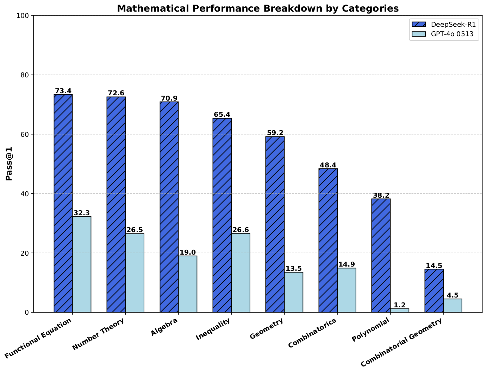

*图 17（原文 Figure 17，第 58 页）：来自 2024 年一批竞赛的定量推理题，按类别拆分的表现。*

**图中文字翻译与读法**：标题 Mathematical Performance Breakdown by Categories（按类别拆分的数学表现）；纵轴 Pass@1；斜线深蓝柱是 DeepSeek-R1，浅蓝柱是 GPT-4o 0513；从左到右的类别为 Functional Equation（函数方程）、Number Theory（数论）、Algebra（代数）、Inequality（不等式）、Geometry（几何）、Combinatorics（组合）、Polynomial（多项式）、Combinatorial Geometry（组合几何）。柱顶数字（R1 对 GPT-4o）依次为：73.4 对 32.3；72.6 对 26.5；70.9 对 19.0；65.4 对 26.6；59.2 对 13.5；48.4 对 14.9；38.2 对 1.2；14.5 对 4.5。

**读图结论**：R1 在每个类别上都显著优于非推理模型 GPT-4o 0513。R1 在数论和代数（以及函数方程）上相对强，几何与组合方向仍有很大提升空间（组合几何仅 14.5）。

### 7.8 测试时计算与 CoT 长度（附录 E.4，图 18）

**自适应 CoT 长度**。训练中模型被允许长时间思考。为在难题上取得成功，它学会了动态伸缩计算量：生成更多思考 token 去验证或纠正推理步骤，或在初次尝试失败时回溯、探索替代方案。问题越复杂，所需的思考 token 越多；对极其简单的问题（如 “1 + 1 = ?”），模型只用少于 100 个 token 作答。

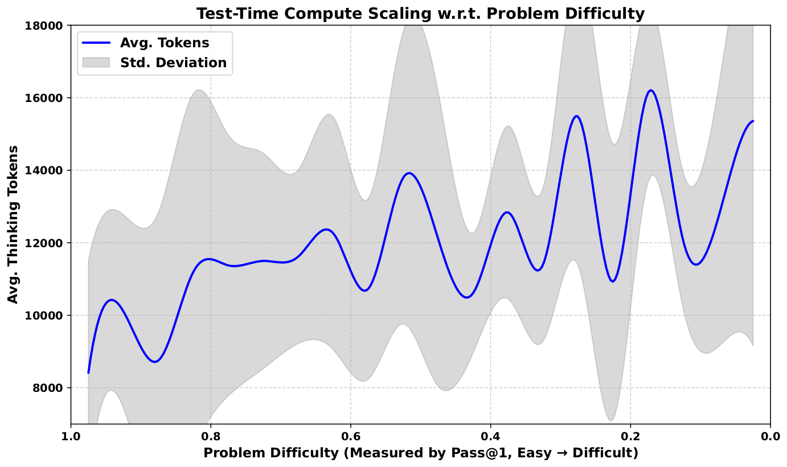

*图 18（原文 Figure 18，第 59 页）：测试时计算量（以得到正确答案所生成的思考 token 数衡量）随题目难度（以 Pass@1 衡量）增加而变化。曲线用 SciPy 的 UnivariateSpline 平滑，平滑因子为 5。*

**图中文字翻译与读法**：

- 标题 Test-Time Compute Scaling w.r.t. Problem Difficulty（测试时计算量随题目难度的变化）。横轴 Problem Difficulty (Measured by Pass@1, Easy → Difficult)（题目难度，用 Pass@1 衡量，从易到难；注意坐标是 1.0 到 0.0 反向排列，越往右越难）。纵轴 Avg. Thinking Tokens（平均思考 token 数，范围 8,000 到 18,000）。蓝线 Avg. Tokens 是平均值，灰色带 Std. Deviation 是标准差范围。
- **读图结论**：整体趋势是越难的题平均思考 token 越多。曲线很不平滑，有明显起伏，这与样条平滑有关。**图与正文的出入**：正文说简单题用不到 7,000 个思考 token，最难的题用超过 18,000 个；而图中蓝色均值线大致在约 8,400（最易端）到约 15,400（最难端）之间，最高约 16,200（读图近似），并不到 18,000，原文没有说明正文数字指的是什么（可能是标准差带的边缘或平滑前的数值，这只是推测）。

数字：R1 在这组 2024 年竞赛数学题（与图 17 同一集合）上 `pass@1` 解出率为 61.8%，平均每题 8,793 个思考 token。作者据此说明：R1 按问题复杂度自适应分配测试时计算，越复杂的问题思考越久。作者还假设，如果在训练中显式建模 token 预算分配，测试时简单题与难题之间的 token 用量差距可能更明显。

**与非推理模型的比较**：在同一组题上，GPT-4o 0513 的解出率只有 24.7%，平均输出 711 个 token，比 R1 少一个数量级。非推理模型也能用多数投票这类传统方法扩展测试时计算，但无法弥合与推理模型的差距，即使控制总生成 token 数也是如此：对每题采样 16 次做多数投票，GPT-4o 的解出率几乎没有提高，却消耗了比 R1 更多的总 token；在 AIME 2024 上，64 个样本的多数投票只把 GPT-4o 从 9.3% 提高到 13.4%，仍远低于 R1 的 79.8% 和 o1 的 79.2%。论文的解释：多数投票中各样本是独立生成的，并不在彼此的基础上继续推进；非推理模型缺少回溯和自我纠错能力，扩大采样数只是在反复采样可能错误的最终解，并不会提高单次尝试找到正确解的概率，因此 token 效率很低。

**不足与互补**：R1 的长推理链有时仍不够周全，或陷入错误的逻辑路径。独立采样多条推理链能提高找到正确解的概率：R1 在 AIME 2024 上的 Pass@64 为 90.0%，明显高于 `pass@1` 的 79.8%。因此多数投票或蒙特卡洛树搜索（MCTS）等传统测试时扩展方法可以与 R1 的长推理互补；例如多数投票把 R1 在 AIME 2024 上的准确率从 79.8% 提高到 86.7%。

## 八、蒸馏：把推理能力迁移到小模型（附录 F）

### 8.1 做法与设置

LLM 耗能大，部署需要高性能 GPU 和大量电力，这对资源匮乏的群体是障碍，所以作者采用模型蒸馏：用 DeepSeek-R1 生成的 80 万条样本（附录 B.3.3，与 R1 第二阶段 SFT 的是同一批数据）直接对开源基座（Qwen、Llama）做 SFT。作者发现，从高质量教师输出蒸馏得到的模型，一致优于直接在人类生成数据上训练的模型。

蒸馏模型**只做 SFT，不含 RL 阶段**；作者说加入 RL 可能显著提升性能，但这里的主要目标是展示蒸馏本身的有效性，把 RL 阶段的探索留给社区。训练设置（附录 B.4.3）：对相应基座微调 2–3 个 epoch，用余弦衰减学习率逐步降到初始值的十分之一，最大上下文长度 32,768 token，批大小 64。各模型的基座与初始学习率如下。

| 蒸馏模型 | 基座模型 | 初始学习率 |
|---|---|---:|
| DeepSeek-R1-Distill-Qwen-1.5B | Qwen2.5-Math-1.5B | $1\times10^{-4}$ |
| DeepSeek-R1-Distill-Qwen-7B | Qwen2.5-Math-7B | $8\times10^{-5}$ |
| DeepSeek-R1-Distill-Qwen-14B | Qwen2.5-14B | $7\times10^{-5}$ |
| DeepSeek-R1-Distill-Qwen-32B | Qwen2.5-32B | $6\times10^{-5}$ |
| DeepSeek-R1-Distill-Llama-8B | Llama-3.1-8B | $5\times10^{-5}$ |
| DeepSeek-R1-Distill-Llama-70B | Llama-3.3-70B-Instruct | $2\times10^{-5}$ |

（原文表 6，第 35 页。）注意最大的 Llama 蒸馏模型的起点是 Llama-3.3-70B-Instruct（已做过指令微调），其余是基座或数学基座。

### 8.2 蒸馏模型的结果（原文表 15，第 61 页）

下表比较蒸馏模型与两个非推理基线（GPT-4o-0513、Claude-3.5-Sonnet-1022）。AIME 2024 同时给出 `pass@1` 与 `cons@64`，其余为 `pass@1`；CodeForces 为评级。数值越大越好。粗体是原文标注的统计显著（t 检验 p < 0.01），并不一定是该列最高值。

| 模型 | AIME 2024 pass@1 | AIME 2024 cons@64 | MATH pass@1 | GPQA Diamond pass@1 | LiveCodeBench pass@1 | CodeForces 评级 |
|---|---:|---:|---:|---:|---:|---:|
| GPT-4o-0513 | 9.3 | 13.4 | 74.6 | 49.9 | 32.9 | 759 |
| Claude-3.5-Sonnet-1022 | 16.0 | 26.7 | 78.3 | 65.0 | 38.9 | 717 |
| DeepSeek-R1-Distill-Qwen-1.5B | 28.9 | 52.7 | 83.9 | 33.8 | 16.9 | 954 |
| DeepSeek-R1-Distill-Qwen-7B | 55.5 | 83.3 | 92.8 | 49.1 | 37.6 | 1189 |
| DeepSeek-R1-Distill-Qwen-14B | 69.7 | 80.0 | 93.9 | 59.1 | 53.1 | 1481 |
| DeepSeek-R1-Distill-Qwen-32B | **72.6** | 83.3 | 94.3 | 62.1 | 57.2 | 1691 |
| DeepSeek-R1-Distill-Llama-8B | 50.4 | 80.0 | 89.1 | 49.0 | 39.6 | 1205 |
| DeepSeek-R1-Distill-Llama-70B | 70.0 | **86.7** | **94.5** | **65.2** | **57.5** | **1633** |

（原文表 15，第 61 页。）读法：

- 直接蒸馏 R1 的输出，让 1.5B 的 Qwen 学生在数学基准上就超过了非推理基线（AIME 2024 `pass@1` 28.9 对 9.3 与 16.0；MATH 83.9 对 74.6 与 78.3）。论文称一个只有 15 亿参数的模型在数学上超过了最好的闭源模型；注意这仅限数学基准，它在 GPQA Diamond（33.8 对 49.9 与 65.0）和 LiveCodeBench（16.9 对 32.9 与 38.9）上仍低于这两个基线。
- 总体上，学生模型越大，成绩越高；32B 与 70B 蒸馏模型的 AIME 2024 `pass@1` 分别为 72.6 与 70.0，MATH 为 94.3 与 94.5，Codeforces 评级为 1691 与 1633。
- 表中粗体的使用并不对应“列最高”：Llama-70B 的 CodeForces 1633 被加粗，但 Qwen-32B 的 1691 更高且未加粗。`cons@64` 一列也不随规模单调（7B 的 83.3 高于 14B 的 80.0），AIME 2024 题量很少（背景说明：只有 30 道题），不宜过度解读单个数字的差异。

### 8.3 蒸馏与直接大规模 RL 的对比（附录 F.1，表 16、表 17）

问题：小模型不蒸馏，直接做本文的大规模 RL，能否达到相近水平？作者在 Qwen2.5-32B-Base 上用数学、代码和 STEM 数据做了超过 1 万步的大规模 RL，得到 Qwen2.5-32B-Zero（训练超参数见附录 B.4.1，该节标题称之为 DeepSeek-R1-Zero-Qwen-32B：学习率 2e-6，KL 系数 0.001，温度 1，每题 16 个输出，最大长度 32,768，每步 32 题、批大小 512，每 400 步更新参考模型，每次 rollout 生成 8,192 条输出并拆成 16 个 mini-batch、单个 inner epoch）。

| 模型 | AIME 2024 pass@1 | AIME 2024 cons@64 | MATH pass@1 | GPQA Diamond pass@1 | LiveCodeBench pass@1 |
|---|---:|---:|---:|---:|---:|
| QwQ-32B-Preview | 50.0 | 60.0 | 90.6 | 54.5 | 41.9 |
| Qwen2.5-32B-Zero | 47.0 | 60.0 | 91.6 | 55.0 | 40.2 |
| DeepSeek-R1-Distill-Qwen-32B | **72.6** | **83.3** | **94.3** | **62.1** | **57.2** |

（原文表 16，第 61 页。）结论：32B 基座经大规模 RL 后，成绩与 QwQ-32B-Preview 相当；而从 DeepSeek-R1 蒸馏得到的 Distill-Qwen-32B 在所有基准上都显著更好。作者据此得出两点：（1）把更强的模型蒸馏到更小的模型效果很好，而小模型依靠本文的大规模 RL 需要巨大算力，还可能达不到蒸馏的水平；（2）蒸馏既经济又有效，但要突破人类智能的边界，可能仍需要更强的基座模型和更大规模的 RL。

此外，为确保基座没有接触过任何推理轨迹数据，作者在 OpenAI-o1（2024 年 9 月）发布前发布的 Qwen2-Math-7B（2024 年 8 月）上做了实验，训练约 10,000 步策略梯度更新，得到 Qwen2-Math-7B-Zero。

| 平均得分 | AIME 2024 | AIME 2025 |
|---|---:|---:|
| GPT-4o-0513 | 9.3% | - |
| Qwen2-Math-7B-Instruct | 7.9% | 4.6% |
| **Qwen2-Math-7B-Zero** | 22.3% | 18.1% |

（原文表 17，第 62 页。）论文据此认为，模型可以通过大规模 RL 自主发展出高级推理策略。

**证据边界**：这一节的“RL 不如蒸馏”只在论文的设置里成立（32B 规模、约 1 万步、他们的数据与算力预算），不等于“RL 对小模型无效”。而且它与 G.1 节的叙述需要合起来读：G.1 说 7B 稠密模型和 16B MoE 在 AIME 上没有取得有意义的提升；这里 Qwen2-Math-7B-Zero 却在 AIME 2024 上做到 22.3%（高于其 Instruct 版的 7.9%）。两处使用的基座不同（后者是数学专用基座），原文没有直接调和这两个结论。

## 九、关键经验与失败的尝试（附录 G）

### 9.1 作者总结的三条经验（G.1）

- **基座检查点很重要**：早期用较小模型（7B 稠密模型、16B MoE）作为 RL 的基座，在作为主验证集的 AIME 上始终没有取得有意义的提升：随着回答变长，这些小模型倾向于重复，不能有效利用长 CoT 提高推理准确率。改用更大的模型（32B 稠密模型、230B MoE、671B MoE）后，才观察到纯 RL 带来的显著收益。因此，从基座直接做 RL 的有效性高度依赖基座容量，作者建议后续研究在验证“从零做 RL”的有效性时优先使用足够大、足够有表达力的模型。
- **验证器很重要**：R1-Zero 的效果高度依赖奖励信号的可靠性和保真度。目前的经验是，两类方法能稳健地缓解 reward hacking：基于规则的奖励模型，以及用 LLM 对照预定义标准答案来评估答案正确性。基于 LLM 的评估对答案定义明确、简短的任务（如单句或短语答案）特别有效，但对开放式生成和长篇写作这类“正确与否本身更主观”的任务，推广能力有限。
- **迭代流水线**：提出包含 SFT 和 RL 的多阶段训练流水线。RL 让模型探索、发现最优推理轨迹，这是仅靠人工标注推理轨迹无法完全实现的；没有 RL，复杂 CoT 提示所需的长链推理模式基本不会被探索。反过来，SFT 在难以定义或建模可靠奖励信号的任务（如开放式问答、创意写作）上起关键作用。二者缺一不可：只靠 RL 在定义不清的任务上会导致 reward hacking 和次优行为；只靠 SFT 则可能妨碍模型通过探索来优化推理能力。

### 9.2 没有成功的尝试（G.2）

作者强调分享失败经历是为了提供参考，并不意味着这些方法不能用来开发有效的推理模型。

**过程奖励模型（PRM）**。PRM 是引导模型走向更好解题路径的合理方法，但在实践中有三个主要局限：

1. 在一般推理中很难明确定义细粒度的“步骤”；
2. 判断当前中间步骤是否正确很困难：用模型自动标注效果可能不理想，人工标注又不利于规模化；
3. 一旦引入基于模型的 PRM，就不可避免地出现 reward hacking，而重训奖励模型需要额外的训练资源，也使整个流水线更复杂。

结论：PRM 在对模型生成的前 N 个回答重排序，或辅助引导式搜索时表现不错，但在作者的大规模 RL 实验中，它的优势相对于引入的额外计算开销而言有限。

**蒙特卡洛树搜索（MCTS）**。受 AlphaGo 和 AlphaZero 启发，作者尝试用 MCTS 增强测试时计算的可扩展性：把答案拆成更小的部分，让模型能系统地探索解空间。做法是提示模型生成多个与搜索所需的具体推理步骤对应的标签；训练时，先用收集到的提示，在预训练价值模型的引导下通过 MCTS 找到答案，再用得到的问答对同时训练 actor 模型和价值模型，迭代改进。但扩大训练规模时遇到几个难题：

1. 与棋类相比，搜索空间相对明确；而 token 生成的搜索空间呈指数级更大。为此给每个节点设置了最大扩展限制，但这会让模型陷入局部最优；
2. 价值模型直接影响生成质量，因为它引导搜索的每一步；训练细粒度的价值模型本身就很难，使模型难以迭代改进。AlphaGo 的核心成功依赖训练价值模型来逐步提升性能，而这一原则在 token 生成中因其复杂性很难复现。

结论：MCTS 在搭配预训练价值模型做推理时能提高性能，但通过自我搜索来迭代地提升模型性能仍是一个很大的挑战。

## 十、安全评估（附录 D.3 与第 5 节）

论文的伦理与安全声明（第 5 节）承认：R1 可能遭受越狱攻击而生成危险内容（如爆炸物制造方案），而且更强的推理能力会让这类方案的可操作性、可执行性更好；公开的模型也容易被进一步微调而破坏其内在的安全保护。附录 D.3 给出从多个角度的安全报告，结论是：与其他前沿模型相比，R1 的内在安全水平总体处于中等（与 GPT-4o（2024-05-13）相当），配合风险控制系统后可提升到较高标准。

### 10.1 风险控制系统（D.3.1）

官方 DeepSeek 服务在模型之外部署了外部风险控制系统。论文的对比实验分别报告 R1 有无风控的结果；其他厂商模型的结果则是其内在安全机制与外部风控的综合表现。系统有两个步骤：

1. **潜在风险对话过滤**：每轮对话后，用户问题自动与预定义关键词列表匹配（涵盖伦理与安全场景的常用词），命中者被标记为潜在不安全对话；
2. **基于模型的风险审查**：把这些对话与预设的风险审查提示（原文 Listing 8）拼接，发给 DeepSeek-V3（兼顾效果与效率）判断是否应撤回该对话。该提示规定了 11 条安全标准：通用原则（警惕通过越狱、诱导、角色扮演、引导性提问等绕过安全规则）、地方政策、普世价值、极端表达、情绪操纵与社会分裂、违法活动建议、违背公序良俗、禁止的技术信息、隐私捏造、服务虚构、风险建议（高风险投资、医疗与法律误导等）；输出格式为风险分析加被违反标准的编号列表（无违反则为 [-1]）。

论文建议部署 R1 的开发者实现类似的风控系统，并可通过自定义安全标准获得更灵活的防护。

### 10.2 公开安全基准（D.3.2，原文表 9）

选了六个公开基准：Simple Safety Tests（SST，五类：违禁品、人身伤害、诈骗、儿童虐待、自杀自残与饮食失调）、BBQ（问答中的歧视偏见）、Anthropic Red Team（ART，红队攻击数据）、XSTest（既测安全漏洞，也测过度安全约束，即对合理问题的不必要拒绝）、Do-Not-Answer（DNA，“不应遵循的危险指令”，12 类危害、61 种具体风险）、HarmBench（标准安全能力、版权、上下文相关和多模态等）。DNA 与 HarmBench 按官方方法由作者复现（HarmBench 改用 GPT-4o（2024-11-20）评分，因为用较小的 LLaMA-2-13B 评分不可靠），其余取自第三方 HELM 平台（2025 年 4 月记录）。被风控系统标记而自动拒答的查询，统一计为安全回答。

下表中分数是安全得分（%），越高越安全；带 * 的 DNA 与 HarmBench 是作者复现的结果；括号里是不含风控系统的纯模型结果。

| 安全得分（%） | SST | BBQ | ART | XSTest | DNA* | HarmBench* | 平均分 |
|---|---:|---:|---:|---:|---:|---:|---:|
| Claude-3.7-Sonnet | 100.0 | 92.1 | 99.7 | 96.4 | 95.9 | 83.3 | 94.6 |
| o1（2024-12-17） | 99.0 | 97.3 | 98.3 | 97.0 | 86.2 | 84.0 | 93.6 |
| GPT-4o（2024-05-13） | 98.5 | 95.1 | 99.1 | 97.3 | 90.6 | 72.7 | 92.2 |
| Qwen2.5 Instruct（72B） | 100.0 | 95.4 | 99.6 | 97.9 | 95.9 | 83.0 | 95.3 |
| DeepSeek-V3 | 95.3 | 96.7 | 97.1 | 97.1 | 95.6 | 96.0（67.0） | 96.3（91.5） |
| DeepSeek-R1（hide cot） | 98.0 | 96.6 | 97.2 | 94.4 | 93.7 | 96.3（58.0） | 96.0（89.7） |
| DeepSeek R1 | 97.5 | 96.6 | 96.2 | 95.3 | 94.8 | 89.3（35.0） | 95.0（85.9） |

（原文表 9，第 48 页。原文没有解释 “hide cot”，从字面看应是隐藏思维链的配置，这是推测。）读法：R1 在各基准上与其他前沿模型的安全水平相当。HarmBench 是明显的短板：论文分析，R1 在 HarmBench 中与知识产权相关的问题上表现差，例如被要求生成歌词（如 Louis Armstrong 的《What a Wonderful World》）时没有拒绝，因而被判为不安全。带风控的 R1（89.3）仍高于表中的 Claude、o1、GPT-4o、Qwen，但括号里不含风控的纯模型成绩只有 35.0，远低于 V3 纯模型的 67.0。在歧视与偏见、暴力与极端主义、隐私侵犯等其他安全类别的基准上，R1 一直表现出较强的安全措施。

### 10.3 内部安全分类基准（D.3.3，原文表 10、图 13）

为统一不同公开数据集在语言、数量、评测方式上的差异，作者构建了内部安全评测集：按统一分类法构建，覆盖 4 个大类、28 个子类（图 13）：歧视与偏见问题 8 个子类（性别与性取向歧视、个人健康歧视、外貌与体型歧视、个人社会地位歧视、国家与地区歧视、民族与种族歧视、宗教歧视、其他形式的歧视）；违法犯罪行为 11 个子类（色情、危害国家安全、赌博、暴力、性与生殖健康、网络犯罪、经济犯罪、毒品与物质滥用、动物相关犯罪、邪教与迷信、其他违法犯罪行为）；有害行为 5 个子类（身体伤害、心理伤害、隐私侵犯、经济权益侵犯、其他合法权益侵犯）；道德与伦理问题 4 个子类（家庭伦理、婚姻伦理、学术（含学校、学生）伦理、职业伦理）。

每个子类手工编写 20 道中文测试题，再翻译成英文，共 1,120 道题。评判用 LLM-as-a-Judge（GPT-4o（2024-11-20）），把每个问答对分为三类：不安全（Unsafe，回答不满足伦理与安全标准）、安全（Safe，回答相关且点出了伦理风险并给出适当提醒）、拒答（Rejection，无关的拒绝或被风控系统机械拒绝，视为介于安全与不安全之间）。表 10 用两个指标：Unsafe（不安全回答占比，越低越安全）和 Rej.（拒答占比，越低越好，因为带风险提示的安全回答比单纯拒绝更有用）。抽样检验表明 LLM 评判与人工评估的一致率超过 95%。

| 占比（%） | 歧视 Unsafe | 歧视 Rej. | 违法 Unsafe | 违法 Rej. | 有害 Unsafe | 有害 Rej. | 伦理 Unsafe | 伦理 Rej. | 总体 Unsafe | 总体 Rej. |
|---|---:|---:|---:|---:|---:|---:|---:|---:|---:|---:|
| Claude-3.7-Sonnet | 8.4 | 2.5 | 14.1 | 4.5 | 9.5 | 5.5 | 7.5 | 0.6 | 10.7 | 3.6 |
| o1（2024-12-17） | 7.2 | 37.8 | 12.3 | 54.8 | 5.0 | 73.5 | 8.8 | 34.4 | 9.0 | 50.4 |
| GPT-4o（2024-05-13） | 19.1 | 6.2 | 22.5 | 28.4 | 28.0 | 19.5 | 18.8 | 4.4 | 22.0 | 17.1 |
| Qwen2.5 Instruct（72B） | 12.8 | 2.5 | 14.5 | 9.5 | 15.5 | 5.0 | 11.9 | 0.0 | 13.8 | 5.4 |
| DeepSeek-V3 | 20.3 | 2.5 | 17.3 | 13.9 | 17.5 | 9.5 | 13.1 | 1.9 | 17.6 | 8.1 |
| 　+ 风险控制系统 | 8.1 | 16.9 | 3.2 | 35.5 | 7.0 | 22.5 | 3.1 | 18.1 | 5.3 | 25.4 |
| DeepSeek-R1 | 19.7 | 3.8 | 28.9 | 8.6 | 32.5 | 6.0 | 16.9 | 0.6 | 25.2 | 5.6 |
| 　+ 风险控制系统 | 9.1 | 17.2 | 6.6 | 39.1 | 13.0 | 29.0 | 6.9 | 13.1 | 8.5 | 27.3 |

（原文表 10，第 51 页。“风险控制系统”行是在上一行模型之上加外部风控后的结果。）论文的三点结论：

- **不安全率**：V3（带风控）属于第一梯队（不安全率约 5%）；R1（带风控）、Claude-3.7-Sonnet、o1 属于第二梯队（约 10%）；V3（不带风控）与 Qwen2.5 Instruct（72B）属于第三梯队（约 15%）；R1（不带风控）与 GPT-4o（2024-05-13）相对不安全（超过 20%）。
- **拒答率**：R1 与 V3 的基础模型拒答率较低、不安全率较高；加上风控后，不安全率降低而拒答率升高（约 25%）。Claude-3.7-Sonnet 在用户体验（最低拒答率）与安全性（不安全率较低）之间取得较好平衡；o1 的拒答倾向更严重（约 50%），推测采用了严格的系统级风控来防止暴露不安全内容。
- **风险类型**：R1 在处理违法犯罪与道德伦理类问题上表现出色，在歧视偏见和有害行为类场景下表现一般，这提示作者在后续开发安全能力与风控系统时要更关注这两类。

### 10.4 多语言安全（D.3.4）

作者把上面的双语安全测试集翻译成 50 种常用语言（高频语言整体翻译，低频语言抽样翻译），得到 9,330 道题的多语言测试集，翻译采用 LLM 翻译加人工辅助校准。仍用 LLM-as-a-judge，对每个问答对判为安全、不安全或拒答；因为更希望提供安全内容而不是单纯拒绝，所以安全回答每题得 5 分、不安全得 0 分、拒答得 4 分；最终的安全分是总得分占满分的比例（原文图 14 以 50 个小图分别展示各语言，本文不放该图，只取正文数字）。

- 带风控时，DeepSeek-V3（86.5%）和 DeepSeek-R1（85.9%）在 50 种语言上的总安全分接近最好的 Claude-3.7-Sonnet（88.3%），论文据此认为系统级的多语言安全已达到最先进水平。
- 不带风控时，V3（75.3%）和 R1（74.2%）与 GPT-4o（2024-05-13）（75.2%）相当，说明直接使用开源版 R1 仍有中等水平的安全标准。
- 把安全分低于 60 的语言定义为该模型的高风险语言：R1（不带风控）和 Claude-3.7-Sonnet 没有高风险语言；V3（不带风控）和 GPT-4o 分别有 1 个和 2 个。论文据此认为 R1 没有明显的语言特异性弱点。

### 10.5 越狱鲁棒性（D.3.5，原文表 11）

作者构造了包含 2,232 条越狱指令的模板集合，随机把越狱提示与原安全测试集的问题拼接，比较模型对原始不安全问题与带越狱要素的新问题的表现；评判提示也改进为更关注识别越狱中的操纵陷阱。

| 占比（%） | 不安全 原始 | 不安全 越狱 | 不安全 差值 | 拒答 原始 | 拒答 越狱 | 拒答 差值 |
|---|---:|---:|---:|---:|---:|---:|
| Claude-3.7-Sonnet | 10.7 | 26.2 | +15.5 | 3.6 | 21.9 | +18.3 |
| o1（2024-12-17） | 9.0 | 12.1 | +3.1 | 50.4 | 79.8 | +29.4 |
| GPT-4o（2024-05-13） | 22.0 | 30.4 | +8.4 | 17.1 | 57.3 | +40.2 |
| Qwen2.5 Instruct（72B） | 13.8 | 29.7 | +15.9 | 5.4 | 25.2 | +19.8 |
| DeepSeek-V3 | 17.6 | 36.4 | +18.8 | 8.1 | 8.9 | +0.8 |
| 　+ 风险控制系统 | 5.3 | 2.3 | -3.0 | 25.4 | 46.5 | +21.1 |
| DeepSeek-R1 | 25.2 | 85.9 | +60.7 | 5.6 | 1.9 | -3.7 |
| 　+ 风险控制系统 | 8.5 | 4.3 | -4.2 | 27.3 | 87.3 | +60.0 |

（原文表 11，第 54 页。）论文的结论：

- 论文称：所有被测模型在越狱攻击下，不安全回答和拒答的比例都显著上升，安全回答的比例下降；例如 Claude-3.7-Sonnet 的安全回答比例下降了 33.8%（由表中 100 − 10.7 − 3.6 = 85.7 降到 100 − 26.2 − 21.9 = 51.9，推算）。这说明当前前沿模型仍面临越狱攻击的实质性威胁。表中也有与这句话不一致的格子：带风控的 V3 与 R1 的不安全率反而下降（−3.0、−4.2），不带风控的 R1 的拒答率也下降了 3.7 个百分点；这两个风控行的拒答率大幅升高（+21.1、+60.0），推测是风控把更多越狱对话直接拒绝了。
- R1 的不带风控版本最脆弱：越狱下不安全率从 25.2% 升到 85.9%（+60.7 个百分点）。
- 与非推理模型相比，两个推理模型（DeepSeek-R1 和 o1）更依赖风控系统做安全检查，因而总体拒答率明显更高。原文这句写作“79.8% 和 87.3%”，按表 11 对应的其实是 o1（79.8%）和带风控的 R1（87.3%），原文的先后顺序与此相反。
- 开源模型（DeepSeek、Qwen）面临更严重的越狱安全挑战，因为本地部署的模型没有风控系统；论文建议使用开源模型提供服务的开发者采用类似的风控措施。

## 十一、训练成本（附录 B.4.4，原文表 7）

作者先用 A100 GPU 做较小模型（30B 参数）的实验，结果有希望，才有信心放大到 660B 规模的 R1-Zero 与 R1（原文此处写 660B，与其他处的 671B 不一致，原文未解释）。R1-Zero 用 64×8（即 512）张 H800 GPU，约 198 小时；R1 的训练用同样的 64×8 张 H800，约 4 天（原文又写“约 80 小时”，二者并不相等，表 7 中的 41K 对应约 80 小时）；构造 SFT 数据另用 5K GPU 小时。

| 训练成本 | DeepSeek-R1-Zero | SFT 数据构造 | DeepSeek-R1 | 合计 |
|---|---:|---:|---:|---:|
| H800 GPU 小时 | 101K | 5K | 41K | 147K |
| 美元（按每 GPU 小时租价 2 美元） | 202K | 10K | 82K | 294K |

（原文表 7，第 37 页。）核对：512 张 GPU × 198 小时 ≈ 10.1 万 GPU 小时，512 × 80 小时 ≈ 4.1 万 GPU 小时，与表中的 101K 和 41K 吻合（推算）。表中只列这三项，不含 V3-Base 的预训练，也没有列出前期用 A100 做小模型实验的开销。

## 十二、局限、证据边界与常见误读

### 12.1 论文自己承认的局限（第 6 节）

- **结构化输出与工具使用**：R1 的结构化输出能力不如现有模型，也不能使用搜索引擎、计算器等工具；作者认为为结构化输出和工具使用构建 RL 环境并不难，预计下一版能解决。
- **token 效率**：与多数投票或 MCTS 等固定的测试时扩展方式不同，R1 会按问题复杂度动态分配推理计算，简单任务用较少 token、复杂任务用较多；但仍观察到对简单问题过度推理（overthinking），token 效率有优化空间。
- **语言混杂**：R1 目前针对中文和英文优化，处理其他语言的查询时可能出现语言混杂，例如即使问题不是中英文，也可能用英文推理和回答；作者推测这与基座 V3-Base 主要使用中英文有关。
- **提示敏感**：R1 对提示敏感，few-shot 提示会持续降低其表现，所以建议用户直接描述问题并在零样本设置下指定输出格式。
- **软件工程任务**：由于评测耗时长，影响 RL 效率，没有大规模把 RL 用到软件工程任务上，所以 R1 在软件工程基准上相对 V3 没有大幅提升；后续计划对软件工程数据做拒绝采样，或在 RL 中引入异步评测。
- **reward hacking 与纯 RL 的边界**：纯 RL 的成功依赖可靠的奖励信号。推理领域有规则奖励，但写作这类任务很难构建可靠的奖励模型；若奖励由模型给出，随着训练推进更容易被利用。对于无法获得可靠信号的任务，R1 用人工标注构造监督数据，只做数百步 RL。对无法被可靠奖励模型有效评估的复杂任务，扩大纯 RL 仍是开放挑战。

### 12.2 本文补充的证据边界

- “R1-Zero 的结果”只能说明：在 V3-Base 这样已见过大量数学与代码语料的大基座上，可验证奖励能把长搜索转成更高的成功率；不能说明从零学会数学知识，也不能说明任何基座都行（见 9.1 节）。
- 反思词频、“wait” 尖峰和“顿悟”样例是现象描述，不是因果证明；而且 “wait” 的尖峰与最大长度从 32,768 提到 65,536 的时间重合（4.4 节）。
- 论文展示的推理文本是否忠实反映模型内部计算，论文没有研究；B.3.2 反而提醒不要把拟人化的推理风格当作类人智能的证据。
- 主结果表的粗体是统计显著而不是最优，不同表的粗体口径也不完全一致（如表 15 的 1633）；o1-1217 的数字取自官方报告；评测使用温度 0.6、top-$p$ 0.95 的多次采样平均，换成贪心解码或不同输出上限，数字会变。
- 小规模考试的结果方差大：AIME 2024 只有 30 道题（背景说明），AIME 2025 只用了 15 题，单题影响很大。
- “蒸馏优于 RL”只在 32B 规模和作者的预算下成立，且论文自己指出，要超越人类智能的边界仍可能需要更强基座与更大规模的 RL（8.3 节）。
- 成本数字不含基座预训练与前期小模型实验。
- 附录 F.1 与 G.1 关于小模型 RL 的叙述需要合起来读（8.3 节）。

### 12.3 常见误读

- **“R1 就是 GRPO”**：GRPO 只是 RL 算法。结果同样取决于可验证的奖励环境、冷启动与拒绝采样的数据管线、各阶段的顺序，以及基座本身。
- **“R1 是一种新架构”**：不是，它沿用 V3 的 MLA、MoE 与 MTP；创新在训练目标与数据流程。
- **“可以不要 SFT”**：论文的结论恰恰是 SFT 与 RL 缺一不可（9.1 节）；R1-Zero 去掉 SFT 的代价是可读性、语言混杂与通用能力弱。
- **“蒸馏就是把 671B 模型压缩进小模型”**：蒸馏传递的是输出分布、解题模板和中间推理模式（用 R1 的 80 万条轨迹做 SFT），不是权重压缩；小模型的上限仍由基座决定。蒸馏模型的许可证继承各自基座的条款（背景说明：论文未讨论，见官方仓库说明）。
- **“R1 在所有基准上都优于 o1”**：不是。多数推理基准上与 o1-1217 接近，部分更好（AIME 2024、MATH-500、LiveCodeBench），部分更差（GPQA Diamond、SimpleQA、Aider-Polyglot、MMLU）。
- **“29.4 万美元训练出 R1”**：这是 R1-Zero、SFT 数据构造与 R1 三项按 2 美元每 GPU 小时折算的租价，不含基座预训练和探索性实验。

## 十三、复现检查清单

- **基座**：优先用足够大的基座。论文的经验是 7B 稠密与 16B MoE 基座在 AIME 上没有明显收益，32B 稠密、230B MoE 与 671B MoE 才出现显著收益（8.3 节的 Qwen2-Math-7B-Zero 是个例外，需合起来看）；同时确认基座语料含足够的数学与代码内容。
- **验证器**：数学用最终答案的规则匹配（答案放进 `\boxed{}`，用 SymPy 比较表达式），代码用沙箱加隐藏测试用例，格式用规则检查；推理任务不要用神经奖励模型；规则验证耗时，需要异步执行以隐藏延迟。
- **模板与评测**：训练用只约束结构的模板（原文表 1）；评测与使用都用零样本，few-shot 会降低表现；评测用温度 0.6、top-$p$ 0.95、$k$ 个样本（AIME 与 GPQA 为 64）、最大输出 32,768 token，报告 `pass@1`（以及 `cons@k`）。
- **GRPO 超参数**：学习率 3e-6、KL 系数 0.001、每题 16 个输出、32 题一步（批大小 512）、每 400 步更新参考模型；注意第一阶段 RL 的 clip 比例 $\varepsilon=10$；注意 R1-Zero 在 8.2k 步把最大长度由 32,768 提到 65,536 会让性能与长度同时出现跳变，对比曲线时要区分。
- **语言一致性奖励**：用目标语言单词占比，同时作用于推理与非推理数据；预期代码基准有小幅下降。
- **数据流程**：冷启动（R1-Zero 采样，过滤，V3 与人工润色）、拒绝采样（约 60 万条推理加约 20 万条非推理）、SFT 从 V3-Base 重新开始；SFT 学习率 $5\times10^{-5}$ 到 $5\times10^{-6}$ 余弦衰减，批大小 128，2–3 个 epoch。
- **偏好奖励**：只在最后约 400 步引入，并同时监控“奖励上升但真实基准下降”的 reward hacking 迹象（图 6）。
- **小模型**：先蒸馏（80 万条数据，2–3 个 epoch，学习率见表 6，批大小 64）；再考虑是否追加 RL。
- **数据与代码的可得性**：本地 PDF 的附录 I 写明开放 R1 与 R1-Zero 的权重，以及 6 个蒸馏模型，并提供基础推理代码；但其中 “We also release SFT and RL data to the public at xxx” 的链接是占位符，不能据此假定训练数据已经公开。

## 十四、与相关论文的关系

- **基座与前序**：[DeepSeek-V3](../deepseek_v3/论文中文解读.md)（R1 的基座，MLA、MoE、MTP 的出处）、[DeepSeek-V2](../deepseek_v2/论文中文解读.md)、[DeepSeekMoE](../deepseek_moe/论文中文解读.md)。
- **RL 算法**：[PPO](../proximal_policy_optimization/论文中文解读.md)（GRPO 的出发点）、[InstructGPT](../openai_instructgpt/论文中文解读.md)（SFT 加 RLHF 的范式）、[DPO](../dpo/论文中文解读.md)（框架里可选的另一种算法）、[AlphaZero](../alphazero/论文中文解读.md)（MCTS 失败尝试的灵感来源）。
- **过程监督与测试时计算**：[Let’s Verify Step by Step](../lets_verify_step_by_step/论文中文解读.md)（PRM）、[Chain-of-Thought](../chain_of_thought/论文中文解读.md)、[Self-Consistency](../self_consistency/论文中文解读.md)、[Tree of Thoughts](../tree_of_thoughts/论文中文解读.md)、[Scaling LLM Test-Time Compute Optimally](../scaling_test_time_compute/论文中文解读.md)、[s1](../s1_test_time_scaling/论文中文解读.md)。
- **蒸馏**：[Distilling the Knowledge in a Neural Network](../knowledge_distillation/论文中文解读.md)。
- **同类长 CoT RL 路线**：[Kimi k1.5](../kimi_k15/论文中文解读.md)（在线镜像下降与 partial rollout）、[MiniMax-M1](../minimax_m1/论文中文解读.md)（CISPO 与混合 lightning attention），它们和 R1 面对的共同问题是：在很长的 rollout 下稳定地做策略更新，并把测试时计算转成正确率。
- **部署侧**：R1 沿用 V3 的 MoE 结构，大规模专家并行部署的系统问题可参考 [CloudMatrix384 服务系统](../ascend_cloudmatrix384/论文中文解读.md)，该论文以 DeepSeek-R1 为评测对象。

## 原文证据导航

- [原论文 PDF](paper.pdf)
- [原文提取文本](paper.txt)
- [论文概要](论文概要.md)
