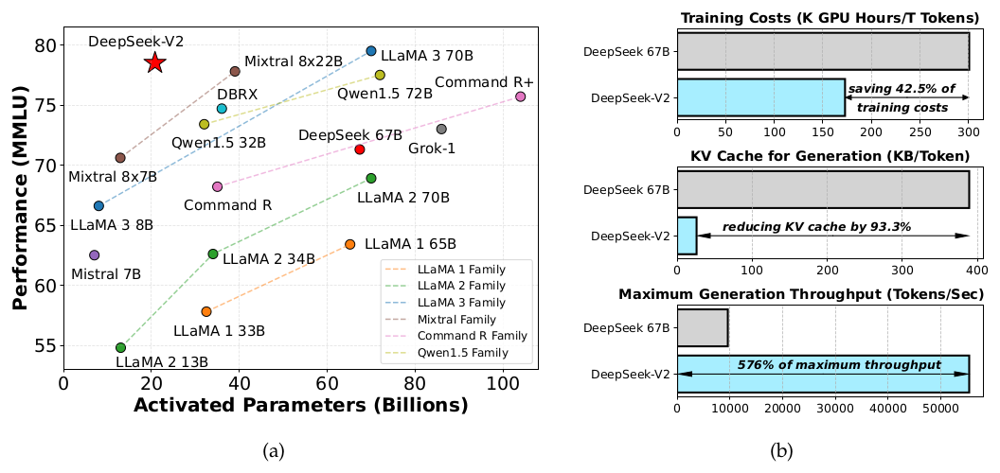
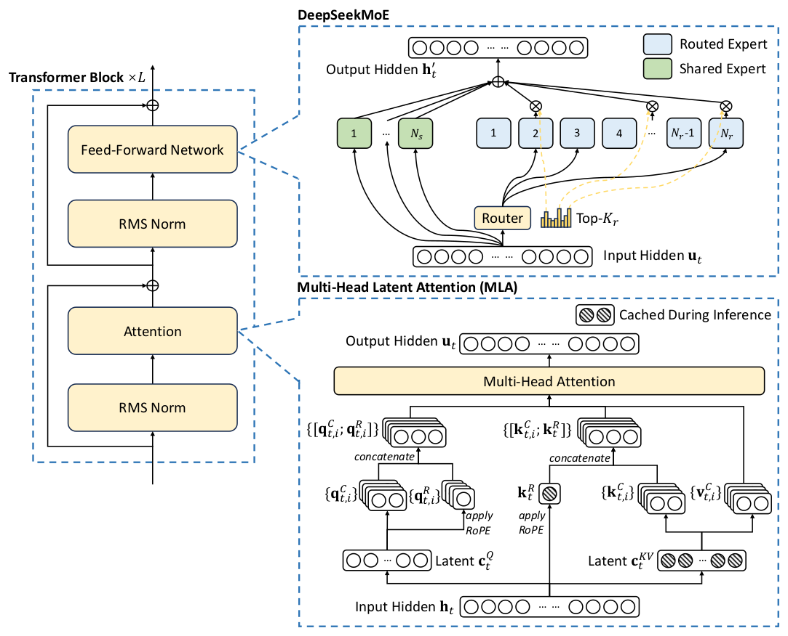
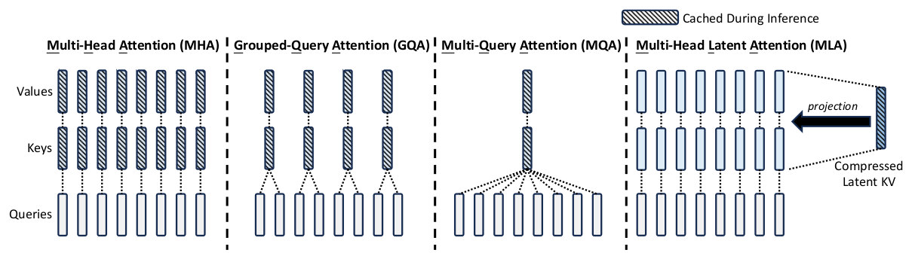
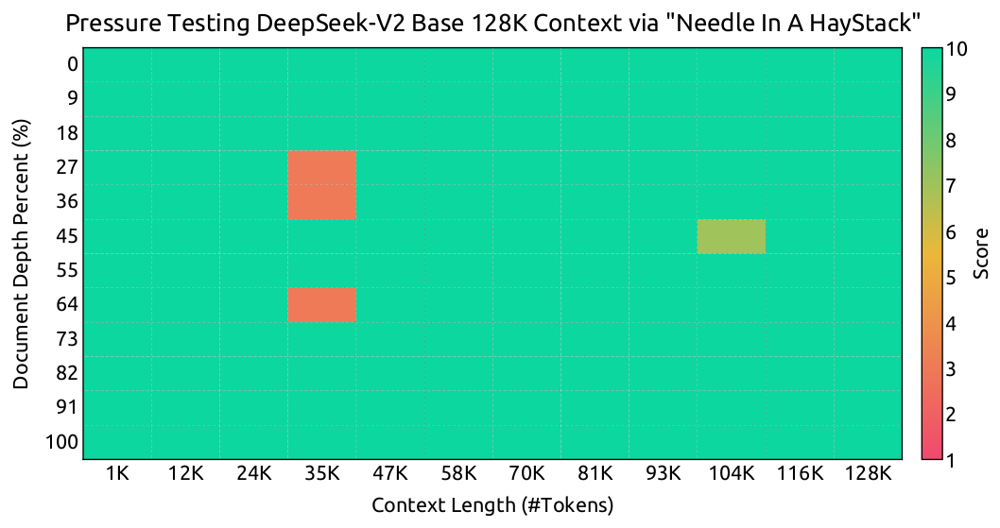
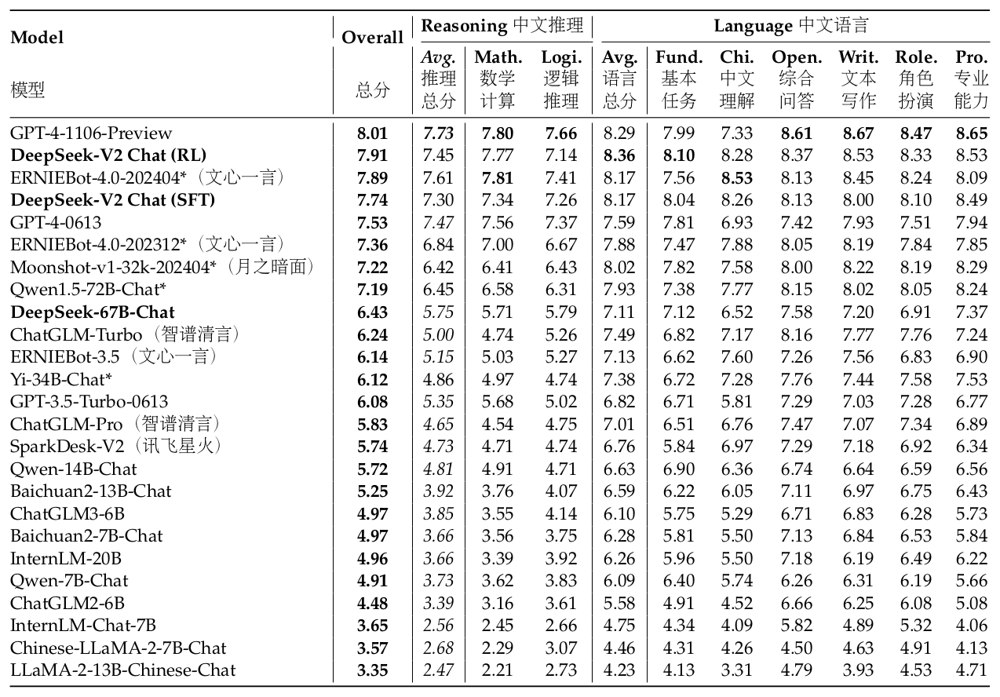
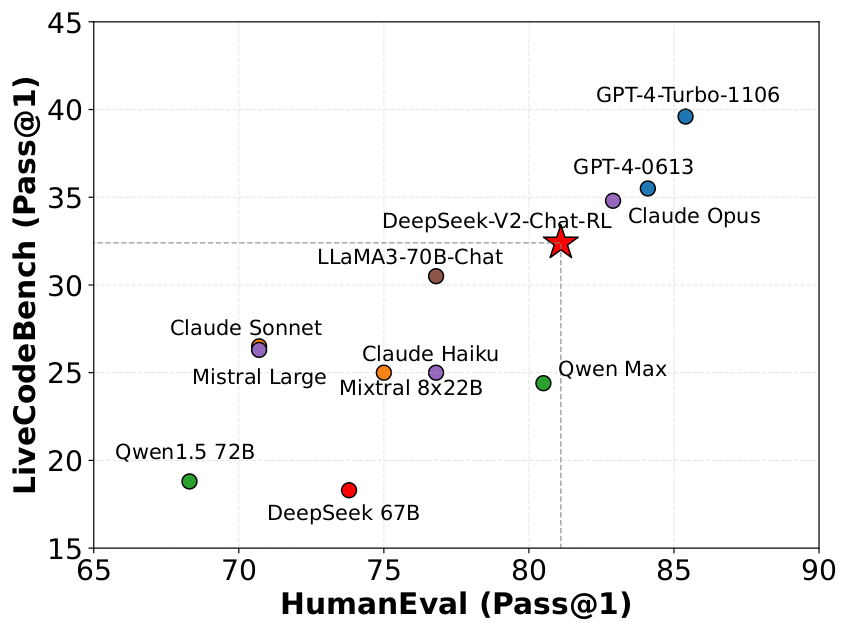

# 论文中文解读：《DeepSeek-V2: A Strong, Economical, and Efficient Mixture-of-Experts Language Model》

> **基本信息**：DeepSeek-AI，arXiv:2405.04434（v5，2024 年 6 月 19 日），模型与代码见 [官方仓库](https://github.com/deepseek-ai/DeepSeek-V2)；论文原文 [arXiv 页面](https://arxiv.org/abs/2405.04434)。
>
> **本文的读法**：图为从 PDF 中按图裁出的原图；表为逐格核对后的中文转录（数字与原文一致，表头和行名译成中文，模型名、数据集名保持英文；粗体为原表标出的最佳结果，原表另用下划线标次佳，这里未保留）。每张图、表后都有中文图题、图例翻译和读法结论，因此不必再翻英文版。凡是本文自己做的换算、推算，一律标注“推算”，不是论文原话。

## 一、一句话结论

DeepSeek-V2 是一个 236B 总参数、每个 token 只激活 21B 参数、支持 128K 上下文的 MoE 语言模型。它只改了标准 Transformer 里最贵的两个部件：attention 换成 **MLA（Multi-head Latent Attention，多头潜在注意力）**，推理时只缓存一个 512 维的低秩 KV 潜向量加一个 64 维的解耦 RoPE key，KV cache 大幅缩小；FFN 换成 **DeepSeekMoE**，即“细粒度路由专家 + 共享专家”，再配上设备受限路由和三种负载均衡损失来控制通信与负载。

论文报告：相对稠密的 DeepSeek 67B，V2 性能显著更强，同时每万亿 token 的训练 GPU 小时节省 42.5%，KV cache 降低 93.3%，最大生成吞吐提升到 5.76 倍。模型在 8.1T token 的双语语料上预训练，再经 150 万条数据的 SFT 和 GRPO 强化学习得到 Chat 版本；同时发布 15.7B 总参数的小模型 DeepSeek-V2-Lite 方便研究 MLA 与 DeepSeekMoE。

## 二、背景：这篇论文要解决什么问题

### 2.1 推理瓶颈：KV cache

自回归生成时，第 $t$ 个 token 的 attention 要用到前面所有 token 的 key 和 value。为了避免每生成一个 token 就把前缀重算一遍，推理系统把它们存下来，这就是 **KV cache**。标准多头注意力（MHA）里，每个 token、每一层要存 $n_h$ 个头的 key 与 value，每个头 $d_h$ 维，所以整个模型每个 token 要存 $2n_hd_hl$ 个元素（$l$ 是层数）。

套用 V2 自己的维度（$n_h=128$、$d_h=128$、$l=60$），MHA 每 token 要缓存 $2\times128\times128\times60=1{,}966{,}080$ 个元素；BF16 下约 3.75 MiB，一条 128K（按 131072 token 计）的序列就要约 480 GiB（推算，论文没有给出这个数）。KV cache 把显存占满之后，能同时服务的 batch size 和最大序列长度都被锁死，生成吞吐上不去。论文说，这个“很重的 KV cache”是限制推理效率的主要瓶颈。

### 2.2 MQA 与 GQA 的取舍

两种已有的缓解办法是 **MQA**（所有 query 头共用一组 K/V，每 token 缓存 $2d_hl$）和 **GQA**（把头分成 $n_g$ 组，每组共用一组 K/V，每 token 缓存 $2n_gd_hl$）。它们确实压小了缓存，但论文在附录 D.1 的 7B 稠密模型对比中发现：MHA 在四个较难的基准上明显优于 GQA 和 MQA（见本文 4.8 节表 8）。所以“压缩 KV cache”和“保持模型质量”之间存在取舍。

### 2.3 MoE 的训练代价

MoE 让总参数很大、每个 token 只走一小部分专家，训练 FLOPs 因此很低。但在专家并行（expert parallelism）下，专家散布在不同设备上，token 要通过 all-to-all 通信发给对应专家再收回结果；DeepSeekMoE 的细粒度专家让每个 token 激活的专家数更多，通信更贵。此外专家之间负载不均会拖慢整体效率，甚至造成“路由塌缩”，所以论文还要设计一组机制来控制通信和负载均衡。

### 2.4 论文的做法与总体效果（图 1）

论文用 MLA 解决 KV cache，用 DeepSeekMoE 解决训练成本，并用设备受限路由与均衡损失解决 MoE 的通信与负载。先看总体效果。

*图 1（原文 Figure 1，第 1 页）：（a）各开源模型的 MMLU 准确率与激活参数量的关系；（b）稠密的 DeepSeek 67B 与 DeepSeek-V2 的训练成本和推理效率对比。*

**图中文字翻译与读法**：

- **左图（a）**：横轴 Activated Parameters (Billions)（激活参数量，单位 B），纵轴 Performance (MMLU)（MMLU 分数）。每个点是一个模型，同一系列用虚线连接，图例为 LLaMA 1/2/3 Family、Mixtral Family、Command R Family、Qwen1.5 Family。红色五角星是 DeepSeek-V2，位于约 21B 激活参数、MMLU 约 78.5 处，处在图的左上角：激活参数远少于 LLaMA 3 70B、Qwen1.5 72B、Mixtral 8x22B（约 39B）、Command R+ 等，MMLU 仅低于 LLaMA 3 70B（图上约 79.5）。从图上读出，LLaMA 3 70B 约 79.5、Mixtral 8x22B 约 77.8，与表 2 的内部评测数字（78.9、77.6）略有出入，论文没有解释，疑为各模型公开报告值，以表 2 为准。
- **右图（b）上**：Training Costs (K GPU Hours/T Tokens)（训练成本，每万亿 token 的千 GPU 小时）。DeepSeek 67B 约 300，DeepSeek-V2 约 173，标注 saving 42.5% of training costs（节省 42.5%）。
- **右图（b）中**：KV Cache for Generation (KB/Token)（生成时每 token 的 KV cache，KB）。DeepSeek 67B 约 380，DeepSeek-V2 约 25，标注 reducing KV cache by 93.3%（降低 93.3%）。数值是从图上读出的近似值。
- **右图（b）下**：Maximum Generation Throughput (Tokens/Sec)（最大生成吞吐，tokens/秒）。DeepSeek 67B 的柱约 1 万，DeepSeek-V2 的柱超过 5 万，标注 576% of maximum throughput（即 5.76 倍）。

**读图结论**：V2 用更少的激活参数取得与大得多的稠密模型相当甚至更高的 MMLU，同时训练成本、KV cache、生成吞吐三项系统指标都明显改善。这些系统指标的测量口径要小心：5.76 倍明确含 FP8 权重与 KV 量化（见本文 8 节），93.3% 据本文推算很可能也含 KV 量化（见 4.7 节）。

## 三、整体架构（图 2）

V2 仍是 Transformer decoder：每个 block 由 attention 模块和 FFN 模块构成，各自前置 RMS Norm、外加残差连接；层归一化和 FFN 激活函数等“小细节”如无特别说明，沿用 DeepSeek 67B 的设置。区别在于 attention 换成 MLA、FFN 换成 DeepSeekMoE（模型的第 1 层 FFN 保持为普通稠密 FFN，其余层全是 MoE）。

*图 2（原文 Figure 2，第 5 页）：左，一个 Transformer block（共 $L$ 个）；右上，DeepSeekMoE 的结构；右下，MLA 的结构。*

**图中文字翻译与读法**：

- **左侧 Transformer Block × L**：自下而上为 RMS Norm、Attention、加法（残差）、RMS Norm、Feed-Forward Network、加法（残差）。右侧两个蓝色虚线框分别放大 Attention 和 FFN 的内部。
- **右上 DeepSeekMoE**：Input Hidden $\mathbf{u}_t$（输入隐状态）同时送给 Shared Expert（绿色，$1\ldots N_s$，所有 token 都经过）和 Router（路由器）；Router 给每个 Routed Expert（蓝色，$1\ldots N_r$）打分，Top-$K_r$（取前 $K_r$ 个）选出的专家，其输出乘上门控值（图中的 ⊗）后与共享专家的输出、输入本身一起相加（⊕），得到 Output Hidden $\mathbf{h}'_t$。
- **右下 Multi-Head Latent Attention (MLA)**：Input Hidden $\mathbf{h}_t$ 先被下投影为两个潜向量：Latent $\mathbf{c}_t^{Q}$（query 的潜向量）和 Latent $\mathbf{c}_t^{KV}$（key-value 的联合潜向量，斜线填充）。$\mathbf{c}_t^{Q}$ 上投影出多头的 $\{\mathbf{q}^C_{t,i}\}$，并另外产生带 RoPE 的 $\{\mathbf{q}^R_{t,i}\}$（apply RoPE），两者拼接（concatenate）成 $\{[\mathbf{q}^C_{t,i};\mathbf{q}^R_{t,i}]\}$；$\mathbf{c}_t^{KV}$ 上投影出 $\{\mathbf{k}^C_{t,i}\}$ 和 $\{\mathbf{v}^C_{t,i}\}$，$\mathbf{h}_t$ 直接另投影出一个所有头共享、带 RoPE 的 $\mathbf{k}^R_t$，与每个头的 $\mathbf{k}^C_{t,i}$ 拼接成 $\{[\mathbf{k}^C_{t,i};\mathbf{k}^R_t]\}$；然后做标准的 Multi-Head Attention，输出 Output Hidden $\mathbf{u}_t$。图例 Cached During Inference（推理时需要缓存）标出的斜线填充部分，只有 $\mathbf{c}_t^{KV}$ 和 $\mathbf{k}^R_t$。

**读图结论**：两个改造点各管一类成本。MLA 针对随 batch 和序列长度增长的 KV cache，缓存的只有图中斜线填充的两项；MoE 针对随参数规模增长的 FFN 计算量。

## 四、MLA：只缓存低秩潜向量的注意力

先给出本节用到的符号和 V2 的取值，后面的公式都可以对照这张表。

| 符号 | 含义 | DeepSeek-V2 的取值 |
|---|---|---|
| $d$ | 隐藏维度（embedding 维度） | 5120 |
| $n_h$ | 注意力头数 | 128 |
| $d_h$ | 每个头的维度 | 128 |
| $l$ | Transformer 层数 | 60 |
| $d_c$ | KV 压缩维度（KV 潜向量的维度） | 512（$=4d_h$） |
| $d_c'$ | query 压缩维度 | 1536 |
| $d_h^R$ | 解耦 RoPE 的每头维度 | 64（$=d_h/2$） |

（取值来自论文 3.1.2 节和表 1 的说明。）

### 4.1 回顾：标准多头注意力（MHA）

设 $\mathbf{h}_t\in\mathbb{R}^{d}$ 是第 $t$ 个 token 在某个 attention 层的输入。MHA 先用三个矩阵得到 query、key、value（式 1–3）：

$$
\mathbf{q}_t=W^{Q}\mathbf{h}_t,\qquad \mathbf{k}_t=W^{K}\mathbf{h}_t,\qquad \mathbf{v}_t=W^{V}\mathbf{h}_t,\qquad W^{Q},W^{K},W^{V}\in\mathbb{R}^{d_hn_h\times d}.
$$

再把它们切成 $n_h$ 个头（式 4–6），每个头独立做 attention，拼接后用输出矩阵 $W^{O}\in\mathbb{R}^{d\times d_hn_h}$ 投影（式 7–8）：

$$
[\mathbf{q}_{t,1};\dots;\mathbf{q}_{t,n_h}]=\mathbf{q}_t,\qquad [\mathbf{k}_{t,1};\dots;\mathbf{k}_{t,n_h}]=\mathbf{k}_t,\qquad [\mathbf{v}_{t,1};\dots;\mathbf{v}_{t,n_h}]=\mathbf{v}_t,
$$

$$
\mathbf{o}_{t,i}=\sum_{j=1}^{t}\operatorname{Softmax}_j\!\left(\frac{\mathbf{q}_{t,i}^{\top}\mathbf{k}_{j,i}}{\sqrt{d_h}}\right)\mathbf{v}_{j,i},\qquad \mathbf{u}_t=W^{O}[\mathbf{o}_{t,1};\mathbf{o}_{t,2};\dots;\mathbf{o}_{t,n_h}].
$$

推理时所有 key 和 value 都要缓存，所以每个 token 要缓存 $2n_hd_hl$ 个元素。

### 4.2 低秩 KV 联合压缩

MLA 的核心是对 key 和 value 做**联合的低秩压缩**（式 9–11）：先把 $\mathbf{h}_t$ 下投影成一个很短的潜向量 $\mathbf{c}_t^{KV}$，再分别上投影回 key 和 value：

$$
\mathbf{c}_t^{KV}=W^{DKV}\mathbf{h}_t,\qquad \mathbf{k}_t^{C}=W^{UK}\mathbf{c}_t^{KV},\qquad \mathbf{v}_t^{C}=W^{UV}\mathbf{c}_t^{KV}.
$$

这里 $\mathbf{c}_t^{KV}\in\mathbb{R}^{d_c}$，$d_c\ll d_hn_h$ 是 KV 压缩维度；$W^{DKV}\in\mathbb{R}^{d_c\times d}$ 是下投影矩阵（D 表示 down）；$W^{UK},W^{UV}\in\mathbb{R}^{d_hn_h\times d_c}$ 是 key、value 的上投影矩阵（U 表示 up）。上标 $C$ 表示“内容（content）部分”，以区别于后面带位置信息的 $R$ 部分。

“联合”指 key 和 value 共享同一个潜向量 $\mathbf{c}_t^{KV}$，所以推理时只需缓存 $\mathbf{c}_t^{KV}$，每 token 每层只有 $d_c$ 个元素，全模型 $d_cl$ 个。对 V2，$d_c=512$，而 MHA 每层要缓存 $2n_hd_h=32768$ 个元素。

### 4.3 “吸收”：为什么推理时不用把 K、V 还原出来

如果每个解码步都把缓存里每个 token 的潜向量上投影回 $\mathbf{k}^C_j,\mathbf{v}^C_j$ 再做 attention，开销会随序列长度线性增长，缓存虽然小了、计算却更多。论文用矩阵乘法的结合律避开了这个问题：$W^{UK}$ 可以吸收进 query 一侧的矩阵，$W^{UV}$ 可以吸收进输出矩阵 $W^{O}$，因此“甚至不需要把 key 和 value 算出来”（式 9–11 后的说明，以及附录 C 的末段）。

下面是对这句话的展开（论文只有一句话，推导为本文所加）。记 $W^{UQ}_i$、$W^{UK}_i$、$W^{UV}_i\in\mathbb{R}^{d_h\times\cdot}$ 为第 $i$ 个头对应的那一块行，$a_{t,j,i}$ 为第 $i$ 个头的 attention 权重。key 一侧：

$$
(\mathbf{q}^C_{t,i})^{\top}\mathbf{k}^C_{j,i}=\big(W^{UQ}_i\mathbf{c}^Q_t\big)^{\top}\big(W^{UK}_i\mathbf{c}^{KV}_j\big)=\big(\mathbf{c}^Q_t\big)^{\top}\big(W^{UQ}_i\big)^{\top}W^{UK}_i\,\mathbf{c}^{KV}_j .
$$

等号最右边中间的 $\big(W^{UQ}_i\big)^{\top}W^{UK}_i$ 是与位置、与具体 token 都无关的固定矩阵，可以并入 query 侧的计算：每个解码步只对当前 query 做一次与序列长度无关的变换，然后直接和缓存里的 $\mathbf{c}^{KV}_j$ 做内积，不必为每个历史 token 还原 $\mathbf{k}^C_j$。value 一侧同理：

$$
\mathbf{u}_t=W^{O}[\mathbf{o}_{t,1};\dots;\mathbf{o}_{t,n_h}]=\sum_{i=1}^{n_h}W^{O}_i\,W^{UV}_i\Big(\sum_{j=1}^{t}a_{t,j,i}\,\mathbf{c}^{KV}_j\Big),
$$

其中 $W^{O}_i\in\mathbb{R}^{d\times d_h}$ 是 $W^{O}$ 中第 $i$ 个头对应的列块。先在潜空间里对 $\mathbf{c}^{KV}_j$ 按注意力权重求和，再用合并后的 $W^{O}_iW^{UV}_i$ 上投影一次即可。

补充两点（本文推算，论文未讨论）：其一，吸收之后所有 $n_h$ 个头对同一份缓存的 512 维潜向量做 attention，形式上与 MQA 相似，只是“头维度”变成了 $d_c$（外加 64 维 RoPE 部分）；其二，这样每个缓存 token 每个头的乘加次数更多，MLA 是用额外计算换更少的缓存读写，对访存受限的解码阶段通常划算。

### 4.4 query 的低秩压缩

为了降低**训练**时的激活显存，query 也做类似的低秩压缩（式 12–13）。它不能减少 KV cache，所以不是推理侧的收益：

$$
\mathbf{c}_t^{Q}=W^{DQ}\mathbf{h}_t,\qquad \mathbf{q}_t^{C}=W^{UQ}\mathbf{c}_t^{Q},
$$

其中 $\mathbf{c}_t^{Q}\in\mathbb{R}^{d_c'}$，$d_c'\ll d_hn_h$ 是 query 压缩维度，$W^{DQ}\in\mathbb{R}^{d_c'\times d}$，$W^{UQ}\in\mathbb{R}^{d_hn_h\times d_c'}$。V2 取 $d_c'=1536$；V2-Lite 不压缩 query。

### 4.5 RoPE 与低秩压缩冲突，所以要“解耦 RoPE”

论文想沿用 DeepSeek 67B 的旋转位置编码 RoPE，但发现 **RoPE 与低秩 KV 压缩不兼容**。RoPE 对 query 和 key 都按位置做旋转：位置为 $t$ 的向量被乘上一个与位置有关的旋转矩阵 $R_t$，两个位置的内积变成 $\mathbf{q}^{\top}R_t^{\top}R_j\mathbf{k}=\mathbf{q}^{\top}R_{j-t}\mathbf{k}$，只依赖相对距离（RoPE 的原理见 [RoPE 论文解读](../rope/论文中文解读.md)）。

如果把 RoPE 直接加在内容 key $\mathbf{k}^C_t$ 上，那么式 10 里的 $W^{UK}$ 就和一个与位置相关的矩阵耦合在一起。按上面的展开，内容部分的打分会变成 $(\mathbf{c}^Q_t)^{\top}(W^{UQ}_i)^{\top}R_{j-t}W^{UK}_i\mathbf{c}^{KV}_j$：夹在中间的 $R_{j-t}$ 随当前 query 位置 $t$ 与历史位置 $j$ 的距离变化，矩阵乘法不满足交换律，$W^{UK}$ 就无法再并入 query 一侧。后果是每个解码步都必须为所有前缀 token 重算 key，大幅拖慢推理。

**解法是解耦 RoPE（decoupled RoPE）**：不要让 RoPE 作用在被压缩的内容分量上，而是另开一小条专门携带位置的通道——额外的多头 query $\mathbf{q}^{R}_{t,i}\in\mathbb{R}^{d_h^R}$ 和一个**所有头共享**的 key $\mathbf{k}^{R}_t\in\mathbb{R}^{d_h^R}$，只在这条通道上加 RoPE（式 14–19）：

$$
[\mathbf{q}^R_{t,1};\dots;\mathbf{q}^R_{t,n_h}]=\mathbf{q}_t^R=\mathrm{RoPE}(W^{QR}\mathbf{c}_t^Q),\qquad \mathbf{k}_t^R=\mathrm{RoPE}(W^{KR}\mathbf{h}_t),
$$

$$
\mathbf{q}_{t,i}=[\mathbf{q}^C_{t,i};\mathbf{q}^R_{t,i}],\qquad \mathbf{k}_{t,i}=[\mathbf{k}^C_{t,i};\mathbf{k}^R_t],
$$

$$
\mathbf{o}_{t,i}=\sum_{j=1}^{t}\operatorname{Softmax}_j\!\left(\frac{\mathbf{q}_{t,i}^{\top}\mathbf{k}_{j,i}}{\sqrt{d_h+d_h^R}}\right)\mathbf{v}^C_{j,i},\qquad \mathbf{u}_t=W^{O}[\mathbf{o}_{t,1};\mathbf{o}_{t,2};\dots;\mathbf{o}_{t,n_h}].
$$

其中 $W^{QR}\in\mathbb{R}^{d_h^Rn_h\times d_c'}$、$W^{KR}\in\mathbb{R}^{d_h^R\times d}$ 产生解耦的 query 和 key，$\mathrm{RoPE}(\cdot)$ 表示施加 RoPE 旋转，$[\cdot;\cdot]$ 表示向量拼接。

读这组式子要抓住三点：

1. 每个头的 query 和 key 都是“内容部分 + 位置部分”的拼接，维度 $d_h+d_h^R$（V2 为 $128+64=192$），打分除以 $\sqrt{d_h+d_h^R}$。内积等于“内容内积 + 位置内积”两项之和，前一项可以按 4.3 节吸收，后一项带 RoPE，用小的 $d_h^R$ 维通道单独算。
2. $\mathbf{k}^R_t$ 是**一个**向量，所有头共用（类似 MQA），它已经带上自己位置的 RoPE 旋转，所以可以直接存进缓存，不用每步重算；$\mathbf{q}^R_{t,i}$ 每步只为当前 token 现算。
3. value 只用内容分量 $\mathbf{v}^C_{j,i}$，位置通道不参与 value。

推理时解耦的 key 也要缓存，所以 V2 每 token 总共缓存 $(d_c+d_h^R)l$ 个元素。

论文的贡献名单特别注明，Huazuo Gao 和 Wangding Zeng 在 MLA 架构的研究上做出了关键创新，并感谢苏剑林（Jianlin Su）在位置编码上的讨论。

### 4.6 完整的 MLA 计算流程（附录 C）与缓存内容

附录 C 把完整过程列成 11 个式子（式 37–47），与上面逐式对应：$\mathbf{c}^Q_t=W^{DQ}\mathbf{h}_t$；$\mathbf{q}^C_t=W^{UQ}\mathbf{c}^Q_t$；$\mathbf{q}^R_t=\mathrm{RoPE}(W^{QR}\mathbf{c}^Q_t)$；$\mathbf{q}_{t,i}=[\mathbf{q}^C_{t,i};\mathbf{q}^R_{t,i}]$；$\mathbf{c}^{KV}_t=W^{DKV}\mathbf{h}_t$；$\mathbf{k}^C_t=W^{UK}\mathbf{c}^{KV}_t$；$\mathbf{k}^R_t=\mathrm{RoPE}(W^{KR}\mathbf{h}_t)$；$\mathbf{k}_{t,i}=[\mathbf{k}^C_{t,i};\mathbf{k}^R_t]$；$\mathbf{v}^C_t=W^{UV}\mathbf{c}^{KV}_t$；attention 与输出投影同 4.5 节。论文用蓝色方框标出生成时需要缓存的两项：$\mathbf{c}^{KV}_t$（式 41）和 $\mathbf{k}^R_t$（式 43）。并且说明：朴素公式要先从 $\mathbf{c}^{KV}_t$ 还原 $\mathbf{k}^C_t$、$\mathbf{v}^C_t$，而借助结合律把 $W^{UK}$ 并入 $W^{UQ}$、$W^{UV}$ 并入 $W^{O}$，就避免了这部分重复计算。

下表把 V2 各矩阵的形状和参数量列出来（本文按论文的符号定义与 V2 取值推算，论文没有给出此表）：

| 矩阵 | 形状 | 参数量（约） |
|---|---|---:|
| $W^{DQ}$ | $1536\times5120$ | 7.86M |
| $W^{UQ}$ | $16384\times1536$ | 25.17M |
| $W^{QR}$ | $8192\times1536$ | 12.58M |
| $W^{DKV}$ | $512\times5120$ | 2.62M |
| $W^{UK}$ | $16384\times512$ | 8.39M |
| $W^{UV}$ | $16384\times512$ | 8.39M |
| $W^{KR}$ | $64\times5120$ | 0.33M |
| $W^{O}$ | $5120\times16384$ | 83.89M |
| 合计（每层） | | 约 149.2M |

对照：同样 $n_hd_h=16384$ 的标准 MHA，四个矩阵 $W^Q,W^K,W^V,W^O$ 各 $16384\times5120$，共约 335.5M。所以 V2 的 MLA 每层 attention 参数量只有 MHA 的约 44%（推算），这也与附录表 9 中 MLA 模型激活参数更少（21.5B 对 25.0B）一致。另外论文说明，由于低秩压缩和细粒度专家会改变层输出的尺度，实践中在压缩后的潜向量后面加了额外的 RMS Norm，并在宽度瓶颈处（压缩潜向量、路由专家的中间隐状态）乘了额外的缩放因子以稳定训练（3.1.2 节）。

### 4.7 KV cache 对比（图 3、表 1）

*图 3（原文 Figure 3，第 7 页）：MHA、GQA、MQA、MLA 的简化示意；MLA 通过把 key 和 value 联合压缩成潜向量，显著降低推理时的 KV cache。*

**图中文字翻译与读法**：

- 图例 Cached During Inference（推理时需要缓存）：斜线填充的矩形是需要缓存的向量。每行分别是 Values（value）、Keys（key）、Queries（query）；MHA、GQA、MQA 的示例画了 8 个 query 头。
- **Multi-Head Attention (MHA)**：8 个 query 头各有自己的 key 和 value，全部斜线填充，即全部要缓存。
- **Grouped-Query Attention (GQA)**：8 个 query 头分成 4 组，每组 2 个 query 共用一对 key/value，只缓存 4 对。
- **Multi-Query Attention (MQA)**：8 个 query 头共用一对 key/value，只缓存 1 对。
- **Multi-Head Latent Attention (MLA)**：每个头仍有自己的 key 和 value（淡蓝色、无斜线，表示不缓存），它们由右侧一个 Compressed Latent KV（压缩的潜在 KV，斜线填充）经 projection（投影）得到；需要缓存的只有这个潜向量。

**读图结论**：MLA 不是靠“让多个头共享 K/V”来省缓存（MQA/GQA 的做法会损失各头的独立表达），而是让每个头保留独立的 key/value，只是把它们的来源压成一个小潜向量。

表 1 给出各机制每 token 的 KV cache（元素个数，不计存储精度）：

| 注意力机制 | 每 token 的 KV cache（元素个数） | 能力 |
|---|---|---|
| 多头注意力 MHA | $2n_hd_hl$ | 强（Strong） |
| 分组查询注意力 GQA | $2n_gd_hl$ | 中等（Moderate） |
| 多查询注意力 MQA | $2d_hl$ | 弱（Weak） |
| MLA（本文） | $(d_c+d_h^R)\,l\approx\tfrac{9}{2}d_hl$ | 更强（Stronger） |

（原文表 1，第 9 页。符号：$n_g$ 为 GQA 的组数，$l$ 为层数。对 V2，$d_c=4d_h$、$d_h^R=d_h/2$，所以 $(d_c+d_h^R)l=\tfrac92d_hl$，恰好等于 $n_g=2.25$ 的 GQA，即 $2\times2.25\,d_hl$；“能力”列是论文的定性判断。）

把表 1 的公式代入 V2 的维度，得到具体数字（推算；GQA 一行是假设取 8 组，V2 并不使用 GQA）：

| 机制 | 代入（$n_h=d_h=128$，$l=60$） | 每 token 元素数 | 相对 MHA |
|---|---|---:|---:|
| MHA | $2\times128\times128\times60$ | 1,966,080 | 100% |
| GQA（$n_g=8$） | $2\times8\times128\times60$ | 122,880 | 6.25% |
| MQA | $2\times128\times60$ | 15,360 | 0.78% |
| MLA | $(512+64)\times60$ | 34,560 | 1.76% |

MLA 的缓存量约为 MQA 的 2.25 倍、MHA 的约 1/57，却被论文认为能力强于 MHA（依据见 4.8 节）。

**关于“KV cache 降低 93.3%”的口径**：这个数字来自摘要、图 1(b) 和 3.2.3 节，比较对象是 DeepSeek 67B，并且是**实际部署口径**：论文在 3.2.3 节说明部署时还把 KV cache 的每个元素量化到平均 6 bit。下面是本文的推算（不在论文中；DeepSeek 67B 的结构取自 DeepSeek LLM 论文，不是本文给出的）：67B 采用 GQA，95 层、8 个 KV 头、头维度 128，每 token 为 $2\times8\times128\times95=194{,}560$ 个元素，BF16 约 380 KB；V2 为 34,560 个元素，按 6 bit 约 25.3 KB。$25{,}920/389{,}120\approx6.7\%$，降幅为 93.3%，与论文的数字吻合。如果两边都按相同精度、只比较元素个数，降幅约为 82.2%。这个吻合提示 93.3% 很可能已经包含了 KV 量化的贡献，而不是只来自 MLA（论文没有逐项拆分，这是本文的推断）。

### 4.8 MLA 与 MHA、GQA、MQA 的对比实验（表 8、表 9）

论文的结论“MHA 强于 GQA/MQA，而 MLA 又强于 MHA”只由附录 D 的两张表支撑。

**表 8：7B 稠密模型，MHA、GQA、MQA 对比（附录 D.1）**。三个模型都训练 1.33T token，除注意力机制外结构相同；为公平起见通过调整层数把参数量对齐到约 7B。指标为准确率或 EM，越高越好。

| 基准（指标） | 样本数 | Dense 7B w/ MQA | Dense 7B w/ GQA（8 组） | Dense 7B w/ MHA |
|---|:---:|---:|---:|---:|
| 参数量 | - | 7.1B | 6.9B | 6.9B |
| BBH（EM） | 3-shot | 33.2 | 35.6 | **37.0** |
| MMLU（Acc.） | 5-shot | 37.9 | 41.2 | **45.2** |
| C-Eval（Acc.） | 5-shot | 30.0 | 37.7 | **42.9** |
| CMMLU（Acc.） | 5-shot | 34.6 | 38.4 | **43.5** |

（原文表 8，第 32 页。）读法：在 BBH、MMLU、C-Eval、CMMLU 四个较难的基准上，MHA 一致领先：MMLU 45.2 对 GQA 的 41.2 和 MQA 的 37.9，C-Eval 42.9 对 37.7 和 30.0。这就是 GQA/MQA 为省缓存付出的质量代价。

**表 9：MoE 模型，MLA 与 MHA 对比（附录 D.2）**。训练两个规模：小模型总参数约 16B、训练 1.33T token；大模型总参数约 250B、训练 420B token。同规模的 MHA 与 MLA 模型除注意力机制外结构相同。

| 基准（指标） | 样本数 | Small MoE w/ MHA | Small MoE w/ MLA | Large MoE w/ MHA | Large MoE w/ MLA |
|---|:---:|---:|---:|---:|---:|
| 激活参数量 | - | 2.5B | 2.4B | 25.0B | 21.5B |
| 总参数量 | - | 15.8B | 15.7B | 250.8B | 247.4B |
| 每 token 的 KV cache（元素个数） | - | 110.6K | 15.6K | 860.2K | 34.6K |
| BBH（EM） | 3-shot | 37.9 | **39.0** | 46.6 | **50.7** |
| MMLU（Acc.） | 5-shot | 48.7 | **50.0** | 57.5 | **59.0** |
| C-Eval（Acc.） | 5-shot | **51.6** | 50.9 | 57.9 | **59.2** |
| CMMLU（Acc.） | 5-shot | 52.3 | **53.4** | 60.7 | **62.5** |

（原文表 9，第 32 页。）读法：

- 缓存：MLA 的 KV cache 是 MHA 的 14%（小模型，15.6K/110.6K）和 4%（大模型，34.6K/860.2K），与附录 D.2 的文字一致。
- 质量：8 个对比里 MLA 赢 7 个。小模型 BBH 39.0 对 37.9、MMLU 50.0 对 48.7、CMMLU 53.4 对 52.3，C-Eval 是 MHA 51.6 略高于 MLA 50.9；大模型四项 MLA 全部更高（BBH 50.7 对 46.6、MMLU 59.0 对 57.5、C-Eval 59.2 对 57.9、CMMLU 62.5 对 60.7）。
- 参数：MLA 模型的激活参数反而更少（2.4B 对 2.5B，21.5B 对 25.0B），与 4.6 节的参数量推算一致。
- 证据边界：只有四个基准、单次训练、大模型只训了 420B token；论文没有给出 MLA 为何更强的理论解释，因此“MLA 优于 MHA”应理解为这些设置下的经验结果，且并非每一项都赢。

## 五、DeepSeekMoE：细粒度专家、共享专家与受限路由

### 5.1 基本结构

DeepSeekMoE 有两个核心想法：把专家切成更细的粒度，以获得更高的专家专精度和更准确的知识获取；单独留出若干**共享专家**，减轻路由专家之间的知识冗余。在激活参数和总专家参数相同的前提下，它在论文引用的实验中大幅优于 GShard 之类的传统 MoE（细节见 [DeepSeekMoE 论文解读](../deepseek_moe/论文中文解读.md)）。

设 $\mathbf{u}_t$ 为第 $t$ 个 token 的 FFN 输入，FFN 输出 $\mathbf{h}'_t$ 为（式 20–22）：

$$
\mathbf{h}'_t=\mathbf{u}_t+\sum_{i=1}^{N_s}\mathrm{FFN}^{(s)}_i(\mathbf{u}_t)+\sum_{i=1}^{N_r}g_{i,t}\,\mathrm{FFN}^{(r)}_i(\mathbf{u}_t),
$$

$$
g_{i,t}=\begin{cases}s_{i,t}, & s_{i,t}\in\operatorname{Topk}\big(\{s_{j,t}\mid 1\le j\le N_r\},K_r\big),\\ 0, & \text{otherwise},\end{cases}\qquad s_{i,t}=\operatorname{Softmax}_i\big(\mathbf{u}_t^{\top}\mathbf{e}_i\big).
$$

符号：$N_s$、$N_r$ 分别是共享专家和路由专家的个数；$\mathrm{FFN}^{(s)}_i(\cdot)$、$\mathrm{FFN}^{(r)}_i(\cdot)$ 是第 $i$ 个共享专家和第 $i$ 个路由专家；$K_r$ 是每个 token 激活的路由专家数；$g_{i,t}$ 是第 $i$ 个专家的门控值；$s_{i,t}$ 是 token 与专家的亲和度（affinity）；$\mathbf{e}_i$ 是本层第 $i$ 个路由专家的质心向量（centroid，可学习）；$\operatorname{Topk}(\cdot,K)$ 表示取该 token 对全部路由专家的亲和度中最大的 $K$ 个。式中第一项 $\mathbf{u}_t$ 是残差连接。

逐项读：共享专家对**每个** token 都生效，没有门控，用来承载通用知识；路由专家只有亲和度进入前 $K_r$ 的才有非零门控，且门控值直接取 softmax 亲和度，没有在 top-K 之后重新归一化。V2 的配置是 $N_s=2$、$N_r=160$、$K_r=6$：每个 token 共经过 $2+6=8$ 个专家。把专家切细的好处是组合数暴涨：从 160 个路由专家里选 6 个有 $\binom{160}{6}=21{,}193{,}254{,}160$ 种组合（推算），而传统做法 16 选 2 只有 120 种，路由器能用更多“小专科”拼出更具体的知识组合。

### 5.2 设备受限路由（Device-Limited Routing）

采用专家并行时，路由专家分布在多个设备上。一个 token 的 MoE 通信频次与它的目标专家**覆盖的设备数**成正比；细粒度分割让激活的专家数很多，如果只做朴素 top-$K$，这些专家可能散落在很多设备上，通信开销很大。

V2 在朴素 top-$K$ 之外再保证：每个 token 的目标专家最多分布在 $M$ 个设备上。具体做法是两步：先为每个 token 选出含有最高亲和度专家的 $M$ 个设备；然后只在这 $M$ 个设备上的专家里做 top-$K$ 选择。论文的经验是，$M\ge3$ 时，设备受限路由的效果与不受限的 top-$K$ 路由大致相当（论文没有给出对应的数据表）。V2 训练取 $M=3$。

举例：V2 的 160 个路由专家均匀放在 $D=8$ 个设备上，每个设备 20 个；朴素 top-6 的 6 个专家最坏分布在 6 个设备上，设备受限路由把它压到至多 3 个设备，该 token 的隐状态至多发送 3 次。代价是可能错过全局亲和度略高、但位于第 4 个设备上的专家。

### 5.3 三种辅助负载均衡损失

自动学习的路由要考虑负载均衡：第一，负载不均会增加**路由塌缩**（routing collapse）的风险，部分专家得不到充分训练和利用；第二，采用专家并行时，负载不均会降低计算效率。V2 训练中设计了三种辅助损失，分别控制专家级、设备级和通信级的均衡。

**专家级均衡损失**（式 23–25，沿用 Switch Transformer 与 GShard 的形式）：

$$
\mathcal{L}_{\mathrm{ExpBal}}=\alpha_1\sum_{i=1}^{N_r}f_iP_i,\qquad f_i=\frac{N_r}{K_rT}\sum_{t=1}^{T}\mathbb{1}\big(\text{token }t\text{ selects expert }i\big),\qquad P_i=\frac1T\sum_{t=1}^{T}s_{i,t},
$$

$\alpha_1$ 为专家级均衡系数，$\mathbb{1}(\cdot)$ 是指示函数，$T$ 是序列中的 token 数。读法：$f_i$ 是专家 $i$ 实际被选中的比例（硬计数，已按 $N_r/K_r$ 归一化，使完全均衡时 $f_i=1$），$P_i$ 是专家 $i$ 在序列上的平均亲和度（软概率，可微）。完全均衡时 $f_i=1$、$P_i=1/N_r$，损失等于 $\alpha_1$；某个专家被选得越多、亲和度越高，乘积越大。梯度通过 $P_i$ 回传，把过载专家的亲和度往下压。

**设备级均衡损失**（式 26–28）：把全部路由专家分成 $D$ 组 $\{\mathcal{E}_1,\dots,\mathcal{E}_D\}$，每组放在同一个设备上：

$$
\mathcal{L}_{\mathrm{DevBal}}=\alpha_2\sum_{i=1}^{D}f_i'P_i',\qquad f_i'=\frac{1}{\lvert\mathcal{E}_i\rvert}\sum_{j\in\mathcal{E}_i}f_j,\qquad P_i'=\sum_{j\in\mathcal{E}_i}P_j.
$$

$f_i'$ 是设备 $i$ 上各专家 $f_j$ 的平均，$P_i'$ 是设备 $i$ 上各专家平均亲和度之和，目的是让各设备的计算量均衡。

**通信均衡损失**（式 29–31）：

$$
\mathcal{L}_{\mathrm{CommBal}}=\alpha_3\sum_{i=1}^{D}f_i''P_i'',\qquad f_i''=\frac{D}{MT}\sum_{t=1}^{T}\mathbb{1}\big(\text{token }t\text{ is sent to device }i\big),\qquad P_i''=\sum_{j\in\mathcal{E}_i}P_j.
$$

设备受限路由保证每个设备**发出**的隐状态至多 $MT$ 个，但如果某个设备**接收**的 token 比别的设备多，实际通信效率仍会受影响。通信均衡损失就是鼓励每个设备都大约接收 $MT$ 个隐状态，从而让设备间的信息交换均衡。式中 $f_i''$ 是发往设备 $i$ 的 token 占比，按 $D/(MT)$ 归一化（本文推算：若 $T$ 个 token 各发往 $M$ 个设备且均匀分布在 $D$ 个设备上，则 $f_i''=1$）。

V2 的系数：$\alpha_1=0.003$、$\alpha_2=0.05$、$\alpha_3=0.02$（3.1.2 节）。

### 5.4 Token dropping（丢弃 token）

均衡损失只能鼓励、不能保证严格均衡。为了进一步减少负载不均造成的计算浪费，训练时引入设备级的 token dropping：先算出每个设备的平均计算预算（即每个设备的 capacity factor 为 1.0），然后参照 Riquelme 等人的做法，在每个设备上丢弃亲和度最低的 token，直到满足预算。另外保证约 10% 的训练序列所属的 token 永远不被丢弃。这样，推理时可以按效率需求灵活决定是否丢 token，并始终保持训练与推理的一致。V2 训练时使用 token dropping 来加速，评测时不丢任何 token。

### 5.5 参数量核对（推算）

论文给出 236B 总参数、21B 激活参数。按 3.1.2 节的配置粗算一遍，可以看出为什么“总参数大、激活参数小”（推算，假设专家为带三个矩阵的 SwiGLU 型 FFN，论文只说沿用 DeepSeek 67B 的 FFN 设置；忽略第 1 层稠密 FFN、embedding 与输出头，论文未给出它们的尺寸）：

- 每个专家约 $3\times5120\times1536\approx23.6$M 参数；
- 59 个 MoE 层 $\times$ 160 个路由专家，共约 222.7B，已占总参数 236B 的绝大部分；
- 每个 token 激活 $2+6=8$ 个专家，59 层共约 11.1B；
- 加上每层约 149.2M 的 MLA（60 层共约 9.0B），激活参数约 20B，再加上被忽略的部分，与论文的 21B 吻合。

## 六、预训练

### 6.1 数据与 tokenizer

数据处理流程与 DeepSeek 67B 相同，但数据量更大、质量更高：挖掘互联网数据潜力并优化清洗流程，找回了大量被误删的数据；纳入更多中文数据，更好地利用中文互联网语料；补充来自多种来源的高质量数据并改进基于质量的过滤算法，使大量无益数据被去除而有价值数据大多保留；此外还过滤了带有特定地区文化倾向的争议内容，以减轻数据偏见（影响见 10.2 节）。tokenizer 沿用 DeepSeek 67B，基于字节级 BPE（BBPE），词表约 100K。分词后的语料共 8.1T token，其中中文 token 比英文多约 12%。论文还特别指出，V2 在预训练阶段从未见过 SFT 数据（有些工作会在预训练阶段混入 SFT 数据）。

### 6.2 模型与训练超参数

下表整理自论文 3.1.2 节正文（论文没有把它们放在表格里）：

| 项目 | 取值 |
|---|---|
| Transformer 层数 | 60 |
| 隐藏维度 $d$ | 5120 |
| 参数初始化 | 随机初始化，标准差 0.006 |
| 注意力头数 $n_h$、每头维度 $d_h$ | 128、128 |
| KV 压缩维度 $d_c$、query 压缩维度 $d_c'$ | 512、1536 |
| 解耦 RoPE 的每头维度 $d_h^R$ | 64 |
| MoE 层 | 除第 1 层外的所有 FFN 都换成 MoE 层（59 层） |
| 每个 MoE 层 | 2 个共享专家 + 160 个路由专家；每个专家的中间隐藏维度 1536；每个 token 激活 6 个路由专家 |
| 总参数 / 激活参数 | 236B / 21B |
| 优化器 | AdamW，$\beta_1=0.9$，$\beta_2=0.95$，weight decay 0.1 |
| 学习率 | 前 2K 步从 0 线性升到最大值 $2.4\times10^{-4}$；训练到约 60% token 时乘 0.316，到约 90% token 时再乘 0.316 |
| 梯度裁剪范数 | 1.0 |
| batch size | 前 225B token 内由 2304 逐步增加到 9216，之后保持 9216 |
| 最大序列长度 / 训练 token | 4K / 8.1T |
| 并行方式 | 流水线并行按层划分到不同设备；每层的路由专家均匀放在 8 个设备上（$D=8$）；每个 token 最多发往 3 个设备（$M=3$） |
| 均衡损失系数 | $\alpha_1=0.003$、$\alpha_2=0.05$、$\alpha_3=0.02$ |
| token dropping | 训练时使用，评测时不丢 token |

### 6.3 基础设施

V2 基于内部开发的轻量训练框架 HAI-LLM 训练：16 路 zero-bubble 流水线并行（Qi 等 2023）、8 路专家并行（GShard 风格）、ZeRO-1 数据并行。由于激活参数相对较少，并且对部分算子做了重计算以节省激活显存，训练**不需要张量并行**，因而减少了通信开销。进一步的效率措施：把共享专家的计算与专家并行的 all-to-all 通信重叠；为通信、路由算法以及跨专家的融合线性计算定制更快的 CUDA kernel；MLA 的实现基于一个改进版的 FlashAttention-2（见 [FlashAttention-2 解读](../flash_attention_2/论文中文解读.md)）。所有实验在 NVIDIA H800 GPU 集群上完成：每个节点 8 张 GPU，节点内用 NVLink 和 NVSwitch 互联，节点间用 InfiniBand。

### 6.4 长上下文扩展与 NIAH 测试（图 4）

预训练结束后，用 **YaRN**（Peng 等 2023）把默认上下文窗口从 4K 扩展到 128K。因为只有解耦的共享 key $\mathbf{k}^R_t$ 携带 RoPE，YaRN 只作用在 $\mathbf{k}^R_t$ 上。YaRN 的设置：尺度 $s=40$、$\alpha=1$、$\beta=32$，目标最大上下文长度 160K，期望模型在 128K 上表现良好。与原版 YaRN 略有不同：由于注意力机制不同，论文调整了长度缩放因子来调节注意力熵，$\sqrt{t}=0.0707\ln s+1$，目标是最小化困惑度（代入 $s=40$ 得 $\sqrt t\approx1.26$，推算；V3 论文把同一因子写成 $0.1\ln s+1$，系数不同，论文没有解释，见 [V3 解读](../deepseek_v3/论文中文解读.md) 的 5.3 节）。之后再额外训练 1000 步，序列长度 32K，batch size 576 个序列。虽然只在 32K 序列上训练，评测时模型在 128K 上仍表现稳健。

用 “Needle In A Haystack”（NIAH，大海捞针）测试检验：

*图 4（原文 Figure 4，第 13 页）：DeepSeek-V2 Base 在 NIAH 测试上的结果；论文称模型在直到 128K 的所有上下文窗口长度上表现良好。*

**图中文字翻译与读法**：

- 标题 Pressure Testing DeepSeek-V2 Base 128K Context via "Needle In A HayStack"（用“大海捞针”对 DeepSeek-V2 Base 做 128K 上下文压力测试）。
- 横轴 Context Length (#Tokens)（上下文长度，1K、12K、24K、35K、47K、58K、70K、81K、93K、104K、116K、128K 共 12 档），纵轴 Document Depth Percent (%)（针被插入的文档深度百分比，0、9、18、27、36、45、55、64、73、82、91、100 共 12 档）。每个格子的颜色代表 Score（得分，1 到 10，右侧色条；绿色为 10 分）。
- 读图：绝大多数格子是满分绿色；从图上读出，约 35K 长度处深度 27%、36%、64% 三个格子偏红（约 3 分），约 104K 长度处深度 45% 的格子偏黄绿（约 7 分），其余看不出失败。

**读图结论**：V2 Base 经过 YaRN 加 32K 补充训练后，能在 128K 范围内找回大多数位置的“针”，但图上并非每个格子都满分，论文的措辞“在所有长度上表现良好”偏概括。NIAH 只测单一事实的检索，不能代表长文推理、跨段聚合等能力。

## 七、基座模型评测

评测基准按类别：多学科选择题（MMLU、C-Eval、CMMLU）、语言理解与推理（HellaSwag、PIQA、ARC、BBH）、闭卷问答（TriviaQA、NaturalQuestions）、阅读理解（RACE、DROP、C3、CMRC）、指代消歧（WinoGrande、CLUEWSC）、语言建模（Pile）、中文理解与文化（CHID、CCPM）、数学（GSM8K、MATH、CMath）、代码（HumanEval、MBPP、CRUXEval）、标准化考试（AGIEval，含中英文子集）。评测使用内部评测框架（集成在 HAI-LLM 中）。HellaSwag、PIQA、WinoGrande、RACE-Middle、RACE-High、MMLU、ARC-Easy、ARC-Challenge、CHID、C-Eval、CMMLU、C3、CCPM 采用基于困惑度的评测；TriviaQA、NaturalQuestions、DROP、MATH、GSM8K、HumanEval、MBPP、CRUXEval、BBH、AGIEval、CLUEWSC、CMRC、CMath 采用基于生成的评测；Pile-test 做语言建模评测，用 BPB（Bits-Per-Byte，每字节比特数）作为指标，以便在不同 tokenizer 的模型间公平比较。附录 G 的表 12–37 给出每个基准的评测格式示例（提示词样例），本文不再转录。

**表 2：DeepSeek-V2 与代表性开源模型的对比（基座模型）**。所有模型都用内部框架在相同评测设置下评测；Pile-test 的 BPB 越低越好，其余指标越高越好；原表规定相差小于 0.3 的分数视为同一水平，因此同一行里可能有多个粗体。

| 基准（指标） | 样本数 | DeepSeek 67B | Qwen1.5 72B | Mixtral 8x22B | LLaMA 3 70B | DeepSeek-V2 |
|---|:---:|---:|---:|---:|---:|---:|
| 架构 | - | Dense | Dense | MoE | Dense | MoE |
| 激活参数量 | - | 67B | 72B | 39B | 70B | 21B |
| 总参数量 | - | 67B | 72B | 141B | 70B | 236B |
| **英文（English）** |  |  |  |  |  |  |
| Pile-test（BPB） | - | 0.642 | 0.637 | 0.623 | **0.602** | 0.606 |
| BBH（EM） | 3-shot | 68.7 | 59.9 | 78.9 | **81.0** | 78.9 |
| MMLU（Acc.） | 5-shot | 71.3 | 77.2 | 77.6 | **78.9** | 78.5 |
| DROP（F1） | 3-shot | 69.7 | 71.5 | 80.4 | **82.5** | 80.1 |
| ARC-Easy（Acc.） | 25-shot | 95.3 | 97.1 | 97.3 | **97.9** | **97.6** |
| ARC-Challenge（Acc.） | 25-shot | 86.4 | 92.8 | 91.2 | **93.3** | 92.4 |
| HellaSwag（Acc.） | 10-shot | 86.3 | 85.8 | 86.6 | **87.9** | 84.2 |
| PIQA（Acc.） | 0-shot | 83.6 | 83.3 | 83.6 | **85.0** | 83.7 |
| WinoGrande（Acc.） | 5-shot | 84.9 | 82.4 | 83.7 | **85.7** | 84.9 |
| RACE-Middle（Acc.） | 5-shot | 69.9 | 63.4 | **73.3** | **73.3** | **73.1** |
| RACE-High（Acc.） | 5-shot | 50.7 | 47.0 | 56.7 | **57.9** | 52.7 |
| TriviaQA（EM） | 5-shot | 78.9 | 73.1 | **82.1** | 81.6 | 79.9 |
| NaturalQuestions（EM） | 5-shot | 36.6 | 35.6 | 39.6 | **40.2** | 38.7 |
| AGIEval（Acc.） | 0-shot | 41.3 | **64.4** | 43.4 | 49.8 | 51.2 |
| **代码（Code）** |  |  |  |  |  |  |
| HumanEval（Pass@1） | 0-shot | 45.1 | 43.9 | **53.1** | 48.2 | 48.8 |
| MBPP（Pass@1） | 3-shot | 57.4 | 53.6 | 64.2 | **68.6** | 66.6 |
| CRUXEval-I（Acc.） | 2-shot | 42.5 | 44.3 | 52.4 | 49.4 | **52.8** |
| CRUXEval-O（Acc.） | 2-shot | 41.0 | 42.3 | 52.8 | **54.3** | 49.8 |
| **数学（Math）** |  |  |  |  |  |  |
| GSM8K（EM） | 8-shot | 63.4 | 77.9 | 80.3 | **83.0** | 79.2 |
| MATH（EM） | 4-shot | 18.7 | 41.4 | 42.5 | 42.2 | **43.6** |
| CMath（EM） | 3-shot | 63.0 | 77.8 | 72.3 | 73.9 | **78.7** |
| **中文（Chinese）** |  |  |  |  |  |  |
| CLUEWSC（EM） | 5-shot | 81.0 | 80.5 | 77.5 | 78.3 | **82.2** |
| C-Eval（Acc.） | 5-shot | 66.1 | **83.7** | 59.6 | 67.5 | 81.7 |
| CMMLU（Acc.） | 5-shot | 70.8 | **84.3** | 60.0 | 69.3 | **84.0** |
| CMRC（EM） | 1-shot | 73.4 | 66.6 | 73.1 | 73.3 | **77.5** |
| C3（Acc.） | 0-shot | 75.3 | **78.2** | 71.4 | 74.0 | 77.4 |
| CHID（Acc.） | 0-shot | 92.1 | - | 57.0 | 83.2 | **92.7** |
| CCPM（Acc.） | 0-shot | 88.5 | 88.1 | 61.0 | 68.1 | **93.1** |

（原文表 2，第 15 页。）

读法与结论：

- **对 DeepSeek 67B**：激活参数 21B 对 67B，V2 在几乎所有基准上显著更强。提升最大的是数学（MATH 18.7 到 43.6，GSM8K 63.4 到 79.2，CMath 63.0 到 78.7）、中文多学科（C-Eval 66.1 到 81.7，CMMLU 70.8 到 84.0）以及 BBH（68.7 到 78.9）、MMLU（71.3 到 78.5）；唯一明显下降的是 HellaSwag（86.3 到 84.2，推算差值 -2.1）。
- **对 Qwen1.5 72B**：V2 在多数英文、代码、数学基准上领先，但数学上领先幅度不大（GSM8K 79.2 对 77.9，MATH 43.6 对 41.4）；中文多学科选择题上 Qwen1.5 72B 更好（C-Eval 83.7 对 81.7，CMMLU 84.3 对 84.0，C3 78.2 对 77.4）；AGIEval 上差距最大（64.4 对 51.2），论文没有单独讨论这一项。CHID 上 Qwen1.5 72B 的 tokenizer 在论文的评测框架里会报错，所以留空（表中用 “-”）。
- **对 Mixtral 8x22B**：英文表现相当或更好，除了与英文常识知识密切相关的 TriviaQA（79.9 对 82.1）、NaturalQuestions（38.7 对 39.6）、HellaSwag（84.2 对 86.6）；MMLU 上 V2 更高（78.5 对 77.6）；代码和数学相当（HumanEval 48.8 对 53.1，MBPP 66.6 对 64.2，MATH 43.6 对 42.5）；中文上 Mixtral 因为没有专门训练中文而远远落后。
- **对 LLaMA 3 70B**：V2 的英文训练 token 不到 LLaMA 3 的四分之一，因此基础英文能力略有差距（MMLU 78.5 对 78.9，BBH 78.9 对 81.0，HellaSwag 84.2 对 87.9）；代码和数学能力相当（MATH 43.6 对 42.2，CRUXEval-I 52.8 对 49.4，GSM8K 79.2 对 83.0）；中文基准上大幅领先。
- 总体：论文称 V2 以 21B 激活参数达到开源模型中的第一梯队，并是当时最强的开源 MoE 模型。注意这是在论文自己的评测框架下的结论。

## 八、训练与推理效率

**训练成本**：V2 每个 token 激活的参数更少、所需 FLOPs 比 DeepSeek 67B 更少，理论上训练更省；MoE 虽带来额外通信开销，但通过算子和通信优化，训练仍能达到较高的模型 FLOPs 利用率（MFU，论文未给具体数字）。在 H800 集群上的实际训练中，每训练一万亿 token，DeepSeek 67B 需要 300.6K GPU 小时，V2 只需 172.8K GPU 小时，即稀疏的 V2 比稠密的 DeepSeek 67B 节省 42.5% 的训练成本：$(300.6-172.8)/300.6\approx42.5\%$。按 8.1T token 推算，V2 预训练约需 1.4M H800 GPU 小时（$172.8\text{K}\times8.1$，推算，论文没有给总数）。

**推理效率**：为了高效部署，V2 先把参数转换为 FP8 精度，并对 KV cache 做量化（Hooper 等 2024；Zhao 等 2023），把 KV cache 的每个元素平均压缩到 6 bit。受益于 MLA 与这些优化，实际部署的 V2 所需 KV cache 比 DeepSeek 67B 少得多，因而可以服务大得多的 batch。吞吐的评测基于实际部署的 DeepSeek 67B 服务的 prompt 与生成长度分布：在单个 8×H800 节点上，V2 的生成吞吐超过每秒 5 万 token，是 DeepSeek 67B 最大生成吞吐的 5.76 倍；V2 的 prompt 输入吞吐超过每秒 10 万 token。

**怎么看这些数字**：5.76 倍是 DeepSeek 自己的部署环境和长度分布下的最大吞吐之比，且 V2 一侧同时用了 FP8 权重和 6 bit 平均的 KV 量化；它不是“只靠 MLA”就能得到的倍数，也不等同于任意场景下的延迟收益。

## 九、对齐：SFT 与强化学习

### 9.1 监督微调（SFT）

SFT 数据共 150 万条：120 万条面向有用性（helpfulness），30 万条面向安全性（safety）。相比初版数据改进了质量，以减少幻觉回答并增强写作能力。训练 2 个 epoch，学习率 $5\times10^{-6}$。评测 DeepSeek-V2 Chat (SFT) 时主要用基于生成的基准，仅 MMLU 和 ARC 这类代表性选择题例外；另外做了指令遵循评测 IFEval（用 prompt 级宽松准确率作指标），并用 2023 年 9 月 1 日至 2024 年 4 月 1 日的 LiveCodeBench 题目评测 Chat 模型；还在开放式对话基准 MT-Bench、AlpacaEval 2.0、AlignBench 上评测。对比模型 Qwen1.5 72B Chat、LLaMA-3-70B Instruct、Mistral-8x22B Instruct 都在论文自己的评测框架与设置下重新评测；DeepSeek 67B Chat 的结果直接引用之前发布的评测。

### 9.2 强化学习：GRPO 与两阶段训练

**算法**：为节省 RL 训练成本，V2 采用 **GRPO（Group Relative Policy Optimization，组相对策略优化，Shao 等 2024）**。GRPO 舍弃了通常与策略模型同样大的 critic（价值）模型，改用同一问题下一组输出的得分来估计基线。具体地，对每个问题 $q$，GRPO 从旧策略 $\pi_{\theta_{old}}$ 采样一组输出 $\{o_1,o_2,\dots,o_G\}$，再通过最大化下面的目标来优化策略 $\pi_\theta$（式 32–34）：

$$
\mathcal{J}_{GRPO}(\theta)=\mathbb{E}\Big[q\sim P(Q),\{o_i\}_{i=1}^{G}\sim\pi_{\theta_{old}}(O\mid q)\Big]\ \frac1G\sum_{i=1}^{G}\left(\min\!\Big(\frac{\pi_\theta(o_i\mid q)}{\pi_{\theta_{old}}(o_i\mid q)}A_i,\ \operatorname{clip}\!\Big(\frac{\pi_\theta(o_i\mid q)}{\pi_{\theta_{old}}(o_i\mid q)},1-\varepsilon,1+\varepsilon\Big)A_i\Big)-\beta\,\mathbb{D}_{KL}\big(\pi_\theta\,\Vert\,\pi_{ref}\big)\right),
$$

$$
\mathbb{D}_{KL}\big(\pi_\theta\,\Vert\,\pi_{ref}\big)=\frac{\pi_{ref}(o_i\mid q)}{\pi_\theta(o_i\mid q)}-\log\frac{\pi_{ref}(o_i\mid q)}{\pi_\theta(o_i\mid q)}-1,\qquad A_i=\frac{r_i-\operatorname{mean}(\{r_1,r_2,\dots,r_G\})}{\operatorname{std}(\{r_1,r_2,\dots,r_G\})}.
$$

读法：$\varepsilon$ 和 $\beta$ 是超参数（论文未给出取值）；$A_i$ 是**优势（advantage）**，由这一组 $G$ 个输出对应的奖励 $\{r_1,\dots,r_G\}$ 在组内做标准化得到——奖励高于组内均值的输出被鼓励，低于均值的被抑制，因此不需要单独的价值网络；$\min(\cdot,\operatorname{clip}(\cdot))$ 是 PPO 风格的截断（限制新旧策略概率比，见 [PPO 解读](../proximal_policy_optimization/论文中文解读.md)）；$-\beta\mathbb{D}_{KL}$ 约束策略不要偏离参考策略 $\pi_{ref}$，式 33 是一个逐样本的 KL 估计量（恒非负）。

**训练策略**：初步实验发现，在代码、数学这类推理数据上做 RL 的特性与通用数据不同，例如数学和代码能力可以在更长的训练步数里持续提高。因此采用**两阶段 RL**，先做推理对齐，再做人类偏好对齐：

- 第一阶段（推理对齐）：为代码和数学推理任务训练奖励模型 $RM_{reasoning}$，用它的反馈优化策略，$r_i=RM_{reasoning}(o_i)$（式 35）。
- 第二阶段（人类偏好对齐）：采用多奖励框架，奖励来自有用性奖励模型 $RM_{helpful}$、安全性奖励模型 $RM_{safety}$ 和基于规则的奖励模型 $RM_{rule}$，回答 $o_i$ 的最终奖励是（式 36）：

$$
r_i=c_1\cdot RM_{helpful}(o_i)+c_2\cdot RM_{safety}(o_i)+c_3\cdot RM_{rule}(o_i),
$$

其中 $c_1,c_2,c_3$ 是对应的系数（论文未给出取值）。

**奖励模型的数据与训练**：为得到可靠的奖励模型，论文精心收集偏好数据并做质量过滤与比例调整。代码偏好数据基于编译器反馈，数学偏好数据基于标准答案标签。奖励模型用 DeepSeek-V2 Chat (SFT) 初始化，采用逐点（point-wise）或成对（pair-wise）损失训练。论文观察到 RL 训练可以充分激发模型潜力，使其能从候选回答中选出正确且令人满意的答案。

**RL 的训练效率优化**：在超大模型上做 RL 对训练框架要求很高，需要精细的工程优化来管理 GPU 显存和内存压力，同时保持训练速度。论文采用三项措施：（1）混合引擎（hybrid engine），训练和推理使用不同的并行策略以提高 GPU 利用率；（2）用 vLLM（Kwon 等 2023）加大 batch 作为推理后端来加速采样；（3）精心设计把模型卸载到 CPU、再加载回 GPU 的调度策略，在训练速度与显存占用之间取得近乎最优的平衡。

### 9.3 标准基准上的对话模型评测（表 3）

**表 3：DeepSeek-V2 Chat (SFT)、DeepSeek-V2 Chat (RL) 与其他开源对话模型的对比**。指标同表 2（越高越好）；IFEval 为指令遵循；LiveCodeBench 为 2023 年 9 月至 2024 年 4 月的题目。

| 基准 | 样本数 | DeepSeek 67B Chat | Qwen 1.5 72B Chat | LLaMA3 70B Inst. | Mixtral 8x22B Inst. | DeepSeek-V2 Chat (SFT) | DeepSeek-V2 Chat (RL) |
|---|:---:|---:|---:|---:|---:|---:|---:|
| 上下文长度 | - | 4K | 32K | 8K | 64K | 128K | 128K |
| 架构 | - | Dense | Dense | Dense | MoE | MoE | MoE |
| 激活参数量 | - | 67B | 72B | 70B | 39B | 21B | 21B |
| 总参数量 | - | 67B | 72B | 70B | 141B | 236B | 236B |
| **英文（English）** |  |  |  |  |  |  |  |
| TriviaQA | 5-shot | 81.5 | 79.6 | 69.1 | 80.0 | 85.4 | **86.7** |
| NaturalQuestions | 5-shot | 47.0 | 46.9 | 44.6 | **54.9** | 51.9 | 53.4 |
| MMLU | 5-shot | 71.1 | 76.2 | **80.3** | 77.8 | 78.4 | 77.8 |
| ARC-Easy | 25-shot | 96.6 | 96.8 | 96.9 | 97.1 | 97.6 | **98.1** |
| ARC-Challenge | 25-shot | 88.9 | 91.7 | **92.6** | 90.0 | **92.5** | **92.3** |
| BBH | 3-shot | 71.7 | 65.9 | 80.1 | 78.4 | **81.3** | 79.7 |
| AGIEval | 0-shot | 46.4 | 62.8 | 56.6 | 41.4 | **63.2** | 61.4 |
| IFEval | 0-shot | 55.5 | 57.3 | **79.7** | 72.1 | 64.1 | 63.8 |
| **代码（Code）** |  |  |  |  |  |  |  |
| HumanEval | 0-shot | 73.8 | 68.9 | 76.2 | 75.0 | 76.8 | **81.1** |
| MBPP | 3-shot | 61.4 | 52.2 | 69.8 | 64.4 | 70.4 | **72.0** |
| CRUXEval-I-COT | 2-shot | 49.1 | 51.4 | 61.1 | 59.4 | 59.5 | **61.5** |
| CRUXEval-O-COT | 2-shot | 50.9 | 56.5 | **63.6** | **63.6** | 60.7 | 63.0 |
| LiveCodeBench | 0-shot | 18.3 | 18.8 | 30.5 | 25.0 | 28.7 | **32.5** |
| **数学（Math）** |  |  |  |  |  |  |  |
| GSM8K | 8-shot | 84.1 | 81.9 | **93.2** | 87.9 | 90.8 | 92.2 |
| MATH | 4-shot | 32.6 | 40.6 | 48.5 | 49.8 | 52.7 | **53.9** |
| CMath | 0-shot | 80.3 | **82.8** | 79.2 | 75.1 | 82.0 | 81.9 |
| **中文（Chinese）** |  |  |  |  |  |  |  |
| CLUEWSC | 5-shot | 78.5 | **90.1** | 85.4 | 75.8 | 88.6 | **89.9** |
| C-Eval | 5-shot | 65.2 | **82.2** | 67.9 | 60.0 | 80.9 | 78.0 |
| CMMLU | 5-shot | 67.8 | **82.9** | 70.7 | 61.0 | 82.4 | 81.6 |

（原文表 3，第 19 页。）原文脚注：TriviaQA 和 NaturalQuestions 上，LLaMA3 70B Instruct 这类对话模型可能不严格遵守 few-shot 设置中通常指定的格式，会导致我们的评测框架低估某些模型。

读法与结论：

- **SFT 带来的提升**：对比表 2 的基座 V2，SFT 后 GSM8K 79.2 到 90.8、MATH 43.6 到 52.7、HumanEval 48.8 到 76.8（差值为推算）。论文把这一提升归因于 SFT 数据中包含大量数学和代码内容。
- **RL 的增量**：RL 在数学与代码上再提升：GSM8K 90.8 到 92.2、MATH 52.7 到 53.9、HumanEval 76.8 到 81.1、MBPP 70.4 到 72.0、LiveCodeBench 28.7 到 32.5。
- **与 Qwen1.5 72B Chat**：SFT 版在几乎所有英文、数学、代码基准上更强；中文多学科选择题略低（C-Eval 80.9 对 82.2，CMMLU 82.4 对 82.9），与基座版的表现一致。
- **与 Mixtral 8x22B Instruct**：SFT 版在多数基准上更好，论文列出的例外是 NaturalQuestions（51.9 对 54.9）和 IFEval（64.1 对 72.1）；表中 CRUXEval-O-COT 也是 Mixtral 更高（60.7 对 63.6）。
- **与 LLaMA3 70B Instruct**：代码和数学相近；LLaMA3 70B 在 MMLU（80.3 对 78.4/77.8）和 IFEval（79.7 对 64.1/63.8）上更好，V2 在中文任务上更强。V2 的指令遵循（IFEval）明显弱于 LLaMA3 70B Instruct 和 Mixtral 8x22B Instruct，这是表中容易被忽略的短板。

下面把表 2 与表 3 里同一基准、相同样本数设置下的“基座 → SFT → RL”并排放，方便看出 RL 的得失（本表由本文从表 2、表 3 摘出，差值为推算）：

| 基准 | 基座 V2 | Chat (SFT) | Chat (RL) | SFT 相对基座 | RL 相对 SFT |
|---|---:|---:|---:|---:|---:|
| GSM8K | 79.2 | 90.8 | 92.2 | +11.6 | +1.4 |
| MATH | 43.6 | 52.7 | 53.9 | +9.1 | +1.2 |
| HumanEval | 48.8 | 76.8 | 81.1 | +28.0 | +4.3 |
| MBPP | 66.6 | 70.4 | 72.0 | +3.8 | +1.6 |
| MMLU | 78.5 | 78.4 | 77.8 | -0.1 | -0.6 |
| BBH | 78.9 | 81.3 | 79.7 | +2.4 | -1.6 |
| C-Eval | 81.7 | 80.9 | 78.0 | -0.8 | -2.9 |
| CMMLU | 84.0 | 82.4 | 81.6 | -1.6 | -0.8 |
| AGIEval | 51.2 | 63.2 | 61.4 | +12.0 | -1.8 |

读法：RL 在数学与代码上继续增益，但在 BBH、C-Eval、AGIEval 等标准基准上有所回落，这正是论文 4.4 节说的“对齐税”。

### 9.4 开放式生成评测（表 4、表 5）

**表 4：英文开放式对话评测**。AlpacaEval 2.0 用长度控制的胜率（length-controlled win rate）作为指标；MT-Bench 为 10 分制总分。均为越高越好。

| 模型 | MT-Bench | AlpacaEval 2.0 |
|---|---:|---:|
| DeepSeek 67B Chat | 8.35 | 16.6 |
| Mistral 8x22B Instruct v0.1 | 8.66 | 30.9 |
| Qwen1.5 72B Chat | 8.61 | 36.6 |
| LLaMA3 70B Instruct | **8.95** | 34.4 |
| DeepSeek-V2 Chat (SFT) | 8.62 | 30.0 |
| DeepSeek-V2 Chat (RL) | **8.97** | **38.9** |

（原文表 4，第 19 页。）读法：RL 版显著优于 SFT 版（MT-Bench 8.62 到 8.97，AlpacaEval 30.0 到 38.9），说明 RL 对偏好对齐有效；在两个基准上都超过 Mistral 8x22B Instruct 和 Qwen1.5 72B Chat；MT-Bench 上与 LLaMA3 70B Instruct 相当（8.97 对 8.95），AlpacaEval 2.0 上明显更高（38.9 对 34.4）。

**表 5：AlignBench 榜单（中文开放式评测，由 GPT-4-0613 打分）**。原表有 25 个模型、11 列分数，超过合理转录的规模，因此这里放原表截图，并在后面用 Markdown 摘出关键行。

*表 5（原文 Table 5，第 20 页）：AlignBench 榜单，按总分降序排列；带 \* 的模型是论文自己通过 API 或开放权重评测的，而非引用原论文结果；Erniebot-4.0 和 Moonshot 的后缀是调用 API 的时间戳。*

**图中文字翻译与读法**：表头 Model（模型）、Overall（总分）；Reasoning 中文推理 下分 Avg.（推理总分）、Math.（数学计算）、Logi.（逻辑推理）；Language 中文语言 下分 Avg.（语言总分）、Fund.（基本任务）、Chi.（中文理解）、Open.（综合问答）、Writ.（文本写作）、Role.（角色扮演）、Pro.（专业能力）。

下面摘出与 DeepSeek-V2 最相关的行（数字取自原表，已与截图核对）：

| 模型 | 总分 | 推理总分 | 数学计算 | 逻辑推理 | 语言总分 | 基本任务 | 中文理解 | 综合问答 | 文本写作 | 角色扮演 | 专业能力 |
|---|---:|---:|---:|---:|---:|---:|---:|---:|---:|---:|---:|
| GPT-4-1106-Preview | 8.01 | 7.73 | 7.80 | 7.66 | 8.29 | 7.99 | 7.33 | 8.61 | 8.67 | 8.47 | 8.65 |
| DeepSeek-V2 Chat (RL) | 7.91 | 7.45 | 7.77 | 7.14 | 8.36 | 8.10 | 8.28 | 8.37 | 8.53 | 8.33 | 8.53 |
| ERNIEBot-4.0-202404\*（文心一言） | 7.89 | 7.61 | 7.81 | 7.41 | 8.17 | 7.56 | 8.53 | 8.13 | 8.45 | 8.24 | 8.09 |
| DeepSeek-V2 Chat (SFT) | 7.74 | 7.30 | 7.34 | 7.26 | 8.17 | 8.04 | 8.26 | 8.13 | 8.00 | 8.10 | 8.49 |
| GPT-4-0613 | 7.53 | 7.47 | 7.56 | 7.37 | 7.59 | 7.81 | 6.93 | 7.42 | 7.93 | 7.51 | 7.94 |
| Qwen1.5-72B-Chat\* | 7.19 | 6.45 | 6.58 | 6.31 | 7.93 | 7.38 | 7.77 | 8.15 | 8.02 | 8.05 | 8.24 |
| DeepSeek-67B-Chat | 6.43 | 5.75 | 5.71 | 5.79 | 7.11 | 7.12 | 6.52 | 7.58 | 7.20 | 6.91 | 7.37 |

读法与结论：

- RL 版总分 7.91，仅次于 GPT-4-1106-Preview（8.01），高于文心一言 4.0（202404 版 7.89）和 GPT-4-0613（7.53）；SFT 版 7.74 已超过 GPT-4-0613 与 Qwen1.5 72B Chat（7.19）。论文据此称 V2 在中文上超过所有开源模型、也胜过大多数闭源模型。
- 论文说 RL 版在“中文语言”上超过包括 GPT-4-Turbo-1106-Preview 在内的所有模型：对应表中“语言总分”8.36 对 8.29；但细分到“中文理解”一栏，文心一言 4.0 的 8.53 高于 V2 的 8.28。
- 推理仍落后：RL 版推理总分 7.45，低于 GPT-4-1106-Preview 的 7.73 和文心一言 4.0 的 7.61，逻辑推理 7.14 与 7.66、7.41 差距更大，论文也承认这一点。

### 9.5 讨论（4.4 节）

- **SFT 数据量**：此前一些工作（Young 等 2024；Zhou 等 2024）认为不到 1 万条 SFT 数据就足以得到令人满意的结果。但论文的实验里，如果 SFT 数据少于 1 万条，IFEval 上会出现明显下降。可能的解释是语言模型需要一定数据量才能发展出特定技能，这个量会随模型变大而减小，但不会完全消失；此外 SFT 数据的质量也很关键，尤其对写作或开放式问题。
- **强化学习的“对齐税”**：人类偏好对齐阶段，开放式生成基准上的得分（无论 AI 还是人类评审）显著提升，但也观察到“对齐税”（alignment tax，Ouyang 等 2022）：对齐可能损害某些标准基准的表现，如 BBH（表 3 里 SFT 的 81.3 降到 RL 的 79.7）。为减轻对齐税，论文在 RL 阶段对数据处理和训练策略投入了很多精力，最终在标准基准与开放式基准之间取得可以接受的折中。如何在不损害通用性能的前提下对齐人类偏好，是值得研究的方向。
- **在线 RL 与离线 RL**：在偏好对齐实验中，在线方法显著优于离线方法，因此论文投入大量精力实现了在线 RL 框架来对齐 V2。关于在线与离线的结论在不同情境下可能不同，更深入的比较留作未来工作（论文没有给出对比数据）。

## 十、附录要点

### 10.1 DeepSeek-V2-Lite：16B 的小模型（附录 B，表 6、表 7）

为方便社区研究 MLA 与 DeepSeekMoE，论文还发布 DeepSeek-V2-Lite。结构：27 层、隐藏维度 2048；采用 MLA，16 个注意力头、每头 128 维；KV 压缩维度 512，但**不压缩 query**；解耦 query/key 的每头维度 64。采用 DeepSeekMoE，除第 1 层外所有 FFN 都换成 MoE 层；每个 MoE 层有 2 个共享专家和 64 个路由专家，每个专家中间隐藏维度 1408，每个 token 激活 6 个路由专家。总参数 15.7B，激活参数 2.4B。

训练细节：用与 V2 相同、未混入任何 SFT 数据的预训练语料从头训练 5.7T token；AdamW，$\beta_1=0.9$，$\beta_2=0.95$，weight decay 0.1；学习率前 2K 步线性升到最大值 $4.2\times10^{-4}$，训练到约 80% token 时乘 0.316，约 90% 时再乘 0.316；梯度裁剪 1.0；不用 batch size 调度，固定 batch 为 4608 个序列；最大序列长度 4K。流水线并行把不同层放在不同设备，但每层的所有专家放在同一个设备上，所以只用一个很小的专家级均衡损失 $\alpha_1=0.001$，不使用设备级和通信均衡损失。预训练后同样做长上下文扩展与 SFT，得到 DeepSeek-V2-Lite Chat。

**表 6：DeepSeek-V2-Lite 与 DeepSeekMoE 16B、DeepSeek 7B 的对比（基座模型）**。指标同表 2（越高越好）。

| 基准 | DeepSeek 7B | DeepSeekMoE 16B | DeepSeek-V2-Lite |
|---|---:|---:|---:|
| 架构 | MHA+Dense | MHA+MoE | MLA+MoE |
| 上下文长度 | 4K | 4K | 32K |
| 激活参数量 | 6.9B | 2.8B | 2.4B |
| 总参数量 | 6.9B | 16.4B | 15.7B |
| 训练 token 数 | 2T | 2T | 5.7T |
| **英文（English）** |  |  |  |
| MMLU | 48.2 | 45.0 | **58.3** |
| BBH | 39.5 | 38.9 | **44.1** |
| TriviaQA | 59.7 | **64.8** | 64.2 |
| NaturalQuestions | 22.2 | 25.5 | **26.0** |
| ARC-Easy | 67.9 | 68.1 | **70.9** |
| ARC-Challenge | 48.1 | 49.8 | **51.2** |
| AGIEval | 26.4 | 17.4 | **33.2** |
| **代码（Code）** |  |  |  |
| HumanEval | 26.2 | 26.8 | **29.9** |
| MBPP | 39.0 | 39.2 | **43.2** |
| **数学（Math）** |  |  |  |
| GSM8K | 17.4 | 18.8 | **41.1** |
| MATH | 3.3 | 4.3 | **17.1** |
| CMath | 34.5 | 40.4 | **58.4** |
| **中文（Chinese）** |  |  |  |
| CLUEWSC | 73.1 | 72.1 | **74.3** |
| C-Eval | 45.0 | 40.6 | **60.3** |
| CMMLU | 47.2 | 42.5 | **64.3** |

（原文表 6，第 29 页。）读法：V2-Lite 以 2.4B 激活参数（总参数 15.7B）、5.7T 训练 token 几乎全面超过两个旧小模型（只有 TriviaQA 略低于 DeepSeekMoE 16B，64.2 对 64.8），尤其是推理、代码和数学：GSM8K 41.1 对 17.4/18.8，MATH 17.1 对 3.3/4.3，C-Eval 60.3 对 45.0/40.6。注意训练 token 数不同（5.7T 对 2T），所以这是“新架构加更多数据”的整体提升，不能全部归因于 MLA。

**表 7：DeepSeek-V2-Lite Chat 与 DeepSeekMoE 16B Chat、DeepSeek 7B Chat 的对比**。

| 基准 | DeepSeek 7B Chat | DeepSeekMoE 16B Chat | DeepSeek-V2-Lite Chat |
|---|---:|---:|---:|
| 架构 | MHA+Dense | MHA+MoE | MLA+MoE |
| 上下文长度 | 4K | 4K | 32K |
| 激活参数量 | 6.9B | 2.8B | 2.4B |
| 总参数量 | 6.9B | 16.4B | 15.7B |
| 训练 token 数 | 2T | 2T | 5.7T |
| **英文（English）** |  |  |  |
| MMLU | 49.7 | 47.2 | **55.7** |
| BBH | 43.1 | 42.2 | **48.1** |
| TriviaQA | 59.5 | 63.3 | **65.2** |
| NaturalQuestions | 32.7 | 35.1 | **35.5** |
| ARC-Easy | 70.2 | 69.9 | **74.3** |
| ARC-Challenge | 50.2 | 50.0 | **51.5** |
| AGIEval | 17.6 | 19.7 | **42.8** |
| **代码（Code）** |  |  |  |
| HumanEval | 45.1 | 45.7 | **57.3** |
| MBPP | 39.0 | **46.2** | 45.8 |
| **数学（Math）** |  |  |  |
| GSM8K | 62.6 | 62.2 | **72.0** |
| MATH | 14.7 | 15.2 | **27.9** |
| CMath | 66.4 | 67.9 | **71.7** |
| **中文（Chinese）** |  |  |  |
| CLUEWSC | 66.2 | 68.2 | **80.0** |
| C-Eval | 44.7 | 40.0 | **60.1** |
| CMMLU | 51.2 | 49.3 | **62.5** |

（原文表 7，第 30 页。）读法：Chat 版同样大幅领先；唯一落后的是 MBPP（45.8 对 DeepSeekMoE 16B Chat 的 46.2）。

### 10.2 预训练数据去偏的讨论（附录 E，表 10）

数据准备时，论文识别并过滤了有争议的内容（如受地区文化影响的价值观），避免模型在争议话题上表现出不必要的主观偏见。结果观察到 V2 在与特定地区文化密切相关的测试集上表现略差：例如在 MMLU 上，V2 在多数子集上与 Mixtral 8x22B 等对手相当或更好，但在主要与美国价值观相关的 Humanity-Moral（人文-道德）子集上落后。

论文对这个子集做了人工分析：三位受过良好教育的标注者对 MMLU Humanity-Moral 子集中的 420 个道德场景独立标注，再计算他们之间以及与标准答案的一致率。

| 一致率（Agreement） | 标准答案 | 标注者 1 | 标注者 2 | 标注者 3 |
|---|---:|---:|---:|---:|
| 标准答案（Ground-Truth Label） | 100.0% | 66.7% | 59.8% | 42.1% |
| 标注者 1（Annotator 1） | 66.7% | 100.0% | 57.9% | 69.0% |
| 标注者 2（Annotator 2） | 59.8% | 57.9% | 100.0% | 65.5% |
| 标注者 3（Annotator 3） | 42.1% | 69.0% | 65.5% | 100.0% |

（原文表 10，第 33 页。）读法：三位标注者与标准答案、以及彼此之间的一致率都不高（42.1% 到 69.0%），说明这个子集的答案受地区文化影响而有争议。论文据此把 V2 在这类价值敏感测试集上的异常表现归因于它在预训练语料上做的去偏。这是作者的推论，论文并没有做“不去偏”的对照训练来验证。

### 10.3 附录 F：SC-Math6 与代码补充评测（表 11、图 5）

**SC-Math6**：由数千道中文数学题构成的语料；论文称 DeepSeek-V2 Chat (RL) 超过了所有中文大模型（开源与闭源）。

**表 11：SC-Math6 模型推理等级**。R Level 为推理等级（Reasoning Level），Comp. Score 为综合分，Reas. Steps Score 为推理步骤分，OvrAcc Score 为总体准确率分。越高越好。

| 模型 | 推理等级（R Level） | 综合分（Comp. Score） | 推理步骤分（Reas. Steps Score） | 总体准确率分（OvrAcc Score） |
|---|:---:|---:|---:|---:|
| GPT-4-1106-Preview | 5 | 90.71 | 91.65 | 89.77 |
| GPT-4 | 5 | 88.40 | 89.10 | 87.71 |
| DeepSeek-V2 Chat (RL) | 5 | 83.35 | 85.73 | **84.54** |
| Ernie-bot 4.0 | 5 | 85.60 | 86.82 | 84.38 |
| Qwen-110B-Chat | 5 | 83.25 | 84.93 | 84.09 |
| GLM-4 | 5 | 84.24 | 85.72 | 82.77 |
| Xinghuo 3.5 | 5 | 83.73 | 85.37 | 82.09 |
| Qwen-72B-Chat | 4 | 78.42 | 80.07 | 79.25 |
| ChatGLM-Turbo | 4 | 57.70 | 60.32 | 55.09 |
| GPT-3.5-Turbo | 4 | 57.05 | 59.61 | 54.50 |
| Qwen-14B-Chat | 4 | 53.12 | 55.99 | 50.26 |
| ChatGLM3-6B | 3 | 40.90 | 44.20 | 37.60 |
| Xinghuo 3.0 | 3 | 40.08 | 45.27 | 34.89 |
| Baichuan2-13B-Chat | 3 | 39.40 | 42.63 | 36.18 |
| Ernie-3.5-turbo | 2 | 25.19 | 27.70 | 22.67 |
| Chinese-Alpaca2-13B | 2 | 20.55 | 22.52 | 18.58 |

（原文表 11，第 33 页。）读法：V2 Chat (RL) 与 GPT-4、GPT-4-1106-Preview、文心 4.0、Qwen-110B-Chat、GLM-4、讯飞星火 3.5 同属 5 级。它的总体准确率分 84.54 在表中非 GPT 的国产模型里最高（略高于 Ernie-bot 4.0 的 84.38），但综合分 83.35 低于 Ernie-bot 4.0（85.60）、GLM-4（84.24）和 Xinghuo 3.5（83.73）。所以“超过所有中文大模型”只在总体准确率这一列成立，综合分一列并不成立。与 GPT-4-1106-Preview（总体准确率 89.77，综合分 90.71）和 GPT-4（87.71，88.40）相比仍有差距。

**HumanEval 与 LiveCodeBench（图 5）**：

*图 5（原文 Figure 5，第 34 页）：各模型在 HumanEval 与 LiveCodeBench 上的结果；LiveCodeBench 的题目选自 2023 年 9 月 1 日至 2024 年 4 月 1 日。*

**图中文字翻译与读法**：横轴 HumanEval (Pass@1)，纵轴 LiveCodeBench (Pass@1)，每个点是一个模型；红色五角星是 DeepSeek-V2-Chat-RL，虚线标出它的坐标，约为 HumanEval 81.1、LiveCodeBench 32.5（与表 3 一致）。从图上读出：它在 LiveCodeBench 上高于 LLaMA3-70B-Chat（约 30.5）、Claude Sonnet、Claude Haiku、Mistral Large、Mixtral 8x22B、Qwen Max 以及 Qwen1.5 72B 和 DeepSeek 67B；低于 GPT-4-Turbo-1106（约 39.6）、GPT-4-0613（约 35.5）和 Claude Opus（约 34.8）。论文据此说它在 LiveCodeBench 上的 Pass@1 甚至超过一些巨型模型。

## 十一、局限、证据边界与常见误读

论文自己承认的局限：与其他 LLM 一样，预训练之后没有持续的知识更新，可能生成未经核实的建议等非事实信息，也可能产生幻觉；数据以中英文为主，在其他语言场景下能力有限，需谨慎使用；目前只支持文本模态。论文的后续计划包括进一步扩大 MoE 规模同时保持经济的训练与推理成本（下一步目标是在后续发布中达到 GPT-4 水平）、让模型在更诚实和安全的方向上与人类价值对齐，以及支持多模态。

**证据边界与常见误读**：

- **MLA 不等于 MQA/GQA**：MQA/GQA 靠让多个头共享 K/V 来省缓存，MLA 让每个头保留独立的 key/value，只是把它们的来源压成一个共享的小潜向量；缓存大小与“2.25 组的 GQA”相当，但表达方式不同。
- **“省缓存”不等于“省延迟”**：KV cache 元素少了，不意味着 decode 延迟同比例下降。解码还受权重读取、投影、kernel 形状、batch 等影响；如果推理引擎没有针对 MLA 的专用 kernel，理论上的缓存收益可能兑现不了。
- **93.3% 与 5.76 倍不是纯架构收益**：二者都是实际部署口径。5.76 倍明确含 FP8 权重和平均 6 bit 的 KV 量化，比较对象是 DeepSeek 67B 在 DeepSeek 自己的服务环境里的最大吞吐；93.3% 据本文推算很可能也含 KV 量化。
- **“21B 激活”不等于只需存 21B 权重**：部署仍要放置全部 236B 参数（除非做分层或远程存储）；MoE 降低了计算量，并不自动降低通信，设备受限路由和均衡损失正是在补这个缺口。
- **MLA 优于 MHA 的证据有限**：只有四个基准、单次训练、两个规模，且小模型的 C-Eval 上 MHA 仍略高。论文没有给出解释。
- **设备受限路由的 $M\ge3$ 结论没有数据**：论文只用文字陈述“与不受限路由大致相当”，没有给出消融表。三种均衡损失各自的贡献也没有单独的消融。
- **NIAH 不代表长上下文推理**：它只测单一事实的检索，且图 4 并非每格满分。
- **对话评测里的差距要谨慎解读**：表 3–5 混合了静态基准、GPT-4 打分的开放式评测，评审偏差、提示格式（如 TriviaQA 的格式遵循问题）都会影响结果；相差一两分不应当被当作确定的架构因果。V2 的指令遵循（IFEval）明显弱于同期的 LLaMA3 70B Instruct。
- **去偏的副作用**：过滤“争议内容”后，V2 在价值敏感子集（MMLU Humanity-Moral）上变弱；论文把原因归于数据去偏，但没有对照实验。
- **所有对比都在论文自己的评测框架里完成**：模型版本、提示与解码设置都可能与第三方排行榜不同。

## 十二、复现检查清单

- 先在小规模上验证 MLA：核对低秩压缩（$d_c$）、解耦 RoPE（$d_h^R$）后每头 query/key 维度是 $d_h+d_h^R$，打分除以 $\sqrt{d_h+d_h^R}$；确认 $\mathbf{k}^R$ 是**所有头共享**的单个向量，且缓存的是已经施加了 RoPE 的版本。
- 检查“吸收”实现与朴素实现（先还原 K/V 再做 attention）的输出在数值误差内一致。
- 缓存大小核对：每 token 每层应为 $d_c+d_h^R=576$ 个元素，V2 共 34,560 个元素（量化前）。
- MoE：第 1 层保持稠密；每层 2 个共享专家 + 160 个路由专家 + top-6；设备受限路由先选 $M=3$ 个设备再在其中取 top-6；监控三种均衡损失以及路由专家的负载分布，防止路由塌缩。
- 训练配置：学习率 warmup 2K 步、峰值 $2.4\times10^{-4}$、60%/90% token 处各乘 0.316，batch size 2304 到 9216，序列长度 4K；长上下文阶段 YaRN（$s=40$、$\alpha=1$、$\beta=32$）只作用于 $\mathbf{k}^R$。
- 评测时不要开启 token dropping；和论文对比数字时使用相同的 few-shot 设置与评测协议（见表 2、表 3 的“样本数”列）。
- 对齐：GRPO 的 $\varepsilon$、$\beta$、奖励系数 $c_1,c_2,c_3$ 与采样组大小 $G$ 论文都没有给出，复现要自行调参。

## 十三、与相关论文的关系

- [DeepSeekMoE](../deepseek_moe/论文中文解读.md)：V2 的 FFN 直接继承其细粒度专家与共享专家，新增了设备受限路由、通信均衡损失和 token dropping 等系统导向的约束。
- [DeepSeek-V3](../deepseek_v3/论文中文解读.md)：沿用 MLA 与 DeepSeekMoE，进一步把辅助损失均衡改为无辅助损失的偏置调整，加入 MTP 与 FP8 训练。
- [DeepSeek-R1](../deepseek_r1/论文中文解读.md)：把 V2 已经使用的 GRPO 扩展到大规模可验证推理训练。
- [Multi-Query Attention](../multi_query_attention/论文中文解读.md)、[GQA](../grouped_query_attention/论文中文解读.md)：本文对比的两种缓存压缩方案；[RoPE](../rope/论文中文解读.md)：解耦 RoPE 所针对的位置编码。
- [CloudMatrix384](../ascend_cloudmatrix384/论文中文解读.md)：V2 定义了后来需要系统层面优化的工作负载：latent KV 让缓存变小，但引入 MLA 投影与融合；细粒度 MoE 让每 token 的 FLOPs 下降，却放大了 dispatch/combine 通信。

## 原文证据导航

- [原论文 PDF](paper.pdf)
- [原文提取文本](paper.txt)
- [论文概要](论文概要.md)
- [arXiv 页面](https://arxiv.org/abs/2405.04434)
