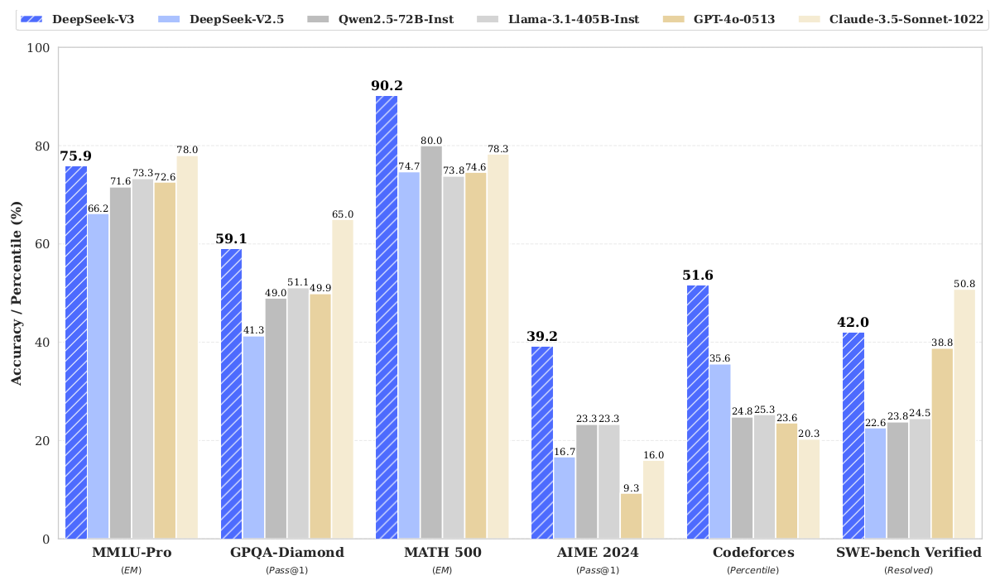
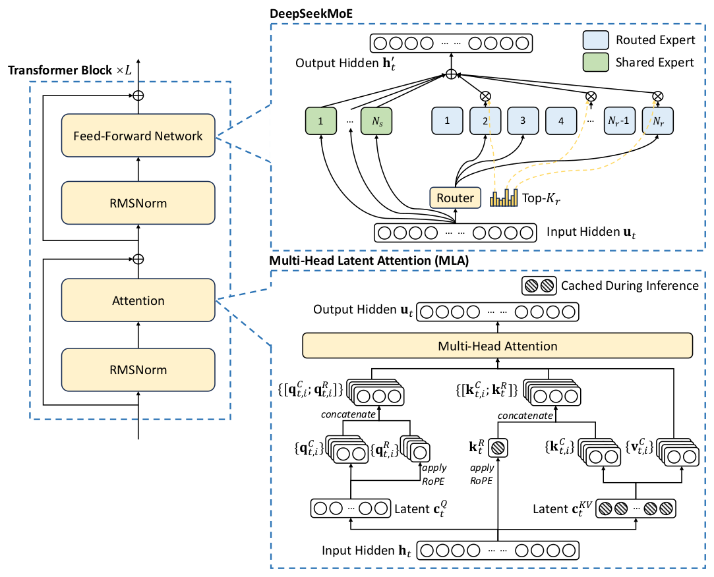
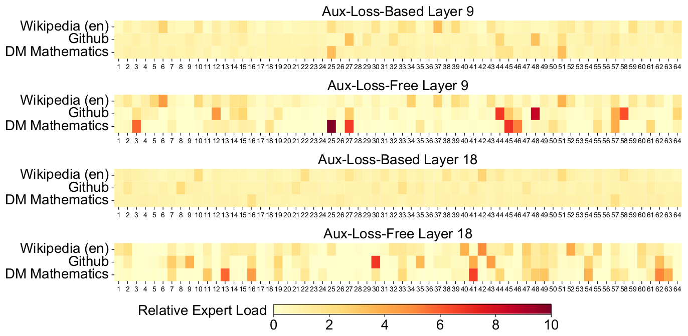
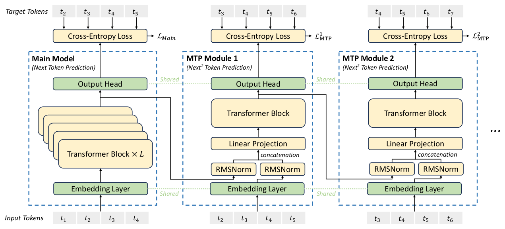
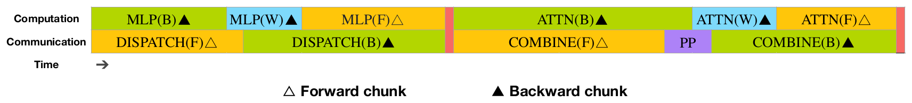
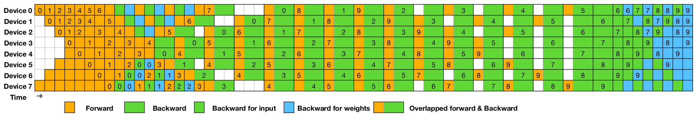
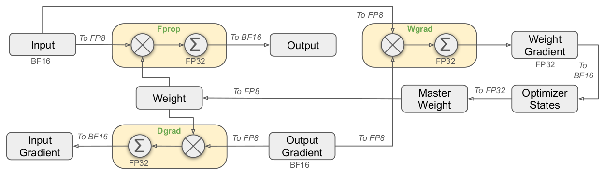
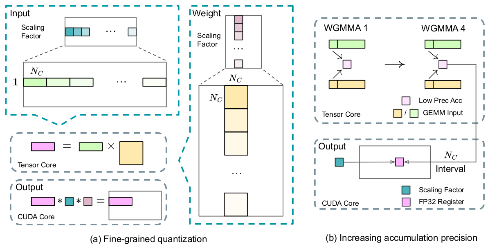
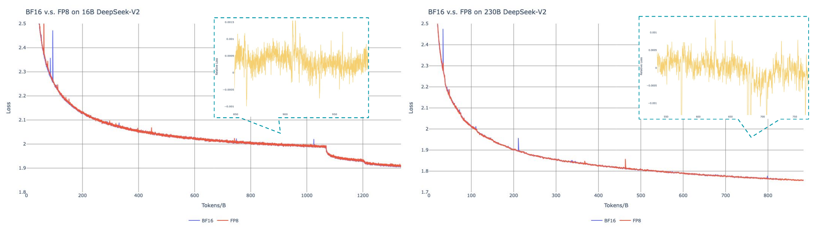
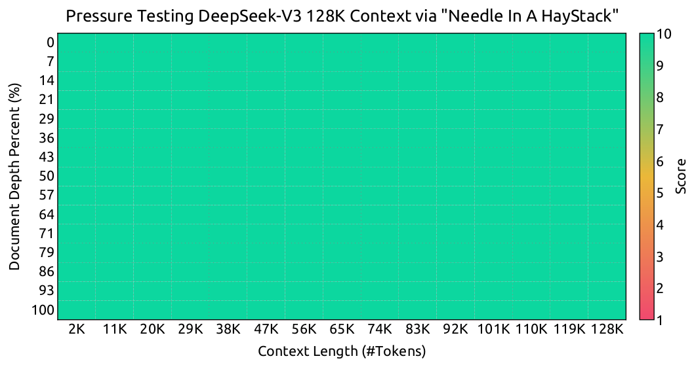

# 论文中文解读：《DeepSeek-V3 Technical Report》

> **基本信息**：DeepSeek-AI，arXiv:2412.19437（2024 年 12 月首次公开，本地 PDF 为 v2，2025 年 2 月 18 日），模型权重见 [官方仓库](https://github.com/deepseek-ai/DeepSeek-V3)；论文原文 [arXiv 页面](https://arxiv.org/abs/2412.19437)。
>
> **本文的读法**：图为从 PDF 中按图裁出的原图；表为逐格核对后的中文转录（数字与原文一致，表头和行名译成中文，模型名、数据集名保持英文；粗体为原表标出的最佳结果，原表另用下划线标次佳，这里未保留）。每张图、表后都有中文图题、图例翻译和读法结论，因此不必再翻英文版。凡是本文自己做的换算、推算或构造的例子，一律标注“推算”或“本文构造”，不是论文原话。MLA 的推导细节见 [DeepSeek-V2 解读](../deepseek_v2/论文中文解读.md)，本文只回顾要点。

## 一、一句话结论

DeepSeek-V3 是 671B 总参数、每个 token 激活 37B 参数的 MoE 语言模型，沿用 V2 已验证的 **MLA**（多头潜在注意力）和 **DeepSeekMoE**，在此之上做了三类改进：

1. 架构与训练目标：用**无辅助损失负载均衡**（给每个专家加一个只影响路由、不进入门控权重的偏置项，由规则动态调整）代替 V2 的三种辅助损失；训练目标里加入**多 token 预测（MTP）**。
2. 训练系统：**FP8 混合精度训练**（细粒度量化 + 提高累加精度）、**DualPipe** 双向流水线并行、定制的跨节点 all-to-all 通信 kernel，使跨节点专家并行的通信几乎被计算完全覆盖，训练中不再需要张量并行。
3. 后训练：SFT + GRPO 强化学习，并从 DeepSeek-R1 系列模型**蒸馏**长思维链推理能力。

论文报告：在 14.8T token 上预训练只需 2.664M H800 GPU 小时，包含上下文扩展和后训练的全流程为 2.788M GPU 小时（按每 GPU 小时 2 美元的租价假设约合 5.576M 美元，只是正式训练的算力租赁账面值）；训练过程没有不可恢复的 loss spike，也没有回滚；基座模型是当时最强的开源基座，对话版本在多数基准上与 GPT-4o、Claude-3.5-Sonnet 相当，数学和算法类代码基准上领先幅度最大。以上结论均为论文自述，评测都在论文自己的评测框架里完成。

## 二、背景与总览

### 2.1 V3 在 V2 之上改了什么

V3 的架构骨架与 V2 一脉相承（背景见 [DeepSeek-V2 解读](../deepseek_v2/论文中文解读.md)）：Transformer decoder，attention 用 MLA，FFN 用 DeepSeekMoE，其余小细节沿用 V2。下表把两篇论文里可以直接对照的设置并排列出（V2 一列取自 V2 论文，V3 一列取自本文）：

| 项目 | DeepSeek-V2 | DeepSeek-V3 |
|---|---|---|
| 总参数 / 激活参数 | 236B / 21B | 671B / 37B |
| 层数 / 隐藏维度 | 60 / 5120 | 61 / 7168 |
| MLA 配置（$n_h$、$d_h$、$d_c$、$d_c'$、$d_h^R$） | 128、128、512、1536、64 | 同 V2：128、128、512、1536、64 |
| 稠密 FFN 层 | 第 1 层 | 前 3 层 |
| 共享专家 / 路由专家 / 每 token 激活的路由专家 | 2 / 160 / 6 | 1 / 256 / 8 |
| 单个专家的中间维度 | 1536 | 2048 |
| 亲和度与门控 | softmax 亲和度，top-K 后直接作门控值 | sigmoid 亲和度，对选中的亲和度归一化后作门控值 |
| 路由限制 | 设备受限，每 token 最多 3 个设备 | 节点受限，每 token 最多 4 个节点 |
| 负载均衡 | 专家级、设备级、通信级三种辅助损失 | 无辅助损失（偏置项）+ 极小的序列级辅助损失 |
| token dropping | 训练时使用 | 训练和推理都不丢 token |
| 训练目标 | 下一 token 预测 | 下一 token 预测 + MTP（深度 1） |
| 预训练 token 数 | 8.1T | 14.8T |
| 词表 | 约 100K | 128K |
| 并行方式 | 16 路流水线 + 8 路专家并行 + ZeRO-1 | 16 路流水线 + 64 路专家并行（跨 8 个节点）+ ZeRO-1 |
| 长上下文扩展 | YaRN，1000 步（32K 序列），评测到 128K | YaRN，两阶段各 1000 步（32K、128K） |

### 2.2 总体结果（图 1）

先看论文用来概括 V3 水平的图：



*图 1（原文 Figure 1，第 1 页）：DeepSeek-V3 与同期模型在六个基准上的成绩。*

**图中文字翻译与读法**：

- 图例（自左到右）：DeepSeek-V3（蓝色斜线柱）、DeepSeek-V2.5、Qwen2.5-72B-Inst、Llama-3.1-405B-Inst、GPT-4o-0513、Claude-3.5-Sonnet-1022。纵轴 Accuracy / Percentile (%)（准确率或百分位，%）。
- 六组基准：MMLU-Pro (EM)、GPQA-Diamond (Pass@1)、MATH 500 (EM)、AIME 2024 (Pass@1)、Codeforces (Percentile，在参赛者中的百分位)、SWE-bench Verified (Resolved，解决的问题比例)。柱顶数字即成绩；V3 依次为 75.9、59.1、90.2、39.2、51.6、42.0，与表 6 一致。
- **读图结论**：V3 在 MATH 500（90.2，其余最高 80.0）、AIME 2024（39.2，其余最高 23.3）、Codeforces（51.6，其余最高 35.6）上明显领先所有对比模型，包括两个闭源模型；在 MMLU-Pro（Claude 78.0 对 75.9）、GPQA-Diamond（Claude 65.0 对 59.1）和 SWE-bench Verified（Claude 50.8 对 42.0）上仍落后于 Claude-3.5-Sonnet-1022；SWE-bench Verified 上 V3 高于 GPT-4o 的 38.8。

### 2.3 训练成本（表 1）与怎样正确解释

**表 1：DeepSeek-V3 的训练成本，假设 H800 的租价为每 GPU 小时 2 美元**

| 训练成本 | 预训练 | 上下文扩展 | 后训练 | 合计 |
|---|---:|---:|---:|---:|
| H800 GPU 小时 | 2664K | 119K | 5K | 2788K |
| 美元 | 5.328M | 0.238M | 0.01M | 5.576M |

（原文表 1，第 5 页。）论文在引言里给出了换算：预训练每万亿 token 只需 180K H800 GPU 小时，即在 2048 张 H800 的集群上 3.7 天；因此 14.8T token 共 2664K GPU 小时，用时不到两个月（推算：180K 乘 14.8 得 2664K；2664K 除以 2048 张卡约 54 天）。这三个阶段加起来 2788K GPU 小时，乘 2 美元得 5.576M 美元。

**怎么看这个数字**：论文自己注明，这些成本只包含 V3 的正式训练，不含此前在架构、算法、数据上的研究与消融实验的开销。此外（本文补充）“GPU 小时乘单价”的口径本身也不包含人员、数据工程、推理部署和机房资本等成本。更适合跨论文比较的口径是 GPU 小时、训练 token 数和训练配置，而不是 5.576M 美元这个“租赁账面值”。

## 三、模型架构

### 3.1 整体结构与配置（图 2）



*图 2（原文 Figure 2，第 7 页）：DeepSeek-V3 的基本架构；与 V2 一样采用 MLA 与 DeepSeekMoE。*

**图中文字翻译与读法**：

- **左侧 Transformer Block × L**：自下而上为 RMSNorm、Attention、加法（残差）、RMSNorm、Feed-Forward Network、加法（残差）。
- **右上 DeepSeekMoE**：Input Hidden $\mathbf{u}_t$（输入隐状态）同时送给 Shared Expert（绿色，所有 token 都经过）和 Router（路由器）；Router 对每个 Routed Expert（蓝色）打分，Top-$K_r$ 选出的路由专家输出乘上门控值（图中的 ⊗）后，与共享专家输出、输入本身一起相加（⊕），得到 Output Hidden $\mathbf{h}'_t$。
- **右下 Multi-Head Latent Attention (MLA)**：Input Hidden $\mathbf{h}_t$ 下投影为 query 的潜向量 Latent $\mathbf{c}_t^{Q}$ 和 key-value 的联合潜向量 Latent $\mathbf{c}_t^{KV}$；$\mathbf{c}_t^{Q}$ 产生多头的 $\{\mathbf{q}^C_{t,i}\}$ 与带 RoPE（apply RoPE）的 $\{\mathbf{q}^R_{t,i}\}$ 并拼接（concatenate）；$\mathbf{c}_t^{KV}$ 产生 $\{\mathbf{k}^C_{t,i}\}$、$\{\mathbf{v}^C_{t,i}\}$，$\mathbf{h}_t$ 另外直接产生一个所有头共享、带 RoPE 的 $\mathbf{k}^R_t$ 与每个头的 $\mathbf{k}^C_{t,i}$ 拼接；再做标准的 Multi-Head Attention，输出 $\mathbf{u}_t$。图例 Cached During Inference（推理时缓存）的斜线填充部分只有 $\mathbf{c}_t^{KV}$ 与 $\mathbf{k}^R_t$。
- **读图结论**：这张图与 V2 的架构图相同，说明 V3 的创新不在 block 的“形状”，而在路由方式（无辅助损失）、训练目标（MTP）和训练系统（FP8、DualPipe）。

下表整理自论文 4.2 节的“模型超参数”（论文没有把它们放在表格里）：

| 项目 | 取值 |
|---|---|
| Transformer 层数 / 隐藏维度 $d$ | 61 / 7168 |
| 参数初始化 | 随机初始化，标准差 0.006 |
| MLA | 注意力头数 $n_h=128$，每头维度 $d_h=128$，KV 压缩维度 $d_c=512$，query 压缩维度 $d_c'=1536$，解耦 RoPE 每头维度 $d_h^R=64$ |
| MoE 层 | 除前 3 层外的所有 FFN 都换成 MoE 层（共 58 层 MoE） |
| 每个 MoE 层 | 1 个共享专家 + 256 个路由专家；每个专家的中间隐藏维度 2048；每个 token 激活 8 个路由专家，并保证最多发往 4 个节点 |
| MTP 深度 $D$ | 1（除了下一个 token，每个 token 再多预测 1 个） |
| 额外细节 | 与 V2 相同：压缩潜向量后加 RMSNorm，在宽度瓶颈处乘额外的缩放因子 |
| 总参数 / 激活参数 | 671B / 37B |

**参数量核对（推算）**：假设专家为带三个矩阵的 SwiGLU 型 FFN（论文只说沿用 V2 的设置），每个专家约 $3\times7168\times2048\approx44.0$M 参数。58 个 MoE 层 $\times$ 256 个路由专家约 653.9B，共享专家约 2.6B；MLA 每层约 187.1M，61 层约 11.4B。合计约 667.9B，再加上被忽略的前 3 层稠密 FFN 和 embedding（论文未给出其尺寸），与 671B 吻合，也说明 671B 大概率不含 MTP 模块（论文没有明说）。每个 token 激活 $1+8=9$ 个专家，58 层共约 23.0B，加上 MLA 约 11.4B，约 34.4B，再加上被忽略的部分，与 37B 吻合。由此可见，671B 里绝大部分是路由专家，每个 token 只用到其中约 3%（8/256）。

### 3.2 MLA：与 V2 相同

V3 直接沿用 V2 的 MLA，设置也一样。要点（式 1–11，推导与“吸收”“解耦 RoPE”的原因见 [DeepSeek-V2 解读](../deepseek_v2/论文中文解读.md)）：key 和 value 联合做低秩压缩，只缓存 $\mathbf{c}_t^{KV}$ 与带 RoPE 的共享 key $\mathbf{k}_t^{R}$；query 也做低秩压缩，目的是降低训练时的激活显存。

$$
\mathbf{c}_t^{KV}=W^{DKV}\mathbf{h}_t,\qquad \mathbf{k}_t^{C}=W^{UK}\mathbf{c}_t^{KV},\qquad \mathbf{k}_t^{R}=\mathrm{RoPE}(W^{KR}\mathbf{h}_t),\qquad \mathbf{k}_{t,i}=[\mathbf{k}^C_{t,i};\mathbf{k}^R_t],\qquad \mathbf{v}_t^{C}=W^{UV}\mathbf{c}_t^{KV},
$$

$$
\mathbf{c}_t^{Q}=W^{DQ}\mathbf{h}_t,\qquad \mathbf{q}_t^{C}=W^{UQ}\mathbf{c}_t^{Q},\qquad \mathbf{q}_t^{R}=\mathrm{RoPE}(W^{QR}\mathbf{c}_t^{Q}),\qquad \mathbf{q}_{t,i}=[\mathbf{q}^C_{t,i};\mathbf{q}^R_{t,i}],
$$

$$
\mathbf{o}_{t,i}=\sum_{j=1}^{t}\operatorname{Softmax}_j\!\left(\frac{\mathbf{q}_{t,i}^{\top}\mathbf{k}_{j,i}}{\sqrt{d_h+d_h^R}}\right)\mathbf{v}^C_{j,i},\qquad \mathbf{u}_t=W^{O}[\mathbf{o}_{t,1};\mathbf{o}_{t,2};\dots;\mathbf{o}_{t,n_h}].
$$

符号：$\mathbf{c}_t^{KV}\in\mathbb{R}^{d_c}$ 和 $\mathbf{c}_t^{Q}\in\mathbb{R}^{d_c'}$ 是压缩后的潜向量，$W^{D\cdot}$ 为下投影、$W^{U\cdot}$ 为上投影，$W^{KR}\in\mathbb{R}^{d_h^R\times d}$、$W^{QR}\in\mathbb{R}^{d_h^Rn_h\times d_c'}$ 产生携带 RoPE 的解耦 key 与 query。论文强调，MLA 只需缓存蓝框标出的 $\mathbf{c}_t^{KV}$ 和 $\mathbf{k}_t^{R}$，在显著减少 KV cache 的同时保持与标准 MHA 相当的性能。每 token 每层缓存 $d_c+d_h^R=576$ 个元素，61 层共 35,136 个元素（推算；V2 为 60 层、34,560 个元素）。作为对照，套用 V2 论文表 1 的公式（推算）：若 V3 改用标准 MHA，每 token 要缓存 $2n_hd_hl=2\times128\times128\times61=1{,}998{,}848$ 个元素，MLA 的 35,136 个只有其约 1.76%。

### 3.3 DeepSeekMoE：sigmoid 亲和度与归一化的门控

FFN 采用 DeepSeekMoE：比 GShard 之类的传统 MoE 用更细粒度的专家，并单独留出共享专家。设 $\mathbf{u}_t$ 为第 $t$ 个 token 的 FFN 输入，输出 $\mathbf{h}'_t$ 为（式 12–15）：

$$
\mathbf{h}'_t=\mathbf{u}_t+\sum_{i=1}^{N_s}\mathrm{FFN}^{(s)}_i(\mathbf{u}_t)+\sum_{i=1}^{N_r}g_{i,t}\,\mathrm{FFN}^{(r)}_i(\mathbf{u}_t),\qquad g_{i,t}=\frac{g'_{i,t}}{\sum_{j=1}^{N_r}g'_{j,t}},
$$

$$
g'_{i,t}=\begin{cases}s_{i,t}, & s_{i,t}\in\operatorname{Topk}\big(\{s_{j,t}\mid 1\le j\le N_r\},K_r\big),\\ 0, & \text{otherwise},\end{cases}\qquad s_{i,t}=\operatorname{Sigmoid}\big(\mathbf{u}_t^{\top}\mathbf{e}_i\big).
$$

符号：$N_s$、$N_r$ 为共享专家与路由专家个数（V3 为 1 与 256），$K_r$ 为每个 token 激活的路由专家数（8），$s_{i,t}$ 为 token 与专家的亲和度，$\mathbf{e}_i$ 为第 $i$ 个路由专家的质心向量，$\operatorname{Topk}(\cdot,K)$ 表示取最大的 $K$ 个。式中 $\mathbf{u}_t$ 一项是残差连接。

与 V2 的区别（论文原话：“Slightly different from DeepSeek-V2”）有两点：亲和度由 softmax 改为 **sigmoid**；先选出 top-$K_r$，再对**选中的亲和度做归一化**得到门控值（V2 直接用 softmax 亲和度，没有归一化）。sigmoid 对每个专家独立打分，不像 softmax 那样让所有专家的得分互相竞争；归一化后选中专家的门控权重之和为 1。每个 token 选 8 个路由专家的组合数为 $\binom{256}{8}\approx4.1\times10^{14}$（推算），远大于 V2 的 $\binom{160}{6}\approx2.1\times10^{10}$。

### 3.4 无辅助损失负载均衡（偏置项）

专家负载不均会导致**路由塌缩**（routing collapse，少数专家被过度使用、其余得不到训练），并且在专家并行下拖低计算效率。常规办法是辅助损失（auxiliary loss，见 V2 的专家级/设备级/通信级三种损失），但辅助损失过大会损害模型性能（Wang 等 2024a）。（直观理解，非论文原话：辅助损失的梯度直接叠加在语言模型损失上，会与主目标相互牵制。）

V3 采用 Wang 等人提出的**无辅助损失**（auxiliary-loss-free）策略：给每个路由专家引入一个偏置项 $b_i$，**只在选 top-$K$ 时**加到亲和度上（式 16）：

$$
g'_{i,t}=\begin{cases}s_{i,t}, & s_{i,t}+b_i\in\operatorname{Topk}\big(\{s_{j,t}+b_j\mid 1\le j\le N_r\},K_r\big),\\ 0, & \text{otherwise}.\end{cases}
$$

关键点：

1. 偏置**只用于路由**（决定“选谁”）。真正乘在专家输出上的门控值，仍由**原始亲和度** $s_{i,t}$ 经归一化得到（式 13），不含偏置。
2. 训练中持续监控每个训练 step 整个 batch 上的专家负载；每个 step 结束时，对过载的专家把偏置减去 $\gamma$，对欠载的专家把偏置加上 $\gamma$。$\gamma$ 称为偏置更新速度（bias update speed）。“过载/欠载”的精确判据论文没有展开，通常理解为与该 step 各专家的平均负载比较。
3. 论文的动机是尽量减小“为鼓励负载均衡而对模型性能造成的损害”，并在 6.3 节用消融说明它优于纯辅助损失。一种直观的理解（本文解读，非论文原话）是：偏置不是通过梯度学习的，而是按规则更新，所以不会产生与语言模型损失相互牵制的梯度。

**本文构造的小例子**：4 个路由专家、top-2，某个 token 的亲和度为 $s=(0.62,\,0.60,\,0.58,\,0.20)$。无偏置时选专家 1、2。如果专家 1 近期过载，其偏置被调到 $b_1=-0.05$，加偏置后的得分为 $(0.57,\,0.60,\,0.58,\,0.20)$，改选专家 2、3；门控值用**原始亲和度**归一化：$g_2=0.60/(0.60+0.58)\approx0.51$，$g_3\approx0.49$。偏置只改变“选谁”，不改变“权重怎么算”。

V3 的取值：前 14.3T token 取 $\gamma=0.001$，其余 500B token 取 $\gamma=0.0$（即训练末段偏置不再更新；论文没有说明原因）。

### 3.5 互补的序列级均衡损失

虽然主要依赖无辅助损失策略，为了防止**单个序列内部**出现极端失衡，V3 还保留了一个互补的序列级均衡损失（式 17–20）：

$$
\mathcal{L}_{\mathrm{Bal}}=\alpha\sum_{i=1}^{N_r}f_iP_i,\qquad f_i=\frac{N_r}{K_rT}\sum_{t=1}^{T}\mathbb{1}\Big(s_{i,t}\in\operatorname{Topk}\big(\{s_{j,t}\mid 1\le j\le N_r\},K_r\big)\Big),
$$

$$
s'_{i,t}=\frac{s_{i,t}}{\sum_{j=1}^{N_r}s_{j,t}},\qquad P_i=\frac1T\sum_{t=1}^{T}s'_{i,t}.
$$

读法：形式与 V2 的专家级均衡损失相同，$f_i$ 是专家 $i$ 在该序列里被选中的比例（按 $N_r/K_r$ 归一化，均衡时为 1），$P_i$ 是专家 $i$ 的平均归一化亲和度；$T$ 是**一个序列**的 token 数，所以约束的范围是“每个序列内部”。因为 V3 的亲和度改用 sigmoid，各专家得分之和不再为 1，所以先做 $s'_{i,t}=s_{i,t}/\sum_js_{j,t}$ 的归一化再求平均。系数 $\alpha=0.0001$，极小，只是为了避免单个序列内的极端失衡。

所以更准确的说法是：V3“主要的”均衡信号不再来自辅助损失，而不是“完全没有辅助损失”。

### 3.6 节点受限路由与不丢 token

**节点受限路由（node-limited routing）**：与 V2 的设备受限路由类似，V3 也限制训练时的通信：每个 token 最多发往 $M$ 个节点，这些节点按“每个节点上专家的最高 $K_r/M$ 个亲和度之和”来选。V3 取 $M=4$、$K_r=8$，即每个节点取其上最高的 2 个亲和度求和，选得分最高的 4 个节点（随后在入选节点的专家里做 top-$K_r$，这一步论文没有逐字写出，沿用 V2 的做法）。训练时每层的路由专家均匀放在 8 个节点的 64 张 GPU 上，即每张 GPU 4 个、每个节点 32 个路由专家（推算）。在这个约束下，MoE 训练框架几乎能实现计算与通信的完全重叠（4.3 节解释为什么选 4）。

**不丢 token（no token-dropping）**：得益于有效的负载均衡，V3 在整个训练中保持良好的负载均衡，所以训练时不丢任何 token（V2 训练时用 token dropping）；论文还为推理部署专门设计了策略（冗余专家，见 4.6 节）来保证推理时的负载均衡，所以推理时也不丢 token。

### 3.7 批级均衡与序列级均衡：为什么无辅助损失更好（论文 4.5.3 节）

无辅助损失策略与序列级辅助损失的关键区别在于**约束范围**：前者是批级（batch-wise，看整个训练 batch 的负载），后者是序列级（sequence-wise，要求每个序列自己均衡）。批级约束更灵活：它不要求每个序列内部在“领域”上均衡，允许某些领域的序列集中使用某些专家，因此专家更容易**按领域专精**。

论文用两组证据支持这一点：

- **专家专精的可视化（图 9）**：在 Pile 测试集的三个领域上，记录 16B 的辅助损失基线与无辅助损失模型的专家负载。
- **批级辅助损失的对照**：另外设计了一个“按训练 batch 而不是按序列”约束均衡的批级辅助损失。在达到相近批级均衡程度时，批级辅助损失的模型性能与无辅助损失方法相当。验证集损失如下（论文正文给出，不是表格）：

| 模型规模 | 序列级辅助损失 | 无辅助损失法 | 批级辅助损失 |
|---|---:|---:|---:|
| 1B MoE | 2.258 | 2.253 | 2.253 |
| 3B MoE | 2.085 | 2.080 | 2.080 |

读法：优势主要来自“批级”这个约束范围，而不一定来自偏置机制本身。



*图 9（原文 Figure 9，第 28 页）：16B 模型在 Pile 测试集三个领域上的专家负载；无辅助损失模型表现出更强的专家专精模式。*

**图中文字翻译与读法**：

- 四个热力图分别是 Aux-Loss-Based Layer 9（辅助损失基线第 9 层）、Aux-Loss-Free Layer 9（无辅助损失第 9 层）、Aux-Loss-Based Layer 18、Aux-Loss-Free Layer 18。每张图三行为三个领域 Wikipedia (en)、Github、DM Mathematics，横轴 1–64 为该层的 64 个路由专家；颜色（右下色条 Relative Expert Load，相对专家负载，0 到 10）表示实际负载与理论均衡负载之比，1 表示恰好均衡。（由于篇幅，正文只放两层；全部层的图在附录 C，那张图在原文里也编号为 Figure 10，原文编号重复，本文未转录。）
- **读图结论**：辅助损失基线的两层几乎全是浅色，各领域对各专家的使用量都接近均衡；无辅助损失模型则出现明显的“热点”，例如第 9 层 DM Mathematics 的某个专家（图上约 25 号）颜色最深（负载约为均衡值的 10 倍左右，从图上读出的近似值），Github 和 Wikipedia 各自集中使用另一些专家，说明不同领域用了不同的专家子集，即专精更强。图只展示了两层、一个模型规模，是论文用来说明趋势的例子。

批级均衡也有两个潜在的效率挑战：（1）某些序列或小 batch 内部的负载失衡；（2）推理时由领域漂移引起的负载失衡。论文的应对：对（1），训练框架使用大规模专家并行和数据并行，保证每个 micro-batch 足够大；对（2），设计了带冗余专家部署的推理框架（4.6 节）。

### 3.8 多 token 预测（MTP）

**动机**：受 Gloeckle 等（2024）启发，MTP 把预测范围扩展到每个位置的多个后续 token。一方面，MTP 让训练信号更稠密，可能提高数据效率；另一方面，它可能迫使模型提前“规划”表示，以便更好地预测后续 token。与 Gloeckle 等用**独立输出头并行**预测 $D$ 个额外 token 不同，V3 **顺序**预测额外 token，并在每个预测深度都保持完整的因果链。保持因果链的思路与 EAGLE 相似，但 EAGLE 的主要目的是推测解码，V3 则用 MTP 改进训练。



*图 3（原文 Figure 3，第 10 页）：MTP 的实现示意；在每个深度都保持完整的因果链。*

**图中文字翻译与读法**：

- 三列从左到右：Main Model (Next Token Prediction)（主模型，预测下一个 token）、MTP Module 1 (Next² Token Prediction)（预测下下个 token）、MTP Module 2 (Next³ Token Prediction)（预测第 3 个后续 token，右侧省略号表示还可以继续叠加）。
- 每列自下而上：Input Tokens（输入 token）→ Embedding Layer（词嵌入）→ Transformer Block（主模型为 $L$ 个）→ Output Head（输出头）→ Cross-Entropy Loss（交叉熵损失）← Target Tokens（目标 token）。主模型输入 $t_1\ldots t_4$、目标 $t_2\ldots t_5$，损失记 $\mathcal{L}_{Main}$；MTP Module 1 的输入是 $t_2\ldots t_5$（整体右移一位）、目标 $t_3\ldots t_6$，损失记 $\mathcal{L}^1_{\mathrm{MTP}}$；MTP Module 2 的输入 $t_3\ldots t_6$、目标 $t_4\ldots t_7$，损失 $\mathcal{L}^2_{\mathrm{MTP}}$。
- MTP 模块内部：两个 RMSNorm 分别处理“上一深度的隐状态”（从左侧主模型/前一模块引来的黑色连线）和“本深度 token 的 embedding”，两路拼接（concatenation）后经 Linear Projection（线性投影）回到 $d$ 维，再进入一个 Transformer Block，最后用输出头预测。
- 绿色虚线标注 Shared：每个 MTP 模块的 Embedding Layer 与 Output Head 都与主模型**共享**。
- **读图结论**：MTP 模块是挂在主模型后面的“小分支”，每多一个深度就多预测一个更远的 token，且每个深度的输入都包含前一深度的隐状态，所以预测链是因果连续的。

**MTP 模块**：V3 用 $D$ 个顺序模块预测 $D$ 个额外 token。第 $k$ 个 MTP 模块由共享的 embedding 层 $\mathrm{Emb}(\cdot)$、共享的输出头 $\mathrm{OutHead}(\cdot)$、一个 Transformer block $\mathrm{TRM}_k(\cdot)$ 和一个投影矩阵 $M_k\in\mathbb{R}^{d\times2d}$ 组成。对第 $i$ 个输入 token $t_i$，在第 $k$ 个预测深度，先把它在第 $k-1$ 深度的表示 $\mathbf{h}^{k-1}_i\in\mathbb{R}^d$ 与第 $i+k$ 个 token 的 embedding $\mathrm{Emb}(t_{i+k})\in\mathbb{R}^d$ 用线性投影合并（式 21–23）：

$$
\mathbf{h}^{\prime\,k}_i=M_k\big[\mathrm{RMSNorm}(\mathbf{h}^{k-1}_i);\ \mathrm{RMSNorm}(\mathrm{Emb}(t_{i+k}))\big],\qquad \mathbf{h}^{k}_{1:T-k}=\mathrm{TRM}_k\big(\mathbf{h}^{\prime\,k}_{1:T-k}\big),\qquad P^{k}_{i+k+1}=\mathrm{OutHead}(\mathbf{h}^{k}_i).
$$

其中 $[\cdot;\cdot]$ 表示拼接；$k=1$ 时 $\mathbf{h}^{0}_i$ 就是主模型给出的表示；$T$ 是输入序列长度；$i{:}j$ 表示闭区间切片；$P^k_{i+k+1}\in\mathbb{R}^V$ 是第 $k$ 个额外预测 token 的概率分布，$V$ 为词表大小。输出头把表示线性映射成 logits，再用 Softmax 得到概率。

**一个具体例子（本文构造）**：序列 $t_1,\dots,t_5$、$D=1$。主模型在位置 $i$ 预测 $t_{i+1}$。MTP 模块 1 在位置 $i$ 取主模型的隐状态 $\mathbf{h}^0_i$ 和**真实的** $\mathrm{Emb}(t_{i+1})$，预测 $t_{i+2}$。也就是说，预测 $t_{i+2}$ 时模型已经“看到”了 $t_{i+1}$，因果链没有断，这与并行独立头的做法不同。

**MTP 训练目标**：对每个预测深度计算交叉熵损失（式 24），再对所有深度取平均并乘以权重 $\lambda$（式 25），作为 V3 额外的训练目标：

$$
\mathcal{L}^{k}_{\mathrm{MTP}}=\mathrm{CrossEntropy}\big(P^{k}_{2+k:T+1},\,t_{2+k:T+1}\big)=-\frac1T\sum_{i=2+k}^{T+1}\log P^{k}_i[t_i],\qquad \mathcal{L}_{\mathrm{MTP}}=\frac{\lambda}{D}\sum_{k=1}^{D}\mathcal{L}^{k}_{\mathrm{MTP}}.
$$

$t_i$ 是第 $i$ 个位置的真实 token，$P^k_i[t_i]$ 是第 $k$ 个 MTP 模块给它的预测概率。V3 取 $D=1$，$\lambda$ 在前 10T token 取 0.3，其余 4.8T token 取 0.1。

**推理时**：MTP 的主要目的是提升主模型，所以推理时可以直接丢弃 MTP 模块，主模型单独正常工作，推理成本与不用 MTP 的模型完全相同；也可以把 MTP 模块重新用于推测解码来降低生成延迟（接受率见 7.7 节）。MTP 的训练收益见 6.2 节表 4。

## 四、训练基础设施

### 4.1 集群与并行方式

V3 在 2048 张 NVIDIA H800 GPU 的集群上训练（推算为 256 个节点）：每个节点 8 张 GPU，节点内用 NVLink 和 NVSwitch 互联，节点间用 InfiniBand（IB）。训练基于内部开发的轻量框架 HAI-LLM，整体并行方式是：16 路流水线并行（PP）、跨 8 个节点的 64 路专家并行（EP）和 ZeRO-1 数据并行（DP）；由于显存被精心优化，**不使用昂贵的张量并行（TP）**。论文把工程优化归为三项：DualPipe 流水线并行、高效的跨节点 all-to-all 通信 kernel、极致的显存节省。

### 4.2 DualPipe 与计算–通信重叠

**要解决的问题**：跨节点专家并行带来的通信开销，使计算与通信的比例约为 1:1，如果两者串行，一半时间在通信，效率很低。DualPipe 的目标是同时：（1）把前向、反向里的计算与通信互相重叠；（2）减少流水线气泡（pipeline bubble）。

**核心想法**：重叠一对单独的前向块（forward chunk）和反向块（backward chunk）内部的计算与通信。每个块被拆成四个组件：attention、all-to-all dispatch（把 token 分发给专家）、MLP、all-to-all combine（把专家输出汇总回来）。对反向块，attention 和 MLP 还各自被进一步拆成两部分：**backward for input**（对输入激活求梯度，要继续传给前一层）和 **backward for weights**（对权重求梯度），做法与 ZeroBubble（Qi 等 2023b）一致。再加上流水线并行通信（PP communication）这一组件。把这些组件重新排列，并手工调整分配给通信和计算的 GPU 流多处理器（SM）比例，可以保证 all-to-all 与 PP 通信都被完全隐藏。



*图 4（原文 Figure 4，第 12 页）：一对独立的前向块与反向块的重叠策略（Transformer block 的边界没有对齐）。*

**图中文字翻译与读法**：

- 两行：上行 Computation（计算）、下行 Communication（通信），横轴 Time（时间）。图例：空心三角 △ 表示前向块（Forward chunk），实心三角 ▲ 表示反向块（Backward chunk）。颜色：橙色为前向，绿色为“对输入的反向”（backward for input），蓝色为“对权重的反向”（backward for weights），紫色为 PP 通信，红色细条为同步屏障（barrier）。
- 计算行依次是：MLP(B)▲、MLP(W)▲、MLP(F)△、屏障、ATTN(B)▲、ATTN(W)▲、ATTN(F)△、屏障（B 为 backward for input，W 为 backward for weights，F 为前向）。通信行依次是：DISPATCH(F)△、DISPATCH(B)▲、屏障、COMBINE(F)△、PP、COMBINE(B)▲。
- **读图结论**：前半段，反向块的 MLP 梯度计算和前向块的 MLP 计算，覆盖了前向与反向的 dispatch 通信；后半段，attention 的反向与前向计算覆盖了前向 combine、PP 通信和反向 combine。通信段都落在某段计算的下方，所以 all-to-all 和 PP 通信都能完全隐藏。

**完整调度**：有了这种重叠策略，完整的 DualPipe 调度见图 5。它是**双向流水线**：从流水线的两端同时送入 micro-batch，大部分通信都能被完全重叠。只要保持计算与通信的比例不变，随着模型继续放大，仍然可以在跨节点使用细粒度专家，同时让 all-to-all 通信开销接近于零。



*图 5（原文 Figure 5，第 13 页）：8 个流水线 rank、两个方向共 20 个 micro-batch 的 DualPipe 调度示例。反向方向的 micro-batch 与正向对称，为简洁起见省略其编号。共用一个黑色边框的两个格子表示它们的计算与通信互相重叠。*

**图中文字翻译与读法**：

- 8 行 Device 0–7 是 8 个 PP rank，横轴 Time 为时间。图例：Forward（前向，橙色）、Backward（反向，绿色）、Backward for input（对输入的反向，绿色）、Backward for weights（对权重的反向，蓝色）、Overlapped forward & Backward（前向与反向重叠，半橙半绿）。格子里的数字是 micro-batch 编号，空白格是气泡。
- 读法：左侧的阶梯状橙色是流水线填充（warm-up）阶段的前向；中段大量半橙半绿的格子是前向与反向互相重叠的块；右侧收尾阶段出现绿色与蓝色的反向块（把反向拆成对输入和对权重两部分，可以用它们填补气泡）。两个方向的 micro-batch 对称地从流水线两端进入。
- **读图结论**：气泡主要集中在两端的阶梯区域，中段几乎没有空闲；这正是表 2 中 DualPipe 气泡更小的来源。

**表 2：不同流水线并行方法的气泡与显存对比**。$F$ 为一个前向块的执行时间，$B$ 为一个完整反向块的执行时间，$W$ 为一个“对权重的反向”块的执行时间，$F\&B$ 为两个互相重叠的前向与反向块的执行时间；$PP$ 为流水线并行的路数。

| 方法 | 气泡 | 参数 | 激活 |
|---|---|---:|---:|
| 1F1B | $(PP-1)(F+B)$ | $1\times$ | $PP$ |
| ZB1P | $(PP-1)(F+B-2W)$ | $1\times$ | $PP$ |
| DualPipe（本文） | $(\tfrac{PP}{2}-1)(F\&B+B-3W)$ | $2\times$ | $PP+1$ |

（原文表 2，第 13 页。）读法：

- 即使在没有沉重通信负担的一般场景下，DualPipe 相比 ZB1P（Qi 等 2023b）和 1F1B（Harlap 等 2018）也显著减少了气泡，代价是峰值激活显存只增加 $1/PP$ 倍（$PP+1$ 对 $PP$）。
- DualPipe 要保存**两份**模型参数（论文原话；一般理解是每个设备要同时承载两个方向的流水线阶段），但因为训练使用较大的 EP 规模，这并不会显著增加显存占用。
- 与 Chimera（Li 和 Hoefler 2021）相比，DualPipe 只要求流水线阶段数和 micro-batch 数能被 2 整除，不要求 micro-batch 数能被流水线阶段数整除。
- 对 DualPipe，气泡和激活显存都不会随 micro-batch 数增加而增长。

### 4.3 跨节点 all-to-all 通信的实现

为了保证 DualPipe 的计算性能，论文定制了高效的跨节点 all-to-all 通信 kernel（包括 dispatch 和 combine），以尽量少占用负责通信的 SM 数量。kernel 的实现与 MoE 的门控算法以及集群的网络拓扑共同设计：

- **带宽差异**：集群里跨节点的 GPU 通过 IB 全互联，节点内通过 NVLink 通信。NVLink 带宽 160 GB/s，约为 IB（50 GB/s）的 3.2 倍。
- **限制节点数**：为利用这一差异，每个 token 最多分发到 4 个节点，减少 IB 流量。
- **两级转发**：路由决策做出后，token 先经 IB 发到目标节点上“节点内编号相同的 GPU”；到达目标节点后，尽量立即通过 NVLink 转发给真正承载目标专家的 GPU，不被后续到达的 token 阻塞。这样 IB 与 NVLink 的通信完全重叠，每个 token 平均可以在每个节点高效选择 3.2 个专家，而不会产生额外的 NVLink 开销。
- **含义**：虽然 V3 实际只选 8 个路由专家，但在通信成本不变的前提下，最多可以扩展到 13 个专家（4 个节点 $\times$ 3.2 个专家/节点，即 12.8）。
- **SM 占用**：在这种通信策略下，只需 20 个 SM 就能充分利用 IB 和 NVLink 带宽（H800 共 132 个 SM）。
- **warp 特化（warp specialization）**：把 20 个 SM 划分成 10 个通信通道。dispatch 过程中，（1）IB 发送、（2）IB 到 NVLink 的转发、（3）NVLink 接收分别由不同的 warp 负责；combine 过程中，（1）NVLink 发送、（2）NVLink 到 IB 的转发与累加、（3）IB 接收与累加也由各自的 warp 负责。分配给每个通信任务的 warp 数量会根据所有 SM 上的实际负载动态调整。
- **减少干扰**：dispatch 和 combine kernel 都与计算流重叠，所以还要考虑它们对其他 SM 上计算 kernel 的影响。论文使用定制的 PTX（Parallel Thread Execution）指令并自动调优通信分块大小，显著减少了 L2 cache 的占用和对其他 SM 的干扰。

### 4.4 以极小开销节省显存

为降低训练时的显存占用，论文采用三项技术：

- **重计算 RMSNorm 与 MLA 上投影**：反向传播时重新计算所有 RMSNorm 和 MLA 的上投影，不再长期保存它们的输出激活，以很小的开销显著降低激活显存。
- **EMA 放在 CPU**：为了在学习率衰减后尽早估计模型性能，训练中保留模型参数的指数滑动平均（EMA）。EMA 参数存放在 CPU 内存里，在每个训练 step 之后异步更新，因此不占额外的显存和时间。
- **MTP 的共享 embedding 与输出头**：借助 DualPipe，把模型最浅的层（含 embedding）和最深的层（含输出头）放在同一个 PP rank 上，使 MTP 模块与主模型之间共享的 embedding 和输出头，其参数和梯度可以在物理上共享，进一步提高显存效率。

### 4.5 FP8 混合精度训练

受低精度训练研究的启发，论文提出一个使用 FP8 数据格式的细粒度混合精度框架。低精度训练的难点是激活、权重、梯度中的**离群值（outlier）**：FP8 的指数位少、动态范围小，容易上溢或下溢。论文的对策是：细粒度量化（tile 或 block 为单位分别缩放）；提高累加精度；全部张量统一使用 E4M3 格式；在线量化；并把缓存的激活和 MoE 通信也压成低精度。论文先在与 V2-Lite 和 V2 相近的两个规模上训练约 1T token 做了验证，相对 BF16 基线，FP8 训练的相对 loss 误差始终低于 0.25%，在训练随机性的可接受范围内（附录 B.1，见本节末尾）。

**（1）混合精度框架（图 6）**



*图 6（原文 Figure 6，第 15 页）：FP8 数据格式的整体混合精度框架；为说明清楚，只画了 Linear 算子。*

**图中文字翻译与读法**：

- 一个 Linear 层有三个 GEMM：**Fprop**（前向）、**Dgrad**（对激活求梯度的反向）、**Wgrad**（对权重求梯度的反向）。图中每个黄色圆角框是一个 GEMM，里面 ⊗ 是矩阵乘，Σ 是累加，累加用 FP32。
- Fprop：Input（BF16）经 “To FP8” 转成 FP8，与来自 Weight 的 FP8 权重相乘，FP32 累加，经 “To BF16” 输出 Output（BF16）。
- Dgrad：Output Gradient（输出梯度，BF16）转 FP8，与 Weight 的 FP8 相乘，FP32 累加，转 BF16 得到 Input Gradient（输入梯度）。
- Wgrad：输入（转 FP8）与输出梯度（转 FP8）相乘，FP32 累加，得到 Weight Gradient（权重梯度，FP32）；它经 “To BF16” 进入 Optimizer States（优化器状态），再经 “To FP32” 更新 Master Weight（主权重），主权重再 “To FP8” 供下一步使用。
- **读图结论**：三个 GEMM 的输入都是 FP8，输出是 BF16 或 FP32，累加在 FP32 中进行；主权重、权重梯度、优化器状态保留较高精度。

论文的文字说明：

- 大多数计算密集的核心算子，即 GEMM，都用 FP8；这些 GEMM 接受 FP8 张量作为输入，输出 BF16 或 FP32。Linear 算子相关的三个 GEMM（Fprop、Dgrad、Wgrad）都在 FP8 下执行，理论上使计算速度比原来的 BF16 方法翻倍。此外，FP8 的 Wgrad GEMM 允许把激活以 FP8 存下来供反向使用，显著减少显存。
- 某些算子对低精度敏感，所以保持原始精度（BF16 或 FP32）：embedding 模块、输出头、MoE 的门控模块、归一化算子、attention 算子。
- 为进一步保证数值稳定，主权重（master weights）、权重梯度、优化器状态用更高精度存放；这些高精度组件带来的显存开销可以通过在多个 DP rank 间分片来降到最低。

**（2）细粒度量化（图 7a）**

标准做法是把输入张量的绝对值最大值缩放到 FP8 可表示的最大值，这让低精度训练对激活离群值非常敏感（一个离群值就会把整个张量的有效精度压低）。论文改为更细的粒度缩放：

- **激活**：按 $1\times128$ 的 **tile**（即每个 token 每 128 个通道）分组、缩放；
- **权重**：按 $128\times128$ 的 **block**（即每 128 个输入通道 $\times$ 128 个输出通道）分组、缩放。

这样可以按更小的元素组自适应调整缩放系数，更好地容纳离群值。一个关键改动是：缩放系数沿 GEMM 的**内维度**（求和维度 $K$）逐组引入，这在标准 FP8 GEMM 里不被直接支持，但结合下面精确的 FP32 累加策略就能高效实现。论文指出这与微缩放格式（microscaling formats，Rouhani 等 2023b）的思想高度一致，而 NVIDIA 下一代 GPU（Blackwell 系列）已宣布支持粒度更小的微缩放格式。

**（3）提高累加精度（图 7b）**

低精度 GEMM 常受下溢影响，精度很大程度取决于高精度累加。论文观察到，H800 上 FP8 GEMM 的累加精度只能保留约 14 位，远低于 FP32；当内维度 $K$ 很大时（大规模训练中 batch 和模型宽度增大时的典型情形）问题更突出。在对两个随机矩阵、$K=4096$ 的初步测试里，Tensor Core 有限的累加精度导致最大相对误差接近 2%。但有限累加精度仍是一些 FP8 框架的默认选项。

论文采用“提升到 CUDA Core 做高精度累加”的策略：在 Tensor Core 上执行 MMA（矩阵乘累加）时，中间结果先以有限位宽累加；每累加到间隔 $N_C$，就把这些部分和复制到 CUDA Core 的 FP32 寄存器里，做全精度 FP32 累加。前面细粒度量化引入的逐组缩放系数，正好可以在 CUDA Core 上作为反量化的一部分高效相乘，额外开销很小。

用公式写出来（本文的形式化，不是论文原式）：设激活 tile 的缩放系数为 $s^{X}_{i,g}$（第 $i$ 个 token、第 $g$ 个 128 通道组），权重 block 的缩放系数为 $s^{W}_{g,h}$（第 $g$ 组输入通道、第 $h$ 组输出通道），FP8 量化值为 $\hat X$、$\hat W$，则输出为

$$
Y_{ij}=\sum_{g=1}^{K/128}s^{X}_{i,g}\,s^{W}_{g,h(j)}\ \underbrace{\sum_{k\in\text{group }g}\hat X_{ik}\hat W_{kj}}_{\text{limited-precision accumulation in Tensor Core}},
$$

里层求和（式中下括号标注的部分）在 Tensor Core 内以有限位宽完成，每 $N_C=128$ 个元素把部分和乘上两个缩放系数，再累加到 CUDA Core 的 FP32 寄存器中。

论文还指出，这一改动会降低单个 warpgroup 的 WGMMA（Warpgroup 级矩阵乘累加）指令发射率，但在 H800 上，通常可以同时有两个 WGMMA 并存：一个 warpgroup 做提升操作时，另一个可以执行 MMA，两者重叠，保持 Tensor Core 的高利用率。实验表明，$N_C=128$（相当于 4 个 WGMMA）是能显著提高精度又不引入明显开销的最小累加间隔。



*图 7（原文 Figure 7，第 16 页）：（a）细粒度量化方法，用于缓解特征离群值造成的量化误差；为简洁起见只画了 Fprop。（b）结合量化策略，通过每隔 $N_C=128$ 个元素的 MMA 就提升到 CUDA Core 做高精度累加，来提高 FP8 GEMM 的精度。*

**图中文字翻译与读法**：

- **左图（a）Fine-grained quantization**：左上 Input（输入）的 Scaling Factor（缩放系数）对应每个 $1\times N_C$ 的小段（$N_C=128$），每段一个系数；右侧 Weight（权重）的 Scaling Factor 对应每个 $N_C\times N_C$ 的方块。下方 Tensor Core 里“粉色 = 绿色输入 $\times$ 黄色权重”表示低精度 GEMM 得到部分结果；再往下 Output（输出）在 CUDA Core 里用“部分结果 $*$ 激活缩放系数 $*$ 权重缩放系数 = 输出”完成反量化。
- **右图（b）Increasing accumulation precision**：上方 Tensor Core 里，WGMMA 1 到 WGMMA 4 的 GEMM 输入（黄、绿）用低精度累加（Low Prec Acc，浅粉色小方块）；每隔 $N_C$ Interval（间隔），把部分和送到下方 CUDA Core，与 Scaling Factor（缩放系数，青色）相乘后累加到 FP32 Register（FP32 寄存器，粉色）。
- **读图结论**：细粒度缩放解决“离群值把整张量精度拉低”的问题，间隔提升解决“Tensor Core 累加位宽太短”的问题，两者配合使用。

**（4）全部用 E4M3（Mantissa over Exponents）**：此前的工作（NVIDIA 2024b；Peng 等 2023b；Sun 等 2019b）采用混合 FP8 格式：前向用 E4M3（4 位指数、3 位尾数），Dgrad 和 Wgrad 用 E5M2（5 位指数、2 位尾数）。V3 对所有张量统一用 **E4M3**，换取更高的尾数精度。论文把可行性归功于细粒度量化：在更小的元素组内共享指数位，缓解了动态范围有限的影响。

**（5）在线量化**：张量级量化框架常用延迟量化（delayed quantization，保留此前若干迭代的最大绝对值历史来推断当前值）。为保证缩放准确并简化框架，V3 对每个 $1\times128$ 的激活 tile 或 $128\times128$ 的权重 block，**在线**计算最大绝对值，据此推导缩放系数，再把激活或权重在线量化成 FP8。

**（6）低精度存储与通信**：

- **低精度优化器状态**：AdamW 的一阶、二阶矩用 BF16 而不是 FP32 跟踪，没有观察到性能下降；但优化器保存的主权重和用于梯度累加的梯度仍保留 FP32。
- **低精度激活**：Wgrad 在 FP8 下执行，所以把线性层反向所需的激活缓存为 FP8 是自然选择，但有两处特殊处理：（a）attention 之后的 Linear 的输入，这些激活还会用于 attention 算子的反向，对精度敏感，因此专门使用自定义的 **E5M6** 格式，并且在反向时要把 $1\times128$ 的量化 tile 转换成 $128\times1$ 的 tile，为避免额外量化误差，所有缩放系数都取 2 的整数次幂；（b）MoE 中 SwiGLU 算子的输入：缓存 SwiGLU 的输入，反向时重新计算其输出，这些激活用前述细粒度量化存成 FP8，在显存效率与计算精度之间取得平衡。
- **低精度通信**：MoE 训练中通信带宽是关键瓶颈。V3 把 MoE 上投影之前的激活量化成 FP8 再做 dispatch，与 MoE 上投影里的 FP8 Fprop 兼容，缩放系数同样取 2 的整数次幂；MoE 下投影之前的激活梯度也采用类似策略。前向和反向的 combine 部分则保留 BF16，以保护训练流水线中的关键环节的精度。

**（7）验证与消融（附录 B）**：



*图 10（原文 Figure 10，第 47 页，附录 B）：BF16 与 FP8 训练的 loss 曲线对比，结果经系数为 0.9 的指数滑动平均（EMA）平滑。*

**图中文字翻译与读法**：

- 左图 “BF16 v.s. FP8 on 16B DeepSeek-V2”（约 16B 总参数的 MoE，训练 1.33T token），右图 “BF16 v.s. FP8 on 230B DeepSeek-V2”（约 230B 总参数，约 0.9T token）。横轴 Tokens/B（已训练 token 数，单位 B），纵轴 Loss（训练损失）。蓝线 BF16，红线 FP8。右上虚线放大框是两条曲线的相对差（Relative Loss，纵轴量级约 $\pm0.001$，从图上读出）。
- **读图结论**：两条曲线几乎完全重合（出现的尖峰两种精度各自都有）；相对误差始终低于 0.25%（论文正文数字）。这是在小于最终 V3 的规模、约 1T token 以内的验证，不是 671B 全程的对照。

**块级量化的失败实验（附录 B.2）**：tile 级细粒度量化需要激活在前向用 $1\times128$、反向用 $128\times1$ 两种分组，激活梯度也一样。一个直接的想法是像权重那样用 $128\times128$ 的 block 量化，这样反向只需转置。论文做了实验：把所有与 Dgrad 相关的张量都按 block 量化。结果显示，沿链式反传到浅层的 Dgrad 对精度高度敏感：对激活梯度做 block 量化，会让一个约 16B 总参数的 MoE 模型在训练约 300B token 时发散。论文推测原因是激活梯度在 token 之间高度不均衡，产生与 token 相关的离群值，block 量化无法有效处理。

### 4.6 推理与部署

V3 部署在 H800 集群上：节点内 GPU 通过 NVLink 互联，整个集群内所有 GPU 通过 IB 全互联。为同时保证在线服务的 SLO（服务水平目标）和高吞吐，论文采用**把预填充（prefilling）和解码（decoding）阶段分离**的部署策略。

| 项目 | 预填充（prefilling） | 解码（decoding） |
|---|---|---|
| 最小部署单元 | 4 个节点、32 张 GPU | 40 个节点、320 张 GPU |
| attention 部分 | 4 路张量并行（TP4）+ 序列并行（SP）+ 8 路数据并行（DP8） | TP4 + SP + DP80 |
| MoE 部分 | 32 路专家并行（EP32） | EP320，每张 GPU 只放 1 个专家；其中 64 张 GPU 负责冗余专家和共享专家 |
| 浅层稠密 MLP | 1 路张量并行，省 TP 通信 | 论文未说明 |
| 通信方式 | 与训练相同：先经 IB 跨节点，再经 NVLink 在节点内转发 | dispatch 和 combine 都用 IB 点对点直接传输以降低延迟，并利用 IBGDA 技术进一步降低延迟 |
| 冗余专家 | 32 个冗余专家；每张 GPU 在原有 8 个专家之外再放 1 个冗余专家 | 周期性确定冗余专家集合；因为每张 GPU 只放 1 个专家，不需要重新排布 |
| 共享专家 | 论文未单独说明 | 当作路由专家处理：每个 token 路由时选 9 个专家，共享专家是一直被选中的“高负载专家” |
| 重叠 | 同时处理两个计算量相近的 micro-batch，把一个的 attention 和 MoE 与另一个的 dispatch 和 combine 重叠 | 正在探索：把一个 micro-batch 的 attention 与另一个的 dispatch+MoE+combine 重叠 |

**预填充阶段的负载均衡：冗余专家**。为了让每张 GPU 处理的 token 数大致相同，V3 部署了冗余专家（redundant experts）：把高负载专家复制多份。高负载专家根据在线服务期间收集的统计检测，并定期调整（例如每 10 分钟一次）。确定冗余专家集合后，再根据观察到的负载，在节点内的 GPU 之间重新排布专家，在不增加跨节点 all-to-all 通信开销的前提下尽量均衡各 GPU 负载。V3 预填充阶段设 32 个冗余专家。论文还在探索**动态冗余**策略：每张 GPU 放更多专家（如 16 个），但每个推理 step 只激活其中 9 个；在每层 all-to-all 开始前，现场计算全局最优的路由方案。由于预填充计算量大，计算该路由方案的开销几乎可以忽略。

**解码阶段**：解码时 attention 占用时间的比例更大，所以重叠的是一个 micro-batch 的 attention 与另一个的 dispatch+MoE+combine。每个专家的 batch size 相对较小（通常在 256 个 token 以内），瓶颈在访存而不是计算；而 MoE 部分只需加载一个专家的参数，访存开销很小，所以分配给 dispatch+MoE+combine 的 SM 少一些也不会显著影响整体性能。因此，为避免影响 attention 部分的计算速度，可以只给 dispatch+MoE+combine 分配一小部分 SM。动态冗余在解码阶段也在探索，但需要更仔细地优化计算全局最优路由方案的算法，并与 dispatch kernel 融合以降低开销。

### 4.7 对硬件设计的建议

基于对 all-to-all 通信和 FP8 训练方案的实现经验，论文向 AI 硬件厂商提出建议：

| 方向 | 论文指出的现状 | 论文的建议 |
|---|---|---|
| 通信硬件 | 通过计算与通信重叠隐藏了通信延迟，但当前实现依赖昂贵的 SM（H800 的 132 个 SM 里分了 20 个做通信），限制了计算吞吐，且让 Tensor Core 完全闲置。这些 SM 主要做：IB 与 NVLink 域之间的转发并把发往同一节点内多个 GPU 的 IB 流量聚合；在 RDMA 缓冲区与输入/输出缓冲区之间搬运数据；执行 all-to-all combine 的 reduce 操作；在 IB 与 NVLink 域内向多个专家分块传输数据时管理细粒度内存布局 | 开发能把这些通信任务从 SM 上卸载的硬件，作为 GPU 协处理器或网络协处理器（类似 NVIDIA SHARP）；并把 IB（scale-out）与 NVLink（scale-up）网络从计算单元的角度统一起来，让计算单元通过提交简单原语的通信请求，就能在整个 IB-NVLink 统一域内完成读、写、多播和归约 |
| FP8 GEMM 累加精度 | Hopper 架构的 Tensor Core 做 FP8 GEMM 时，把 32 个尾数乘积按最大指数右移对齐后，每个尾数乘积只取最高 14 位参与加法，超出部分被截断；累加到寄存器也是 14 位精度。V3 用“每 128 个 FP8 乘积的和累加进 CUDA Core 的 FP32”部分缓解，只是对硬件缺陷的折中 | 未来的芯片需要采用更高的累加精度 |
| 支持 tile 和 block 级量化 | 当前 GPU 只支持逐张量（per-tensor）量化；V3 要在每个 $N_C$ 间隔把部分结果从 Tensor Core 复制到 CUDA Core，乘缩放系数再加到 FP32 寄存器，频繁的数据搬运限制计算效率 | 让 Tensor Core 能接收缩放系数并实现带分组缩放的 MMA，使部分和累加与反量化直接在 Tensor Core 内完成，避免频繁数据搬运 |
| 支持在线量化 | 现状要从 HBM 读 128 个 BF16 激活值做量化，量化后的 FP8 值写回 HBM，再读出来做 MMA | 把 FP8 转换与 TMA（Tensor Memory Accelerator）访问融合成单一操作，在激活从全局内存搬到共享内存的过程中完成量化；支持 warp 级 cast 指令以加速并便于归一化与 FP8 转换的融合；或采用近存计算，在 HBM 附近放置计算逻辑，BF16 元素读入 GPU 时直接转 FP8，可把片外访存减少约 50% |
| 支持转置 GEMM | 前向时激活量化成 $1\times128$ 的 FP8 tile 存储；反向时需要读出、反量化、转置、重新量化成 $128\times1$ 的 tile 再存回 HBM | 允许在 MMA 之前直接从共享内存做矩阵的转置读取；与 FP8 格式转换和 TMA 访问的融合配合，将大幅简化量化流程 |

## 五、预训练

### 5.1 数据与 tokenizer

相比 V2，预训练语料的改进有：提高数学和编程样本的比例；把多语言覆盖扩展到中英文之外；改进数据处理流程以减少冗余并保持多样性。受 Ding 等（2024）启发，采用文档打包（document packing）保证数据完整性，但训练时**不使用跨样本注意力掩码**。最终语料共 14.8T 个高质量、多样化 token（按 V3 的 tokenizer 计）。

与 DeepSeekCoder-V2 一致，预训练也采用 **Fill-in-Middle**（FIM，填空）策略：在 DeepSeekCoder-V2 的训练中观察到 FIM 不损害下一 token 预测能力，同时让模型能根据上下文准确预测中间文本。具体用 Prefix-Suffix-Middle（PSM）框架组织数据：

```text
<|fim_begin|> f_pre <|fim_hole|> f_suf <|fim_end|> f_middle <|eos_token|>
```

这种结构在文档级别、作为预打包流程的一部分应用，FIM 的比例为 0.1。

tokenizer 采用字节级 BPE（Byte-level BPE），词表扩展到 128K；预分词器和训练数据都做了修改以优化多语言压缩效率。与 V2 相比，新的预分词器引入了把标点和换行符合并在一起的 token，这可能带来 token 边界偏差（token boundary bias，Lundberg 2023），特别是模型处理没有终止换行的多行提示（如 few-shot 评测提示）时。为缓解，训练时随机拆分一定比例的这类合并 token，让模型接触更多特殊情形。

### 5.2 训练超参数

下表整理自论文 4.2 节的“训练超参数”：

| 项目 | 取值 |
|---|---|
| 优化器 | AdamW，$\beta_1=0.9$，$\beta_2=0.95$，weight decay 0.1 |
| 最大序列长度 / 训练 token | 4K / 14.8T |
| 学习率 | 前 2K 步从 0 线性升到 $2.2\times10^{-4}$；保持 $2.2\times10^{-4}$ 直到训练了 10T token；随后按余弦曲线在 4.3T token 内衰减到 $2.2\times10^{-5}$；最后 500B token 中，前 333B 保持 $2.2\times10^{-5}$，其余 167B 改为 $7.3\times10^{-6}$ |
| 梯度裁剪范数 | 1.0 |
| batch size | 前 469B token 内由 3072 逐步增加到 15360，之后保持 15360 |
| 并行放置 | 流水线并行把不同层放到不同 GPU；每层的路由专家均匀放在 8 个节点的 64 张 GPU 上；节点受限路由：每个 token 最多发往 4 个节点（$M=4$） |
| 偏置更新速度 $\gamma$ | 前 14.3T token 取 0.001，其余 500B token 取 0.0 |
| 序列级均衡损失系数 $\alpha$ | 0.0001 |
| MTP 损失权重 $\lambda$ | 前 10T token 取 0.3，其余 4.8T token 取 0.1 |

### 5.3 长上下文扩展（图 8）

长上下文做法与 V2 类似：预训练之后用 **YaRN**（Peng 等 2023a）做上下文扩展，并进行两个各 1000 步的额外训练阶段，把上下文窗口从 4K 逐步扩展到 32K，再到 128K。YaRN 的配置与 V2 一致，仅作用于解耦的共享 key $\mathbf{k}^R_t$。两个阶段超参数相同：尺度 $s=40$、$\alpha=1$、$\beta=32$，缩放因子 $\sqrt{t}=0.1\ln s+1$。第一阶段序列长度 32K、batch size 1920；第二阶段序列长度 128K、batch size 480；两个阶段的学习率都是 $7.3\times10^{-6}$，与预训练末段的最终学习率一致。

按论文给出的数字推算：预训练 $15360\times4096$、第一阶段 $1920\times32768$、第二阶段 $480\times131072$，每步的 token 数都是 62,914,560，即三个阶段的每步 token 量相同，两个扩展阶段各约 629 亿 token（推算，假设 K 取 1024）。

（本文提醒：V3 论文把缩放因子写成 $\sqrt t=0.1\ln s+1$，而 V2 论文写的是 $\sqrt t=0.0707\ln s+1$，系数不同，而 V3 称“YaRN 配置与 V2 一致”。可能是符号约定不同，论文没有解释，本文无法核对，视为未解决的不一致。代入 $s=40$，前者约 1.37，后者约 1.26。）



*图 8（原文 Figure 8，第 23 页）：“大海捞针”（Needle In A Haystack，NIAH）测试结果；论文称 DeepSeek-V3 在直到 128K 的所有上下文窗口长度上表现良好。*

**图中文字翻译与读法**：

- 标题 Pressure Testing DeepSeek-V3 128K Context via "Needle In A HayStack"（用“大海捞针”对 DeepSeek-V3 做 128K 上下文压力测试）。横轴 Context Length (#Tokens)（上下文长度，2K、11K、20K、29K、38K、47K、56K、65K、74K、83K、92K、101K、110K、119K、128K 共 15 档），纵轴 Document Depth Percent (%)（针所在的文档深度，0、7、14、21、29、36、43、50、57、64、71、79、86、93、100 共 15 档）。颜色代表 Score（得分，1 到 10，绿色为 10 分）。
- **读图结论**：所有格子都是满分绿色，没有失败格。注意：论文说明这是**监督微调之后**的 V3 的结果（V2 的 NIAH 图是基座模型）；NIAH 只测单一事实的检索，不能代表长文推理或跨段聚合能力。

## 六、预训练评测与消融

### 6.1 基座模型评测（表 3）

评测基准的类别与 V2 类似，新增 MMLU-Redux、MMLU-Pro、MMMLU（多语言）、MGSM（多语言数学）、LiveCodeBench-Base（0801 到 1101）。评测使用内部评测框架（集成在 HAI-LLM 中）：HellaSwag、PIQA、WinoGrande、RACE-Middle、RACE-High、MMLU、MMLU-Redux、MMLU-Pro、MMMLU、ARC-Easy、ARC-Challenge、C-Eval、CMMLU、C3、CCPM 采用基于困惑度的评测；TriviaQA、NaturalQuestions、DROP、MATH、GSM8K、MGSM、HumanEval、MBPP、LiveCodeBench-Base、CRUXEval、BBH、AGIEval、CLUEWSC、CMRC、CMath 采用基于生成的评测；Pile-test 用 BPB（Bits-Per-Byte）作为指标，以便在不同 tokenizer 的模型之间公平比较。

**表 3：DeepSeek-V3-Base 与代表性开源基座模型的对比**。所有模型都用内部框架在相同评测设置下评测；相差不超过 0.3 的分数视为同一水平，因此同一行里可能有多个粗体；Pile-test 的 BPB 越低越好，其余指标越高越好。

| 基准（指标） | 样本数 | DeepSeek-V2 Base | Qwen2.5 72B Base | LLaMA-3.1 405B Base | DeepSeek-V3 Base |
|---|:---:|---:|---:|---:|---:|
| 架构 | - | MoE | Dense | Dense | MoE |
| 激活参数量 | - | 21B | 72B | 405B | 37B |
| 总参数量 | - | 236B | 72B | 405B | 671B |
| **英文（English）** |  |  |  |  |  |
| Pile-test（BPB） | - | 0.606 | 0.638 | **0.542** | 0.548 |
| BBH（EM） | 3-shot | 78.8 | 79.8 | 82.9 | **87.5** |
| MMLU（EM） | 5-shot | 78.4 | 85.0 | 84.4 | **87.1** |
| MMLU-Redux（EM） | 5-shot | 75.6 | 83.2 | 81.3 | **86.2** |
| MMLU-Pro（EM） | 5-shot | 51.4 | 58.3 | 52.8 | **64.4** |
| DROP（F1） | 3-shot | 80.4 | 80.6 | 86.0 | **89.0** |
| ARC-Easy（EM） | 25-shot | 97.6 | 98.4 | 98.4 | **98.9** |
| ARC-Challenge（EM） | 25-shot | 92.2 | 94.5 | **95.3** | **95.3** |
| HellaSwag（EM） | 10-shot | 87.1 | 84.8 | **89.2** | **88.9** |
| PIQA（EM） | 0-shot | 83.9 | 82.6 | **85.9** | 84.7 |
| WinoGrande（EM） | 5-shot | **86.3** | 82.3 | 85.2 | 84.9 |
| RACE-Middle（EM） | 5-shot | 73.1 | 68.1 | **74.2** | 67.1 |
| RACE-High（EM） | 5-shot | 52.6 | 50.3 | **56.8** | 51.3 |
| TriviaQA（EM） | 5-shot | 80.0 | 71.9 | **82.7** | **82.9** |
| NaturalQuestions（EM） | 5-shot | 38.6 | 33.2 | **41.5** | 40.0 |
| AGIEval（EM） | 0-shot | 57.5 | 75.8 | 60.6 | **79.6** |
| **代码（Code）** |  |  |  |  |  |
| HumanEval（Pass@1） | 0-shot | 43.3 | 53.0 | 54.9 | **65.2** |
| MBPP（Pass@1） | 3-shot | 65.0 | 72.6 | 68.4 | **75.4** |
| LiveCodeBench-Base（Pass@1） | 3-shot | 11.6 | 12.9 | 15.5 | **19.4** |
| CRUXEval-I（EM） | 2-shot | 52.5 | 59.1 | 58.5 | **67.3** |
| CRUXEval-O（EM） | 2-shot | 49.8 | 59.9 | 59.9 | **69.8** |
| **数学（Math）** |  |  |  |  |  |
| GSM8K（EM） | 8-shot | 81.6 | 88.3 | 83.5 | **89.3** |
| MATH（EM） | 4-shot | 43.4 | 54.4 | 49.0 | **61.6** |
| MGSM（EM） | 8-shot | 63.6 | 76.2 | 69.9 | **79.8** |
| CMath（EM） | 3-shot | 78.7 | 84.5 | 77.3 | **90.7** |
| **中文（Chinese）** |  |  |  |  |  |
| CLUEWSC（EM） | 5-shot | 82.0 | 82.5 | **83.0** | **82.7** |
| C-Eval（EM） | 5-shot | 81.4 | 89.2 | 72.5 | **90.1** |
| CMMLU（EM） | 5-shot | 84.0 | **89.5** | 73.7 | 88.8 |
| CMRC（EM） | 1-shot | **77.4** | 75.8 | 76.0 | 76.3 |
| C3（EM） | 0-shot | 77.4 | 76.7 | **79.7** | 78.6 |
| CCPM（EM） | 0-shot | **93.0** | 88.5 | 78.6 | 92.0 |
| **多语言（Multilingual）** |  |  |  |  |  |
| MMMLU-non-English（EM） | 5-shot | 64.0 | 74.8 | 73.8 | **79.4** |

（原文表 3，第 25 页。）论文说明：由于评测框架在过去几个月里有变化，表中 DeepSeek-V2-Base 的成绩与之前报告的结果略有出入（例如 V2 论文里 MMLU 为 78.5，这里是 78.4）。

读法与结论：

- **对 DeepSeek-V2-Base**：架构改进、模型和训练 token 规模扩大以及数据质量提升，使 V3-Base 全面大幅领先，例如 MMLU 78.4 到 87.1、MMLU-Pro 51.4 到 64.4、MATH 43.4 到 61.6、HumanEval 43.3 到 65.2、CRUXEval-O 49.8 到 69.8、AGIEval 57.5 到 79.6（差值为推算）。
- **对 Qwen2.5 72B Base**：只用一半的激活参数（37B 对 72B），在英文、多语言、代码、数学上优势明显；中文上除了 CMMLU（88.8 对 89.5）以外也更好（论文原话）。表中 V3 低于 Qwen2.5 的还有 RACE-Middle（67.1 对 68.1）。
- **对 LLaMA-3.1 405B Base**：后者是最大的开源模型，激活参数是 V3 的约 11 倍。V3 在多语言、代码、数学上明显更好；英文和中文语言基准上表现相当或更好，尤其是 BBH、MMLU 系列、DROP、C-Eval、CMMLU、CCPM。但表中也能看到 V3 落后的地方：RACE-Middle（67.1 对 74.2）、RACE-High（51.3 对 56.8）、PIQA（84.7 对 85.9）、NaturalQuestions（40.0 对 41.5）、C3（78.6 对 79.7），Pile-test 的 BPB 为 0.548，略差于 405B 的 0.542。
- **效率**：在论文的训练框架和基础设施下，训练 V3 每万亿 token 只需 180K H800 GPU 小时，比训练 72B 或 405B 的稠密模型便宜得多。

### 6.2 MTP 的消融（表 4）

在两个不同规模的基线模型上验证 MTP：小规模是 15.7B 总参数的 MoE 基线，训练 1.33T token；大规模是 228.7B 总参数的 MoE 基线，训练 540B token。保持训练数据和其他架构不变，在基线上加一个深度为 1 的 MTP 模块，训练出两个带 MTP 的模型作对比。推理时直接丢弃 MTP 模块，所以对比模型的推理成本完全一样。

**表 4：MTP 策略的消融结果**

| 基准（指标） | 样本数 | Small MoE 基线 | Small MoE w/ MTP | Large MoE 基线 | Large MoE w/ MTP |
|---|:---:|---:|---:|---:|---:|
| 激活参数量（推理时） | - | 2.4B | 2.4B | 20.9B | 20.9B |
| 总参数量（推理时） | - | 15.7B | 15.7B | 228.7B | 228.7B |
| 训练 token 数 | - | 1.33T | 1.33T | 540B | 540B |
| Pile-test（BPB） | - | **0.729** | **0.729** | 0.658 | **0.657** |
| BBH（EM） | 3-shot | 39.0 | **41.4** | 70.0 | **70.7** |
| MMLU（EM） | 5-shot | 50.0 | **53.3** | **67.5** | 66.6 |
| DROP（F1） | 1-shot | 39.2 | **41.3** | 68.5 | **70.6** |
| TriviaQA（EM） | 5-shot | 56.9 | **57.7** | **67.0** | **67.3** |
| NaturalQuestions（EM） | 5-shot | **22.7** | 22.3 | 27.2 | **28.5** |
| HumanEval（Pass@1） | 0-shot | 20.7 | **26.8** | 44.5 | **53.7** |
| MBPP（Pass@1） | 3-shot | 35.8 | **36.8** | 61.6 | **62.2** |
| GSM8K（EM） | 8-shot | 25.4 | **31.4** | 72.3 | **74.0** |
| MATH（EM） | 4-shot | 10.7 | **12.6** | 38.6 | **39.8** |

（原文表 4，第 26 页。）读法：MTP 在多数基准上带来改进，增益最大的是代码和数学：HumanEval 小模型 20.7 到 26.8、大模型 44.5 到 53.7，GSM8K 小模型 25.4 到 31.4、大模型 72.3 到 74.0，MATH 10.7 到 12.6、38.6 到 39.8；BBH、DROP 也有提升。但并非全部：小模型的 NaturalQuestions（22.7 对 22.3）和大模型的 MMLU（67.5 对 66.6）下降，Pile-test 的 BPB 几乎不变（0.729 对 0.729、0.658 对 0.657）。论文的结论是“在多数基准上一致提升”。论文没有给出多次运行的方差；MTP 为什么有效（训练信号更稠密、提前规划表示）是论文的解释，表本身没有直接检验这些机制。

### 6.3 无辅助损失均衡的消融（表 5）

同样在两个规模的基线上验证：小规模 15.7B 总参数、训练 1.33T token；大规模 228.7B 总参数、训练 578B token。两个基线都**纯粹用辅助损失**鼓励负载均衡，并使用 sigmoid 门控与 top-K 亲和度归一化，控制辅助损失强度的超参数分别与 DeepSeek-V2-Lite 和 DeepSeek-V2 相同。在它们之上，保持训练数据和其他架构不变，去掉所有辅助损失，引入无辅助损失均衡策略作对比。

**表 5：无辅助损失均衡策略的消融结果**

| 基准（指标） | 样本数 | Small MoE 辅助损失法 | Small MoE 无辅助损失法 | Large MoE 辅助损失法 | Large MoE 无辅助损失法 |
|---|:---:|---:|---:|---:|---:|
| 激活参数量 | - | 2.4B | 2.4B | 20.9B | 20.9B |
| 总参数量 | - | 15.7B | 15.7B | 228.7B | 228.7B |
| 训练 token 数 | - | 1.33T | 1.33T | 578B | 578B |
| Pile-test（BPB） | - | 0.727 | **0.724** | 0.656 | **0.652** |
| BBH（EM） | 3-shot | 37.3 | **39.3** | 66.7 | **67.9** |
| MMLU（EM） | 5-shot | 51.0 | **51.8** | **68.3** | 67.2 |
| DROP（F1） | 1-shot | 38.1 | **39.0** | **67.1** | **67.1** |
| TriviaQA（EM） | 5-shot | **58.3** | **58.5** | 66.7 | **67.7** |
| NaturalQuestions（EM） | 5-shot | **23.2** | **23.4** | 27.1 | **28.1** |
| HumanEval（Pass@1） | 0-shot | 22.0 | **22.6** | 40.2 | **46.3** |
| MBPP（Pass@1） | 3-shot | **36.6** | 35.8 | 59.2 | **61.2** |
| GSM8K（EM） | 8-shot | 27.1 | **29.6** | 70.7 | **74.5** |
| MATH（EM） | 4-shot | **10.9** | **11.1** | 37.2 | **39.6** |

（原文表 5，第 27 页。）读法：无辅助损失策略在多数基准上更好。大模型上提升最明显的是 HumanEval（40.2 到 46.3）、GSM8K（70.7 到 74.5）、MATH（37.2 到 39.6）和 BBH（66.7 到 67.9）；小模型 Pile-test 的 BPB 0.727 到 0.724、BBH 37.3 到 39.3、GSM8K 27.1 到 29.6。例外：大模型的 MMLU（68.3 对 67.2）和小模型的 MBPP（36.6 对 35.8）反而下降，DROP 在大模型上持平（67.1 对 67.1）。注意：这个消融里的“无辅助损失”一侧去掉了**所有**辅助损失，而最终的 V3 还保留了系数为 0.0001 的序列级均衡损失；表 4 与表 5 的大规模基线训练 token 数也不同（540B 对 578B），是不同的训练实验，不能跨表混比。专家专精的证据见 3.7 节图 9。

## 七、后训练

### 7.1 监督微调（SFT）

SFT 数据共 150 万条，覆盖多个领域，每个领域按各自需求采用不同的数据构造方法。

**推理类数据**（数学、代码竞赛题、逻辑谜题）由内部的 DeepSeek-R1 模型生成。R1 生成的数据准确率高，但存在过度思考、格式差、过长的问题。论文的目标是平衡 R1 数据的高准确率与常规格式推理数据的清晰简洁。做法是：

1. 先针对某个具体领域（代码、数学或通用推理）训练一个**专家模型**（expert model），训练流程是 SFT 加 RL 的组合；这个专家模型随后作为最终模型的数据生成器。
2. 对每个实例生成两类 SFT 样本：第一类是“问题 + 原始回答”，格式为 `<problem, original response>`；第二类是在问题之前加一个系统提示，格式为 `<system prompt, problem, R1 response>`。系统提示经过精心设计，引导模型产出带有反思和验证机制的回答。
3. 在 RL 阶段，模型用高温采样生成回答，即使没有显式的系统提示，这些回答也融合了 R1 数据和原始数据两种模式。经过数百步 RL 之后，中间的 RL 模型学会把 R1 模式融入自己的输出，从而有策略地提升整体表现。
4. RL 训练完成后，用**拒绝采样**（rejection sampling）为最终模型挑选高质量 SFT 数据，专家模型作为数据生成来源。这样最终训练数据既保留 DeepSeek-R1 的长处，又让回答简洁有效。

**非推理类数据**（创意写作、角色扮演、简单问答）用 DeepSeek-V2.5 生成回答，并请人工标注者核验准确性和正确性。

**SFT 设置**：在 SFT 数据集上微调 DeepSeek-V3-Base 两个 epoch，学习率用余弦衰减，从 $5\times10^{-6}$ 逐渐降到 $1\times10^{-6}$。训练时每条序列由多个样本打包而成，但采用样本掩码（sample masking）策略确保这些样本彼此隔离、互不可见。

### 7.2 强化学习

**奖励模型**：RL 中同时使用基于规则的奖励模型（rule-based RM）和基于模型的奖励模型（model-based RM）。

- **规则奖励**：对可以用特定规则验证的问题，用规则奖励给反馈。例如某些数学题有确定的结果，要求模型把最终答案放在指定格式里（如方框中），就能用规则验证对错；LeetCode 类问题可以用编译器按测试用例产生反馈。凡能用规则验证的地方就用规则，因为这种方式不易被操纵或利用，可靠性更高。
- **模型奖励**：对有自由形式标准答案的问题，用奖励模型判断回答是否与标准答案相符；对没有确定标准答案的问题（如创意写作），奖励模型根据问题和对应回答给出反馈。奖励模型从 DeepSeek-V3 的 SFT 检查点训练而来；为提升可靠性，构造的偏好数据不仅给出最终奖励，还包含得出奖励的**思维链**，这有助于缓解特定任务上的奖励投机（reward hacking）风险。

**GRPO**：与 V2 相同，采用 GRPO（Group Relative Policy Optimization，Shao 等 2024），舍弃通常与策略模型同样大的 critic 模型，用一组输出的得分估计基线。对每个问题 $q$，从旧策略 $\pi_{\theta_{old}}$ 采样一组输出 $\{o_1,\dots,o_G\}$，最大化（式 26–28）：

$$
\mathcal{J}_{GRPO}(\theta)=\mathbb{E}\Big[q\sim P(Q),\{o_i\}_{i=1}^{G}\sim\pi_{\theta_{old}}(O\mid q)\Big]\ \frac1G\sum_{i=1}^{G}\left(\min\!\Big(\frac{\pi_\theta(o_i\mid q)}{\pi_{\theta_{old}}(o_i\mid q)}A_i,\ \operatorname{clip}\!\Big(\frac{\pi_\theta(o_i\mid q)}{\pi_{\theta_{old}}(o_i\mid q)},1-\varepsilon,1+\varepsilon\Big)A_i\Big)-\beta\,\mathbb{D}_{KL}\big(\pi_\theta\,\Vert\,\pi_{ref}\big)\right),
$$

$$
\mathbb{D}_{KL}\big(\pi_\theta\,\Vert\,\pi_{ref}\big)=\frac{\pi_{ref}(o_i\mid q)}{\pi_\theta(o_i\mid q)}-\log\frac{\pi_{ref}(o_i\mid q)}{\pi_\theta(o_i\mid q)}-1,\qquad A_i=\frac{r_i-\operatorname{mean}(\{r_1,r_2,\dots,r_G\})}{\operatorname{std}(\{r_1,r_2,\dots,r_G\})}.
$$

读法：$\varepsilon$、$\beta$ 为超参数（论文未给出取值），$\pi_{ref}$ 为参考模型，$A_i$ 是由同一组 $G$ 个输出的奖励在组内标准化得到的优势；符号的逐项解释见 [DeepSeek-V2 解读](../deepseek_v2/论文中文解读.md) 的 9.2 节。RL 过程中纳入了编程、数学、写作、角色扮演、问答等多个领域的提示，这不仅让模型更贴近人类偏好，也在可用 SFT 数据有限的场景里提升了基准表现。

### 7.3 评测设置

**评测基准**：除基座评测用的基准外，对指令模型还评测 IFEval、FRAMES、LongBench v2、GPQA、SimpleQA、C-SimpleQA、SWE-Bench Verified、Aider、LiveCodeBench（2024 年 8 月到 11 月的题目）、Codeforces、中国高中数学奥林匹克（CNMO 2024）和美国数学邀请赛（AIME 2024）。

**对比基线**：DeepSeek-V2-0506、DeepSeek-V2.5-0905、Qwen2.5 72B Instruct、LLaMA-3.1 405B Instruct、Claude-Sonnet-3.5-1022 和 GPT-4o-0513；闭源模型通过各自的 API 评测。

**详细配置**：MMLU、DROP、GPQA、SimpleQA 采用 simple-evals 框架的评测提示；MMLU-Redux 用 Zero-Eval 提示格式，零样本；其他数据集按原始评测协议和数据集作者提供的默认提示。HumanEval-Mul 包含 8 种主流编程语言（Python、Java、Cpp、C#、JavaScript、TypeScript、PHP、Bash）；LiveCodeBench 用 CoT 和非 CoT 两种方法评测，数据收集自 2024 年 8 月到 11 月；Codeforces 用“超过的参赛者百分比”度量；SWE-Bench Verified 用 agentless 框架评测；Aider 相关基准用 “diff” 格式。数学评测中，AIME 和 CNMO 2024 用温度 0.7，结果取 16 次运行的平均，MATH-500 用贪心解码。所有模型在每个基准上最多输出 8192 个 token。

### 7.4 标准评测（表 6）

**表 6：DeepSeek-V3 与代表性对话模型的对比**。所有模型都在输出长度限制为 8K 的配置下评测；样本数少于 1000 的基准用不同的温度设置多次测试，以得到稳健的最终结果。指标越高越好；Codeforces 为百分位，SimpleQA、C-SimpleQA 为答对比例。

| 基准（指标） | DeepSeek-V2-0506 | DeepSeek-V2.5-0905 | Qwen2.5 72B-Inst. | LLaMA-3.1 405B-Inst. | Claude-3.5-Sonnet-1022 | GPT-4o 0513 | DeepSeek-V3 |
|---|---:|---:|---:|---:|---:|---:|---:|
| 架构 | MoE | MoE | Dense | Dense | - | - | MoE |
| 激活参数量 | 21B | 21B | 72B | 405B | - | - | 37B |
| 总参数量 | 236B | 236B | 72B | 405B | - | - | 671B |
| **英文（English）** |  |  |  |  |  |  |  |
| MMLU（EM） | 78.2 | 80.6 | 85.3 | **88.6** | **88.3** | 87.2 | **88.5** |
| MMLU-Redux（EM） | 77.9 | 80.3 | 85.6 | 86.2 | **88.9** | 88.0 | **89.1** |
| MMLU-Pro（EM） | 58.5 | 66.2 | 71.6 | 73.3 | **78.0** | 72.6 | 75.9 |
| DROP（3-shot F1） | 83.0 | 87.8 | 76.7 | 88.7 | 88.3 | 83.7 | **91.6** |
| IF-Eval（Prompt Strict） | 57.7 | 80.6 | 84.1 | 86.0 | **86.5** | 84.3 | 86.1 |
| GPQA-Diamond（Pass@1） | 35.3 | 41.3 | 49.0 | 51.1 | **65.0** | 49.9 | 59.1 |
| SimpleQA（Correct） | 9.0 | 10.2 | 9.1 | 17.1 | 28.4 | **38.2** | 24.9 |
| FRAMES（Acc.） | 66.9 | 65.4 | 69.8 | 70.0 | 72.5 | **80.5** | 73.3 |
| LongBench v2（Acc.） | 31.6 | 35.4 | 39.4 | 36.1 | 41.0 | 48.1 | **48.7** |
| **代码（Code）** |  |  |  |  |  |  |  |
| HumanEval-Mul（Pass@1） | 69.3 | 77.4 | 77.3 | 77.2 | 81.7 | 80.5 | **82.6** |
| LiveCodeBench（Pass@1-COT） | 18.8 | 29.2 | 31.1 | 28.4 | 36.3 | 33.4 | **40.5** |
| LiveCodeBench（Pass@1） | 20.3 | 28.4 | 28.7 | 30.1 | 32.8 | 34.2 | **37.6** |
| Codeforces（Percentile） | 17.5 | 35.6 | 24.8 | 25.3 | 20.3 | 23.6 | **51.6** |
| SWE Verified（Resolved） | - | 22.6 | 23.8 | 24.5 | **50.8** | 38.8 | 42.0 |
| Aider-Edit（Acc.） | 60.3 | 71.6 | 65.4 | 63.9 | **84.2** | 72.9 | 79.7 |
| Aider-Polyglot（Acc.） | - | 18.2 | 7.6 | 5.8 | 45.3 | 16.0 | **49.6** |
| **数学（Math）** |  |  |  |  |  |  |  |
| AIME 2024（Pass@1） | 4.6 | 16.7 | 23.3 | 23.3 | 16.0 | 9.3 | **39.2** |
| MATH-500（EM） | 56.3 | 74.7 | 80.0 | 73.8 | 78.3 | 74.6 | **90.2** |
| CNMO 2024（Pass@1） | 2.8 | 10.8 | 15.9 | 6.8 | 13.1 | 10.8 | **43.2** |
| **中文（Chinese）** |  |  |  |  |  |  |  |
| CLUEWSC（EM） | 89.9 | 90.4 | **91.4** | 84.7 | 85.4 | 87.9 | 90.9 |
| C-Eval（EM） | 78.6 | 79.5 | 86.1 | 61.5 | 76.7 | 76.0 | **86.5** |
| C-SimpleQA（Correct） | 48.5 | 54.1 | 48.4 | 50.4 | 51.3 | 59.3 | **64.8** |

（原文表 6，第 31 页。）

读法与结论：

- **英文知识**：MMLU 88.5，与 LLaMA-3.1 405B（88.6）、GPT-4o（87.2）、Claude-3.5-Sonnet（88.3）处在同一水平，明显高于 Qwen2.5 72B（85.3）；MMLU-Redux 89.1 超过所有对比模型；MMLU-Pro 75.9，仅次于 Claude（78.0）；GPQA-Diamond 59.1，仅次于 Claude（65.0），明显高于其他模型。
- **长上下文与事实性**：DROP（3-shot F1）91.6，高于所有对比模型；LongBench v2 得 48.7，略高于 GPT-4o 的 48.1；FRAMES 73.3，低于 GPT-4o 的 80.5（论文称“closely trails GPT-4o”，表中差 7.2 分），高于其他开源模型。SimpleQA（英文事实问答）V3 为 24.9，落后于 GPT-4o（38.2）和 Claude（28.4），论文归因于 V3 把更多训练 token 分配给中文知识；相应地中文事实问答 C-SimpleQA 为 64.8，是表中最高，高于 Qwen2.5 72B 的 48.4 达 16.4 分（论文说明 Qwen2.5 的训练语料为 18T token，比 V3 的 14.8T 多约 20%）。指令遵循 IF-Eval 86.1，较 V2.5 的 80.6 和 V2 的 57.7 大幅提高，与 LLaMA-3.1 405B（86.0）、Claude（86.5）相近。
- **代码**：算法类任务上，HumanEval-Mul（82.6）、LiveCodeBench（CoT 40.5、非 CoT 37.6）都是最高，Codeforces 百分位 51.6，其他模型都在 17.5 到 35.6 之间；论文把这归功于先进的知识蒸馏。工程类任务上，SWE Verified（42.0 对 Claude 的 50.8）和 Aider-Edit（79.7 对 84.2）落后于 Claude-Sonnet-3.5-1022，但大幅领先其他开源模型；Aider-Polyglot 上 V3（49.6）高于 Claude（45.3）。
- **数学**：AIME 2024 39.2、MATH-500 90.2、CNMO 2024 43.2，相对第二名 Qwen2.5 72B 的领先幅度分别约为 15.9、10.2 和 27.3 个点（推算；论文笼统地说“约 10%”）。论文把这归功于从 DeepSeek-R1 蒸馏。
- **中文**：CLUEWSC 90.9（Qwen2.5 72B 为 91.4）、C-Eval 86.5（Qwen 为 86.1），与 Qwen2.5 72B 处在相近水平。
- 说明：表中 V3 并不是每一项都最高，也不应把“最强开源模型”理解为在每个基准上都领先；闭源模型是通过 API 调用，版本和采样设置的差异会影响比较。

### 7.5 开放式评测（表 7）

开放式生成任务用大模型作评委，遵循 AlpacaEval 2.0（Dubois 等 2024）和 Arena-Hard（Li 等 2024a）的原始配置，用 GPT-4-Turbo-1106 做成对比较的评委；Arena-Hard 的对比基线是 GPT-4-0314。

**表 7：英文开放式对话评测**。AlpacaEval 2.0 用长度控制的胜率（length-controlled win rate）作为指标；Arena-Hard 为对 GPT-4-0314 的胜率。均为越高越好。

| 模型 | Arena-Hard | AlpacaEval 2.0 |
|---|---:|---:|
| DeepSeek-V2.5-0905 | 76.2 | 50.5 |
| Qwen2.5-72B-Instruct | 81.2 | 49.1 |
| LLaMA-3.1 405B | 69.3 | 40.5 |
| GPT-4o-0513 | 80.4 | 51.1 |
| Claude-Sonnet-3.5-1022 | 85.2 | 52.0 |
| DeepSeek-V3 | **85.5** | **70.0** |

（原文表 7，第 33 页。）读法：V3 在 Arena-Hard 上 85.5，与 Claude-Sonnet-3.5-1022（85.2）相当，论文称这是首个在 Arena-Hard 上超过 85% 的开源模型；在 AlpacaEval 2.0 上 70.0，比 DeepSeek-V2.5-0905 高约 20 个点（19.5）。需要注意：论文正文写“Arena-Hard 胜率超过 86%”，而表 7 是 85.5，两处不一致，本文以表为准。AlpacaEval 2.0 上 V3 与其他模型的差距（70.0 对最高的 52.0）远大于 Arena-Hard（85.5 对 85.2），说明这类由 LLM 评判的开放式评测对风格和长度等因素敏感，两个榜单给出的“领先幅度”不应等同看待。

### 7.6 V3 作为生成式奖励模型（表 8）

论文把 V3 的判断能力与 GPT-4o、Claude-3.5 在 RewardBench（Lambert 等 2024）上比较。

**表 8：GPT-4o、Claude-3.5-sonnet 与 DeepSeek-V3 在 RewardBench 上的表现**

| 模型 | Chat | Chat-Hard | Safety | Reasoning | Average |
|---|---:|---:|---:|---:|---:|
| GPT-4o-0513 | 96.6 | 70.4 | 86.7 | 84.9 | 84.7 |
| GPT-4o-0806 | 96.1 | 76.1 | 88.1 | 86.6 | 86.7 |
| GPT-4o-1120 | 95.8 | 71.3 | 86.2 | 85.2 | 84.6 |
| Claude-3.5-sonnet-0620 | 96.4 | 74.0 | 81.6 | 84.7 | 84.2 |
| Claude-3.5-sonnet-1022 | 96.4 | 79.7 | 91.1 | 87.6 | 88.7 |
| DeepSeek-V3 | 96.9 | 79.8 | 87.0 | 84.3 | 87.0 |
| DeepSeek-V3 (maj@6) | 96.9 | 82.6 | 89.5 | 89.2 | 89.6 |

（原文表 8，第 34 页。）读法：V3 单次判断的平均分 87.0，与最好的 GPT-4o-0806（86.7）相当、超过其他 GPT-4o 版本和 Claude-3.5-sonnet-0620，但低于 Claude-3.5-sonnet-1022 的 88.7；加上多数投票（maj@6，六次采样取多数）后 V3 提高到 89.6，超过表中所有模型。因此论文用 V3 加投票技术为开放式问题提供自反馈，以提升对齐过程的有效性和鲁棒性。

### 7.7 蒸馏、自我奖励与 MTP 推测解码（论文 5.4 节）

**从 DeepSeek-R1 蒸馏**：论文基于 DeepSeek-V2.5 做消融（不是在 V3 上做）：基线用短 CoT 数据训练，对比组用上述专家检查点生成的数据。

**表 9：来自 DeepSeek-R1 的蒸馏的贡献**。LiveCodeBench 和 MATH-500 的评测设置与表 6 相同；“平均长度”为回答的平均长度（论文未注明单位，一般指 token 数）。

| 模型 | LiveCodeBench-CoT Pass@1 | LiveCodeBench-CoT 平均长度 | MATH-500 Pass@1 | MATH-500 平均长度 |
|---|---:|---:|---:|---:|
| DeepSeek-V2.5 Baseline | 31.1 | 718 | 74.6 | 769 |
| DeepSeek-V2.5 +R1 Distill | 37.4 | 783 | 83.2 | 1510 |

（原文表 9，第 34 页。）读法：蒸馏明显提升两个基准：LiveCodeBench-CoT 31.1 到 37.4，MATH-500 74.6 到 83.2。代价是回答变长，尤其 MATH-500 的平均长度由 769 增加到 1510（约 2 倍，推算）；LiveCodeBench 只增加约 9%（718 到 783）。论文因此强调这是精度与长度的权衡，为 V3 精心选择了蒸馏的最优设置。论文认为，目前只蒸馏数学和代码领域，长 CoT 蒸馏对其他需要复杂推理的任务也可能有价值，这是未来方向。

**自我奖励（self-rewarding）**：在可以用外部工具验证的场景（如部分代码或数学），RL 效果显著；但在更一般的场景里，用硬编码构造反馈机制不现实。V3 的开发中，对这类场景采用 constitutional AI 方法（Bai 等 2022），把 V3 自己的投票评估结果作为反馈来源，在主观评测上取得了显著的对齐效果；引入额外的“宪法”输入，V3 可以朝宪法方向优化。论文认为“补充信息 + LLM 作为反馈来源”这一范式非常重要，LLM 是把不同场景的非结构化信息转化为奖励的通用处理器。

**MTP 的推测解码评估**：V3 通过 MTP 技术预测接下来 2 个 token，与推测解码（speculative decoding）框架结合，可显著加快解码速度。一个自然的问题是额外预测 token 的接受率：论文评测显示，在各种生成主题上，第二个 token 的预测被接受的比例在 85% 到 90% 之间，表现稳定可靠。这样高的接受率让 V3 的解码速度显著提升，达到 1.8 倍的 TPS（tokens per second，每秒生成 token 数）。（粗算：接受率 $p$ 时每步平均产出约 $1+p$ 个 token，即 1.85 到 1.90 倍，实测 1.8 倍与之吻合，差额来自额外开销；推算。）

## 八、局限与未来方向

论文自己指出的局限，主要在部署上：第一，为了高效推理，推荐的部署单元相对较大（预填充 32 张 GPU、解码 320 张 GPU，见 4.6 节），可能给小团队带来负担；第二，虽然部署策略已经使端到端生成速度达到 V2 的两倍以上，但仍有提升潜力。论文预期这些局限会随着更先进硬件的发展自然缓解。

未来方向：（1）继续研究和改进模型架构，进一步提升训练和推理效率，力求高效支持无限上下文长度，并尝试突破 Transformer 的架构局限；（2）持续迭代训练数据的数量和质量，探索更多训练信号来源，在更全面的维度上推进数据扩展；（3）持续探索并迭代模型的深度思考能力，通过扩展推理的长度和深度来增强智能和解决问题的能力；（4）探索更全面、多维度的评测方法，避免研究中朝着优化一组固定基准的方向发展，以免对模型能力造成误导性印象。

## 九、证据边界与常见误读

- **5.576M 美元不是 V3 的总成本**：它是“2.788M GPU 小时乘假设单价 2 美元”，论文明确说只含正式训练、不含此前研究与消融实验的开销；这个口径也不含人员、数据工程、推理部署和机房资本等成本（后者为本文补充）。
- **671B 不是每个 token 的计算量**：每个 token 只激活约 37B；但部署仍要放置全部权重，且推荐的部署单元很大（预填充 32 GPU、解码 320 GPU）。
- **FP8 训练不是“把所有张量都改成 FP8”**：embedding、输出头、MoE 门控、归一化、attention 算子都保留 BF16 或 FP32，主权重、权重梯度、优化器状态是更高精度，MoE 的 combine 通信也保留 BF16；FP8 的数值稳定性依赖细粒度量化和 FP32 累加，且部分实现依赖 H800/Hopper 的特定行为（论文也把这些列为对硬件的建议）。
- **FP8 与 BF16 的对比只在较小规模上做过**：图 10 的两个规模分别是约 16B（1.33T token）和约 230B（约 0.9T token），相对误差低于 0.25%；论文没有给出 671B 全程的 FP8/BF16 对照。
- **“无辅助损失”不等于“没有任何均衡约束”**：V3 保留了系数 0.0001 的序列级均衡损失；偏置项只影响路由，不进入门控；批级而非序列级的均衡约束才是（论文认为的）收益来源，批级辅助损失在对照中表现与无辅助损失法相当。
- **MTP 的训练收益与推测解码收益是两件事**：表 4 是训练时加 MTP 模块后的基准变化（推理时丢弃 MTP 模块，成本不变）；1.8 倍 TPS 是另一件事，依赖第二个 token 85% 到 90% 的接受率与服务实现。V3 的 MTP 深度只有 1，只预测下下一个 token。
- **MTP 与无辅助损失的消融规模较小，且论文未报告方差**：两个消融最大都只有约 229B 总参数、几百 B token；表 4、表 5 里都有个别基准反而下降，论文说的“多数基准上一致提升”不等于所有基准都提升。
- **蒸馏消融在 V2.5 上做，不是在 V3 上做**：表 9 显示蒸馏明显提升精度，同时让 MATH-500 的回答长度约翻倍。V3 的 SFT 和 R1 蒸馏方案只覆盖数学与代码类推理数据，不等于完整的 R1 训练流程（R1 论文还涉及无 SFT 的 R1-Zero、冷启动、多轮 RL 等，见 [DeepSeek-R1 解读](../deepseek_r1/论文中文解读.md)）。
- **训练稳定性只有文字陈述**：“没有不可恢复的 loss spike，也没有回滚”是论文的陈述，论文没有给出 V3 主训练的完整 loss 曲线。
- **对话评测的比较要谨慎**：闭源模型通过 API 评测，版本与采样设置可能不同；Arena-Hard、AlpacaEval 由 GPT-4-Turbo-1106 评判；论文正文“Arena-Hard 超过 86%”与表 7 的 85.5 不一致；V3 并非每个基准都第一（SimpleQA、SWE-bench Verified、GPQA 等落后于闭源模型）。
- **训练数据配方没有公开**：14.8T token 的数据构成、过滤细节，以及训练代码和生产 kernel 并未完全公开，成本很难被独立复现。
- **设计与硬件拓扑绑定**：节点受限路由（每 token 至多 4 个节点）、通信 kernel 的 20 个 SM 配置都与 H800 的拓扑（NVLink 160 GB/s、IB 50 GB/s）绑定；换用别的集群需要重新设计。

## 十、复现检查清单

- **MLA**：每 token 每层缓存 $d_c+d_h^R=576$ 个元素，61 层共 35,136 个元素；打分除以 $\sqrt{d_h+d_h^R}$；$\mathbf{k}^R$ 是所有头共享的单个向量。
- **MoE**：前 3 层稠密，其余 58 层为 1 个共享专家 + 256 个路由专家，top-8；亲和度用 sigmoid，对选中的亲和度归一化；每 token 最多 4 个节点，节点按其上专家最高 $K_r/M$ 个亲和度之和选出；不丢 token。
- **无辅助损失**：偏置 $b_i$ 只加在 top-$K$ 选择时，门控用原始 $s_{i,t}$；每个 step 末按全 batch 负载把过载专家的 $b_i$ 减 $\gamma$、欠载专家的加 $\gamma$；$\gamma=0.001$（前 14.3T token）、0.0（最后 500B token）；另有 $\alpha=0.0001$ 的序列级均衡损失。
- **MTP**：深度 $D=1$；MTP 模块与主模型共享 embedding 和输出头；$\lambda=0.3$（前 10T token）、0.1（其余）；推理时可丢弃。
- **FP8**：三个 GEMM 都用 FP8；激活 $1\times128$ tile、权重 $128\times128$ block 缩放；全部使用 E4M3；在线量化；$N_C=128$ 提升到 FP32 累加；保留 BF16/FP32 的组件见 4.5 节；优化器矩用 BF16，主权重和梯度用 FP32；MoE 激活 FP8 dispatch、combine 用 BF16。
- **并行**：16 路 PP + 64 路 EP（8 个节点）+ ZeRO-1，不用 TP；DualPipe 双向调度；all-to-all kernel 用 20 个 SM、10 个通信通道。
- **训练超参**：见 5.2 节表；batch size 3072 到 15360（前 469B token）；学习率 $2.2\times10^{-4}$、10T token 后余弦衰减到 $2.2\times10^{-5}$，最后 167B token 为 $7.3\times10^{-6}$；上下文扩展两阶段各 1000 步（32K、batch 1920；128K、batch 480）。
- **评测**：对比论文表格时使用相同的 few-shot 设置、输出长度上限 8192 token、AIME 与 CNMO 取温度 0.7 的 16 次平均，MATH-500 用贪心解码。
- **未公开、需自行确定的项**：数据配方、GRPO 的 $\varepsilon$、$\beta$、采样组大小 $G$、规则奖励和模型奖励的混合比例、冗余专家的具体选择策略等。

## 十一、与相关论文的关系

- [DeepSeek-V2](../deepseek_v2/论文中文解读.md)：MLA 的推导（低秩压缩、吸收、解耦 RoPE）、KV cache 对比，以及设备受限路由和三种辅助损失的原型。
- [DeepSeekMoE](../deepseek_moe/论文中文解读.md)：细粒度专家与共享专家的来源。
- [DeepSeek-R1](../deepseek_r1/论文中文解读.md)：V3 后训练里蒸馏的长思维链来自 R1 系列模型；R1 论文进一步研究无 SFT 的 R1-Zero、冷启动与多阶段训练。
- [推测解码](../speculative_decoding/论文中文解读.md)、[EAGLE](../eagle_speculative/论文中文解读.md)：MTP 用于推测解码时的背景；V3 的 MTP 保持因果链的思路与 EAGLE 相似，但目的是改进训练。
- [CloudMatrix384](../ascend_cloudmatrix384/论文中文解读.md)：该论文把 V3 作为主要负载，讨论这些特性（EP320、MLA、MTP、prefill/decode 分离）在 Ascend 超节点上如何服务化。
- [Kimi K2](../kimi_k2/论文中文解读.md)：沿着 DeepSeek-V3 的 MLA + 细粒度 MoE 路线做得更稀疏的后续模型，可对照阅读。

## 原文证据导航

- [原论文 PDF](paper.pdf)
- [原文提取文本](paper.txt)
- [论文概要](论文概要.md)
- [arXiv 页面](https://arxiv.org/abs/2412.19437)
- 附录 C 的全部层专家负载图（本文未转录）见 [原论文 PDF](paper.pdf) 第 48–53 页。
