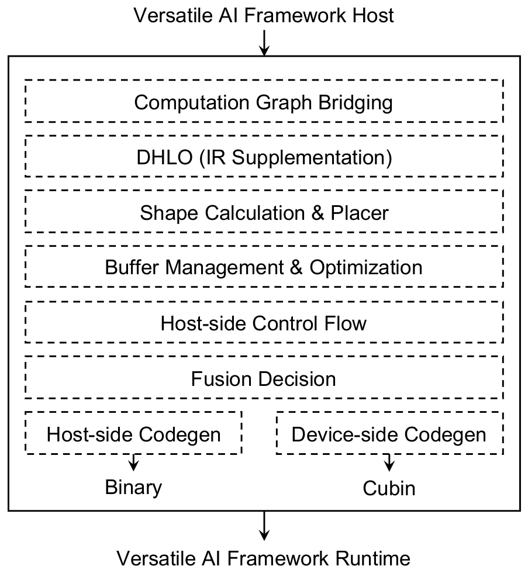
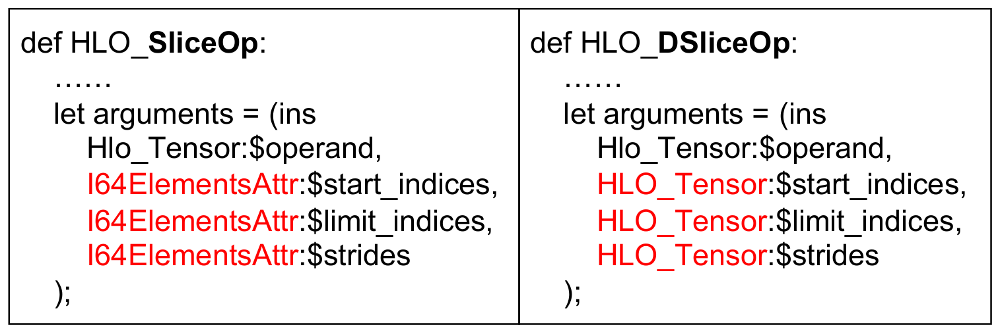
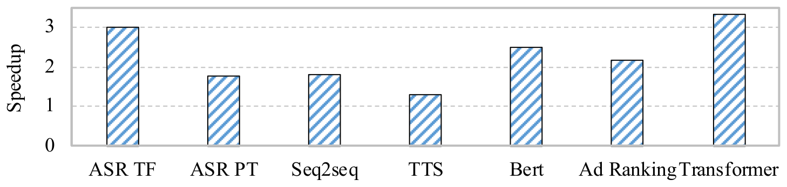
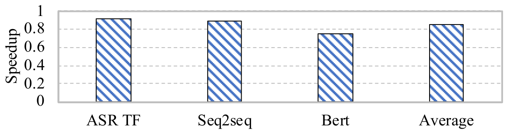

# 论文中文解读：《DISC: A Dynamic Shape Compiler for Machine Learning Workloads》

> **基本信息**：Kai Zhu、Wenyi Zhao、Zhen Zheng、Tianyou Guo、Pengzhan Zhao、Feiwen Zhu、Junjie Bai、Jun Yang、Xiaoyong Liu、Lansong Diao、Wei Lin（Alibaba Group），EuroMLSys '21（2021 年 4 月 26 日，线上会议），arXiv:2103.05288（本文依据 2021 年 11 月 23 日的 v2）；论文原文 [官方页面](https://arxiv.org/abs/2103.05288)。原文只使用 DISC 这个名字，没有出现 BladeDISC。
>
> **本文的读法**：图为从 PDF 中按图裁出的原图，表为逐格核对后的中文转录（数字与原文一致，表头翻译为中文）。每张图后有中文图题、图中文字翻译与读图结论，因此不必再翻英文版。柱状图上读出的数值写作“约”，原文正文给出的数字优先；凡是“由表中数字算出”的比值都注明是本文的计算。标明“说明性示例”的内容是为了讲清机制而编的，不是原文内容。

## 一、一句话结论

很多新模型的张量 shape 在编译期不是常量（变长序列、不同尺寸的图像、`Unique` 这类输出大小依赖数据的算子）。以 XLA 为代表的静态 shape 编译器按“带完整 shape 的融合模式”缓存生成的 kernel，每出现一个新 shape 就要重新编译，编译时间与缓存开销大到不可用，所以 XLA 在这类负载上通常是关闭的。DISC 基于 MLIR 做了一个端到端的动态 shape 编译器：（1）在 XLA 的 HLO 方言上补充出 **DHLO**，把 slice、pad、broadcast 等原本要求编译期常量的属性改成运行期的张量参数；（2）把 shape 计算、buffer 分配与释放、kernel 启动、库函数调用等**运行时流程也在编译期生成成代码**，而不是像 Nimble 那样用虚拟机（VM）在运行时解释；（3）在不知道具体 shape 的情况下，用 **shape 传播**和编译期收集的 **shape 约束**（维度相等、元素总数相等）判断哪些访存密集算子可以融合，并对 launch 维度、向量化、隐式 broadcast 等生成多版本 kernel、由 host 端按实际 shape 选择。在 NVIDIA T4（CUDA 10.0）上，DISC 相对 TensorFlow/PyTorch 平均加速 2.27 倍、最高 3.35 倍；在 Transformer 上相对 Nimble 端到端快约 1.8 倍；在静态输入上，关闭静态回退后达到静态优化性能的约 85%（74.5% 到 91.4%）。

## 二、问题与背景

### 2.1 计算密集与访存密集算子的分工

原文把 GEMM 和 Conv 称为**计算密集**算子，其余称为**访存密集**算子。计算密集算子通常通过预先构建好的库（cuDNN、cuBLAS、oneDNN）调用，而不是靠编译优化；访存密集算子（例如 Add、各类逐元素算子、reduce）单个太轻，不值得做成库，而且不同负载里它们的组合千变万化，无法预先构建融合 kernel，所以要靠 AI 编译器做 kernel fusion 与代码生成：融合可以减少片外内存访问和频繁的 kernel 启动开销。本文只关注访存密集算子的优化；GEMM、Conv 受动态 shape 影响不大，因为它们走库调用。

### 2.2 静态 shape 编译器（以 XLA 为例）怎么工作

给定计算图，XLA 先把它翻译成 HLO IR，再找出可以融合的算子并生成融合 kernel；生成的 kernel 按**融合模式**缓存，而融合模式包含算子序列和**完整的 shape 信息**。遇到一个融合模式时，XLA 先检查是否已缓存：命中就直接用二进制，否则编译这个新模式并缓存结果。

这个流程对静态 shape 很好，对动态 shape 负载效率很低。典型例子是输入输出序列长度可变的 Seq2seq 模型：计算图本身没有变，但 XLA 要为不同长度的样本重新编译融合 kernel；shape 种类多时，编译时间以及缓存占用的主机/设备内存会让静态 shape 编译方案不可用。其他典型的动态 shape 负载还有：处理不同图像尺寸的 CV 负载（如目标检测），以及含 `Unique` 算子、输出张量大小随数据变化的稀疏负载。

### 2.3 已有的绕过办法及缺陷

- **只聚类静态 shape 的算子交给 XLA**：把有动态 shape 特征的算子留着不融合地跑，丢掉了一部分优化机会；而且有些负载实际上只有动态 shape 的算子。
- **用 padding 与 slicing 把张量统一成某个固定 shape**：引入冗余计算，还可能造成负优化。
- 因为这些方法都没有从根本上解决问题，XLA 在动态 shape 负载上通常关闭，以防负优化。

### 2.4 MLIR、Nimble 与 DISC 的位置

**MLIR** 提供了可扩展、可与已有优化兼容的编译器基础设施，设计理念上天然支持动态 shape，但它给的是基础设施，不是动态 shape 问题本身的解法，MLIR 不直接提供动态 shape 的 IR 表达。**Nimble** 是基于 TVM 的、处理动态 shape 的编译框架，与 DISC 是同期工作（DISC 有更早发布的 RFC，2020 年 1 月）。Nimble 把运行时控制逻辑预先构建成一个 VM 组件，其问题是：失去了探索 host 与 device 联合优化的机会，VM 方式也带来解释开销。

DISC 的做法对应三个问题：

1. **IR 表达不完整**：不从零设计新 IR，而是在 XLA 已用的 HLO 方言上引入 DHLO，复用 XLA 与 MLIR-HLO 方言里已有的构件；
2. **高效的运行时流程**：不建 VM 在运行时解释，而是在编译期把运行时流程“即时生成”成代码；由于 device 计算与 host 侧逻辑被一起编译，也扩大了 host-device 联合优化的机会；
3. **不知道完整 shape 时生成高效融合 kernel**：用 shape 传播和收集到的 shape 约束，判断两个算子的 shape 是否兼容，从而形成更大范围的融合，进一步减少片外访存和 kernel 启动开销。

此外 DISC 通过 DHLO 这个枢纽支持多个框架（TensorFlow 与 PyTorch），并支持静态与动态优化的混合：当发现子图是静态 shape 时，会回退到静态优化以获得更好的性能。

论文的四条贡献：首次展示如何用 MLIR 基础设施高效地构建支持动态 shape 的编译器；用全动态 IR 加编译期生成的运行时流程支持动态 shape 处理；在没有完整 shape 信息的情况下，特别是借助额外的 shape 约束收集方法解决融合问题；支持多个框架及静态/动态优化混合。

**范围限定**：DISC 只处理“rank 固定、维度大小动态”的 shape；原文给出的理由是“没有发现动态 rank 是一种普遍的行为”。

## 三、总体架构

*图 1（原文 Figure 1，第 3 页）：DISC 框架总览。*

**图中文字翻译与读法**：

- 最上方 Versatile AI Framework Host（多种 AI 框架的宿主，如 TensorFlow、PyTorch）把计算图交给 DISC；最下方 Versatile AI Framework Runtime（框架运行时）接收 DISC 编译产物并执行；
- 方框内由上到下是七个虚线子模块：Computation Graph Bridging（计算图桥接）→ DHLO (IR Supplementation)（DHLO，IR 补充）→ Shape Calculation & Placer（shape 计算与放置器）→ Buffer Management & Optimization（buffer 管理与优化）→ Host-side Control Flow（host 端控制流）→ Fusion Decision（融合决策）→ 最底层并排的 Host-side Codegen（host 端代码生成，产物为 Binary，即 host 二进制）和 Device-side Codegen（device 端代码生成，产物为 Cubin，即 GPU 上的 CUDA 二进制）；
- **读图结论**：与传统只生成 device kernel 的编译器不同，DISC 同时生成 host 二进制和 device cubin，其中 host 二进制承载 shape 计算、buffer 管理与控制流。

各组件的职责（原文第 3 节）：

- **计算图桥接**：把各 AI 框架描述的计算图降低到 DISC 使用的枢纽 IR DHLO，并在这一层收集 shape 约束信息以帮助融合优化；
- **DHLO**：从 HLO 方言扩展而来、支持完全动态的 shape；
- **Shape 计算与放置器**：动态 shape 负载的基本执行流程是“在没有完整 shape 信息时编译，在运行时才得到 shape”。DISC 在编译时把 **shape 计算和数据处理分开**，并为 shape 计算逻辑生成代码；放置器把 shape 计算逻辑放在 host 侧，把张量计算 kernel 放在 device 侧。生成的 shape 推断函数在执行模型时于 host 侧运行；
- **Buffer 管理**：管理计算图里张量的 buffer 生命周期。DISC 在编译期生成 buffer 的分配、复用与释放逻辑，运行时执行这段编译好的流程。基本优化规则是：buffer 一旦没有使用者就立刻释放；并且依据“shape 兼容性”尽可能复用 buffer；
- **Host 端控制**：负责外部库的降低、kernel 启动管理、设备管理，以及编译引擎与 AI 框架宿主之间的交互；和其他运行时逻辑一样，它也是在编译期生成的，以避免已有工作的解释开销，并丰富 host-device 联合优化的机会；
- **融合决策**：依赖对算子调度兼容性的分析；DISC 依据来自 shape 传播与 shape 约束分析的“shape 提示（hints）”决定怎样融合算子；
- **Host 端与 device 端代码生成**：分别生成 host 侧二进制和 GPU 侧的 CUDA cubin；
- 最后 DISC 把编译优化后的计算图插回 AI 框架，用一小组接口 API 适配各框架运行时的实现，处理编译器与框架之间的交互。

## 四、DHLO：把编译期常量属性改成运行期张量

MLIR 灵活、易扩展，却只提供基础设施，没有专门的 IR 设计来直接支持动态 shape。作者选 HLO IR 来构建动态 shape 的 MLIR 方言，因为 HLO 已经支持许多算子描述和不同框架。但 HLO 是为静态 shape 编译优化设计的，在某些情况下缺乏表达动态 shape 的能力，于是作者给 HLO 做了一组 IR 补充，称为 DHLO。

**补充的核心思想**：把“编译期的常量折叠”替换成“运行期的张量数据流”。具体而言，需要扩展的算子是那些在 HLO 里属性被常量折叠的算子，如 slice、pad、broadcast 等；在 DHLO 里，用张量参数替换这些常量属性，以支持动态 shape 行为。

*图 2（原文 Figure 2，第 4 页）：静态 slice 算子（左）与动态 slice 算子（右）。*

**图中文字翻译与读法**：

- 左框是 HLO 的 `HLO_SliceOp`：参数为 `Hlo_Tensor:$operand`（被切的输入张量）加三个 `I64ElementsAttr`（红色）：`$start_indices`（起始索引）、`$limit_indices`（结束索引）、`$strides`（步长），即这三项是**编译期常量属性**；
- 右框是 DHLO 的 `HLO_DSliceOp`：同样的 `$operand`，但 `$start_indices`、`$limit_indices`、`$strides` 的类型都换成了 `HLO_Tensor`（红色），即**运行期才产生的张量参数**；
- 一个 slice 算子按包围盒的索引从输入张量里取出子张量。在 HLO 中这些索引是编译期常量；但动态 shape 负载下这些索引随 shape 变化，常量折叠的表达式行不通，所以把它们定义成 slice 的张量参数。这个扩展在动态 shape 场景里管用，因为张量的值是在运行时生成的；
- **读图结论**：改动只是把“属性”换成“张量操作数”，这样 shape 相关的值可以由别的算子（shape 计算子图）在运行期算出来，参与数据流。

**DHLO 只是扩展，不是替换整个 HLO**：对很多算子（如逐元素的 Add、Mul）来说，它们在 HLO 里的定义本身就足以表达动态 shape，所以保持原样。

## 五、编译期生成运行时流程

### 5.1 为什么需要“生成”运行时流程

动态 shape 编译器的一个挑战是：编译是静态行为，而目标是处理动态行为。XLA 这样的先进编译引擎要求在编译前知道全部 shape 信息：它在编译期静态地生成代码，并构建 buffer 管理与 kernel 启动序列；没有 shape 信息就行不通。动态 shape 编译器需要生成能适应运行时遇到的任何 shape 的代码。Nimble 设计了一个 VM 来解释动态 shape 计算图的运行流程，解释张量 shape 并自适应地组织运行时逻辑。DISC 则不用解释器，而是对 host 和 device 两侧的计算以及运行时流程（buffer 管理、kernel 启动等）**都编译并生成代码**；这样的编译式运行时流程减少了 Nimble 中 VM 解释的开销。

### 5.2 自适应 shape 推断（两个阶段）

DISC 里的 shape 推断分两个阶段：

1. **编译期**：在不知道具体 shape 值的情况下，识别 shape 约束；这服务于代码生成优化；
2. **运行期**：生成运行时代码，根据输入张量算出具体的 shape 值；这服务于正确执行。

**shape 约束（shape constraints）**。编译时没有具体 shape 值会丢掉一些优化机会，这是当前动态 shape 编译技术的普遍问题。DISC 指出，仍然可以获得一些额外的 shape 约束信息来帮助生成高效 kernel。它探索两类约束：

- **维度大小相等约束（dimension size equality）**：一个张量的某一维大小是否等于同一张量的另一维，或另一个张量的任意一维；
- **张量大小相等约束（tensor size equality）**：两个张量的元素总数是否相同。

这些约束在 IR 优化与代码生成两个阶段都有用：IR 优化阶段，当知道两个算子处理的张量 shape 相同或兼容时，可以决定把它们融合；代码生成阶段，这些约束能让**索引计算化简得更激进**。

**约束从哪里来**（两个来源）：

1. **DHLO 算子语义本身蕴含的约束**。例如 TransposeOp 的输入和输出张量大小应相同；按算子定义，AddOp 的输入和输出张量 shape 应相同。
2. **框架高层算子蕴含的约束，在计算图桥接时注入 DHLO**。例如 TensorFlow 的 `SplitOp` 沿某一维把张量均分，意味着它的所有输出 shape 相同；一个 `TF.SplitOp` 会被降低成多个相互独立的 `DHLO.SliceOp`，这些 slice 实际上 shape 相同，但降到 DHLO 之后，如果没有显式的 shape 约束，这个信息就丢了。

**说明性示例（非原文）**：设 `x` 的 shape 为 [B, S, H]，其中 B、S 是编译期未知的符号维度。`y = Relu(x + bias)` 中 Add 的两个操作数与输出的各维大小都相等（维度大小相等约束，来自算子语义），Relu 是逐元素算子；`z = Transpose(y)` 得到 [B, H, S]，输入输出元素总数相同（张量大小相等约束，来自算子语义），尽管逐维大小不同。于是编译器无需知道 B、S 的具体取值，就能判断这几个算子遍历的元素个数相同，可以放进同一个循环里融合，并简化索引计算。

### 5.3 shape 计算与放置

与只需为“shape 已被常量折叠的计算本身”生成代码的静态 shape 编译器不同，DISC 把 **shape 推断子图**与 **kernel 计算子图**分开生成代码。shape 计算很轻量，DISC 把它放在 host 侧（CPU），而操作张量的子图放在 device 侧（GPU）。这个放置逻辑与 Nimble 类似；区别在于 DISC 用编译方式把计算、shape 推断和放置逻辑一起生成代码，而不是用预先构建的 VM 解释器做运行时控制，从而避免额外的解释开销，也带来了 host 与 device 之间联合优化的机会。

### 5.4 动态 buffer 管理

因为已经生成了在运行时计算每个 buffer 的 shape 的代码，DISC 可以通过发射 `alloc` 与 `dealloc` 指令来动态管理 buffer。为了减少 buffer 分配的开销，作者用了两种方法：（1）基于 IR 里的 shape 约束，做 buffer 活跃性（liveness）分析与优化；（2）把 `alloc`、`dealloc` 降低成带缓存的分配器，在本文里就是 TensorFlow/PyTorch 提供的分配器。第 3 节还提到按“shape 兼容性”尽可能复用 buffer；原文没有展开“兼容”的精确定义，按上下文，可以理解为 shape 约束能证明两个 buffer 大小一致时才复用（这是本文的推断）。

### 5.5 host 端控制

host 端代码在统一的编译流程中生成，使后续 pass 可以做联合优化。除了 shape 计算，host 端代码还包括：launch 维度的计算、kernel 启动、厂商库调用，以及设备管理指令（初始化、同步、cubin 加载等）。

**把这几部分串起来看（综合，非原文逐字）**：对一次输入，host 端的生成代码依次做：根据输入张量算出各中间张量的 shape；据此算出每个 buffer 的大小并分配（从框架的缓存分配器里取），在最后一个使用者之后释放；算出每个 kernel 的 launch 维度；按实际 shape 选择 kernel 的某个版本或库调用（见第七节）；启动 kernel。这些步骤在编译期被生成成 host 代码，运行时不需要 VM 逐条解释。

## 六、多框架支持与静/动态混合

DISC 能为 TensorFlow、PyTorch 等多个 AI 框架服务，同时可以降低到静态或动态 shape 编译器。DHLO 是把各部分连起来的枢纽 IR，这一中间层简化了适配。DISC 并不把所有计算图都降低到动态 shape 编译器：当编译期 shape 已知，或 shape 的种类数可以接受时，它把计算图降低到**静态 shape 编译器**，因为静态 shape 编译引擎利用更丰富的信息通常能取得比动态 shape 编译器更好的性能。

## 七、融合与代码生成

### 7.1 动态 shape 下融合为什么难

访存密集算子的 kernel 融合是当前 AI 编译器的主要优化之一。常见的融合策略是：允许**元素个数相同**的访存密集算子融合到一起。但在动态 shape 场景下，编译期并不知道要处理的张量 shape，判断哪些算子融合之后能带来性能收益不是一件简单的事。

### 7.2 shape 提示的收集

DISC 用两类提示判断两个算子是否 shape 相同：

1. **shape 传播**：例如 Add 的操作数必须与 Add 的消费者的张量 shape 相同。DISC 维护一张表，记录每种算子的传播性质；有些算子具有相同的 shape 传播性质（如 Add 和 Sub），按传播性质对算子分类，以避免重复枚举；
2. **DISC 收集的 shape 约束**（见 5.2 节）。

### 7.3 适应 shape 的融合配置

对访存密集融合模式的代码生成，DISC 倾向于选择对各种 shape 都比较友好的模板，如经典的 **loop fusion（循环融合）**，以及以 reduce 算子为根的 **input fusion（输入融合）**。但在一些方面，针对不同的运行时 shape 做出不同反应仍然能得到更好的性能，例如：

- 选择 launch 维度（grid/block）；
- 是否做循环的向量化 load/store；
- 是否需要隐式 broadcast。

对这些方面，DISC 生成**多个版本的 kernel**，并从 host 端生成选择逻辑，运行时对每个到来的 shape 启动合适的 kernel。

术语小注（通用常识，不是原文逐字内容）：loop fusion 指把若干逐元素算子融合进同一个按输出元素遍历的循环（GPU 上对应一个 kernel），中间结果留在寄存器里不写回显存；以 reduce 为根的 input fusion 指把 reduce 输入一侧的逐元素算子融合进 reduce 所在的 kernel，省掉中间张量的读写。这两种模板的循环结构只依赖张量的秩和各算子之间的元素对应关系，而不依赖具体的维度取值，所以对各种 shape 都适用；而 launch 维度（要启动多少个 block、每个 block 多少线程）则必须由运行期的元素个数算出，这正是 host 端生成的“launch 维度计算”要做的事。（为什么这些方面依赖 shape：例如向量化 load/store 需要内层维度满足对齐/整除条件，这是本文的常识性解释，原文没有展开。）

### 7.4 对静态 shape 库的支持（计算密集算子）

对计算密集算子，不同 shape 可能需要不同的优化才能达到最佳性能。Nimble 的选择是在一组固定的 shape 下调优 kernel：kernel 保证能在其他 shape 上工作，但性能未必最佳。为了平衡动态性与性能，DISC 实现了一个接口，在运行时根据不同的 shape 从一个**库**里选择最佳 kernel；库中既有厂商库（cuBLAS、cuDNN），也有针对各个 shape 手工调优并预先生成的 kernel。

## 八、实验

### 8.1 设置

作者用多种特征不同的 ML 应用评估 DISC。工作负载用不同框架在 GPU 上实现（见表 1），DISC 也适用于 GPU 之外的设备。对比对象是 TensorFlow/PyTorch 以及 Nimble；**不和 XLA 比**，因为 XLA 在这些动态 shape 负载上带来严重的编译开销并导致性能下降。数据在 NVIDIA T4 GPU、CUDA toolkit 10.0 上采集。

**表 1：评估所用工作负载**

| 模型 | 框架 | batch size |
|---|---|---|
| ASR | TensorFlow | 1 |
| ASR | PyTorch | 1 |
| Seq2seq | PyTorch | 64 |
| TTS | TensorFlow | 1 |
| BERT | PyTorch | 1 |
| Ad Ranking（广告排序） | TensorFlow | 512 |
| Transformer | TensorFlow | 1 |

（原文表 1，第 5 页；原表中 ASR 一格合并了 TensorFlow 与 PyTorch 两行。）读法：共 7 个“模型-框架”组合，覆盖语音识别、序列到序列、语音合成、BERT、广告排序和 Transformer。原文没有给出各负载的输入 shape 分布（例如序列长度范围）、TensorFlow/PyTorch 的版本以及重复测量的次数。

### 8.2 相对 TensorFlow/PyTorch（图 3）

*图 3（原文 Figure 3，第 6 页）：DISC 相对 TensorFlow/PyTorch 的加速比。*

**图中文字翻译与读法**：

- 横轴是七个工作负载：ASR TF（TensorFlow 版 ASR）、ASR PT（PyTorch 版 ASR）、Seq2seq、TTS、Bert、Ad Ranking（广告排序）、Transformer；纵轴 Speedup（加速比，越大越好，1 表示与原框架持平），范围 0 到 3 以上；
- 读图近似值：ASR TF 约 3.0、ASR PT 约 1.8、Seq2seq 约 1.8、TTS 约 1.3、Bert 约 2.5、Ad Ranking 约 2.2、Transformer 约 3.3；这七个值的算术平均约 2.27，与原文的“平均 2.27 倍”吻合（原文正文说“6 个流行模型”，图里共 7 个条形，ASR 分别算 TF 和 PT 两个）；
- 原文文字：最高 3.35 倍（对应 Transformer），平均 2.27 倍；收益主要来自访存密集算子的 kernel 融合，它减少了片外内存访问和 kernel 启动开销；
- **读图结论**：所有七个负载上 DISC 都有加速，没有出现负优化；加速幅度从约 1.3 倍到约 3.3 倍，与负载中访存密集算子的占比和可融合程度有关。

作者用几个案例分析收益来源：

- **Transformer**：计算密集算子在 TensorFlow 与 DISC 版本里耗时相近，而访存密集算子在 DISC 下好得多：DISC 版本花 21.52 ms，原始 TensorFlow 花 66.06（原文未写单位，上下文为 ms）。收益一部分来自 kernel 融合减少的片外内存访问，另一部分来自 kernel 调用次数减少：TensorFlow 的访存密集算子共 42884 次 kernel 调用，DISC 只有 6186 次。
- **BERT**：加速同样主要来自访存密集算子的融合优化：访存密集算子的执行时间从 PyTorch 的 5.96 ms 降到 DISC 的 3.33 ms，kernel 调用从 198 次降到 97 次。另外，作者在 onnx-tensorrt 工作流的 TensorRT 实现上比较 BERT，DISC 取得 **1.3 倍**的端到端加速；访存密集算子耗时从 TensorRT 的 4.99 ms 降到 DISC 的 3.33 ms。
- 作者还收集了其他负载的分解数据，观察到与 Transformer、BERT 相似的行为：这些负载主要都受益于访存密集算子的 kernel 融合优化。

### 8.3 与 Nimble 的比较（表 2、表 3）

作者在 Transformer（现代 ML 模型中最重要的结构之一）上比较 Nimble。**重要说明**：在 Nimble 的实现里，计算密集算子使用的是 cuDNN/cuBLAS 库调用，而不是 kernel 调优，因为作者没有找到 Nimble 报告中所描述的计算密集算子 schedule 的开源代码。所以这不是对 Nimble 官方完整实现的同配置对比。

**表 2：Transformer 的性能分解**（原文表中未标单位，按正文上下文为毫秒）

| 后端 | 计算密集（Comp. bound） | 访存密集（Mem. bound） | CPU | 端到端（E2E） |
|---|---|---|---|---|
| Nimble | 66.58 | 56.09 | 65.83 | 188.5 |
| DISC | 59.68 | 21.52 | 24.08 | 105.28 |

（原文表 2，第 6 页。）读法：按表中数字，每行的 E2E 恰好等于前三项之和（Nimble：66.58 + 56.09 + 65.83 = 188.50；DISC：59.68 + 21.52 + 24.08 = 105.28）。本文的计算：端到端 188.5 / 105.28 ≈ 1.79 倍，与摘要的“比 Nimble 快 1.8 倍”一致。

**表 3：Transformer 的 kernel 数量分解**

| 后端 | 计算密集（Comp. bound） | 访存密集（Mem. bound） | 总计（Total） |
|---|---|---|---|
| Nimble | 5232 | 8632 | 13924 |
| DISC | 4476 | 6186 | 10734 |

（原文表 3，第 6 页。）读法：访存密集的 kernel 数从 8632 降到 6186（本文计算约降 28%），总数从 13924 降到 10734（约降 23%）。需要注意：表里每行“计算密集 + 访存密集”并不等于“总计”（Nimble：5232 + 8632 = 13864，比 13924 少 60；DISC：4476 + 6186 = 10662，比 10734 少 72），原文没有解释这个差额，可能是未归入这两类的其他 kernel。

原文对两张表的解读：

- DISC 仅在访存密集算子上就取得 **2.61 倍**加速（本文计算 56.09 / 21.52 ≈ 2.61），这是总体加速的主要原因之一。优势在于它同时从 shape 传播和 shape 约束收集 shape 提示来帮助做高效融合，适应 shape 的融合配置策略也对总体性能有贡献。
- 另一优势是**低开销的运行时流程**：DISC 的 CPU 时间只有 Nimble 的 **36.6%**（本文计算 24.08 / 65.83 ≈ 0.366）。CPU 时间降低的一小部分来自 kernel 启动次数的减少（表 3 里总 kernel 数略有减少），而主要原因是 DISC 生成的运行时流程在 host 与 device 控制流的联合优化下运行得更高效。
- 计算密集部分 DISC 为 59.68，Nimble 为 66.58（本文计算约 1.12 倍）；两者都用库调用，差距不是本文的主要卖点。

### 8.4 与静态优化的差距（图 4）

DISC 可以自动回退到静态编译器以获得更好的性能。为了评估动态编译器相对静态编译器的性能，作者**关闭回退功能**，在 3 个典型负载上用静态输入比较静态和动态编译器。

*图 4（原文 Figure 4，第 6 页）：与静态优化的性能差距。*

**图中文字翻译与读法**：

- 横轴是三个负载 ASR TF、Seq2seq、Bert 和它们的 Average（平均）；纵轴标为 Speedup，按原文语境应理解为“动态编译器性能相对静态优化性能的比值”（1 表示与静态优化持平，越高越好）；
- 读图近似值：ASR TF 约 0.91（原文给出范围上限 91.4%）、Seq2seq 约 0.89、Bert 约 0.75（原文给出范围下限 74.5%）、平均约 0.85；
- 原文文字：DISC 平均达到静态优化性能的 **85%**，范围 74.5% 到 91.4%；
- 差距的一个原因：没有 shape 信息就缺少一些融合优化机会（如更激进的图优化、融合决策、代码生成策略等），尽管 DISC 已经收集了 shape 提示；
- **读图结论**：动态 shape 的通用性有代价，约有 10% 到 25% 的性能损失；这也是 DISC 在 shape 已知时回退静态编译器的原因。

## 九、相关工作与关系

- **XLA**：用一组规则即时融合逐元素与 reduce 等算子；静态 shape，在动态 shape 上编译开销严重；
- **FusionStitching**（[中文解读](../fusion_stitching/论文中文解读.md)）：通过算子之间中间值复用，扩大 JIT 融合能处理的范围；也是为静态 shape 场景服务；
- **面向大的计算密集算子的工作**（原文引用 Tiramisu、TVM、Tensor Comprehensions、Ansor）：也有融合小 kernel 的能力，但同样面向静态 shape 场景，在动态 shape 负载上编译开销更严重；
- **惰性编译（lazy compilation）**：在未知 shape 有限时可以降低编译开销，但丢掉了一部分 kernel 融合机会，shape 太多时不可行；
- **Nimble**（[中文解读](../nimble_dynamic_nn/论文中文解读.md)）：基于 TVM 的动态 shape 编译系统，用 VM 在运行时解释动态 shape 处理流程。DISC 在编译期生成运行时流程，避免解释开销并暴露更多 host-device 联合优化机会；DISC 也更关注访存密集融合；
- **IREE**：基于 MLIR 的开源端到端编译器，把 ML 模型降低成统一 IR，面向移动/边缘端的实时推理，提供灵活的部署方案，但原文称它当时仍处于早期。

## 十、局限、证据边界与常见误读

### 10.1 局限与证据边界

- **只支持 static rank、动态维度大小**：原文的理由只是“不认为动态 rank 是普遍行为”；
- 计算密集算子仍依赖库或按 shape 预先生成的 kernel（第 7.4 节），不是靠动态 shape 编译解决；
- 评估只在 NVIDIA T4、CUDA 10.0 上，不与 XLA 比较（因为 XLA 在这些负载上有严重编译开销）；
- 与 Nimble 的比较只在 Transformer 一个模型上，且 Nimble 的计算密集部分被替换为 cuDNN/cuBLAS 库调用；
- 原文没有给出各负载的输入 shape 分布、框架版本与测量次数/方差，因此无法判断 2.27 倍对 shape 分布的敏感度；
- 表 3 的“总计”不等于两类之和，原文没有解释。

### 10.2 常见误读

- **“动态 shape 等于任意 rank”**：不是，本文明确只做 static rank；
- **“DISC 解决的是动态 Python 控制流”**：不是。DISC 的输入是已经得到的计算图（由 TensorFlow/PyTorch 桥接而来），要解决的是“张量维度大小在编译期不全已知”的问题；
- **“不重编译就等于不专门化”**：DISC 不为每个完整 shape 重新编译整张图，但对 launch 维度、向量化、隐式 broadcast 等仍生成多版本 kernel 并在运行时选择；计算密集部分也从库里按 shape 选最佳 kernel；
- **“2.27 倍都来自 shape 推理”**：直接的收益来自访存密集算子的融合、减少内存访问与 kernel 启动次数；shape 传播和约束是让这些融合在动态条件下仍然安全可行的前提；
- **“DISC 与静态编译一样快”**：静态输入下关闭回退，DISC 只达到静态优化的约 85%，所以才有“能静态就回退”的设计。

## 十一、复现检查清单

- 硬件与软件：NVIDIA T4、CUDA toolkit 10.0；TensorFlow/PyTorch 的具体版本原文没给；
- 工作负载与 batch size 按表 1；各负载使用的输入 shape 分布需要自己约定并记录；
- 区分计时口径：端到端、计算密集、访存密集、CPU 时间（表 2 的口径）；kernel 数量按计算密集/访存密集两类统计，注意总数里可能有第三类；
- 对比 Nimble 时记录其计算密集算子的实现方式（本文是 cuDNN/cuBLAS 库调用），不要当作官方 schedule 的对比；
- 对比静态优化时需要关闭 DISC 的静态回退功能（图 4 的做法）；
- 对比 XLA 时需要计入每个新 shape 的编译时间与缓存占用，否则不能反映动态 shape 问题。

## 十二、与相关论文的关系

- **FusionStitching**（[中文解读](../fusion_stitching/论文中文解读.md)）：作者高度重叠的、更早发表的访存密集融合工作，面向静态 shape；DISC 的 shape 约束与多版本 kernel，可以理解为把这类融合推广到动态 shape（这是本文的归纳）；
- **Nimble**（[中文解读](../nimble_dynamic_nn/论文中文解读.md)）：同期的动态神经网络编译系统，两者的核心差别在“运行时流程是 VM 解释还是编译生成”；
- **XLA**（[中文解读](../xla_compiler/论文中文解读.md)）：DISC 复用 HLO 方言并通过 MLIR 的 dialect 转换复用 XLA 现有的优化组件；
- **TVM**（[中文解读](../tvm_compiler/论文中文解读.md)）：Nimble 所基于的编译栈。

## 原文证据导航

- [原论文 PDF](paper.pdf)
- [原文提取文本](paper.txt)
- [论文概要](论文概要.md)
