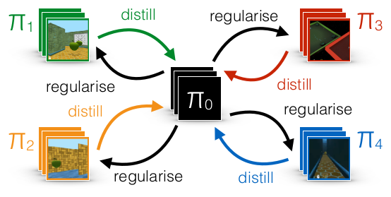
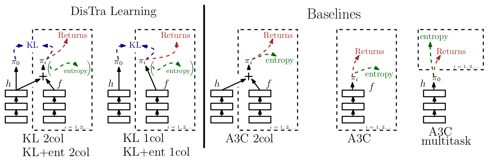
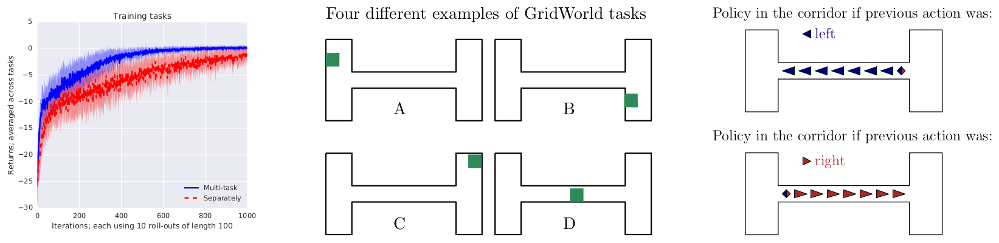
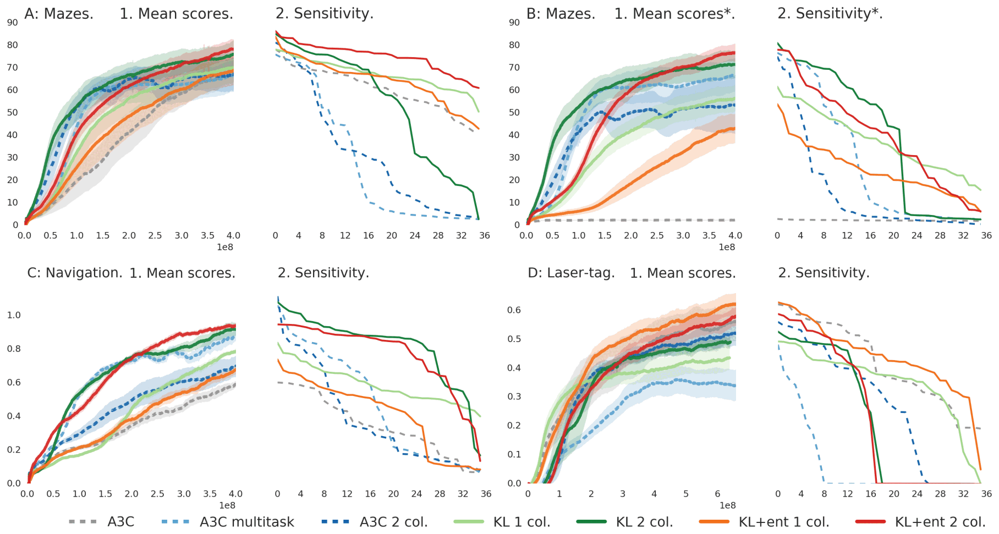
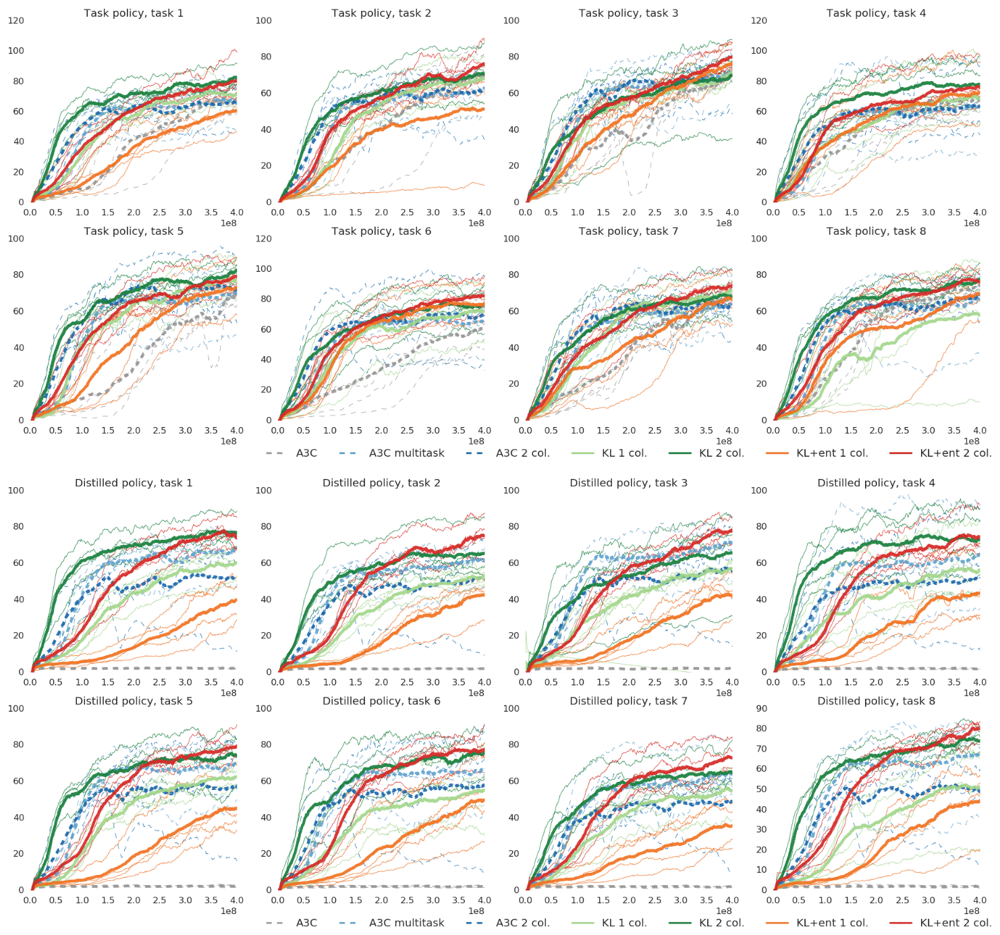
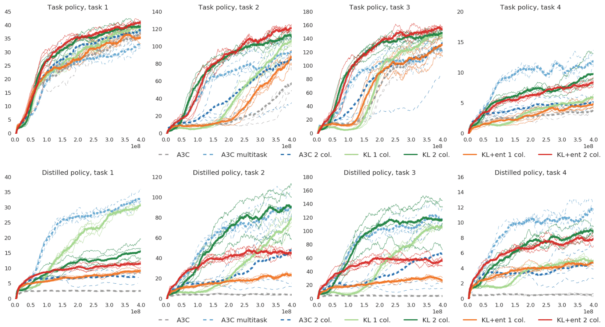
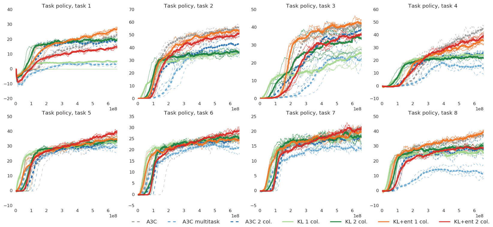

# 论文中文解读：《Distral: Robust Multitask Reinforcement Learning》

> **基本信息**：Yee Whye Teh、Victor Bapst、Wojciech Marian Czarnecki、John Quan、James Kirkpatrick、Raia Hadsell、Nicolas Heess、Razvan Pascanu（DeepMind，伦敦），arXiv:1707.04175（本地 PDF 为 2017 年 7 月 13 日的 v1），发表于 NIPS 2017；论文原文 [官方页面](https://arxiv.org/abs/1707.04175)。
>
> **本文的读法**：图均为从 PDF 中裁出的原图（正文图 1–4，附录图 5–7，共 7 张），表为逐格核对后的中文转录（原文共 2 张表，另有一张整理自附录 B 的超参数汇总表，已注明）。每张图后有中文图题、图例/坐标轴翻译和读图结论；凡从图上读出的数值都写“约”，并以正文给出的数字为准。公式编号沿用原文（式 1–12），方便对照原文。

## 一、一句话结论

多任务深度强化学习里，让各任务共享网络参数常常不是互相帮助，而是梯度互相干扰，或者奖励大的任务把共享模型“拖”向自己。Distral（Distill & transfer learning）改为**不共享参数，而共享一个“蒸馏出来的策略” $\pi_0$**：每个任务策略 $\pi_i$ 在最大化自己回报的同时，用 KL 散度被约束在 $\pi_0$ 附近；而 $\pi_0$ 通过蒸馏成为所有任务策略的“质心”（centroid）。这两半来自同一个联合目标（回报 + KL 正则 + 熵正则），互相喂养：任务把可复用的行为蒸馏进 $\pi_0$，$\pi_0$ 再作为 shaping 先验反过来指导所有任务的探索。

实验结论分三档：在 DeepMind Lab 的 Mazes（8 个任务）上，Distral 比三种 A3C 基线学得更快、终局更高；在 Navigation（4 个任务）上终局更高；两组任务上它都对超参数和随机种子更稳。在任务差异很大的 Laser-tag（8 个任务）上，Distral 没有显著超过“每个任务独立训练的 A3C”，但明显好于普通 multitask A3C。

## 二、背景与动机

### 2.1 多任务 RL 为什么常常不如单任务

深度强化学习（Deep RL）用深度网络做函数逼近，使 RL 能处理复杂、视觉丰富的环境。DQN 在许多 Atari 游戏上超过人类水平，但需要大量时间和数据，训练过程本身也相当不稳定；已有改进沿着三条路线展开：改学习算法（如 prioritized replay、double Q-learning），改优化器（如 TRPO、A3C），以及联合训练辅助任务（auxiliary tasks）。随着任务越来越复杂，研究重心转向“一个智能体要同时或依次解决多个相关问题”。由于计算代价极高，这一方向需要**不依赖任务特定设计、也不需要大量调超参的稳健算法**。

直觉上，相关任务有共同结构，彼此应能降低数据需求或提高渐近性能（multitask / transfer learning 的长期动机）。但在 RL 里实际常常相反：多任务训练会损害单个任务的表现，需要额外技巧才能抵消。论文给出的解释有两条：

- 其他任务的梯度对当前任务像噪声一样干扰学习（negative interference）；
- 某个任务可能压倒（dominate）其他任务，奖励尺度不同尤其容易引起这种情况。

此外，解读者补充两种常见现象（并非论文原话）：简单任务先收敛，把共享表示拉向自己的局部最优；多任务的平均得分可能掩盖个别任务完全学不会。

### 2.2 先备知识

- **A3C 与熵正则**：A3C（Asynchronous Advantage Actor-Critic）让许多 worker 并行与环境交互，用优势函数做 policy gradient。目标里加入熵奖励 $-\log\pi(a\mid s)$，防止策略过早变成确定性的 greedy 策略。本文所有实验都建立在 A3C 上。
- **KL 散度与蒸馏**：$D_{\mathrm{KL}}(p\Vert q)=\sum_a p(a)\log\frac{p(a)}{q(a)}$ 衡量用 $q$ 近似 $p$ 的代价。蒸馏（distillation）指训练 student 的输出分布去拟合 teacher 的输出分布，源于 Bucila 等人的 model compression 与 Hinton 等人的 knowledge distillation（见 [knowledge_distillation](../knowledge_distillation/论文中文解读.md)）。
- **软 Q 学习（soft Q-learning，也叫 G learning）**：把 Bellman 备份里的 $\max$ 换成逆温度 $\beta$ 的 soft-max，其最优策略是 Boltzmann 策略，对应“带熵正则的 RL”。$\beta\to\infty$ 时退化为普通的 max。

### 2.3 论文的定位：从 Policy Distillation 到 Distral

Policy Distillation（[policy_distillation](../policy_distillation/论文中文解读.md)）和 Actor-Mimic 已证明可以把多个训练完成的 DQN 策略合并到一个网络，但知识只**单向**从 teacher 流向 student。Distral 的两点不同：

1. 蒸馏这一步不是人为添加的，而是从“KL 正则的联合目标”里自然推出来的；
2. 蒸馏出的策略会被“**喂回**”任务策略的下一轮优化，成为跨任务共享、可迁移知识的通道，所以迁移发生在训练过程中（尤其是探索阶段），而不是训练完再压缩。

## 三、方法

### 3.1 总体结构（图 1）



*图 1（原文 Figure 1，第 2 页）：以 4 个任务为例的 Distral 框架：中心是蒸馏策略 $\pi_0$，四周是各任务的策略 $\pi_1,\dots,\pi_4$。*

**图中文字翻译与读法**：

- **中心黑色方块 $\pi_0$**：共享的蒸馏策略（distilled policy）；四周带缩略图的彩色方块 $\pi_1$–$\pi_4$ 是各任务自己的策略，缩略图是 DeepMind Lab 里不同任务的第一视角画面（迷宫、走廊等）。
- **彩色箭头 distill（蒸馏）**：从每个任务策略指向中心，表示把任务策略里的行为蒸馏进 $\pi_0$。
- **黑色箭头 regularise（正则化）**：从中心指向每个任务策略，表示 $\pi_0$ 通过 KL 散度正则项约束、引导任务策略。
- **读图结论**：这是一个以 $\pi_0$ 为中心的星形、双向结构。信息循环是“任务 $i$ 的成功行为 → 蒸馏进 $\pi_0$ → 作为 shaping 奖励影响其他任务的探索与学习”。论文说这种效应类似 shaping reward，可以克服随机游走式探索的瓶颈。

```text
任务 i 的轨迹 ──蒸馏──▶ 共享策略 π0
共享策略 π0 ──KL 正则──▶ 所有任务的探索与学习
```

各任务策略仍可以有各自独立的参数，不必在参数空间里被迫一致；它们只需要在实际访问到的状态上，动作分布与 $\pi_0$ 相近。这样共享的对象是**行为**（动作分布），而不是“第几层权重应该相似”。

### 3.2 数学设定与联合目标（式 1）

设定：

- 共有 $n$ 个任务，为简单起见假设无限期、折扣因子为 $\gamma$（论文脚注：可推广到无折扣的有限期情形）；
- 所有任务共享同一个动作空间 $A$ 和状态空间 $S$，动作记作 $a\in A$，状态记作 $s\in S$；
- 转移动态 $p_i(s'\mid s,a)$ 和奖励函数 $R_i(a,s)$ 因任务而异；
- $\pi_i$ 是任务 $i$ 的随机策略（动态与策略诱导出状态-动作轨迹的分布，论文也用 $\pi_i$ 表示它）；
- $\pi_0$ 是蒸馏策略，被期望捕获各任务共有的行为。

联合目标把“期望回报”与“策略正则”相加，其中 KL 正则是 $\gamma$ 折扣的 $\mathbb{E}_{\pi_i}\big[\sum_{t\ge0}\gamma^t\log\frac{\pi_i(a_t\mid s_t)}{\pi_0(a_t\mid s_t)}\big]$，另外再加折扣熵正则以鼓励探索（**式 1**，两行是同一个量）：

$$
\begin{aligned}
J(\pi_0,\{\pi_i\}_{i=1}^n)
&=\sum_i\mathbb{E}_{\pi_i}\Big[\sum_{t\ge0}\gamma^t R_i(a_t,s_t)-c_{\mathrm{KL}}\gamma^t\log\frac{\pi_i(a_t\mid s_t)}{\pi_0(a_t\mid s_t)}-c_{\mathrm{Ent}}\gamma^t\log\pi_i(a_t\mid s_t)\Big]\\
&=\sum_i\mathbb{E}_{\pi_i}\Big[\sum_{t\ge0}\gamma^t R_i(a_t,s_t)+\frac{\gamma^t\alpha}{\beta}\log\pi_0(a_t\mid s_t)-\frac{\gamma^t}{\beta}\log\pi_i(a_t\mid s_t)\Big].
\end{aligned}
$$

其中 $c_{\mathrm{KL}},c_{\mathrm{Ent}}\ge0$ 是 KL 正则和熵正则的强度，并定义

$$
\alpha=\frac{c_{\mathrm{KL}}}{c_{\mathrm{KL}}+c_{\mathrm{Ent}}},\qquad \beta=\frac{1}{c_{\mathrm{KL}}+c_{\mathrm{Ent}}}.
$$

反过来 $c_{\mathrm{KL}}=\alpha/\beta$，$c_{\mathrm{Ent}}=(1-\alpha)/\beta$（由定义直接解出，原文未单独写出）。代回去就能验证式 1 的两行相等：$-\frac{\alpha}{\beta}\log\frac{\pi_i}{\pi_0}-\frac{1-\alpha}{\beta}\log\pi_i=\frac{\alpha}{\beta}\log\pi_0-\frac{1}{\beta}\log\pi_i$。

三项的含义：

1. **任务自身回报** $R_i$；
2. **KL 正则** $-c_{\mathrm{KL}}\log\frac{\pi_i}{\pi_0}$：鼓励任务策略沿用跨任务共同行为。第二行里它表现为 $\frac{\alpha}{\beta}\log\pi_0(a_t\mid s_t)$，可看作**奖励 shaping**：在 $\pi_0$ 下概率高的动作得到额外奖励；
3. **熵正则**：式 1 第二行里的 $-\frac{1}{\beta}\log\pi_i$ 是 KL 项里的 $-c_{\mathrm{KL}}\log\pi_i$ 与单独的熵项 $-c_{\mathrm{Ent}}\log\pi_i$ 合并后的结果，它鼓励探索。

论文还说明：可以给不同任务设置不同的 $c_{\mathrm{KL}},c_{\mathrm{Ent}}$（任务的奖励尺度与所需探索量差别很大时可能很重要），但会引入昂贵的额外超参数；实验里所有任务使用同一组。

**符号速查**

| 符号 | 含义 |
|---|---|
| $n$、$\gamma$ | 任务个数、折扣因子 |
| $p_i(s'\mid s,a)$、$R_i(a,s)$ | 任务 $i$ 的转移与奖励 |
| $\pi_i$、$\pi_0$ | 任务 $i$ 的策略、蒸馏（共享）策略 |
| $c_{\mathrm{KL}}$、$c_{\mathrm{Ent}}$ | KL 正则、熵正则强度 |
| $\alpha$、$\beta$ | $\alpha=c_{\mathrm{KL}}/(c_{\mathrm{KL}}+c_{\mathrm{Ent}})$，$\beta=1/(c_{\mathrm{KL}}+c_{\mathrm{Ent}})$（逆温度） |
| $V_i$、$Q_i$、$A_i$ | 任务 $i$ 的软状态值、软动作值、软优势 |
| $h_{\theta_0}$、$f_{\theta_i}$ | 蒸馏策略网络的 logits、任务 $i$ 网络的 logits（两列结构里的“共享列”与“任务列”） |

### 3.3 固定 $\pi_0$：每个任务是一个带熵正则的 RL（式 2–4）

为建立直觉，论文先看表格型（tabular）情形，并用**交替最大化**：固定 $\pi_0$ 优化各 $\pi_i$，再固定各 $\pi_i$ 优化 $\pi_0$。

当 $\pi_0$ 固定时，式 1 对每个任务分解成独立问题：它是一个带熵正则的期望回报，只是奖励被改写为

$$
R_i'(a,s):=R_i(a,s)+\frac{\alpha}{\beta}\log\pi_0(a\mid s).
$$

可以用软 Q 学习求解，它基于“软化”的 Bellman 更新（推导见论文引用的文献）：

$$
V_i(s_t)=\frac{1}{\beta}\log\sum_{a_t}\pi_0^{\alpha}(a_t\mid s_t)\exp\big[\beta Q_i(a_t,s_t)\big]\qquad(\text{式 2})
$$

$$
Q_i(a_t,s_t)=R_i(a_t,s_t)+\gamma\sum_{s_{t+1}}p_i(s_{t+1}\mid s_t,a_t)V_i(s_{t+1})\qquad(\text{式 3})
$$

“软化”的意思是：通常的状态值取动作上的 $\max$，这里换成逆温度 $\beta$ 的 soft-max，$\beta\to\infty$ 时变回 $\max$。最优策略是逆温度 $\beta$ 的 Boltzmann 策略：

$$
\pi_i(a_t\mid s_t)=\pi_0^{\alpha}(a_t\mid s_t)\,e^{\beta Q_i(a_t,s_t)-\beta V_i(s_t)}=\pi_0^{\alpha}(a_t\mid s_t)\,e^{\beta A_i(a_t,s_t)}\qquad(\text{式 4})
$$

其中 $A_i(a,s)=Q_i(a,s)-V_i(s)$ 是软优势函数，软状态值 $V_i(s)$ 起到归一化常数（对数配分函数）的作用。读法：

- $\pi_0$ 在这里是**策略先验**（policy prior），这与“RL 即概率推断”的文献一致；
- 与以往工作不同的是，先验被取了 $\alpha\le1$ 次幂，这会**削弱先验对 $\pi_i$ 的影响**，原因是 KL 之外还有额外的熵正则；
- 也与以往工作不同：$\pi_0$ 不是手工选定的（通常是动作上的均匀分布），而是**学出来的**。

### 3.4 固定 $\pi_i$：蒸馏（式 5）

式 1 中只依赖 $\pi_0$ 的项是

$$
\frac{\alpha}{\beta}\sum_i\mathbb{E}_{\pi_i}\Big[\sum_{t\ge0}\gamma^t\log\pi_0(a_t\mid s_t)\Big]\qquad(\text{式 5})
$$

这恰好是用 $\pi_0$ 去拟合“各任务在各自策略下的 $\gamma$ 折扣状态-动作分布的混合”的**对数似然**。表格型情形下，最大似然解可由各任务轨迹的状态-动作访问频率给出，结果是按访问频率加权的“状态条件动作分布的混合”（推导：设 $\rho_i(s)$ 为任务 $i$ 的折扣状态访问量，则 $\pi_0(a\mid s)\propto\sum_i\rho_i(s)\pi_i(a\mid s)$）；非表格型情形下用随机梯度上升，得到的更新正是把各任务策略 $\pi_i$ **蒸馏**进 $\pi_0$。

与 Policy Distillation / Actor-Mimic 以及以往深度学习中的蒸馏相比，这里有两处不同：蒸馏步骤是从 KL 正则目标里自然推出的；蒸馏出的 $\pi_0$ 会被“**喂回**”任务策略下一轮优化，成为任务间共享可迁移知识的通道。

### 3.5 为什么 KL 之外还要熵

论文专门讨论了额外熵项（即 $\alpha<1$）的作用：

- **只有一个任务且 $\alpha=1$**：式 5 在 $\pi_0=\pi_1$ 时最大，此时 KL 为 0，目标退化成**无正则的期望回报**，$\pi_1$ 收敛到局部最大化回报的 greedy 策略。换个角度，交替最大化等价于 natural gradient / TRPO 这类以上一轮策略为中心的 KL 信赖域方法，它们已知会收敛到 greedy 策略。
- **$\alpha<1$**：即使 $\pi_0=\pi_1$ 使 $\mathrm{KL}(\pi_1\Vert\pi_0)=0$，式 1 仍剩下熵项，目标退化为熵正则系数 $\beta'=\beta/(1-\alpha)=1/c_{\mathrm{Ent}}$ 的期望回报，最优策略是逆温度 $\beta'$ 的 Boltzmann 形式。所以加入额外熵项可以保证任务策略**不会变成 greedy**，探索量由 $c_{\mathrm{Ent}}$ 控制。

多任务时这种额外控制更关键。设想一个任务较容易、先被解决，其他任务奖励更稀疏：如果没有熵项，在其他任务遇到奖励之前，蒸馏策略和所有任务策略都可能收敛到那个“解决简单任务”的策略；该策略是 greedy 的，对其他任务探索不足，甚至遇不到奖励，导致次优行为。单任务 RL 里熵正则由 Mnih 等人（A3C）推广来对抗策略梯度学习中过早收敛到 greedy 的问题，这一点在多任务里依然成立，这就是额外熵项的理由。

因此两个旋钮是分开的：

- $c_{\mathrm{KL}}$ 控制**迁移强度**；
- $c_{\mathrm{Ent}}$ 控制**探索强度**；
- 两者不应压成一个无法区分的“正则强度”。

$\alpha$ 的三种取值（对应后面的算法）：$\alpha=0$ 是纯熵正则目标，不在任务间耦合、不迁移；$\alpha=1$ 是纯 KL 正则，会耦合与迁移，但若蒸馏策略与任务策略变得相似且 greedy，探索可能过早停止；$0<\alpha<1$ 两者兼具。

### 3.6 联合优化与两列网络（式 6–8）

上述交替最大化让人想到 EM 算法：$\pi_0$ 像“参数”，各 $\pi_i$ 像潜变量的“后验分布”。但当 $\pi_0$、$\pi_i$ 都是深度网络时，交替方式可能比用随机梯度上升对任务策略与蒸馏策略**联合**优化更慢。此时任务策略 $\pi_i$ 的梯度就是带熵正则的 policy gradient，可以放在 advantage actor-critic 框架里完成。

最简单的参数化是每个任务一个网络、蒸馏策略另用一个网络。论文提出的另一种参数化（论证可使迁移更快）来自式 4 的最优 Boltzmann 策略形式。把蒸馏策略用参数为 $\theta_0$ 的网络表示：

$$
\hat\pi_0(a_t\mid s_t)=\frac{\exp\big(h_{\theta_0}(a_t\mid s_t)\big)}{\sum_{a'}\exp\big(h_{\theta_0}(a'\mid s_t)\big)}\qquad(\text{式 6})
$$

再用另一个参数为 $\theta_i$ 的网络估计软优势：

$$
\hat A_i(a_t\mid s_t)=f_{\theta_i}(a_t\mid s_t)-\frac{1}{\beta}\log\sum_a\hat\pi_0^{\alpha}(a\mid s_t)\exp\big(\beta f_{\theta_i}(a\mid s_t)\big)\qquad(\text{式 7})
$$

（带帽子的符号表示参数化的近似量。论文脚注：实际并不把它当优势估计来用，只是用式 8 参数化一个策略，再用 policy gradient 优化。）任务 $i$ 的策略于是成为

$$
\hat\pi_i(a_t\mid s_t)=\hat\pi_0^{\alpha}(a_t\mid s_t)\exp\big(\beta\hat A_i(a_t\mid s_t)\big)=\frac{\exp\big(\alpha h_{\theta_0}(a_t\mid s_t)+\beta f_{\theta_i}(a_t\mid s_t)\big)}{\sum_{a'}\exp\big(\alpha h_{\theta_0}(a'\mid s_t)+\beta f_{\theta_i}(a'\mid s_t)\big)}\qquad(\text{式 8})
$$

这是一种**两列（two-column）结构**：一列是蒸馏策略（共享列，logits 为 $h_{\theta_0}$），另一列是为适应任务 $i$ 所需的调整（任务列，logits 为 $f_{\theta_i}$），两者在 logits 层相加。共享行为一旦更新，立刻出现在所有任务策略里，所以迁移快；任务列又能纠正共享先验。

### 3.7 梯度与“策略空间质心”（式 9–10）

任务专属参数 $\theta_i$ 的梯度由标准策略梯度定理给出：

$$
\nabla_{\theta_i}J=\mathbb{E}_{\hat\pi_i}\Big[\sum_{t\ge1}\nabla_{\theta_i}\log\hat\pi_i(a_t\mid s_t)\sum_{u\ge t}\gamma^{u}R_i^{\mathrm{reg}}(a_u,s_u)\Big]\qquad(\text{式 9})
$$

（原文先写成 $\sum_{u\ge1}$ 的形式，再化简为 $\sum_{u\ge t}$。）其中 $R_i^{\mathrm{reg}}(a,s)=R_i(a,s)+\frac{\alpha}{\beta}\log\hat\pi_0(a\mid s)-\frac{1}{\beta}\log\hat\pi_i(a\mid s)$ 是**正则化奖励**。熵项对 $\theta_i$ 的偏导在积分里的期望为 $\mathbb{E}_{\hat\pi_i}[\nabla_{\theta_i}\log\hat\pi_i(a_t\mid s_t)]=0$（log-derivative 技巧）；若估计了价值基线，可以从正则化回报里减去它以降低梯度方差。

对共享参数 $\theta_0$ 的梯度更值得读：

$$
\begin{aligned}
\nabla_{\theta_0}J=\sum_i\mathbb{E}_{\hat\pi_i}\Big[&\sum_{t\ge1}\nabla_{\theta_0}\log\hat\pi_i(a_t\mid s_t)\sum_{u\ge t}\gamma^{u}R_i^{\mathrm{reg}}(a_u,s_u)\Big]\\
+\frac{\alpha}{\beta}\sum_i\mathbb{E}_{\hat\pi_i}\Big[&\sum_{t\ge1}\gamma^{t}\sum_{a_t'}\big(\hat\pi_i(a_t'\mid s_t)-\hat\pi_0(a_t'\mid s_t)\big)\nabla_{\theta_0}h_{\theta_0}(a_t'\mid s_t)\Big]
\end{aligned}\qquad(\text{式 10})
$$

读法：

- **第一项**与 $\theta_i$ 的策略梯度形式相同，因为 $\theta_0$ 也出现在 $\hat\pi_i$ 里（式 8）；
- **第二项**让任务策略 $\hat\pi_i$ 与蒸馏策略 $\hat\pi_0$ 的动作概率相互靠近。若 $\pi_i$ 用同样的结构参数化却不加 KL 正则，这一项就不会出现。论文说，有了 KL 正则，蒸馏策略就会学成所有任务策略的**质心**：若 $\hat\pi_0(a_t'\mid s_t)=\frac{1}{n}\sum_i\hat\pi_i(a_t'\mid s_t)$，第二项为零，这有助于在任务之间以及向新任务快速传递信息。严格地说，这是各任务在该状态上权重相同的理想情形，一般情形下是按各任务访问频率加权的平均；
- 解读者补充的推导（原文未写）：对 $\hat\pi_0$ 的 softmax 形式求导可得 $\mathbb{E}_{a\sim\hat\pi_i}\big[\nabla_{\theta_0}\log\hat\pi_0(a\mid s)\big]=\sum_{a'}\big(\hat\pi_i(a'\mid s)-\hat\pi_0(a'\mid s)\big)\nabla_{\theta_0}h_{\theta_0}(a'\mid s)$，所以第二项恰好是式 5 的对数似然（蒸馏）的梯度，式 10 因此同时包含“策略梯度”和“蒸馏”两部分。

**与相关方法的关系**（论文的说明）：

- Distral 的**质心与星形结构**让人想到 ADMM、elastic-averaging SGD（EASGD）和层级 Bayes（hierarchical Bayes）。关键区别是，它们在**参数空间**里靠拢，而 Distral 的蒸馏策略在**策略空间**里成为质心。论文认为这在语义上更有意义，并可能因稳定学习而有助于观察到的稳健性；实验里去掉 KL 正则确实显著影响算法的稳定性。深度网络的参数本身通常没有语义，所以“在语义更明确的空间（策略）里做正则”更值得考虑。
- 与 Fox 等人的 option learning 相比：论文用深度网络作为灵活的函数逼近器并应用于丰富的 3D 视觉环境，而 Fox 等人只考虑表格型；论文强调 KL 之外还要额外的熵正则，使迁移量与探索量可分别控制；Fox 等人则着眼于学习多个 option（相当于多个蒸馏策略），把任务到 option 的分配当成聚类问题，这在表格型之外不易推广。

policy-space 质心的两个优势（解读者的补充理解）：神经网络参数存在置换对称性等，权重距离近未必行为近，权重远也可能行为相同；KL 直接度量同一状态上的动作分布差异，更接近要共享的对象。但质心仍受访问分布加权影响：频繁出现的状态和任务贡献更多，未被访问的区域没有约束；若各任务在同一状态需要相反动作，单一的中心会成为折中，甚至是坏先验。

### 3.8 七种算法与三个设计轴（表 1、图 2）

框架允许多种实现，是**目标、算法、结构**三方面选择的组合：

- **KL 还是熵**：$\alpha=0$ 纯熵正则（不迁移）；$\alpha=1$ 纯 KL；$0<\alpha<1$ 两者都有。
- **交替还是联合优化**：可以联合优化蒸馏策略与任务策略，也可以固定一个、优化另一个。交替优化的算法类似 policy distillation / actor-mimic，但是迭代式的（蒸馏策略会回馈到任务策略优化中）；也可以对每个任务用软 Q 学习而不是策略梯度。交替优化可能更慢，但来自 policy distillation / actor-mimic 的证据表明它可能学得更稳，尤其当任务差异很大时。
- **独立列还是两列参数化**：任务策略是否按式 8 使用蒸馏策略。使用时，蒸馏到 $\pi_0$ 的行为对任务策略“立即可用”，迁移更快；但如果迁移发生得太快，可能妨碍各任务自己的有效探索。

实验在这个谱系里取四种具体的 Distral 算法，并与三种 A3C 基线比较（共七种），见表 1 与图 2。

**表 1：实验中评估的七种算法**。每一列是一种网络结构，列标题表示任务策略的 logits；每一行对应 KL 与熵正则的相对强度，第一行是没有 KL 项的 A3C 基线。

| | $h_{\theta_0}(a\mid s)$ | $f_{\theta_i}(a\mid s)$ | $\alpha h_{\theta_0}(a\mid s)+\beta f_{\theta_i}(a\mid s)$ |
|---|---|---|---|
| $\alpha=0$ | A3C multitask | A3C | A3C 2col |
| $\alpha=1$ | — | KL 1col | KL 2col |
| $0<\alpha<1$ | — | KL+ent 1col | KL+ent 2col |

（原文表 1，第 6 页；原表空白处记为“—”。）读法：列方向区分网络结构——只有共享列 $h$（所有任务同一个策略）、只有任务列 $f$（各任务独立）、两列相加；行方向区分正则——$\alpha=0$ 无 KL（A3C 系），$\alpha=1$ 只有 KL，$0<\alpha<1$ 同时有 KL 与熵。

各算法的定义（原文附录 A）：

- **A3C**：每个任务单独用 A3C 训练一个策略；
- **A3C_multitask**：用 A3C 在所有任务上同时训练一个策略；
- **A3C_2col**：每个任务用 A3C 训练一个策略，策略用式 8 的两列结构参数化，其中一列在任务间共享；
- **KL_1col**：每个策略（包括蒸馏策略）各用一个网络参数化，优化式 1 且 $\alpha=1$，即只有 KL 正则；
- **KL+ent_1col**：同 KL_1col，但同时用 KL 与熵正则，$\alpha=0.5$，实验中未对 $\alpha$ 调参；
- **KL_2col**：同 KL_1col，但使用式 8 的两列结构，其中共享的一列同时产生蒸馏策略 $\hat\pi_0$；
- **KL+ent_2col**：同 KL+ent_1col，但使用两列结构。

初步实验中作者还试过两种 A3C：原始 A3C 与 Schulman 等人使用熵正则回报的变体，两者在本文设置下差别不显著，所以后面只报告原始 A3C。



*图 2（原文 Figure 2，第 5 页）：左边是两类 Distral 算法，右边是三种 A3C 基线。*

**图中文字翻译与读法**：

- **左半 DisTra Learning（Distral 学习）**：左图 “KL 2col / KL+ent 2col”：左列（标 $h$）输出 $\pi_0$ 的 logits；右列（标 $f$，虚线框内，$i=1,2,\dots$ 表示每个任务一份）输出任务列的 logits；二者相加（“+”号，式 8）得到 $\pi_i$。$\pi_0$ 与 $\pi_i$ 之间的蓝色虚线箭头经过 “KL” 节点，$\pi_i$ 上的红色虚线是 “Returns”（回报），绿色括号内的虚线 “entropy”（熵）是**可选的**，只在 KL+ent 版本里使用。右图 “KL 1col / KL+ent 1col”：共享列 $h$ 仍只产生 $\pi_0$，任务策略 $\pi_i$ 只由各任务自己的列 $f$ 产生（没有“+”），两者之间仅靠 KL 项耦合。
- **右半 Baselines（基线）**：“A3C 2col”结构同左边的两列，但没有 KL，只有 Returns 与 entropy；“A3C”每个任务一个独立网络，只有 Returns 与 entropy；“A3C multitask”一个共享网络（$h$）输出同一个策略，所有任务的回报与熵都作用在它上面。
- **读图结论**：1col 与 2col 的区别在于“任务策略是否直接复用共享列的 logits”，也就是迁移的“带宽”不同：2col 里梯度也会经过共享列流向蒸馏策略，共享行为立即对所有任务可用；1col 里只通过 KL 损失耦合。

## 四、实验设置与结果

### 4.1 双房间 GridWorld：共享的是走廊技能

先用一个简单环境建立直觉：两个房间由一条走廊相连（图 3 中），每个任务的目标位置是随机选的不同位置，MDP 状态由地图位置、上一步动作和上一步奖励组成。这里的 Distral 智能体只用 KL 正则，优化算法在**软 Q 学习与策略蒸馏之间交替**，每次软 Q 学习迭代使用长度 10 的 rollout。对照组是为每个任务各自用软 Q 学习学一个策略（Separately）。附录 B.1 给出的设置：智能体可以原地不动或向四个方向移动；每步惩罚 $-0.1$，撞墙额外惩罚 $-0.5$；到达目标时回合终止并获得 $+1$；软 Q 学习的学习率 0.1、折扣 0.95、$\beta=5$；蒸馏策略对每个状态的每个动作加 1 个伪计数（pseudocount）做正则。论文称结果对这些设置不敏感，也没有为它们调参。



*图 3（原文 Figure 3，第 7 页）：左，训练任务的学习曲线；中，四个示例任务；右，走廊里的蒸馏策略 $\pi_0$。*

**图中文字翻译与读法**：

- **左图 Training tasks（训练任务）**：横轴 “Iterations; each using 10 roll-outs of length 100”（迭代次数，每次迭代使用 10 条长度 100 的 roll-out，0–1000）；纵轴 “Returns; averaged across tasks”（各任务平均回报，约 −30 到 5）。蓝色实线 Multi-task 是 Distral 智能体，红色虚线 Separately 是各任务分别学习的基线，阴影表示波动范围（论文未说明具体统计量）。读图：蓝线上升更快、更平稳，1000 次迭代时接近 0（约），红线更慢更抖，到最后仍低于蓝线（约 −1）。论文的结论是 Distral 学得显著更快、收敛到更好的策略、整体更稳定。
- **中图 Four different examples of GridWorld tasks（四个示例任务）**：A–D 四个任务，都是“左右两个房间加中间窄走廊”的同一张地图。绿色方块是目标位置：A 在左房间的左壁，B 在右房间的右下角，C 在右房间的右上角，D 在走廊中部。论文说明目标位置在每个任务里是均匀采样的，起点在每个回合开始时均匀采样。
- **右图 Policy in the corridor if previous action was（走廊里的策略，条件是上一步动作为）**：上图条件为 left（向左），下图为 right（向右），均为没有上一步奖励的情形。箭头大小表示动作概率；up/down 的概率可忽略。读图：上一步向左，走廊内几乎每个位置都继续向左；上一步向右则继续向右。这说明 $\pi_0$ 学到了“在走廊里**保持行进方向**”的鲁棒行为，可以帮助智能体更快到达另一个房间，并在遇到新的测试任务时帮助探索。
- **读图结论**：$\pi_0$ 没有记住某个具体目标，它学到的是在许多任务里重复有用、又不决定最终目标的**条件行为**。这是理想的“迁移单元”。该环境是表格型的小任务，不能单独证明深度网络规模下有效；它的价值在于提供一个可解释的机制。Fox 等人的工作里学了两个独立的 option，这里则学一个以更多历史信息（上一步动作、上一步奖励）为条件的蒸馏策略。

### 4.2 DeepMind Lab：任务与实现细节

为检验更具挑战的条件，论文用第一视角、部分可观测、视觉丰富的 3D 环境 DeepMind Lab，设计了三组任务（表 2）。

**表 2：第 4.2 节使用的各任务族的详细情况**

| 任务族 | 任务数 | 任务间差异 | 地图/迷宫布局 | 目标与智能体行为 |
|---|---:|---|---|---|
| Mazes（迷宫） | 8 | 低 | 每个任务布局固定 | 在迷宫里从不同起点多次收集一个目标物体 |
| Navigation（导航） | 4 | 中 | 每个 episode 程序化重新生成 | 需要记忆与探索技能的多种目标：收集物体并导航回起点；从多个起点寻找目标物体，且门会随机开关 |
| Laser-tag（激光标记） | 8 | 高 | 一部分任务固定，一部分程序化生成 | 在收集物体增加得分的同时，击中由 OpenArena AI 控制的 bot；可能需要跳跃等其他行为 |

（原文表 2，第 11 页。）读法：三组任务的任务间差异依次升高。Navigation 的四个任务分别是：随机放置奖励物体；把这些物体带回起点；从不同起点反复找到单个目标物体；门随机开关以迫使重新寻路。Laser-tag 的任务在固定/程序化地图、固定/程序化 bot 以及所需行为复杂度上差异很大。

**实现与超参数（整理自附录 B.2，非原文表）**

| 项目 | 取值 |
|---|---|
| 代码与并行 | 分布式 Python/TensorFlow，每个任务 32 个 worker，由 parameter server 协调，异步 RMSProp |
| 观测 | RGB 图像，$3\times84\times84$ |
| 每个网络列 | 与 A3C 原文相同：两个卷积层（ReLU）→ 256 单元全连接层（ReLU）→ LSTM；策略 logits 与价值从 LSTM 线性读出 |
| batch | 长度 20 |
| 超参数网格 | $(1/\beta,\ \epsilon)\in\{3\cdot10^{-4},10^{-3},3\cdot10^{-3}\}\times\{2\cdot10^{-4},4\cdot10^{-4},8\cdot10^{-4}\}$，即 3 个熵代价 × 3 个初始学习率 = 9 组；每组 4 次运行，每种算法共 36 次 |
| $\alpha$ | KL+ent_1col 与 KL+ent_2col 固定为 0.5；A3C、A3C_multitask、A3C_2col 的 $\alpha=0$；KL_1col、KL_2col 的 $\alpha=1$ |
| 学习率 | 在总步数内线性从 $\epsilon$ 退火到 $\epsilon/6$ |
| 每任务训练步数 $N$ | Mazes 与 Navigation：$4\cdot10^8$；Laser-tag：$6.6\cdot10^8$（环境步） |
| action repeat | 4（网络每个输出动作喂给环境 4 次），因此各环境中的训练（决策）步数分别为 $10^8$ 与 $1.65\cdot10^8$ |
| 价值正则 | 对每个任务的状态价值估计 $\hat V_i$ 另加系数 0.005 的 $L_2$ 损失，鼓励价值估计上也有少量知识迁移；未调参，作者认为对结果不关键 |
| 其他超参数 | 取单任务 A3C 的默认值 |
| 结果归一化 | Navigation 与 Laser-tag 的结果按标准 A3C 智能体在各任务上的最佳表现逐任务归一化，以抵消不同任务的奖励尺度 |

一个记号上的提醒：第 4.2 节正文把“熵代价”也写作 $\beta$（沿用 A3C 里“熵项系数”的习惯），而附录给出的网格是 $(1/\beta,\epsilon)$，其中 $1/\beta$ 取 $3\cdot10^{-4}$、$10^{-3}$、$3\cdot10^{-3}$，才是熵代价。按第三节的记号，这意味着逆温度 $\beta$ 其实很大（约 333–3333）。附录接着写“由于 $\beta$ 的取值小（small values of $\beta$）”，按字面与网格矛盾，推测是把 $1/\beta$ 写成了 $\beta$。实现上，论文让网络直接输出 $\beta$ 倍的软优势，于是式 7、8 改写为下面的**式 11、12**（把 $\beta f$ 记为网络输出 $f$）：

$$
\beta\hat A_i(a_t\mid s_t)=f_{\theta_i}(a_t\mid s_t)-\log\sum_a\hat\pi_0^{\alpha}(a\mid s_t)\exp\big(f_{\theta_i}(a\mid s_t)\big)\qquad(\text{式 11})
$$

$$
\hat\pi_i(a_t\mid s_t)=\hat\pi_0^{\alpha}(a_t\mid s_t)\exp\big(\beta\hat A_i(a_t\mid s_t)\big)=\frac{\exp\big(\alpha h_{\theta_0}(a_t\mid s_t)+f_{\theta_i}(a_t\mid s_t)\big)}{\sum_{a'}\exp\big(\alpha h_{\theta_0}(a'\mid s_t)+f_{\theta_i}(a'\mid s_t)\big)}\qquad(\text{式 12})
$$

### 4.3 主结果（图 4）

每个算法的学习曲线取**平均曲线下面积（AUC）最好**的超参数设置；粗线是 4 次运行的平均，阴影是各任务标准差的平均；每个面板的第 2 列 “Sensitivity（敏感性）”把该算法全部 36 次运行（9 组超参数 × 4 次运行）的**最终表现从最好到最差排序**，曲线越能在更多名次上保持高位，说明对超参数与随机种子越不敏感。



*图 4（原文 Figure 4，第 8 页）：A、C、D 分别是 Mazes、Navigation、Laser-tag 的任务策略表现；B 是 Mazes 的蒸馏策略表现。每个面板的左列为平均得分曲线，右列为 36 次运行最终表现的排序。*

**图中文字翻译与读法**：

- **面板命名**：A: Mazes（迷宫）；B: Mazes（标 $*$，表示用**蒸馏策略**评估，A3C 没有蒸馏策略，用未训练网络的表现代替，因此是接近 0 的灰色虚线）；C: Navigation（导航）；D: Laser-tag（激光标记）。每个面板 1. Mean scores（平均得分，横轴为每个任务的训练环境步数，A–C 到 $4\times10^8$、D 到约 $6.6\times10^8$）；2. Sensitivity（敏感性，横轴为按最终表现从好到坏的运行名次 0–36，纵轴为最终平均回报）。
- **图例**：灰色虚线 A3C；浅蓝虚线 A3C multitask；深蓝虚线 A3C 2 col.；浅绿实线 KL 1 col.；深绿实线 KL 2 col.；橙色实线 KL+ent 1 col.；红色实线 KL+ent 2 col.。
- **纵轴尺度**：Mazes 为原始得分（0–约 90）；Navigation、Laser-tag 经归一化（见上文）。

**Mazes（8 个任务，任务差异低）**（面板 A、B）：

- 正文：Distral 的各算法比三个 A3C 基线**学得更快、最终性能更好**；两列算法比对应的一列算法学得更快；不含熵项的 Distral 学得更快，但最终得分低于含熵项的，作者认为是学习后期探索不足。
- 普通 multitask A3C 与两列 A3C 在部分运行里学得不错，但总体**不稳定**：有些运行没学好，有些先学好后来退化。论文认为这是任务间的负干扰，Distral 没有这种情形。稳定性也提高了对超参数的稳健性：图 4 的 A2 里 Distral 算法有显著更高比例的运行取得好回报，其中 KL+ent_2col 最稳健。
- 读图（约，从图上读出）：A1 末端 KL+ent 2col 约 78、KL 2col 约 76，其余算法约 66–70（A3C、A3C multitask、A3C 2col 都挤在约 62–68 的带内）。A2 里 KL+ent 2col 的**最差一次运行**仍有约 60；A3C multitask 约在第 16 名就已降到约 10，A3C 2col 在第 12–18 名间只有约 30–35。KL 2col 前约 20 名很高，之后快速下落，最差的运行接近 0，说明它对部分超参数设置很敏感（论文只称 KL+ent_2col 最稳）。
- **蒸馏策略**（B1、B2）：使用两列的算法（KL_2col、KL+ent_2col）蒸馏策略最好，因为策略梯度也直接传到了蒸馏策略；B2 显示 Distral 比传统 multitask A3C 更稳定。论文还观察到 KL 算法的蒸馏策略比 KL+ent 的好，认为是额外熵正则允许任务策略与蒸馏策略偏离更多，并建议随训练**退火熵项或增大 KL 项**可能改善蒸馏策略。从图上读出：1col 的情形吻合（KL 1col 约 56，KL+ent 1col 约 43），但 2col 在训练末期 KL+ent 2col（约 76）反而略高于 KL 2col（约 71），论文的概括在 2col 上主要体现在训练早中期。

**Navigation（4 个任务，随机地图，任务差异中等）**（面板 C）：这些任务比前面的迷宫更复杂；Distral 算法再次给出更好的最终结果和更好的稳定性（C2），表现最好的仍是两列 Distral（KL_2col 与 KL+ent_2col）。读图（约，从图上读出）：C1 末端 KL+ent 2col 约 0.93、KL 2col 约 0.91、A3C multitask 约 0.87、KL 1col 约 0.78，A3C 2col、KL+ent 1col、A3C 分别约 0.70、0.67、0.59。注意普通 multitask A3C 在这里并不差，早期甚至与两列 Distral 一样快；差别主要体现在 C2：最好的单次运行上 multitask A3C 与两列 Distral 接近（都约 1.05），但 multitask A3C 的排序曲线很快下落（约第 20 名就降到 0.2 左右），而 KL+ent 2col 前 20 名左右都保持在约 0.84 以上。

**Laser-tag（8 个任务，任务差异高）**（面板 D）：这些任务差别很大：地图固定或程序化生成、bot 固定或程序化生成，以及智能体行为的复杂度（例如有的任务需要学会跳跃）。对应地，**最好的基线是对每个任务独立训练的 A3C**。在 Distral 算法里，一列版本表现更好，尤其是早期，论文给出的解释是它们能分别学习各任务自己的特征；不含熵项的算法又出现早期平台化（plateau）。Distral 与 A3C 基线相比没有显著更好，但明显优于 multitask A3C。读图（约）：D1 末端 KL+ent 1col 约 0.62、KL+ent 2col 约 0.58、A3C 约 0.56、A3C 2col 约 0.52、KL 2col 约 0.49、KL 1col 约 0.43、A3C multitask 约 0.34；各算法误差带重叠，因此与论文“不显著更好”一致。D2 里 KL 2col 与 KL+ent 2col 约一半的运行（约第 17 名之后）最终得分已掉到约 0，A3C multitask 约第 8 名之后即为 0，而 KL+ent 1col 与 A3C 的 36 次运行最终得分都为正。论文没有解释这些近 0 的运行；Laser-tag 只计算了任务策略，没有报告蒸馏策略。

论文据此认为，综合三组复杂 3D 实验，Distral 是对多任务 RL 最有前景的方案。

### 4.4 附录 C：逐任务学习曲线（图 5–7）

附录把图 4 里被平均掉的曲线按任务拆开。每个面板里，细线是 4 次独立运行，粗线是它们的平均；每个算法只画 AUC 最优的超参数设置；图例同图 4。



*图 5（原文 Figure 5，第 12 页）：8 个迷宫任务的得分。上两行是各任务的任务策略（Task policy, task 1–8），下两行是蒸馏策略（Distilled policy, task 1–8）。*

原文图 5 的题注写的是 “the navigation suite”，但它有 8 个任务，对应的是表 2 里 8 个任务的 Mazes（Navigation 只有 4 个任务，见下一张图），因此题注中的 “navigation” 应为笔误。读图：几乎每个迷宫任务上，KL 2col（深绿）与 KL+ent 2col（红）都比灰色的独立 A3C 更早升起，A3C（灰）与 KL+ent 1col（橙）上升最慢；蓝色虚线的个别运行（A3C multitask、A3C 2col）在后期明显回落，对应前面说的“不稳定”。下面两行是蒸馏策略：灰色虚线贴近 0，是用未训练网络代替的 A3C；两列 Distral（深绿、红）的蒸馏策略最好，其次是 A3C multitask。



*图 6（原文 Figure 6，第 13 页）：4 个导航任务的得分。上行为任务策略，下行为蒸馏策略。*

读图（均为从图上读出的近似值）：上行任务策略里，任务 2、3 上两列 Distral（深绿、红）最先升起、终局最高（任务 2 约 113 与 120，任务 3 约 148 与 155），A3C（灰）、KL+ent 1col（橙）、KL 1col（浅绿）要到约 1–2 个 $10^8$ 步之后才开始快速上升；任务 1 上各算法差别较小，红、绿略高（约 41 与 39）。任务 4 的趋势不同：A3C multitask（浅蓝虚线）最高（约 11–12），其次是 KL 2col（约 9.7）和 KL+ent 2col（约 8.3），其余约 6 以下。

下行蒸馏策略里，A3C multitask 并不弱：任务 1 上它（约 33）和 KL 1col（约 31）远高于两列 Distral（约 12–16），任务 2、3 上它与 KL 2col 相当（任务 2 约 90 对 90，任务 3 约 122 对 117），任务 4 上最高（约 11.8）；灰色 A3C 一直接近 0（用未训练网络代替）。这说明在这 4 个导航任务上，普通共享的单策略对个别任务并不吃亏，Distral 的优势主要体现在学习速度和稳定性上（图 4 的 C2）。这是对单任务曲线的读图，论文正文没有逐任务讨论。



*图 7（原文 Figure 7，第 13 页）：8 个 laser-tag 任务的得分，只计算了任务策略。*

读图（近似）：没有哪个算法在所有任务上占优。独立 A3C（灰）在多数任务上都接近最好（例如任务 2 约 55、任务 4 约 45），Distral 各变体在不同任务上各有高低：KL+ent 1col 在任务 1、3、8 上最高（约 27、43、39），KL+ent 2col 在任务 5、6 上最高（约 40、28.5）。A3C multitask（浅蓝虚线）在任务 1、3、4、7、8 上明显低于其他算法（任务 1 约 3，任务 8 约 11），KL 1col（浅绿）在任务 1 与 3 上明显偏低（约 5 与 26）。多数任务的早期（约前 $1\times10^8$ 步），一列版本（浅绿、橙）上升更快，与论文“一列版本早期更好”一致。这些现象说明在差异大的任务上，强迁移与共享单策略都可能拖累个别任务。

## 五、论文证明了什么、没有证明什么

结果较有说服力的地方是报告了全部 $9\times4$ 次运行的排序，能看到算法对超参数的敏感性，而不只是最好曲线。仍需注意：

- 学习曲线按 AUC **事后选择**最佳超参数设置；
- 不同算法的参数量和共享路径并不相同（两列结构有额外共享列）；
- Navigation 与 Laser-tag 按 A3C 的最佳结果逐任务归一化。图 4 里 A3C 自己的曲线最终也只有约 0.59（Navigation）和约 0.56（Laser-tag），到不了 1.0，说明归一化所用的参考值不是图中这些 A3C 曲线的末端，论文没有说明具体口径；
- 训练步数高达每任务 $4\times10^8$ 或 $6.6\times10^8$ 个环境步；
- 任务都来自同一个 DeepMind Lab 接口，视觉与动作结构高度相容，且假设所有任务共享状态与动作空间。

因此证据支持的结论是：在共享接口、相关任务集合上，策略空间正则（Distral）比普通参数共享**更稳**，在 Mazes 上学得更快、终局也更好，在 Navigation 上终局更好；证据**不**支持“Distral 总是优于独立 A3C”。Laser-tag 的结果正是论文最重要的边界：迁移强度要与任务相关性匹配。

## 六、局限、失败场景与扩展

论文假设所有任务有相同的状态与动作空间，并只用一个蒸馏策略 $\pi_0$，即假设各任务存在一个共同的动作模式。以下是解读者对失败场景的推论（并非论文实验结论）：

- 同一状态在不同任务里需要互斥动作；
- 任务的观测或动作空间不同；
- 某任务的数据量或奖励频率远大于其他任务，使 $\pi_0$ 被它主导；
- 共享先验太强，阻碍任务专门探索；
- 任务依次出现（sequential tasks）、旧任务不可再访问时，出现遗忘。

论文自己提出的未来方向：把 Distral 与辅助损失技术结合；使用多个蒸馏策略或在蒸馏策略中引入潜变量以容纳更多样的行为；探索任务依次出现的持续学习（continual learning）；探索自适应调节 KL 与熵代价，以更好地控制迁移量与探索量。

## 七、复现检查清单

- 网络：每列两层卷积 + 256 单元全连接 + LSTM；输入 $3\times84\times84$ RGB；RMSProp，rollout 长度 20，每任务 32 个 worker；
- 超参数：9 组 $(1/\beta,\epsilon)$ × 4 次运行；$\alpha=0.5$ 用于 KL+ent 版本且未调；学习率线性退火到 $\epsilon/6$；
- action repeat 为 4，环境步数 $N$ 与网络决策步数相差 4 倍；
- 价值估计上另有系数 0.005 的 $L_2$ 小型迁移正则，严格复现应保留或做消融；
- 实现上让网络输出 $\beta$ 倍的软优势（式 11、12）；
- Navigation 与 Laser-tag 报告前要按任务逐一归一化，Mazes 用原始得分；
- 汇报时要同时给出平均曲线与 36 次运行的排序曲线，只报最佳曲线会高估稳健性。

## 八、常见误读

- Distral **不是**简单的参数共享，也**不是**只在训练后做蒸馏压缩：它在训练过程中让蒸馏策略与任务策略相互约束，交替或联合优化同一个目标。
- $\pi_0$ 是各任务策略在访问状态分布下的**策略质心**，不是参数平均。
- KL 与熵是两个不同的旋钮：KL 管迁移，熵管探索；只有 KL 容易过早 greedy，只有熵则没有跨任务迁移。
- 它没有在所有任务上超过独立 A3C：Laser-tag 上论文只称“不显著好于” A3C（图 4D 里 KL 1col、KL 2col 的均值还低于 A3C），但明显好于 multitask A3C。
- 两列并非总是更好：Mazes、Navigation 上两列的终局更好（Mazes 上还更快），Laser-tag 上一列早期更好。

## 九、与相关论文的关系

- [knowledge_distillation](../knowledge_distillation/论文中文解读.md)：蒸馏的原始思想（分类任务，teacher 到 student）；
- [policy_distillation](../policy_distillation/论文中文解读.md)：把多个训练好的 DQN 策略蒸馏到一个网络，知识单向流动；Distral 把蒸馏改为联合目标的一部分并让其反馈；
- [deep_q_network](../deep_q_network/论文中文解读.md)：本文引言中作为 deep RL 起点的 DQN；
- [soft_actor_critic](../soft_actor_critic/论文中文解读.md)：同样基于“带熵正则的 RL”，与本文的软 Q 学习视角相通。

## 十、小结

Distral 把“蒸馏”从训练后的压缩手段改造成多任务 RL 的通信协议：任务把可复用的行为写入中心策略，中心策略再作为 shaping 先验发回所有任务。它避免用缺乏语义的权重距离去定义共享，并把迁移（KL）与探索（熵）拆成两个可以分别控制的因素。

实验同时说明，正迁移不是免费的：任务越相似，两列结构的快速共享越有效；任务差异越大，独立的任务表示和较慢的迁移越重要。这个边界比“Distral 总是优于 A3C”的排行榜式结论更有价值。

## 原文证据导航

- [原论文 PDF](paper.pdf)
- [原文提取文本](paper.txt)
- [论文概要](论文概要.md)
