# 论文中文解读：《Scalable Diffusion Models with Transformers》

> **基本信息**：William Peebles（UC Berkeley；工作完成于 Meta AI FAIR 团队实习期间）、Saining Xie（New York University），arXiv:2212.09748（本地 PDF 为 v2，2023 年 3 月 2 日；该文一般引用为 ICCV 2023，本地 PDF 未标会议名）；论文原文 [官方页面](https://arxiv.org/abs/2212.09748)；原文首页脚注说明代码与项目页在其主页上。
>
> **本文的读法**：本文按“背景与前置知识 → DiT 的设计空间（patchify、四种条件注入 block、模型尺寸、解码器）→ 实验设置 → 实验（block 对比、缩放分析、与 SOTA 比较、采样算力）→ 附录 → 局限”的顺序，把原文逐项讲清楚。图均取自论文原文（从 PDF 按图裁出，照片类用 JPEG），每张图后有中文图题、图中文字翻译与读图结论；表为逐格核对后的中文转录，数字与原文一致，粗体沿用原文。原文没有给公式编号，本文也不编号；凡标“补充”或“本文核算”的内容是为帮助理解而加的推导或计算，原文没有写。

## 一、一句话结论

扩散模型的去噪主干长期默认是卷积 U-Net。DiT（Diffusion Transformer）把它换成标准的 Vision Transformer：先用一个**冻结的现成 VAE** 把图像压成 latent，再把 latent 切成 $p\times p$ 的小块（patch）排成 token 序列，由 $N$ 个 DiT block 预测噪声（和对角协方差）。时间步与类别标签通过 adaptive layer norm（adaLN）注入，并把每个 block 的残差分支初始化成恒等映射（adaLN-Zero），这是四种条件注入方案里最好的一种。

论文的核心发现是**缩放规律**：用前向 Gflops（而不是参数量）衡量模型复杂度，Gflops 越高（更深更宽，或 patch 更小、token 更多），FID 越低，二者的相关系数约为 $-0.93$。最大的 DiT-XL/2（118.6 Gflops）在类条件 ImageNet 256×256 上，用 classifier-free guidance（$s=1.5$）取得 FID-50K 2.27，比此前最好的扩散模型（LDM-4-G，3.60）低；在 512×512 上取得 3.04，比此前最好的扩散模型（ADM-G + ADM-U，3.85）低。

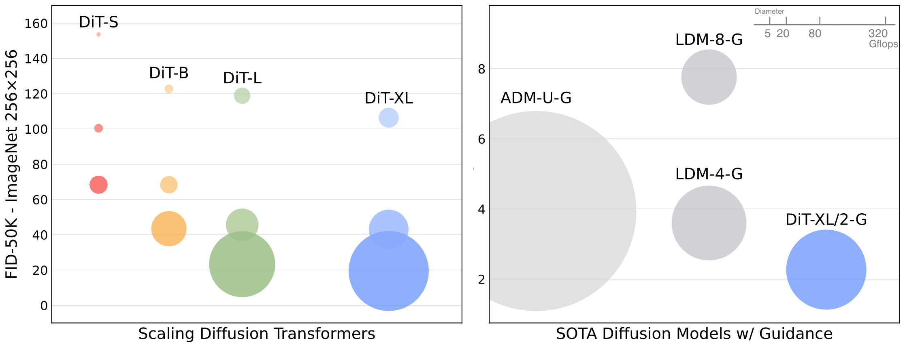

*图 2（原文 Figure 2，第 2 页）：用 Diffusion Transformer（DiT）做 ImageNet 生成。气泡面积表示扩散模型的 Gflops。左：我们的 DiT 模型在 400K 训练迭代时的 FID-50K（越低越好），FID 随模型 Gflops 增大稳步改善。右：我们最好的模型 DiT-XL/2 计算高效，优于此前所有基于 U-Net 的扩散模型，如 ADM 和 LDM。*

**图中文字翻译与读法**：

- **左图 Scaling Diffusion Transformers（缩放扩散 Transformer）**：纵轴 FID-50K - ImageNet 256×256。从左到右四列依次是 DiT-S、DiT-B、DiT-L、DiT-XL；每列有三个气泡，对应 patch size 8、4、2（气泡越大 Gflops 越大）。数值可由表 4 对应：DiT-S 的三个点是 153.60、100.41、68.40；DiT-B 是 122.74、68.38、43.47；DiT-L 是 118.87、45.64、23.33；DiT-XL 是 106.41、43.01、19.47。气泡越往右下（越大的模型、越小的 patch），FID 越低。
- **右图 SOTA Diffusion Models w/ Guidance（带 guidance 的最优扩散模型）**：纵轴是 FID。ADM-U-G 的气泡最大（总 742 Gflops，FID 约 3.94），LDM-8-G（约 7.76）与 LDM-4-G（3.60）较小，DiT-XL/2-G（2.27）位置最低。右上角的图例 Diameter（直径）给出 5、20、80、320 Gflops 的气泡大小。读图结论：DiT-XL/2-G 的 Gflops 与 LDM-4-G 相近而 FID 更低，Gflops 远小于 ADM-U-G 而 FID 也更低。

## 二、背景与前置知识

### 2.1 论文要回答的问题（原文第 1–2 页）

过去五年，自然语言处理、视觉等领域的网络结构几乎都被 Transformer 取代；但图像级的生成模型里，Transformer 主要出现在自回归模型中。扩散模型是图像生成的前沿，却全都沿用卷积 U-Net 作为事实上的主干：Ho 等人（DDPM）最早引入 U-Net 主干，它继承自 PixelCNN++，是以 ResNet 块为主的卷积结构，并在较低分辨率处插入了空间自注意力块（这是它与标准 U-Net 的区别）；Dhariwal 与 Nichol 对 U-Net 的结构做过消融（例如用 adaptive normalization 层注入条件信息，调整卷积通道数），但 U-Net 的高层设计基本没变。

本文要“祛魅”：**U-Net 的归纳偏置对扩散模型的性能并不关键，它可以被标准的 Transformer 设计直接替换**。好处是扩散模型可以受益于“架构统一”的趋势：继承其他领域的最佳实践和训练配方，并保留可扩展性、鲁棒性与效率，还为跨领域研究提供标准化架构。DiT 遵循 ViT 的最佳实践，ViT 在视觉识别上比传统卷积网络（如 ResNet）扩展得更有效。

论文具体研究 Transformer 的**缩放行为**：网络复杂度（用 Gflops 度量）与样本质量（用 FID 度量）的关系。做法是在 Latent Diffusion Models（LDM）的框架下构建并评测 DiT 设计空间（扩散模型在 VAE 的潜空间中训练），从而成功地把 U-Net 换成 Transformer；并表明 DiT 是可扩展的扩散架构：网络复杂度与样本质量之间有很强的相关性。

### 2.2 前置知识 1：扩散模型的公式与损失（原文 3.1 节，第 3 页）

本节回顾理解 DiT 所需的 DDPM 概念，详细推导见 [DDPM](../ddpm/论文中文解读.md)。

**前向加噪**：高斯扩散模型假设一个逐步给真实数据 $x_0$ 加噪声的前向过程，其中常数 $\bar\alpha_t$ 是超参数：

$$
q(x_t\mid x_0)=\mathcal N\big(x_t;\sqrt{\bar\alpha_t}\,x_0,\ (1-\bar\alpha_t)\mathbf I\big),\qquad x_t=\sqrt{\bar\alpha_t}\,x_0+\sqrt{1-\bar\alpha_t}\,\epsilon_t,\quad \epsilon_t\sim\mathcal N(0,\mathbf I).
$$

**反向过程与训练**：扩散模型学习逆转前向破坏的反向过程 $p_\theta(x_{t-1}\mid x_t)=\mathcal N\big(\mu_\theta(x_t),\Sigma_\theta(x_t)\big)$，用神经网络预测 $p_\theta$ 的统计量。反向过程模型用对数似然的变分下界训练，去掉与训练无关的一项后化为

$$
\mathcal L(\theta)=-\log p(x_0\mid x_1)+\sum_t D_{\mathrm{KL}}\big(q^*(x_{t-1}\mid x_t,x_0)\,\Vert\,p_\theta(x_{t-1}\mid x_t)\big).
$$

（原文此处把第一项写成 $-p(x_0\mid x_1)$，漏了对数，对照 DDPM 的式（5）应为 $-\log p(x_0\mid x_1)$。）由于 $q^*$ 与 $p_\theta$ 都是高斯，KL 散度可由两个分布的均值与协方差算出。把 $\mu_\theta$ 重参数化为噪声预测网络 $\epsilon_\theta$，就可以用预测噪声 $\epsilon_\theta(x_t)$ 与真实采样噪声 $\epsilon_t$ 之间的简单均方误差训练：

$$
\mathcal L_{\mathrm{simple}}(\theta)=\big\lVert\epsilon_\theta(x_t)-\epsilon_t\big\rVert_2^2.
$$

**学习协方差**：若要训练带有**学习到的**反向过程协方差 $\Sigma_\theta$ 的模型，则需要优化完整的 KL 项。本文沿用 Nichol 与 Dhariwal 的做法：**用 $\mathcal L_{\mathrm{simple}}$ 训练 $\epsilon_\theta$，用完整的 $\mathcal L$ 训练 $\Sigma_\theta$**。这就是 DiT 的输出同时包含噪声预测和对角协方差预测的原因。训练好之后，从 $x_{t_{\max}}\sim\mathcal N(0,\mathbf I)$ 出发，通过重参数化技巧反复采样 $x_{t-1}\sim p_\theta(x_{t-1}\mid x_t)$ 就得到新图像。

### 2.3 前置知识 2：classifier-free guidance（原文 3.1 节，第 4 页）

条件扩散模型把额外信息（如类别标签 $c$）作为输入，此时反向过程变成 $p_\theta(x_{t-1}\mid x_t,c)$，$\epsilon_\theta$ 与 $\Sigma_\theta$ 都以 $c$ 为条件。Classifier-free guidance 用来鼓励采样过程找到使 $\log p(c\mid x)$ 很高的 $x$。由 Bayes 公式 $\log p(c\mid x)\propto\log p(x\mid c)-\log p(x)$，所以 $\nabla_x\log p(c\mid x)\propto\nabla_x\log p(x\mid c)-\nabla_x\log p(x)$。把扩散模型的输出解释为 score 函数，DDPM 采样可以被引导去采样 $p(x\mid c)$ 很高的 $x$：

$$
\hat\epsilon_\theta(x_t,c)=\epsilon_\theta(x_t,\varnothing)+s\cdot\nabla_x\log p(x\mid c)\ \propto\ \epsilon_\theta(x_t,\varnothing)+s\cdot\big(\epsilon_\theta(x_t,c)-\epsilon_\theta(x_t,\varnothing)\big),
$$

其中 $s>1$ 表示引导强度（$s=1$ 就是标准采样）。要得到 $c=\varnothing$ 时的预测，训练时**随机丢弃** $c$，并用一个**学习到的“空”嵌入** $\varnothing$ 替换它。原文说 classifier-free guidance 能显著改善样本，这一趋势在 DiT 上同样成立。（丢弃概率原文没有给出。）

**读法**：同一个网络，一次带条件、一次不带条件，两次预测的差给出“更像类别 $c$”的方向，再乘以 $s$ 外推；$s$ 越大越贴合类别、多样性越低（附录 B 也指出这一点）。

### 2.4 前置知识 3：latent diffusion 模型（原文 3.1 节，第 4 页）

直接在高分辨率像素空间训练扩散模型计算上代价过高。Latent diffusion models（LDM，见 [Latent Diffusion](../latent_diffusion/论文中文解读.md)）用两阶段方法解决：(1) 学习一个自编码器，用学到的编码器 $E$ 把图像压成更小的空间表示；(2) 训练表示 $z=E(x)$ 的扩散模型，而不是图像 $x$ 的扩散模型（$E$ 冻结）。采样时先从扩散模型采样一个表示 $z$，再用学到的解码器 $x=D(z)$ 解码成图像。

如图 2 所示，LDM 用像素空间扩散模型（如 ADM）的一小部分 Gflops 就获得不错的性能。因为本文关心计算效率，这使 LDM 成为架构探索的有吸引力的起点。本文把 DiT 用在潜空间，不过它们也可以不加修改地用于像素空间。这使得整套图像生成流水线是**混合式**的：现成的卷积 VAE 加上基于 Transformer 的 DDPM。

### 2.5 为什么用 Gflops 而不是参数量衡量复杂度（原文第 2–3 页）

在图像生成文献里，常用参数量评估架构复杂度。但参数量往往是模型复杂度的差劲代理，因为它没有考虑例如图像分辨率这类显著影响性能的因素。因此本文的复杂度分析主要通过**理论 Gflops**，这也与架构设计文献里常用 Gflops 衡量复杂度的做法一致（原文也承认“黄金复杂度指标”仍有争议，因为它常取决于具体应用场景）。与本文最相关的是 Nichol 与 Dhariwal 改进扩散模型的工作，他们分析过 U-Net 架构类的可扩展性与 Gflops 性质；本文则聚焦 Transformer 类。

## 三、方法：DiT 的设计空间

论文要尽量忠实于标准 Transformer 架构，以保留其缩放性质。DiT 基于 ViT（在 patch 序列上运算），保留了 ViT 的许多最佳实践。整个设计空间包含三个维度：**patch size**、**Transformer block 架构**、**模型尺寸**。

### 3.1 整体结构与一次前向的数据流（图 3 左）

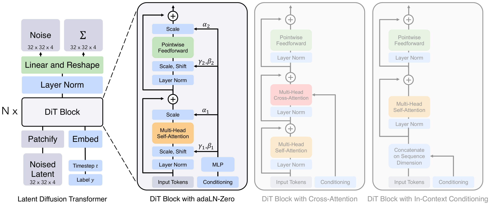

*图 3（原文 Figure 3，第 3 页）：Diffusion Transformer（DiT）的架构。左：我们训练条件潜空间 DiT 模型。输入 latent 被分解成 patch，由若干 DiT block 处理。右：DiT block 的细节。我们试验了标准 Transformer block 的几种变体，分别通过 adaptive layer norm、交叉注意力和额外的输入 token 来引入条件。Adaptive layer norm 效果最好。*

**图中文字翻译与读法**：

- **最左：Latent Diffusion Transformer（潜扩散 Transformer）**。自下而上：Noised Latent（带噪 latent，32×32×4）经 Patchify（切块并线性嵌入）变成 token；Timestep $t$（时间步）与 Label $y$（类别标签）经 Embed（嵌入）变成条件向量；二者进入 “N × DiT Block”（重复 $N$ 次的 DiT block）；随后是 Layer Norm、Linear and Reshape（线性层并重排），得到两个输出：Noise（噪声预测，32×32×4）与 $\Sigma$（对角协方差预测，32×32×4）。
- **中：DiT Block with adaLN-Zero（带 adaLN-Zero 的 DiT block）**，本文最终采用的 block。底部是 Input Tokens（输入 token）与 Conditioning（条件，即 $t$ 与 $y$ 的嵌入之和），条件经过一个 MLP 回归出 $\gamma_1,\beta_1,\alpha_1,\gamma_2,\beta_2,\alpha_2$。自下而上：Input Tokens → Layer Norm → Scale, Shift（用 $\gamma_1,\beta_1$ 调制）→ Multi-Head Self-Attention（多头自注意力）→ Scale（用 $\alpha_1$ 缩放）→ 与输入的残差相加 “+”；再 → Layer Norm → Scale, Shift（$\gamma_2,\beta_2$）→ Pointwise Feedforward（逐位置前馈网络）→ Scale（$\alpha_2$）→ 残差相加 “+”。
- **右两个半透明的 block** 是被淘汰的方案。DiT Block with Cross-Attention（交叉注意力 block）：多头自注意力之后再接一个多头交叉注意力（条件作为 key/value），然后是 Pointwise Feedforward，每个子层前有 Layer Norm、后有残差相加。DiT Block with In-Context Conditioning（上下文条件 block）：条件在序列维度上与输入 token 拼接（Concatenate on Sequence Dimension），之后就是标准的 ViT block（Layer Norm → 多头自注意力 → 残差 → Layer Norm → 前馈 → 残差）。
- **读图结论**：三种方案的区别只在“条件 $t,y$ 如何进入 Transformer block”；原文在图题里已给出结论：adaLN（尤其 adaLN-Zero）效果最好（见 5.1 节）。

**一次前向的形状变化**（本文以 DiT-XL/2、256×256 图像为例整理；$d$、头数见表 1，头维度 72 由 $d$ 与头数相除得到）：

| 阶段 | 形状 |
|---|---|
| 输入 latent $z_t$ | 32×32×4 |
| Patchify（$p=2$，线性嵌入）+ 位置嵌入 | 256 个 token，每个 1152 维 |
| 条件向量 $c$：时间步嵌入 + 类别嵌入 | 1152 维（对整张图只有一个） |
| $N=28$ 个 DiT block（16 个头，头维度 72） | 256×1152 |
| 最终 LayerNorm（adaLN 形式）+ 线性层 | 每个 token 输出 $p\times p\times2C=2\times2\times8=32$ 个数 |
| 重排回空间布局 | 32×32×8，即噪声预测 32×32×4 + 对角协方差预测 32×32×4 |

### 3.2 Patchify：把 latent 变成 token 序列（原文第 4 页，图 4）

DiT 的输入是一个空间表示 $z$（对 256×256×3 的图像，$z$ 的形状为 32×32×4）。DiT 的第一层是 “patchify”：对输入里的每个 patch 做线性嵌入，把空间输入转成由 $T$ 个 token 组成的序列，每个 token 是 $d$ 维。patchify 之后，对所有输入 token 加上标准的 ViT 基于频率的位置嵌入（sine-cosine 版本）。patchify 产生的 token 数 $T$ 由 patch size 超参数 $p$ 决定。

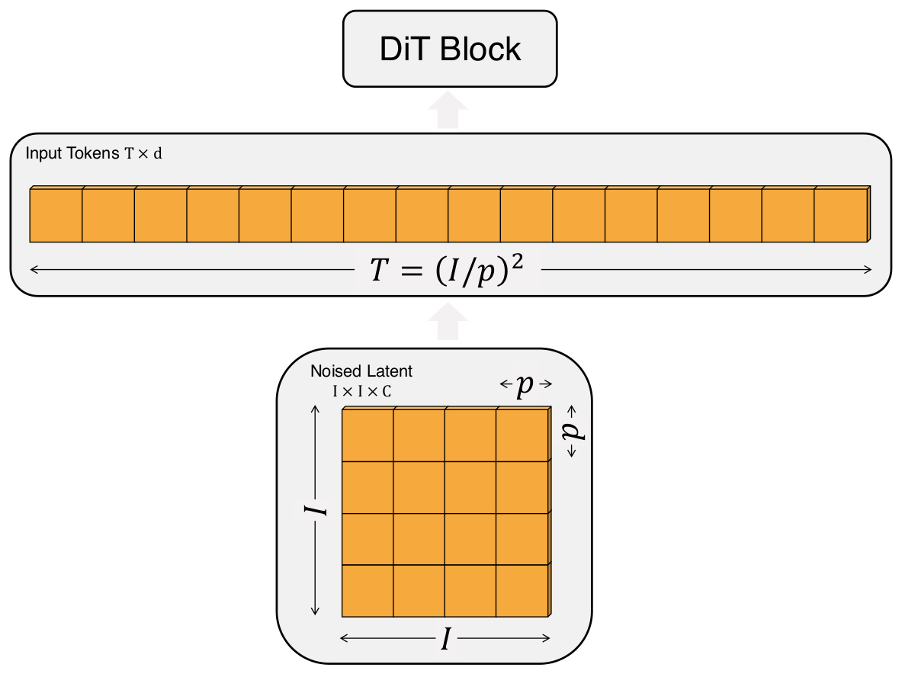

*图 4（原文 Figure 4，第 4 页）：DiT 的输入规格。给定 patch size $p\times p$，形状为 $I\times I\times C$ 的空间表示（来自 VAE 的带噪 latent）被“patchify”成长度 $T=(I/p)^2$、隐层维度为 $d$ 的序列。更小的 patch size $p$ 得到更长的序列，因而有更多 Gflops。*

**图中文字翻译与读法**：下方是 Noised Latent（带噪 latent，$I\times I\times C$），被划成 $p\times p$ 的小方块（图中示意 4×4=16 块，每块边长 $p$）；上方是 Input Tokens（输入 token，$T\times d$）：16 个方块依次排成一条序列，长度 $T=(I/p)^2$，再送入 DiT Block。读图结论：序列长度 $T$ 随 $p$ 的平方反比变化。

**token 数与 Gflops**（原文）：把 $p$ 减半，$T$ 变成四倍，因此总的 Transformer Gflops 至少变成四倍。虽然 $p$ 对 Gflops 影响很大，但改变 $p$ 对下游参数量**没有实质影响**。本文把 $p=2,4,8$ 加入 DiT 设计空间。对 $I=32$（256×256 图像）：

| patch size $p$ | 8 | 4 | 2 |
|---|---:|---:|---:|
| token 数 $T=(32/p)^2$ | 16 | 64 | 256 |

对 512×512 图像，latent 是 64×64×4，$p=2$ 时共有 1024 个 token（原文第 5.1 节）。

### 3.3 DiT block：四种条件注入方案（原文 3.2 节，第 4–5 页）

patchify 之后，输入 token 由一串 Transformer block 处理。除了带噪图像输入，扩散模型有时还要处理额外的条件信息，如噪声时间步 $t$、类别标签 $c$、自然语言等。论文探索四种以不同方式处理条件输入的 Transformer block 变体，它们对标准 ViT block 做了小而重要的改动：

1. **In-context conditioning（上下文条件）**：直接把 $t$ 与 $c$ 的向量嵌入当作**两个额外 token** 追加到输入序列里，与图像 token 一视同仁。这类似 ViT 里的 cls token，使得可以不加修改地使用标准 ViT block；最后一个 block 之后把条件 token 从序列中移除。这种方法引入的新增 Gflops 可以忽略不计。
2. **Cross-attention block（交叉注意力）**：把 $t$ 与 $c$ 的嵌入拼成一个长度为 2 的序列，与图像 token 序列**分开**。Transformer block 被修改为在多头自注意力块之后再加一个多头交叉注意力层，类似 Vaswani 等的原始设计，也类似 LDM 对类别标签做条件时用的做法。交叉注意力给模型增加的 Gflops 最多，约 15% 的开销。
3. **Adaptive layer norm（adaLN）block**：沿用 GAN 与带 U-Net 主干的扩散模型里广泛使用的 adaptive normalization 层，把 Transformer block 里标准的 layer norm 换成 adaLN。不直接学习逐维度的缩放与平移参数 $\gamma,\beta$，而是由 $t$ 与 $c$ 的嵌入向量**之和**回归出它们。三种 block 里 adaLN 增加的 Gflops 最少，所以计算最高效；它也是唯一一种受限于“对所有 token 施加同一函数”的条件机制。
4. **adaLN-Zero block**：已有关于 ResNet 的工作发现，把每个残差块初始化为恒等函数是有益的。例如 Goyal 等发现，把每个块里最后一个 batch norm 的缩放因子 $\gamma$ 零初始化，能加速监督学习中的大规模训练；扩散 U-Net 也用类似的初始化策略，把每个块里在残差连接之前的最后一层卷积零初始化。本文对 adaLN block 做同样的改动：除了回归 $\gamma,\beta$，还回归**逐维度的缩放参数 $\alpha$**，把它施加在 DiT block 内**每个残差连接之前**。**把生成这些参数的 MLP 初始化为对所有 $\alpha$ 输出零向量**，于是整个 DiT block 在初始化时就是恒等函数。与普通 adaLN 一样，adaLN-Zero 增加的 Gflops 可以忽略不计。

**adaLN-Zero 的公式**（补充：根据图 3 中间图整理；原文没有写公式）。记条件向量 $c=\mathrm{Embed}(t)+\mathrm{Embed}(y)$，由 MLP 得到 $(\gamma_1,\beta_1,\alpha_1,\gamma_2,\beta_2,\alpha_2)=\mathrm{MLP}(c)$（每个都是 $d$ 维），则对输入 token $x$：

$$
x'=x+\alpha_1\odot\mathrm{MSA}\big(\gamma_1\odot\mathrm{LN}(x)+\beta_1\big),\qquad
x_{\mathrm{out}}=x'+\alpha_2\odot\mathrm{FFN}\big(\gamma_2\odot\mathrm{LN}(x')+\beta_2\big).
$$

其中 $\mathrm{LN}$ 是不带可学习仿射参数的 layer norm（这一点是本文的合理推断；原文只说“回归 $\gamma,\beta$ 来替代直接学习的缩放与平移”），$\mathrm{MSA}$ 是多头自注意力，$\mathrm{FFN}$ 是逐位置前馈网络，$\odot$ 是逐维度乘法，$\gamma,\beta,\alpha$ 对**所有 token 共享**（对整张图一份）。**读法**：$\alpha_1=\alpha_2=0$ 时两个残差分支都被“关掉”，$x_{\mathrm{out}}=x$，即整个 block 是恒等映射；训练过程中 $\alpha$ 才逐渐变成非零，条件信息也通过 $\gamma,\beta,\alpha$ 同时调制归一化与残差强度。附录 A 给出的实现细节是：时间步先经 256 维频率嵌入再过一个两层 MLP（宽度等于 Transformer 隐层大小，SiLU 激活）；每个 adaLN 层把时间步嵌入与类别嵌入之和送入 SiLU 非线性与一个线性层，线性层输出神经元数是 Transformer 隐层大小的 **4 倍（adaLN）或 6 倍（adaLN-Zero）**；核心 Transformer 用 GELU（tanh 近似）。

**四种方案的参数量与 Gflops 对照**（取自表 4，均为 DiT-XL/2、256×256；FID-50K 为 400K 训练步、无 guidance）：

| block 类型 | Gflops | 参数量（M） | FID-50K |
|---|---:|---:|---:|
| In-context | 119.37 | 449 | 35.24 |
| Cross-attention | 137.62 | 598 | 26.14 |
| adaLN | 118.56 | 600 | 25.21 |
| adaLN-Zero | 118.64 | 675 | **19.47** |

**本文核算：参数量为什么是这样**。一个标准 Transformer block 约有 $12d^2$ 个参数（注意力的 $Q,K,V,O$ 共 $4d^2$，MLP 取 4 倍扩张共 $8d^2$）。对 DiT-XL（$d=1152$，$N=28$）：$12d^2N\approx446$M，正是 in-context 的 449M（它没有额外模块）。cross-attention 每块多一个交叉注意力（约 $4d^2$），总计约 $16d^2N\approx595$M，对应 598M；adaLN 每块多一个输出 $4d$ 的调制 MLP（约 $4d^2$），同样约 595M，对应 600M；adaLN-Zero 的调制 MLP 输出 $6d$（约 $6d^2$），约 $18d^2N\approx669$M，对应 675M。所以 adaLN-Zero 比 adaLN 多出的约 75M 参数，来自多出的 $\alpha_1,\alpha_2$ 输出。这一点在评价“零初始化的作用”时要记得（见第六节）。

### 3.4 模型尺寸（原文表 1，第 5 页）

沿用 ViT 的做法，用标准的 Transformer 配置，同时缩放层数 $N$、隐层维度 $d$ 与注意力头数。共四种配置 DiT-S、DiT-B、DiT-L、DiT-XL，覆盖很宽的模型尺寸和 Gflops 分配范围，从 0.3 到 118.6 Gflops（表 4 中最小的 DiT-S/8 为 0.36），便于考察缩放表现。

下表给出 DiT 各配置的细节：遵循 ViT 的模型配置，Small（S）、Base（B）、Large（L）；另外引入一个 XLarge（XL）配置作为最大模型。Gflops 一列在 $I=32$、$p=4$ 下计算。

| 模型 | 层数 $N$ | 隐层维度 $d$ | 注意力头数 | Gflops（$I=32$，$p=4$） |
|---|---:|---:|---:|---:|
| DiT-S | 12 | 384 | 6 | 1.4 |
| DiT-B | 12 | 768 | 12 | 5.6 |
| DiT-L | 24 | 1024 | 16 | 19.7 |
| DiT-XL | 28 | 1152 | 16 | 29.1 |

（原文表 1，第 5 页。）模型命名为“配置 / patch size”，例如 DiT-XL/2 表示 XLarge 配置、$p=2$。

**本文核算：Gflops 的解析公式**。原文没有给公式，但可以用 $N,d,T$ 近似复现表 4（偏差小于 1%，见下）。对 DiT block 数 $N$、隐层维度 $d$、token 数 $T$：

$$
\text{Gflops}\approx\frac{1}{10^{9}}\Big[\,N\,T\,\big(12d^2+2Td\big)+6d^2N\,\Big],
$$

其中 $12d^2T$ 是每层的线性层（注意力投影 $4d^2$ 加 MLP $8d^2$，每个 token 一份），$2T^2d$ 是注意力的 $QK^\top$ 与加权求和两次矩阵乘，$6d^2N$ 是 adaLN-Zero 的调制 MLP（对整张图只算一次），patchify 与最后的线性层贡献很小（可忽略）。这里数的是乘加次数（每次乘加记一次），这也是视觉论文里常见的 “flops” 口径。

核对：DiT-XL/2（$N=28,d=1152,T=256$）：线性层与注意力共约 118.38 G，加调制 MLP 约 0.22 G，得到约 118.6 G（表 4：118.64）；DiT-S/2（$N=12,d=384,T=256$）约 6.06 G（表 4：6.06）；DiT-XL/8（$T=16$）约 7.39 G（表 4：7.39）；512×512 的 DiT-XL/2（$T=1024$）约 524.5 G（表 4：524.60）。按这个公式计算全部 12 个 256×256 模型，与表 4 的偏差都小于 1%，其中 9 个小于 0.1%（偏差较大的是 DiT-S/8 约 0.7%、DiT-B/8 约 0.3%、DiT-S/4 约 0.1%，主要是表中数字只保留两位小数所致）。

两个推论：(1) $p$ 减半时 $T$ 变成 4 倍，线性层部分恰好变成 4 倍，注意力部分变成 16 倍，总计“至少 4 倍”（原文的说法）；(2) 在 $T=256$ 时，注意力的矩阵乘只占 DiT-XL/2 总 Gflops 的约 3.6%（约 4.2 G / 118.4 G），Gflops 增长主要来自**与 token 数成正比的线性层**，而不是注意力本身。

### 3.5 Transformer 解码器（原文第 5 页）

最后一个 DiT block 之后，要把图像 token 序列解码成输出的噪声预测和输出的对角协方差预测，二者的形状都等于原始空间输入。用一个标准的**线性解码器**完成：先施加最后的 layer norm（若用 adaLN 则是自适应的），再把每个 token 线性解码成一个 $p\times p\times2C$ 的张量（$C$ 是 DiT 空间输入的通道数），最后把解码出的 token 重排回原始空间布局，得到预测的噪声和协方差。完整的 DiT 设计空间就是 patch size、Transformer block 架构与模型尺寸。

### 3.6 补充：训练与采样的完整流程

原文没有给算法框，下面是根据第 3、4 节和附录 A 整理的流程（标 “原文未给” 的部分是实现细节，需对照官方代码）：

```text
准备：冻结的 VAE（编码器 E、解码器 D）；DiT 网络 f_θ(z_t, t, y) → (ε_θ, Σ_θ)

训练（一次迭代，batch=256）：
    取图像 x 与类别 y，随机水平翻转
    z = E(x)                               （latent 的缩放常数：原文未给）
    以一定概率把 y 换成可学习的 "空" 嵌入 ∅    （丢弃概率：原文未给）
    t ~ Uniform{1, ..., 1000}，ε ~ N(0, I)
    z_t = √ᾱ_t · z + √(1−ᾱ_t) · ε
    (ε_θ, Σ_θ) = f_θ(z_t, t, y)
    损失：ε_θ 用 ‖ε − ε_θ‖²（L_simple）训练；Σ_θ 用完整的 L（KL 项）训练
    AdamW 更新，学习率常数 1e-4；同时维护 EMA（衰减 0.9999）

采样：
    z_{t_max} ~ N(0, I)
    对 t 从大到小（评测用 250 个 DDPM 步）：
        ε̂ = ε_θ(z_t, ∅) + s · ( ε_θ(z_t, y) − ε_θ(z_t, ∅) )       （使用 guidance 时；原文只对前 3 个 latent 通道做 guidance）
        用 ε̂ 与 Σ_θ 按 DDPM 的反向步骤得到 z_{t-1}
    x = D(z_0)
```

## 四、实验设置（原文第 4 节与附录 A、D，第 5–6、12–13 页）

下表整理自原文第 4 节与附录（非原文表格）。

| 项目 | 设置 |
|---|---|
| 任务与数据 | 在 ImageNet 上训练**类条件**潜空间 DiT，分辨率 256×256 与 512×512 |
| 潜空间 | 用 Stable Diffusion 的**现成预训练 VAE**（编码器下采样倍数 8：256×256×3 → 32×32×4；512×512 → 64×64×4）；所有扩散模型都在这个 $Z$ 空间里运算；采样得到新 latent 后用 VAE 解码器解码成像素。VAE 的编码器与解码器共 84M 参数，**不计入** DiT 的参数量与 Gflops |
| 扩散超参数（沿用 ADM） | $t_{\max}=1000$；线性方差调度，从 $1\times10^{-4}$ 到 $2\times10^{-2}$；ADM 对协方差 $\Sigma_\theta$ 的参数化；ADM 对输入时间步与标签的嵌入方式 |
| 初始化 | 最后一层线性层用零初始化，其余用 ViT 的标准权重初始化；adaLN-Zero 里生成 $\alpha$ 的 MLP 输出零向量 |
| 优化器与超参数 | AdamW；**常数学习率 $1\times10^{-4}$**；**无 weight decay**；批大小 256；数据增强只有水平翻转 |
| 稳定性 | 不像以往 ViT 工作那样需要学习率 warmup 或正则化；训练在所有配置下都非常稳定，没有观察到 Transformer 常见的 loss 尖峰 |
| EMA | 对 DiT 权重做指数滑动平均，衰减 0.9999；所有报告结果使用 EMA 模型 |
| 超参数是否调过 | 所有 DiT 尺寸与 patch size 使用**同一套**训练超参数；几乎全部沿用 ADM，**没有调**学习率、衰减/warmup 计划、Adam 的 $\beta_1/\beta_2$ 或 weight decay |
| 评估指标 | 主要指标 FID（Fréchet Inception Distance）；按惯例报告 **FID-50K**，使用 **250 个 DDPM 采样步**；为保证比较准确，所有数字都是导出样本后用 ADM 的 TensorFlow 评估套件算出的（FID 对实现细节敏感）；除非另行说明，本节的 FID **不使用** classifier-free guidance；另报 Inception Score、sFID、Precision/Recall 作为次要指标 |
| 实现与硬件 | 用 JAX 实现，在 TPU-v3 pod 上训练；最耗算力的 DiT-XL/2 在 TPU v3-256 pod 上、全局批大小 256 时约 5.7 迭代/秒（本文推算：7M 步约 14 天，原文没有直接给出） |
| 解码器版本 | 缩放分析（第 5 节主体）用 ft-MSE 解码器监控指标；表 2、表 3 的最终指标用 ft-EMA 解码器（附录 D） |

**术语**：sFID 是用空间特征算的 FID 变体（Nash 等，原文引用）；Precision/Recall 衡量样本的保真度与对数据分布的覆盖（Kynkäänniemi 等，原文引用）；这些指标在原文中只给出名称与引用，没有展开定义。

## 五、实验

### 5.1 DiT block 设计：哪种条件注入最好（原文第 6 页，图 5）

**设置**：训练四个 Gflops 最高的 DiT-XL/2 模型，各用一种 block 设计：in-context（119.4 Gflops）、cross-attention（137.6 Gflops）、adaLN（118.6 Gflops）、adaLN-Zero（118.6 Gflops），在训练过程中测量 FID。

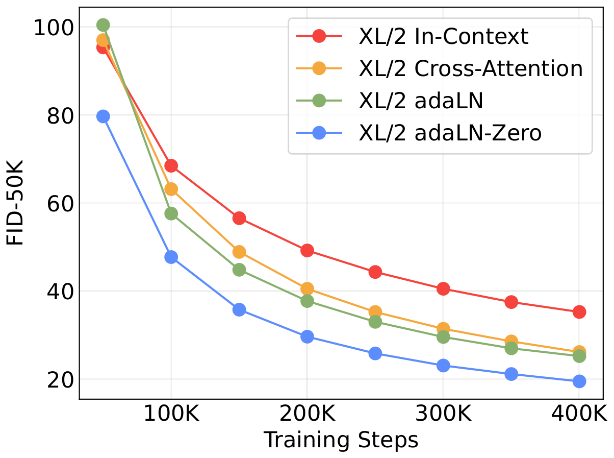

*图 5（原文 Figure 5，第 5 页）：比较不同的条件注入策略。adaLN-Zero 在训练的所有阶段都优于交叉注意力与 in-context 条件。*

**图中文字翻译与读法**：

- **坐标轴**：横轴 Training Steps（训练步数，约 50K 到 400K，每 50K 一个点），纵轴 FID-50K（越低越好）。四条线：红色 XL/2 In-Context、橙色 XL/2 Cross-Attention、绿色 XL/2 adaLN、蓝色 XL/2 adaLN-Zero。
- **读图**（近似值，从图上读出）：训练到 100K 步时，adaLN-Zero 约 48，adaLN 约 58，cross-attention 约 63，in-context 约 68；之后四条线都单调下降且次序不变。400K 步时的数值与表 4 一致：adaLN-Zero 19.47、adaLN 25.21、cross-attention 26.14、in-context 35.24。
- **读图结论**：adaLN-Zero 在每个训练阶段都最好；在 400K 步，adaLN-Zero 的 FID（19.47）差不多是 in-context（35.24）的一半，说明条件机制对模型质量至关重要；初始化也很重要：把每个 DiT block 初始化为恒等函数的 adaLN-Zero 显著优于普通 adaLN（19.47 对 25.21）。此后全文所有模型都用 adaLN-Zero block。

交叉注意力方案类似 LDM 对类别标签的条件做法（原文明确指出了这一点），在 DiT 里它不如 adaLN-Zero。一种解释（本文的推测，不是原文的结论）是：$t$ 与类别都是对整张图只有一份的全局条件，用 adaLN 做逐通道调制，比把它们当作 token 序列去做注意力更直接。

### 5.2 缩放模型尺寸与 patch size（原文第 8 页；图 6、表 4、图 7）

**设置**：训练 12 个 DiT 模型，扫描模型配置（S、B、L、XL）与 patch size（8、4、2）。原文提醒：DiT-L 与 DiT-XL 在相对 Gflops 上彼此比其他配置更接近。原文的结论：**在所有情况下，增大模型尺寸、减小 patch size 都得到明显更好的扩散模型**。

下表是 12 个模型在 400K 训练步时的 FID-50K（无 guidance），整理自原文表 4；括号里是对应的 Gflops（$p=8/4/2$）。

| 配置（Gflops：$p=8$ / $p=4$ / $p=2$） | $p=8$ | $p=4$ | $p=2$ |
|---|---:|---:|---:|
| DiT-S（0.36 / 1.41 / 6.06） | 153.60 | 100.41 | 68.40 |
| DiT-B（1.42 / 5.56 / 23.01） | 122.74 | 68.38 | 43.47 |
| DiT-L（5.01 / 19.70 / 80.71） | 118.87 | 45.64 | 23.33 |
| DiT-XL（7.39 / 29.05 / 118.64） | 106.41 | 43.01 | 19.47 |

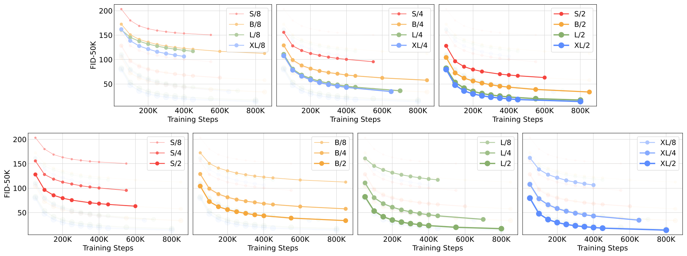

*图 6（原文 Figure 6，第 6 页）：缩放 DiT 模型在训练的所有阶段都改善 FID。展示 12 个 DiT 模型的 FID-50K 随训练迭代的变化。上排：固定 patch size 比较 FID；下排：固定模型尺寸比较 FID。缩放 Transformer 主干在所有模型尺寸与 patch size 上都得到更好的生成模型。*

**图中文字翻译与读法**：

- **布局**：每个小图的横轴是 Training Steps（训练步数，最多约 850K），纵轴是 FID-50K。上排三个小图固定 patch size（从左到右 $p=8$、$p=4$、$p=2$），每个图里的四条线是 S、B、L、XL 四种尺寸（颜色分别为红、橙、绿、蓝，越大的模型线越粗、标记越大）；下排四个小图固定模型尺寸（S、B、L、XL），每个图里的三条线是 $p=8,4,2$。背景里淡淡的线是其他模型，用来对照。
- **上排读图结论**（固定 $p$，改变尺寸）：每个小图里，越大的模型曲线越低；在 $p=2$ 的图里，各曲线末端的 FID 从 S/2（约 63，约 600K 步）到 B/2（约 33）、L/2（约 17）、XL/2（约 14，约 800K 步）逐级下降（从图上读出的近似值，各模型训练的步数不同）。原文的结论：在四种配置下，把 Transformer 做得更深更宽，在训练的**所有阶段**都带来显著的 FID 改善。
- **下排读图结论**（固定尺寸，改变 $p$）：每个小图里，$p$ 越小曲线越低（如 XL 一栏，400K 步时 XL/8 为 106.41、XL/4 为 43.01、XL/2 为 19.47，见表 4；XL/2 继续训练到约 800K 步时降到约 14，为图上读出的近似值）。原文的结论：只通过增加 DiT 处理的 token 数（参数量大致不变）就能在训练全程得到可观的 FID 改善。

**读表与读图要点**：表中的每一行（固定尺寸，$p$ 减小）与每一列（固定 $p$，尺寸增大）FID 都单调下降。$p=8$ 时 token 只有 16 个，即使模型很大（XL/8 有 676M 参数）FID 仍高达 106.41，说明“只加参数、不加 token”收益有限。

**Gflops 才是关键，而不是参数量**（原文第 8 页）：图 6 表明参数量不能唯一决定 DiT 的质量。在模型尺寸固定而减小 patch size 时，Transformer 的总参数量实际上基本不变（甚至略有下降，见表 4：XL 为 676M、675M、675M），**只有 Gflops 增加**。这说明提升模型 Gflops 才是改善性能的关键。从表 4 可以直接看到这一点（本文整理）：DiT-S/2（33M 参数，6.06 Gflops）与 DiT-B/4（130M 参数，5.56 Gflops）的 FID 几乎相同（68.40 对 68.38），参数量差约 4 倍；DiT-L/4（458M，19.70 G，45.64）、DiT-B/2（130M，23.01 G，43.47）与 DiT-XL/4（675M，29.05 G，43.01）也相近，Gflops 接近而参数量相差 3.5–5 倍。

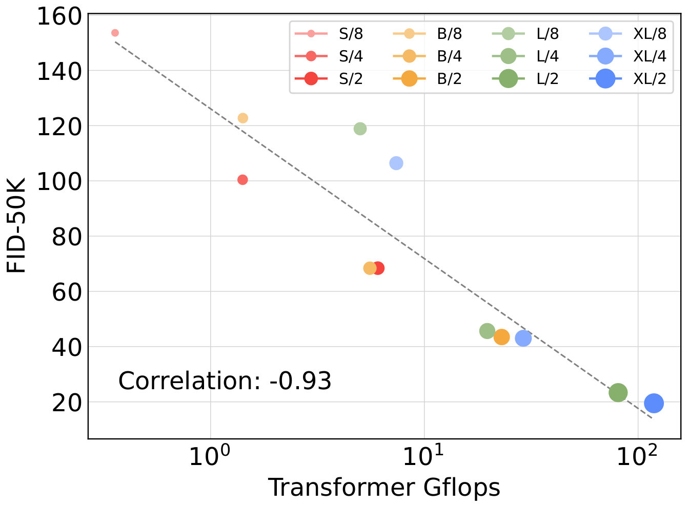

*图 8（原文 Figure 8，第 8 页）：Transformer Gflops 与 FID 强相关。绘出每个 DiT 模型的 Gflops 与该模型在 400K 训练步时的 FID-50K。*

**图中文字翻译与读法**：横轴 Transformer Gflops（对数刻度，约 $10^{0}$ 到 $10^{2}$），纵轴 FID-50K。12 个点用颜色区分尺寸（红 S、橙 B、绿 L、蓝 XL）、用深浅与大小区分 patch size（越大越深，对应 $p$ 越小）；虚线是一条拟合直线；图中标注 Correlation: -0.93（相关系数 $-0.93$）。读图结论：不同配置在 Gflops 相近时得到相近的 FID（如 DiT-S/2 与 DiT-B/4 几乎重合），Gflops 与 FID 有很强的负相关，说明额外的模型计算量是改进 DiT 的关键因素。本文用表 4 的 12 个点核算：FID 与 $\log_{10}$（Gflops）的皮尔逊相关系数为 $-0.93$（与原始 Gflops 的相关系数只有 $-0.73$），所以图上的相关系数是在对数 Gflops 上计算的，原文没有说明这一点。

**可视化缩放的效果（图 7）**：为了直观看到缩放对样本质量的影响，作者在 400K 训练步时，用**相同的初始噪声 $x_{t_{\max}}$、相同的采样噪声与相同的类别标签**，从 12 个 DiT 模型各采一张图。

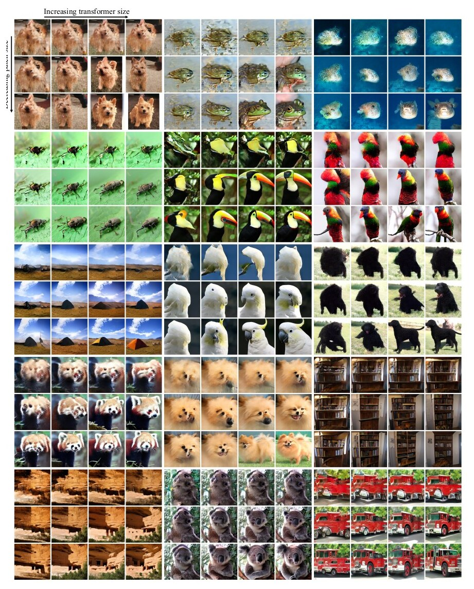

*图 7（原文 Figure 7，第 7 页）：增加 Transformer 前向 Gflops 提高样本质量。放大查看效果更好。我们在 400K 训练步后，用相同的输入 latent 噪声与类别标签从全部 12 个 DiT 模型采样。无论是通过增加 Transformer 深度/宽度，还是通过增加输入 token 数来增加模型 Gflops，都显著改善视觉保真度。*

**图中文字翻译与读法**：整幅图由 15 个类别各一块 $3\times4$ 的小图阵组成（5 行 × 3 列块）。每块里：**从左到右**是 Increasing transformer size（Transformer 尺寸增大，列依次是 S、B、L、XL），**从上到下**是 Decreasing patch size（patch size 减小，行依次是 $p=8,4,2$），所以每块左上角是 DiT-S/8（Gflops 最低），右下角是 DiT-XL/2（Gflops 最高）。图上能辨认出的类别有狗、青蛙、河豚、甲虫、巨嘴鸟、鹦鹉、帐篷、白色凤头鹦鹉、黑狗、小熊猫、博美犬、书柜、崖壁建筑、考拉、消防车（按外观辨认，原文没有标类别名）。读图结论：以每块的左上角为例，S/8 的图像只有模糊的色块和大致轮廓；沿右、下两个方向（增大尺寸、减小 patch），同一类别的物体逐渐出现清晰的形状、纹理和背景细节，右下角（XL/2）最清楚，例如巨嘴鸟一块里，鸟喙的形状与颜色在右下角最完整。因为 12 个模型用的是同一初始噪声和类别，同一块里整体构图相近，差别主要来自模型 Gflops，所以这是“Gflops 越高视觉保真度越好”的直观证据；它是定性展示，原文没有给出这些图的定量打分。

### 5.3 更大的 DiT 模型对算力的利用更高效（原文第 8 页，图 9）

原文把训练算力估计为

$$
\text{训练算力}\approx\text{模型 Gflops}\times\text{批大小}\times\text{训练步数}\times3,
$$

其中因子 3 粗略地把反向传播当作前向的两倍计算量。（本文核算：DiT-XL/2 训练 400K 步约 $3.6\times10^{10}$ Gflops，训练 7M 步约 $6.4\times10^{11}$ Gflops，与图 9 横轴的右端相符。）

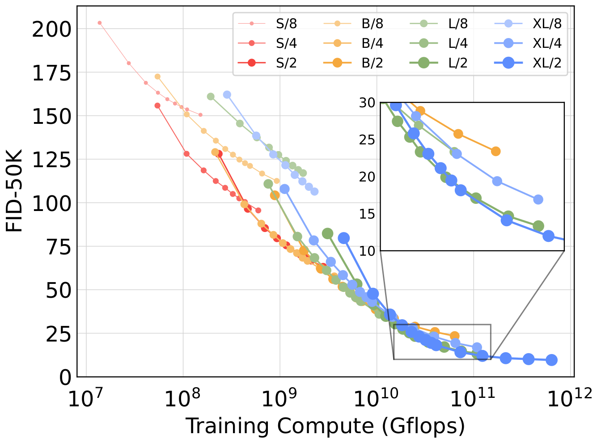

*图 9（原文 Figure 9，第 8 页）：更大的 DiT 模型更高效地利用大量算力。绘出 FID 随总训练算力的变化。*

**图中文字翻译与读法**：横轴 Training Compute (Gflops)（训练算力，对数刻度，$10^7$ 到 $10^{12}$），纵轴 FID-50K。12 条线对应 12 个模型，线上的点是不同的训练检查点；右下方的放大框把 FID 10–30、算力约 $10^{10.2}$ 到 $10^{11.2}$ Gflops 的区域放大。读图结论（原文）：(1) **小的 DiT 模型，即使训练更久，最终相对于训练步数更少的大模型也变得算力低效**；(2) 除 patch size 外完全相同的模型，即便控制了训练 Gflops，也有不同的性能曲线，例如 XL/4 在约 $10^{10}$ Gflops 之后被 XL/2 超过。从图上还能读出：算力较小时（约 $10^{8}$ 到 $10^{9}$ Gflops），小模型或大 patch 的模型 FID 反而更低，大模型一开始就要花更多算力，只有在算力更多之后才赶上并超过；放大框里，蓝色的 XL/2 与绿色的 L/2 位于最下方，橙色的 B/2 与浅蓝色的 XL/4 在它们上方。

### 5.4 与 SOTA 的比较（原文 5.1 节，第 8–9 页；表 2、表 3、图 1）

**256×256 ImageNet**：按缩放分析的结论，作者继续训练 Gflops 最高的 DiT-XL/2，共 **7M 步**，并与最先进的类条件生成模型比较，结果见表 2。使用 classifier-free guidance 时，DiT-XL/2 优于此前所有扩散模型，把此前最好的 FID-50K（LDM 的 3.60）降到 2.27。图 2 右显示：DiT-XL/2（118.6 Gflops）相对于 LDM-4（103.6 Gflops）这类潜空间 U-Net 模型是计算高效的，比 ADM（1120 Gflops）、ADM-U（742 Gflops）这类像素空间 U-Net 模型的效率高得多。

**表 2：类条件 ImageNet 256×256 上的基准对比**（FID↓、sFID↓、IS↑、Precision↑、Recall↑；带 G 的行使用 guidance，cfg 为 classifier-free guidance 尺度；LDM-8-G 用的是分类器引导）：

| 模型 | FID↓ | sFID↓ | IS↑ | Precision↑ | Recall↑ |
|---|---:|---:|---:|---:|---:|
| BigGAN-deep [2] | 6.95 | 7.36 | 171.4 | 0.87 | 0.28 |
| StyleGAN-XL [53] | 2.30 | 4.02 | 265.12 | 0.78 | 0.53 |
| ADM [9] | 10.94 | 6.02 | 100.98 | 0.69 | 0.63 |
| ADM-U | 7.49 | 5.13 | 127.49 | 0.72 | 0.63 |
| ADM-G | 4.59 | 5.25 | 186.70 | 0.82 | 0.52 |
| ADM-G, ADM-U | 3.94 | 6.14 | 215.84 | 0.83 | 0.53 |
| CDM [20] | 4.88 | - | 158.71 | - | - |
| LDM-8 [48] | 15.51 | - | 79.03 | 0.65 | 0.63 |
| LDM-8-G | 7.76 | - | 209.52 | 0.84 | 0.35 |
| LDM-4 | 10.56 | - | 103.49 | 0.71 | 0.62 |
| LDM-4-G（cfg=1.25） | 3.95 | - | 178.22 | 0.81 | 0.55 |
| LDM-4-G（cfg=1.50） | 3.60 | - | 247.67 | **0.87** | 0.48 |
| **DiT-XL/2** | 9.62 | 6.85 | 121.50 | 0.67 | **0.67** |
| **DiT-XL/2-G（cfg=1.25）** | 3.22 | 5.28 | 201.77 | 0.76 | 0.62 |
| **DiT-XL/2-G（cfg=1.50）** | **2.27** | **4.60** | **278.24** | 0.83 | 0.57 |

（原文表 2，第 9 页。方括号里是原文参考文献编号，原文只在每个系列的第一行标注；“-” 为原文该格为空。）

**读法**：

- **加 guidance 后 FID 最低**：DiT-XL/2-G（cfg=1.50）的 FID 2.27，在全表最低（StyleGAN-XL 为 2.30，LDM-4-G 为 3.60）；原文称“我们的方法在所有先前生成模型中取得最低 FID，包括此前最先进的 StyleGAN-XL”。IS 278.24 也是全表最高。
- **原文粗体的含义**：从加粗的位置看，粗体只标扩散模型各行里的最优，两个 GAN 行（BigGAN-deep、StyleGAN-XL）不参与加粗（原文没有明说）。所以 sFID 的 4.60 加粗，但并非全表最低（StyleGAN-XL 为 4.02）；Precision 的 0.87 加粗在 LDM-4-G 上，与 BigGAN-deep 的 0.87 并列。
- **不加 guidance 时并不是最好**：DiT-XL/2 的 9.62 只比 ADM（10.94）与 LDM-4（10.56）好约 1，比 ADM-U（7.49）与 CDM（4.88）差；后两者是级联模型（ADM-U 总计 742 Gflops，含上采样器），而 DiT 是单个基础模型。2.27 对 3.60 的大幅领先出现在 cfg=1.5 之下。
- **guidance 的权衡**：cfg 从 1（无 guidance）到 1.25 再到 1.5，FID 由 9.62 降到 3.22 再到 2.27，IS 由 121.50 升到 201.77 再到 278.24，Precision 由 0.67 升到 0.76 再到 0.83，但 Recall 由 0.67 降到 0.62 再到 0.57：用多样性换保真度。
- **召回率**：原文指出 DiT-XL/2 在所有测试的 guidance 尺度下，Recall 都高于 LDM-4 与 LDM-8（0.67/0.62/0.57 对 0.62/0.55/0.48 与 0.63/0.35）。
- **训练步数**：原文还说，当 DiT-XL/2 只训练 2.35M 步（与 ADM 相近）时，仍然优于所有此前的扩散模型，FID 为 2.55（原文没有说明这个数字对应的 guidance 设置，按上下文应是带 guidance 的结果；表 4 中 2352K 步、无 guidance 的 FID 为 10.67）。

**512×512 ImageNet**：用与 256×256 模型相同的超参数，新训练一个 512×512 的 DiT-XL/2，共 3M 次迭代。patch size 为 2 时，这个 XL/2 模型处理 64×64×4 的 input latent 切块后共 1024 个 token（524.6 Gflops）。表 3 给出与最先进方法的比较：XL/2 再次优于该分辨率下所有此前的扩散模型，把此前最好的 FID 3.85（ADM 取得）降到 3.04。尽管 token 数增多，XL/2 仍然计算高效：ADM 用 1983 Gflops，ADM-U 用 2813 Gflops，XL/2 只用 524.6 Gflops。

**表 3：类条件 ImageNet 512×512 上的基准对比**：

| 模型 | FID↓ | sFID↓ | IS↑ | Precision↑ | Recall↑ |
|---|---:|---:|---:|---:|---:|
| BigGAN-deep [2] | 8.43 | 8.13 | 177.90 | 0.88 | 0.29 |
| StyleGAN-XL [53] | 2.41 | 4.06 | 267.75 | 0.77 | 0.52 |
| ADM [9] | 23.24 | 10.19 | 58.06 | 0.73 | 0.60 |
| ADM-U | 9.96 | 5.62 | 121.78 | 0.75 | **0.64** |
| ADM-G | 7.72 | 6.57 | 172.71 | **0.87** | 0.42 |
| ADM-G, ADM-U | 3.85 | 5.86 | 221.72 | 0.84 | 0.53 |
| **DiT-XL/2** | 12.03 | 7.12 | 105.25 | 0.75 | **0.64** |
| **DiT-XL/2-G（cfg=1.25）** | 4.64 | 5.77 | 174.77 | 0.81 | 0.57 |
| **DiT-XL/2-G（cfg=1.50）** | **3.04** | **5.02** | **240.82** | 0.84 | 0.54 |

（原文表 3，第 9 页。原文说明：此前工作（ADM）对 512×512 用 1000 个真实样本测量 Precision 与 Recall，为一致起见本文也这样做。）

**读法**：

- **在扩散模型里最好，但不是全表最好**：DiT-XL/2-G（cfg=1.50）的 3.04 低于 ADM-G + ADM-U（3.85），所以原文说“优于该分辨率下所有此前的扩散模型”；但 StyleGAN-XL 的 FID（2.41）、sFID（4.06）、IS（267.75）都比它好，也就是说 512×512 上 DiT 并未超过 StyleGAN-XL。
- **不加 guidance 时**：DiT-XL/2 的 12.03 比 ADM-U（9.96）差。
- 与 256×256 一样，加 guidance 提高 FID、IS、Precision，降低 Recall（0.64 → 0.57 → 0.54）。
- **算力**：512×512 的 DiT-XL/2 只有 524.6 Gflops，对 ADM 的 1983 和 ADM-U 的 2813 约为 26% 与 19%（本文算）。


*图 1（原文 Figure 1，第 1 页）：带 Transformer 主干的扩散模型取得最先进的图像质量。展示我们两个类条件 DiT-XL/2 模型（分别在 ImageNet 上以 512×512 与 256×256 分辨率训练）的精选样本。*

**图中文字翻译与读法**：上排三张较大的图是 512×512 模型的样本（按外观是金毛幼犬、蓝眼睛的西伯利亚哈士奇、白色凤头鹦鹉），下面两排共 12 张较小的图是 256×256 模型的样本（按外观依次是豪猪、汽车后视镜里的日落、糕点柜、鳄鱼、推粪球的蜣螂、吊桥；考拉、海龟、气泡、雪貂、蟒蛇、巨嘴鸟；类别名是本文按外观辨认，原文没有标注）。读图要点：毛发、羽毛、金属反光、糕点纹理等细节真实。**注意这是“精选”样本（selected）**：附录图 14–33 给出了各个 guidance 尺度和类别下的**未经挑选**（uncurated）样本，并指出与以往使用 guidance 的工作一样，更大的尺度提高视觉保真度、降低样本多样性；附录图 11 的精选样本用的 guidance 尺度是 512×512 模型 6.0、256×256 模型 4.0，两者的解码器都是 ft-EMA（原文没有说明图 1 所用的尺度）。

### 5.5 模型算力与采样算力（原文 5.2 节，第 9 页，图 10）

扩散模型的独特之处在于，训练之后还可以通过增加采样步数来使用更多算力。既然模型 Gflops 对样本质量影响这么大，本节研究：更小模型算力的 DiT 能否通过更多的**采样算力**超过更大的 DiT。作者在 400K 训练步后，对全部 12 个 DiT 模型用 [16, 32, 64, 128, 256, 1000] 步采样计算 FID-10K（图 10）。

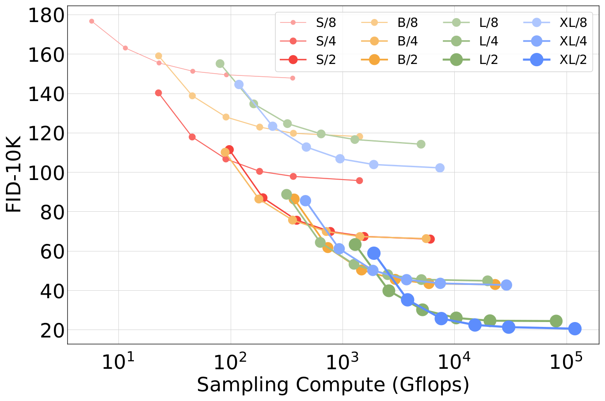

*图 10（原文 Figure 10，第 9 页）：增加**采样**算力无法弥补**模型**算力的不足。对每个训练了 400K 迭代的 DiT 模型，用 [16, 32, 64, 128, 256, 1000] 个采样步计算 FID-10K。对每个步数，画出 FID 以及采样每张图所用的 Gflops。小模型即使采样时用的测试期 Gflops 比大模型还多，也无法缩小与大模型的性能差距。*

**图中文字翻译与读法**：横轴 Sampling Compute (Gflops)（采样一张图所用的总 Gflops = 模型 Gflops × 采样步数，对数刻度），纵轴 FID-10K（越低越好）。每个模型一条线，线上 6 个点自左向右依次是 16、32、64、128、256、1000 步。读图：(1) 每条线先陡降后变平，说明采样步数增加到一定程度后收益很小；(2) 小模型即使采样到 1000 步也停在较高的 FID 平台（从图上读出的近似值：S/8 约 148、S/4 约 96、S/2 约 66、XL/8 约 102），而 L/2 与 XL/2 的平台约 20–25，小模型无论怎样增加采样算力都到不了这个水平。

**原文的对比**：考虑 DiT-L/2 用 1000 采样步、DiT-XL/2 用 128 步。此时 L/2 采样每张图用 80.7 Tflops；XL/2 少用 5 倍的算力，只需 15.2 Tflops，却有更好的 FID-10K（**23.7 对 25.9**）。结论：**增加采样算力不能弥补模型算力的不足**。（本文核算：$80.71\times1000\,\text{Gflops}=80.7$ Tflops，$118.64\times128=15.2$ Tflops，比值约 5.3。）

### 5.6 附录补充结果

**其他指标上的缩放（附录 C，图 12）**。图 12 给出 DiT 规模对一整套评测指标——FID、sFID、Inception Score、Precision、Recall——的影响。作者发现主文中以 FID 驱动的分析对其他指标同样成立：在每个指标上，放大的 DiT 模型都更高效地使用算力，并且模型 Gflops 与性能高度相关；其中 Inception Score 与 Precision 受益于模型规模尤其明显。

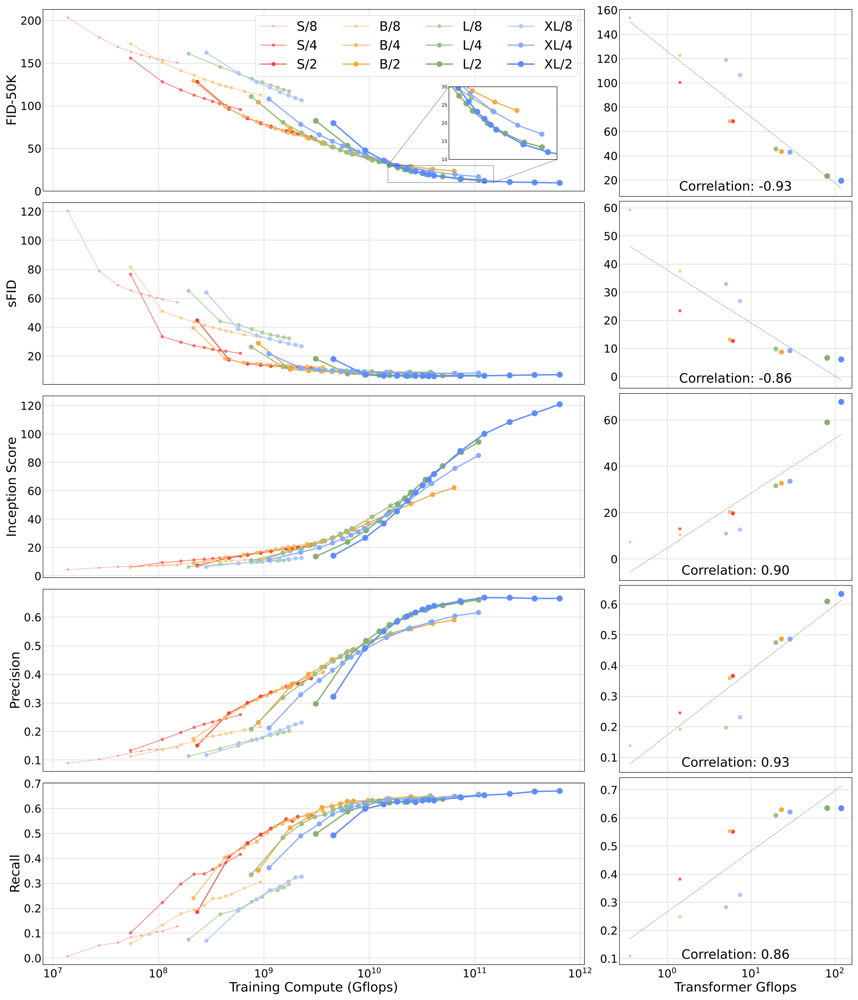

*图 12（原文附录 Figure 12，第 14 页）：DiT 在多个生成建模指标上的缩放行为。左：模型性能随总训练算力变化，指标为 FID、sFID、Inception Score、Precision 和 Recall。右：全部 12 个 DiT 变体在 400K 训练步时的模型性能对 Transformer Gflops 的关系，各指标都有强相关。所有数值都是用 ft-MSE VAE 解码器算的。*

**图中文字翻译与读法**：五行对应五个指标（自上而下 FID-50K、sFID、Inception Score、Precision、Recall）。左列横轴 Training Compute (Gflops)（训练算力，对数刻度），12 条线同图 9；右列横轴 Transformer Gflops（对数刻度），每个点是一个模型在 400K 步时的指标，虚线为拟合线，图中标注相关系数：FID $-0.93$、sFID $-0.86$、Inception Score $0.90$、Precision $0.93$、Recall $0.86$（FID、sFID 越低越好，故为负；IS、Precision、Recall 越高越好，故为正）。读图结论：各指标都随训练算力改善；从图上读出（近似值）：Recall 在约 $10^{10}$ Gflops 之后基本持平（约 0.62–0.67），Precision 到约 $10^{11}$ Gflops 后持平（约 0.67），而 Inception Score 到最大算力处仍在上升（约 120，与表 2 里 7M 步、无 guidance 的 DiT-XL/2 的 121.50 相符）。

**训练损失（附录 C，图 13）**。作者还考察规模对训练损失的影响：提高 DiT 模型 Gflops（通过 Transformer 尺寸或输入 token 数）会让训练损失下降得更快，并饱和在更低的值，这与语言模型里观察到的趋势一致，大规模 Transformer 同时有更好的损失曲线和更好的下游评测表现。

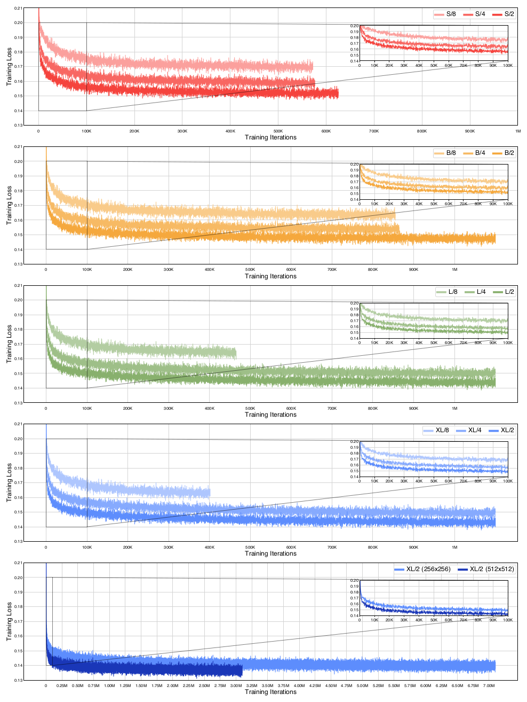

*图 13（原文附录 Figure 13，第 15 页）：全部 DiT 模型的训练损失曲线。绘出全部 DiT 模型训练过程中的损失（噪声预测均方误差与 $D_{\mathrm{KL}}$ 之和）；同时突出显示早期训练行为。放大后的 DiT 模型有更低的训练损失。*

**图中文字翻译与读法**：五个子图，前四个依次是 S、B、L、XL 三个 patch size（8、4、2）的曲线（颜色同前，深浅表示 $p$），第五个是 DiT-XL/2 在 256×256（较浅蓝）与 512×512（深蓝）上的曲线；每个子图右上角的放大框显示前 100K 步。纵轴 Training Loss（训练损失，范围约 0.13–0.21），横轴 Training Iterations（训练迭代）。读图（近似值）：S/8 约稳定在 0.17，S/2 约 0.15，XL/2 约 0.14；XL/2 在 512×512 上略低于 256×256。原文说明损失是噪声预测 MSE 与 $D_{\mathrm{KL}}$ 之和。读图结论：Gflops 越高，损失下降越快、平台越低；训练曲线平滑，没有尖峰，与 4 节所述“训练高度稳定”相符。

**VAE 解码器消融（附录 D，表 5）**。实验全程使用现成的预训练 VAE。VAE 模型（ft-MSE 与 ft-EMA）是原始 LDM “f8” 模型的微调版本（只微调了解码器权重）。作者用 ft-MSE 解码器监控第 5 节的缩放分析，用 ft-EMA 解码器给出表 2、表 3 的最终指标。这里消融三种解码器：LDM 使用的原始解码器，以及 Stable Diffusion 使用的两个微调解码器。由于编码器相同，解码器可以直接替换而不必重新训练扩散模型。

**表 5：解码器消融**（类条件 ImageNet 256×256，DiT-XL/2-G，cfg=1.5）：

| 解码器 | FID↓ | sFID↓ | IS↑ | Precision↑ | Recall↑ |
|---|---:|---:|---:|---:|---:|
| original | 2.46 | 5.18 | 271.56 | 0.82 | 0.57 |
| ft-MSE | 2.30 | 4.73 | 276.09 | 0.83 | 0.57 |
| ft-EMA | 2.27 | 4.60 | 278.24 | 0.83 | 0.57 |

（原文表 5，第 13 页。）读法：不同的预训练解码器权重在 ImageNet 256×256 上给出可比的结果；即使用 LDM 的原始解码器（FID 2.46），XL/2 仍然优于此前所有扩散模型（此前最好为 3.60）。但解码器选择本身能带来约 0.2 的 FID 差，和 DiT 与最强基线之间的差距（2.27 对 3.60）相比不大，对 DiT 与 StyleGAN-XL（2.30）这类接近的比较则不可忽略。

**只对前三个 latent 通道做 guidance（附录 A）**。在使用 classifier-free guidance 的实验里，作者只对 latent 的**前三个通道**施加 guidance，而不是全部四个通道。作者调查后发现，三通道 guidance 与四通道 guidance 给出相似的结果（FID），只需要调整尺度因子：三通道、尺度 $(1+x)$ 大致可由四通道、尺度 $(1+\tfrac34x)$ 近似（例如三通道尺度 1.5 给出 FID-50K 2.27，而四通道尺度 1.375 给出 FID-50K 2.20）。作者认为只对元素的子集施加 guidance 仍能取得好性能“有些有趣”，留待未来探索。这意味着表 2 中 2.27 这个头条数字用的是三通道 guidance，并非最低的设置。

**U-Net 基线的 Gflops（附录 A，表 6）**：

| 模型 | 图像分辨率 | 基础模型 Gflops | 上采样器 Gflops | 总 Gflops |
|---|---|---:|---:|---:|
| ADM | 128×128 | 307 | - | 307 |
| ADM | 256×256 | 1120 | - | 1120 |
| ADM | 512×512 | 1983 | - | 1983 |
| ADM-U | 256×256 | 110 | 632 | 742 |
| ADM-U | 512×512 | 307 | 2506 | 2813 |
| LDM-4 | 256×256 | 104 | - | 104 |
| LDM-8 | 256×256 | 57 | - | 57 |

（原文表 6，第 13 页。原文说明：只统计 DDPM 部分的 Flops，不含 VAE。）

**所有 DiT 模型的详细信息（原文表 4）**。下表逐行转录。参数量与 Gflops 均不含 VAE（VAE 编码器与解码器共 84M 参数）；FID-50K 为不使用 classifier-free guidance、用 ft-MSE VAE 解码器的值；原文还注明，对于 256×256 与 512×512 的 DiT-XL/2，都没有观察到 FID 饱和，因此尽可能地继续训练。

| 模型 | 图像分辨率 | Gflops | 参数量（M） | 训练步数（K） | 批大小 | 学习率 | DiT block | FID-50K（无 guidance） |
|---|---|---:|---:|---:|---:|---:|---|---:|
| DiT-S/8 | 256×256 | 0.36 | 33 | 400 | 256 | $1\times10^{-4}$ | adaLN-Zero | 153.60 |
| DiT-S/4 | 256×256 | 1.41 | 33 | 400 | 256 | $1\times10^{-4}$ | adaLN-Zero | 100.41 |
| DiT-S/2 | 256×256 | 6.06 | 33 | 400 | 256 | $1\times10^{-4}$ | adaLN-Zero | 68.40 |
| DiT-B/8 | 256×256 | 1.42 | 131 | 400 | 256 | $1\times10^{-4}$ | adaLN-Zero | 122.74 |
| DiT-B/4 | 256×256 | 5.56 | 130 | 400 | 256 | $1\times10^{-4}$ | adaLN-Zero | 68.38 |
| DiT-B/2 | 256×256 | 23.01 | 130 | 400 | 256 | $1\times10^{-4}$ | adaLN-Zero | 43.47 |
| DiT-L/8 | 256×256 | 5.01 | 459 | 400 | 256 | $1\times10^{-4}$ | adaLN-Zero | 118.87 |
| DiT-L/4 | 256×256 | 19.70 | 458 | 400 | 256 | $1\times10^{-4}$ | adaLN-Zero | 45.64 |
| DiT-L/2 | 256×256 | 80.71 | 458 | 400 | 256 | $1\times10^{-4}$ | adaLN-Zero | 23.33 |
| DiT-XL/8 | 256×256 | 7.39 | 676 | 400 | 256 | $1\times10^{-4}$ | adaLN-Zero | 106.41 |
| DiT-XL/4 | 256×256 | 29.05 | 675 | 400 | 256 | $1\times10^{-4}$ | adaLN-Zero | 43.01 |
| DiT-XL/2 | 256×256 | 118.64 | 675 | 400 | 256 | $1\times10^{-4}$ | adaLN-Zero | 19.47 |
| DiT-XL/2 | 256×256 | 119.37 | 449 | 400 | 256 | $1\times10^{-4}$ | in-context | 35.24 |
| DiT-XL/2 | 256×256 | 137.62 | 598 | 400 | 256 | $1\times10^{-4}$ | cross-attention | 26.14 |
| DiT-XL/2 | 256×256 | 118.56 | 600 | 400 | 256 | $1\times10^{-4}$ | adaLN | 25.21 |
| DiT-XL/2 | 256×256 | 118.64 | 675 | 2352 | 256 | $1\times10^{-4}$ | adaLN-Zero | 10.67 |
| DiT-XL/2 | 256×256 | 118.64 | 675 | 7000 | 256 | $1\times10^{-4}$ | adaLN-Zero | 9.62 |
| DiT-XL/2 | 512×512 | 524.60 | 675 | 1301 | 256 | $1\times10^{-4}$ | adaLN-Zero | 13.78 |
| DiT-XL/2 | 512×512 | 524.60 | 675 | 3000 | 256 | $1\times10^{-4}$ | adaLN-Zero | 11.93 |

（原文表 4，第 13 页。）**读法**：(1) 前 12 行是缩放实验的 12 个模型，在 400K 步比较；(2) 接下来的 3 行与第 12 行（XL/2 adaLN-Zero）是 5.1 节的 block 设计对比；(3) 最后四行是训练到 2.35M、7M（256×256）以及 1.3M、3M（512×512）步的 XL/2：256×256 上 FID（无 guidance）从 400K 步的 19.47 降到 7M 步的 9.62，512×512 从 1.3M 步的 13.78 降到 3M 步的 11.93，即越训练越好，没有饱和。表中 7M 步一行的 9.62（ft-MSE 解码器）与表 2 里 DiT-XL/2 的 9.62（ft-EMA 解码器）数值相同；512×512 则是 11.93（ft-MSE）对 12.03（表 3，ft-EMA）。

## 六、局限、证据边界与常见误读

**原文自己交代的方向**：结论里作者说，鉴于有希望的缩放结果，未来工作应继续把 DiT 扩展到更大的模型和更多的 token 数；DiT 还可以作为 DALL·E 2、Stable Diffusion 这类文本到图像模型的**即插即用主干**来探索——也就是说本文**没有**做文本到图像。

**证据边界（读数字时注意）**：

- **只有类条件 ImageNet，且 VAE 固定**：所有结论都是在 Stable Diffusion 的现成 VAE 潜空间里、在 ImageNet 类条件生成上得到的。条件只有“时间步 + 类别标签”这类**全局**条件；adaLN 是“对所有 token 施加同一函数”的机制，是否适用于文本等序列条件，本文没有验证。
- **“DiT 优于 U-Net”的比较不是同等训练预算下的对照**：本文的缩放实验只在 DiT 内部做；与 ADM、LDM 的比较用的是它们已发表的数字。原文用推断时的 Gflops 来论证“计算高效”，没有给出同等训练算力下的对照。按两篇论文各自报告的数字估算（本文核算），DiT-XL/2 的 7M 步、批大小 256 约见过 17.9 亿个样本，LDM-4 的 178K 步、批大小 1200（LDM 论文表 10）约 2.1 亿个，相差约 8 倍。原文还说 DiT-XL/2 的 FID 没有饱和、是尽可能长地训练的。
- **不加 guidance 的差距小**：DiT-XL/2（9.62）与 LDM-4（10.56）、ADM（10.94）相差约 1；级联模型 ADM-U（7.49）、CDM（4.88）还更好。2.27 对 3.60 的领先出现在 cfg=1.5 下，并且 guidance 只用在 latent 的前三个通道，换成四通道是 2.20（附录 A）。
- **512×512 上并未超过 StyleGAN-XL**：FID 3.04 对 2.41，sFID 5.02 对 4.06，IS 240.82 对 267.75（表 3）；256×256 上 FID 的领先也很窄（2.27 对 2.30），sFID 则落后于 StyleGAN-XL（4.60 对 4.02），Precision 低于 BigGAN-deep 与 LDM-4-G（0.83 对 0.87）；IS（278.24 对 265.12）与 Recall（0.57 对 0.53）仍高于 StyleGAN-XL。原文的措辞是“优于所有此前的**扩散**模型”，对 256×256 另说“所有此前生成模型里 FID 最低”。
- **adaLN 与 adaLN-Zero 的差异不止是初始化**：原文把 adaLN-Zero 优于 adaLN（19.47 对 25.21）归因于“初始化”，但两者还差一组 $\alpha$ 缩放参数（参数量 600M 对 675M，见 3.3 节核算），原文没有“带 $\alpha$ 但不用零初始化”的对照，所以“初始化是关键”这一结论只能说有提示、未被单独验证。
- **Gflops 是理论前向计算量，且不含 VAE**：表 4 注明参数与 Gflops 都排除 VAE（84M 参数）；用它衡量“计算高效”不等于实际耗时（实际还取决于硬件、注意力实现、批大小等）；采样总算力还要乘以采样步数。
- **相关系数是在对数 Gflops 上算的**（本文用表 4 复核：对数 Gflops 为 $-0.93$，原始 Gflops 为 $-0.73$）；只有 12 个点，且 Gflops 通过改变深度宽度与 $p$ 两种方式共同变化，原文没有拟合缩放定律的幂指数。
- **没有方差**：表格里的 FID 都是单次评测的数字，没有给出多次训练/采样的方差或置信区间；表 2 的 FID 对解码器选择约有 0.2 的差异（表 5）。
- **FID 受实现影响**：原文强调全部数字用 ADM 的 TensorFlow 评估套件算出；与其他论文的数字比较时要核对评测实现、样本数与参考集。图 10 用的是 FID-10K，与 FID-50K 不可直接比较。
- **精选样本**：图 1 与附录图 11 是挑选过的，质量判断应看附录里的未挑选样本（图 14–33）。

**常见误读**：

- DiT 证明 Transformer 是有效且可扩展的扩散骨干，**不是**证明 U-Net 已经无效，也不是说“Transformer 一定比卷积好”；它仍然依赖 VAE 潜空间、扩散目标和采样过程，生成能力不能只归于自注意力。
- “缩放”在这里指 **Gflops**（深度、宽度或 token 数），不是单纯的参数量：patch size 变小时参数量几乎不变，但 FID 大幅下降。
- DiT-XL/2 里的 “XL/2” 是配置 XL 加 patch size 2，不是“2 倍”的意思。
- 论文不涉及文本条件与视频；后来采用 DiT 类主干的系统（如 Stable Diffusion 3、Sora）是后续工作，不在本文内。

## 七、复现检查清单

- VAE 与 latent：使用同一个现成 VAE（缩放分析用 ft-MSE 解码器，最终指标用 ft-EMA 解码器）；latent 的缩放常数原文未给，必须与所用 VAE 的官方约定一致；VAE 不计入参数量与 Gflops。
- DiT block：adaLN-Zero，调制 MLP 输出 $6d$ 个数（$\gamma_1,\beta_1,\alpha_1,\gamma_2,\beta_2,\alpha_2$）；$\alpha$ 零初始化使每个 block 初始为恒等；最后一层线性层零初始化；位置嵌入是固定的 sine-cosine；GELU 用 tanh 近似。
- 输出：每个 token 输出 $p\times p\times2C$，重排后切成噪声预测和对角协方差；$\epsilon_\theta$ 用 $\mathcal L_{\mathrm{simple}}$ 训练，$\Sigma_\theta$ 用完整的 $\mathcal L$ 训练（沿用 ADM 的协方差参数化）。
- 训练：AdamW，常数学习率 $1\times10^{-4}$，无 weight decay，批大小 256，只做水平翻转，不用 warmup；EMA 衰减 0.9999，评测用 EMA 权重；扩散步数 1000、线性 $\beta$ 从 $1\times10^{-4}$ 到 $2\times10^{-2}$。
- classifier-free guidance：训练时随机把类别替换为可学习的空嵌入（丢弃概率原文未给）；采样时只对前 3 个 latent 通道做 guidance；记录 $s$（表 2 为 1.25 与 1.5，图 11 为 4.0 与 6.0）。
- 评测：FID-50K、250 个 DDPM 采样步，用 ADM 的 TensorFlow 评估套件；512×512 的 Precision/Recall 用 1000 个真实样本；图 10 用 FID-10K，采样步数 [16, 32, 64, 128, 256, 1000]。
- Gflops 口径：本文核算的公式 $N\,T\,(12d^2+2Td)+6d^2N$（乘加次数，不含 VAE）与表 4 吻合；报告缩放曲线时要同时报告 Gflops、参数量和 token 数。
- 比较 patch size 时要固定模型尺寸，并同时看 token 数和 Gflops；比较不同尺寸时固定 $p$。

## 八、与相关论文的关系

- [Latent Diffusion](../latent_diffusion/论文中文解读.md)：DiT 完全沿用其“冻结 VAE + 在潜空间里做扩散”的框架（也沿用其 VAE，表 2 里的 LDM-4、LDM-8 是对比基线）；唯一的核心改动是把 U-Net 换成 Transformer。LDM 的类条件交叉注意力对应 DiT 里被淘汰的 cross-attention block。
- [DDPM](../ddpm/论文中文解读.md)：DiT 采用与 DDPM 相同的扩散公式、$\mathcal L_{\mathrm{simple}}$、$T=1000$ 与线性 $\beta$ 调度（$1\times10^{-4}$ 到 $2\times10^{-2}$）；DDPM 的 U-Net 是 DiT 要替换的对象。
- [VAE](../vae/论文中文解读.md)：DiT 的潜空间来自 Stable Diffusion 的 VAE（一种 KL 正则的自编码器）。
- [ViT](../vit/论文中文解读.md)：patchify、sine-cosine 位置嵌入以及 S/B/L 的层数、宽度与头数配置都来自 ViT；DiT 的“缩放”思路也借鉴 ViT 的扩展研究。
- [Transformer](../transformer/论文中文解读.md)：DiT block 是对标准 Transformer block 的改造（自注意力、逐位置 MLP，以及可选的交叉注意力）。
- [GAN](../gan/论文中文解读.md)：表 2、表 3 里的 BigGAN-deep 与 StyleGAN-XL 是 GAN 对照；adaLN 的思路来自 GAN 与 ADM 中的自适应归一化。
- [Scaling Laws](../scaling_laws/论文中文解读.md)：本文把“模型计算量越大，指标越好”的语言模型缩放分析（原文引用 Kaplan 等）搬到扩散模型上，但没有拟合幂律。

## 原文证据导航

- [原论文 PDF](paper.pdf)
- [原文提取文本](paper.txt)
- [论文概要](论文概要.md)
- 关键位置（PDF 页码）：摘要、引言、图 1 在第 1 页；图 2、相关工作在第 2 页；图 3、3.1 节（扩散公式）在第 3 页；classifier-free guidance、latent diffusion、patchify、图 4、block 设计在第 4 页；表 1、图 5、adaLN-Zero、模型尺寸、解码器、训练设置在第 5 页；图 6、4 节（扩散与评估）、5 节开头在第 6 页；图 7 在第 7 页；图 8、图 9、缩放分析、5.1 节开头在第 8 页；表 2、表 3、图 10、5.2 节、结论在第 9 页；附录 A、B、图 11 在第 12 页；表 4、表 5、表 6、附录 C、D 在第 13 页；图 12 在第 14 页；图 13 在第 15 页；未经挑选的样本图 14–33 在第 16–25 页。
