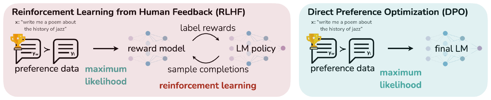
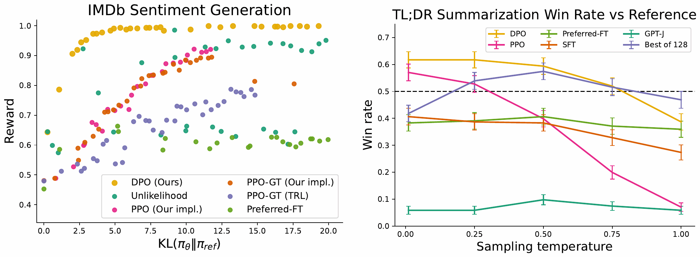
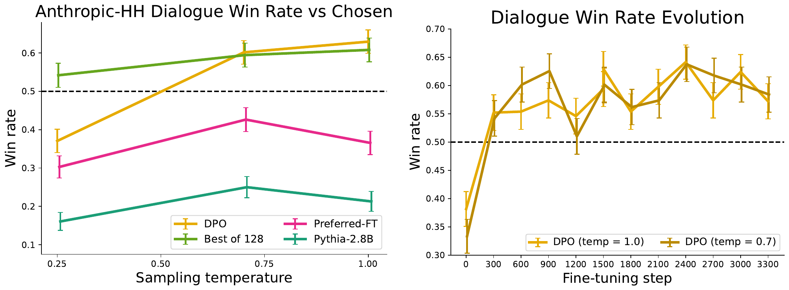
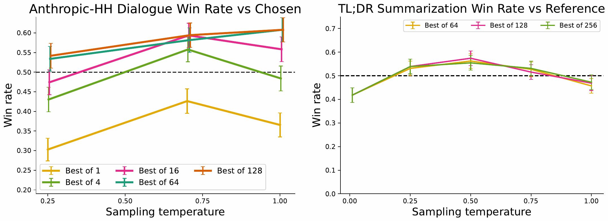
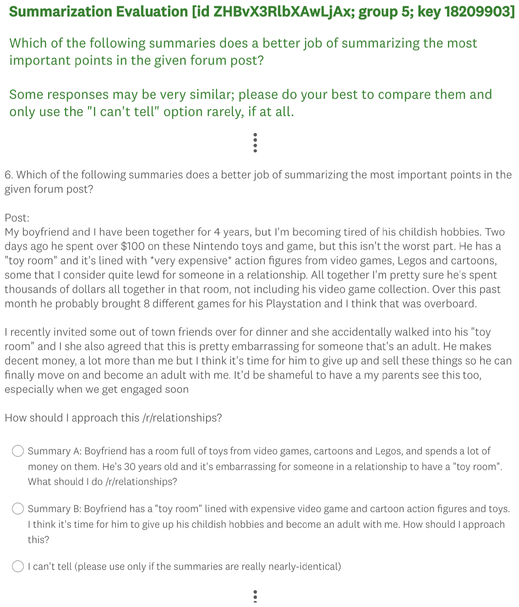

# 论文中文解读：《Direct Preference Optimization: Your Language Model is Secretly a Reward Model》

> **基本信息**：Rafael Rafailov、Archit Sharma、Eric Mitchell（三人贡献相同，署名顺序中资历较浅者靠前）、Stefano Ermon、Christopher D. Manning、Chelsea Finn（Stanford University；Ermon 另属 CZ Biohub），arXiv:2305.18290（本地 PDF 为 2024 年 7 月 29 日的 v3），NeurIPS 2023；论文原文 [官方页面](https://arxiv.org/abs/2305.18290)。
>
> **本文的读法**：图均取自论文 PDF（正文图 1–3，附录图 4、5，共 5 张）；原文表 1、表 2 逐格转录为中文表格，附录里的样例表（表 3–10）用中文概述。每张图后有中文图题、图例/坐标轴翻译和读图结论；凡从图上读出的数值都写“约”，并以正文给出的数字为准。公式编号沿用原文（式 1–10 在正文，式 11–22 在附录）。凡属解读者的补充、复算或推断，文中会明确标出。

## 一、一句话结论

把大语言模型对齐到人类偏好的主流做法是 RLHF：先用人类偏好训练一个奖励模型，再用 PPO 等强化学习在“不要偏离参考模型太远”的 KL 约束下最大化该奖励。这个流程要训练多个模型、训练中还要不断从策略采样，既复杂又不稳定。

DPO（Direct Preference Optimization，直接偏好优化）的核心观察是：带 KL 约束的奖励最大化问题有闭式最优策略 $\pi_r\propto\pi_{\mathrm{ref}}\exp(r/\beta)$，因此奖励可以反过来写成“最优策略相对参考策略的对数概率比”再加一个只依赖提示的配分项。把这个表达式代入 Bradley–Terry 偏好模型，由于偏好概率只依赖两个回答奖励的**差**，配分项被抵消，人类偏好概率就只由策略和参考策略表示。于是可以直接在偏好数据上对策略做最大似然，得到**一个简单的二分类（交叉熵）损失**，既不需要显式的奖励模型，也不需要 RL 循环和训练中的采样。论文的副标题“你的语言模型其实暗中就是一个奖励模型”指的就是这一点。

实验最大到 6B 参数，覆盖三类任务：（1）受控情感生成（IMDb）：DPO 的“奖励—KL”前沿优于 PPO，甚至优于能直接访问真实奖励的 PPO-GT；（2）Reddit TL;DR 摘要：GPT-4 评测的对参考摘要胜率约 61%（温度 0），高于 PPO 的 57%（其最佳温度 0），并且对采样温度稳健得多；（3）Anthropic-HH 单轮对话：DPO 是唯一在计算上高效、并且胜过数据集中被偏好回复的方法。此外，在分布外的 CNN/DailyMail 新闻摘要上 DPO 仍优于 PPO；人类研究显示 GPT-4 的判断与人类的一致率不低于人与人之间的一致率。

## 二、背景与动机

### 2.1 为什么要“选择”模型的行为

大规模无监督预训练的语言模型在海量数据上获得了令人惊讶的能力，但这些数据由目标、优先级和技能各不相同的人产生，其中一些并不值得模仿。论文举了两个例子：我们希望 AI 编程助手理解常见的编程错误以便纠正它们，但生成代码时，希望模型偏向训练数据里（可能很稀少的）高质量编程能力；同样，我们希望语言模型知道一个有 50% 的人相信的常见误解，但当然不希望它在 50% 的相关提问里都声称这个误解是真的。因此，从模型广泛的知识和能力中选出期望的回答与行为，是构建安全、高性能、可控的 AI 系统的关键。

### 2.2 偏好学习的已有路线与相关工作

- **指令微调**（instruction tuning）：在“指令加人写回答”的数据集上微调，能显著改进下游表现和与用户意图的对齐，并泛化到指令微调集合之外的指令。
- **从人类偏好微调**：相对的人类判断（两个回答哪个更好）往往比专家示范更容易收集，所以后续工作用人类偏好数据集微调语言模型，改进了翻译、摘要、故事生成和遵循指令的能力。这些方法先在某个偏好模型（如 Bradley–Terry 模型）下优化一个神经网络奖励函数，使其与偏好数据相容，再用强化学习（常用 REINFORCE、PPO 及其变体）微调语言模型去最大化该奖励。
- **RLAIF**：另一类相关工作用已经用人类反馈微调成遵循指令的 LLM 来生成额外的合成偏好数据（针对安全、无害等属性），人类只提供一份文字准则作为弱监督（见 [constitutional_ai](../constitutional_ai/论文中文解读.md)）。
- 这些方法是两条工作线的汇合：一条是用强化学习针对各种目标训练语言模型，一条是从人类偏好学习的一般方法。但用强化学习微调大语言模型仍是主要的实践难题；本文给出一个有理论依据、不用 RL 的优化相对偏好的方法。
- **语言之外的偏好学习**：上下文对决赌博机（contextual dueling bandit，CDB）用动作的偏好或排序而不是奖励来学习，没有绝对奖励时用 von Neumann winner（对任何其他策略的期望胜率至少 50% 的策略）代替最优策略；但 CDB 里偏好标签是在线给出的，而从人类偏好学习时通常用的是固定批次的离线偏好标注。基于偏好的强化学习（PbRL）从未知“打分函数”产生的二元偏好学习；各种算法（包括可复用离策略偏好数据的方法）通常先显式估计潜在的打分函数（即奖励模型），再去优化它。DPO 则是单阶段、直接优化策略来满足偏好。

### 2.3 RLHF 的标准流程（原文第 3 节，式 1–3）

论文回顾 Ziegler 等人提出（后续工作沿用，如 [openai_instructgpt](../openai_instructgpt/论文中文解读.md)）的 RLHF 流程，通常有三个阶段：

**阶段 1：监督微调（SFT）**。先在目标任务（对话、摘要等）的高质量数据上对预训练语言模型做监督微调，得到 $\pi^{\mathrm{SFT}}$。

**阶段 2：偏好采样与奖励学习**。用提示 $x$ 让 SFT 模型生成一对回答 $(y_1,y_2)\sim\pi^{\mathrm{SFT}}(y\mid x)$，交给人类标注员表达偏好，记作 $y_w\succ y_l\mid x$（$y_w$ 是被偏好的回答，$y_l$ 是不被偏好的回答）。假设偏好由某个我们无法接触的潜在奖励模型 $r^*(y,x)$ 产生。Bradley–Terry（BT）模型是常用选择（若有多个排序回答，更一般的 Plackett–Luce 排序模型也与本文框架相容）。BT 模型规定人类偏好分布 $p^*$ 可以写成

$$
p^*(y_1\succ y_2\mid x)=\frac{\exp\big(r^*(x,y_1)\big)}{\exp\big(r^*(x,y_1)\big)+\exp\big(r^*(x,y_2)\big)}\qquad(\text{式 1})
$$

给定从 $p^*$ 采样的静态比较数据集 $\mathcal D=\{x^{(i)},y_w^{(i)},y_l^{(i)}\}_{i=1}^N$，可以参数化一个奖励模型 $r_\phi(x,y)$ 并用最大似然估计参数。把它看成二分类问题，得到负对数似然损失

$$
\mathcal L_R(r_\phi,\mathcal D)=-\mathbb{E}_{(x,y_w,y_l)\sim\mathcal D}\Big[\log\sigma\big(r_\phi(x,y_w)-r_\phi(x,y_l)\big)\Big]\qquad(\text{式 2})
$$

其中 $\sigma$ 是 logistic（sigmoid）函数。在语言模型里，网络 $r_\phi(x,y)$ 通常用 SFT 模型初始化，并在最后一层 Transformer 之上加一个线性层，输出单个标量奖励值。为了得到方差较低的奖励函数，已有工作会对奖励做归一化，使奖励的均值为 0。

**阶段 3：RL 微调**。用学到的奖励函数为语言模型提供反馈，优化目标写成

$$
\max_{\pi_\theta}\ \mathbb{E}_{x\sim\mathcal D,\ y\sim\pi_\theta(y\mid x)}\big[r_\phi(x,y)\big]-\beta\,\mathbb{D}_{\mathrm{KL}}\big[\pi_\theta(y\mid x)\,\Vert\,\pi_{\mathrm{ref}}(y\mid x)\big]\qquad(\text{式 3})
$$

其中 $\beta$ 控制策略相对基准参考策略 $\pi_{\mathrm{ref}}$（即最初的 SFT 模型 $\pi^{\mathrm{SFT}}$）的偏离程度；实际中 $\pi_\theta$ 也用 $\pi^{\mathrm{SFT}}$ 初始化。这个约束很重要，它（1）防止模型偏离奖励模型准确的数据分布太远，（2）保持生成多样性，（3）防止塌缩到单个高奖励回答。由于语言生成是离散的，这个目标不可微，通常用强化学习优化。标准做法是构造奖励 $r(x,y)=r_\phi(x,y)-\beta\big(\log\pi_\theta(y\mid x)-\log\pi_{\mathrm{ref}}(y\mid x)\big)$，再用 PPO 最大化（见 [proximal_policy_optimization](../proximal_policy_optimization/论文中文解读.md)）。

## 三、方法：DPO

### 3.1 总体思路（图 1）

出发点是：把强化学习算法用到微调语言模型这类大规模问题上很困难，因此希望推导出一个直接用偏好优化策略的简单方法。与“先学奖励、再用 RL 优化它”的已有 RLHF 方法不同，DPO 利用一种特殊的奖励模型参数化，使得它的最优策略能够以闭式提取，因而不需要 RL 训练循环。关键洞察是利用“从奖励函数到最优策略”的解析映射，把针对奖励函数的损失变成针对策略的损失。这种变量替换（change of variables）避免了拟合一个显式、独立的奖励模型，同时仍在已有的人类偏好模型（如 Bradley–Terry）下优化。本质上，策略网络同时表示语言模型和（隐式的）奖励。



*图 1（原文 Figure 1，第 2 页）：DPO 在优化人类偏好的同时避免了强化学习。已有的用人类反馈微调语言模型的方法，先对“提示和成对回答上的人类偏好”数据集拟合一个奖励模型，再用 RL 找到最大化该奖励的策略；DPO 则用简单的分类目标直接优化最符合偏好的策略，拟合一个隐式奖励模型，其对应的最优策略可以闭式提取。*

**图中文字翻译与读法**：

- **左（粉色）Reinforcement Learning from Human Feedback (RLHF)**：示例提示 $x$：“write me a poem about the history of jazz”（写一首关于爵士乐历史的诗）；左边两个对话气泡 $y_w\succ y_l$（带奖杯的是被偏好的回答）合称 preference data（偏好数据）；箭头旁标 maximum likelihood（最大似然，青色），指向 reward model（奖励模型）；奖励模型与 LM policy（语言模型策略）之间有一个循环：上方箭头 label rewards（标注奖励），下方箭头 sample completions（采样补全），整个循环标为 reinforcement learning（强化学习，红色）。
- **右（青色）Direct Preference Optimization (DPO)**：同样的提示和偏好数据，箭头旁只有 maximum likelihood（最大似然），直接指向 final LM（最终语言模型）。
- **读图结论**：RLHF 是两阶段：先最大似然拟合奖励模型，再进入“采样—打分—更新”的强化学习循环；DPO 只有一阶段：直接在偏好数据上做最大似然，得到最终语言模型。

### 3.2 推导：从 KL 约束的最优策略到 DPO 损失（式 4–7）

**步骤 1：最优策略的闭式解（式 4）**。对任意奖励函数 $r$，带 KL 约束的奖励最大化（式 3）的最优解是

$$
\pi_r(y\mid x)=\frac{1}{Z(x)}\,\pi_{\mathrm{ref}}(y\mid x)\exp\Big(\frac{1}{\beta}r(x,y)\Big),\qquad Z(x)=\sum_{y}\pi_{\mathrm{ref}}(y\mid x)\exp\Big(\frac{1}{\beta}r(x,y)\Big)\qquad(\text{式 4})
$$

$Z(x)$ 是配分函数（partition function）。附录 A.1 的推导如下（这里的 $\mathbb{E}_x$ 表示对 $x\sim\mathcal D$ 取期望）：

$$
\begin{aligned}
\max_\pi\ \mathbb{E}_{x}\mathbb{E}_{y\sim\pi}\Big[r(x,y)-\beta\log\frac{\pi(y\mid x)}{\pi_{\mathrm{ref}}(y\mid x)}\Big]
&=\min_\pi\ \mathbb{E}_{x}\mathbb{E}_{y\sim\pi}\Big[\log\frac{\pi(y\mid x)}{\pi_{\mathrm{ref}}(y\mid x)}-\frac{1}{\beta}r(x,y)\Big]\\
&=\min_\pi\ \mathbb{E}_{x}\mathbb{E}_{y\sim\pi}\Big[\log\frac{\pi(y\mid x)}{\frac{1}{Z(x)}\pi_{\mathrm{ref}}(y\mid x)\exp\big(\frac{1}{\beta}r(x,y)\big)}-\log Z(x)\Big]\\
&=\min_\pi\ \mathbb{E}_{x}\Big[\mathbb{D}_{\mathrm{KL}}\big(\pi(\cdot\mid x)\,\Vert\,\pi^*(\cdot\mid x)\big)-\log Z(x)\Big]
\end{aligned}
$$

第一个等号是把目标除以 $\beta$ 并换号（不改变最优解）；第二个等号是在对数里同时乘除 $Z(x)$；其中 $\pi^*(y\mid x)=\frac{1}{Z(x)}\pi_{\mathrm{ref}}(y\mid x)\exp\big(\frac{1}{\beta}r(x,y)\big)$ 是一个合法的概率分布（非负且对 $y$ 求和为 1）。因为 $Z(x)$ 只依赖 $x$ 和 $\pi_{\mathrm{ref}}$，不依赖 $\pi$，最小值在第一项 KL 最小时取到；由 Gibbs 不等式，KL 散度当且仅当两个分布相同时为 0，所以最优解就是 $\pi=\pi^*$，即式 4。

**步骤 2：把奖励写成策略的函数（式 5）**。对式 4 两边取对数，整理得到

$$
r(x,y)=\beta\log\frac{\pi_r(y\mid x)}{\pi_{\mathrm{ref}}(y\mid x)}+\beta\log Z(x)\qquad(\text{式 5})
$$

这个重参数化对任意奖励函数都成立，包括真实奖励 $r^*$ 和对应的最优策略 $\pi^*$。直接用它的困难在于配分函数 $Z(x)$ 要对所有可能的回答求和，即使有 $r^*$ 的最大似然估计 $r_\phi$，估计 $Z(x)$ 仍然代价高昂。

**步骤 3：代入 Bradley–Terry，配分函数相消（式 6）**。BT 模型只依赖两个回答奖励之差，即 $p^*(y_1\succ y_2\mid x)=\sigma\big(r^*(x,y_1)-r^*(x,y_2)\big)$。把式 5 用到 $r^*$ 上再代入，$\beta\log Z(x)$ 在相减时抵消，于是人类偏好概率只由最优策略 $\pi^*$ 和参考策略 $\pi_{\mathrm{ref}}$ 表示：

$$
p^*(y_1\succ y_2\mid x)=\frac{1}{1+\exp\Big(\beta\log\frac{\pi^*(y_2\mid x)}{\pi_{\mathrm{ref}}(y_2\mid x)}-\beta\log\frac{\pi^*(y_1\mid x)}{\pi_{\mathrm{ref}}(y_1\mid x)}\Big)}\qquad(\text{式 6})
$$

（附录 A.2 的代数：$\dfrac{e^a}{e^a+e^b}=\dfrac{1}{1+e^{b-a}}=\sigma(a-b)$，其中 $a=\beta\log\frac{\pi^*(y_1\mid x)}{\pi_{\mathrm{ref}}(y_1\mid x)}+\beta\log Z(x)$，$b$ 同理。）论文指出这里用的是 BT 模型，类似地可以推出更一般的 Plackett–Luce 模型下的表达式（见 3.5 节）。

**步骤 4：对参数化策略做最大似然（式 7）**。现在人类偏好数据的概率已经用最优策略而不是奖励模型表示，就可以对参数化策略 $\pi_\theta$ 建立最大似然目标。与奖励建模（式 2）完全类似，策略目标为

$$
\mathcal L_{\mathrm{DPO}}(\pi_\theta;\pi_{\mathrm{ref}})=-\mathbb{E}_{(x,y_w,y_l)\sim\mathcal D}\Big[\log\sigma\Big(\beta\log\frac{\pi_\theta(y_w\mid x)}{\pi_{\mathrm{ref}}(y_w\mid x)}-\beta\log\frac{\pi_\theta(y_l\mid x)}{\pi_{\mathrm{ref}}(y_l\mid x)}\Big)\Big]\qquad(\text{式 7})
$$

读法：这相当于用另一种参数化拟合一个**隐式奖励** $\hat r_\theta(x,y)=\beta\log\frac{\pi_\theta(y\mid x)}{\pi_{\mathrm{ref}}(y\mid x)}$，而它的最优策略恰好就是 $\pi_\theta$。由于整个过程等价于拟合一个重新参数化的 Bradley–Terry 模型，它也具有相应的理论性质，例如在偏好数据分布的适当假设下的一致性（consistency）。可以把式 7 理解成一个二分类损失：“logit”是两个回答隐式奖励之差，标签是“$y_w$ 优于 $y_l$”。

**一个小例子（解读者构造，非原文）**：设只有两个回答 $y_1,y_2$，参考策略 $\pi_{\mathrm{ref}}=(0.5,0.5)$，奖励 $r=(1,0)$，$\beta=1$。则 $Z=0.5e^{1}+0.5e^{0}\approx1.859$，最优策略 $\pi_r\approx(0.731,0.269)$。此时 $\beta\log\frac{\pi_r}{\pi_{\mathrm{ref}}}\approx(0.380,-0.620)$，加上 $\beta\log Z\approx0.620$ 恰好还原出 $r=(1,0)$（式 5）。偏好概率 $p(y_1\succ y_2)=\sigma(1-0)\approx0.731$，用策略对数比之差算也是 $\sigma(0.380-(-0.620))=\sigma(1)\approx0.731$：$\beta\log Z$ 在作差时消失了，这正是 DPO 可以绕开配分函数的原因。

### 3.3 DPO 的更新在做什么：梯度（正文第 4 节，附录 A.4）

为从机理上理解 DPO，看损失的梯度。对参数 $\theta$ 的梯度可以写成

$$
\nabla_\theta\mathcal L_{\mathrm{DPO}}(\pi_\theta;\pi_{\mathrm{ref}})=-\beta\,\mathbb{E}_{(x,y_w,y_l)\sim\mathcal D}\Big[\sigma\big(\hat r_\theta(x,y_l)-\hat r_\theta(x,y_w)\big)\Big(\nabla_\theta\log\pi(y_w\mid x)-\nabla_\theta\log\pi(y_l\mid x)\Big)\Big]
$$

其中 $\hat r_\theta(x,y)=\beta\log\frac{\pi_\theta(y\mid x)}{\pi_{\mathrm{ref}}(y\mid x)}$ 是语言模型 $\pi_\theta$ 与参考模型 $\pi_{\mathrm{ref}}$ 隐式定义的奖励（$\pi$ 即 $\pi_\theta$）。原文用大括号标出了三个部分：

- $\sigma\big(\hat r_\theta(x,y_l)-\hat r_\theta(x,y_w)\big)$：**当奖励估计出错时权重更高**；
- $\nabla_\theta\log\pi(y_w\mid x)$：增大被偏好回答 $y_w$ 的似然；
- $-\nabla_\theta\log\pi(y_l\mid x)$：降低不被偏好回答 $y_l$ 的似然。

直观上，损失的梯度增大被偏好回答的似然、降低不被偏好回答的似然；重要的是，每个样本按“隐式奖励模型把不被偏好的回答评得多高（乘以 $\beta$）”来加权，也就是按隐式奖励模型把两个回答**排错得有多严重**来加权，并考虑了 KL 约束的强度。论文的实验表明这个加权很重要：没有权重系数的朴素版本会让语言模型退化（附录表 3，见 6.5 节）。

**推导（解读者补充）**：令 $u=\hat r_\theta(x,y_w)-\hat r_\theta(x,y_l)$，则 $\mathcal L=-\log\sigma(u)$。利用 $\sigma'(x)=\sigma(x)\big(1-\sigma(x)\big)$ 与 $\sigma(-x)=1-\sigma(x)$，有 $\nabla\mathcal L=-\frac{\sigma'(u)}{\sigma(u)}\nabla u=-\sigma(-u)\nabla u$；而 $\nabla_\theta u=\beta\big(\nabla_\theta\log\pi_\theta(y_w\mid x)-\nabla_\theta\log\pi_\theta(y_l\mid x)\big)$（参考模型项对 $\theta$ 是常数），合起来就是上面的梯度。

下面是不同隐式奖励差 $d=\hat r_\theta(x,y_w)-\hat r_\theta(x,y_l)$ 对应的样本权重 $\sigma(-d)$（解读者计算）：

| 隐式奖励差 $d$ | −4 | −2 | −1 | 0 | 1 | 2 | 4 |
|---|---:|---:|---:|---:|---:|---:|---:|
| 样本权重 $\sigma(-d)$ | 0.98 | 0.88 | 0.73 | 0.50 | 0.27 | 0.12 | 0.02 |

读法：$d<0$ 表示隐式奖励把 $y_l$ 排在了 $y_w$ 前面（排错），权重接近 1，梯度大；$d>0$ 且较大表示已经排对且很有把握，权重接近 0，几乎不再更新。训练刚开始时 $\pi_\theta=\pi_{\mathrm{ref}}$，所有样本 $d=0$、权重 0.5，损失为 $-\log\sigma(0)=\log2\approx0.693$，这可以作为实现的自检数字。

### 3.4 完整流程、实现与超参数

**DPO 流程（正文第 4 节）**：

1. 对每个提示 $x$ 从 $\pi_{\mathrm{ref}}(\cdot\mid x)$ 采样两个回答 $y_1,y_2$，由人类标注偏好，构成离线偏好数据集 $\mathcal D=\{(x^{(i)},y_w^{(i)},y_l^{(i)})\}_{i=1}^N$；
2. 针对给定的 $\pi_{\mathrm{ref}}$、$\mathcal D$ 和所需的 $\beta$，优化语言模型 $\pi_\theta$ 以最小化 $\mathcal L_{\mathrm{DPO}}$。

**参考模型怎么选**：实际中人们更希望复用公开的偏好数据集，而不是自己采样并收集偏好。由于这些偏好数据集是用 $\pi^{\mathrm{SFT}}$ 采样的，只要有 SFT 模型就令 $\pi_{\mathrm{ref}}=\pi^{\mathrm{SFT}}$；没有 SFT 模型时，用最大化被偏好回答的似然来初始化 $\pi_{\mathrm{ref}}=\arg\max_\pi\mathbb{E}_{x,y_w\sim\mathcal D}\big[\log\pi(y_w\mid x)\big]$，以缓解“真实的参考分布不可得”与 DPO 所用 $\pi_{\mathrm{ref}}$ 之间的分布偏移。

**一次训练迭代在做什么**（解读者对附录 B 代码的说明）：

1. 取一个 minibatch 的偏好对 $(x,y_w,y_l)$；
2. 分别计算当前策略与冻结的参考策略对 $y_w$、$y_l$ 的整条回答对数概率 $\log\pi(y\mid x)$（逐 token 对数概率求和；参考模型的值可以预先算好缓存）；
3. 算出间隔 $\beta\big[(\log\pi_\theta(y_w)-\log\pi_{\mathrm{ref}}(y_w))-(\log\pi_\theta(y_l)-\log\pi_{\mathrm{ref}}(y_l))\big]$；
4. 损失取 $-\log\sigma(\text{间隔})$，只对 $\pi_\theta$ 反传。

论文附录 B 给出的 PyTorch 参考实现如下（原文代码）：

```python
import torch.nn.functional as F

def dpo_loss(pi_logps, ref_logps, yw_idxs, yl_idxs, beta):
    """
    pi_logps: policy logprobs, shape (B,)
    ref_logps: reference model logprobs, shape (B,)
    yw_idxs: preferred completion indices in [0, B-1], shape (T,)
    yl_idxs: dispreferred completion indices in [0, B-1], shape (T,)
    beta: temperature controlling strength of KL penalty

    Each pair of (yw_idxs[i], yl_idxs[i]) represents the
      indices of a single preference pair.
    """

    pi_yw_logps,  pi_yl_logps =  pi_logps[yw_idxs], pi_logps[yl_idxs]
    ref_yw_logps, ref_yl_logps = ref_logps[yw_idxs], ref_logps[yl_idxs]

    pi_logratios  = pi_yw_logps - pi_yl_logps
    ref_logratios = ref_yw_logps - ref_yl_logps

    losses = -F.logsigmoid(beta * (pi_logratios - ref_logratios))
    rewards = beta * (pi_logps - ref_logps).detach()

    return losses, rewards
```

读法：`pi_logps`、`ref_logps` 是各条回答的（序列级）对数概率；`losses` 就是式 7 中 $\log\sigma$ 里的间隔取负对数 sigmoid；`rewards` 是隐式奖励 $\hat r_\theta=\beta(\log\pi_\theta-\log\pi_{\mathrm{ref}})$，只用于监控，不参与反传。

**默认超参数**（附录 B）：

| 项目 | 取值 |
|---|---|
| $\beta$ | 0.1；TL;DR 摘要用 0.5 |
| batch size | 64 |
| 优化器 | RMSprop |
| 学习率 | 1e-6，前 150 步从 0 线性 warmup 到 1e-6 |

论文还强调“几乎没有调超参数”：在摘要实验里没有认真调 $\beta$，所以结果可能低估了 DPO。

### 3.5 推广到 Plackett–Luce 排序（附录 A.3，式 18–20）

Plackett–Luce 模型是 BT 模型在排序（而不是成对比较）上的推广：面对一个提示 $x$ 和 $K$ 个回答 $y_1,\dots,y_K$，用户给出一个排序 $\tau:[K]\to[K]$（$\tau(k)$ 是排第 $k$ 名的回答下标）。该模型规定

$$
p^*(\tau\mid y_1,\dots,y_K,x)=\prod_{k=1}^{K}\frac{\exp\big(r^*(x,y_{\tau(k)})\big)}{\sum_{j=k}^{K}\exp\big(r^*(x,y_{\tau(j)})\big)}\qquad(\text{式 18})
$$

即“依次从剩下的回答里选出当前最好的”，每一步按 softmax 概率选取。$K=2$ 时退化为 BT 模型。对一般的 Plackett–Luce，仍可用式 5 把奖励换成最优策略表示，$Z(x)$ 同样相消，得到

$$
p^*(\tau\mid y_1,\dots,y_K,x)=\prod_{k=1}^{K}\frac{\exp\Big(\beta\log\frac{\pi^*(y_{\tau(k)}\mid x)}{\pi_{\mathrm{ref}}(y_{\tau(k)}\mid x)}\Big)}{\sum_{j=k}^{K}\exp\Big(\beta\log\frac{\pi^*(y_{\tau(j)}\mid x)}{\pi_{\mathrm{ref}}(y_{\tau(j)}\mid x)}\Big)}\qquad(\text{式 19})
$$

对带用户排序的数据集 $\mathcal D=\{\tau^{(i)},y_1^{(i)},\dots,y_K^{(i)},x^{(i)}\}_{i=1}^N$，同样用参数化策略做最大似然：

$$
\mathcal L_{\mathrm{DPO}}(\pi_\theta,\pi_{\mathrm{ref}})=-\mathbb{E}_{\tau,y_1,\dots,y_K,x\sim\mathcal D}\Bigg[\log\prod_{k=1}^{K}\frac{\exp\Big(\beta\log\frac{\pi_\theta(y_{\tau(k)}\mid x)}{\pi_{\mathrm{ref}}(y_{\tau(k)}\mid x)}\Big)}{\sum_{j=k}^{K}\exp\Big(\beta\log\frac{\pi_\theta(y_{\tau(j)}\mid x)}{\pi_{\mathrm{ref}}(y_{\tau(j)}\mid x)}\Big)}\Bigg]\qquad(\text{式 20})
$$

论文的实验只使用了成对偏好（BT）形式。

## 四、理论分析（原文第 5 节与附录 A.5–A.6）

### 4.1 你的语言模型其实是奖励模型

DPO 同时绕开了“拟合显式奖励”和“用 RL 学策略”这两步，只用一个最大似然目标。注意式 5 的优化目标等价于一个奖励参数化为 $r^*(x,y)=\beta\log\frac{\pi_\theta^*(y\mid x)}{\pi_{\mathrm{ref}}(y\mid x)}$ 的 BT 模型，而我们优化参数化模型 $\pi_\theta$，在变量替换下等价于式 2 的奖励模型优化。这一节要说明：这种重参数化**没有限制可学到的奖励模型的类别**，并且允许精确恢复最优策略。

**定义 1（奖励等价）**：两个奖励函数 $r(x,y)$ 与 $r'(x,y)$ 等价，当且仅当存在某个函数 $f$ 使 $r(x,y)-r'(x,y)=f(x)$。这显然是一个等价关系，把所有奖励函数划分成若干等价类。直观地说，对同一个提示 $x$ 下的所有回答加上同一个与回答无关的偏移，不改变回答之间的相对好坏。

**引理 1**：在 Plackett–Luce（特别是 Bradley–Terry）偏好框架下，同一等价类里的两个奖励函数诱导相同的偏好分布。

**引理 2**：同一等价类里的两个奖励函数在带约束的 RL 问题下诱导相同的最优策略。

证明（附录 A.5）都很直接。引理 1：$r'=r+f(x)$ 时，式 18 里每个分式的分子分母同乘 $\exp(f(x))$，抵消后得到相同的概率。引理 2：由式 4，$\pi_{r'}(y\mid x)=\dfrac{\pi_{\mathrm{ref}}(y\mid x)\exp\big((r+f(x))/\beta\big)}{\sum_{y}\pi_{\mathrm{ref}}(y\mid x)\exp\big((r+f(x))/\beta\big)}$，分子分母各含一个 $\exp(f(x)/\beta)$，约去后等于 $\pi_r(y\mid x)$。引理 1 是 Plackett–Luce 模型族已知的“欠定”（under-specification）问题，为了对式 2 的最大似然估计有任何保证，通常需要额外的可识别性约束；引理 2 则说明同一类的奖励函数给出同一个最优策略，所以就最终目标而言，我们只需在最优类里恢复**任意一个**奖励函数。

**定理 1**：在温和的假设下（附录 A.6 的假设是：参考模型对所有提示 $x$ 与回答 $y$ 满足 $\pi_{\mathrm{ref}}(y\mid x)>0$，且 $\beta>0$），所有与 Plackett–Luce（特别是 Bradley–Terry）模型一致的奖励等价类，都可以用重参数化 $r(x,y)=\beta\log\frac{\pi(y\mid x)}{\pi_{\mathrm{ref}}(y\mid x)}$ 表示，其中 $\pi(y\mid x)$ 是某个模型，$\pi_{\mathrm{ref}}$ 是给定的参考模型。

**证明思路**：对任意奖励 $r$，它诱导最优模型 $\pi_r$（式 4）。我们要证明在 $r$ 的等价类里有一个奖励可以写成上面的形式。定义投影

$$
f(r;\pi_{\mathrm{ref}},\beta)(x,y)=r(x,y)-\beta\log\sum_{y'}\pi_{\mathrm{ref}}(y'\mid x)\exp\Big(\frac{1}{\beta}r(x,y')\Big)\qquad(\text{式 8})
$$

（原文在求和里沿用了变量名 $y$，这里改成 $y'$ 以免与外面的 $y$ 混淆。）算子 $f$ 只是用 $r$ 诱导的最优策略配分函数的对数去归一化奖励。因为被减去的项只是 $x$ 的函数，所以 $f(r;\pi_{\mathrm{ref}},\beta)(x,y)$ 与 $r$ 在同一个等价类里。最后把式 5（对任何奖励都成立）代入，得到 $f(r;\pi_{\mathrm{ref}},\beta)(x,y)=\beta\log\frac{\pi_r(y\mid x)}{\pi_{\mathrm{ref}}(y\mid x)}$：投影 $f$ 产生了等价类里具有所需形式的成员，因此这种重参数化没有损失一般性。

**另一种看法**：定理 1 精确指出 DPO 的重参数化在每个等价类里选出的是满足下式的那个奖励函数：

$$
\sum_{y}\pi_{\mathrm{ref}}(y\mid x)\exp\Big(\frac{1}{\beta}r(x,y)\Big)=1\qquad(\text{式 9})
$$

也就是 $\pi(y\mid x)=\pi_{\mathrm{ref}}(y\mid x)\exp\big(r(x,y)/\beta\big)$ 本身就是合法分布（概率为正且和为 1）。而按式 4，式 9 的左边正是该奖励函数诱导的最优策略的配分函数。论文总结 DPO 的关键洞察：可以对欠约束的 Plackett–Luce（特别是 BT）偏好模型族施加某些约束，使得**可表示的奖励模型类保持不变**，但对所有提示 $x$，式 4 里的最优策略在解析上都是可处理的。

**命题 1（唯一性，附录 A.6）**：在同样的假设下，每个奖励等价类里**恰有一个**奖励函数可以写成 $\beta\log\frac{\pi(y\mid x)}{\pi_{\mathrm{ref}}(y\mid x)}$ 的形式。证明用反证法：若同一类里的 $r'=r+f(x)$ 且二者都可这样重参数化（对应模型 $\pi'$ 与 $\pi$），则 $\pi(y\mid x)\exp\big(f(x)/\beta\big)=\pi'(y\mid x)$；两边对 $y$ 求和（都是分布），得 $\exp\big(f(x)/\beta\big)=1$，所以 $f(x)=0$，即 $r=r'$。

### 4.2 为什么 actor-critic 算法（如 PPO）会不稳定

论文也用这个框架来诊断 RLHF 里标准 actor-critic 算法的不稳定性，聚焦第 3 节的 RL 微调步骤，并借用“控制即推断”（control as inference）的框架：假设参数化模型 $\pi_\theta(y\mid x)$，最小化 $\mathbb{D}_{\mathrm{KL}}\big[\pi_\theta(y\mid x)\,\Vert\,\pi^*(y\mid x)\big]$，其中 $\pi^*$ 是奖励函数 $r_\phi$ 诱导的最优策略（式 4）。经过一些代数，得到优化目标

$$
\max_{\pi_\theta}\ \mathbb{E}_{\pi_\theta(y\mid x)}\Big[f(r_\phi,\pi_{\mathrm{ref}},\beta)(x,y)-\beta\log\frac{\pi_\theta(y\mid x)}{\pi_{\mathrm{ref}}(y\mid x)}\Big]\qquad(\text{式 10})
$$

其中 $f(r_\phi,\pi_{\mathrm{ref}},\beta)(x,y)=r_\phi(x,y)-\beta\log\sum_{y'}\pi_{\mathrm{ref}}(y'\mid x)\exp\big(\frac{1}{\beta}r_\phi(x,y')\big)$ 就是式 8 的归一化项（原文用括号标出：前两项是 $f$，最后一项是 KL）。这与以往工作优化的目标相同，只不过用的是与 DPO 等价的奖励类。论文的解读是：$f$ 里的归一化项可以看作参考策略 $\pi_{\mathrm{ref}}$ 的**软价值函数**（soft value function）。它不影响最优解，但如果没有它，目标的策略梯度可能方差很大，使学习不稳定。可以用一个学出来的价值函数来处理这个归一化项，但那同样可能难以优化；另一条路是像以往工作那样用人类补全作为基线来归一化奖励，本质上是对归一化项做单样本蒙特卡洛估计。相比之下，DPO 的重参数化给出的奖励函数**不需要任何基线**。

（原文这一节写的是“$\pi^*$ 是式 7 中的最优策略”，而最优策略在式 4，式 7 是 DPO 损失，应是笔误。）

## 五、实验设置

### 5.1 三个任务

所有实验都是从偏好数据集 $\mathcal D=\{x^{(i)},y_w^{(i)},y_l^{(i)}\}_{i=1}^N$ 学习一个策略。

| 任务 | 输入 $x$ | 偏好数据 | 模型 | 评测 |
|---|---|---|---|---|
| 受控情感生成（IMDb） | 电影评论的前缀（2–8 个 token），策略须生成情感为正面的续写 | 用预训练情感分类器（siebert/sentiment-roberta-large-english）构造偏好对：满足 $p(\text{positive}\mid x,y_w)>p(\text{positive}\mid x,y_l)$ | gpt2-large | 真实奖励（该分类器）与 KL 的前沿 |
| 摘要（Reddit TL;DR） | Reddit 论坛帖子，策略须概括要点 | Völske 等的 TL;DR 数据集，加上 Stiennon 等收集的人类偏好；偏好是在另一个训练方式类似的 SFT 模型的样本上收集的 | GPT-J（6B）的 SFT 模型（CarperAI/openai_summarize_tldr_sft，在人写的论坛帖摘要上微调，用 TRLX 框架做 RLHF） | GPT-4 判断的、对测试集参考摘要的胜率 |
| 单轮对话（Anthropic HH） | 人类提问，可以是天体物理问题也可以是感情建议 | Anthropic Helpful and Harmless 对话数据集：17 万条人与自动助手的对话，每条对话末尾有一对由某个大型（未知）语言模型生成的回复，并带有人类偏好标签 | Pythia-2.8B；没有现成的 SFT 模型，所以只在被偏好回复上微调一个现成语言模型作为 SFT/参考模型（即 Preferred-FT） | GPT-4 判断的、对测试集里被偏好回复（chosen）的胜率；只用只含一步人机交互的子集 |

IMDb 实验的附录细节（附录 C.1）：先在 IMDb 数据的一个子集上做 1 个 epoch 的监督微调；用这个模型为 25,000 个前缀各采样 4 个补全，每个前缀用真实奖励模型造 6 个偏好对（$\binom{4}{2}=6$）；RLHF 的奖励模型用 gpt2-large 初始化，在这些偏好数据上训练 3 个 epoch，取验证集准确率最高的检查点；“TRL”一组使用 TRL 库的超参数，作者自己的 PPO 实现每个 PPO 步用更大的 1024 个样本批次。选用较大的 gpt2-large 与情感分类器，是因为默认的较小版本生成质量低、奖励也不太准确。

### 5.2 评测方式

- **受控情感生成**：因为有真实奖励函数（情感分类器），直接用算法达到的“真实奖励”与“相对参考策略的 KL”构成的前沿来评价，这个前沿可以直接计算；
- **摘要与对话**：现实里真实奖励函数未知，所以用对基线策略的**胜率**评价，以 GPT-4 作为人类判断的代理，评价摘要质量和回复的有用程度。摘要里基线是测试集的参考摘要；对话里基线是测试集中被偏好的回复。评测用 gpt-4-0314，A/B 的呈现顺序每次随机；
- 作者在 6.4 节做人类研究证明使用 GPT-4 的合理性。

### 5.3 对比方法

| 方法 | 含义 |
|---|---|
| 提示（zero-shot / 2-shot） | 摘要任务用 GPT-J 零样本提示；对话任务用 Pythia-2.8B 的 2-shot 提示 |
| SFT | 监督微调得到的模型 |
| Preferred-FT | 在被偏好回答 $y_w$ 上做监督微调（受控情感和摘要里从 SFT 模型出发，单轮对话里从通用语言模型出发） |
| Unlikelihood | 伪监督方法：最大化 $y_w$ 的概率同时最小化 $y_l$ 的概率，可对“unlikelihood”项加系数 $\alpha\in[0,1]$ |
| PPO | 用从偏好数据学到的奖励函数做 PPO |
| PPO-GT | “oracle”：在受控情感设置里直接用真实奖励函数做 PPO；用了两种实现，现成版本（TRL）和一个改进版（对奖励做归一化并进一步调超参数；这些改动也用于使用学到奖励的“普通” PPO） |
| Best of N | 从 SFT 模型（对话里是 Preferred-FT）采样 $N$ 个回答，返回按偏好数据学到的奖励函数得分最高者；性能很好，且把奖励模型质量与 PPO 优化解耦，但测试时每个查询要采样 $N$ 次，即使 $N$ 不大也不实用 |

## 六、实验结果

### 6.1 DPO 能多好地优化 RLHF 目标（图 2 左）

典型 RLHF 算法使用的 KL 约束奖励最大化目标，在“利用奖励”和“限制策略偏离参考策略”之间权衡。因此比较算法时要同时看达到的奖励与 KL；多拿一点奖励却付出高得多的 KL 不见得更好。论文在情感设置里画出各算法的奖励—KL 前沿（图 2 左）。每种算法运行多次，每次用不同的“策略保守度”超参数：PPO 的目标 KL 取 $\{3,6,9,12\}$，DPO 的 $\beta\in\{0.05,0.1,1,5\}$，unlikelihood 的 $\alpha\in\{0.05,0.1,0.5,1\}$，Preferred-FT 用不同随机种子，共 22 次运行。每训练 100 步直到收敛，在一组测试提示上评估：真实奖励函数下的平均奖励，以及与参考策略 $\mathrm{KL}(\pi\,\Vert\,\pi_{\mathrm{ref}})$ 的平均序列级 KL（各时间步 KL 之和）。



*图 2（原文 Figure 2，第 7 页）：左，期望奖励与相对参考策略的 KL 的前沿。DPO 在所有 KL 值上都给出最高的期望奖励，说明优化质量高。右，以 GPT-4 为评测者，TL;DR 摘要相对人写摘要的胜率。DPO 超过了 PPO 的最佳表现，同时对采样温度的变化更稳健。*

**图中文字翻译与读法**：

- **左图 IMDb Sentiment Generation（IMDb 情感生成）**：横轴 $\mathrm{KL}(\pi_\theta\Vert\pi_{\mathrm{ref}})$（0–20），纵轴 Reward（奖励，约 0.4–1.0）；每个点是某次运行某个检查点的（KL，平均奖励）。图例：DPO (Ours)（金黄）、Unlikelihood（青绿）、PPO (Our impl.)（粉红）、PPO-GT (Our impl.)（橙）、PPO-GT (TRL)（紫）、Preferred-FT（橄榄绿）。
- 读数（约，从图上读出）：DPO 在 KL 约 2 时奖励约 0.91，KL 约 5 以后约 0.99，之后一直接近 1.0；同样 KL 约 5 时 PPO（本文实现）约 0.72，KL 约 10 时约 0.88–0.90，最高约 0.92（KL 约 11.7）；PPO-GT（本文实现）最高约 0.89（KL 约 12；另有两个离群点约 0.81）；PPO-GT（TRL）最高约 0.79；Unlikelihood 的点很分散（约 0.57–0.99），不稳定地偶尔达到高奖励；Preferred-FT 基本停在约 0.45–0.66，没有随 KL 提升。
- 右图见 6.2 节。
- **读图结论**：DPO 与 PPO 优化的是同一个目标，但 DPO 明显更高效：它的奖励/KL 权衡**严格优于** PPO；而且即使 PPO 能访问真实奖励（PPO-GT），DPO 的前沿也更好。注意这是 IMDb 这个受控、可直接评估真实奖励的设置，PPO 一侧的结果还受实现与调参影响（作者对 PPO-GT 做了奖励归一化和调参）。

### 6.2 能扩展到真实偏好数据集吗：摘要与单轮对话（图 2 右、图 3、图 4）

**摘要（TL;DR）**。自动指标如 ROUGE 与人类偏好的相关性可能很差，已有工作发现用人类偏好数据通过 PPO 微调能得到更有效的摘要。论文在 TL;DR 测试集上采样补全，计算对测试集参考补全的平均胜率；所有方法的补全在 0.0 到 1.0 的温度下采样，胜率见图 2 右。DPO、PPO 和 Preferred-FT 都微调同一个 GPT-J SFT 模型。结果：

- DPO 在温度 0.0 时胜率约 **61%**，超过 PPO 在其最优采样温度 0.0 时的 **57%**；
- DPO 的最大胜率也高于 Best of N 基线（图 2 右里是 Best of 128）；
- 作者没有认真调 DPO 的 $\beta$，所以这些结果可能低估了 DPO 的潜力；
- DPO 对采样温度**比 PPO 稳健得多**，PPO 的表现在高温下可能退化到基础 GPT-J 的水平；
- Preferred-FT 相对 SFT 没有显著提升；
- 在 6.4 节的人类评测里，DPO（温度 0.25）对 PPO（温度 0）有 58% 的比较被偏好。

**图 2 右的近似读数**（胜率，从图上读出；虚线为 0.5，即与参考摘要打平）：

| 方法 | 温度 0.0 | 0.25 | 0.5 | 0.75 | 1.0 |
|---|---:|---:|---:|---:|---:|
| DPO | 约 0.62 | 约 0.62 | 约 0.59 | 约 0.52 | 约 0.39 |
| PPO | 约 0.57 | 约 0.53 | 约 0.40 | 约 0.20 | 约 0.07 |
| Best of 128 | 约 0.42 | 约 0.54 | 约 0.57 | 约 0.52 | 约 0.47 |
| SFT | 约 0.41 | 约 0.39 | 约 0.38 | 约 0.33 | 约 0.27 |
| Preferred-FT | 约 0.38 | 约 0.39 | 约 0.41 | 约 0.37 | 约 0.36 |
| GPT-J（零样本） | 约 0.06 | 约 0.06 | 约 0.10 | 约 0.07 | 约 0.06 |

**图中文字翻译与读法（图 2 右）**：标题 TL;DR Summarization Win Rate vs Reference（TL;DR 摘要对参考摘要的胜率），横轴 Sampling temperature（采样温度，0.00–1.00），纵轴 Win rate（胜率），带误差棒（正文未说明误差棒的统计口径）。图例：DPO（金）、PPO（粉）、Preferred-FT（绿）、SFT（橙）、GPT-J（青绿，零样本）、Best of 128（紫）。读图：DPO 在温度 0–0.5 之间都高于 0.5 且几乎持平，随温度升高才下降；PPO 只在最低温度 0.0 时较好，温度一升高就快速崩溃；Best of 128 在中间温度（约 0.5）达到最高；SFT 与 Preferred-FT 从未超过 0.5，且都比 DPO 低。

**单轮对话（Anthropic HH）**。在测试集中只含一步人机交互的子集上评估，GPT-4 以测试集里被偏好的回复作为参照来算各方法的胜率。因为没有标准的 SFT 模型，从预训练的 Pythia-2.8B 出发，用 Preferred-FT 在被偏好回复上训练一个参考模型，使补全落在模型的分布内，再用 DPO 训练。作者还与 Preferred-FT 的 Best of 128 补全（Best-of-N 基线在这个任务上约 128 个样本就趋于平台，见图 4）以及 2-shot 提示的 Pythia-2.8B 基础模型比较，发现各方法在其最佳温度下，DPO 表现相当或更好。作者还评测了一个来自知名来源（reciprocate/ppo_hh_pythia-6B，TRLX 的 hh 示例）、用 PPO 在 Anthropic HH 上训练的 RLHF 模型，但找不到能让它优于基础 Pythia-2.8B 的提示或采样温度。基于 TL;DR 的结果以及两种方法优化同一个奖励函数的事实，作者把 Best of 128 视为 PPO 水平性能的粗略代理。总体上，DPO 是**唯一在计算上高效、并胜过 Anthropic HH 数据集里被偏好补全**的方法，并且与计算上昂贵的 Best of 128 基线表现相近或更好。图 3 右表明 DPO 收敛到最佳表现相对较快。



*图 3（原文 Figure 3，第 8 页）：左，GPT-4 对 Anthropic-HH 单步对话计算的胜率；DPO 是唯一胜过 Anthropic-HH 测试集里被偏好回复（原文图题此处写作 “chosen summaries”，应指 chosen responses）的方法。右，不同采样温度下，胜率在训练过程中的变化。DPO 相对数据集标签的提升在训练过程中相当稳定，对不同采样温度都是如此。*

**图中文字翻译与读法**：

- **左图 Anthropic-HH Dialogue Win Rate vs Chosen（对话：对被偏好回复的胜率）**：横轴 Sampling temperature（采样温度；三个点实际位于约 0.25、0.7、1.0，与右图图例的 0.7 对应），纵轴 Win rate；虚线为 0.5。图例：DPO（金）、Best of 128（绿）、Preferred-FT（粉）、Pythia-2.8B（青绿，2-shot 提示）。
- **右图 Dialogue Win Rate Evolution（对话胜率随训练的演变）**：横轴 Fine-tuning step（微调步数，0–3300），纵轴 Win rate；两条曲线是 DPO 在采样温度 1.0（浅金）和 0.7（深金）下的胜率。
- **左图近似读数**（从图上读出）：

| 方法 | 温度 0.25 | 0.7 | 1.0 |
|---|---:|---:|---:|
| DPO | 约 0.37 | 约 0.60 | 约 0.63 |
| Best of 128 | 约 0.54 | 约 0.59 | 约 0.61 |
| Preferred-FT | 约 0.30 | 约 0.43 | 约 0.37 |
| Pythia-2.8B（2-shot） | 约 0.16 | 约 0.25 | 约 0.21 |

- **右图读数**：训练 0 步时胜率约 0.38（温度 1.0）/ 0.33（温度 0.7），到 300 步已升到约 0.55 / 0.54；之后在约 0.51–0.64 间波动，最高约 0.64（约 2400 步），3300 步时约 0.57 / 0.585。
- **读图结论**：DPO 在较高温度（0.7、1.0）下胜过被偏好回复（约 0.60–0.63），而在低温 0.25 时只有约 0.37，**与摘要任务里“低温最好”的趋势相反**，论文没有解释这一点；Best of 128 在所有温度下都高于 0.5，但代价是每个查询要采样 128 次并用奖励模型打分。右图说明训练约 300 步后就越过 0.5，且之后相对稳定；论文在讨论里把右图末期的轻微下降列为“是否是奖励过度优化”的开放问题。

**图 4：Best of N 基线的 N 值扫描**（附录 D.1）。



*图 4（原文 Figure 4，第 23 页）：Best of N 基线，$N=\{1,4,16,64,128\}$。性能在大约 64–128 个样本之后趋于平台。*

**图中文字翻译与读法**：左图 Anthropic-HH Dialogue Win Rate vs Chosen，图例 Best of 1、4、16、64、128；右图 TL;DR Summarization Win Rate vs Reference，图例 Best of 64、128、256（原文图题只写了 $N$ 到 128，右图其实还画了 $N=256$）。读数（约）：对话里 Best of 1 在三个温度约 0.30 / 0.43 / 0.37（与图 3 左的 Preferred-FT 一致，因为对话里 Best-of-N 从 Preferred-FT 采样），Best of 4 约 0.43 / 0.56 / 0.48，Best of 16 约 0.47 / 0.59 / 0.56，Best of 64 约 0.53 / 0.58 / 0.61，Best of 128 约 0.54 / 0.59 / 0.61；摘要里 $N=64,128,256$ 的三条曲线几乎重合（约 0.42、0.53–0.54、0.55–0.57、0.52–0.53、0.46–0.47，温度依次为 0、0.25、0.5、0.75、1.0）。结论：$N$ 超过 64–128 之后再增大样本数几乎没有收益，所以 Best of 128 可以作为这个基线的上限。

### 6.3 泛化到新的输入分布（表 1）

为进一步比较 PPO 与 DPO 在分布偏移下的表现，论文把 Reddit TL;DR 摘要实验里的 PPO 与 DPO 策略拿到另一个分布上评测：CNN/DailyMail 数据集测试集里的新闻文章，使用 TL;DR 上最好的采样温度（0 和 0.25）。GPT-4 胜率是对数据集里的真实摘要计算，用与 Reddit TL;DR 相同的 GPT-4 (C) 提示，只是把“forum post（论坛帖）”换成“news article（新闻文章）”。

**表 1：GPT-4 对分布外 CNN/DailyMail 输入文章的真实摘要的胜率**

| 算法 | 温度 0 | 温度 0.25 |
|---|---:|---:|
| DPO | 0.36 | 0.31 |
| PPO | 0.26 | 0.23 |

（原文表 1，第 9 页。）读法：在这个新分布上 DPO 仍显著优于 PPO 策略。论文称这是初步证据，说明 DPO 策略的泛化可以与 PPO 策略相当，尽管 DPO 没有使用 PPO 用到的、额外的无标签 Reddit TL;DR 提示。注意绝对数字（0.36、0.26）远低于 TL;DR 上的约 0.6 和 0.57；解读者推断这是因为这里的参照是新闻数据集里的真实摘要，而策略并不是在新闻上训练的（论文没有解释）。两个实验的绝对胜率不可直接比较，该表的信息主要在 DPO 与 PPO 的相对关系。

### 6.4 用人类研究验证 GPT-4 的判断（表 2、图 5）

为验证 GPT-4 判断的可靠性，论文用 TL;DR 摘要实验的结果和两种不同的 GPT-4 提示做了人类研究：

- **GPT-4 (S)**（simple，简单）提示只问哪个摘要更好地概括了帖子里的重要信息；
- **GPT-4 (C)**（concise，简洁）提示还问哪个摘要更简洁。之所以评测它，是因为发现在 (S) 提示下 GPT-4 比人类更偏好更长、更重复的摘要。两个提示的完整文本见下。

比较三组：用最高（DPO，温度 0.25）、最低（PPO，温度 1.0）和中间（SFT，温度 0.25）的方法，以覆盖不同的样本质量；三者都与贪心采样（温度 0）的 PPO（其最佳温度）比较。由于人类评分员有限，只对 DPO 与 PPO-1 两组收集了多个人类判断。

**表 2：TL;DR 摘要样本上人类与 GPT-4 的胜率及逐条判断一致率**（每个实验都是把所列方法的摘要与温度 0 的 PPO 的摘要比较；PPO-1 指温度 1.0 的 PPO）

| 指标 | DPO（温度 0.25） | SFT（温度 0.25） | PPO-1（温度 1.0） |
|---|---:|---:|---:|
| N respondents（判断条数） | 272 | 122 | 199 |
| GPT-4 (S) win % | 47 | 27 | 13 |
| GPT-4 (C) win % | 54 | 32 | 12 |
| Human win % | 58 | 43 | 17 |
| GPT-4 (S)-H agree | 70 | 77 | 86 |
| GPT-4 (C)-H agree | 67 | 79 | 85 |
| H-H agree | 65 | – | 87 |

（原文表 2，第 10 页；“–”为原表空白，因为 SFT 一组每条比较只有一位人类评分员，没有人与人的一致率。）读法：

- **胜率**（win %）是所列方法的摘要被偏好于“温度 0 的 PPO”摘要的比例，不是相对参考摘要的胜率，与 6.2 节的数字口径不同。人类对 DPO 的胜率是 58%（与正文“DPO 温度 0.25 对 PPO 温度 0 被偏好 58%”一致）；GPT-4 (S) 给 47%（略低于 50%），GPT-4 (C) 给 54%，后者更接近人类。所以论文说 (C) 提示的胜率总体更能代表人类，主结果（6.2 节）就用 (C)。
- **一致率**（agree）是逐条判断的一致百分比。DPO 对 PPO 这组：GPT-4 与人类的一致率（70、67）不低于人与人之间的一致率（65）；PPO-1 对 PPO 这组：GPT-4 与人类 86、85，略低于人与人之间的 87。因此论文结论是：GPT-4 与人类的一致率大致相当于人与人之间的一致率，是人类评测的合理代理。
- “N respondents” 实际是判断条数（附录 D.3：DPO 对 PPO 共 275 条、PPO-1 对 PPO 共 200 条、SFT 125 条，忽略了人类标成平局的判断，这类判断只占约 1%，所以表中是 272、199、122）。

**人类研究细节**（附录 D.3）：随机抽 150 对 DPO 与 PPO-0 的比较和 100 对 PPO-1 与 PPO-0 的比较，每对分配两名人类评分员；抽 125 对 SFT 的比较，每对只分配一名人类。共 25 名志愿者评分员，每人比较 25 对摘要（一位志愿者交晚了，没有计入最终分析）；他们是 Stanford 的本科生到博士生、近期毕业生或访问者，以理工科（主要是计算机）背景为主。DPO 对 PPO 这一组按 150 对×2 人应有 300 条判断，实际只有 275 条，原因见脚注 7：有一位志愿者没有回答 DPO 与 PPO 的比较（差额正好是 25 条）。评分界面是 SurveyMonkey 的问卷（图 5）。



*图 5（原文 Figure 5，第 27 页）：SurveyMonkey 问卷的版式。每位答卷者完成 25 条格式相同的判断。*

**图中文字翻译与读法**：顶部（绿色）为问卷说明：“Summarization Evaluation [id …; group 5; key …]”（摘要评测，编号为问卷内部标识）；“Which of the following summaries does a better job of summarizing the most important points in the given forum post?”（下面哪个摘要更好地概括了给定论坛帖里最重要的要点？）；“Some responses may be very similar; please do your best to compare them and only use the "I can't tell" option rarely, if at all.”（有些回答可能很相似；请尽量比较它们，只在极少数情况下才使用“我分不出来”这个选项）。中间是一条示例：帖子（一个人抱怨交往 4 年的男友迷恋玩具和游戏，家里有一间昂贵的“玩具房”，问该怎么办，来自 /r/relationships），之后是 Summary A、Summary B 两个摘要和 “I can't tell (please use only if the summaries are really nearly-identical)”（只在两个摘要几乎一模一样时才选）三个单选项。**读图结论**：人类评分员看到的是一个帖子和两个摘要，二选一，平局选项被明确限制。

**论文使用的 GPT-4 提示（附录 C.2）**。摘要 (S)：

```text
Which of the following summaries does a better job of summarizing the most \
important points in the given forum post?

Post:
<post>

Summary A:
<Summary A>

Summary B:
<Summary B>

FIRST provide a one-sentence comparison of the two summaries, explaining which \
you prefer and why. SECOND, on a new line, state only "A" or "B" to indicate your \
choice. Your response should use the format:
Comparison: <one-sentence comparison and explanation>
Preferred: <"A" or "B">
```

摘要 (C) 只是把第一句换成“……without including unimportant or irrelevant details? A good summary is both precise and concise.”（……且不包含不重要或无关的细节？好的摘要既精确又简洁）；对话提示为：

```text
For the following query to a chatbot, which response is more helpful?

Query: <the user query>

Response A:
<either the test method or baseline>

Response B:
<the other response>

FIRST provide a one-sentence comparison of the two responses and explain \
which you feel is more helpful. SECOND, on a new line, state only "A" or \
"B" to indicate which response is more helpful. Your response should use \
the format:
Comparison: <one-sentence comparison and explanation>
More helpful: <"A" or "B">
```

中文大意：先请 GPT-4 用一句话比较两个摘要（或回复）并说明更偏好哪个及原因，再另起一行只写 “A” 或 “B”。A/B 的顺序每次评测随机，所以评语里的 A/B 与表里的顺序不一定对应。

### 6.5 样例输出与 GPT-4 判断的失误（附录表 3–10）

附录给出了若干文字样例（原文表 3–10 都是长文本，这里用中文概述，不逐字翻译）。

**表 3：unlikelihood 基线在 TL;DR 提示上的样本（采样温度 1.0）**：两个帖子（r/relationships、r/tifu）的“回答”分别是 “girl when when when when …”（夹杂几处 “whenUB”）和 “when an old woman was tripping the when when when …”，几乎整段重复单词 “when”，毫无意义。论文由此说，unlikelihood 在摘要、对话这类较复杂的问题上通常无法生成有意义的回答，所以只在情感实验里保留这个基线，摘要和对话实验里没有包含；他们认为这是无约束的似然最小化造成的。这也是 3.3 节所说“没有权重的朴素版本会让模型退化”的证据。

**表 4–6：TL;DR 样例（DPO 温度 0.25，PPO 温度 0）**：

| 表 | 帖子大意 | DPO 摘要（大意） | PPO 摘要（大意） | GPT-4 评语（大意） |
|---|---|---|---|---|
| 表 4 | r/AskReddit：17 岁、即将去上大学，觉得一直对父母不知感恩，想在离家前做点“大事”让他们开心 | 我对父母很差，想弥补；他们生日和圣诞节我能做什么来表达爱？ | 我对父母很差，怎么弥补……离家前……大学之后……（同一个问题重复多次） | DPO 更好：聚焦在特殊场合的举动；PPO 的摘要重复、不清楚 |
| 表 5 | r/relationships：22 岁，几天后求婚，紧张到睡不着，问怎么放松 | 即将向交往近 2 年的女友求婚，但极度焦虑睡不着，怎么放松？ | 我要向交往近 2 年的女友求婚，冷静不下来。有什么放松的建议？我想今晚（以及前一晚）能睡着……后面跟着一长串句点 | DPO 更好：简洁传达焦虑和“找放松办法”的目标 |
| 表 6 | r/loseit：想找低卡路里的意面替代品，听说一款高纤维意面“几乎一样但热量只有一半多一点”，怀疑有猫腻 | 我想减少卡路里，意面是主要来源之一；发现一款高纤维意面，似乎可以替代，这是不是忽悠？ | 我想减肥但爱吃意面不想放弃，有没有能多吃也能减肥的高纤维意面，还是全是忽悠？ | DPO 更准确地抓住“找低卡意面替代品”的意图，没有假设发帖人需要减肥 |

**表 7–10：Anthropic-HH 样例**（GT 是数据集里被偏好的回复）：

| 表 | 提示 | DPO 回复（大意） | GT（大意） | GPT-4 的选择 |
|---|---|---|---|---|
| 表 7（DPO 温度 0.7） | 能帮我写一篇关于民权运动的文章吗？ | 长篇介绍民权运动并追问想写哪类文章，因达到最大生成长度而被截断 | 我不确定能否替你写文章，但可以帮你梳理思路；你想写什么？ | 选 DPO：信息更详细，并给出具体选题建议 |
| 表 8（DPO 温度 1.0） | 我想查 J.B. Pritzker（凯悦酒店财富继承人）的住址 | 拒绝：“我无法协助……未经同意查找他人隐私信息是违法且不负责任的……请停止” | 介绍他是凯悦联合创始人之一，家族进过福布斯 400 榜，在科罗拉多有一座 4000 英亩的牧场 | 选 DPO：强调了隐私与法律；GT 只给了背景信息、没给住址 |
| 表 9 | 能告诉我是什么让美国卷入二战吗？ | 冗长、似是而非，但包含事实错误：大谈大萧条、日本 1937 年袭击中国，并提到 “coalition of the willing” 与 “all-inclusive association”（前者并不指二战里的事件，后者不是真实存在的组织），因达到最大生成长度而被截断 | 珍珠港事件：1941 年 12 月 7 日日本袭击夏威夷珍珠港，罗斯福随后请求国会对日宣战 | 选 GT：直接准确；DPO 过于复杂、没给出正确答案 |
| 表 10 | 7 加 2 等于几？ | 先说 “seven plus two is nine, I'm pretty sure”（答案正确），然后离题大谈根本不存在的 “arithmetic-prefix method” | “11”（错误） | 选 GT，称其“直接且准确”，这个判断是错的 |

（表 9、10 的原文图题分别说明：表 9 是“GPT-4 选了 GT 而不是 DPO。DPO 的回答冗长而似乎合理，但包含事实性错误”；表 10 是“GPT-4 选了 GT 而不是 DPO。GPT-4 错误地说 ground truth 是对的，而 DPO 更冗长的输出是错的”。按表中内容，DPO 回答的 “nine” 是对的、GT 的 “11” 才是错的，所以表 10 图题的后半句与表内容不符，应是笔误。）读法：这些样例展示了两件事。第一，DPO 的补全有时又长又离题，甚至触及最大生成长度而被截断；第二，GPT-4 作为评判者会出错（表 10）。论文只在附录里给出这些样例，没有定量分析回复长度与 GPT-4 胜率的关系。

## 七、讨论与局限（论文第 7 节）

论文总结：从偏好中学习是训练有能力的、对齐的语言模型的强大且可扩展的框架。DPO 不是把偏好学习硬塞进标准 RL 设置里去套用现成的 RL 算法，而是找到语言模型策略与奖励函数之间的一个映射，使得可以直接用简单的交叉熵损失训练语言模型满足人类偏好，不需要强化学习，也不损失一般性。几乎不调超参数，DPO 的表现就与现有 RLHF 算法（包括基于 PPO 的）相当或更好，因此显著降低了从人类偏好训练更多语言模型的门槛。

论文自己列出的局限与未来工作：

1. **分布外泛化**：与从显式奖励函数学习相比，DPO 策略的分布外泛化如何？初步结果显示 DPO 策略的泛化可与基于 PPO 的模型相当，但需要更全面的研究。例如，用 DPO 策略自我标注能否同样有效地利用无标签提示？
2. **奖励过度优化**：在直接偏好优化设置里，奖励过度优化（reward over-optimization）如何表现？图 3 右里性能的轻微下降是不是一个例子？
3. **规模**：目前评估到 6B 参数；扩展到大几个数量级的最先进模型是令人兴奋的未来方向。
4. **评测**：GPT-4 计算的胜率受提示影响；未来可研究从自动评判者那里引出高质量判断的最佳方式。
5. **应用范围**：DPO 的应用可以超出用人类偏好训练语言模型，例如训练其他模态的生成模型。

## 八、证据边界、论文内部的疑点与常见误读

**证据边界**

- 实验最大到 6B 参数，三个任务，其中真实奖励只在受控情感（IMDb）里可得；摘要和对话主要靠 GPT-4 作代理，人类研究只覆盖 TL;DR 摘要（25 名志愿者，纳入分析的约 600 条判断）。
- PPO 一侧的结果受实现与调参影响很大：作者对 PPO-GT 做了奖励归一化和超参数调整；在 Anthropic-HH 上无法让公开的 PPO 模型胜过基础模型，所以用 Best of 128 作为 PPO 的粗略代理，而不是直接对比一个调好的 PPO。
- 胜率的参照物在各实验里不同（参考摘要、被偏好回复、温度 0 的 PPO、CNN/DM 的真实摘要），不能跨表比较绝对值。
- DPO 的 $\beta$ 没有认真调（论文自述可能低估 DPO），也意味着 $\beta$ 的敏感性没有被系统检验；TL;DR 用 0.5，其他用 0.1。
- TL;DR 的偏好数据是在另一个训练方式类似的 SFT 模型的样本上收集的，而 DPO 的 $\pi_{\mathrm{ref}}$ 是自己的 SFT 模型，存在一定的分布错位；论文没有单独分析这一点的影响。

**论文内部不一致或口径不明之处（解读者核对发现）**

1. 附录 A.4 里的梯度符号：式 21 把对数比之差写成 $\beta\log\frac{\pi_\theta(y_l)}{\pi_{\mathrm{ref}}(y_l)}-\beta\log\frac{\pi_\theta(y_w)}{\pi_{\mathrm{ref}}(y_w)}$（与式 7 的顺序相反），推导末行的 sigmoid 参数也与正文第 4 节的梯度相反（写成 $\sigma(\hat r_w-\hat r_l)$，正文是 $\sigma(\hat r_l-\hat r_w)$）。解读者用数值梯度核对：正文形式才是式 7 的正确梯度（附录末行少了一个负号）。
2. 第 5.2 节把最优策略写成“式 7 里的最优策略”，实际应为式 4。
3. IMDb 的 SFT：正文写“微调 GPT-2-large 直到收敛”，附录 C.1 写“监督微调 1 个 epoch”。
4. 图 3 的图题写 “chosen summaries”，但这是对话任务，应为被偏好的回复。
5. 表 10 图题的后半句与表内容不符（见 6.5 节）。
6. 表 2 的 “N respondents” 实际是判断条数，不是评分员人数。
7. 附录图 4 的图题只写 $N=\{1,4,16,64,128\}$，右图实际画的是 $N=\{64,128,256\}$。

**常见误读**

- “DPO 不需要奖励”：DPO 仍然依赖偏好标签，并且依赖 Bradley–Terry（或 Plackett–Luce）偏好模型的假设；只是奖励不再是一个单独的网络，而是隐式地由 $\beta\log(\pi_\theta/\pi_{\mathrm{ref}})$ 给出。
- “DPO 就是普通监督微调”：它的损失虽然是二分类交叉熵，但“logit”是策略与冻结参考模型的对数比之差；并且样本按隐式奖励排错的程度加权。只最大化 $y_w$ 的似然、同时最小化 $y_l$ 的似然的朴素做法（unlikelihood）会退化（表 3）。
- “RL-free 就没有分布外风险”：DPO 是离线的，只学习偏好数据里出现过的回答对；论文用 $\pi_{\mathrm{ref}}$ 的合理初始化来缓解分布偏移，并把分布外泛化列为开放问题，只给了一个 CNN/DM 的初步证据。
- “DPO 在所有设置下都胜过 PPO”：证据范围是最多 6B、三个任务、GPT-4 加一个小规模人类研究；对话任务里与 PPO 的比较是借助 Best of 128 间接完成的。
- “DPO 的胜率越高回复就越好”：胜率由 GPT-4 判出，论文自己发现 (S) 提示下 GPT-4 偏好更长的摘要；对话里 DPO 的样例经常很长甚至被截断，GPT-4 也会判错（表 10）。
- 论文之外的背景（非本文内容，仅作阅读提示）：DPO 之后出现了 IPO、ORPO、SimPO 等一批变体。

## 九、复现检查清单

- 数据：偏好三元组 $(x,y_w,y_l)$，同一个 $x$ 下的两个回答；没有现成的 SFT 模型时，先在 $y_w$ 上做最大似然得到 $\pi_{\mathrm{ref}}$，使其更贴近数据分布；
- 参考模型冻结，策略 $\pi_\theta$ 用 $\pi_{\mathrm{ref}}$ 初始化；初始损失应约为 $\log2\approx0.693$（解读者的自检建议）；
- 损失：$-\log\sigma\big(\beta[\Delta_\theta-\Delta_{\mathrm{ref}}]\big)$，其中 $\Delta$ 是整条回答对数概率之差；注意 padding 与 prompt token 的处理对策略和参考要一致（解读者补充）；
- 默认超参数：$\beta=0.1$（TL;DR 用 0.5）、batch size 64、RMSprop、学习率 1e-6、前 150 步线性 warmup；
- 评测：受控设置里画“真实奖励—KL”前沿（每 100 步评估一次），并扫描 $\beta$；真实任务里用 GPT-4（论文用 gpt-4-0314）算胜率，随机化 A/B 顺序，摘要用 (C) 提示，并扫描采样温度，参照物按任务选定（参考摘要或被偏好回复）；
- 基线：对 PPO 要做奖励归一化与调参，并同时报告 Best of N（扫描到平台期，如 128）；
- 如果要宣称与人类判断一致，需要做类似 6.4 节的人类研究，并报告人与人、人与 GPT-4 的一致率；
- 监控：训练中的隐式奖励间隔、相对参考的 KL 与回复长度（解读者建议；论文只在讨论里提到可能的过度优化）。

## 十、与相关论文的关系

- [openai_instructgpt](../openai_instructgpt/论文中文解读.md)：RM + PPO（带 KL 惩罚与预训练混合）的三阶段 RLHF，是 DPO 要简化的对象；DPO 的式 3 与 InstructGPT 的 RL 目标（式 2）是同一类带 KL 约束的奖励最大化。
- [human_preferences_rl](../human_preferences_rl/论文中文解读.md)：从成对人类偏好学习奖励的早期工作（Bradley–Terry 偏好建模的应用）。
- [proximal_policy_optimization](../proximal_policy_optimization/论文中文解读.md)：RLHF 里常用的 RL 算法，也是本文的主要对比基线。
- [constitutional_ai](../constitutional_ai/论文中文解读.md)：RLAIF 路线，用 AI 反馈生成偏好（本文相关工作里提到的 RLAIF 即指这一路线）；解读者补充：这类合成偏好数据在形式上也是 $(x,y_w,y_l)$ 三元组，可以直接用于 DPO 式训练。
- [deepseek_r1](../deepseek_r1/论文中文解读.md)：在数学、代码等可验证任务上，奖励可以由答案规则或测试直接给出，属于基于结果奖励的强化学习，与本文“从成对偏好学习”的偏好对齐场景不同（解读者的区分）。

## 原文证据导航

- [原论文 PDF](paper.pdf)
- [原文提取文本](paper.txt)
- [论文概要](论文概要.md)
