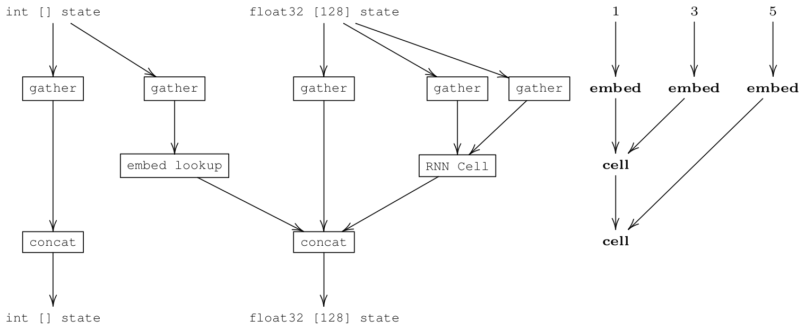
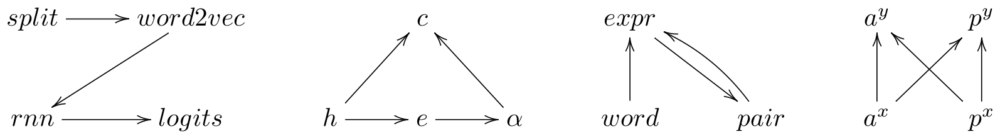

# 论文中文解读：《Deep Learning with Dynamic Computation Graphs》

> **基本信息**：Moshe Looks、Marcello Herreshoff、DeLesley Hutchins、Peter Norvig（Google Inc.），ICLR 2017，arXiv:1702.02181（2017 年 2 月）；论文原文 [官方页面](https://arxiv.org/abs/1702.02181)。论文配套的开源库叫 TensorFlow Fold（`github.com/tensorflow/fold`）。
>
> **本文的读法**：原文有 2 幅图（Figure 1、Figure 2）、3 张表（Table 1–3）和若干代码清单。图为从 PDF 裁出的原图并配中文说明；表逐格转录；代码清单转录成带语言标识的代码块并加中文逐行解释。凡不是出自论文的内容（笔者构造的调度示例、由表中数字做的换算、与其他论文的类比）都会明确标注“笔者补充”。
>
> **先说明一个术语**：本文的“动态计算图（dynamic computation graph，DCG）”指**每个输入样本自带一张形状不同的计算图**（例如每个句子一棵不同的语法树），与上一篇 [Chainer](../chainer_define_by_run/论文中文解读.md) 里“计算图在每次运行时由 Python 程序现场构造”的 Define-by-Run 不是同一件事，二者是互补关系：Define-by-Run 解决“怎么写出每个样本不同的图”，本文解决“这些形状各异的图怎样才能高效地批量执行”。

## 一、一句话结论

当每个输入样本对应的计算图形状都不同（语法树、分子图等），这样的网络既无法直接做 mini-batch，又很难在 TensorFlow 这类基于静态数据流图的库里实现。论文提出 **dynamic batching（动态批处理）**：把一批形状各异的输入图看成一张不连通的大图，按拓扑深度分层，把“同一深度、同一种 operation”的全部节点合并成一次批量调用，用 `gather` / `concat` 搬运数据，并把整套调度放进静态 TensorFlow 图中的一个 `tf.while_loop`（每轮循环处理一个深度）。它不仅能在**不同输入图之间**做批处理，也能在**同一张图内部的不同节点之间**做批处理。

在 Tree-LSTM 基准上（树大小 128，LSTM 状态 1024），相对逐树 batch size 为 1 的手工批处理，GPU（GeForce GTX-1080）上最高快约 120 倍，CPU 上约 28 倍；动态批处理自身也有代价（额外的 `gather`/`concat`），大 batch 时会比“形状完全相同的完美手工批处理”慢（表中最大约 1.6 倍）。论文还给出一个组合子库（combinator library）TensorFlow Fold，用它重写 Tree-LSTM 情感分类等模型，代码行数为原作者实现的 0.37–0.73，并在 Stanford Sentiment Treebank 上用 30 个模型的集成取得当时最好的结果。

## 二、背景与动机

### 2.1 什么是“动态计算图”

深度学习近年的突破主要出现在输入可以表示为稠密 $n$ 维数组（张量）或张量序列的领域（视觉、自然语言）。这些成功依赖于**在数十到数百个样本组成的 mini-batch 上做梯度下降**，并利用现代 GPU 的并行 SIMD 能力和多核 CPU。于是出现了大量用“张量上的可微数据流图（data-flow graph）”来表达模型的库（TensorFlow、Theano、Torch 等），使训练和部署更容易。

但神经网络在**结构化输入**上计算也有很长的历史：语法树、逻辑项（logical terms）、分子图等。在这类模型里，**每个不同的输入对应一张不同结构的计算图**，论文称之为动态计算图（DCG）。这类模型至今仍在发展，并在情感分类与语义相关度（Tai et al. 2015；Li et al. 2015）、问答（Andreas et al. 2016）、化合物筛选（Kearnes et al. 2016）等问题上取得过更好的结果。

### 2.2 为什么大家回避 DCG：两个障碍

尽管有这些成功，多数从业者因为**实现上的原因**而回避 DCG：

1. **无法批处理。** Bowman et al.（2016）的话被论文引用：因为 TreeRNN 对每个句子使用不同的模型结构，“在标准实现里高效批处理是不可能的”。
2. **主流库假定图是静态的，并且构图代价很大。** 即使原则上可以高效批处理，TensorFlow 这类库也假定数据流图对每个输入都相同（静态），并且构图本身代价高昂，因此“为每个输入构造一张新图”不可行。

静态图下的“手工批处理”是怎样的：计算被写成对批大小多态（polymorphic）的静态运算图，例如 $y=\sigma(x\cdot w+c)$：输入 $x$ 的维度为 $(b,n)$，输出的维度为 $(b,m)$，$b$ 是批大小。有了 DCG，运算图不再是静态的而是每个输入各不相同，于是多个输入不再能自然地沿 batch 维拼在一起。

### 2.3 论文的两项贡献

- **第 2 节**：dynamic batching，可在只支持静态数据流图的现有库上高效运行 DCG（同一张静态图可以跑任意一棵语法树上的 TreeRNN），并给出 TensorFlow 上的实验结果；
- **第 3 节**：一个组合子库（TensorFlow Fold），用来简洁地实现使用 dynamic batching 的 DCG 模型。

## 三、动态批处理（论文第 2 节）

### 3.1 术语与前提

论文首先区分两个层次：

- **ops**：底层数据流图里的单个节点，如加法、矩阵乘；
- **operations**（论文的用词，注意与 ops 区分）：概念上充当张量函数的小子图，如一个前馈层或一个 LSTM cell。

动态批处理调度的是 **operations，而不是 ops**。构成 DCG 网络的积木就是 operations。算法要求**所有可能用到的 operation 事先指定**，算法把它们枚举出来用于调度。例如，用于自然语言语法树的二叉 TreeRNN 有两个 operation：叶子上的词嵌入表查询（embedding lookup），以及非终结符上的 RNN cell。

operation 的输入输出有**张量类型**：

- 一个张量类型 = 形状 $x_1,\dots,x_n$ + 标量数据类型（如 float32）；每个输入或输出可以有不同的类型，但所有类型必须**事先固定并完全指定**；
- operation 的输入张量维度为 $(b,x_1,\dots,x_n)$，其中 $b$ 是批大小；输出张量维度为 $(b,y_1,\dots,y_m)$；
- operation 必须对批大小**多态**，因为每次调用时批大小都会变，取决于输入图的拓扑；但张量类型是固定的，所以输入计算图里的每条边都能被赋予一个已知的张量类型。

### 3.2 贪心调度算法

算法的输入是一张有向无环计算图。**一批多个输入图可视为一张单一的不连通图**。源节点是常量张量，非源节点是 operation，边把某个节点的某个输出连到另一个节点的某个输入。调度用一个贪心算法完成：

1. **赋深度**：没有依赖的节点（常量）深度为 0；只依赖深度为 0 节点的节点深度为 1；依赖的最大深度为 1 的节点深度为 2，依此类推（即深度 = 到源节点的最长路径长度）。
2. **插入直通（pass-through，恒等）operation**，使得深度 $d+1$ 的 operation 只引用深度 $d$ 的结果。
3. **批合并**：把同一深度上调用同一个 operation 的所有节点合并成一个节点。
4. **拼接输出**：把相同深度、相同张量类型的所有输出拼接（concatenate）起来；拼接的顺序对应各 dynamic batching operation 被枚举的顺序。
5. **给边打标签**：为原图中的每条边赋标签 $(d,t,i)$，其中 $d$ 为深度，$t$ 为张量类型，$i$ 为该边在深度 $d$、类型 $t$ 的（拼接后）输出中的整数下标。图的**调度（schedule）** 就是所有边的下标 $i$，按深度和 operation 分组。

### 3.3 一个手算示例（笔者补充）

下面用论文图 1 右侧的那棵树 $((w_1,w_3),w_5)$，再加一棵新树 $(w_2,w_4)$，手工走一遍上面的算法，帮助理解。设叶子上是词嵌入查询 `embed`，内部节点是 RNN `cell`。

- 深度 0：5 个常量（5 个词的编号，类型 `int []`）；
- 深度 1：5 个 `embed`（分别对应 $w_1,w_3,w_5$ 以及第二棵树的 $w_2,w_4$）；它们只依赖深度 0 的常量；
- 深度 2：`cell`$(e_1,e_3)$（第一棵树的下层 cell）与 `cell`$(e_2,e_4)$（第二棵树的唯一 cell），都依赖深度 1 的结果；
- 深度 3：`cell`（第一棵树的根），它依赖深度 2 的下层 cell 和**深度 1** 的 $e_5$。深度 1 的结果不能直接被深度 3 引用，所以要在深度 2 为 $e_5$ 插入一个**直通** operation。

于是调度如下（拼接顺序按图 1 中从左到右的 operation 顺序，是笔者的假设，原文只说顺序对应枚举次序；各树根节点的结果最后如何取出，原文没有展开，下表略去）：

| 深度 | 本深度执行的批量 operation | gather 的下标（取自上一深度的状态） | 本深度输出（按拼接顺序） |
|---|---|---|---|
| 0 | 常量 | - | `int []` 状态：5 个词编号 |
| 1 | `embed` 批大小 5（一次调用） | 取 int 状态的下标 0、1、2、3、4 | float 状态：$[e_1,e_3,e_5,e_2,e_4]$ |
| 2 | 直通 批大小 1；`cell` 批大小 2 | 直通取下标 2（$e_5$）；`cell` 的左输入取 0、3（$e_1,e_2$），右输入取 1、4（$e_3,e_4$） | $[e_5',h_{13},h_{24}]$ |
| 3 | `cell` 批大小 1 | 左输入取下标 1（$h_{13}$），右输入取下标 0（$e_5'$） | $[h_{135}]$ |

对照：不做批处理需要 5 次 `embed` + 3 次 `cell` = 8 次 operation 调用；做批处理后每个深度只有一次 `embed` 或一次 `cell`（外加一次廉价的直通），共 3 次主要调用。树越大、批里的树越多，差距越大。

### 3.4 在 TensorFlow 中的实现

在论文的 TensorFlow 实现里：

- **每个动态 operation 在静态数据流图里只实例化一次**；
- 每个 operation 的输入是 `tf.gather` 节点，输出送入 `tf.concat` 节点；
- 这些 TensorFlow 节点被放进一个 `tf.while_loop`，**每轮循环计算一个特定深度上的所有 operation**；
- 循环为每个张量类型 $t$ 维护一个状态变量：第 $d$ 轮 `concat` 得到的类型 $t$ 输出，作为第 $d+1$ 轮类型 $t$ 的 `gather` 的输入；
- 第 $d$ 轮 `gather` 所用的下标，取自调度里深度 $d$ 的边标签 $i$；
- 深度 0 的状态变量初值就是输入图里的常量。

于是动态批处理“构造出一张只含每种 operation 各一个实例的静态 TensorFlow 图，却能模拟任意大小、任意拓扑的输入图，其中 operation 可以出现任意多次”。`concat`、`gather`、`while_loop` 在 TensorFlow 里都是**可微的**，所以梯度计算和反向传播不需要额外代码。

### 3.5 图 1：静态图与输入图



*图 1（原文 Figure 1，第 3 页）：动态批处理为二叉 TreeRNN 构造的静态数据流图（左）；语法树 $((word_1,word_3),word_5)$ 对应的输入图（右）。*

**图中文字翻译与读法**：

- **左半部分**是 `tf.while_loop` 的循环体，有两个状态变量，对应两种张量类型：`int [] state`（整数标量，如词编号）和 `float32 [128] state`（128 维的 float32 向量，如词向量/隐状态）。
- 在 `int [] state` 一列：一个 `gather` 接 `concat`，输出回到 `int [] state`——这是整数状态的**直通**（图中的长竖线）；另一个 `gather` 把需要查表的词编号取出，送入 `embed lookup`（词嵌入查询），其输出进入 float32 的 `concat`。
- 在 `float32 [128] state` 一列：最左的 `gather` 直接连到 `concat`（float 状态的**直通**）；另外两个 `gather` 分别取出左子节点和右子节点的状态，送入 `RNN Cell`；`embed lookup`、直通、`RNN Cell` 三路输出在 `concat` 汇合，得到新的 `float32 [128] state`，进入下一轮循环。
- 每个 `gather` 还有一个图中没有画出的额外输入：当前深度的下标，决定每个 operation 对状态里的哪些行调用。论文原话：长长的向下箭头就是直通。
- **右半部分**是输入图：叶子上写着词编号 1、3、5，各自经过 `embed`（词嵌入）；前两个词的嵌入进入第一个 `cell`；它的输出和第三个词的嵌入进入第二个 `cell`。这对应语法树 $((word_1,word_3),word_5)$。算法读入这样的树，把它变成每个深度上各个 `gather` 的下标输入（此处“深度”就是 `tf.while_loop` 的循环计数器）。
- **读图结论**：图的**拓扑（树的形状）不再体现在 TensorFlow 图里，而是变成了 `gather` 的下标数据**；TensorFlow 图本身固定，只含每种 operation 一个实例。这就是“用静态图模拟动态图”。

## 四、实验：动态批处理的速度（论文第 2.1 节）

### 4.1 实验设置

论文把动态批处理实现为新库 TensorFlow Fold 的一部分，并设计了一个合成的速度基准，与原生 TensorFlow 的手工批处理对比；两种情形使用相同的底层 kernel 和执行引擎。

- **手工批处理的限制**：原生 TensorFlow 无法把形状不同的树批在一起，所以测试时使用一批随机二叉树，而且**这批树的形状全相同**。因此结果代表**最好情形**：所有 operation 都能完美批处理。手工批处理时，构造一张与树形状对应的静态数据流图；动态批处理时，遍历每棵树构造调度。
- **模型**：树的叶子是词嵌入表查询，非终结符实现 Tree-LSTM（Tai et al. 2015）方程的一个变体。**树大小 128，LSTM 状态大小 1024**。
- **硬件**：CPU 测试在 Dell z620 工作站上（两颗 8 核 Intel Xeon，共 32 个硬件线程）；GPU 测试用一张消费级 Nvidia GeForce GTX-1080。
- **比较三种情形**：手工批处理（manual）；动态批处理且所有树形状相同（dynamic）；动态批处理且每棵树形状不同（“full dynamic”）。论文说：处理形状不同的树**没有可测量的惩罚**。
- **计时**：表 1 是推理计时，数值为壁钟时间的平均值，单位秒。

### 4.2 表 1：推理计时基准

**表 1：推理计时基准。** 单位：秒，越小越好。各列含义：batch-size 为批大小；“每批”是处理一批的时间；“每树”是平均每棵树的时间（每批时间除以批大小）；cost ratio（代价比）是动态批处理与手工批处理的耗时之比（树形状全相同的情形，即 dynamic 每批 ÷ manual 每批）；speedup ratio（加速比）是**批大小为 1 的手工批处理的每树时间**与 full dynamic 的每树时间之比。

| 设备 | batch-size | 手工 每批 | 手工 每树 | 动态 每批 | 动态 每树 | full dynamic 每批 | full dynamic 每树 | cost ratio | speedup ratio |
|---|---:|---:|---:|---:|---:|---:|---:|---:|---:|
| CPU | 1024 | 14.62 | 0.014 | 18.68 | 0.018 | 18.37 | 0.017 | 1.27 | 28.86 |
| CPU | 512 | 7.54 | 0.014 | 9.84 | 0.019 | 9.57 | 0.018 | 1.30 | 27.68 |
| CPU | 256 | 4.14 | 0.016 | 5.22 | 0.020 | 5.25 | 0.020 | 1.26 | 25.23 |
| CPU | 128 | 2.48 | 0.019 | 2.95 | 0.023 | 3.08 | 0.024 | 1.18 | 21.47 |
| CPU | 64 | 1.64 | 0.025 | 1.76 | 0.027 | 1.78 | 0.027 | 1.06 | 18.55 |
| CPU | 32 | 1.27 | 0.039 | 1.05 | 0.032 | 1.10 | 0.034 | 0.82 | 14.94 |
| CPU | 1 | 0.52 | 0.517 | 0.26 | 0.258 | 0.26 | 0.262 | 0.49 | 1.97 |
| GPU | 1024 | 0.978 | 0.0009 | 1.590 | 0.0015 | 1.617 | 0.0015 | 1.62 | 101.79 |
| GPU | 512 | 0.530 | 0.0010 | 0.715 | 0.0013 | 0.721 | 0.0014 | 1.34 | 114.15 |
| GPU | 256 | 0.312 | 0.0012 | 0.323 | 0.0012 | 0.340 | 0.0013 | 1.03 | 120.86 |
| GPU | 128 | 0.236 | 0.0018 | 0.164 | 0.0012 | 0.178 | 0.0013 | 0.69 | 115.05 |
| GPU | 64 | 0.193 | 0.0030 | 0.093 | 0.0014 | 0.106 | 0.0016 | 0.48 | 96.40 |
| GPU | 32 | 0.153 | 0.0047 | 0.061 | 0.0019 | 0.074 | 0.0023 | 0.40 | 68.79 |
| GPU | 1 | 0.161 | 0.1608 | 0.038 | 0.0376 | 0.036 | 0.0359 | 0.23 | 4.47 |

（原文表 1，第 4 页；“CPU”/“GPU”对应原表左侧的 (CPU)、(GPU) 分组标记。）

**读法**：

1. **批处理本身极其重要，GPU 上尤其如此。** TensorFlow 会为树中的每个节点启动一个 GPU kernel，所以存在一个与树大小成正比的固定开销，在小 batch 时主导执行时间。手工批处理的 GPU 每树时间从 batch 1 的 0.1608 s 降到 batch 1024 的 0.0009 s；论文说完全批处理与不批处理相差 160 倍以上，且要到 1024 或更大的批大小，TensorFlow 才开始“喂饱”GPU。
2. **动态批处理的 kernel 调用更少。** 它的数据流图更小：每个 operation 只实例化一次，每个深度调用一次，所以 kernel 调用次数是 $\log n$（$n$ 为树大小）而不是 $n$（这对平衡二叉树成立；原文没有区分叶子数与总节点数）。因此即使 batch size 为 1，动态批处理也能获得很大的加速，因为它在**同一棵树内部**把同深度的 operation 批在一起：GPU batch 1 时每树 0.0376 s 对手工的 0.1608 s（约 4.3 倍，即 $1/0.23$）。
3. **但额外的 `concat` 和 `gather` 有代价。** cost ratio 在大 batch 时大于 1：GPU batch 1024 时为 1.62，CPU 为 1.27；而在小 batch 时小于 1（树内批处理的收益盖过了代价）：GPU 在 batch ≤ 128 时小于 1，约在 256 处与手工持平（1.03）；CPU 约在 32 与 64 之间越过 1。原文说代价主要出现在大 batch 上，原因就是小 batch 时被树内批处理的收益抵消。
4. **speedup ratio 的含义**：以“批大小为 1 的手工批处理”（即逐节点执行，TensorFlow 实际上不会这样跑，因为构图代价很大，且这一代价未计入表中）为基线，full dynamic 的每树时间最高快 **120.86 倍（GPU，batch 256）**、**28.86 倍（CPU，batch 1024）**，对应正文的“120x”与“28x”。
5. **“形状不同没有可测量的惩罚”**：dynamic 与 full dynamic 两列基本相当（CPU 上相差在约 ±5% 以内）。笔者核对表中数字发现：GPU 小 batch 时 full dynamic 比同形状的 dynamic 慢约 14%–21%（batch 64：0.106 对 0.093；batch 32：0.074 对 0.061），所以“没有可测量的惩罚”在小 batch GPU 上并不严格成立，应理解为“大 batch 或 CPU 上差别很小”。

**证据边界**（笔者归纳）：

- 手工批处理要求所有树形状相同，是对基线**最有利**的设定；真实的异构树数据无法这样做，所以速度比只能说明“动态批处理能把异构树的吞吐拉到接近完美批处理的水平”，不是“比任何手工实现都快”。
- 只测了推理；论文正文还说到训练（含反向传播）时代价更高，但没有给出训练计时表。
- 原文正文写道：“代价对 GPU 上 batch size 为 1 的推理仅 20%，但对带反向传播的训练升到 60%”。这句话和表 1 无法直接对上（表 1 里 batch size 1 的 cost ratio 是 0.23，意思是动态批处理反而更快），且训练计时没有提供，所以这两个百分数无法用本文表格核对；本文只依据表 1 判断推理的代价。
- 论文没有单独报告构造调度（遍历每棵树）的耗时，也没有说明它是否计入表 1。

## 五、组合子库（论文第 3 节）

只有调度算法还不够：用户仍需要方便地描述这些异构结构的模型。论文的目标是展示：动态批处理使得可以在比手工批处理**更高的抽象层次**上实现深度学习模型，从而加快尝试新模型变体的反馈回路。库的设计受函数式编程技术启发，如 parser combinators 和 arrows。在组合子库里，计算以**组合**方式构造：把更简单的计算以各种方式接在一起。

### 5.1 块（block）与类型系统

TensorFlow Fold 里计算的基本单位是 **block**，本质上是从输入到输出的函数。在典型的 DCG 模型里，输入是某种图或树，输出是一个向量，可以接损失函数用于训练。

块是**静态类型**的：每个块有输入类型和输出类型；类型能推断时自动推断，有时必须显式指定。类型是以下之一：

| 类型 | 含义 |
|---|---|
| `Input` | 宿主语言（Python）里的对象，如树和字典 |
| `Tensor`（dtype，shape） | 指定 dtype 和 shape 的张量（脚注：张量前面的 batch 维不计入 `Tensor` 类型的 shape） |
| `Tuple(t1, …, tn)` | 类型分别为 t1…tn 的值的元组 |
| `Sequence(t)` | 任意长度的、元素类型为 t 的序列 |
| `Void` | 单位类型 |

例如 `Sequence(Sequence(Tuple(Tensor float32,[], Tensor int8,[3,4])))` 表示不规则（jagged）数组，其元素是 (float32 标量, $3\times4$ 的 int8 张量) 对。

块以层次方式组合，**块表达式总是一棵树**：非叶节点是 `Map`、`Fold` 这样的组合子（combinator），以更简单的块为参数；叶子是原子块。

### 5.2 原子块与组合子

**原子块**（树的叶子）：

| 块 | 类型 | 作用 |
|---|---|---|
| `Scalar` | Input → Tensor | 把 Python 标量转成张量 |
| `Tensor` | Input → Tensor | 把 NumPy 数组转成张量 |
| `Function(h)` | 张量或张量元组 → 张量或张量元组 | 在张量上定义一个 operation h（见第 2 节）；多输入多输出的 operation 使用张量元组 |
| `InputTransform(h)` | Input → Input | 用用户自定义的 Python 函数 h 预处理输入 |

**序列组合子**（设 f 作用于序列的元素，g 作用于元素对）：

| 组合子 | 结果 | 典型用途 |
|---|---|---|
| `Map(f)` | $[f(x_1),f(x_2),\dots,f(x_n)]$，对序列每个元素施加 f | 把句子的每个词嵌入成向量 |
| `Fold(g, z)` | $g(\dots g(g(z,x_1),x_2),\dots,x_n)$，按左向链顺序施加 g；默认 $z=0$ | 在序列上运行 RNN |
| `Reduce(g)` | $g(\mathrm{Reduce}([x_1,\dots,x_{\lfloor n/2\rfloor}]),\mathrm{Reduce}([x_{\lfloor n/2\rfloor+1},\dots,x_n]))$，按平衡二叉树施加 g | 对元素做 max 或 sum pooling |

脚注说明 `Reduce` 用平衡树而非链，是为了**最小化计算深度并提供更多批处理机会**。论文特别指出：序列**不需要补零或截断到同一长度**，动态批处理会处理长度不同的序列。

**其他重要组合子**：

| 组合子 | 类型 | 作用 |
|---|---|---|
| `b1 >> b2` | - | 函数复合：b1 的输出送入 b2 的输入 |
| `Record({l1: b1, …, ln: bn})` | Input → Tuple(t1,…,tn) | 输入 Python 字典或元组，把每个块 bi 施加到标签为 li 的字段上，得到类型 ti 的对象，返回所有字段结果的元组 |
| `OneOf(b1, …, bn)` | Input → t | 依据输入有条件地分派到块 b1…bn 之一 |
| `Optional(b)` | Input → t | 输入不是 `None` 就施加 b，否则返回零；是 `OneOf` 的特例 |
| `AllOf(b1, …, bn)` | t0 → Tuple(t1,…,tn) | 把类型 t0 的输入传给每个块 b1…bn，返回结果元组 |

### 5.3 例 1：流水线（Pipeline）

假设输入是一组 (text, label) 对，要从文本预测标签；文本由词构成，已有预训练词向量数组 `word_matrix` 与把词映射到下标的字典 `word_idx`（`word_idx.get(word)` 返回词在 `word_matrix` 中的下标，未知词返回 `None`）。先建一个把词嵌入连续空间的块：

```python
word2vec = (InputTransform(word_idx.get) >>
            Optional(Scalar('int32')) >>
            Function(Embedding(initializer=word_matrix)))
```

- `InputTransform(word_idx.get)`：对输入的词调用 Python 的字典查找，得到下标（或 `None`）；
- `Optional(Scalar('int32'))`：下标不是 `None` 时转成 int32 标量张量，是 `None`（未知词）时返回 0；
- `Function(Embedding(initializer=word_matrix))`：对这个下标做嵌入表查询，嵌入表用预训练的 `word_matrix` 初始化。

有了 `word2vec`，定义嵌入句子的 `text2vec`：

```python
split = InputTransform(str.split)
rnn_cell = Concat() >> Function(FC(d, activation=tf.nn.relu))
text2vec = split >> Map(word2vec) >> Fold(rnn_cell, Zeros(d))
```

- `split`：用 Python 的 `str.split` 把字符串切成词；
- `rnn_cell`：一个简单的 RNN cell：把（状态，输入）拼接（`Concat`），再过一个 $d$ 个隐单元的全连接层 `FC` 加 ReLU；
- `text2vec`：先切词，再用 `word2vec` 把每个词映射成向量（`Map`），再用 `rnn_cell` 从全零初始状态 `Zeros(d)` 开始按序折叠（`Fold`）。

设有 $n$ 个标签，用一个输出 $n$ 维的线性层得到未归一化的 logits；训练时再用 `Record` 把标签也转成张量并计算损失：

```python
text2logits = text2vec >> Function(FC(n, activation=None))
```

```python
record = Record([('text',  text2logits),
                 ('label', Scalar('int32'))])
loss = record >> Function(tf.nn.sparse_softmax_cross_entropy)
```

- `Record`：输入是 (text, label) 的字典/元组：`text` 字段走 `text2logits` 得到 logits，`label` 字段走 `Scalar('int32')` 转成标签张量；两者作为元组送给交叉熵函数得到损失。

最后创建 `Compiler`：它**校验块、做类型检查，并在 TensorFlow 里设置动态批处理**；编译后的块的输出就是 TensorFlow 张量，之后的训练与任何其他 TensorFlow 模型一样：

```python
compiler = Compiler.create(loss)
cross_entropy = Compiler.output_tensors[0]
train_op = tf.train.AdamOptimizer().minimize(cross_entropy)
```

（原文第二行写作 `Compiler.output_tensors[0]`，首字母大写，按上下文应是刚创建的对象 `compiler` 的属性，此处照原样转录。）

### 5.4 例 2：前馈注意力（复杂组合，DAG）

Raffel & Ellis（2016）为前馈网络提出了一个注意力模型，它推广了平均池化：

$$
e_t=a(h_t),\qquad \alpha_t=\frac{\exp(e_t)}{\sum_{k=1}^{T}\exp(e_k)},\qquad c=\sum_{t=1}^{T}\alpha_t h_t
$$

其中 $a$ 是一个可学习函数，$h_t$ 是序列的第 $t$ 个元素，$e_t$ 是打分，$\alpha_t$ 是对序列做 softmax 得到的权重，$c$ 是加权和。（原文公式 (1)。）

这个模型的块结构不是简单的流水线（用 `>>` 串起来），而是一张**有向无环图**（见图 2 第二幅）；`Composition` 块允许把块组成 DAG。代码（原文附录 A）为：

```python
attention = Composition()
with attention.scope():
  h = attention.input
  exp_e = Map(a >> Function(tf.exp)).reads(h)
  z = (Sum() >> Broadcast()).reads(exp_e)
  alpha = ZipWith(Function(tf.div)).reads(exp_e, z)
  c = (ZipWith(Function(tf.mul)) >> Sum()).reads(alpha, h)
  attention.output.reads(c)
```

**逐行解释**：

- 在 `Composition` 作用域（`scope`）里，块可以用 `reads` 连线，只要不形成有向环；`input` 和 `output` 属性定义整个组合块的输入输出；
- `h = attention.input`：输入是序列 $h_1,\dots,h_T$；
- `exp_e = Map(a >> Function(tf.exp)).reads(h)`：对每个 $h_t$ 先过 $a$ 再取指数，得到 $\exp(e_t)$；
- `z = (Sum() >> Broadcast()).reads(exp_e)`：先把所有 $\exp(e_t)$ 逐元素相加得到分母 $\sum_k\exp(e_k)$，再用 `Broadcast` 把这一个值变成无限重复的序列；
- `alpha = ZipWith(Function(tf.div)).reads(exp_e, z)`：逐元素相除得到 $\alpha_t$（`ZipWith` 在最短的输入序列结束时停止，所以无限序列 `z` 被截成与 `exp_e` 同长）；
- `c = (ZipWith(Function(tf.mul)) >> Sum()).reads(alpha, h)`：逐元素相乘 $\alpha_th_t$，再求和得到 $c$；
- `attention.output.reads(c)`：把 $c$ 设为输出。

这个例子引入的额外块：`Sum` 是 `Reduce` 的特例，做逐元素加法；`ZipWith` 是 `Map` 的变体，接受 $n$ 个序列，并对其逐元素应用 $n$ 元函数 f（到最短序列结束为止）；`Broadcast` 从单个 t 创建一个 `Sequence(t)`，无限重复同一个元素。

### 5.5 例 3：递归定义（Tree-LSTM）与图 2

$N$ 叉 Tree-LSTM（Tai et al. 2015，第 3.2 节）把 LSTM 从 1 个前驱状态推广到 $N$ 个。Tai et al. 在第 5.1 节把它们用于对 Stanford Sentiment Treebank 的句子分类：该语料由单句影评的二值化成分句法树构成，**每个节点都有情感标签**。在树的叶子处，词被映射成词嵌入向量，作为二叉 Tree-LSTM 的输入（前驱状态为 0）；在内部节点处，LSTM 的输入是 0，前驱状态是它的两个孩子的状态。形式化地：

$$
h_{\text{word}}=\mathrm{TreeLSTM}\big(\mathrm{Embedding}(\text{word}),0,0\big)
$$

$$
h_{\text{left,right}}=\mathrm{TreeLSTM}\big(0,h_{\text{left}},h_{\text{right}}\big)
$$

（原文公式 (2)(3)。）其中 $\mathrm{TreeLSTM}(x,h_{\text{left}},h_{\text{right}})$ 是对应 Tai et al.（2015）公式 9–14（$N=2$）的可学习函数。因为树是递归数据类型，处理树的模型必须**递归定义**——图 2 第三幅里 `expr` 与 `pair` 之间的环就是这个递归；`ForwardDeclaration` 用来创建递归模型：

```python
expr = ForwardDeclaration()
word = AllOf(Record([('word', word2vec)]),
             Zeros((state_size, state_size)))
pair = AllOf(Zeros(embedding_size),
             Record([('left', expr()), ('right', expr())]))
expr_def = (OneOf(key_fn=len, case_blocks=[(1, word), (2, pair)]) >>
            TreeLSTM(state_size))
expr.resolve_to(expr_def)
```

（原文清单里 `word = AllOf(...)` 一行少了一个右括号，此处已补上。）

**逐行解释**：

- `expr = ForwardDeclaration()`：先“前向声明”一个名字 `expr`，它**本身不是块**，但可以被调用（`expr()`）以创建指向这个声明的引用（即引用该声明的块）；
- `word`：叶子情形：`AllOf` 把同一个输入分别送给两个子块——`Record([('word', word2vec)])` 取出 `'word'` 字段并用 `word2vec` 嵌入成词向量，`Zeros((state_size, state_size))` 给出两个全零的状态（对应公式 (2) 里的两个 0 前驱状态）；
- `pair`：内部节点情形：输入向量是全零（`Zeros(embedding_size)`），两个孩子状态由 `Record` 取出 `'left'`、`'right'` 字段递归地用 `expr()` 计算；
- `expr_def`：`OneOf(key_fn=len, case_blocks=[(1, word), (2, pair)])` 依据输入的 `len` 分派：长度为 1 走 `word`，长度为 2 走 `pair`（笔者推断：树被编码成嵌套字典，叶子是 `{'word': w}`，内部节点是 `{'left': …, 'right': …}`；原文没有明说）；分派之后统一过一个 `TreeLSTM(state_size)`；
- `expr.resolve_to(expr_def)`：最后把所有对 `expr` 的引用都更新为指向 `expr_def`，递归就闭合了。

下面的图 2 把四个例子的块结构画成小图：



*图 2（原文 Figure 2，第 6 页）：流水线（第 3.3 节）、前馈注意力（第 3.4 节）、二叉 Tree-LSTM（第 3.5 节）、分子图的 weave 模块（第 3.6 节）的块结构。*

**图中文字翻译与读法**：

- **第 1 幅（流水线）**：$split\to word2vec\to rnn\to logits$，按顺序串联（`>>`），对应例 1；
- **第 2 幅（前馈注意力）**：$h\to e\to\alpha\to c$，同时 $h\to c$，即公式 (1) 里 $c$ 同时依赖 $\alpha$ 和 $h$，这是一个 DAG，不是单链；
- **第 3 幅（二叉 Tree-LSTM）**：$word\to expr$，$expr\leftrightarrow pair$（两者之间一来一回两条箭头，构成**环**），表示递归：`expr` 通过 `pair` 引用自身；
- **第 4 幅（weave 模块）**：$a^x\to a^y$、$p^x\to p^y$，另外 $a^x\to p^y$、$p^x\to a^y$ 两条交叉的边，表示原子级特征和原子对级特征互相影响（见下一节）。
- **读图结论**：这四个例子分别覆盖了流水线、一般 DAG、递归、带嵌套的 DAG；它们都能用同一套 block 组合子表达，并交给同一个 `Compiler` 做动态批处理。

### 5.6 例 4：分子图卷积（weave 模块）

最后一个例子用 Fold 实现 Kearnes et al.（2016）提出的分子图卷积模型，分子被表示成无向的原子图。代码更复杂，因为涉及嵌套的 `Composition` 块，完整的在原文附录 B。每个原子、每对不同原子都有实值特征向量：对有 $N$ 个原子的分子，原子特征向量索引为 $a_i\in\mathbb{R}^n$（$1\le i\le N$），原子对特征向量索引为 $p_{i,j}\in\mathbb{R}^m$（$1\le i,j\le N$），其中 $p_{i,j}=p_{j,i}$，$p_{i,i}=0$。

模型的核心是 **weave 模块**，用六个可学习函数（通常是全连接 ReLU 层）把原子级特征和原子对级特征结合起来；weave 模块可以任意堆叠成深层图卷积模型。以上标 $x$、$y$ 分别表示输入和输出：

$$
a_i^{y}=f_A\Big(f_{A\to A}(a_i^{x}),\ \sum_{j=1}^{N}f_{P\to A}(p_{i,j}^{x})\Big)
$$

$$
p_{i,j}^{y}=f_P\Big(f_{A\to P}(a_i^{x},a_j^{x})+f_{A\to P}(a_j^{x},a_i^{x}),\ f_{P\to P}(p_{i,j}^{x})\Big)
$$

（原文公式 (4)(5)。）其中 $f_A,f_P,f_{A\to A},f_{A\to P},f_{P\to A},f_{P\to P}$ 都是可学习函数。注意 $a^x\to p^y$ 的计算涉及对原子的**嵌套扫描**：对每个 $a_i$ 要对所有 $1\le j\le N$ 计算 $f_{A\to P}(a_i^x,a_j^x)+f_{A\to P}(a_j^x,a_i^x)$，代码为：

```python
a_i_to_p = Composition()
with a_i_to_p.scope():
  a_x_i = Broadcast().reads(a_i_to_p.input[0])
  a_x = a_i_to_p.input[1]
  f_i_j = ZipWith(Concat() >> f_a_p).reads(a_x_i, a_x)
  f_j_i = ZipWith(Concat() >> f_a_p).reads(a_x, a_x_i)
  p = ZipWith(Sum()).reads(f_i_j, f_j_i)
  a_i_to_p.output.reads(p)
```

输入是 $(a_i^x,a^x)$，类型为 `Tuple(Tensor float32,[n], Sequence(Tensor float32,[n]))`。把 $a_i^x$ 对 $a^x$ 连续广播两次，计算所有 $1\le j\le N$ 的 $f_{A\to P}(a_i^x,a_j^x)$ 和 $f_{A\to P}(a_j^x,a_i^x)$，得到 `f_i_j` 与 `f_j_i`，它们是长度为 $N$ 的向量序列；把它们逐元素拼接并相加，得到块的最终输出（也是长度为 $N$ 的向量序列）。整个 weave 模块则这样实现：

```python
weave = Composition()
with weave.scope():
  a_x = weave.input[0]
  p_x = weave.input[1]
  a_to_a = Map(f_a_a).reads(a_x)
  p_to_a = Map(Map(f_p_a) >> Sum()).reads(p_x)
  a_y = ZipWith(Concat() >> f_a).reads(a_to_a, p_to_a)
  a_to_p = ZipWith(a_i_to_p).reads(a_x, Broadcast().reads(a_x))
  p_to_p = Map(Map(f_p_p)).reads(p_x)
  p_y = ZipWith(ZipWith(Concat() >> f_p)).reads(a_to_p, p_to_p)
  weave.output.reads(a_y, p_y)
```

输入是 $(a^x,p^x)$，类型为 `Tuple(Sequence(Tensor float32,[n]), Sequence(Sequence(Tensor float32,[m])))`。各行含义（原文附录 B 的逐条说明）：

- `a_to_a`：对 `a_x` 逐元素施加 $f_{A\to A}$，从 `Sequence(Tensor)` 到 `Sequence(Tensor)`；
- `p_to_a`：对 `p_x` 逐元素施加原子对到原子的函数并沿**内层维度求和**，从 `Sequence(Sequence(Tensor))` 约简成 `Sequence(Tensor)`（原文这条说明里把函数写成 $f_{A\to P}$，但公式 (4) 和代码里的 `f_p_a` 都是 $f_{P\to A}$，应是原文的笔误）；
- `a_y`：用 $f_A$ 把 `a_to_a` 和 `p_to_a` 逐元素合并，得到 `Sequence(Tensor)`；
- `a_to_p`：把 `a_x` 对自身广播，用 `a_i_to_p` 扩展成 `Sequence(Sequence(Tensor))`；
- `p_to_p`：对 `p_x` 逐元素施加 $f_{P\to P}$；
- `p_y`：用 $f_P$ 把 `a_to_p` 和 `p_to_p` 逐元素合并，得到 `Sequence(Sequence(Tensor))`。

这个例子的重点是：分子的原子数 $N$ 各不相同，嵌套序列的长度也不同，而 Fold 的类型系统与动态批处理让用户**不必补零、不必手工管理 batch 维**。

## 六、实验：Tree-LSTM 情感分类与代码行数

### 6.1 Stanford Sentiment Treebank（表 2）

论文用 Fold 实现了 $N$ 叉 Tree-LSTM 做情感分析，并强调：虽然取得了新的 SOTA，但那**不是重点**；模型并不特别原创，不用 TensorFlow Fold 也可以实现；Fold 的作用是使定义更简单简洁（见表 3），同时执行更快，从而更容易快速探索新的模型变体。

**设置**：采用成分（constituency）Tree-LSTM，词嵌入用调好的 GloVe 向量，这是 Tai et al.（2015）所有情感模型里结果最好的那个。在此基础上论文探索了若干新变体。Tai et al. 使用非循环 dropout 和 $L_2$ 权重正则；论文**取消权重正则**，改用 Semeniuta et al.（2016）提出的**循环 dropout**，并把 LSTM 状态大小从 150 增大到 300，其余超参数不变。（脚注：不成功的变体包括接受来自孩子的池化历史的标准 LSTM（即只有单个遗忘门），以及基于字符而不是词级嵌入的模型。）

**指标**：细粒度（fine-grained）准确率对所有树计算，基于五个可能的标签；二分类（binary）准确率只对情感非中性的树计算，是负面对正面的分类。括号中的数是标准差。Tai et al. 报告五次独立运行，论文的结果基于三十次独立运行。数据集很小（训练/开发/测试分别为 8544/1101/2210 棵树），所以论文进一步评估了这三十个独立训练的模型组成的**集成**。

**表 2：Stanford Sentiment Treebank 的测试集准确率（%，越大越好）。**

| 模型 | 细粒度（五分类） | 二分类 |
|---|---:|---:|
| Tai et al. (2015) | 51.0 (0.5) | 88.0 (0.3) |
| Munkhdalai & Yu (2016a) | 52.8 | 89.7 |
| Munkhdalai & Yu (2016b) | 53.1 | 89.3 |
| Ours（单模型） | 52.3 (0.7) | 89.4 (0.4) |
| Ours（集成） | **53.6** | **90.2** |

（原文表 2，第 8 页。括号内为标准差；Munkhdalai & Yu 没有报告标准差和运行次数。）

**读法**：

- 与同一模型族的原作 Tai et al. 相比，Fold 里的变体单模型提升 1.3（细粒度，52.3 对 51.0）和 1.4（二分类，89.4 对 88.0）个百分点；
- **单模型**并未超过 Munkhdalai & Yu 的结果（52.8/53.1 与 89.7/89.3），**集成**才在两个子任务上都超过（53.6 与 90.2）；论文的“新的 SOTA”指的是集成；
- 对比对象的运行次数不同（Tai et al. 五次，本文三十次），且 Munkhdalai & Yu 没有报告，所以表中单模型的比较要保留余地。

### 6.2 代码行数（表 3）与统计协议

组合子库的影响更难定量说明。论文的做法（“带着一大把盐”）是比较代码行数，对象是原作者的源码。

**表 3：代码行数对比。**

| 模型 | 本文（Fold） | 原实现 | 比值 |
|---|---:|---:|---:|
| Feed-Forward Attention（前馈注意力） | 26 | 71 | 0.37 |
| Tree-LSTM | 119 | 219 | 0.54 |
| Graph Convolutions（图卷积） | 32 | 44 | 0.73 |

（原文表 3，第 8 页。比值 = 本文行数 ÷ 原实现行数。）

**统计协议（原文附录 C）**：定义“功能单元”为一个输入-输出映射；把只实现这一功能的代码放进单个文件；去掉 import 语句、抽象基类、日志、文件 I/O 和验证逻辑；用 cloc 统计行数，忽略空行和注释；所有实现都按 80 列格式化（Tree-LSTM 有几行稍长，仍算作一行）。三个对比的细节：

- **前馈注意力**：功能单元是为 Raffel & Ellis（2016，第 2.3 节）的变长实验创建模型，含损失和准确率计算，不含训练循环与训练数据创建；原实现是 Python + Theano + Lasagne（commit e8fce3e）。Fold 更简洁，部分原因是 TensorFlow 与 Lasagne 的差异；Fold 自身减少复杂度的方式是消除手工批处理，例如 `x.sum(axis=1)`（batch 在第 0 轴显式存在）对 `x >> Sum()`（隐式批处理）。
- **Tree-LSTM**：功能单元是创建（二叉）成分 Tree-LSTM 并跑一个细粒度情感分类的训练 epoch（Tai et al. 第 5.1 节），不含加载词嵌入或数据集；原实现是 Lua + Torch（commit b02ad49），Lua 以 `end` 结束块，这些行不计。这里手工批处理不起作用，因为原实现一次只对一棵树算梯度和损失。Fold 用 `OneOf` 区分叶子和内部节点，代替显式遍历树的递归函数，从而降低复杂度。
- **图卷积**：功能单元是创建单个 weave 模块（Kearnes et al. 2016，第 3.3 节）；原实现是 Python + TensorFlow（由 Kearnes et al. 提供），两者语言和库相同。Fold 的帮助在于消除手工批处理，尤其明显的是原子到原子对的计算：把 $n\times d$ 矩阵 $x$ 复制 $n$ 份得到 $n\times n\times d$ 张量。原生 TensorFlow 里第一维是 batch，需要显式复制 `reshape(tile(x, [1, n, 1]), [batch_size, n, n, d])`；在 Fold 里 `x >> Broadcast()` 就够了，因为需要的复制份数由后续计算惰性地决定。

**读法与证据边界**：代码行数只是粗糙的代理指标（论文自己也说这个比较要“带一大把盐”，并指出过短的实现如果以牺牲灵活性为代价并不理想）；三种原实现语言、库、功能单元并不一致（Python+Theano、Lua+Torch、Python+TensorFlow），0.37–0.73 的比值不能当作“Fold 一致地少写 27%–63% 代码”的普遍结论。

## 七、讨论、局限与常见误读（论文第 4 节与笔者归纳）

**论文的讨论**：具有动态计算图的神经结构既有**批处理低效**又有**工具差**的问题。论文相信动态批处理第一次**完全一般地**解决了前一个问题；SPINN 架构（Bowman et al. 2016）是另一种基于栈的办法，也能对 DCG 高效批处理，但只限于二叉树，并且要对不同大小的树做补零/截断。Fold 库则通过提供高层组合子库来解决工具问题，目的是让从业者快速开发、迭代 DCG 结构。动态批处理的影响由第 2.1 节的实验量化，组合子库的影响更难定量；第 3.5.1 节的结果表明文献中的模型可以用 Fold 重新实现，再加以扩展来取得更好的性能。作者猜测，其他 DCG 模型也还有不少“提升空间”，原因仅仅是相对于主流结构，对它们的调参工作做得少。

**局限与证据边界**（笔者归纳）：

1. **只覆盖“已知的有限种 operation + 固定的张量类型”**：算法要求所有 operation 事先指定、类型（含形状）事先固定，operation 只对批大小多态。因此它处理的是**拓扑**的动态（树/图形状），不是形状的动态（例如同一 operation 的内部维度随样本变化）。
2. **贪心按深度分层，没有最优性分析**：论文没有讨论调度是否最优。笔者的推论：对接近链状的深树，深度接近节点数，树内可批处理的机会很少，只能靠树间批处理；直通 operation 也带来额外的数据搬运。
3. **基准是合成的、偏向基线的**：见 4.2 节“证据边界”。
4. **推理为主**：训练时的代价只在正文一句话里提到，没有表格。
5. **系统年代久远**：TensorFlow Fold 是 TensorFlow 1.x 时代的库；论文的价值在思想（把拓扑编码成下标数据、用静态图模拟动态图），而不是今天的工程选型。

**常见误读**：

- “动态图性能问题只靠算子融合就能解决”——对异构树，最大的问题可能是形不成足够大的 kernel 工作量；先批处理再融合通常比只融合更重要（笔者的判断，不是论文结论）。
- “形状不同就是拓扑不同”——序列长度变化是**形状**动态；Tree-LSTM 孩子关系变化是**拓扑**动态，两者处理方式不同。本文的动态批处理处理的是后者（序列的变长则用 `Map`/`Fold` 等，由同一机制处理）。
- “动态批处理没有额外代价”——表 1 的 cost ratio 显示大 batch 时它比“形状完全相同的完美手工批处理”慢（最高 1.62 倍）；调度构造、`gather`、`concat` 与直通都是成本。
- “120 倍就是对任何框架的加速”——它是相对 TensorFlow 逐节点执行（batch size 1，且不含构图代价）的比值，硬件是 GTX-1080，树大小 128，状态大小 1024，不能外推到现代 PyTorch eager。

## 八、与本仓库其他论文的关系

- 与 [Chainer](../chainer_define_by_run/论文中文解读.md) 的 Define-by-Run 互补：Define-by-Run 让“每个样本一张不同的图”很容易写，但逐节点执行仍面临 kernel 小、调度开销大的问题；本文提供的是**把这些图重新拼成大 batch**的办法。PyTorch 一类 eager 框架里，用 Python 循环处理树/图并不会自动获得本文的算法，需要专门的批处理表示、`vmap`、segment 操作或图库（笔者补充）。
- 与 [PyTorch 2](../pytorch_2/论文中文解读.md) 的 `torch.compile` 不同：后者先捕获 Python 执行区域得到 FX graph；本文则是把许多节点实例编排进一个静态执行器。两者可以组合：前端捕获解决“程序是什么”，动态批处理解决“不规则工作怎样聚合成高效 batch”（笔者的判断）。
- 动态 shape 与运行时的另一条线可读 [Nimble](../nimble_dynamic_nn/论文中文解读.md)、[DISC](../disc_dynamic_shape/论文中文解读.md)；整体路线见 [PyTorch 动态图与 Graph 编译论文阅读索引](../PyTorch动态图与Graph编译论文阅读索引.md)。

## 九、复现与阅读检查清单

- 能否不看原文，用自己的话讲清动态批处理五步（赋深度、插直通、批合并、拼接输出、给边打标签），并手算一棵三叶子的树？
- 能否说明为什么 TensorFlow 图是静态的，而它能模拟任意拓扑：`gather` 下标承载拓扑，`while_loop` 的轮次对应深度？
- 引用“120×”时，是否写明基线是**批大小为 1 的逐节点手工批处理**、硬件是 **GTX-1080**、树大小 128、状态大小 1024、只测推理，并且手工批处理基线用的是所有树形状相同的最好情形？
- 引用 Table 1 的 cost ratio 时，是否区分“小 batch 小于 1（动态批处理更快）”和“大 batch 大于 1（更慢）”？
- 引用 SST 结果时，是否区分“单模型”和“集成”（只有集成超过 Munkhdalai & Yu）？

## 原文证据导航

- [原论文 PDF](paper.pdf)
- [原文提取文本](paper.txt)
- [论文概要](论文概要.md)
