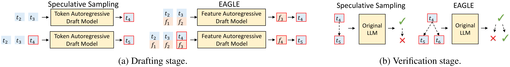
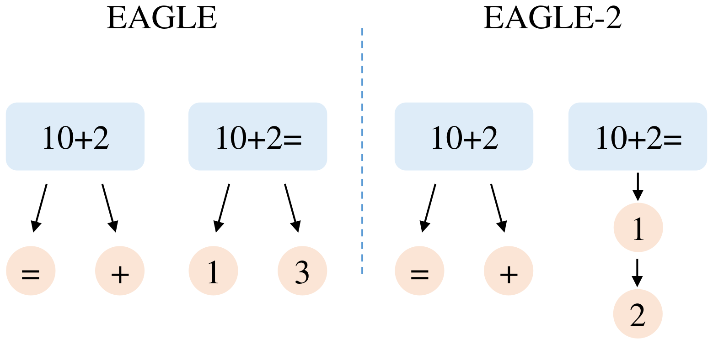
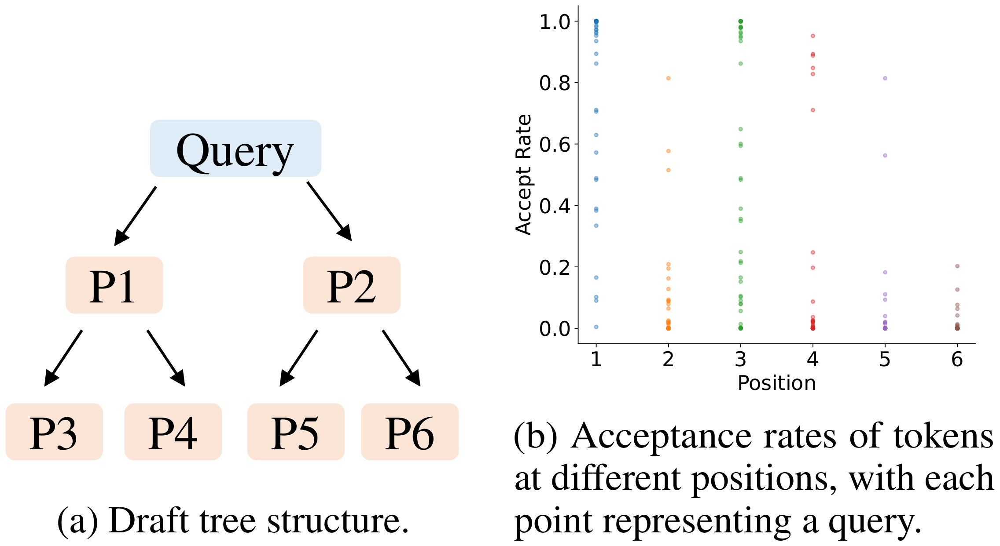
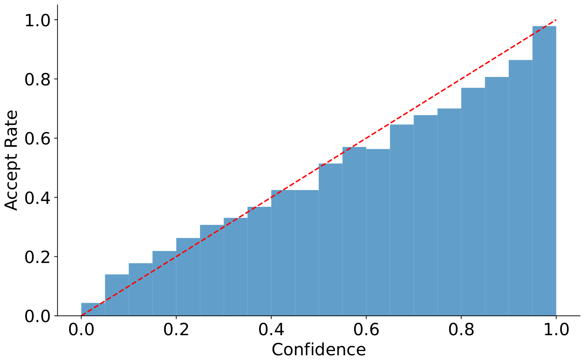
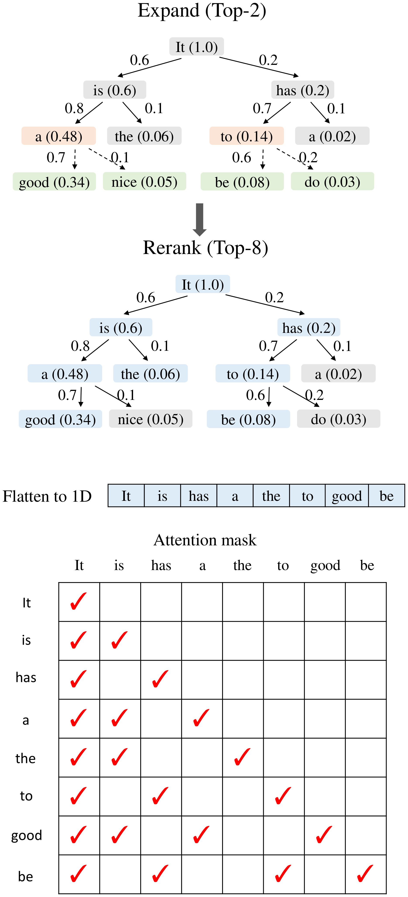
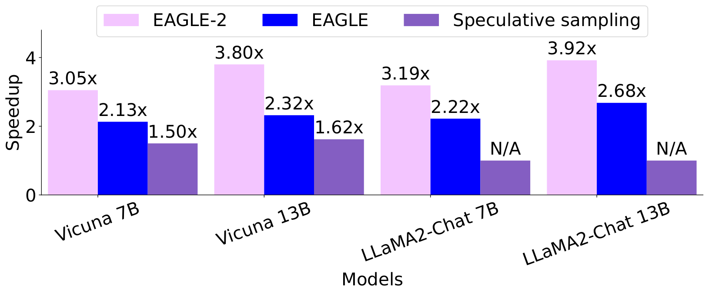
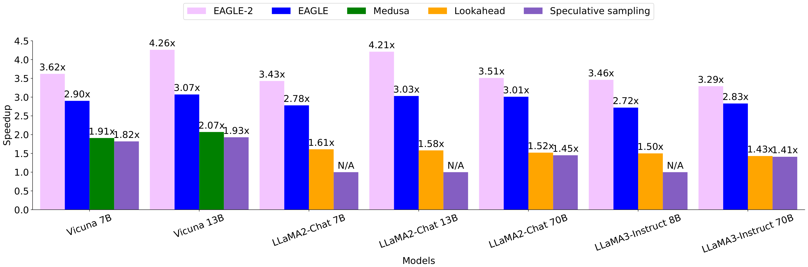

# 论文中文解读：《EAGLE-2: Faster Inference of Language Models with Dynamic Draft Trees》

> **基本信息**：Yuhui Li、Fangyun Wei、Chao Zhang、Hongyang Zhang（北京大学、Microsoft Research、University of Waterloo、Vector Institute），arXiv:2406.16858（本地 PDF 为 2024 年 6 月 30 日的 v2；PDF 页眉不含会议信息，EMNLP 2024 沿用旧概要）；论文原文 [arXiv 页面](https://arxiv.org/abs/2406.16858)，代码仓库见首页给出的 [SafeAILab/EAGLE](https://github.com/SafeAILab/EAGLE)。
>
> **本文的读法**：图取自论文原文（从 PDF 中按图裁出的原图），表为逐格核对后的中文转录（数字与原文一致，表头翻译为中文）。每张图后有中文图题、图中文字翻译和读图结论，因此不必再翻英文版。图中的具体数值若不是正文或图上标注给出的，是整理者从 PDF 矢量图坐标反算出的近似值，文中写“约”或在数字前注明。凡标明“整理者补充”“整理者核算”的内容，是为了帮助理解而加的，不是论文自带的数字。

## 一、一句话结论

大模型自回归解码每步只出一个 token，且受显存带宽限制。推测采样（speculative sampling）让一个便宜的草稿先猜一批 token，再由原 LLM 一次前向并行验证；每轮被接受的 token 越多，加速越大。为了提高每轮被接受的 token 数，近期工作把链式草稿改成**树形草稿**：同一个位置多放几个候选，一个被拒绝还能试另一个。但 Medusa、EAGLE 等用的树都是**静态**的：树的形状（每一步加几个候选）事先定好，所有上下文共用。这隐含了“草稿 token 的接受率只取决于它在树中的位置”这一假设（Sequoia 更是明确假设了这一点）。

**EAGLE-2** 基于两个观察：

1. 草稿 token 的接受率**不只取决于位置，还强烈依赖上下文**（图 5）；
2. EAGLE 的草稿模型**校准良好（well-calibrated）**：草稿模型给出的置信度（输出概率）与该 token 被原 LLM 接受的概率很接近（图 6）。

接受率本来要调用原 LLM 才能知道，这与推测采样“少调用原 LLM”的目的矛盾；置信度恰好提供了一个零额外开销的近似。于是 EAGLE-2 用**上下文感知的动态草稿树**：**扩展阶段**逐层选出当前层 value 最高的 $k$ 个节点（value 是从根到该节点路径上草稿置信度的乘积，近似“整条路径被接受”的概率）交给草稿模型继续扩展；**重排阶段**再从所有草稿 token 里按 value 选前 $m$ 个，展平成一维序列并按树结构构造注意力掩码，交给原 LLM 验证。它不改草稿模型的训练与推理，也不改验证阶段，所以**不需要额外训练**，并且保持输出分布不变。

主要结果与出处：

- **速度**：摘要称在三个系列的 LLM 和六个任务上加速 3.05–4.26 倍，比 EAGLE-1 快 20%–40%（整理者核对：3.05–4.26 倍恰是 MT-bench 在图 1、图 2 中的最小值与最大值）；引言称所有实验中加速 2.5–5 倍。在 MT-bench 上约比 Medusa 快 2 倍、比 Lookahead 快约 2.3 倍（图 2）。
- **每轮产出**（表 1、表 2）：EAGLE-2 每个起草加验证的循环生成约 4–5.5 个 token，约是标准推测采样和 Medusa 的 2 倍。
- **六个任务**（表 1）：MT-bench、HumanEval、GSM8K、Alpaca、CNN/DM、Natural Questions，温度 0 和 1，EAGLE-2 在所有数据集和 LLM 上加速比最高；HumanEval 上最高达 5.00 倍（LLaMA2-Chat 13B）。
- **消融**（表 3）：Vicuna 7B、MT-bench，去掉 value 与重排为 2.81 倍，完整 EAGLE-2 为 3.62 倍。

## 二、背景：推测采样、EAGLE 与静态草稿树（第 1、2 节）

### 2.1 推测采样回顾（第 2.1 节）

推测采样的核心是“先起草、再验证”：先快速生成一段可能正确的草稿，再检查其中哪些 token 可以接受。记 $t_i$ 为第 $i$ 个 token，$T_{a:b}$ 为 token 序列 $t_a,t_{a+1},\dots,t_b$。给定前缀 $T_{1:j}$：

1. **起草阶段**：调用草稿模型（比原 LLM 小的 LLM）自回归地生成草稿 $\hat T_{j+1:j+k}$，并记录每个 token 的草稿概率 $\hat p$（这里 $k$ 是草稿长度；论文第 4 节里同一个字母 $k$ 又表示每层扩展的节点数，下文用到时会说明）；
2. **验证阶段**：调用原 LLM 检查草稿，记录它的概率 $p$，然后从前往后逐个判断。

草稿 token $\hat t_{j+i}$ 以下面的概率被接受：

$$
\min\Big(1,\ \frac{p_{j+i}(\hat t_{j+i})}{\hat p_{j+i}(\hat t_{j+i})}\Big)
$$

接受就检查下一个；否则从分布 $\mathrm{norm}\big(\max(0,\,p_{j+i}-\hat p_{j+i})\big)$ 里采样一个 token 替换它，并丢弃草稿剩下的部分。

论文引用 Leviathan 等（2023）附录 A.1：这样与朴素自回归解码的分布一致；EAGLE 与 EAGLE-2 都沿用这个框架。接受规则与“无损”的推导见 [Speculative Decoding](../speculative_decoding/论文中文解读.md)、[Speculative Sampling](../speculative_sampling/论文中文解读.md) 和 [EAGLE](../eagle_speculative/论文中文解读.md)。

### 2.2 EAGLE 回顾（第 2.2 节，图 3）

EAGLE 是对推测采样的改进；论文称在投稿时 EAGLE 在 Spec-Bench（评测推测解码方法的综合基准）上排第一。

- **起草阶段**：标准推测采样在 token 层自回归；EAGLE 在更有规律的**特征层**（LM Head 之前的特征）自回归，再用原 LLM 的 LM Head 得到草稿 token。采样会给特征序列带来不确定性，所以 EAGLE 还把提前一个时间步的 token 序列输入草稿模型（图 3a）。
- **验证阶段**：标准推测采样的草稿是链式的，一个 token 被拒绝，后面的全部丢弃；EAGLE 用树形草稿，一个 token 被拒绝后还可以试替代分支（图 3b）。



*图 3（原文 Figure 3，第 3 页）：标准推测采样与 EAGLE 的对比。为简单起见，EAGLE 的树形草稿只在验证阶段画出，起草阶段的示意用的是链式草稿。$t_i$ 表示第 $i$ 个 token 的嵌入，$f_i$ 表示 LLM 在 LM Head 之前的倒数第二层的第 $i$ 个特征向量。*

**图中文字翻译与读法**：

- **(a) Drafting stage（起草阶段）**：左边 Speculative Sampling（推测采样）：Token Autoregressive Draft Model（token 自回归草稿模型）读入 $t_2,t_3$，输出 $t_4$（红框表示草稿的预测）；再读入 $t_2,t_3,t_4$，输出 $t_5$。右边 EAGLE：Feature Autoregressive Draft Model（特征自回归草稿模型）读入 $(t_2,f_1)$、$(t_3,f_2)$ 两列（token 在上、特征在下，token 比特征提前一位），输出 $f_3$，再得到 $t_4$；再读入 $(t_2,f_1)$、$(t_3,f_2)$、$(t_4,f_3)$，输出 $f_4$，再得到 $t_5$。
- **(b) Verification stage（验证阶段）**：左边推测采样的链式草稿 $t_4\to t_5$ 交给 Original LLM（原 LLM）：$t_4$ 通过（绿勾），$t_5$ 被拒绝（红叉），草稿到此为止。右边 EAGLE 的树形草稿：$t_4$ 的下一位有两个候选 $t_5$ 和 $t_6$，原 LLM 一次前向判断后，$t_5$ 被拒绝而 $t_6$ 通过，所以多接受了一个 token。

### 2.3 EAGLE 与 EAGLE-2 的区别（图 4）

EAGLE 的草稿树**形状固定**，起草阶段只是往对应位置里填 token；EAGLE-2 要让树**随上下文动态调整**。



*图 4（原文 Figure 4，第 3 页）：EAGLE 与 EAGLE-2 的差异。EAGLE 总是使用固定的草稿形状。当 query 是 “10+2=” 时，下一个 token 很可能被正确预测为 “1”；但静态草稿树的 EAGLE 仍会添加两个候选，尽管另一个候选 “3” 正确的概率很低。EAGLE-2 则根据上下文调整草稿树的形状：当 query 是 “10+2” 时，下一个 token 很难预测，所以 EAGLE-2 添加两个候选；对更简单的 query “10+2=”，EAGLE-2 只添加一个候选 “1”。*

**图中文字翻译与读法**：

- 左半（EAGLE）：query “10+2” 后挂两个候选 “=”“+”；query “10+2=” 后也挂两个候选 “1”“3”。右半（EAGLE-2）：query “10+2” 同样挂 “=”“+”；query “10+2=” 只挂一个候选 “1”，并且省下来的节点继续往深处接了 “2”（即 “10+2=12”）。
- **读图结论**：在“容易”的上下文里，EAGLE 把一个节点浪费在几乎不可能的 “3” 上；EAGLE-2 把它用于向深处延伸；在“难”的上下文里两者都多放候选。这就是“同样多的节点，按上下文重新分配”。

## 三、两个观察（第 3 节）

### 3.1 接受率依赖上下文（图 5）

先判断动态树是否有必要，即草稿 token 的接受率是否**只**与位置有关。论文在 Alpaca 数据集和 Vicuna 7B 上测了草稿树各位置上 token 的接受率，结果见图 5。



*图 5（原文 Figure 5，第 4 页）：草稿 token 在不同位置的接受率。左图中 P1–P6 表示 token 树中的位置，对应右图横轴上的位置 1–6；右图显示 P1–P6 位置上草稿 token 的接受率。（图内小标题：(a) 草稿树结构；(b) 不同位置上 token 的接受率，每个点代表一个 query。）*

**图中文字翻译与读法**：

- **(a)**：Query（查询）下挂 P1、P2 两个节点，P1 下挂 P3、P4，P2 下挂 P5、P6。
- **(b)**：横轴 Position（位置，1–6），纵轴 Accept Rate（接受率，0–1.0），每个位置一列彩色点，每个点是一个 query。整理者从矢量图坐标读出：每个位置有 50 个点；各位置的接受率（约）如下：

| 位置 | 最小 | 最大 | 均值 | 中位数 | 不低于 0.8 的点数 | 不高于 0.1 的点数 |
|---:|---:|---:|---:|---:|---:|---:|
| 1 | 0.00 | 1.00 | 0.83 | 1.00 | 37 | 2 |
| 2 | 0.00 | 0.81 | 0.06 | 0.00 | 1 | 43 |
| 3 | 0.00 | 1.00 | 0.50 | 0.44 | 20 | 15 |
| 4 | 0.00 | 0.95 | 0.12 | 0.00 | 5 | 42 |
| 5 | 0.00 | 0.81 | 0.04 | 0.00 | 1 | 46 |
| 6 | 0.00 | 0.20 | 0.01 | 0.00 | 0 | 48 |

- **读图结论**（论文）：总体上接受率与位置有关，位置 P1 最高、P6 最低；树左上角的 token（如 P1）接受率更高，右下角的（如 P6）更低，这支持 EAGLE 和 Medusa 这类静态树“左上多放节点、右下少放节点”的设计。**但同一位置上的接受率方差很大**：例如位置 1 的点从约 0 到 1.0 都有，位置 3 的 50 个点里有 20 个不低于 0.8、15 个不高于 0.1。说明一个草稿 token 被接受的概率不只取决于位置，还取决于上下文；因此上下文感知的动态树比静态树更有潜力。

### 3.2 草稿模型校准良好（图 6）

要用动态树，需要一种**不调用原 LLM** 就能估计草稿 token 接受率的低成本办法。论文在 Alpaca 数据集上研究草稿模型的置信度（LLM 对每个 token 的输出概率）与接受率的关系。



*图 6（原文 Figure 6，第 4 页）：草稿模型不同置信度区间的平均接受率。红色虚线连接 (0,0) 与 (1,1)，便于目视判断。原 LLM 是 Vicuna 7B。*

**图中文字翻译与读法**：横轴 Confidence（草稿模型的置信度，0–1，分成 20 档，每档宽 0.05），纵轴 Accept Rate（该档草稿 token 的平均接受率）；蓝色柱是各档的平均接受率，红色虚线是“接受率等于置信度”的理想对角线。整理者从矢量图坐标读出各档柱高（约）：

| 置信度区间 | 接受率 | 置信度区间 | 接受率 |
|---|---:|---|---:|
| 0.00–0.05 | 0.04 | 0.50–0.55 | 0.51 |
| 0.05–0.10 | 0.14 | 0.55–0.60 | 0.57 |
| 0.10–0.15 | 0.18 | 0.60–0.65 | 0.56 |
| 0.15–0.20 | 0.22 | 0.65–0.70 | 0.65 |
| 0.20–0.25 | 0.26 | 0.70–0.75 | 0.68 |
| 0.25–0.30 | 0.31 | 0.75–0.80 | 0.70 |
| 0.30–0.35 | 0.33 | 0.80–0.85 | 0.77 |
| 0.35–0.40 | 0.37 | 0.85–0.90 | 0.81 |
| 0.40–0.45 | 0.42 | 0.90–0.95 | 0.86 |
| 0.45–0.50 | 0.42 | 0.95–1.00 | 0.98 |

- **论文的结论**：草稿模型的置信度与接受率有很强的正相关。置信度低于 0.05 的草稿 token 接受率约 0.04，高于 0.95 的约 0.98。所以可以用置信度近似接受率，没有额外开销，从而动态调整草稿树。论文还说，在其他方法的草稿模型（GLIDE 和 CAPE，Du 等 2024）上观察到类似现象。
- **整理者的补充观察**：柱子整体贴着对角线，但并不等于对角线。以档中心为准，最大偏差约 0.075（0.75–0.80 一档，接受率约 0.70，对角线 0.775）；在 0.60–0.95 的各档接受率都比对角线低 0.03–0.075（草稿模型略偏自信），最后一档（0.95–1.00）与对角线几乎重合（高 0.003），置信度低于 0.30 的各档则比对角线高 0.02–0.065；曲线也不是严格单调（0.55–0.60 一档 0.57，到 0.60–0.65 一档 0.56；0.40–0.45 与 0.45–0.50 两档相同）。这是在一个数据集（Alpaca）、一个模型（Vicuna 7B）上的结果，论文没有给出其他模型和任务的校准曲线，也没有给出校准误差的数值指标。

## 四、方法：上下文感知的动态草稿树（第 4 节）

EAGLE-2 **不改变草稿模型的训练与推理，也不影响验证阶段**。改进集中在两点：怎样**扩展**草稿树（4.2 节），以及怎样对草稿 token **重排**（4.3 节）。扩展阶段把当前最后一层里最有希望的节点输入草稿模型，形成下一层；重排阶段选出接受概率更高的 token，作为验证阶段输入原 LLM。论文说明：草稿树中一个节点就是一个 token，下文“节点”和“token”可以互换。

### 4.1 value：路径上的置信度乘积

由于树注意力，草稿模型可以一次前向就把当前层的所有 token 输入、算出下一个 token 的概率，从而把当前层的所有 token 都扩展一遍。但一次输入太多 token 会拖慢草稿模型的前向，而且草稿树每层的 token 数呈指数增长，所以要**有选择地扩展**。

在推测采样中，一个草稿 token 被拒绝就会丢弃它后面的所有 token；一个 token 最终被接受，当且仅当它所有的前缀都被接受。所以一个 token $t_i$ 的**全局接受率**是从根到它的路径上所有 token 接受率的乘积，论文把它定义为**价值（value）**：

$$
V_i=\prod_{t_j\in\mathrm{Path}(\mathrm{root},\,t_i)}p_j\ \approx\ \prod_{t_j\in\mathrm{Path}(\mathrm{root},\,t_i)}c_j ,
$$

其中 $\mathrm{Path}(\mathrm{root},t_i)$ 是草稿树中从根节点到 $t_i$ 的路径，$p_j$ 是节点 $t_j$ 的接受率，$c_j$ 是草稿模型给 $t_j$ 的置信度。第 3.2 节的实验表明置信度与接受率强正相关，所以用置信度的乘积近似 value。value 越高的分支越可能被接受。

**为什么用 value 而不是置信度本身**（第 5.2.1 节）：EAGLE 的草稿模型能较好地近似接受率，但它是**局部**的，反映不出一个草稿 token 真正被接受的概率（真正被接受还要求祖先都被接受）。所以选节点时用“该 token 的置信度乘上祖先节点置信度”的 value 作为排序依据。

整理者补充（value 的一个用处）：每个节点被接受要求它的所有祖先都被接受，而且同一个父节点下最多接受一个子节点，所以一次验证中被接受的草稿 token 数就等于被接受的节点数。于是被接受的草稿 token 数的期望等于所有节点“整条路径被接受的概率”之和，用 value 近似就是 $\sum_i V_i$，再加上目标 LLM 自己多送的 1 个 token（论文把 $\tau$ 定义为每轮生成的 token 数，这里按它包含这一个来算），期望产出 $\tau\approx1+\sum_iV_i$。这与 [Medusa](../medusa/论文中文解读.md) 构造稀疏树时“期望接受长度等于各节点路径准确率乘积之和”是同一个思路；区别是 Medusa 用校准集离线统计准确率、对所有请求用同一棵树，EAGLE-2 用草稿模型的置信度在线、逐请求地估计。论文自己没有写这个求和公式，它依赖“置信度约等于接受率”这个近似。

### 4.2 扩展阶段（expansion）

从当前层（最后一层）里选出 value 最高的 $k$ 个节点，作为草稿模型的输入，根据输出扩展草稿树：

1. 所选的 $k$ 个节点一次（用树注意力）输入草稿模型，得到各自的下一 token 分布；
2. 每个被扩展的节点接上若干个子 token（论文没有写取几个、怎么取；图 7 的例子每个节点接 2 个），子节点的 value 等于父节点的 value 乘以该子节点的置信度；
3. 新加入的子节点成为新的“最后一层”，重复上述步骤，直到达到设定的深度。

注意是**逐层**进行、每层只在最后一层里选前 $k$ 个，而不是在全部叶子里做全局的最优优先搜索。

扩展阶段的目的是**加深**草稿树（图 7 上半部分）。

### 4.3 重排阶段（reranking）

扩展阶段让树变深，但接受率在 0 到 1 之间，所以越深的 token 的 value 越低；一些没有被扩展的浅层节点，value 可能比被扩展出来的深层节点还高。因此**不直接把扩展阶段选中的 token 当作草稿**，而是对**所有**草稿 token 重排，选出 value 最高的前 $m$ 个。

- 一个节点的 value 总是**小于等于**它父节点的 value（每个因子都在 0 到 1 之间）；
- value 相同的节点，**优先选更浅的**；
- 这样可以保证重排后选出的前 $m$ 个 token 仍然构成一棵**连通的树**（选中节点的祖先一定也被选中）。

### 4.4 展平与注意力掩码

选出的 token 展平成一维序列，作为验证阶段的输入。为了与朴素自回归解码保持一致，还要调整注意力掩码：朴素自回归解码里每个 token 能看到之前所有 token，注意力矩阵是下三角；用了草稿树，不同分支的 token 不应互相可见，因此注意力掩码要按树结构调整，保证**每个 token 只能看到它的祖先节点**。

把 4.1–4.4 节串起来，整个动态建树的流程可以写成下面的伪代码（整理者按论文的文字和图 7 整理；论文没有给出伪代码，每个被扩展节点保留几个子 token、根节点是否计入 $m$ 等细节论文没有写）：

```text
输入：根节点 root（已确定的最新 token，value = 1）；每层扩展的节点数 k；深度 D；草稿 token 总数 m
pool  ← {root}                         # 已生成的所有节点
layer ← [root]                         # 当前最后一层
重复 D 次：                              # 扩展阶段
    S ← layer 中 value 最高的 k 个节点
    用树注意力把 S 一次输入草稿模型，得到每个节点的下一 token 分布
    对 S 中的每个节点 u：
        取若干个子 token v，其置信度为 c_v
        value(v) ← value(u) × c_v
        把 v 作为 u 的子节点加入 pool
    layer ← 这一步新加入的所有子节点
draft ← pool 中 value 最高的 m 个节点      # 重排阶段；value 相同时优先浅的，结果仍是一棵连通的树
把 draft 展平成一维序列；按“每个节点只能看到自己和祖先”构造注意力掩码
把序列和掩码交给原 LLM 做一次前向，再按推测采样的接受与残差规则验证
```



*图 7（原文 Figure 7，第 5 页）：EAGLE-2 的示意。边旁边的数字是草稿模型的置信度，方块括号里的数字是节点的 value。在扩展阶段，从当前层选出 value 最高的 2 个节点（橙色块）作为草稿模型的输入，并把生成的 token（绿色块）接到草稿树上。在重排阶段，从所有节点（蓝色块）里选出 value 最高的 8 个，展平成一维序列，构成最终草稿；然后按树结构构造注意力掩码，保证每个 token 只能看到它的祖先节点。*

**图中文字翻译与读法**：

- **上：Expand (Top-2)（扩展，取前 2）**：根 `It (1.0)`；边上数字是置信度，节点括号里是 value。第 1 层：`is (0.6)`（边 0.6）、`has (0.2)`（边 0.2）。第 2 层：`is` 的子节点 `a (0.48)`（边 0.8）、`the (0.06)`（边 0.1）；`has` 的子节点 `to (0.14)`（边 0.7）、`a (0.02)`（边 0.1）。这一层 value 最高的 2 个节点 `a (0.48)` 与 `to (0.14)`（橙色）被扩展，生成第 3 层绿色节点：`good (0.34)`（边 0.7）、`nice (0.05)`（边 0.1）、`be (0.08)`（边 0.6）、`do (0.03)`（边 0.2）。
- **中：Rerank (Top-8)（重排，取前 8）**：同一棵树，从所有 11 个节点里选 value 最高的 8 个（蓝色）：`It`、`is`、`has`、`a (0.48)`、`the (0.06)`、`to (0.14)`、`good (0.34)`、`be (0.08)`；灰色的 `a (0.02)`、`nice (0.05)`、`do (0.03)` 被丢弃。
- **下：Flatten to 1D（展平成一维）** 得到序列 `It, is, has, a, the, to, good, be`；**Attention mask（注意力掩码）** 是 $8\times8$ 的方阵，打勾表示该行的 token 能看到该列的 token，每行恰好是该 token 的祖先加自己：`It` 只看自己；`is`、`has` 各看 `It` 和自己；`a`、`the` 看 `It`、`is` 和自己；`to` 看 `It`、`has` 和自己；`good` 看 `It`、`is`、`a` 和自己；`be` 看 `It`、`has`、`to` 和自己。共 22 个勾。

### 4.5 图 7 的逐步演算（整理者核算）

下表按“value = 父节点 value × 边上置信度”把图 7 的数字重新算了一遍（图中括号里是四舍五入后的值；两个都叫 `a` 的节点分别标注它们的父节点）：

| 节点 | 父节点 | 边上置信度 | value（精确值） | 图中标注 | 是否被扩展 | 重排取前 8 |
|---|---|---:|---:|---:|---|---|
| It（根） | — | — | 1 | 1.0 | 是 | 保留 |
| is | It | 0.6 | 0.6 | 0.6 | 是（第 1 层只有 2 个节点，全选） | 保留 |
| has | It | 0.2 | 0.2 | 0.2 | 是（同上） | 保留 |
| a（is 之下） | is | 0.8 | 0.48 | 0.48 | 是（第 2 层前 2 名） | 保留 |
| the | is | 0.1 | 0.06 | 0.06 | 否 | 保留 |
| to | has | 0.7 | 0.14 | 0.14 | 是（第 2 层前 2 名） | 保留 |
| a（has 之下） | has | 0.1 | 0.02 | 0.02 | 否 | 丢弃 |
| good | a（is 之下） | 0.7 | 0.336 | 0.34 | 示例到此为止 | 保留 |
| nice | a（is 之下） | 0.1 | 0.048 | 0.05 | 示例到此为止 | 丢弃 |
| be | to | 0.6 | 0.084 | 0.08 | 示例到此为止 | 保留 |
| do | to | 0.2 | 0.028 | 0.03 | 示例到此为止 | 丢弃 |

排序（从大到小）：It 1.0、is 0.6、a 0.48、good 0.336、has 0.2、to 0.14、be 0.084、the 0.06，其后是 nice 0.048、do 0.028、a 0.02，所以前 8 个正是图中的蓝色块。注意第 8 名 `the (0.06)` 是一个**没有被扩展的浅层节点**，它的 value 超过了被扩展出来的更深的 `nice (0.05)`，这就是重排的作用。图中的例子把根节点也算进这 8 个（`It` 在序列里）；论文没有说明正文实验里 $m=60/50/48$ 是否包含根节点。

按 4.1 节的近似，这棵树的 7 个草稿节点的 value 之和是 $0.6+0.2+0.48+0.06+0.14+0.336+0.084=1.90$，即期望被接受约 1.9 个草稿 token，期望每轮产出 $\tau\approx2.90$。

### 4.6 整理者补充的小数值例子（不是论文数字）

**例 A：为什么按 value 而不是按置信度挑节点。** 根有两个子节点：A（置信度 0.9，value 0.9）与 B（置信度 0.1，value 0.1）。再下一层有 4 个候选：A1（置信度 0.3，value $0.9\times0.3=0.27$）、A2（0.2，value 0.18）、B1（置信度 **0.9**，value $0.1\times0.9=0.09$）、B2（0.05，value 0.005）。如果这一层只能再扩展 1 个节点：按置信度会选 B1（0.9），但要走到 B1 必须先让 B 被接受（约 10% 的可能），整条路径被接受的概率只有约 0.09；按 value 会选 A1，整条路径被接受的概率约 0.27，是前者的 3 倍。

**例 B：同样 6 个草稿节点，在“容易”和“困难”的上下文里怎样分配。** 设预算是 6 个草稿节点（不含根），并用 4.1 节的 $\tau\approx1+\sum V$ 估算。

- **容易的上下文**（像图 4 的 “10+2=”）：草稿在每一步都很有把握，每个节点的子 token 置信度从高到低是 0.9、0.05、……
- **困难的上下文**：每个节点的子 token 置信度是 0.4、0.3、0.2、0.1。
- **静态树**（所有上下文共用同一个形状；这里取：根有 2 个子节点，第 1 个子节点有 2 个孩子，第 2 个子节点有 1 个孩子，第 1 个孙节点再有 1 个孩子，共 6 个节点）；
- **动态树**：从所有候选节点里直接取 value 最高的 6 个。

| 上下文 | 树 | 6 个节点的 value | value 之和（期望被接受的草稿 token 数） | 估算 $\tau$ |
|---|---|---|---:|---:|
| 容易 | 静态 | 0.9、0.05、0.81、0.045、0.045、0.729 | 2.579 | 3.58 |
| 容易 | 动态 | 0.9、0.81、0.729、0.6561、0.5905、0.5314（一条长链） | 4.217 | 5.22 |
| 困难 | 静态 | 0.4、0.3、0.16、0.12、0.12、0.064 | 1.164 | 2.16 |
| 困难 | 动态 | 0.4、0.3、0.2、0.16、0.12、0.12（宽而浅） | 1.300 | 2.30 |

读法：同样的节点预算，草稿有把握时动态树把节点都用来向深处延伸（一条长链），草稿没把握时把节点撒在浅层的多个分支上。多接受的草稿 token 数在容易的上下文里是 $4.217/2.579\approx1.64$ 倍，在困难的上下文里只有 $1.300/1.164\approx1.12$ 倍。这只是说明“按上下文重新分配”的方向，不是论文的实验数字，并且依赖“置信度约等于接受率”的近似。

### 4.7 超参数与代价（附录 A）

论文给出的 EAGLE-2 设置：对 7B（8B）、13B、70B 的原 LLM，**草稿 token 总数** $m$ 分别设为 60、50、48，**草稿树深度**为 6，扩展阶段**选 10 个节点**（即 $k=10$）。作为对照，EAGLE 的固定树（见 [EAGLE](../eagle_speculative/论文中文解读.md) 的图 9）有 25 个草稿节点、深度 5。论文没有明说每个被扩展节点保留多少个子节点（图 7 的玩具例子取 2 个），也没有报告扩展与重排本身的耗时。整理者推断：每层把选出的 $k$ 个节点一次输入草稿模型，因此草稿前向次数等于树的深度。

### 4.8 为什么仍然无损（第 1、2.1 节）

论文的说法：EAGLE-2 既不微调原 LLM 的参数，也不放宽接受条件，所以生成文本的分布与原 LLM **可证明地完全一致**；它不改变草稿模型的训练与推理，也不影响验证阶段，所以无需额外训练。作为对比，Medusa 等方法在非贪心设置下放宽接受条件，不保证无损，所以论文在温度 1 的表里不与它们比较。

整理者的理解：动态树只改变“哪些 token 被放进候选树”，验证仍按推测采样的接受与残差规则做，分布由原 LLM 决定。置信度再不准，只会让命中率下降、速度变慢，不会改变分布。

整理者补充的一个论文没有写的细节：温度 0 时候选由 top-$k$ 确定，没有问题。温度 1 时，如果候选是按 value 在草稿分布上确定性地挑出来的，而不是从草稿分布里采样出来的，验证时就不能直接套 [EAGLE](../eagle_speculative/论文中文解读.md) 算法 1 里“候选采样自 $\hat p$”的前提，而应把该候选的提议分布看作落在这个 token 上的点质量：接受概率是 $p(t)$，被拒绝后把 $t$ 的概率挪走再归一化。这样输出仍恰好服从 $p$：输出为 $t$ 的概率是 $p(t)$，输出为其他 token $x$ 的概率是 $(1-p(t))\cdot\frac{p(x)}{1-p(t)}=p(x)$。论文没有说明实现采用的是哪一种处理。

## 五、实验

### 5.1 设置（第 5 节、附录 A）

**模型**：Vicuna 7B、13B；LLaMA2-Chat 7B、13B、70B；LLaMA3-Instruct 8B、70B。

**任务**：六个生成任务，分别是多轮对话（MT-bench）、代码生成（HumanEval）、数学推理（GSM8K）、指令遵循（Alpaca）、摘要（CNN/Daily Mail）和问答（Natural Questions）。沿用 LLM 社区常用的零样本/少样本设置，即所有任务上对同一个原 LLM 使用同一份草稿模型权重。

**指标**：EAGLE-2 不微调原 LLM、不放宽接受条件，是无损加速方法，所以不评估生成质量，只用两个指标：

- **加速比（Speedup Ratio）**：相对朴素自回归解码的实测加速比；
- **平均接受长度 $\tau$**：每个起草加验证循环平均生成的 token 数，对应从草稿里接受的 token 数。优点是与硬件和运行环境无关，缺点是不反映草稿模型的开销。

**为什么没有接受率**：接受率只反映草稿模型的表现，而 EAGLE-2 不改变草稿模型的结构，所以接受率与 EAGLE 相同。

**对比方法与实现**（附录 A）：

| 方法 | 说明 |
|---|---|
| Vanilla（朴素解码） | HuggingFace transformers 库、PyTorch 后端、预分配 KV cache；其他方法也以这些模型为基础 |
| SpS（标准推测采样） | 用 HuggingFace Transformers 的 assisted generation；Vicuna 系列草稿模型为 Vicuna-68M；LLaMA2-Chat 70B 与 LLaMA3-Instruct 70B 分别用 LLaMA2-Chat 7B、LLaMA3-Instruct 8B 作草稿；其余 LLaMA 系列缺少合适草稿模型，标 N/A |
| PLD | 基于检索的草稿，没有神经网络草稿模型；用默认设置 |
| Lookahead | Jacobi 迭代；默认设置 |
| Medusa、Hydra | 多头草稿；用默认设置和官方权重 |
| EAGLE | Vicuna 与 LLaMA2-Chat 用官方发布的草稿模型权重；LLaMA3-Instruct 用 ShareGPT 数据集自己训练（与 Medusa、Hydra 一致） |
| EAGLE-2 | 草稿 token 总数 60（7B/8B）、50（13B）、48（70B），树深度 6，扩展阶段选 10 个节点 |

论文说加速比依赖硬件，所以在**相同设备**上测试各方法以保证公平，并使用 Spec-Bench（Xia 等 2024）做对比实验。论文没有说明具体的 GPU 型号和批大小。

### 5.2 MT-bench：图 1、图 2



*图 1（原文 Figure 1，第 1 页）：不同方法在温度 1 下的加速比。对推测采样，Vicuna 系列用 Vicuna-68M 作草稿模型；LLaMA2-Chat 缺少合适的草稿模型，标 N/A。Medusa 等方法在非贪心设置下放宽接受条件，不保证无损加速。本文只与保证输出文本分布不变的推测采样类方法比较。表 1 给出了更多方法的比较，本图只展示其中的一个子集，包括这些方法中最快的 EAGLE。*

**图中文字翻译与读法**：图例是 EAGLE-2（浅紫）、EAGLE（蓝）、Speculative sampling（推测采样，紫）；横轴 Models（模型），纵轴 Speedup（加速比）。柱上标注：

| 模型 | EAGLE-2 | EAGLE | 推测采样 |
|---|---:|---:|---:|
| Vicuna 7B | 3.05× | 2.13× | 1.50× |
| Vicuna 13B | 3.80× | 2.32× | 1.62× |
| LLaMA2-Chat 7B | 3.19× | 2.22× | N/A |
| LLaMA2-Chat 13B | 3.92× | 2.68× | N/A |

**读图结论**：温度 1 时 EAGLE-2 在四个模型上都明显领先，比 EAGLE 快 1.43、1.64、1.44、1.46 倍（整理者核算）。N/A 的紫色柱画在 1.0 处只是占位，表示没有合适的草稿模型。



*图 2（原文 Figure 2，第 2 页）：不同方法在温度 0 下的加速比。对推测采样，Vicuna 系列用 Vicuna-68M 作草稿模型。LLaMA2-Chat 7B、13B 与 LLaMA3-Instruct 8B 缺少合适的草稿模型，标 N/A；LLaMA2-Chat 70B 与 LLaMA3-Instruct 70B 分别用 LLaMA2-Chat 7B 与 LLaMA3-Instruct 8B 作草稿模型。表 1 给出了更多方法的比较，本图只展示其中的一个子集，包括这些方法中最快的 EAGLE。*

**图中文字翻译与读法**：图例是 EAGLE-2（浅紫）、EAGLE（蓝）、Medusa（绿）、Lookahead（橙）、Speculative sampling（紫）；横轴 Models，纵轴 Speedup。柱上标注（“—”表示图中没有这一根柱）：

| 模型 | EAGLE-2 | EAGLE | Medusa | Lookahead | 推测采样 |
|---|---:|---:|---:|---:|---:|
| Vicuna 7B | 3.62× | 2.90× | 1.91× | — | 1.82× |
| Vicuna 13B | 4.26× | 3.07× | 2.07× | — | 1.93× |
| LLaMA2-Chat 7B | 3.43× | 2.78× | — | 1.61× | N/A |
| LLaMA2-Chat 13B | 4.21× | 3.03× | — | 1.58× | N/A |
| LLaMA2-Chat 70B | 3.51× | 3.01× | — | 1.52× | 1.45× |
| LLaMA3-Instruct 8B | 3.46× | 2.72× | — | 1.50× | N/A |
| LLaMA3-Instruct 70B | 3.29× | 2.83× | — | 1.43× | 1.41× |

**读图结论**：EAGLE-2 在七个模型上都是最高的柱。整理者核算：EAGLE-2 比 EAGLE 快 1.25、1.39、1.23、1.39、1.17、1.27、1.16 倍；比 Medusa 快 1.90 与 2.06 倍；比 Lookahead 快 2.13、2.66、2.31、2.31、2.30 倍，与引言所说“比 Medusa 快约 2 倍、比 Lookahead 快约 2.3 倍”一致。

### 5.3 六个任务：表 1

下表给出不同方法的加速比与平均接受长度 $\tau$（越大越好），每格写作“加速比 / $\tau$”。原文：V 表示 Vicuna，L2 表示 LLaMA2-Chat；SpS 表示标准推测采样，其草稿模型是 Vicuna-68M；Medusa 等方法在非贪心设置下放宽接受条件，不保证无损加速，所以不与它们比较（因此温度 1 部分只有 SpS、EAGLE、EAGLE-2）。原表中 EAGLE-2 各行用粗体表示最优。

| 温度 | 模型 | 方法 | MT-bench | HumanEval | GSM8K | Alpaca | CNN/DM | Natural Ques. | 平均 |
|---|---|---|---:|---:|---:|---:|---:|---:|---:|
| T=0 | Vicuna 13B | SpS | 1.93× / 2.27 | 2.23× / 2.57 | 1.77× / 2.01 | 1.76× / 2.03 | 1.93× / 2.33 | 1.66× / 1.88 | 1.88× / 2.18 |
| T=0 | Vicuna 13B | PLD | 1.58× / 1.63 | 1.85× / 1.93 | 1.68× / 1.73 | 1.16× / 1.19 | 2.42× / 2.50 | 1.14× / 1.17 | 1.64× / 1.69 |
| T=0 | Vicuna 13B | Medusa | 2.07× / 2.59 | 2.50× / 2.78 | 2.23× / 2.64 | 2.08× / 2.45 | 1.71× / 2.09 | 1.81× / 2.10 | 2.07× / 2.44 |
| T=0 | Vicuna 13B | Lookahead | 1.65× / 1.69 | 1.71× / 1.75 | 1.81× / 1.90 | 1.46× / 1.51 | 1.46× / 1.50 | 1.36× / 1.39 | 1.58× / 1.62 |
| T=0 | Vicuna 13B | Hydra | 2.88× / 3.65 | 3.28× / 3.87 | 2.93× / 3.66 | 2.86× / 3.53 | 2.05× / 2.81 | 2.11× / 2.88 | 2.69× / 3.40 |
| T=0 | Vicuna 13B | EAGLE | 3.07× / 3.98 | 3.58× / 4.39 | 3.08× / 3.97 | 3.03× / 3.95 | 2.49× / 3.52 | 2.42× / 3.11 | 2.95× / 3.82 |
| T=0 | Vicuna 13B | EAGLE-2 | 4.26× / 4.83 | 4.96× / 5.41 | 4.22× / 4.79 | 4.25× / 4.89 | 3.40× / 4.21 | 3.13× / 3.74 | 4.04× / 4.65 |
| T=0 | LLaMA2-Chat 13B | PLD | 1.42× / 1.46 | 1.63× / 1.70 | 1.41× / 1.44 | 1.16× / 1.20 | 1.42× / 1.45 | 1.12× / 1.15 | 1.36× / 1.40 |
| T=0 | LLaMA2-Chat 13B | Lookahead | 1.58× / 1.64 | 1.80× / 1.85 | 1.65× / 1.69 | 1.47× / 1.50 | 1.46× / 1.53 | 1.42× / 1.45 | 1.56× / 1.61 |
| T=0 | LLaMA2-Chat 13B | EAGLE | 3.03× / 3.90 | 3.76× / 4.52 | 3.20× / 4.03 | 3.01× / 3.83 | 2.70× / 3.59 | 2.83× / 3.47 | 3.09× / 3.89 |
| T=0 | LLaMA2-Chat 13B | EAGLE-2 | 4.21× / 4.75 | 5.00× / 5.52 | 4.31× / 4.90 | 4.13× / 4.61 | 3.45× / 4.24 | 3.51× / 4.04 | 4.10× / 4.68 |
| T=0 | Vicuna 7B | SpS | 1.82× / 2.36 | 1.99× / 2.61 | 1.71× / 2.26 | 1.65× / 2.21 | 1.81× / 2.44 | 1.60× / 2.16 | 1.76× / 2.34 |
| T=0 | Vicuna 7B | PLD | 1.61× / 1.68 | 1.82× / 1.87 | 1.82× / 1.99 | 1.21× / 1.31 | 2.53× / 2.72 | 1.23× / 1.44 | 1.70× / 1.84 |
| T=0 | Vicuna 7B | Medusa | 1.91× / 2.52 | 2.02× / 2.67 | 1.89× / 2.59 | 1.79× / 2.48 | 1.42× / 2.02 | 1.51× / 2.09 | 1.76× / 2.40 |
| T=0 | Vicuna 7B | Lookahead | 1.63× / 1.69 | 1.72× / 1.77 | 1.84× / 1.99 | 1.38× / 1.57 | 1.44× / 1.53 | 1.45× / 1.60 | 1.58× / 1.69 |
| T=0 | Vicuna 7B | Hydra | 2.69× / 3.60 | 2.98× / 3.79 | 2.73× / 3.66 | 2.66× / 3.58 | 2.01× / 2.70 | 2.25× / 2.86 | 2.55× / 3.37 |
| T=0 | Vicuna 7B | EAGLE | 2.90× / 3.94 | 3.33× / 4.29 | 3.01× / 4.00 | 2.79× / 3.89 | 2.33× / 3.42 | 2.31× / 3.21 | 2.78× / 3.79 |
| T=0 | Vicuna 7B | EAGLE-2 | 3.62× / 4.98 | 3.95× / 5.33 | 3.63× / 4.97 | 3.46× / 4.86 | 2.94× / 4.12 | 2.76× / 3.82 | 3.39× / 4.68 |
| T=0 | LLaMA2-Chat 7B | PLD | 1.38× / 1.43 | 1.52× / 1.59 | 1.32× / 1.37 | 1.15× / 1.19 | 1.48× / 1.52 | 1.15× / 1.20 | 1.33× / 1.38 |
| T=0 | LLaMA2-Chat 7B | Lookahead | 1.61× / 1.66 | 1.72× / 1.77 | 1.58× / 1.65 | 1.49× / 1.52 | 1.49× / 1.54 | 1.48× / 1.53 | 1.56× / 1.61 |
| T=0 | LLaMA2-Chat 7B | EAGLE | 2.78× / 3.62 | 3.17× / 4.24 | 2.91× / 3.82 | 2.78× / 3.71 | 2.43× / 3.41 | 2.61× / 3.44 | 2.78× / 3.71 |
| T=0 | LLaMA2-Chat 7B | EAGLE-2 | 3.43× / 4.70 | 4.03× / 5.39 | 3.52× / 4.77 | 3.45× / 4.66 | 3.01× / 4.12 | 3.15× / 4.19 | 3.43× / 4.64 |
| T=1 | Vicuna 13B | SpS | 1.62× / 1.84 | 1.72× / 1.97 | 1.46× / 1.73 | 1.52× / 1.78 | 1.66× / 1.89 | 1.43× / 1.70 | 1.55× / 1.82 |
| T=1 | Vicuna 13B | EAGLE | 2.32× / 3.20 | 2.65× / 3.63 | 2.57× / 3.60 | 2.45× / 3.57 | 2.23× / 3.26 | 2.14× / 3.06 | 2.39× / 3.39 |
| T=1 | Vicuna 13B | EAGLE-2 | 3.80× / 4.40 | 4.22× / 4.89 | 3.77× / 4.41 | 3.78× / 4.37 | 3.25× / 3.97 | 3.07× / 3.54 | 3.65× / 4.26 |
| T=1 | LLaMA2-Chat 13B | EAGLE | 2.68× / 3.45 | 2.89× / 3.78 | 2.82× / 3.67 | 2.66× / 3.55 | 2.41× / 3.39 | 2.37× / 3.31 | 2.64× / 3.53 |
| T=1 | LLaMA2-Chat 13B | EAGLE-2 | 3.92× / 4.51 | 4.58× / 5.29 | 4.21× / 4.80 | 3.85× / 4.48 | 3.31× / 4.08 | 3.43× / 3.89 | 3.88× / 4.51 |
| T=1 | Vicuna 7B | SpS | 1.50× / 1.87 | 1.55× / 1.95 | 1.53× / 1.82 | 1.56× / 1.85 | 1.63× / 1.91 | 1.33× / 1.72 | 1.52× / 1.85 |
| T=1 | Vicuna 7B | EAGLE | 2.13× / 3.17 | 2.39× / 3.43 | 2.34× / 3.29 | 2.21× / 3.30 | 2.08× / 3.12 | 1.95× / 2.86 | 2.18× / 3.20 |
| T=1 | Vicuna 7B | EAGLE-2 | 3.05× / 4.28 | 3.33× / 4.65 | 3.07× / 4.49 | 3.08× / 4.43 | 2.63× / 3.76 | 2.48× / 3.56 | 2.94× / 4.20 |
| T=1 | LLaMA2-Chat 7B | EAGLE | 2.22× / 3.30 | 2.61× / 3.79 | 2.40× / 3.52 | 2.29× / 3.33 | 2.19× / 3.15 | 2.22× / 3.12 | 2.32× / 3.37 |
| T=1 | LLaMA2-Chat 7B | EAGLE-2 | 3.19× / 4.41 | 3.67× / 5.06 | 3.35× / 4.62 | 3.20× / 4.48 | 2.73× / 3.85 | 2.81× / 4.01 | 3.15× / 4.41 |

（原文表 1，第 7 页。）**读法**：

- 论文：在测试的所有数据集和 LLM 上，EAGLE-2 的加速比与平均接受长度都最高。EAGLE-2 每轮约生成 4–5.5 个 token，约是标准推测采样和 Medusa 的 2 倍（平均 $\tau$：EAGLE-2 4.64–4.68，SpS 2.18/2.34，Medusa 2.44/2.40）。PLD 与 Lookahead 的平均接受长度较短，但它们没有草稿模型或草稿模型不是神经网络，起草开销很低，所以加速比很接近平均接受长度。
- 表中 EAGLE-2 的最小加速比是 2.48 倍（Vicuna 7B、温度 1、Natural Questions），最大是 5.00 倍（LLaMA2-Chat 13B、温度 0、HumanEval），即引言的“2.5–5 倍”。
- 整理者核对：表中的 EAGLE 行与 [EAGLE](../eagle_speculative/论文中文解读.md) 论文的数字逐项相同（很可能沿用了旧结果），唯一的例外是 Vicuna 7B 的 Alpaca $\tau$，本表是 3.89，EAGLE 论文是 3.86。“平均”列与六个数据集的算术平均基本吻合，唯一明显的出入是 Vicuna 13B 温度 1 的 SpS：六个加速比的平均是 1.57，表中写 1.55。
- **EAGLE-2 比 EAGLE 快多少**（整理者核算，用“平均”列；每轮耗时比 $c=\tau/\text{加速比}$，含义见 [EAGLE](../eagle_speculative/论文中文解读.md) 的 7.5 节）：

| 设置 | 模型 | 加速比之比（EAGLE-2 / EAGLE） | $\tau$ 之比 | $c$（EAGLE） | $c$（EAGLE-2） |
|---|---|---:|---:|---:|---:|
| T=0，六任务平均 | Vicuna 13B | 1.37 | 1.22 | 1.29 | 1.15 |
| T=0，六任务平均 | LLaMA2-Chat 13B | 1.33 | 1.20 | 1.26 | 1.14 |
| T=0，六任务平均 | Vicuna 7B | 1.22 | 1.23 | 1.36 | 1.38 |
| T=0，六任务平均 | LLaMA2-Chat 7B | 1.23 | 1.25 | 1.33 | 1.35 |
| T=1，六任务平均 | Vicuna 13B | 1.53 | 1.26 | 1.42 | 1.17 |
| T=1，六任务平均 | LLaMA2-Chat 13B | 1.47 | 1.28 | 1.34 | 1.16 |
| T=1，六任务平均 | Vicuna 7B | 1.35 | 1.31 | 1.47 | 1.43 |
| T=1，六任务平均 | LLaMA2-Chat 7B | 1.36 | 1.31 | 1.45 | 1.40 |
| T=0，MT-bench（表 2） | LLaMA2-Chat 70B | 1.17 | 1.18 | 1.27 | 1.28 |
| T=0，MT-bench（表 2） | LLaMA3-Instruct 70B | 1.16 | 1.15 | 1.28 | 1.26 |
| T=0，MT-bench（表 2） | LLaMA3-Instruct 8B | 1.27 | 1.24 | 1.34 | 1.31 |

读法：$\tau$ 平均提高 15%–31%，加速比提高 16%–53%。除了两个 13B 模型，加速比之比都与 $\tau$ 之比接近，说明 EAGLE-2 每轮验证更多 token（见 4.7 节）的额外耗时很小；两个 13B 模型上加速比之比明显高于 $\tau$ 之比，是因为 EAGLE-2 的每轮耗时比（1.14–1.17）反而低于 EAGLE（1.26–1.42）。这在算法上不好解释（EAGLE-2 每轮验证的 token 更多、草稿多一次前向），更可能来自两者实现或测量环境的差别，见第六节。

### 5.4 更大的模型与 LLaMA3：表 2

下表给出以 LLaMA2-Chat 70B、LLaMA3-Instruct 70B 和 LLaMA3-Instruct 8B 为原 LLM，温度 0，在 MT-bench 上的加速比与平均接受长度 $\tau$（越大越好）。

| 模型 | 方法 | 加速比 | $\tau$ |
|---|---|---:|---:|
| LLaMA2-Chat 70B | PLD | 1.31× | 1.39 |
| LLaMA2-Chat 70B | Lookahead | 1.52× | 1.64 |
| LLaMA2-Chat 70B | EAGLE | 3.01× | 3.81 |
| LLaMA2-Chat 70B | EAGLE-2 | 3.51× | 4.48 |
| LLaMA3-Instruct 70B | EAGLE | 2.83× | 3.62 |
| LLaMA3-Instruct 70B | EAGLE-2 | 3.29× | 4.16 |
| LLaMA3-Instruct 8B | EAGLE | 2.72× | 3.65 |
| LLaMA3-Instruct 8B | EAGLE-2 | 3.46× | 4.53 |

（原文表 2，第 8 页。）读法：更大的模型上 EAGLE-2 仍然领先，但增幅比 7B/13B 小：比 EAGLE 快 16%–27%（7B/13B 在温度 0 的 MT-bench 上是 23%–39%）。

### 5.5 任务差异与草稿训练数据（第 5.1 节）

- **代码任务最快**：大多数推测采样方法在代码生成（HumanEval）上加速最高，得益于代码中大量使用固定模板；EAGLE 系列在 HumanEval 上最高达 5 倍。
- **PLD 与摘要**：论文说，用 Vicuna 作原 LLM 时 PLD 在摘要任务（CNN/DM）上取得最高加速比，原因是 PLD 基于检索生成草稿，而 Vicuna 做摘要时上下文重合度高。整理者核对表 1：Vicuna 上 PLD 的 CNN/DM 加速比是 2.42×（13B）和 2.53×（7B），确实是其他基线中很高的，但 EAGLE-2 是 3.40× 和 2.94×，Vicuna 13B 上 EAGLE（2.49×）也高于 PLD，所以这句话只在“不含 EAGLE 系列”时成立，与同段“EAGLE-2 在所有数据集和 LLM 上最高”并不一致。
- **标准推测采样的训练代价高**：用 Vicuna-68M 作草稿模型也取得了明显加速，但训练开销比其他方法大得多：PLD 与 Lookahead 不需要训练；Medusa、Hydra、EAGLE、EAGLE-2 的草稿模型用 SFT 数据集训练；Vicuna-68M 同时用了预训练数据集和 SFT 数据集，预训练数据集比 SFT 数据集大得多。
- **问答和摘要上接受长度较低**：Medusa、Hydra、EAGLE、EAGLE-2 在问答（Natural Questions）和摘要（CNN/DM）上的平均接受长度比其他任务低（例如 EAGLE-2 在 Vicuna 13B 温度 0 的 MT-bench 为 4.83，CNN/DM 为 4.21，Natural Questions 为 3.74），加速比也有同样的规律；标准推测采样没有这种下降。论文把差异归因于草稿模型的训练数据：Natural Questions 是关于世界知识的问题（如“2015 年橄榄球世界杯在哪里举行？”），世界知识主要来自预训练而不是 SFT；摘要任务在 SFT 数据集里占比也较低。这提示扩充草稿模型训练数据可能有好处。尽管如此，EAGLE-2 在这两个数据集上仍然优于标准推测采样。

### 5.6 消融：value 与重排（第 5.2 节、表 3）

下表给出 Vicuna 7B、温度 0 的消融（越大越好）。“w/o value” 表示不用 value、直接用置信度；“w/o reranking” 表示不做重排；“w/o both” 表示两者都不用。

| 方法 | MT-bench 加速比 | MT-bench $\tau$ | GSM8K 加速比 | GSM8K $\tau$ |
|---|---:|---:|---:|---:|
| w/o both（既不用 value，也不重排） | 2.81× | 3.92 | 2.85× | 3.93 |
| w/o value（直接用置信度） | 3.21× | 4.39 | 2.93× | 3.96 |
| w/o reranking（不做重排） | 3.48× | 4.86 | 3.50× | 4.85 |
| EAGLE-2（完整） | 3.62× | 4.98 | 3.63× | 4.97 |

（原文表 3，第 8 页。）读法：

- 论文：按 value 扩展比按置信度扩展的加速比和平均接受长度都更高（第 5.2.1 节），说明 EAGLE-2 的设计合理；重排同时提高了平均接受长度和加速比（第 5.2.2 节）。
- 整理者核算各项的贡献（相对 “w/o both”，MT-bench 加速比 / GSM8K 加速比）：只加 value（即 w/o reranking）+0.67 / +0.65；只加重排（即 w/o value）+0.40 / +0.08；两者都加 +0.81 / +0.78。所以 **value 贡献最大**；在已经用了 value 之后，重排再带来 +0.14 / +0.13。平均接受长度的增量是 +0.94 / +0.92（只加 value）、+0.47 / +0.03（只加重排）、+1.06 / +1.04（两者）。
- 整理者核对：“w/o both” 的 2.81 倍、$\tau$ 3.92 与静态 EAGLE 在同一设置的 2.90 倍、3.94（MT-bench）基本持平，GSM8K 上是 2.85 倍对 3.01 倍、$\tau$ 3.93 对 4.00。也就是说，只靠置信度在最后一层选节点、不加 value 和重排，并不比固定树更好；收益来自 value 和重排。论文没有说明 “w/o both” 和 “w/o value” 各自的节点总数以及重排阶段所用的排序依据。

## 六、局限、证据边界与常见误读

**论文自己的说明**：论文没有单列局限一节。它承认的有：草稿模型的置信度是**局部**的，只能近似接受率（第 5.2.1 节）；问答和摘要等任务上接受长度较低，提示草稿模型的训练数据有扩充的空间（第 5.1 节）；Medusa 等放宽接受条件的方法不保证无损，所以没有放在非贪心的比较里。

**证据边界（整理者归纳）**：

- **节点预算不一致，增益来源没有拆开**：EAGLE-2 每轮验证 48–60 个草稿 token、树深度 6；EAGLE 原论文的固定树只有 25 个草稿 token、深度 5。论文没有写 EAGLE 一侧用的树有多大，也没有做“节点数相同”的对照，所以“比 EAGLE 快 20%–40%”中有多少来自动态分配本身、有多少来自节点更多，论文没有拆开。
- **加速比与每轮耗时的不一致**：表 1 里的 EAGLE 行与 EAGLE 论文的数字逐项相同（沿用旧结果的可能性很大）。按 5.3 节的核算，两个 13B 模型上 EAGLE-2 的每轮耗时比（1.14–1.17）低于 EAGLE（1.26–1.42），而 EAGLE-2 验证的 token 数更多，这提示两者的加速比可能不是在同一实现或环境下测得的（也可能是 EAGLE-2 的实现本身更高效）；论文说各方法在相同设备上测试，但没有给出设备型号。不依赖硬件的 $\tau$ 比较更可靠：EAGLE-2 的 $\tau$ 比 EAGLE 高约 15%–31%。
- **摘要里“20%–40%”的范围**：只对温度 0 下 7B/13B 模型成立（MT-bench 上 23%–39%，六任务平均 22%–37%）；温度 1 时 MT-bench 为 43%–64%（六任务平均 35%–53%）；70B 与 LLaMA3 行只有 16%–27%。摘要的“3.05–4.26 倍”恰好是 MT-bench 这一个任务在图 1、图 2 中的最小值与最大值，而摘要的措辞是“三个系列的 LLM 和六个任务”，容易被误读成六个任务上的范围；六个任务上的范围是 2.5–5 倍（引言、表 1）。
- **校准证据有限**：图 5、图 6 只在一个数据集（Alpaca）和一个模型（Vicuna 7B）上，没有给出温度 1、其他模型和其他任务的校准曲线，也没有校准误差的数值。图 5 每个点代表一个 query，论文没有说明接受率是怎样统计的（是否以父节点被接受为条件）。
- **硬件与批大小没有说明**：论文没有写 GPU 型号、批大小和是否做过大批量实验。动态树的最优节点数和深度可能随批大小、硬件变化（批大小增大后多验证 token 更贵），这只是整理者的推断。
- **扩展与重排的开销没有报告**：论文没有给出树构造（选 top-$k$、排序、展平、建掩码）本身的耗时，也没有拆分草稿前向与验证前向的耗时；只能从加速比与 $\tau$ 反推每轮耗时（5.3 节）。
- **温度 1 下的无损性只有一句话**：论文只说不放宽接受条件所以可证明无损，没有给出动态树在非贪心设置下的证明，也没有说明候选 token 如何产生（见 4.8 节整理者补充）。
- **正文与表格的小出入**：PLD 在摘要任务上“最高”的说法与表 1 不一致（5.5 节）；表 1 的 Vicuna 13B 温度 1 的 SpS 平均加速比、Vicuna 7B 的 EAGLE Alpaca $\tau$ 有小出入（5.3 节）。
- **消融只做了一个模型**：表 3 只在 Vicuna 7B 的 MT-bench 与 GSM8K 上做，没有扫描 $k$、$m$、深度，也没有给出“无 value、无重排”一行的节点数。

**常见误读**：

- EAGLE-2 **没有训练新模型来预测树的形状**：它直接用 EAGLE 草稿模型的置信度，所以“不需要额外训练”（但仍需要 EAGLE 草稿模型本身；LLaMA3-Instruct 的草稿模型是作者用 ShareGPT 自己训练的）。
- 扩展阶段不是全局最优优先搜索：每层只在最后一层里选前 $k$ 个节点，最终由重排阶段在所有节点里选前 $m$ 个。
- 置信度**约等于**接受率，不是等于：图 6 的柱子贴着对角线但最大偏差约 0.075，高置信度区间略偏自信。
- “动态树”改变的是树的形状而不是验证规则：所以无损性仍由接受与残差规则保证。
- “20%–40%”和“3.05–4.26 倍”是特定设置的范围，不是所有设置下的结论（见上）。

## 七、复现检查清单

- 先准备好 EAGLE 草稿模型（对应目标 LLM 的官方权重，或按 EAGLE 的方法用 ShareGPT 训练）；EAGLE-2 不再训练任何东西。
- 先在自己的模型和任务上画“置信度—接受率”校准曲线（20 档、每档宽 0.05，对照图 6），并按任务和温度分层；校准差则动态树收益下降。
- 起草：逐层扩展，每层只在最后一层按 value 选前 $k$ 个节点（论文 $k=10$），一次用树注意力输入草稿模型；子节点的 value 等于父节点 value 乘以其置信度；明确每个节点保留的子 token 数（论文未写）；深度取 6。
- 重排：对所有候选节点按 value 排序取前 $m$ 个（论文 $m=60/50/48$，对应 7B 或 8B、13B、70B），value 相同时优先浅的；确认是否把根节点计入 $m$（论文未写）；选中集合必须连通。
- 展平成一维序列（图 7 是按层的顺序），按“只看祖先和自己”构造掩码；位置编码按节点深度取值（论文未写，沿用树注意力的通用做法，整理者提示）。
- 验证沿用 EAGLE 的树验证与接受规则；温度 0 时是 top-$k$ 确定性候选，温度 1 时要明确候选如何产生，并用与之匹配的提议分布做接受判断（4.8 节）。
- 评测：报告加速比与 $\tau$，并附 GPU 型号、批大小、基线实现；基线要在同一设备上重测；报告树构造耗时、草稿前向与验证前向各自的耗时、每轮验证的 token 数；做节点数相同的对照（EAGLE 的固定树对 EAGLE-2 的 $m$）以及 w/o value、w/o reranking 的消融。

## 八、与相关论文的关系

- [EAGLE](../eagle_speculative/论文中文解读.md)：EAGLE-2 沿用 EAGLE 的草稿模型（特征层自回归加前移一位的 token）和验证（树注意力加多轮推测采样），只把固定的草稿树换成动态树；EAGLE 论文的附录 A.1 自己承认固定树“凭直觉、未严格优化”，并提到最优树依赖上下文。
- [Medusa](../medusa/论文中文解读.md)：Medusa 也用静态稀疏树，并按“路径上准确率的乘积”贪心地挑节点，但准确率来自校准集、对所有请求相同；EAGLE-2 把这个思路变成在线的、逐请求的。EAGLE-2 还指出 Medusa 在非贪心设置下放宽接受条件，不保证无损。
- [SpecInfer](../specinfer/论文中文解读.md)：论文的相关工作这样介绍它：把多个小模型的草稿合并成树，用树注意力并行验证。
- [Speculative Decoding](../speculative_decoding/论文中文解读.md)、[Speculative Sampling](../speculative_sampling/论文中文解读.md)：提出推测采样的接受与残差规则，EAGLE-2 的无损性依赖于它。
- 论文相关工作还提到的**部分动态**的草稿树：BiLD 与 Kangaroo 用草稿模型的置信度做早停，控制树的深度；GLIDE 与 CAPE 在 top-1 置信度低时添加额外候选，但这些额外候选不再继续扩展，所以树结构受限；EAGLE-2 没有这些限制。Sequoia 明确假设接受率只取决于位置。

## 原文证据导航

- 第 1 节（引言）：静态树的隐含假设、两个观察、结果概览（图 1、图 2）
- 第 2 节：推测采样与 EAGLE 回顾（图 3）、EAGLE 与 EAGLE-2 的区别（图 4）
- 第 3 节：接受率依赖上下文（图 5）、草稿模型校准良好（图 6）
- 第 4 节：动态草稿树的扩展与重排（图 7）
- 第 5 节：实验设置、主结果（表 1、表 2）、任务差异、消融（表 3）；附录 A：实现细节
- 第 6、7 节：相关工作与结论
- [原论文 PDF](paper.pdf)
- [原文提取文本](paper.txt)
- [论文概要](论文概要.md)
