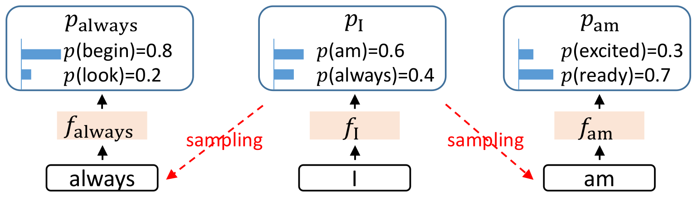
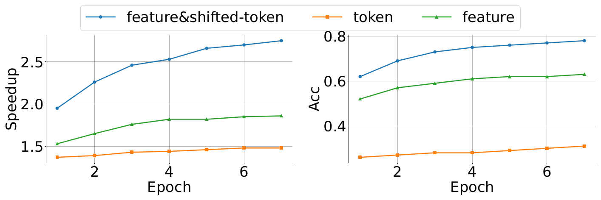
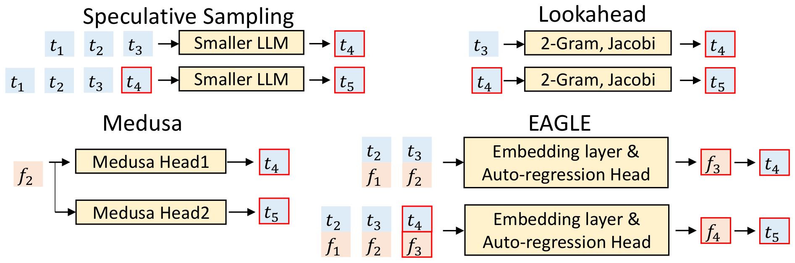
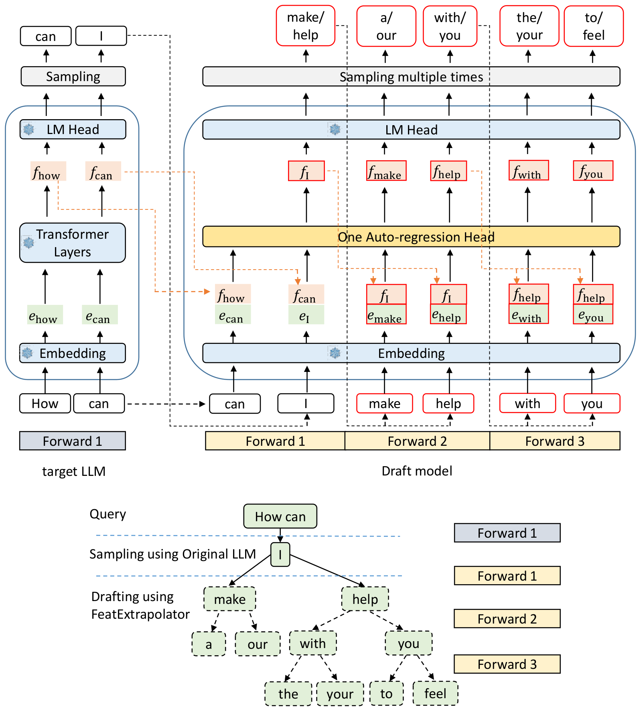
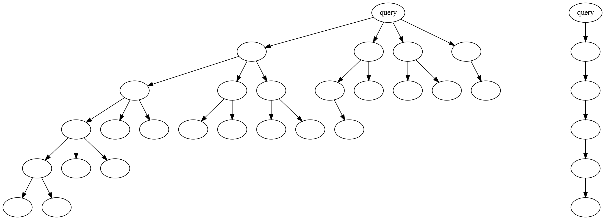
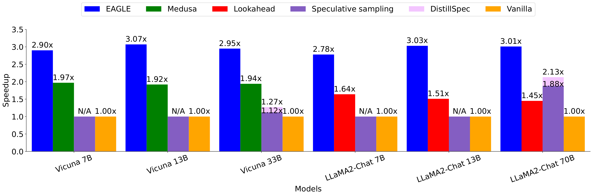
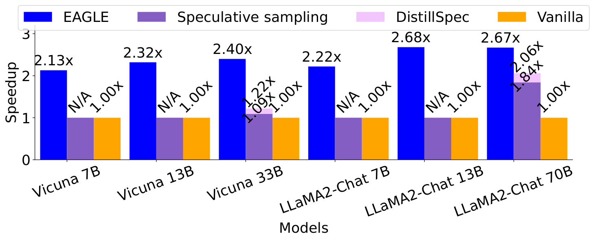
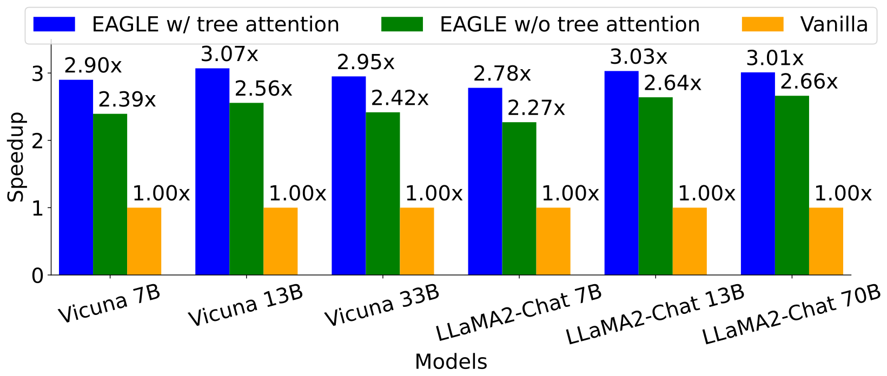
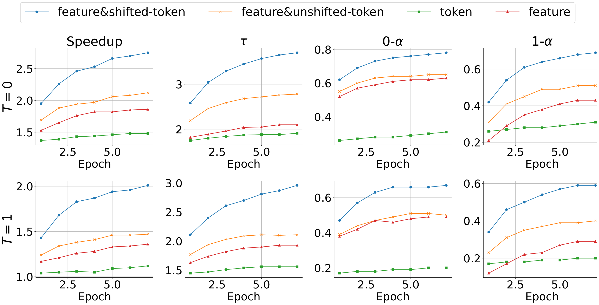

# 论文中文解读：《EAGLE: Speculative Sampling Requires Rethinking Feature Uncertainty》

> **基本信息**：Yuhui Li、Fangyun Wei、Chao Zhang、Hongyang Zhang（北京大学、Microsoft Research、University of Waterloo、Vector Institute），arXiv:2401.15077（本地 PDF 为 2025 年 3 月 4 日的 v3；PDF 页眉不含会议信息，ICML 2024 沿用旧概要）；论文原文 [arXiv 页面](https://arxiv.org/abs/2401.15077)，代码仓库见首页给出的 [SafeAILab/EAGLE](https://github.com/SafeAILab/EAGLE)。
>
> **本文的读法**：图取自论文原文（从 PDF 中按图裁出的原图），表为逐格核对后的中文转录（数字与原文一致，表头翻译为中文）。每张图后有中文图题、图中文字翻译和读图结论，因此不必再翻英文版。图中的具体数值若不是正文或图上标注给出的，是整理者从 PDF 矢量图坐标反算出的近似值，文中写“约”或在数字前注明。凡标明“整理者补充”“整理者核算”的内容，是为了帮助理解而加的，不是论文自带的数字。

## 一、一句话结论

大模型每生成一个 token 都要完整跑一遍前向，这一步**受显存带宽限制**，算力大量闲置。推测采样（speculative sampling）让一个便宜的“草稿”先猜好几个 token，再由原模型（论文称目标 LLM，target LLM）一次前向并行验证，既提速又不改变输出分布。难点在草稿：独立的小模型要么找不到、要么太慢；Medusa、Lookahead 这类不用独立草稿模型的方法又不够准。

**EAGLE（Extrapolation Algorithm for Greater Language-model Efficiency）** 基于两个观察：

1. 在**特征（feature，目标模型倒数第二层、LM Head 之前的隐藏状态）层面做自回归**，比在 token 层面做更容易；
2. 特征层的自回归受**采样不确定性**制约：同一个特征后面接哪个 token 是随机的，不同的 token 又会导致不同的后续特征。解决办法是把**提前一个时间步的 token 序列**（含采样结果）一起输入草稿模型。

做法：复用目标模型**冻结**的 Embedding 层和 LM Head，只训练一个**自回归头（Autoregression Head，一个全连接层加一层 Transformer decoder 层）**；草稿阶段在特征空间逐步外推，用树注意力（tree attention）生成并一次验证一棵草稿树，再用**多轮推测采样（multi-round speculative sampling）** 做无损验证。

主要结果与出处：

- **MT-bench 速度**（批大小 1）：温度 0 时六个模型加速 2.78–3.07 倍（图 1），温度 1 时 2.13–2.68 倍（图 2）；论文称比 Lookahead 快 1.70–2.08 倍，比 Medusa 快 1.47–1.60 倍（第 4.1 节）。
- **多任务**（表 1）：温度 0 下 HumanEval 3.17–3.76 倍，GSM8K 2.91–3.25 倍，Alpaca 2.78–3.03 倍；代码任务最快。
- **每轮产出**（表 1、表 2）：目标 LLM 每次前向平均接受 3.2–4.5 个 token（$\tau$），朴素解码只有 1 个。
- **70B 与吞吐**：摘要称 LLaMA2-Chat 70B 延迟加速 2.7–3.5 倍、吞吐翻倍（表 7：1.99 倍）。
- **MoE 与组合**：Mixtral 8x7B Instruct 只有 1.50 倍（表 3）；与 gpt-fast 叠加，LLaMA2-Chat 7B 在单张 RTX 3090 上达到 160.4 tokens/s（int4，表 4）。
- **训练成本**：自回归头 0.24B–0.99B 参数，只用约 6.8 万条 ShareGPT 对话训练；70B 在 4 张 A100（40G）上 1–2 天，7B/13B/33B 在 RTX 3090 节点上 1–2 天。
- **保持分布**：沿用推测采样的接受与残差规则，贪心和非贪心下都不改变目标 LLM 的输出分布，所以论文不再评估生成质量。

## 二、背景与动机

### 2.1 符号与推测采样回顾（第 2 节）

**符号**：“目标 LLM”是要被加速的模型，“草稿模型（draft model）”负责生成草稿；“特征（feature）”一般指 LLM 倒数第二层的特征，即 LM Head 之前的隐藏状态。token 记作小写 $t$，嵌入（embedding）记作 $e$，特征记作 $f$，概率分布记作 $p$；序列用大写，例如 $T_{i:j}=(t_i,t_{i+1},\dots,t_j)$。LLM 把输入 $T_{1:j}$ 经 Embedding 层变成嵌入 $E_{1:j}$，再得到特征 $F_{1:j}$，LM Head 把 $f_j$ 映射成分布 $p_{j+1}=\mathrm{LMHead}(f_j)$，从中采样下一个 token $t_{j+1}$。因此朴素（vanilla）的 token 级自回归是

$$
T_{1:j}\to E_{1:j}\to f_j\to p_{j+1}\to t_{j+1},\qquad j\ge 1 .
$$

**推测采样**分草稿和验证两个阶段：

1. **草稿阶段**：用较小的模型生成 $\gamma$ 个 token $\hat T_{j+1:j+\gamma}$ 以及它们各自的分布 $\hat P_{j+1:j+\gamma}$；
2. **验证阶段**：目标 LLM 只做一次前向，就得到这 $\gamma$ 个位置的概率 $P_{j+1:j+\gamma}$；然后从前往后逐个检验，第 $i$ 个草稿 token $\hat t_{j+i}$ 以概率

$$
\min\Big(1,\ \frac{p_{j+i}(\hat t_{j+i})}{\hat p_{j+i}(\hat t_{j+i})}\Big)
$$

被接受；一旦某个 token 被拒绝，它之后的草稿全部丢弃，并从残差分布 $\mathrm{norm}\big(\max(0,\,p_{j+i}-\hat p_{j+i})\big)$ 里重新采样这个位置的 token。

论文引用 Leviathan 等（2023）附录 A.1 的证明：这样得到的结果等价于直接从目标 LLM 采样，所以输出分布不变；EAGLE 沿用这套规则，因此在贪心和非贪心设置下都保持分布不变。

整理者补充：这个“无损”一行就能看明白。记 $\beta=\sum_x\min(\hat p(x),p(x))$ 为一次草稿被接受的总概率，被拒绝的概率是 $1-\beta=\sum_x\max(0,p(x)-\hat p(x))$。输出 token 恰为 $x$ 的概率，等于“草稿提出 $x$ 且被接受”的概率 $\hat p(x)\min(1,p(x)/\hat p(x))=\min(\hat p(x),p(x))$，加上“被拒绝后残差分布给出 $x$”的概率 $(1-\beta)\cdot\frac{\max(0,p(x)-\hat p(x))}{1-\beta}$，两项相加正好是 $p(x)$。更完整的推导与加速比分析见 [Speculative Decoding](../speculative_decoding/论文中文解读.md) 与 [Speculative Sampling](../speculative_sampling/论文中文解读.md)。

### 2.2 已有草稿方法的痛点（第 1 节）

- **独立小模型**：要找到“功能像目标模型、但延迟低得多”的草稿模型。LLaMA2 系列有 7B、13B、70B，用 7B 给 70B 做草稿可行，但 7B 自己没有更小的同系列模型；TinyLlama 与 LLaMA2-Chat 的指令模板不一致，不适用于指令微调模型；用 7B 给 13B 做草稿则因 7B 开销太高，反而比朴素自回归慢（见图 1 的 N/A）。专门训练新草稿模型又贵：TinyLlama 用了 3,000B token，而 EAGLE 只用 2–4B token。
- **降低草稿开销的方法**：Lookahead 用 n-gram 与 Jacobi 迭代；Medusa 用一组 MLP 基于目标模型倒数第二层的特征预测 token。它们显著降低了草稿延迟，但草稿准确率有限：论文称 Medusa 的准确率约 0.6，Lookahead 更低，而 EAGLE 约 0.8（0.6 这个数字论文没有给出图表或出处）。
- **加速的两条路**：推测采样的收益取决于“草稿的时间开销”和“被目标模型接受的比例”（原文引用 Chen 等 2023b、Xia 等 2023、Santilli 等 2023）。EAGLE 的目标是：开销像 Medusa 一样低，准确率比 Medusa 高。

## 三、两个核心观察（第 1 节，图 3、图 4）

### 3.1 观察一：特征层的自回归比 token 层更简单

论文称：特征是高维连续向量，特征序列比 token 序列更有规律，因为 token 序列只是自然语言的一种简单变换。因此“先在特征层自回归、再用目标模型的 LM Head 得到 token”比“直接自回归地预测 token”效果更好。证据是图 4：只用特征的草稿模型加速比约 1.9 倍，只用 token 的约 1.5 倍（图 4 中 Vicuna 7B、温度 0、第 7 轮：1.86 对 1.48）。注意这是实验上的比较，论文没有给出理论分析。

### 3.2 观察二：特征序列中的采样不确定性

文本生成时，目标 LLM 先预测 token 的分布，再从中**采样**，这带来随机性；而特征是高维连续的，不能像 token 那样当作“一个离散样本”处理。图 3 给出了这个问题：



*图 3（原文 Figure 3，第 2 页）：特征序列中的不确定性。$f_{\mathrm{I}}$ 之后的下一个特征取决于采样结果，不能只由 $f_{\mathrm{I}}$ 决定：“always”和“am”都可能接在 token “I”之后，从而分出两个分支。*

**图中文字翻译与读法**：

- **中间**：token “I”经目标 LLM 得到特征 $f_{\mathrm{I}}$，LM Head 给出分布 $p_{\mathrm{I}}$：$p(\text{am})=0.6$，$p(\text{always})=0.4$。
- **两条红色虚线 sampling（采样）**：从 $p_{\mathrm{I}}$ 采样，左边采到 “always”，右边采到 “am”。
- **左边**：“always”对应特征 $f_{\mathrm{always}}$，其分布 $p_{\mathrm{always}}$ 为 $p(\text{begin})=0.8$，$p(\text{look})=0.2$。**右边**：“am”对应特征 $f_{\mathrm{am}}$，其分布 $p_{\mathrm{am}}$ 为 $p(\text{excited})=0.3$，$p(\text{ready})=0.7$。
- **读图结论**：$f_{\mathrm{I}}$ 相同，但采样到不同 token 后，下一个特征（$f_{\mathrm{always}}$ 还是 $f_{\mathrm{am}}$）和再下一步的分布都完全不同。草稿模型如果只看 $f_{\mathrm{I}}$，就无法判断该往哪个分支走。

论文接着指出：**Medusa 在预测间隔的 token 时有类似问题**，即不确定对输入 $f_{\mathrm{I}}$ 来说真正的目标应是 $p_{\mathrm{am}}$ 还是 $p_{\mathrm{always}}$。EAGLE 的解决办法：把提前一个时间步的 token 序列（包含采样结果）输入草稿模型。对图 3 的例子，就是用 $f_{\mathrm{I}}$ 和 $t_{\mathrm{always}}$ 预测 $f_{\mathrm{always}}$，用 $f_{\mathrm{I}}$ 和 $t_{\mathrm{am}}$ 预测 $f_{\mathrm{am}}$。论文称，解决这个不确定性后，加速比从 1.9 倍进一步提高到 2.8 倍（图 4）。

**整理者补充的小数值例子（不是论文数字）：为什么要把采样到的 token 一起输入。** 借用图 3 的玩具概率，把它们当作目标模型真实的条件分布：上下文以 “I” 结尾，下一个 token 为 am（0.6）或 always（0.4）；若是 “I am”，再下一个为 excited（0.3）或 ready（0.7）；若是 “I always”，再下一个为 begin（0.8）或 look（0.2）。

- **(a) 预测下一个特征**：目标是 $f_{\mathrm{am}}$（概率 0.6）或 $f_{\mathrm{always}}$（概率 0.4）。只看 $f_{\mathrm{I}}$ 的草稿模型无法区分，用平方误差训练时它的最优输出是 $0.6f_{\mathrm{am}}+0.4f_{\mathrm{always}}$，这个“加权平均”并不对应任何一个真实分支（整理者的直观解释，论文只说“存在歧义”）。知道采样结果后，目标是唯一确定的。
- **(b) 猜“再下一个”token**（Medusa 头面对的情形）：不知道第一步采到谁时，第二个 token 的边缘分布是 ready $0.6\times0.7=0.42$、begin $0.4\times0.8=0.32$、excited $0.6\times0.3=0.18$、look $0.4\times0.2=0.08$（合计 1）。即使草稿完美学到这个边缘分布，最好的单点猜测 ready 也只有 **42%** 的命中率。知道第一步采到谁（EAGLE 的 shifted token）时：采到 am 就猜 ready（命中 0.7），采到 always 就猜 begin（命中 0.8），总命中率 $0.6\times0.7+0.4\times0.8=0.74$，即 **74%**。
- 两者相差 32 个百分点，差距不来自模型容量，而来自**信息**：前一步的采样结果决定了后一步的分布。

### 3.3 图 4：三种草稿输入的对比



*图 4（原文 Figure 4，第 3 页）：以 token、特征（feature）和 feature&shifted-token 为输入的草稿模型的准确率与加速比，温度为 0，在 MT-bench 上测试，原 LLM 为 Vicuna 7B。feature&shifted-token 指输入一个特征序列和一个提前一个时间步的 token 序列。*

**图中文字翻译与读法**：

- 图例：feature&shifted-token（特征加前移一位的 token，即 EAGLE 的输入）、token（只用 token）、feature（只用特征）。
- **左图**：纵轴 Speedup（加速比），横轴 Epoch（训练轮数）；**右图**：纵轴 Acc（草稿的准确率；下面会说明它与图 8 的 0-α 数据一致），横轴同为训练轮数。
- 整理者从矢量图坐标反算，第 1 轮 → 第 7 轮（约）：

| 草稿输入 | 加速比 | 准确率 Acc |
|---|---:|---:|
| feature&shifted-token | 1.95 → 2.75 | 0.62 → 0.78 |
| feature | 1.53 → 1.86 | 0.52 → 0.63 |
| token | 1.37 → 1.48 | 0.26 → 0.31 |

- **读图结论**：三条曲线随训练轮数缓慢上升且没有交叉。只用特征比只用 token 明显更好（观察一）；再加上前移一位的 token 又大幅提高（观察二）。整理者核对矢量坐标：这张图的数据点与后面图 8 第一行（温度 0）的 Speedup 与 0-α 两列完全重合，所以这里的 Acc 就是 0-α（定义见 7.1 节），图 4 是图 8 的子集。

## 四、草稿阶段：EAGLE 怎样生成草稿

### 4.1 几种草稿方式的对比（图 5）



*图 5（原文 Figure 5，第 4 页）：几种方法起草第四、第五个 token $t_4$ 和 $t_5$ 的对比。$t$（蓝色块）表示 token，$f$（橙色块）表示特征，下标是它们在序列中的位置；红框表示草稿模型的预测。为简单起见，图中 Lookahead 的 n-gram 取 $n=2$。*

**图中文字翻译与读法**：

- **Speculative Sampling（推测采样）**：输入 $t_1,t_2,t_3$，经较小的 LLM（Smaller LLM）得到 $t_4$；再把 $t_4$ 接到输入末尾（$t_1$ 到 $t_4$），再过一次小 LLM 得到 $t_5$。
- **Lookahead**：输入 $t_3$，经 2-Gram（二元组）与 Jacobi 迭代得到 $t_4$；输入 $t_4$ 得到 $t_5$。
- **Medusa**：只用目标 LLM 的特征 $f_2$，Medusa Head 1 预测 $t_4$，Medusa Head 2 预测 $t_5$，两个头相互独立。
- **EAGLE**：输入特征序列 $(f_1,f_2)$ 与提前一个时间步的 token 序列 $(t_2,t_3)$，经 Embedding layer & Auto-regression Head（嵌入层与自回归头）预测 $f_3$，再由 LM Head 得到并采样 $t_4$；把 $(f_3,t_4)$ 追加到输入，预测 $f_4$，再采样 $t_5$。
- **读图结论**：差别在于“草稿看到什么、怎样往后走”。小 LLM 与 Lookahead 全在 token 层；Medusa 的两个头都只看 $f_2$，互不依赖；EAGLE 在特征层自回归，并且每一步都把已经采样出的 token 接进输入。

用公式写，EAGLE 的草稿是（取 $F_{1:i}$ 为目标 LLM 的真实特征，$T_{2:i+1}$ 比特征序列“超前”一位）：

$$
\hat f_{i+1}=\mathrm{Draft}(T_{2:i+1},\,F_{1:i}),\qquad
\hat p_{i+2}=\mathrm{Softmax}\big(\mathrm{LMHead}(\hat f_{i+1})\big),\qquad
\hat t_{i+2}\sim\hat p_{i+2}.
$$

取 $i=2$ 就是图 5：用 $(f_1,f_2)$ 与 $(t_2,t_3)$ 预测 $\hat f_3$，由 $\hat p_4=\mathrm{Softmax}(\mathrm{LMHead}(\hat f_3))$ 采样得到 $t_4$；之后把 $\hat f_3$ 与 $t_4$ 追加到输入，预测 $\hat f_4$，再采样 $t_5$。

### 4.2 图 6：一轮完整的草稿过程



*图 6（原文 Figure 6，第 4 页）：EAGLE 的流程。上半部分展示计算过程，下半部分展示每一步对应的生成结果。上半部分中，绿色块表示 token 的嵌入，橙色块表示特征，红框表示草稿模型的预测，带雪花图标的蓝色模块表示使用目标 LLM 的参数（不参与训练）。*

**图中文字翻译与读法**：

- **左：target LLM（目标 LLM）**，自下而上是输入 token “How”“can” → Embedding（嵌入层，得到 $e_{\text{how}},e_{\text{can}}$）→ Transformer Layers（Transformer 层，得到特征 $f_{\text{how}},f_{\text{can}}$）→ LM Head → Sampling（采样），输出 “can”“I”。底部 Forward 1 是目标 LLM 的第 1 次前向。
- **右：Draft model（草稿模型）**：Embedding、One Auto-regression Head（一个自回归头）、LM Head、Sampling multiple times（多次采样）。Embedding 与 LM Head 带雪花图标，用的是目标 LLM 的参数；底部 Forward 1、2、3 是草稿模型的 3 次前向。橙色虚线表示特征的传递：目标 LLM 的特征传给草稿的 Forward 1，草稿每次前向输出的特征传给下一次前向。
- **下：生成结果**：Query（查询）“How can” → Sampling using Original LLM（用原 LLM 采样）得到 “I” → Drafting using FeatExtrapolator（用特征外推器起草；FeatExtrapolator 是草稿模型的名字）得到树：I → {make, help}，make → {a, our}，help → {with, you}，with → {the, your}，you → {to, feel}。右侧图例说明颜色：灰蓝色是目标 LLM 的 Forward 1，浅黄色是草稿的 Forward 1、2、3。

**逐步走一遍图 6 的例子**（记 How $=t_1$，can $=t_2$，I $=t_3$；每个输入位置由“前一位置的特征”和“当前位置的 token 嵌入”组成，输出的是当前位置的预测特征）：

1. **目标 LLM 前向（Forward 1，图左）**：对 “How can” 前向一次，得到两个位置的特征 $f_{\text{how}},f_{\text{can}}$；LM Head 从 $f_{\text{can}}$ 得到分布，采样出新 token “I”。
2. **草稿 Forward 1**：输入是 $(f_{\text{how}},e_{\text{can}})$ 与 $(f_{\text{can}},e_{\text{I}})$（图中橙色虚线把目标的特征送进来）。自回归头输出各位置的预测特征，图中只画出最后位置的 $\hat f_{\text{I}}$。LM Head 把 $\hat f_{\text{I}}$ 变成分布，“多次采样”（贪心设置下取 top-$k$）得到 “I” 的两个候选后继：make、help。
3. **草稿 Forward 2**：make、help 是两个新节点。它们的特征输入都是父节点的预测特征 $\hat f_{\text{I}}$，token 输入分别是 $e_{\text{make}},e_{\text{help}}$；输出 $\hat f_{\text{make}},\hat f_{\text{help}}$，再各取两个候选：make → a、our；help → with、you。
4. **草稿 Forward 3**：图中的例子只继续扩展 help 这一支：with、you 的特征输入都是它们的父节点特征 $\hat f_{\text{help}}$，token 输入是各自的嵌入；输出 $\hat f_{\text{with}},\hat f_{\text{you}}$，再各取两个候选：with → the、your；you → to、feel。
5. **结果**：3 次草稿前向共得到 10 个草稿 token（$2+4+4$）。论文的说法（译）是“只用 3 次前向就起草出一棵 10 个 token 的树”；一般地，深度为 $m$ 的草稿树可以用 $m$ 次前向得到多于 $m$ 个 token。
6. **验证**：目标 LLM 用树注意力一次前向处理整棵树，再用多轮推测采样决定接受哪条路径（第五节）。被接受的 token 以及它们由目标 LLM 算出的**真实特征**会被记录下来，作为下一轮草稿的输入。

### 4.3 自回归头的结构与张量形状（第 3.1 节）

草稿模型由三个模块组成：**Embedding 层、LM Head、自回归头**。前两者直接用目标 LLM 的参数，不需要额外训练。数据流如下：

1. 输入一个特征序列，形状为 (bs, seq_len, hidden_dim)，和一个提前一个时间步的 token 序列，形状为 (bs, seq_len)；
2. Embedding 层把 token 序列转成嵌入序列，形状 (bs, seq_len, hidden_dim)；
3. 嵌入序列与特征序列拼接，得到融合序列，形状 (bs, seq_len, 2×hidden_dim)；
4. 自回归头由**一个全连接（FC）层和一层 decoder 层**组成：FC 层把融合序列降维回 (bs, seq_len, hidden_dim)，decoder 层再预测下一个特征；
5. LM Head 由预测特征算出分布，从中采样（或取 top-$k$）得到下一个 token；
6. 把预测特征与采样得到的 token 拼进输入，继续下一步自回归。

论文给出的可训练参数量：7B、13B、33B、70B 模型对应的自回归头分别为 0.24B、0.37B、0.56B、0.99B；MoE 模型 Mixtral 8x7B 对应 0.28B。

整理者核算：若按公开的 LLaMA 配置估算，自回归头 ≈ FC（$2h\to h$）+ 一层标准 decoder 层。7B（$h=4096$，FFN 中间维 11008）：decoder 层约 2.02 亿 + FC 约 0.34 亿 ≈ 0.24B；13B（$h=5120$，13824）：约 3.17 亿 + 0.52 亿 ≈ 0.37B；70B（$h=8192$，FFN 中间维 28672，8 个 KV 头）：约 8.56 亿 + 1.34 亿 ≈ 0.99B，都与论文吻合，说明“FC 加一层与目标模型同宽的 decoder 层”这个描述是准确的。但按同样方法 33B（$h=6656$，17920）估算约 0.62B，与论文的 0.56B 不一致，原因未查明（可能是配置差异或笔误）。

### 4.4 草稿树的结构（附录 A.1，图 9）



*图 9（原文 Figure 9，第 12 页）：EAGLE 的草稿结构。左边是使用树注意力时的草稿结构，右边是不使用树注意力时的草稿结构。*

**图中文字翻译与读法**：图中只有两个根节点上写着 “query”（查询），没有别的文字。每个椭圆是一个 token 位置，箭头从父节点指向子节点。

- **左：树草稿**。根节点 query 有 4 个子节点（论文说“根节点 $k=4$”）；整理者按图数出各层节点数如下：

| 深度（草稿前向次数） | 节点数 |
|---:|---:|
| 1 | 4 |
| 2 | 8 |
| 3 | 8 |
| 4 | 3 |
| 5 | 2 |
| 合计 | 25 |

这 25 个草稿节点中，15 个是叶子，10 个有子节点；最左边的分支最深、最宽（根 4 个子节点；其最左子节点有 3 个孩子，其最左孙节点有 3 个孩子，一直到第 5 层）。
- **右：链式草稿**。query 后面跟着 5 个节点组成的一条链，用于“不使用树注意力”的消融（表 5、图 7）和测量接受率 n-α。
- **论文的说明**：贪心设置下取概率最高的 $k$ 个 token 作为子节点，非贪心设置下**采样** $k$ 个 token；每个节点的 $k$ 从图 9 里读出；不论树还是链，草稿模型都做 **5 次前向**；验证阶段目标 LLM 一次前向得到每个 token 的概率。
- **为什么是这棵树**：论文承认树结构**没有严格优化**，只是凭直觉——“概率更高的分支应该更深更宽”；所有模型、所有实验都用这同一棵树。最优树很可能依赖上下文，例如批大小增大、冗余算力减少时，更小的树可能更合适；调整草稿结构有可能进一步提升性能。
- 整理者补充：验证时目标 LLM 要处理根节点（刚由目标采样出、尚未进入 KV cache 的那个 token）加上全部草稿节点，即一次前向 26 个位置，而链式草稿只有 6 个位置；一轮最多前进的 token 数是草稿深度加 1，即 $5+1=6$（5 个草稿全部被接受，再加目标自己采样的 1 个），实测 $\tau$ 为 3.2–4.5，约为上限的一半到四分之三。

## 五、验证阶段：树注意力与多轮推测采样

### 5.1 树注意力（第 3.3 节）

目标 LLM 用**树注意力**在一次前向里算出整棵草稿树中每个 token 的概率：每个节点只关注已缓存的前缀和它在树里的祖先（以及自己），不关注兄弟分支。EAGLE 与 SpecInfer、Medusa 一样使用树注意力，论文没有再给出掩码的细节。

整理者补充：以图 6 的 11 个 token（根节点 I 加 10 个草稿）为例，掩码如下（所有行都还能看到前缀 “How can”）。11×11 的矩阵里共有 33 个允许位置（含对角线）。

| 节点（行） | 除前缀外还能看到的节点（列） |
|---|---|
| I | I |
| make | I、make |
| help | I、help |
| a | I、make、a |
| our | I、make、our |
| with | I、help、with |
| you | I、help、you |
| the | I、help、with、the |
| your | I、help、with、your |
| to | I、help、you、to |
| feel | I、help、you、feel |

位置编码也要按节点在树中的深度取值而不是按展平后的顺序（论文未写，沿用 SpecInfer 与 Medusa 的做法，整理者提示）。

### 5.2 多轮推测采样（第 3.3 节、附录 A.2、算法 1）

链式草稿里每个位置只有一个候选，推测采样的接受与残差规则可以直接用。树草稿里，同一个父节点下有 $k$ 个候选子节点，需要修改采样算法。论文的做法（与 SpecInfer 一致）：

- 记推测采样的“单轮算法”为 $A$：候选被接受就返回它，否则从残差分布采样一个 token；
- **多轮推测采样**对 $k$ 个候选递归地调用 $A$：第一个候选被拒绝后，**不直接从残差分布采样**，而是把残差分布当作新的目标分布，再用第二个候选调用 $A$；如此继续；
- 如果 $k$ 个候选全部被拒绝，才直接从最后一次的残差分布采样。

原文算法 1（中文翻译；原文更新 $p$ 的那一行把残差写成 $p(t_i)-\hat p_i(t_i)$，见下方说明）：

```text
算法 1  多轮推测采样（Multi-round speculative sampling）
输入：目标分布 p；候选 token t_1…t_k 及其草稿分布 p̂_1…p̂_k，其中 t_i 采样自 p̂_i
输出：一个服从 p 的样本 x
i ← 1
当 i ≤ k 时：
    r ← U(0,1)                            # 均匀随机数
    若 r < p(t_i) / p̂_i(t_i)：
        返回 t_i                          # 接受第 i 个候选
    p ← norm(max(0, p(t_i) − p̂_i(t_i)))   # 原文写法，应理解为逐 token 相减的残差分布
    i ← i + 1
循环结束
从当前的 p 采样 t
返回 t                                    # 所有候选都被拒绝
```

整理者说明：原文这一行写成对被采样 token 的两个概率值相减，按字面理解会得到一个数而不是分布。结合正文第 2 节“从分布 $\mathrm{norm}(\max(0,p-\hat p))$ 重新采样”和推测采样的原始算法，应理解为对所有 token 逐点相减：$p\leftarrow\mathrm{norm}(\max(0,\,p-\hat p_i))$。

在整棵树上的用法：从根节点开始，对当前节点的所有子节点依次做上面的循环；若某个子节点被接受，就走到该子节点，并对它的子节点重复；若全部被拒绝，则从最后的残差分布采样一个 token 作为本轮的结尾。整理者补充（论文没有单独说明）：如果一路走到叶子，目标 LLM 在该叶子位置的分布也已经在这次前向里算出，直接从中采样一个额外 token，与推测采样中“全部接受后再多送一个 token”一致；温度为 0 时则等价于逐层检查子节点是否等于目标分布的 argmax。

**整理者补充的小数值例子（不是论文数字）：多轮推测采样。** 词表只有 4 个 token：a、b、c、d。目标分布 $p=(0.4,\,0.3,\,0.2,\,0.1)$，草稿分布 $\hat p=(0.1,\,0.1,\,0.4,\,0.4)$；在同一个节点处独立地从 $\hat p$ 抽 $k=2$ 个候选（论文没有说明非贪心设置下 $k$ 个候选是否放回抽取，这里取放回）。

**第 1 轮**（目标分布 $p$）：

- 候选 $t_1$ 若抽到 a、b、c、d，接受概率 $\min(1,p/\hat p)$ 分别是 $1$、$1$、$0.5$、$0.25$；
- 第 1 轮“抽到并被接受”的概率质量是 $\min(\hat p,p)=(0.1,\,0.1,\,0.2,\,0.1)$，合计 0.5，所以被拒绝的概率也是 0.5；
- 拒绝后更新：$p'=\mathrm{norm}\big(\max(0,p-\hat p)\big)=\mathrm{norm}(0.3,\,0.2,\,0,\,0)=(0.6,\,0.4,\,0,\,0)$。

**第 2 轮**（目标分布 $p'$）：

- 接受的概率质量是 $\min(\hat p,p')=(0.1,\,0.1,\,0,\,0)$，合计 0.2，被拒绝的概率是 0.8；
- 再更新：$p''=\mathrm{norm}\big(\max(0,p'-\hat p)\big)=\mathrm{norm}(0.5,\,0.3,\,0,\,0)=(0.625,\,0.375,\,0,\,0)$；
- 若两个候选都被拒绝，就从 $p''$ 采样。

**最终输出分布**：

- a：$0.1+0.5\times(0.1+0.8\times0.625)=0.1+0.5\times0.6=0.4$；
- b：$0.1+0.5\times(0.1+0.8\times0.375)=0.1+0.5\times0.4=0.3$；
- c：$0.2+0.5\times(0+0)=0.2$；
- d：$0.1$。

正好等于 $p$，输出分布不变。同时，“至少有一个草稿候选被接受”的概率从只有 1 个候选时的 0.5 提高到 $0.5+0.5\times0.2=0.6$，这就是在树里让一个节点带多个子节点的收益。

一条具体的随机轨迹：$t_1=\text{c}$，$r=0.7$ 不小于 $p(\text{c})/\hat p(\text{c})=0.5$，拒绝，更新为 $p'$；$t_2=\text{d}$，接受概率 $\min(1,0/0.4)=0$，拒绝，更新为 $p''$；从 $p''$ 采样，若抽到 a 就输出 a。草稿几乎不会猜 a（$\hat p(\text{a})=0.1$），但目标分布里 a 最可能，残差分布正是把这部分概率补回来。

## 六、训练（第 3.2 节）

**两个损失**：预测下一个特征是**回归**任务，用 Smooth L1 损失：

$$
L_{\mathrm{reg}}=\mathrm{SmoothL1}\big(f_{i+1},\ \mathrm{Draft}(T_{2:i+1},F_{1:i})\big).
$$

预测特征只是草稿模型的中间目标，最终目的是预测 token、生成 token 序列，所以还要加一个**分类损失**直接优化最终目标：

$$
p_{i+2}=\mathrm{Softmax}\big(\mathrm{LMHead}(f_{i+1})\big),\qquad
\hat p_{i+2}=\mathrm{Softmax}\big(\mathrm{LMHead}(\hat f_{i+1})\big),\qquad
L_{\mathrm{cls}}=\mathrm{CrossEntropy}(p_{i+2},\hat p_{i+2}).
$$

这里 $p_{i+2}$ 是用目标模型真实特征算出的分布，$\hat p_{i+2}$ 是用草稿模型预测特征算出的分布（原文没有写交叉熵的展开式，按软标签交叉熵理解，即 $-\sum_x p_{i+2}(x)\log\hat p_{i+2}(x)$，整理者补充）。总损失是

$$
L=L_{\mathrm{reg}}+w_{\mathrm{cls}}\,L_{\mathrm{cls}},\qquad w_{\mathrm{cls}}=0.1 .
$$

论文给出的理由：分类损失在数值上通常比回归损失大一个数量级，所以把 $w_{\mathrm{cls}}$ 设为 0.1。整理者补充：PyTorch 的 SmoothL1 损失在误差小于 $\beta$（默认 1）时按二次、否则按线性增长；论文没有给出 $\beta$。

**数据**：自回归头最理想的训练数据是目标 LLM 自己自回归生成的文本，但这样做很贵。好在 EAGLE 对训练数据不敏感（表 6），所以不用目标 LLM 生成的文本，而是用**固定数据集**，大幅减少开销。训练使用 ShareGPT 数据集（论文原词为 68,000 dialogue iterations，引言称“不超过 7 万条对话”），同一个目标模型在所有评测上用同一份自回归头权重，评测数据集上没有任何额外训练。

**噪声增强**：在草稿阶段 EAGLE 自回归地处理特征，特征的误差可能累积。为缓解，训练时给目标 LLM 的特征加上从均匀分布 $U(-0.1,0.1)$ 采样的随机噪声（引用 Jain 等 2023 的 NEFTune），让模型习惯输入特征不精确的情形。

**超参数**：学习率 3e-5，AdamW 优化器，$(\beta_1,\beta_2)=(0.9,0.95)$，梯度裁剪 0.5；目标 LLM 固定不动。训练成本：70B 的自回归头在一台 4×A100（40G）服务器上 1–2 天训完；7B、13B、33B 可在一台 RTX 3090 节点上 1–2 天训完。论文强调每个目标模型只需训练一次，随着查询数增加，摊到每次查询的训练成本可以忽略。论文没有给出训练的总轮数、序列长度和批大小（图 4、图 8 只画到第 7 轮）。

## 七、实验设置与主要结果

### 7.1 设置与指标

**模型与任务**：Vicuna（7B、13B、33B）、LLaMA2-Chat（7B、13B、70B）和 Mixtral 8x7B Instruct，覆盖多轮对话（MT-bench）、代码生成（HumanEval）、数学推理（GSM8K）和指令遵循（Alpaca）。选 MT-bench 是因为 Lookahead 和 Medusa 都用它报告加速比，便于公平比较。大多数实验用**批大小 1**（沿用推测采样与 DistillSpec、BiLD 的设置），批大小大于 1 的实验在 8.4 节（表 7）。

**指标**：

- **墙钟加速比（walltime speedup ratio）**：相对于朴素自回归解码的实测加速比；
- **平均接受长度 $\tau$**：目标 LLM 每次前向平均接受的 token 数。论文把它与“朴素解码每次前向只产生 1 个 token”对比，所以朴素解码的 $\tau=1$；按这个口径，EAGLE 的 $\tau$ 是每次目标前向产出的 token 总数，包含目标 LLM 自己采样的那个 token（整理者的理解，论文没有逐字定义）；
- **接受率 $\alpha$**：草稿阶段被接受的 token 与生成的 token 之比，衡量草稿准确率。树草稿在每个位置采样多个 token 却只接受一个，所以 $\alpha$ 对树不太适用；测量 $\alpha$ 时改用**不带树注意力的链式草稿**（与推测采样、DistillSpec 一致）。EAGLE 的自回归会累积特征误差，所以把接受率记作 **n-α**：草稿模型的输入中包含 n 个由草稿模型自己预测的（可能不准的）特征时的接受率。0-α 是输入特征全部精确（来自目标 LLM）时的接受率，1-α 是输入含一个不精确特征时的接受率，依此类推。链式草稿有 5 个位置，对应 0-α 到 4-α。

论文不评估生成质量：EAGLE 的加速在理论上保证目标 LLM 的输出分布不变，所以评估质量“既不必要也没有意义”。

### 7.2 MT-bench 主结果（图 1、图 2）



*图 1（原文 Figure 1，第 1 页）：Vicuna 与 LLaMA2-Chat 在 MT-bench 上、贪心（temperature=0）设置下的推理延迟加速比。Medusa 与 Lookahead 的加速比抄自它们各自的原始技术报告。推测采样缺少能加速 7B 模型的合适草稿模型；用 7B 模型作 13B 模型的草稿模型，因 7B 模型开销太高而比朴素自回归解码更慢。这些情形标 N/A。本文只与不需要微调主干模型的推测采样类方法比较，以保证输出文本分布不变。*

**图中文字翻译与读法**：图例依次是 EAGLE、Medusa、Lookahead、Speculative sampling（推测采样）、DistillSpec、Vanilla（朴素自回归）；横轴 Models（模型），纵轴 Speedup（加速比）。柱上的数字（原图标注）如下表，“—”表示图中没有这一根柱（图 1 的 N/A 位置只画了一根紫色柱，没有单独的 DistillSpec 柱）：

| 模型 | EAGLE | Medusa | Lookahead | 推测采样（7B 草稿） | DistillSpec | 朴素解码 |
|---|---:|---:|---:|---:|---:|---:|
| Vicuna 7B | 2.90× | 1.97× | — | N/A | — | 1.00× |
| Vicuna 13B | 3.07× | 1.92× | — | N/A | — | 1.00× |
| Vicuna 33B | 2.95× | 1.94× | — | 1.12× | 1.27× | 1.00× |
| LLaMA2-Chat 7B | 2.78× | — | 1.64× | N/A | — | 1.00× |
| LLaMA2-Chat 13B | 3.03× | — | 1.51× | N/A | — | 1.00× |
| LLaMA2-Chat 70B | 3.01× | — | 1.45× | 1.88× | 2.13× | 1.00× |

**读图结论**：

- EAGLE 在六个模型上都是最高的柱，为 2.78–3.07 倍。EAGLE 与 Medusa 的比值为 1.47、1.60、1.52 倍，与 Lookahead 的比值为 1.70、2.01、2.08 倍（整理者核算，与论文所说的 1.47–1.60 倍和 1.70–2.08 倍一致）。
- N/A 的柱画在 1.0 处只是占位：7B 模型没有更小的同系列模型可作草稿；13B 用 7B 作草稿比朴素解码还慢。论文第 4.1 节对 7B 草稿的做法是遍历草稿长度 2 到 10，取最高加速比；结果 13B 没有提速，33B 为 1.12 倍，70B 为 1.88 倍。
- DistillSpec 用与 EAGLE 相同的训练数据，散度函数按 DistillSpec 附录 A.1 取前向 KL（FKL）。蒸馏只让加速比略有提高（33B：1.12 → 1.27；70B：1.88 → 2.13），论文的解释是蒸馏的目标是提高草稿模型的接受率，而推测采样的瓶颈在草稿模型的高开销。



*图 2（原文 Figure 2，第 2 页）：MT-bench 上、非贪心（temperature=1）设置下的加速比。Lookahead 只限于贪心解码，Medusa 的非贪心生成不保证无损，所以 EAGLE 不与它们比较。*

**图中文字翻译与读法**：图例是 EAGLE、Speculative sampling、DistillSpec、Vanilla；横轴 Models，纵轴 Speedup。柱上的数字（原图标注）：

| 模型 | EAGLE | 推测采样（7B 草稿） | DistillSpec | 朴素解码 |
|---|---:|---:|---:|---:|
| Vicuna 7B | 2.13× | N/A | — | 1.00× |
| Vicuna 13B | 2.32× | N/A | — | 1.00× |
| Vicuna 33B | 2.40× | 1.09× | 1.22× | 1.00× |
| LLaMA2-Chat 7B | 2.22× | N/A | — | 1.00× |
| LLaMA2-Chat 13B | 2.68× | N/A | — | 1.00× |
| LLaMA2-Chat 70B | 2.67× | 1.84× | 2.06× | 1.00× |

**读图结论**：温度 1 时 EAGLE 仍有 2.13–2.68 倍，但整体低于温度 0（图 1 的 2.78–3.07 倍）。在能比较的 33B 与 70B 上，EAGLE 比推测采样快 2.20 倍与 1.45 倍，比 DistillSpec 快 1.97 倍与 1.30 倍（整理者核算）。

### 7.3 多任务结果（表 1）

下表给出 HumanEval、GSM8K、Alpaca 上的加速比和平均接受长度 $\tau$（越大越好）。T 为温度（原文：V 表示 Vicuna，LC 表示 LLaMA2-Chat）。

| 温度 | 模型 | HumanEval 加速比 | HumanEval $\tau$ | GSM8K 加速比 | GSM8K $\tau$ | Alpaca 加速比 | Alpaca $\tau$ |
|---|---|---:|---:|---:|---:|---:|---:|
| T=0 | Vicuna 7B | 3.33× | 4.29 | 3.01× | 4.00 | 2.79× | 3.86 |
| T=0 | Vicuna 13B | 3.58× | 4.39 | 3.08× | 3.97 | 3.03× | 3.95 |
| T=0 | Vicuna 33B | 3.67× | 4.28 | 3.25× | 3.94 | 2.97× | 3.61 |
| T=0 | LLaMA2-Chat 7B | 3.17× | 4.24 | 2.91× | 3.82 | 2.78× | 3.71 |
| T=0 | LLaMA2-Chat 13B | 3.76× | 4.52 | 3.20× | 4.03 | 3.01× | 3.83 |
| T=0 | LLaMA2-Chat 70B | 3.52× | 4.42 | 3.03× | 3.93 | 2.97× | 3.77 |
| T=1 | Vicuna 7B | 2.39× | 3.43 | 2.34× | 3.29 | 2.21× | 3.30 |
| T=1 | Vicuna 13B | 2.65× | 3.63 | 2.57× | 3.60 | 2.45× | 3.57 |
| T=1 | Vicuna 33B | 2.76× | 3.62 | 2.77× | 3.60 | 2.52× | 3.32 |
| T=1 | LLaMA2-Chat 7B | 2.61× | 3.79 | 2.40× | 3.52 | 2.29× | 3.33 |
| T=1 | LLaMA2-Chat 13B | 2.89× | 3.78 | 2.82× | 3.67 | 2.66× | 3.55 |
| T=1 | LLaMA2-Chat 70B | 2.92× | 3.76 | 2.74× | 3.58 | 2.65× | 3.47 |

（原文表 1，第 6 页。）读法：

- 论文：EAGLE 在温度 0 时的加速好于温度 1，例如 LLaMA2-Chat 13B 在温度 0 的加速比范围是 3.01–3.76 倍，温度 1 是 2.66–2.89 倍；代码生成（HumanEval）上加速最好，因为代码里有大量固定模板，草稿更容易猜对。
- 整理者核算：按数据集对六个模型取简单平均（MT-bench 取自图 1、图 2 与表 2）：

| 数据集 | T=0 平均加速比 | T=1 平均加速比 | T=0 平均 $\tau$ | T=1 平均 $\tau$ |
|---|---:|---:|---:|---:|
| MT-bench | 2.96× | 2.40× | 3.82 | 3.30 |
| HumanEval | 3.50× | 2.70× | 4.36 | 3.67 |
| GSM8K | 3.08× | 2.61× | 3.95 | 3.54 |
| Alpaca | 2.93× | 2.46× | 3.79 | 3.42 |

四个任务的顺序都是 HumanEval 最高、MT-bench 或 Alpaca 最低，温度 1 比温度 0 低约 0.5–0.8 倍。论文没有解释温度 1 变慢的原因；表 2 里温度 1 的 0-α 约 0.71–0.73，低于温度 0 的 0.74–0.79，与此一致。
- 论文：表 1、表 2 说明目标 LLM 每次前向产生 3.2–4.5 个 token，而朴素解码只有 1 个。

### 7.4 接受长度与接受率（表 2）

下表给出 MT-bench 上的平均接受长度 $\tau$ 与接受率 α（n-α，用链式草稿测得，定义见 7.1 节）。

| 温度 | 模型 | $\tau$ | 0-α | 1-α | 2-α | 3-α | 4-α |
|---|---|---:|---:|---:|---:|---:|---:|
| T=0 | Vicuna 7B | 3.94 | 0.79 | 0.74 | 0.72 | 0.73 | 0.67 |
| T=0 | Vicuna 13B | 3.98 | 0.79 | 0.74 | 0.72 | 0.74 | 0.70 |
| T=0 | Vicuna 33B | 3.68 | 0.74 | 0.69 | 0.67 | 0.67 | 0.66 |
| T=0 | LLaMA2-Chat 7B | 3.62 | 0.76 | 0.69 | 0.67 | 0.68 | 0.68 |
| T=0 | LLaMA2-Chat 13B | 3.90 | 0.77 | 0.69 | 0.69 | 0.70 | 0.71 |
| T=0 | LLaMA2-Chat 70B | 3.81 | 0.75 | 0.69 | 0.65 | 0.64 | 0.64 |
| T=1 | Vicuna 7B | 3.17 | 0.71 | 0.68 | 0.66 | 0.66 | 0.65 |
| T=1 | Vicuna 13B | 3.20 | 0.73 | 0.68 | 0.68 | 0.67 | 0.69 |
| T=1 | Vicuna 33B | 3.22 | 0.71 | 0.67 | 0.64 | 0.64 | 0.64 |
| T=1 | LLaMA2-Chat 7B | 3.30 | 0.71 | 0.66 | 0.66 | 0.66 | 0.64 |
| T=1 | LLaMA2-Chat 13B | 3.45 | 0.73 | 0.69 | 0.66 | 0.67 | 0.67 |
| T=1 | LLaMA2-Chat 70B | 3.46 | 0.73 | 0.67 | 0.64 | 0.66 | 0.65 |

（原文表 2，第 6 页。）读法：

- 论文：输入特征全部精确时的 0-α 明显高于含一个错误特征的 1-α，说明特征误差确实损害草稿模型；但 1-α 到 4-α 之间变化很小，说明 EAGLE 对特征误差有鲁棒性、较好地处理了误差累积（原文此处写“见图 2 和附录 B”，实际数据在表 2 和表 8）。
- 这也与引言“EAGLE 的准确率约 0.8”一致：0-α 在温度 0 时为 0.74–0.79。

**整理者补充的小数值例子（不是论文数字）：由 n-α 粗估 $\tau$。** 若把 n-α 近似看作“前 n 个草稿 token 都被接受后，第 n+1 个草稿 token 被接受的概率”，则链式草稿（5 个草稿 token）的期望接受长度是

$$
\tau\approx 1+\sum_{k=1}^{5}\prod_{i=0}^{k-1}\alpha_i ,
$$

其中加 1 是目标 LLM 自己多送的那个 token。以表 2 的 Vicuna 7B（温度 0）$\alpha=(0.79,0.74,0.72,0.73,0.67)$ 为例：连乘依次是 $0.79$、$0.5846$、$0.4209$、$0.3073$、$0.2059$，相加为 2.309，所以 $\tau\approx3.31$；表 5 里链式草稿的实测 $\tau$ 是 3.20。LLaMA2-Chat 70B 的 $\alpha=(0.75,0.69,0.65,0.64,0.64)$ 得到 $\tau\approx2.96$，表 5 实测 3.12。两个模型的估算与实测相差 +0.11 与 −0.16，量级一致但不相等：论文把 $\alpha$ 定义为“接受 token 数与生成 token 数之比”，并没有说它是条件概率，所以这只是粗估，不能当作恒等式。

### 7.5 每轮耗时：从 $\tau$ 与加速比反推（整理者核算）

论文没有直接给出每轮草稿加验证的耗时，但可以从 $\tau$ 与加速比反推。设朴素解码一步耗时为 1，EAGLE 一轮（草稿 5 次前向加一次树验证）耗时为 $c$，则每秒产出的 token 数之比为 $\text{加速比}=\tau/c$，即 $c=\tau/\text{加速比}$。用表 2 的 $\tau$ 与图 1、图 2 的加速比（同为 MT-bench）：

| 模型 | $\tau$（T=0） | 加速比（T=0） | 每轮耗时比 $c$（T=0） | $\tau$（T=1） | 加速比（T=1） | 每轮耗时比 $c$（T=1） |
|---|---:|---:|---:|---:|---:|---:|
| Vicuna 7B | 3.94 | 2.90× | 1.36 | 3.17 | 2.13× | 1.49 |
| Vicuna 13B | 3.98 | 3.07× | 1.30 | 3.20 | 2.32× | 1.38 |
| Vicuna 33B | 3.68 | 2.95× | 1.25 | 3.22 | 2.40× | 1.34 |
| LLaMA2-Chat 7B | 3.62 | 2.78× | 1.30 | 3.30 | 2.22× | 1.49 |
| LLaMA2-Chat 13B | 3.90 | 3.03× | 1.29 | 3.45 | 2.68× | 1.29 |
| LLaMA2-Chat 70B | 3.81 | 3.01× | 1.27 | 3.46 | 2.67× | 1.30 |

读法：EAGLE 一轮的耗时只是朴素一步的约 1.25–1.36 倍（温度 0），却能产出 3.6–4.0 个 token，所以净加速接近 $\tau$ 的 3/4；温度 1 时一轮更慢（1.29–1.49），论文没有分析原因（可能与非贪心下的采样与验证开销有关，整理者推测）。模型越大 $c$ 越小，符合“自回归头固定很小、相对越大的目标模型开销占比越低”的直觉，但这是推断，论文没有测。

### 7.6 Mixtral 8x7B 与 gpt-fast

下表给出 Mixtral 8x7B Instruct-v0.1 在 MT-bench、温度 0 下的结果。

| 加速比 | $\tau$ | 0-α | 1-α | 2-α | 3-α | 4-α |
|---:|---:|---:|---:|---:|---:|---:|
| 1.50× | 3.25 | 0.67 | 0.62 | 0.61 | 0.64 | 0.63 |

（原文表 3，第 6 页。）论文的解释：相比 LLaMA 类模型，Mixtral 的加速较小，一是平均接受长度更短，二是用推测采样加速 MoE 模型本身更复杂。MoE 模型在朴素自回归解码时每个 token 只需读取两个专家的权重；而推测采样的验证阶段一次处理多个 token，可能要访问两个以上专家的权重，不像稠密的 decoder-only 模型那样，不管前向多少个 token 都是读取全部权重。整理者核算：用同样的方法，$c=3.25/1.50\approx2.17$，即一轮耗时约是朴素一步的 2.2 倍，而稠密模型只有约 1.25–1.36 倍，与“验证要读更多专家”的解释方向一致，但论文没有直接测每轮耗时。

下表给出 EAGLE 与 gpt-fast 结合的生成速度（tokens/s，越大越好），MT-bench，LLaMA2-Chat 7B，温度 0。

| 精度 | FP16 | int4 |
|---|---:|---:|
| 朴素解码（Huggingface） | 24.5 tokens/s | N/A |
| gpt-fast | 55.1 tokens/s | 106.9 tokens/s |
| EAGLE + gpt-fast | 100.2 tokens/s | 160.4 tokens/s |

（原文表 4，第 6 页。）读法：EAGLE 与量化、编译等加速技术互补。论文称 EAGLE 与 gpt-fast 结合后，LLaMA2-Chat 7B 在单张 RTX 3090 上生成速度达到 160.4 tokens/s（原文此处写“如图 4 所示”，实际是表 4）。整理者核算：相对 gpt-fast，EAGLE 在 FP16 下再提速 $100.2/55.1\approx1.82$ 倍，在 int4 下 $160.4/106.9\approx1.50$ 倍，小于主结果里 LLaMA2-Chat 7B 的 2.78 倍（图 1）；论文没有分析原因，整理者推测是 gpt-fast 把每一步压得更快，草稿与验证开销占比更高。

## 八、消融实验

### 8.1 树注意力（图 7、表 5）

EAGLE 与 SpecInfer、Medusa 一样使用树注意力，草稿的生成与验证都是树形；推测采样不用树注意力，草稿生成和验证都是链式。

下表给出有无树注意力时 EAGLE 的平均接受长度 $\tau$（MT-bench，温度 0）。

| 系列 | 规模 | 链式（Chain） | 树（Tree） |
|---|---|---:|---:|
| Vicuna | 7B | 3.20 | 3.94（+0.74） |
| Vicuna | 13B | 3.23 | 3.98（+0.75） |
| Vicuna | 33B | 2.97 | 3.68（+0.71） |
| LLaMA2-Chat | 7B | 3.00 | 3.62（+0.62） |
| LLaMA2-Chat | 13B | 3.18 | 3.90（+0.68） |
| LLaMA2-Chat | 70B | 3.12 | 3.81（+0.69） |

（原文表 5，第 7 页。括号里是树相对链式的增量。）图 7 给出同一设置下的加速比：



*图 7（原文 Figure 7，第 7 页）：使用与不使用树注意力时 EAGLE 的加速比。评测数据集是 MT-bench，温度参数为 0。*

**图中文字翻译与读法**：图例是 EAGLE w/ tree attention（使用树注意力的 EAGLE，蓝）、EAGLE w/o tree attention（不用树注意力的 EAGLE，绿）、Vanilla（朴素解码，橙）；横轴 Models，纵轴 Speedup。柱上的标注：

| 模型 | 使用树注意力 | 不使用树注意力 | 朴素解码 |
|---|---:|---:|---:|
| Vicuna 7B | 2.90× | 2.39× | 1.00× |
| Vicuna 13B | 3.07× | 2.56× | 1.00× |
| Vicuna 33B | 2.95× | 2.42× | 1.00× |
| LLaMA2-Chat 7B | 2.78× | 2.27× | 1.00× |
| LLaMA2-Chat 13B | 3.03× | 2.64× | 1.00× |
| LLaMA2-Chat 70B | 3.01× | 2.66× | 1.00× |

**读图结论**：

- 论文：树草稿与树验证让平均接受长度提高约 0.6–0.8，加速比提高约 0.3–0.5。与链式相比，树**没有增加**目标 LLM 和草稿模型的前向次数，但增加了每次前向处理的 token 数，所以加速比的提升不如接受长度的提升明显。即使不用树，EAGLE 也有显著加速，约 2.3–2.7 倍。
- 整理者核算：图 7 标注相减，加速比提高 0.51、0.51、0.53、0.51、0.39、0.35（论文说“约 0.3–0.5”）。再用 7.5 节的方法算每轮耗时比 $c=\tau/\text{加速比}$：

| 模型 | 链式 $c$ | 树 $c$ |
|---|---:|---:|
| Vicuna 7B | 1.34 | 1.36 |
| Vicuna 13B | 1.26 | 1.30 |
| Vicuna 33B | 1.23 | 1.25 |
| LLaMA2-Chat 7B | 1.32 | 1.30 |
| LLaMA2-Chat 13B | 1.20 | 1.29 |
| LLaMA2-Chat 70B | 1.17 | 1.27 |

即一轮的耗时，树只比链多出约 −2% 到 +8%（LLaMA2-Chat 7B 的 −2% 在测量噪声之内），而 $\tau$ 多出 0.62–0.75，所以净收益显著；在较大的模型上树的额外开销相对大一些。

### 8.2 草稿模型的输入（图 8，第 4.3.2 节）

论文在 Vicuna 7B 上比较四种草稿输入：**feature&shifted-token**（EAGLE）、**feature&unshifted-token**、**token**、**feature**。除了对 feature&token 类输入多用一个 FC 层降维外，草稿模型的结构完全一致。

整理者补充（理解两种“特征加 token”）：unshifted 是位置 $i$ 输入 $(f_i,t_i)$，而 $t_i$ 本来就是产生 $f_i$ 的输入，信息已经包含在 $f_i$ 里，只是多给了一份不会出错的离散副本；shifted 是位置 $i$ 输入 $(f_i,t_{i+1})$，$t_{i+1}$ 是从 $f_i$ 对应的分布里采样出来的结果，提供了“采样走了哪条分支”这一新信息。



*图 8（原文 Figure 8，第 8 页）：不同输入的草稿模型的表现。目标 LLM 是 Vicuna 7B，测试集是 MT-bench。Speedup 指墙钟加速比，$\tau$ 表示平均接受长度，0-α 表示输入完全精确时的接受率，1-α 表示输入包含一个不精确特征时的接受率，$T$ 指温度。*

**图中文字翻译与读法**：图例是 feature&shifted-token、feature&unshifted-token、token、feature。2×4 个子图：上排 $T=0$、下排 $T=1$；四列依次是 Speedup（加速比）、$\tau$（平均接受长度）、0-α、1-α；横轴都是 Epoch（训练轮数）。整理者从矢量图坐标反算每条曲线的第 1 轮 → 第 7 轮的值（约）：

| 温度 | 草稿输入 | 加速比 | $\tau$ | 0-α | 1-α |
|---|---|---:|---:|---:|---:|
| T=0 | feature&shifted-token | 1.95 → 2.75 | 2.58 → 3.70 | 0.62 → 0.78 | 0.42 → 0.69 |
| T=0 | feature&unshifted-token | 1.69 → 2.12 | 2.19 → 2.78 | 0.55 → 0.65 | 0.31 → 0.51 |
| T=0 | feature | 1.53 → 1.86 | 1.82 → 2.10 | 0.52 → 0.63 | 0.21 → 0.43 |
| T=0 | token | 1.37 → 1.48 | 1.75 → 1.91 | 0.26 → 0.31 | 0.26 → 0.31 |
| T=1 | feature&shifted-token | 1.43 → 2.01 | 2.11 → 2.96 | 0.47 → 0.67 | 0.34 → 0.59 |
| T=1 | feature&unshifted-token | 1.24 → 1.47 | 1.77 → 2.11 | 0.39 → 0.50 | 0.23 → 0.40 |
| T=1 | feature | 1.17 → 1.36 | 1.63 → 1.93 | 0.38 → 0.49 | 0.12 → 0.29 |
| T=1 | token | 1.04 → 1.12 | 1.45 → 1.56 | 0.17 → 0.20 | 0.17 → 0.20 |

**读图结论**（论文总结了三点，括号里是对应的图中数值）：

1. **草稿模型参数量有限时，用特征比用 token 略好**（温度 0 第 7 轮：加速比 1.86 对 1.48，0-α 0.63 对 0.31）。token 一行的 0-α 与 1-α 数值相同，因为 token 输入根本没有特征，谈不上“不精确特征”。
2. **合并特征与 token 带来适度提升**，主要因为离散的、无误差的 token 缓解了特征误差的累积：feature&unshifted-token 与只用特征的 0-α 相近（0.65 对 0.63），但 1-α 明显更高（0.51 对 0.43）。
3. **解决采样的随机性带来最大提升**：feature&shifted-token 与 feature&unshifted-token 结构上同样复杂，只是把 token 提前一个时间步，就显著增强了草稿模型（加速比 2.75 对 2.12，$\tau$ 3.70 对 2.78，0-α 0.78 对 0.65）。

**一个没有说明的差异（整理者发现）**：图 8 中 feature&shifted-token 在第 7 轮的数值（温度 0：加速比约 2.75、$\tau$ 约 3.70、0-α 约 0.78；温度 1：约 2.01、2.96、0.67）低于论文主结果的同一设置（Vicuna 7B：温度 0 为 2.90×、$\tau$ 3.94、0-α 0.79；温度 1 为 2.13×、3.17、0.71）。论文没有说明图 4、图 8 的草稿树结构和训练配置是否与主实验不同，所以这两张图只适合比较四种输入的相对关系，不适合当作最终成绩。

### 8.3 训练数据（表 6）

下表给出使用不同训练数据时的加速比与平均接受长度 $\tau$，MT-bench，目标 LLM 是 LLaMA2-Chat 7B，温度 0。“固定数据集”指问题和答案都来自 ShareGPT；“目标 LLM 生成的数据”指问题来自 ShareGPT，答案由目标 LLM 生成。

| 训练数据 | 加速比 | $\tau$ |
|---|---:|---:|
| 固定数据集 | 2.78× | 3.62 |
| 目标 LLM 生成的数据 | 2.88× | 3.75 |

（原文表 6，第 7 页。）读法：用目标 LLM 生成的数据只带来小幅提升（加速比 +0.10，$\tau$ +0.13），说明 EAGLE 对训练数据不敏感，使用固定数据集以节省成本是合理的。固定数据集这一行与主结果（图 1、表 2 的 LLaMA2-Chat 7B：2.78×、3.62）一致。这个消融只在一个模型、一个基准上做过。

### 8.4 批大小与吞吐（第 4.4 节、表 7）

论文的背景判断：LLM 推理是显存带宽受限的，GPU 算力没有被充分利用；推测采样加速的原理就是更有效地利用这些闲置算力。批大小增大后，GPU 可用的剩余算力减少，加速效果随之下降。

下表给出不同批大小下的加速比与 EAGLE 的吞吐提升（倍数，越大越好），MT-bench，温度 0。

| 批大小 | 1 | 2 | 3 | 4 | 吞吐 |
|---|---:|---:|---:|---:|---:|
| Vicuna 7B | 2.90× | 2.87× | 2.65× | 2.76× | 1.97× |
| LLaMA2-Chat 70B | 3.01× | 2.81× | 2.50× | 2.40× | 1.99× |

（原文表 7，第 8 页。）读法：

- 加速比随批大小增加而下降。Vicuna 7B 的批大小 4 比 3 高，论文的解释是：EAGLE 验证阶段目标 LLM 一次前向处理多个 token，批大小 4 时的处理比批大小 3 更快；而朴素解码每次前向只处理一个 token，批大小 3 与 4 的速度几乎相同。
- **吞吐**：EAGLE 比朴素解码多占一点 CUDA 显存。Vicuna 7B 在 24G 显存的 RTX 3090 上，朴素解码和 EAGLE 的最大批大小分别是 8 和 7；LLaMA2-Chat 70B 在 4 张 A100（共 160G）上分别是 5 和 4；这些评测均在 FP16 精度下进行。论文对不同批大小计算吞吐并取最大值，两种方法都在各自的最大批大小处吞吐最大。吞吐提升 1.97 倍（Vicuna 7B）与 1.99 倍（LLaMA2-Chat 70B），即“吞吐翻倍”。
- 论文还说，树注意力消耗更多算力；批大小为 7 时算力不富余，“不使用树注意力更有利”，并且指出草稿结构可以随批大小调整。论文没有逐项说明吞吐实验用的具体草稿结构。

## 九、附录 B：表 8（MT-bench 之外的详细结果）

下表给出 HumanEval、GSM8K、Alpaca 上、温度 0 的加速比、平均接受长度 $\tau$ 与接受率 α。整理者核对：加速比与 $\tau$ 两列和表 1 的温度 0 部分完全一致，表 8 只是多了 n-α 列。

| 数据集 | 模型 | 加速比 | $\tau$ | 0-α | 1-α | 2-α | 3-α | 4-α |
|---|---|---:|---:|---:|---:|---:|---:|---:|
| HumanEval | Vicuna 7B | 3.33× | 4.29 | 0.82 | 0.77 | 0.72 | 0.69 | 0.71 |
| HumanEval | Vicuna 13B | 3.58× | 4.39 | 0.85 | 0.78 | 0.74 | 0.72 | 0.73 |
| HumanEval | Vicuna 33B | 3.67× | 4.28 | 0.83 | 0.77 | 0.74 | 0.70 | 0.70 |
| HumanEval | LLaMA2-Chat 7B | 3.17× | 4.24 | 0.81 | 0.76 | 0.73 | 0.74 | 0.72 |
| HumanEval | LLaMA2-Chat 13B | 3.76× | 4.52 | 0.85 | 0.80 | 0.78 | 0.76 | 0.75 |
| HumanEval | LLaMA2-Chat 70B | 3.52× | 4.42 | 0.84 | 0.79 | 0.75 | 0.73 | 0.74 |
| GSM8K | Vicuna 7B | 3.01× | 4.00 | 0.79 | 0.71 | 0.70 | 0.71 | 0.70 |
| GSM8K | Vicuna 13B | 3.08× | 3.97 | 0.79 | 0.71 | 0.67 | 0.68 | 0.64 |
| GSM8K | Vicuna 33B | 3.25× | 3.94 | 0.79 | 0.71 | 0.67 | 0.67 | 0.67 |
| GSM8K | LLaMA2-Chat 7B | 2.91× | 3.82 | 0.75 | 0.69 | 0.64 | 0.65 | 0.63 |
| GSM8K | LLaMA2-Chat 13B | 3.20× | 4.03 | 0.80 | 0.70 | 0.70 | 0.68 | 0.66 |
| GSM8K | LLaMA2-Chat 70B | 3.03× | 3.93 | 0.77 | 0.71 | 0.66 | 0.64 | 0.60 |
| Alpaca | Vicuna 7B | 2.79× | 3.86 | 0.74 | 0.68 | 0.66 | 0.66 | 0.67 |
| Alpaca | Vicuna 13B | 3.03× | 3.95 | 0.72 | 0.67 | 0.64 | 0.63 | 0.64 |
| Alpaca | Vicuna 33B | 2.97× | 3.61 | 0.70 | 0.64 | 0.64 | 0.63 | 0.64 |
| Alpaca | LLaMA2-Chat 7B | 2.78× | 3.71 | 0.73 | 0.66 | 0.62 | 0.64 | 0.62 |
| Alpaca | LLaMA2-Chat 13B | 3.01× | 3.83 | 0.75 | 0.67 | 0.64 | 0.63 | 0.63 |
| Alpaca | LLaMA2-Chat 70B | 2.97× | 3.77 | 0.76 | 0.68 | 0.65 | 0.61 | 0.62 |

（原文表 8，第 13 页。）读法：代码任务（HumanEval）的 0-α 最高（0.81–0.85），数学（GSM8K）与指令（Alpaca）较低；每一行的 0-α 都明显高于 1-α，之后的 2-α 到 4-α 变化不大，与 7.4 节的结论一致。

## 十、局限、证据边界与常见误读

**论文自己的说明**：论文没有单列局限一节，但在正文里承认：草稿树结构没有严格优化，最优结构依赖上下文和批大小（附录 A.1）；MoE 模型加速较小（第 4.1 节）；批大小增大时加速下降（第 4.4 节）；EAGLE 比朴素解码多占一点显存。

**证据边界（整理者归纳）**：

- **Medusa、Lookahead 的数字来源不明**：图 1 里它们的加速比“抄自原始技术报告”，没有给出版本、变体与硬件。图 1 的 Medusa 数字（1.97、1.92、1.94 倍）与本仓库 [Medusa](../medusa/论文中文解读.md) 里所读的 Medusa 论文数字不同（Medusa-1：Vicuna-7B 2.18 倍、13B 2.33 倍；Medusa-2：Vicuna-7B 与 13B 均为 2.83 倍，Vicuna-33B 为 2.35 倍）。若用 Medusa 论文自己的 Medusa-1 数字，EAGLE 的优势约为 1.3 倍而不是 1.47–1.60 倍（2.90/2.18、3.07/2.33，整理者核算；不同论文的硬件与基线不同，只作量级提示）。引言里“Medusa 准确率约 0.6”同样没有出处。
- **图 8 与主结果的差异**：见 8.2 节，图 4、图 8 的最终数值低于主结果，论文没有说明原因。
- **硬件未集中说明**：评测部分只在批大小实验和 gpt-fast 实验里提到 RTX 3090 与 A100，主结果用什么 GPU、软件栈与基线实现没有集中交代；摘要里的“2.7–3.5 倍”实际是 LLaMA2-Chat 70B 在四个任务和两种温度下的范围（整理者核对：最小 2.65、最大 3.52），不是 Vicuna 与 LLaMA2-Chat 全系列的范围。
- **结论一节的数字有混用**：结论写“在 MT-bench 上比朴素自回归快 2.1–3.8 倍”，但 MT-bench 上的范围是 2.13–3.07 倍，3.8 倍对应的 3.76 倍来自 HumanEval（表 1）。
- **笔误**：gpt-fast 一节“如图 4 所示”应为表 4；接受率一节“见图 2 和附录 B”应为表 2 和表 8；算法 1 里更新 $p$ 的那一行的残差写法见 5.2 节；自回归头在 33B 上的参数量与按配置估算不符（4.3 节）。
- **任务与规模的覆盖**：训练只用 ShareGPT，评测任务只有四个；“对训练数据不敏感”只在 LLaMA2-Chat 7B 一个模型上验证（表 6）；树结构全文只用一种，没有做树大小的扫描；批大小只测到 4，吞吐只在最大批大小处比较。
- **“无损”的含义**：保证的是接受规则的数学等价性（精确算术下）。实际用 FP16 与批处理时，logits 会有微小的数值差异，输出不一定逐比特一致（这一点在 [Speculative Sampling](../speculative_sampling/论文中文解读.md) 中有明确说明）。论文也没有做质量评测。

**常见误读**：

- “特征”不是最后一层的 logits，也不是 token 嵌入，而是目标模型倒数第二层、LM Head 之前的隐藏状态。
- $\tau$ 不是“被接受的草稿 token 数”：按论文与朴素解码对比的口径，它是每次目标前向产出的 token 数（朴素解码为 1），因此包含目标自己采样的那个 token。
- “无损”不等于草稿的特征是准确的：特征可以错，目标 LLM 最后裁决，特征质量只影响接受长度和速度。
- 图 1、图 2 的 N/A 柱画在 1.0 处只是占位，含义是“没有合适草稿”或“比朴素解码还慢”，不是“与朴素解码持平”。
- n-α 是用**链式**草稿测的，不能直接套到树草稿上。
- EAGLE 不是“Medusa 加一棵树”：Medusa 的各个头并行、互不依赖地预测未来 token，EAGLE 的自回归头逐步外推特征，并把已采样的 token 作为输入。

## 十一、复现检查清单

- 明确“特征”取目标模型的哪一层、是否经过最终归一化（论文只说“倒数第二层”）；Embedding 层与 LM Head 直接取目标模型的并冻结。
- 自回归头的输入是 (特征, 前移一位的 token 嵌入) 拼接后经 FC 降维，再过**一层** decoder 层；检查 token 与特征的位置对齐（预测 $f_{i+1}$ 用 $F_{1:i}$ 与 $T_{2:i+1}$）。
- 损失：Smooth L1 回归加分类（经目标 LM Head 的软标签交叉熵），$w_{\mathrm{cls}}=0.1$；训练时给目标特征加 $U(-0.1,0.1)$ 噪声；学习率 3e-5、AdamW(0.9, 0.95)、梯度裁剪 0.5；数据用固定的 ShareGPT。训练轮数、序列长度和批大小需要自行确定（论文未给出）。
- 草稿树：用图 9 的结构（根 4 个子节点，5 次草稿前向，25 个草稿节点）；贪心时取 top-$k$，非贪心时采样 $k$ 个，并明确是否放回；树的 mask 与位置编码要按节点深度，逐路径与普通前向对照。
- 验证：目标 LLM 一次前向处理根节点加全部草稿节点；在每个节点按算法 1 做多轮推测采样（残差用分布相减），记录被接受 token 的**目标特征**供下一轮草稿使用。
- 评测：同时报告墙钟加速比、$\tau$、n-α（用链式草稿测）；区分温度 0 与温度 1；报告硬件、批大小、基线实现与草稿/验证各自的延迟；MoE 与稠密模型分开看。
- 与 Medusa、Lookahead 的比较要在同一硬件、同一基线上重测，不要直接引用别的报告。

## 十二、与相关论文的关系

- [Speculative Decoding](../speculative_decoding/论文中文解读.md) 与 [Speculative Sampling](../speculative_sampling/论文中文解读.md) 提出推测解码和接受与残差规则；EAGLE 沿用这套规则，改的是草稿的生成方式。
- [SpecInfer](../specinfer/论文中文解读.md)：EAGLE 的验证阶段与它一致（树注意力与多轮推测采样，论文原文说“consistent with SpecInfer”）。
- [Medusa](../medusa/论文中文解读.md)：同样用目标模型的特征和树注意力；区别是 Medusa 的各个头互相独立地并行预测，EAGLE 自回归地在特征空间外推并输入采样到的 token。EAGLE 论文还指出 Medusa 的非贪心生成不保证无损。
- [EAGLE-2](../eagle_2/论文中文解读.md)：在 EAGLE 的基础上改进草稿树的构造：不再用图 9 那样固定形状的树（论文自己说它“凭直觉、未严格优化”），而是用草稿模型的置信度估计每个节点被接受的概率，逐请求动态地扩展并重排出草稿树；草稿模型本身不变，也不需要额外训练。

## 原文证据导航

- 第 1 节（引言）：两个观察（图 3、图 4）、贡献与结果概览（图 1、图 2）；第 2 节：符号与推测采样回顾
- 第 3 节：草稿阶段（图 5、图 6）、训练（损失、噪声、超参数）、验证阶段
- 第 4.1 节：主结果（图 1、图 2、表 1、表 2、表 3）；第 4.2 节：gpt-fast（表 4）
- 第 4.3 节：树注意力（表 5、图 7）、草稿输入（图 8）、训练数据（表 6）；第 4.4 节：批大小与吞吐（表 7）
- 附录 A.1：树结构（图 9）；附录 A.2：多轮推测采样（算法 1）；附录 B：表 8
- [原论文 PDF](paper.pdf)
- [原文提取文本](paper.txt)
- [论文概要](论文概要.md)
