# 论文中文解读：《Event Tensor: A Unified Abstraction for Compiling Dynamic Megakernel》

> **基本信息**：Hongyi Jin、Bohan Hou、Guanjie Wang、Ruihang Lai（共同一作）等 21 位作者，来自 Carnegie Mellon University、Shanghai Jiao Tong University、NVIDIA、UC Berkeley、Princeton University、Tsinghua University、Peking University，通讯作者 Hongyi Jin，末位作者 Tianqi Chen。发表于 MLSys 2026（第 9 届 MLSys 会议，Bellevue），arXiv:2604.13327v2（2026 年 4 月 21 日）；论文原文 [官方页面](https://arxiv.org/abs/2604.13327)。
>
> **本文的读法**：图 1–5、7、9–18 取自论文 PDF 的原图；图 6 与图 8 在论文里是伪代码，本文转成代码块并逐行讲解。表 1–4 是逐格核对后的中文转录，页码指 `paper.pdf` 的页码。论文的性能图没有数据标签，本文从柱高读出的数值一律写“约”（误差约 ±0.01），并说明基线；正文明确写出的数字优先使用原文数字。凡是解读者自己的计算、推断或判断，文中都明确标出。

## 一、一句话结论

MegaKernel 把多个算子融合成一个常驻（persistent）的 kernel，消除 kernel 启动开销和 kernel 边界上的隐式同步，但已有工作只支持单 batch 的稠密模型推理，处理不了动态形状和数据相关的计算。这篇论文提出 **Event Tensor**：把 tile 级任务之间“完成了就通知、没完成就等待”的关系（event）做成带 shape 的张量，作为编译器 IR 里的一等对象。用符号 shape 表达 batch、序列长度这类形状动态，用运行时算出的索引（如 MoE 的 top-k）表达数据相关的依赖。在这个抽象之上，**Event Tensor Compiler（ETC）** 提供两种可互换的调度变换：静态调度（编译期把任务排进每个 SM 的队列，用 `notify`/`wait` 同步）和动态调度（设备侧的调度器 `push`/`pop` 就绪任务）。

主要结论（8×B200 或单 B200，基线与口径见各节）：GEMM+Reduce-Scatter 与 All-Gather+GEMM 最高比“不重叠”的 cuBLAS+NCCL 快 1.40 倍；单卡 Qwen3-30B-A3B 的 MoE 层以 Triton 为基线最高 1.23 倍；batch 1 时 Qwen3-30B-A3B 的每 token 延迟比 vLLM/SGLang 低 1.48/1.20 倍，Qwen3-32B 单卡对 vLLM 最高 1.15 倍；Qwen3-32B 的引擎预热从 vLLM 的 123 s、SGLang 的 583 s 降到 35 s（另有 107 s 的离线编译）。动态调度并不总赢：小 batch、延迟敏感的稠密场景里静态调度更好。

## 二、背景与动机

### 2.1 三种 GPU 调度模型（图 1）

LLM 推理的每个自回归解码步可能包含成百上千个细粒度算子。论文指出，每次 kernel launch 通常带来 5–10 µs 的延迟，而最快的 kernel 可能 2 µs 就结束，launch 开销因此成了主导。第二个开销来自 kernel 边界：它强制前后两个 kernel 之间隐式同步，而很多时候后一个 kernel 只依赖前一个 kernel 的部分结果，本可重叠或流水。

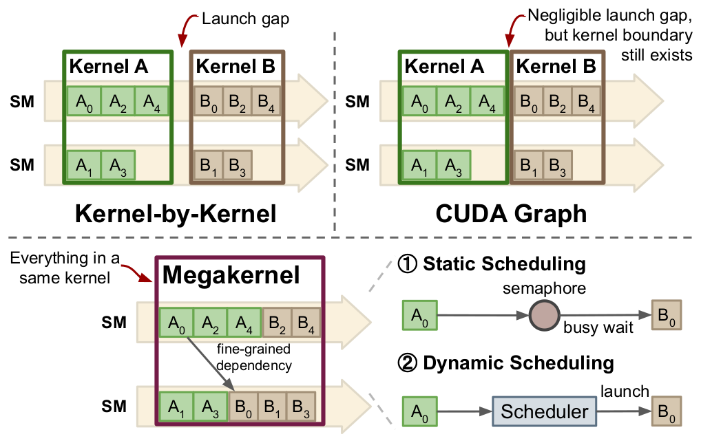

*图 1（原文 Figure 1，第 1 页）：kernel-by-kernel 与 CUDA Graph 都强制粗粒度的顺序执行；megakernel 把操作拆成更小的任务，得到 kernel 之间的并行。*

**图中文字翻译与读法**：

- **左上 Kernel-by-Kernel（逐 kernel 执行）**：两条横带代表两个 SM。Kernel A 的 5 个任务 $A_0$–$A_4$ 分给两个 SM（SM 0 跑 $A_0,A_2,A_4$，SM 1 跑 $A_1,A_3$），Kernel B 的 $B_0$–$B_4$ 同理；两个 kernel 之间有 Launch gap（启动间隙）。
- **右上 CUDA Graph**：启动间隙几乎消失（Negligible launch gap），但 kernel boundary still exists（kernel 边界仍然存在）：Kernel B 必须等 Kernel A 整体结束。
- **下左 Megakernel（巨型 kernel）**：Everything in a same kernel（所有东西在同一个 kernel 里）：SM 0 依次跑 $A_0,A_2,A_4,B_2,B_4$，SM 1 跑 $A_1,A_3,B_0,B_1,B_3$。箭头 fine-grained dependency（细粒度依赖）表示 $B_0$ 只依赖 $A_0$，不必等整个 Kernel A，所以前后算子的任务可以交错执行。
- **下右两种任务管理方式**：① Static Scheduling（静态调度）：$A_0$ 完成后更新一个信号量（semaphore），$B_0$ 在信号量上 busy wait（忙等）；② Dynamic Scheduling（动态调度）：$A_0$ 完成后交给 Scheduler（调度器），由它 launch（发射）$B_0$。

**读图结论**：这张图给出全文的概念框架：CUDA Graph 只能消除 launch gap，不能消除 kernel 边界；megakernel 两者都消除，代价是必须自己管理任务之间的依赖，而依赖管理又有“预先排好”和“运行时分配”两种思路。

### 2.2 现有 megakernel 的两类难题

论文把已有的 megakernel 工作（Spector 等 2025 的 Hazy Research 博客、Cheng 等 2025，即本仓库的 [Mirage Persistent Kernel](../mirage_persistent_kernel/论文中文解读.md)）归纳为只支持单 batch 的稠密模型、只有单一调度策略，并指出落地时的两类挑战：

1. **动态性（dynamism）**：
   - **形状动态**：continuous batching 使输入形状可变。在一个 megakernel 里支持动态形状，常常意味着要为每个可能的形状重新生成或重新编译 kernel，启动延迟高得无法承受，形状空间太大时甚至不可能。这也不是 megakernel 独有的问题：CUDA Graph 在动态形状下要重复捕获、管理多张图，是生产环境 LLM serving 的一大痛点。
   - **数据动态**：MoE 这类模型有数据相关的控制流（专家路由），要在运行时跟踪细粒度的任务依赖才能利用算子间并行；现有方法缺少表达这种细粒度数据依赖的抽象。
   - 这些挑战对实时 agent、交互式编程助手这类延迟敏感、以低 batch 为主的应用尤其重要，因为那里算子间并行对降低单请求延迟至关重要。
2. **可编程性（programmability）**：megakernel 编程要推理任务之间复杂的细粒度依赖，容易出错、难维护，而形状动态与数据动态让这更难；而且不同负载可能需要不同的任务管理策略（静态调度：kernel 启动前给每个 SM 预先指定任务队列；动态调度：GPU 上有一个调度器，运行时派发就绪任务），理想情况下开发者应能选择或组合调度策略而不必重写整个 kernel。

### 2.3 论文的方案与贡献

论文提出 Event Tensor 这个抽象（图 2），并在其上构建 ETC 编译器。论文把一个 **event** 定义为“一组任务在 GPU SM 粒度上的完成”；megakernel 把算子切成大量 tile 级任务后，对应的同步事件天然形成类似数据张量的多维结构，**Event Tensor 就是这种事件的多维数组**。信号量式同步是已知的原语，论文的核心新意在于把它们提升为编译器 IR 里的一等张量，从而可以复用编译器对符号 shape 的支持（让张量维度保持符号化，紧凑地表示动态形状计算），并用“把任务坐标映射到事件坐标”的索引表达式来表达数据相关的动态性。

论文声称的结果：张量并行场景下，GEMM 与 Reduce-Scatter 融合最高 1.40 倍；MoE 等数据相关场景，megakernel 比专用库最高快 1.23 倍；动态形状、低 batch 的推理里，ETC 持平或超过高度优化的 vLLM/SGLang（它们已使用 CUDA Graph、Programmatic Dependent Launch（PDL）和 `torch.compile`），同时把引擎预热开销最多降到 1/3.5（这个 3.5 对应 vLLM 的 123 s 对 35 s，见第 5.5 节）；声称实现了真正的提前编译（AOT），不再需要运行时编译或反复重捕获 CUDA Graph；ETC 已被集成进一个主要的开源系统（论文没有具体说明是哪个）。

### 2.4 术语速查

| 术语 | 含义 |
| --- | --- |
| task（任务） | 一个 tile 级的计算单元，在一个 SM 上执行，由多维坐标标识 |
| device function（设备函数） | 定义“一组并行启动的任务网格”，每个任务可以带 warp specialization、tensor core 调用等专门逻辑 |
| event（事件） | 一组任务在 SM 粒度上的完成 |
| Event Tensor | 事件的多维数组；每个元素有初始等待计数 `wait_count`，支持 `notify()` 与 `wait()` |
| graph function（图函数） | 由 `call_device` 调用构成的计算图，既含数据张量也含 Event Tensor |
| `in_edges` / `out_edges` | 在 `call_device` 上标注“这个 device function 的任务读哪些事件、写哪些事件”以及坐标映射（einsum 风格） |
| symbolic shape（符号形状） | 用 `sym_var()` 表示运行时才知道的维度，如 batch |
| persistent kernel（常驻 kernel） | 一次 launch、每个 SM 上循环取任务执行、不再重新启动的 kernel |
| `indptr` | 稀疏矩阵 CSR 等格式里常用的“前缀和指针”数组；本文用 `exp_indptr` 记录每个专家要触发的 GroupGEMM tile 的前缀和 |
| ETC | Event Tensor Compiler，本文在 Apache TVM 上实现的一组编译器 pass |

## 三、Event Tensor 抽象（论文第 2 节）

### 3.1 总览（图 2）

先看全貌：一个 LLM 解码层的计算图被切成 tiled operator（任务），Event Tensor 把任务之间的细粒度依赖变成一个带符号 shape 的一等对象。

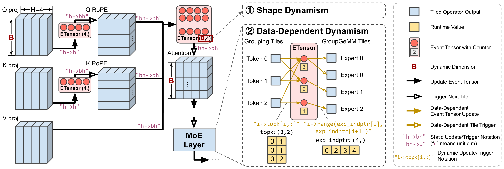

*图 2（原文 Figure 2，第 2 页）：左侧的计算图被划分为 tiled operator；Event Tensor 把任务之间的细粒度依赖表示成带符号形状的一等对象，处理 LLM serving 中两类主要的动态性：① 形状动态；② 数据相关的动态。*

**图中文字翻译与读法**：

- **图例（右侧）**：浅蓝方块 Tiled Operator Output（tile 化的算子输出）；黄色方块 Runtime Value（运行时才知道的值）；红圆加灰框数字 Event Tensor with Counter（带计数器的 Event Tensor）；红色的 B 是 Dynamic Dimension（动态维度）；黑色实心箭头 Update Event Tensor（更新 Event Tensor，即 `notify`）；黑色空心箭头 Trigger Next Tile（触发下一个 tile）；金色实心箭头 Data-Dependent Event Tensor Update（数据相关的事件更新）；金色空心箭头 Data-Dependent Tile Trigger（数据相关的 tile 触发）；紫红色的 `"h->bh"`、`"bh->u"` 是 Static Update/Trigger Notation（静态的更新/触发标注，`u` 表示单位维）；金色的 `"i->topk[i,:]"` 是 Dynamic Update/Trigger Notation（动态的更新/触发标注）。
- **左侧：注意力前半段的计算图**。Q proj、K proj、V proj 三个投影的输出沿头维 $H=4$ 切成 4 个 tile，沿 batch 维 $B$（红色，动态维度）切分。Q proj 的第 $h$ 个 tile 通过 `"h->h"` 更新事件 $h$（共 4 个事件，`ETensor (4,)`），事件 $h$ 再通过 `"h->bh"` 触发 Q RoPE 的 $(b,h)$ 号任务（对当前所有 $b$）；K 同理。RoPE 的 $(b,h)$ 任务完成后用 `"bh->bh"` 更新 `ETensor (B,4)` 中的事件 $(b,h)$；V proj 的第 $h$ 个 tile 用 `"h->bh"` 更新这些事件（同一个 V tile 服务所有 $b$）；事件 $(b,h)$ 再用 `"bh->bh"` 触发 Attention 的 $(b,h)$ 号任务。再往后经过省略号到 MoE Layer（右下）。
- **① Shape Dynamism（形状动态）**：指向 `ETensor (B,4)` 的虚线说明，这个事件张量的形状含符号维度 $B$，运行时才确定。
- **② Data-Dependent Dynamism（数据相关的动态）**：展开 MoE 层。左列 Grouping Tiles（分组 tile，每个 token 一个：Token 0、1、2），中间 ETensor（每个专家一个事件，计数器分别是 3、2、1），右列 GroupGeMM Tiles（Expert 0、Expert 0、Expert 1、Expert 2 四个 tile）。运行时张量 `topk: (3,2)` 的内容是 $[[0,1],[0,1],[0,2]]$（第 $i$ 行是 token $i$ 选中的两个专家），金色标注 `"i->topk[i,:]"` 表示 token $i$ 的分组 tile 去更新 $\mathrm{topk}[i,:]$ 指向的那些专家事件，所以专家 0 的计数器是 3（token 0、1、2 都选了它），专家 1 是 2，专家 2 是 1。`exp_indptr: (4,)` 的内容是 $[0,2,3,4]$，标注 `"i->range(exp_indptr[i], exp_indptr[i+1])"` 表示专家 $i$ 的事件触发区间 $[\mathrm{exp\_indptr}[i],\mathrm{exp\_indptr}[i+1])$ 内的 GroupGEMM tile：专家 0 触发 2 个 tile，专家 1 与专家 2 各触发 1 个。

**读图结论**：同一套“更新/触发 + 索引标注”的记法，既能写静态依赖（`"h->bh"`，只依赖形状），也能写数据相关的依赖（`"i->topk[i,:]"`，依赖运行时张量）；形状动态靠符号维度 $B$，数据动态靠运行时索引张量。

### 3.2 三个语言构造

- **Device Function（设备函数）**：定义一个在 GPU 上并行启动的任务网格。每次 launch 由一个多维坐标参数化，每个坐标对应一个在 SM 上执行的任务 tile；任务内部可以带专门逻辑，如 warp specialization 或 tensor core 调用。
- **Event Tensor**：多维结构，元素是“事件”，即 SM 粒度上一组任务的完成（延续了并行编程系统里已有的做法，如 Cilk、Legion、Realm、OpenMP Tasks）。每个元素有一个**初始等待计数（wait count）**，记录它依赖多少个任务；支持 `E[i].notify()`（通知一个任务完成）、`E[i].wait()`（阻塞直到事件被触发），在动态调度下事件还可以触发依赖它的任务。与逐个管理独立事件的做法相比，Event Tensor 在真实 LLM 推理里事件规模达到百万量级时，大幅减少任务图的管理开销。
- **Graph Function（图函数）**：表示一张计算图，由若干 `call_device` 调用构成，每个调用显式地启动一个 device function 并指定任务形状；与传统计算图不同，它既含数据张量也含 Event Tensor；每次 device function 的 launch 可以标注显式的输入/输出依赖和坐标映射，通过 Event Tensor 跟踪细粒度的任务关系。

这样，一个程序就是“producer task → event → consumer task”形式的任务图的紧凑表示。论文用类似 numpy `einsum` 的下标记法来写 lambda 形式的坐标映射（如 `"ij->i"`）。这些依赖标注隐式地对应：每个 producer 任务结束时做 event 通知，每个 consumer 任务开始时等待。论文认为这种写法对多数场景已经足够；同时也允许 device function 把 Event Tensor 当作参数显式传入、在任务内部自己调用 `notify` 和 `wait`，这使得高级用法成为可能，也使得“显式融合”成为 IR 内部的变换（第 4 节）。

### 3.3 例子：按行求和（图 3）

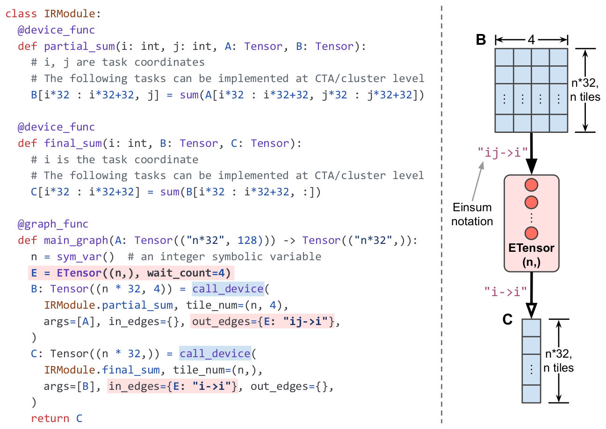

*图 3（原文 Figure 3，第 3 页）：左，示例程序（两个 device function 和一个 graph function）；右，对应的任务图。*

**图中文字翻译与读法**：左边的代码是三段：`IRModule` 里的两个 `@device_func` 与一个 `@graph_func`。右边的任务图自上而下：张量 B（形状 $(n\cdot32, 4)$，$n$ 个 tile 沿行、4 列）→ 标注 `"ij->i"`（Einsum notation，爱因斯坦求和风格的记法）→ `ETensor (n,)`（$n$ 个红色计数器）→ 标注 `"i->i"` 的空心箭头 → 张量 C（$n\cdot32$，$n$ 个 tile）。

这个程序对输入 $A$（符号形状 $(n\times32,\,128)$）求每行的和：

$$
C[i]=\sum_{k\in[0,128)}A[i,k]
$$

它采用 split-K 式的两阶段算法：第一阶段 `partial_sum` 把每行的 128 列分成 4 段，各自求和得到 $B[i,j]$；第二阶段 `final_sum` 再把 4 个部分和相加：

$$
B[i,j]=\sum_{k\in[32j,\,32j+32)}A[i,k],\qquad C[i]=\sum_{k\in[0,4)}B[i,k]
$$

在传统的逐 kernel 方式里，第二阶段要等第一阶段全部任务结束才启动。但每一行输出 $C[i]$ 只依赖对应一行的 $B[i,:]$，完全可以和其他行的部分和并发。为了表达这种细粒度依赖，程序把 $B$ 和 $C$ 的计算分成更细的任务，并引入 Event Tensor $E$：

- 任务 $\hat B_{i,j}$：计算 `B[i*32 : i*32+32, j]`；
- 事件 $E_i$：对应 `E[i]`；
- 任务 $\hat C_i$：计算 `C[i*32 : i*32+32]`。

依赖关系是 $\hat B_{i,j}\to E_i$（$\hat B_{i,j}$ 产生 $E_i$）和 $E_i\to\hat C_i$（$\hat C_i$ 消费 $E_i$），每个 $E_i$ 对应从第 $32i$ 行开始的连续 32 行 $B$ 全部完成。

**代码逐行读法**（代码在图中，下面是同一段代码的转录，注释为原文）：

```python
class IRModule:
  @device_func
  def partial_sum(i: int, j: int, A: Tensor, B: Tensor):
    # i, j are task coordinates
    # The following tasks can be implemented at CTA/cluster level
    B[i*32 : i*32+32, j] = sum(A[i*32 : i*32+32, j*32 : j*32+32])

  @device_func
  def final_sum(i: int, B: Tensor, C: Tensor):
    # i is the task coordinate
    # The following tasks can be implemented at CTA/cluster level
    C[i*32 : i*32+32] = sum(B[i*32 : i*32+32, :])

@graph_func
def main_graph(A: Tensor(("n*32", 128))) -> Tensor(("n*32",)):
  n = sym_var()  # an integer symbolic variable
  E = ETensor((n,), wait_count=4)
  B: Tensor((n * 32, 4)) = call_device(
    IRModule.partial_sum, tile_num=(n, 4),
    args=[A], in_edges={}, out_edges={E: "ij->i"},
  )
  C: Tensor((n * 32,)) = call_device(
    IRModule.final_sum, tile_num=(n,),
    args=[B], in_edges={E: "i->i"}, out_edges={},
  )
  return C
```

1. `partial_sum(i, j, ...)` 是任务的函数体：任务坐标 $(i,j)$ 处理 $A$ 的第 $i$ 个行块、第 $j$ 个列块，结果写到 $B$ 的第 $j$ 列。注释说这些任务可以在 CTA 或 cluster 级实现。
2. `sym_var()` 声明整数符号变量 $n$，所以 $A$ 的行数 $n\times32$ 在编译时是符号的。
3. `E = ETensor((n,), wait_count=4)`：$n$ 个事件，每个初始计数是 4，因为每一行块要等 $j=0,1,2,3$ 四个部分和任务。
4. `partial_sum` 的 `call_device` 的任务网格是 `tile_num=(n, 4)`，`out_edges={E: "ij->i"}` 表示任务 $(i,j)$ 完成时通知事件 $E[i]$（四个 $j$ 都映射到同一个 $i$，所以计数器从 4 递减到 0）。
5. `final_sum` 的任务网格是 `tile_num=(n,)`，`in_edges={E: "i->i"}` 表示任务 $i$ 要等事件 $E[i]$。

### 3.4 一等公民的动态形状（图 4）

Event Tensor 图可以看作传统并行系统（如 Realm 的任务图）的一种更紧凑的表示：传统做法里每个事件和任务都是运行时显式物化的节点与边；这里一个张量就能表示成千上万个事件。更关键的是，**Event Tensor 的形状可以含符号变量**（如 batch size、序列长度）。符号形状的 Event Tensor 图是一个通用模板，在运行时对应不同的具体任务图（图 4）。这样就能超越 CUDA Graph 这类静态任务图系统的限制：提前编译、对多种形状做优化，而不需要重新编译或重复捕获图。

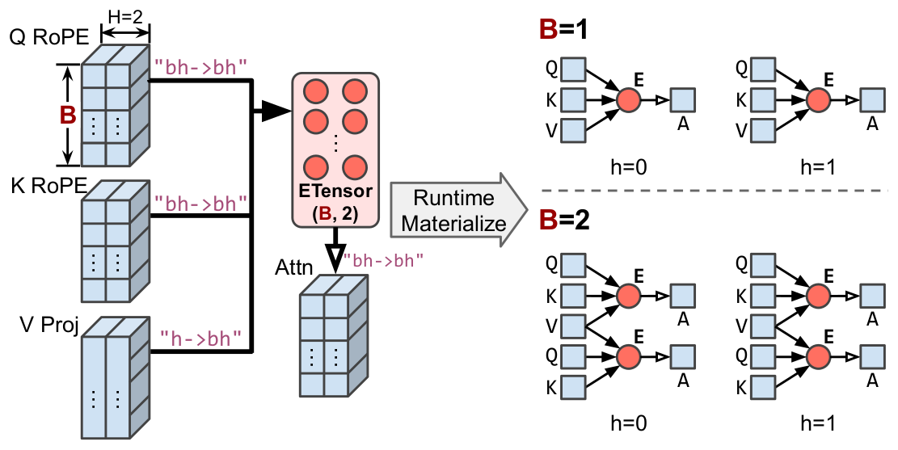

*图 4（原文 Figure 4，第 4 页）：Event Tensor 用符号形状的张量处理形状动态：它们定义依赖图的模板，运行时用具体形状值实例化（例如 batch size 1 得到 1×2 的图，batch size 2 得到 2×2 的图），不需要重新编译，也不需要重复捕获图。*

**图中文字翻译与读法**：

- **左半（模板）**：Q RoPE、K RoPE、V Proj 的输出张量，头维 $H=2$，batch 维 $B$ 是动态的（红色）；三者用标注 `"bh->bh"`、`"bh->bh"`、`"h->bh"` 更新同一个 `ETensor (B, 2)`；该事件张量再用 `"bh->bh"` 触发 Attn 张量的对应 tile。
- **中间箭头 Runtime Materialize（运行时实体化）**：当运行时知道 $B$ 的值，就把模板实例化。
- **右半（实例）**：$B=1$ 时，每个头 $h=0,1$ 各一个事件 E，输入是 Q、K、V，输出触发 A，共 2 个事件；$B=2$ 时每个头有 2 个事件（对应两个 batch 行），Q、K 各自有两份，而 V（来自 `"h->bh"`）被同一个头的两个事件共用，共 4 个事件。

**读图结论**：模板只编译一次，实例化只是按 $B$ 的值展开事件和任务，这正是“形状动态不需要重新编译”的含义。

### 3.5 数据相关的动态性（图 5）

MoE 层里，输入 token 根据运行时算出的路由决策被送到不同的专家子网络。高效实现通常先按专家对 token 分组，再用 GroupGEMM 算子计算每组内所有 token 的结果。动态路由带来细粒度的、编译期未知的数据相关任务依赖（具体是：哪个专家的 GroupGEMM tile 处理哪些 token），这对假定静态任务图的传统编译器和调度器是个难题。论文用两个机制管理这类数据相关的任务图：

1. **数据相关的事件更新（Data-Dependent Event Update）**：传统任务图只支持静态依赖（图 5a）；Event Tensor 允许动态的事件依赖（图 5b）。在 MoE 例子里，运行时存放在 `topk` 张量中的路由决策决定哪些分组 tile（每个 token 一个）更新哪些事件（每个专家一个）。每个专家事件的计数器初始化为路由给它的 token 数，这个初始化在运行时动态完成，与 `topk` 的计算同时进行。
2. **数据相关的任务触发（Data-Dependent Task Triggering）**：类似地，一个事件可以触发运行时才确定个数的任务。根据 `topk` 的路由结果，可以算出每个专家要处理多少 token，从而需要多少个 GroupGEMM tile；这个信息编码在张量 `exp_indptr` 里，它保存每个专家要触发的 GroupGEMM tile 数的前缀和。利用 `exp_indptr`，专家 $i$ 的事件可以激活区间 $(\mathrm{exp\_indptr}[i],\ \mathrm{exp\_indptr}[i+1])$ 里的 tile。

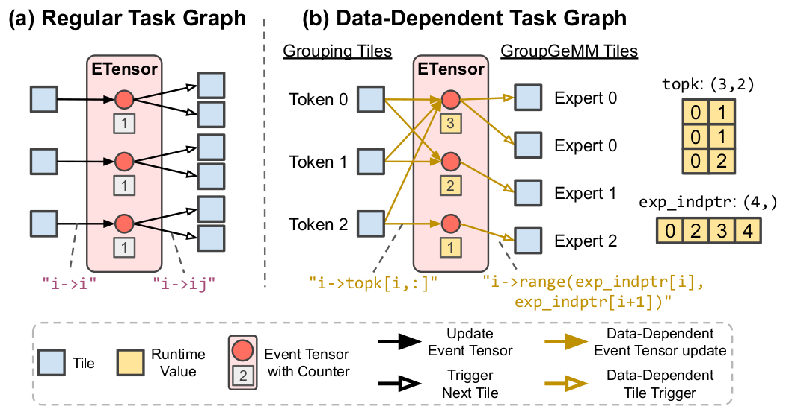

*图 5（原文 Figure 5，第 4 页）：(a) 静态依赖的规则任务图；(b) 数据相关的 MoE 任务图：运行时张量 `topk` 与 `exp_indptr` 定义一张不规则的任务图，使事件更新与任务触发都依赖数据。*

**图中文字翻译与读法**：

- **(a) Regular Task Graph（规则任务图）**：三个 tile 各自更新自己的事件（标注 `"i->i"`，计数器均为 1），每个事件触发两个 tile（标注 `"i->ij"`）。静态依赖只依赖形状。
- **(b) Data-Dependent Task Graph（数据相关任务图）**：与图 2② 相同的 MoE 例子（3 个 token、3 个专家），左列 Grouping Tiles（分组 tile），中间 ETensor（计数器 3、2、1 是黄色的运行时值），右列 GroupGeMM Tiles（Expert 0、Expert 0、Expert 1、Expert 2）。右侧给出 `topk: (3,2)` 与 `exp_indptr: (4,)` 两个运行时张量的内容。
- **图例**：浅蓝 Tile（任务 tile）；黄色 Runtime Value（运行时值）；Event Tensor with Counter；黑色/金色实心箭头是更新事件，空心箭头是触发 tile。

**两点说明**：

- 总体依赖链仍然是严格的前馈结构：Attention 输出 → Token Routing（TopK）→ Token Grouping → Token Computation（GroupGEMM）。计算 TopK 只依赖前面的 Attention 输出，是标准的静态依赖；上面的数据相关机制只管理后面的阶段，即路由结果动态地决定哪些分组任务通知哪些专家事件、每个专家触发多少个 GroupGEMM tile。
- 结合前面的符号形状，ETC 的全部编译都发生在离线阶段；推理时编译好的二进制以零编译开销处理形状动态与数据相关的动态。

## 四、Event Tensor 编译：ETC（论文第 3 节）

ETC 以 Apache TVM 为基础，实现为一系列编译器 pass。它的输入是一张带显式算子和 Event Tensor 的计算图，输出是一个可执行的 megakernel。这些变换支持从完全静态到动态负载均衡的多种调度策略，每种在“同步开销”和“运行时适应性”之间取不同的折中；论文说，ETC 把以前手写的融合和手工调度技术（Spector 等 2025、Cheng 等 2025）统一成编译器变换，显著降低构造 megakernel 的工程量并改善运行时性能。

### 4.1 静态调度变换

**思想**：编译期就通过显式地把任务分给各个 SM，把多个 device function 融合起来。每个任务预先分配到某个 SM 的任务队列里；任务之间的依赖由底层同步原语（基于计数器的信号量、事件触发的等待）管理。这样同步开销最小，特别适合可预测的负载（SM 的划分可以提前优化）。

**三个步骤（Algorithm 1）**：(1) 在 host 上构造每个 SM 的执行队列；(2) 生成一个常驻的主循环，让每个 SM 连续执行任务而不用重新 launch；(3) 把 Event Tensor 依赖降低成显式的 `notify()` 与 `wait()` 调用，以保证细粒度的执行顺序。

**Algorithm 1：ETC 中的静态调度变换**（原文 Algorithm 1，第 6 页；中文转录，行号与原文一致）

```text
 1: 输入：含 tile 级数据流图 G（带 Event Tensor 依赖）的模块 mod
 2: 输出：更新后的模块，含一个融合的、静态调度的 megakernel
 3: mod_updated ← mod.Copy()
 4: static_schedule ← GenerateStaticSchedule(G)       # 预先算好每个 SM 的任务顺序
 5: fused_kernel ← NewPersistentKernel()
 6: // 把预先计算好的调度嵌入 global memory
 7: fused_kernel.AddBuffer(static_schedule)
 8: 对 G 中每个 task_grid：
 9:     fused_kernel.AddDispatchLogic(task_grid)        # 按任务类型分派
10:     对 task_grid.in_edges 中每个 event：
11:         fused_kernel.AddWaitLogic(event)            # 任务开始前等待
12:     结束
13:     fused_kernel.AddTileLogic(task_grid)            # tile 自身的计算
14:     对 task_grid.out_edges 中每个 event：
15:         fused_kernel.AddNotifyLogic(event)          # 任务结束后通知
16:     结束
17: 结束
18: mod_updated.Replace(G, fused_kernel)
19: 返回 mod_updated
```

**图 6：GEMM + Reduce-Scatter 在静态调度变换前后。** 这是论文里的伪代码图，下面分“变换前”和“变换后”照录（注释为原文；`...` 为原文省略）。

变换前：两个独立的 device function，加一个 graph function 用 Event Tensor 连接：

```python
# Constants: M, N, K (matrix dimensions),
# BLK_M, BLK_N (block sizes), WORLD_SIZE (number of devices)
LOCAL_M = M // WORLD_SIZE

@device_func
def matmul(i: int, j: int, A: Tensor, B: Tensor, C: Tensor):
  # i is the task coordinate
  with cta():
    matmul_cta(C[i*BLK_M : (i+1)*BLK_M, j*BLK_N : (j+1)*BLK_N],
               A[i*BLK_M : (i+1)*BLK_M, :],
               B[:, j*BLK_N : (j+1)*BLK_N])

@device_func
def reduce_scatter(i: int, j: int, C: Tensor, D: Tensor):
  # i, j are task coordinates
  with cta():
    offset = get_rank() * LOCAL_M
    multimem_ld_reduce_cta(
      D[i*BLK_M : (i+1)*BLK_M, j*BLK_N : (j+1)*BLK_N],
      C[offset + i*BLK_M : offset + (i+1)*BLK_M,
        j*BLK_N: (j+1)*BLK_N]
    )

@graph_func
def main_graph(A: Tensor((M, K)), B: Tensor((K, N))) -> Tensor((LOCAL_M, N)):
  # E is a distributed Event Tensor, sharded on dimension 0.
  # Each device holds a shard of shape (LOCAL_M // BLK_M, N // BLK_N)
  E = ETensor((M // BLK_M, N // BLK_N), wait_count=WORLD_SIZE, shard="S[0]")
  C: Tensor((M, N)) = call_device(
    matmul, tile_num=(M // BLK_M, N // BLK_N),
    args=[A, B], in_edges={}, out_edges={E: "ij->ij"},
  )
  E_local = E.local_view()
  D: Tensor((LOCAL_M, N)) = call_device(
    reduce_scatter, tile_num=(LOCAL_M // BLK_M, N // BLK_N),
    args=[C], in_edges={E_local: "ij->ij"}, out_edges={},
  )
  return D
```

变换后：两个 device function 被融合成一个常驻的 device function，用显式的 `notify` 与 `wait` 协调依赖：

```python
@device_func
def fused_matmul_rs(
    sm_id: int, A: Tensor, B: Tensor, C: Tensor, E: ETensor, D: Tensor
):
  # sm_id is the task coordinate
  with cta():
    tile_scheduler = init_tile_scheduler(sm_id)
    while tile_scheduler.valid():
      task_idx, task_type = tile_scheduler.get_task()
      if task_type == 0:
        i, j = task_idx
        matmul_cta(C[...], A[...], B[...])
        E[i, j].notify()
      else:
        i, j = task_idx
        offset = get_rank() * LOCAL_M
        E[i + offset // BLK_M, j].wait()
        multimem_ld_reduce_cta(D[...], C[...])
      tile_scheduler.next_tile()

@device_func
def main_graph(
    A: Tensor((M, K)), B: Tensor((K, N))
) -> Tensor((LOCAL_M, N)):
  E = ETensor(
    (M // BLK_M, N // BLK_N), wait_count=WORLD_SIZE, shard="S[0]"
  )
  C: Tensor((M, N)) = empty((M, N))  # Allocate intermediate tensor C
  D: Tensor((LOCAL_M, N)) = call_device(
    fused_matmul_rs, tile_num=(SM_COUNT,), args=[A, B, C, E],
    in_edges={}, out_edges={},
  )
  return D
```

**逐步读法**：

1. 变换前的 `main_graph` 里，`E` 是一个**分布式** Event Tensor（`shard="S[0]"`：沿第 0 维分片，每台设备持有形状 `(LOCAL_M // BLK_M, N // BLK_N)` 的一片），`wait_count=WORLD_SIZE`（以下解释是解读者按代码推断）：因为 tensor parallel 下每台设备都算出一个形状 $(M,N)$ 的部分和 $C$，Reduce-Scatter 要把所有设备上对应 tile 的部分和加起来，所以每个事件要等 `WORLD_SIZE` 个 `matmul` 任务的通知。
2. `matmul` 的 `out_edges={E: "ij->ij"}`：任务 $(i,j)$ 完成后通知事件 $E[i,j]$；`reduce_scatter` 的 `in_edges={E_local: "ij->ij"}`：任务 $(i,j)$ 等本地分片里的事件 $E_{\mathrm{local}}[i,j]$。
3. 变换后，两个 device function 被融合成 `fused_matmul_rs`：其任务网格变成 `tile_num=(SM_COUNT,)`，即“每个 SM 一个常驻任务”；每个 SM 里 `tile_scheduler` 从预先算好的队列里不断取任务（`get_task()`），按 `task_type` 分派：类型 0 是 GEMM tile，算完后调用 `E[i, j].notify()`；否则是 Reduce-Scatter tile，先 `E[...].wait()` 等所有设备的 GEMM tile 到齐，再执行 `multimem_ld_reduce_cta`（用 CUDA multimem 指令做归约）。
4. 原来 `in_edges/out_edges` 里隐含的依赖，在这里变成显式的 `notify()` 和 `wait()` 调用，这就是“依赖降低成显式同步”的含义。

**图 7：静态调度下的通知与等待机制。** 看一个具体例子：融合后的 GEMM（MM）+ Reduce-Scatter（RS）kernel 在静态调度下如何运行。每个 RS 任务依赖两个 MM 任务（一个 RS tile 的大小是 MM tile 的两倍），所以每个事件的初始计数是 2。

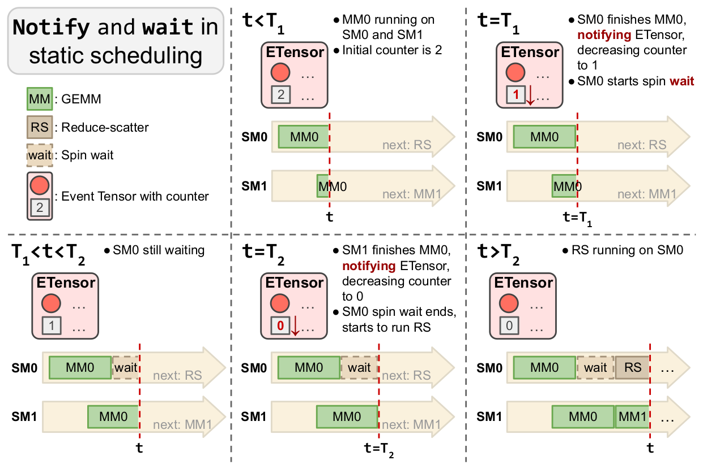

*图 7（原文 Figure 7，第 6 页）：静态调度下的通知与等待。*

**图中文字翻译与读法**：图的标题 Notify and wait in static scheduling（静态调度中的通知与等待）；图例：绿色 MM : GEMM，褐色 RS : Reduce-scatter，虚线框 wait : Spin wait（自旋等待），带红圆圈的灰框 Event Tensor with counter（带计数器的 Event Tensor）。五个时间快照，每个快照上方是 ETensor 的计数器，下方是 SM0 与 SM1 的时间轴（横带上的灰字 next: RS、next: MM1 是各 SM 队列里的下一个任务）：

- **$t<T_1$**：MM0 同时在 SM0 与 SM1 上运行（两个 SM 各算一个 MM0 tile，在这个例子里都是同一个事件的依赖），初始计数器是 2。
- **$t=T_1$**：SM0 上的 MM0 先完成并 notifying ETensor（通知），计数器减到 1。SM0 的队列里静态地排在下一个的是 RS，它不能立刻开始，于是进入自旋等待（spin wait）。
- **$T_1<t<T_2$**：SM0 仍在等待；SM1 继续执行 MM0，保持 GPU 忙碌。
- **$t=T_2$**：SM1 上的 MM0 完成，计数器减到 0，满足依赖；SM0 的自旋等待结束，开始运行 RS。
- **$t>T_2$**：RS 在 SM0 上运行；SM1 去做自己队列里的下一个任务 MM1。

**读图结论**：静态调度下，任务到 SM 的映射是编译期固定的；SM0 在 $T_1$ 到 $T_2$ 之间空等，没有机会去做别的任务，这是静态调度的代价，也是第 4.2 节动态调度要解决的问题。

**静态调度怎样应付动态性**：纯静态调度并不天然支持动态负载。论文的处理是：

- **形状动态**：对一组有代表性的形状做采样，未见过的形状复用“下一个更大的采样值”的执行队列；
- **数据相关的动态**：保守地假设最坏情况，把相关的 `notify()` 和 `wait()` 重写成对 `E[0].notify()` 与 `E[0].wait()` 的调用；
- 为简单起见，用 round-robin 策略构造执行队列。

解读者的提醒：这几条说明静态调度对动态性是“近似与保守”的处理（队列按更大形状排、依赖按最坏情况同步），论文没有单独评估这种近似带来的性能损失。

### 4.2 动态调度变换

**思想**：当任务执行时间不可预测时，动态调度能改善 SM 之间的负载均衡。ETC 用一个轻量的 GPU 上任务调度器实现基于 Event Tensor 的动态调度：当一个事件被触发（它所依赖的任务全部完成）时，它原子地把所有关联的消费者任务 push 进调度器，标记为就绪；任何空闲的 SM 都可以原子地 pop 一个就绪任务来执行。

**Algorithm 2：ETC 中的动态调度变换**（原文 Algorithm 2，第 16 页，附录 A；中文转录，行号与原文一致）

```text
 1: 输入：含 tile 级数据流图 G（带 Event Tensor 依赖）的模块 mod
 2: 输出：更新后的模块，含一个融合的、动态调度的 megakernel
 3: mod_updated ← mod.Copy()
 4: fused_kernel ← NewPersistentKernel()
 5: // 这不是运行时调度器，只提供 push/pop 函数
 6: scheduler ← GPUScheduler()
 7: fused_kernel.AddPopLogic(scheduler.f_pop_tasks)
 8: 对 G 中每个 task_grid：
 9:     fused_kernel.AddDispatchLogic(task_grid)
10:     fused_kernel.AddTileLogic(task_grid)
11:     对 task_grid.out_edges 中每个 event：
12:         fused_kernel.AddCompleteOnLogic(event, scheduler.f_push_tasks)
13:     结束
14: 结束
15: mod_updated.Replace(G, fused_kernel)
16: 返回 mod_updated
```

附录 A 的说明：每当一个 SM 完成当前任务，就插入一次 `scheduler.pop_tasks` 调用；每当一个任务的完成使相关事件的计数器减到 0、从而解除了依赖它的任务的阻塞时，就插入一次 `scheduler.push_tasks` 调用。注意与算法 1 的区别：动态版本里没有 `AddWaitLogic`，消费者任务只有在事件触发后才会被 push 进队列，所以它不需要等待。

**图 8：GEMM + Reduce-Scatter 在动态调度变换后。** 论文用同一个 GEMM + RS 例子展示变换后的代码（原文 Figure 8，第 7 页，伪代码，下面照录；图中高亮的是 `pop_task` 与 `push_task` 两行）：

```python
@device_func
def fused_matmul_rs(
    sm_id: int, A: Tensor, B: Tensor,
    C: Tensor, E: ETensor, D: Tensor,
):
  # sm_id is the task coordinate
  with cta():
    tile_scheduler = init_tile_scheduler(sm_id)
    while tile_scheduler.valid():
      task_idx, task_type = tile_scheduler.pop_task()
      if task_type == 0:
        i, j = task_idx
        matmul_cta(C[...], A[...], B[...])
        state = E[i, j].notify()
        if state == 0:
          tile_scheduler.push_task(task_idx, task_type)
      else:
        i, j = task_idx
        offset = get_rank() * LOCAL_M
        multimem_ld_reduce_cta(D[...], C[...])
      tile_scheduler.next_tile()

@device_func
def main_graph(
    A: Tensor((M, K)), B: Tensor((K, N))
) -> Tensor((LOCAL_M, N)):
  # Same as the statically fused "main_graph"
  ...
```

读法：与静态版本相比，取任务从 `get_task()`（读预先排好的队列）变成 `pop_task()`（从设备侧调度器取）；`notify()` 现在返回事件的状态，若 `state == 0`（计数器已减到 0，依赖满足），就 `push_task` 把消费者任务推进调度器；RS 分支里不再有 `wait()`，因为只有依赖已满足的 RS 任务才会被推入队列。（原文这里写作 `push_task(task_idx, task_type)`，是示意写法，实际含义是推入由该事件触发的消费者任务。）

**图 9：动态调度下的 push-and-pop 机制。** 还是同一个例子：

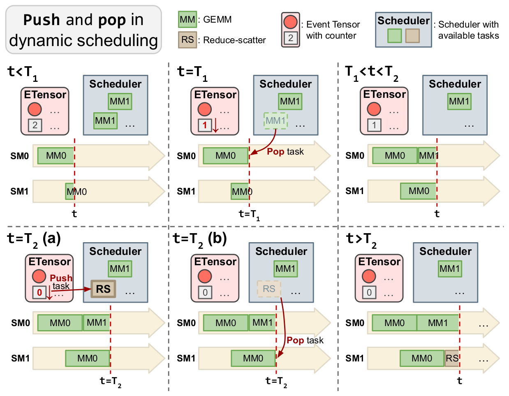

*图 9（原文 Figure 9，第 7 页）：动态调度下的 push 与 pop。*

**图中文字翻译与读法**：标题 Push and pop in dynamic scheduling（动态调度中的 push 与 pop）；图例：MM : GEMM、RS : Reduce-scatter、Event Tensor with counter、Scheduler : Scheduler with available tasks（装有可用任务的调度器）。六个快照，每个包含 ETensor（计数器）、Scheduler（里面的绿/褐方块是可用任务）以及 SM0、SM1 的时间轴：

- **$t<T_1$**：ETensor 计数器是 2；Scheduler 里有 MM1 类任务（等待被取走）；SM0、SM1 都在跑 MM0。
- **$t=T_1$**：SM0 的 MM0 完成，计数器减到 1；SM0 立刻从 Scheduler **pop** 一个就绪的 MM1（Scheduler 里那一格变成虚线），不空等。
- **$T_1<t<T_2$**：计数器 1；SM0 在跑 MM1；SM1 的 MM0 还没结束。
- **$t=T_2$（a）**：SM1 的 MM0 完成，计数器减到 0，触发 RS 任务被 **push** 进 Scheduler。
- **$t=T_2$（b）**：SM1 现在空闲，从 Scheduler **pop** 出 RS 任务（Scheduler 里 RS 变虚线）。
- **$t>T_2$**：SM1 接着在 MM0 之后运行 RS，SM0 继续它的 MM1。

论文的说明：整个依赖跟踪与任务分派过程都在 GPU 上高效完成，不需要 host 预先计算任务队列。动态调度天然同时支持两种动态，因为 tile 的执行顺序是在运行时、此时符号形状值和运行时数据值都已被调度器解析之后才确定的。

**读图结论**：与图 7 相比，动态调度下 SM0 在 $T_1$ 之后没有空等（它立刻去取 MM1），RS 被分给第一个空闲的 SM（SM1）；这就是动态调度“天然负载均衡”的机制，代价是每个任务多一次队列 push/pop 和原子操作。

**实现细节与取舍**：论文的 push/pop 接口用的是一个全局内存里、所有 SM 共享的**集中式队列**，理由是实现简单，同时论文承认大规模时可能有争用（contention）。附录 E 的运行时优化叫 **early push（提前 push）**：调度器不等一个任务的依赖项（producer 任务）执行完，而是在它的所有 producer 任务都已**派发**到 SM（不要求完成）时，就提前把这个消费者任务推入就绪队列，依赖由消费者任务执行前额外的一次 `wait` 来保证。这样 push 操作的开销不落在关键路径上：push 与 producer 任务的执行并发进行，把调度成本与前面的计算重叠。

**静态与动态的取舍**：论文称这是一个经典的折中。静态调度的调度开销最小，适合可预测负载；动态调度则为数据相关的动态负载或不可预测的任务完成时间提供灵活性，天然得到负载均衡，代价是任务队列 push 与 pop 的少量运行时开销。

### 4.3 降低到最小的运行时（图 10）

静态与动态调度让编译器把低层的任务依赖及其处理直接封装进变换后的程序里，因此对配套运行时的需求很小：

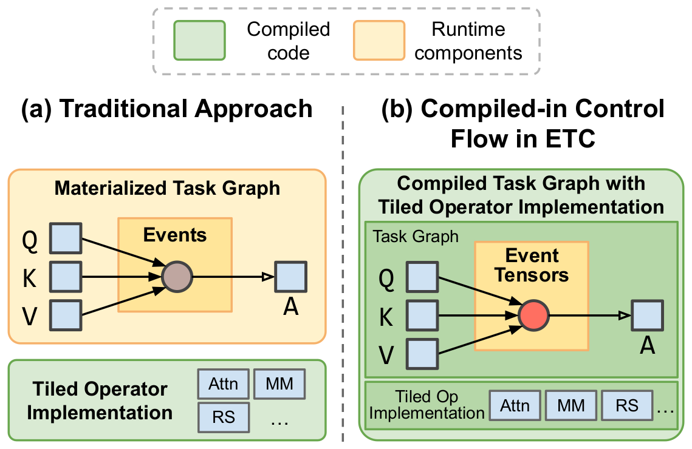

*图 10（原文 Figure 10，第 7 页）：运行时架构对比。(a) 传统运行时执行器里的任务图在内存中被实体化，只有 tiled operator 被编译；(b) ETC 把调度逻辑编译进 megakernel，不需要在运行时实体化任务图。*

**图中文字翻译与读法**：图例：绿色 Compiled code（已编译的代码），橙色 Runtime components（运行时组件）。**(a) Traditional Approach（传统做法）**：橙色的 Materialized Task Graph（实体化的任务图）里有 Q、K、V 三个输入、Events（事件）、输出 A；绿色的 Tiled Operator Implementation（tile 化算子的实现）有 Attn、MM、RS 等。也就是说，任务图本身是运行时的数据结构，由一个通用的任务执行器去遍历。**(b) Compiled-in Control Flow in ETC（ETC 把控制流编译进去）**：外面一整块都是绿色的 Compiled Task Graph with Tiled Operator Implementation（带 tile 算子实现的已编译任务图），里面的 Task Graph 里 Q、K、V 到 A 之间是 Event Tensors，仅这部分仍是橙色的运行时组件；tile 算子实现（Attn、MM、RS 等）同样已编译。

具体做法（论文第 3.3 节）：

- 每个 Event Tensor 被降低成一个**整数张量**，复用已有的张量数据结构，不需要专门的运行时事件数据结构；
- 整数张量上的 `notify()` 与 `wait()` 用高效的硬件原子操作实现：`notify()` 做一次**原子递减**，`wait()` **自旋等待**计数器变成 0；
- 运行时的数据状态**仅由这些整数张量和调度器的任务队列**构成。

与典型的任务图方案相比（需要把整张任务图实体化在内存里，并靠一个通用的任务执行器遍历这张图去 launch device function），这种“编译进去”的做法对运行时的要求更小。

### 4.4 端到端编译流程（论文第 3.4 节与附录 B，图 15）

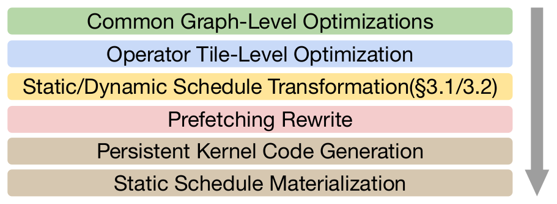

*图 15（原文 Figure 15，第 16 页）：ETC 的端到端编译流水线，自上而下。*

**图中文字翻译与读法**：自上而下六个阶段：Common Graph-Level Optimizations（通用的图级优化）→ Operator Tile-Level Optimization（算子的 tile 级优化）→ Static/Dynamic Schedule Transformation（§3.1/3.2，静态或动态调度变换）→ Prefetching Rewrite（预取重写）→ Persistent Kernel Code Generation（常驻 kernel 代码生成）→ Static Schedule Materialization（静态调度的实体化）。

流程说明：

1. **输入**：一张未优化的计算图，其中 Event Tensor 已经定义、算子已经切成 CTA 级 tile。tile 化可以由用户用 kernel DSL（如 Triton）指定，也可以由编译器内置提供。论文的实现里 device function 用一个基于 TVM 的 DSL（Hou 等 2026）编写，支持标准的 tile 级编程。论文强调 Event Tensor 抽象与 DSL 无关：其依赖图与调度逻辑可以集成进其他编译栈（如 Triton、CuteDSL），没有根本的设计冲突。
2. **通用图级优化**：包括内存规划，类似现有深度学习编译器。
3. **tile 级优化**：确定硬件指令映射、流水线策略等低层细节。
4. **静态或动态调度变换**：即第 4.1、4.2 节。融合后的 device function 以常驻 kernel 的风格输出成 GPU 代码。
5. **预取重写（prefetching pass）**：根据用户标注，为 tile 化算子生成**权重预取**函数，使每个 tile 能在输入激活到达之前先预取权重。
6. **静态调度实体化**：若选了静态调度，编译器此时计算每个 SM 的任务顺序，并把它实体化成 megakernel 的静态执行队列。

## 五、实验（论文第 4 节与附录 C、D）

### 5.1 平台、基线与要回答的问题

**硬件与软件**：一台带 8 张 NVIDIA B200 GPU 的服务器，GPU 之间用 NVLink 连接，运行 Ubuntu 24.04、PyTorch 2.8.0、CUDA 13.0、驱动 580.82.07。论文说选 B200 是因为它代表最先进的硬件，而 Event Tensor 抽象工作在编译器 IR 层，不特定于某一代 GPU。

**对比对象**：最先进的深度学习编译器、专用库和高性能 LLM serving 系统。论文说明，已有的 megakernel 框架是为单 batch 推理定制的，无法在动态形状或数据相关的负载下公平比较，所以实验里没有与它们对比。

**论文要回答的四个问题**：(1) Event Tensor 抽象能否有效管理含静态任务图（论文第 4.1 节）、以及含形状动态与数据相关动态的任务图（第 4.2 节）的细粒度依赖；(2) ETC 编译出的 megakernel 能否在动态的低 batch serving 场景里取得更低的端到端延迟（第 4.3 节）；(3) 对形状动态的支持能否消除静态形状运行时 JIT 编译与图捕获带来的引擎预热开销（第 4.4 节）；(4) 静态与动态调度是否在不同负载上呈现不同的性能折中（第 4.5 节）。下面各小节依次对应。

### 5.2 融合通信与计算：GEMM + Reduce-Scatter 与 All-Gather + GEMM（图 11、图 12、表 4）

**设置**：为评估 Event Tensor 对静态的计算—通信模式的优化效果，论文测了张量并行 LLM 里两个基础的融合 kernel：GEMM + Reduce-Scatter 与 All-Gather + GEMM。所有实验固定张量并行规模为 8（8 张 B200）、token 数为 8192，MLP 配置取自一系列现代 LLM，列在表 4。

**表 4：融合通信与计算评测所用的 MLP 配置**（$S$ 为序列长度，$H$ 为隐藏维度，$I$ 为中间维度）

| 名称 | 来源模型 | $S$ | $H$ | $I$ |
| --- | --- | ---: | ---: | ---: |
| MLP-1 | Qwen3-8B | 8192 | 4096 | 12288 |
| MLP-2 | LLaMA-3.1-8B | 8192 | 4096 | 14336 |
| MLP-3 | Gemma-2-9B | 8192 | 3584 | 14336 |
| MLP-4 | Gemma-2-27B | 8192 | 4608 | 36864 |
| MLP-5 | Qwen3-32B | 8192 | 5120 | 25600 |
| MLP-6 | LLaMA-3.1-70B | 8192 | 8192 | 28672 |
| MLP-7 | GPT-3-175B | 8192 | 12288 | 49152 |
| MLP-8 | LLaMA-3.1-405B | 8192 | 16384 | 53248 |

（原文表 4，第 16 页，附录 C。）

**两个 workload 的实现选择**：

- **GEMM + Reduce-Scatter**：Reduce-Scatter 集合通信用 CUDA multimem PTX 指令实现；用 ETC 的**动态调度器**来处理网络争用和波动带来的不可预测负载，那里它的在线适应与均衡最有效。
- **All-Gather + GEMM**：All-Gather 用环形算法，通过 copy engine（DMA）实现；用**静态调度器**，因为只有 GEMM tile 在 SM 上执行，且按环形算法规定的数据到达顺序进行，预先计算好的静态调度就能以极小的运行时开销重叠通信与计算。

**基线**：cuBLAS+NCCL（不重叠的基线，顺序执行 cuBLAS 与 NCCL kernel，代表没有融合的性能）；TP-Async（Liang 等 2025，基于 PyTorch、手工编排异步操作来重叠）；Triton Distributed v0.0.2-rc（Zheng 等 2025，基于编译器生成重叠 kernel 的开源基线）；cuBLASMp（NVIDIA 2023，多进程融合 kernel 库，重叠分布式计算与通信）。

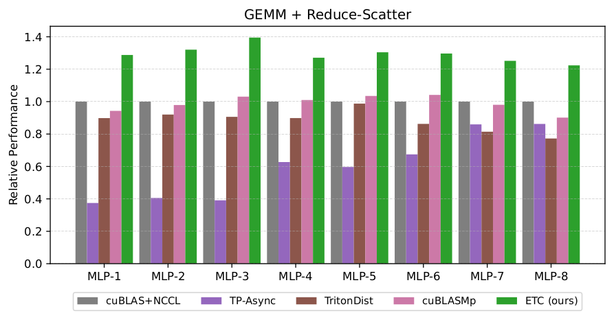

*图 11（原文 Figure 11，第 8 页）：GEMM + Reduce-Scatter 在 8 张 B200 上、使用动态调度器的性能。*

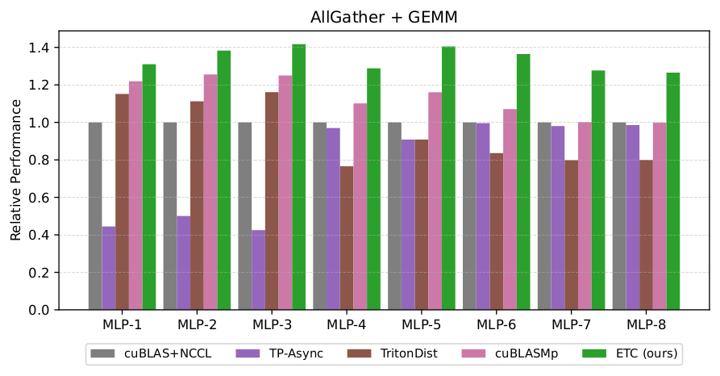

*图 12（原文 Figure 12，第 9 页）：All-Gather + GEMM 在 8 张 B200 上、使用静态调度器的性能。*

**图中文字翻译与读法**：两张图结构相同。横轴是表 4 的 MLP-1 到 MLP-8 共 8 个配置；纵轴 Relative Performance（相对性能，越高越快），**以 cuBLAS+NCCL 为 1.0**（灰色柱，所以恒为 1.0）；五种柱：灰 cuBLAS+NCCL、紫 TP-Async、褐 TritonDist、粉 cuBLASMp、绿 ETC (ours)。图上没有数据标签，下表是从柱高读出的近似值（约，误差约 ±0.01）：

| 配置 | TP-Async | TritonDist | cuBLASMp | ETC |
| --- | ---: | ---: | ---: | ---: |
| 图 11：GEMM + Reduce-Scatter（动态调度器） |  |  |  |  |
| MLP-1 | 0.37 | 0.90 | 0.94 | 1.29 |
| MLP-2 | 0.40 | 0.92 | 0.98 | 1.32 |
| MLP-3 | 0.39 | 0.90 | 1.03 | 1.39 |
| MLP-4 | 0.63 | 0.90 | 1.01 | 1.27 |
| MLP-5 | 0.59 | 0.99 | 1.03 | 1.30 |
| MLP-6 | 0.67 | 0.86 | 1.04 | 1.29 |
| MLP-7 | 0.85 | 0.81 | 0.98 | 1.25 |
| MLP-8 | 0.86 | 0.77 | 0.90 | 1.22 |
| 图 12：All-Gather + GEMM（静态调度器） |  |  |  |  |
| MLP-1 | 0.44 | 1.15 | 1.22 | 1.31 |
| MLP-2 | 0.50 | 1.11 | 1.25 | 1.38 |
| MLP-3 | 0.42 | 1.16 | 1.25 | 1.41 |
| MLP-4 | 0.97 | 0.76 | 1.10 | 1.29 |
| MLP-5 | 0.91 | 0.91 | 1.16 | 1.40 |
| MLP-6 | 0.99 | 0.83 | 1.07 | 1.36 |
| MLP-7 | 0.98 | 0.79 | 1.00 | 1.27 |
| MLP-8 | 0.98 | 0.79 | 1.00 | 1.26 |

**读图结论**：

- 论文正文：图 11 与图 12 显示，在各基线之上有明显提升，尤其是在较大的模型配置上；对两个 workload，相对 cuBLAS+NCCL 基线最高都达到 1.40 倍的执行时间加速。图上读到的最大值（图 11 的 MLP-3 约 1.39，图 12 的 MLP-3 约 1.41）与之吻合。
- **要注意这个 1.40 倍的参照系是“不重叠”的基线**。若与最强的融合基线 cuBLASMp 相比（解读者按图上读数相除）：GEMM + Reduce-Scatter 约为 1.24–1.37 倍，All-Gather + GEMM 约为 1.07–1.27 倍。
- 论文对基线的评语：TP-Async 的粗粒度切分会产生要么太小而填不满 SM、要么太大而藏不住通信延迟的块；Triton-Dist 对 B200 的支持还是实验性的，它基于 Triton 的 GEMM 还没有为 Blackwell 充分优化。结果是未融合的 cuBLAS+NCCL 有时能与这些融合方案相当，说明高效融合的难度。所以这些基线在 B200 上的状态并非最优，读数时要把这一点计入。
- 论文把 ETC 稳定的优势归因于 Event Tensor：把细粒度依赖表示成一等公民，让编译器把整块的操作变成深度流水的任务图；统一的调度变换也使调度器的选择有章可循：GEMM + Reduce-Scatter 用动态调度器应对通信延迟的不确定，All-Gather + GEMM 用静态调度器配合可预测的环形算法，开销最小。

### 5.3 MoE 层（图 13）

**设置**：为评估 Event Tensor 管理“形状动态 + 数据相关动态”任务图的能力，论文测一个完整的、token 数可变的 MoE 层。已有系统用的 persistent GroupGEMM kernel 虽高效，但完整的 MoE 层仍然需要一串单独的 launch；ETC 能把整个数据相关的 MoE 数据流融合成一个 megakernel。单张 B200，MoE 层取自 Qwen3-30B-A3B（128 个专家，top-k 为 8）；使用 ETC 的**动态调度器**，因为它的自适应负载均衡最适合不规则的、数据相关的任务图。基线：Triton 3.4.0（SGLang 与 vLLM 等先进 serving 系统里广泛使用的高度优化 MoE 实现）；FlashInfer 0.2.14.post1（面向 LLM 推理的高性能库，含融合 MoE kernel）。

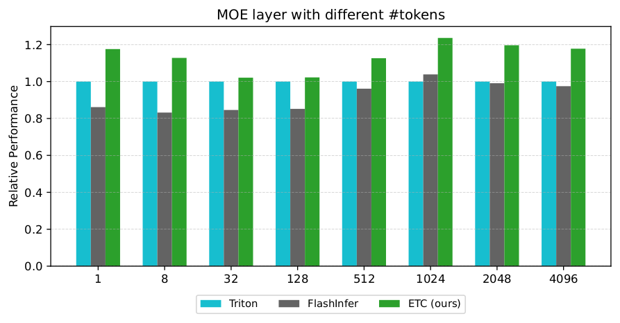

*图 13（原文 Figure 13，第 9 页）：单张 B200 上 MoE 层的性能，横轴为 token 数。*

**图中文字翻译与读法**：标题 MOE layer with different #tokens（不同 token 数下的 MoE 层）；横轴 token 数 1、8、32、128、512、1024、2048、4096；纵轴 Relative Performance（越高越快），**以 Triton 为 1.0**（青色柱，恒为 1.0）；灰色柱 FlashInfer，绿色柱 ETC (ours)。图上无数据标签，下表是读图近似值（约，±0.01）：

| token 数 | Triton | FlashInfer | ETC |
| ---: | ---: | ---: | ---: |
| 1 | 1.00 | 0.86 | 1.17 |
| 8 | 1.00 | 0.83 | 1.12 |
| 32 | 1.00 | 0.84 | 1.02 |
| 128 | 1.00 | 0.85 | 1.02 |
| 512 | 1.00 | 0.96 | 1.12 |
| 1024 | 1.00 | 1.03 | 1.23 |
| 2048 | 1.00 | 0.99 | 1.19 |
| 4096 | 1.00 | 0.97 | 1.17 |

**读图结论**：

- 论文正文：ETC 显著超过最好的基线，在 1024 个 token 时最高达到 1.23 倍。两个基线之间，FlashInfer 的 GroupGEMM 在较大 token 数上更优，Triton 则受益于把 gather/scatter 融合进 GroupGEMM，所以它们的相对名次随 token 数变化。
- **解读者的补充（按图上读数计算）**：图的纵轴是以 Triton 为 1.0 的，1.23 倍是相对 Triton 而言；在 1024 个 token 时更好的基线是 FlashInfer（约 1.03），ETC 相对它约 1.19 倍；相对“每个 token 数下更好的基线”，ETC 的优势从约 1.02（32、128 个 token）到约 1.19（1024、2048 个 token）不等。也就是说，在 32 与 128 个 token 这两点上 ETC 只比 Triton 好约 2%，“显著超过最好的基线”并非对所有 token 数都成立。
- 论文对增益的归因：一是数据相关的 Event Tensor 打破了基线里的全局同步屏障，在 MoE 的两个 GroupGEMM 阶段之间形成细粒度流水，同时通过平滑融合算子之间的 SM 分配来减少 wave quantization（波量化）；二是对 MoE 更重要的，片上动态调度器为不规则的 token 路由提供更好的负载均衡，最大限度减少 SM 空闲时间，在 token 数增长时持续超过其他方法。

### 5.4 端到端低 batch serving（图 14、图 16–18）

**设置**：论文测的是 ETC 编译的 megakernel 在动态低 batch serving 场景下能否取得更低的端到端延迟（实时 agent、交互式编程助手等延迟敏感应用越来越以这类场景为主）。**只看解码阶段**，因为 prefill 与大 batch serving 通常 GPU 利用率已经很高，megakernel 带来的收益很小（计算—通信重叠除外，见第 5.2 节）；论文还说 ETC 不会降低大 batch 性能，因为单个算子的硬件利用率没有额外开销。

- **模型**：Qwen3-30B-A3B（MoE）与 Qwen3-32B（稠密）；论文选 Qwen 系列（稠密和 MoE 变体）是因为它在架构上能代表现代 LLM（如 LLaMA 3、GPT）。megakernel 覆盖完整的解码流水线（Attention、RoPE、KV-Cache、Norm、MLP、MoE），而不只是 GEMM。
- **调度器**：两个模型都用**静态调度器**，以避免运行时开销。
- **数据与指标**：合成数据集，prefill 长度 512、生成 100 个输出 token，batch size 从 1 到 128；指标是 **time-per-output-token（TPOT，每个输出 token 的时间，越低越好）**，最能反映 LLM 引擎的解码性能。
- **基线**：vLLM v0.11.0rc2 与 SGLang v0.5.3rc0，二者都使用 CUDA Graph 与 `torch.compile`。
- **硬件**：Qwen3-30B-A3B 和 Qwen3-32B 的 TP=1 在单张 B200 上，Qwen3-32B 的 TP=4 在 4 张 B200 上（附录 D 说明）。

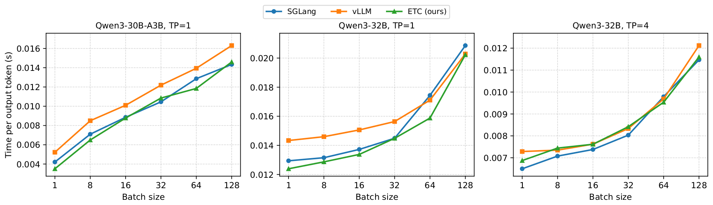

*图 14（原文 Figure 14，第 10 页）：模型 serving 的端到端性能，越低越好。*

**图中文字翻译与读法**：三个子图依次是 Qwen3-30B-A3B（TP=1）、Qwen3-32B（TP=1）、Qwen3-32B（TP=4）；横轴 Batch size（1、8、16、32、64、128）；纵轴 Time per output token (s)（每输出 token 的时间，单位秒，越低越好）；蓝色圆点线 SGLang，橙色方块线 vLLM，绿色三角线 ETC (ours)。图上无数据标签，下表给出几个关键点的读图近似值（约，误差约 ±0.2 ms）：

| 子图 | batch size | SGLang（ms） | vLLM（ms） | ETC（ms） |
| --- | ---: | ---: | ---: | ---: |
| Qwen3-30B-A3B，TP=1 | 1 | 约 4.2 | 约 5.2 | 约 3.5 |
| Qwen3-30B-A3B，TP=1 | 128 | 约 14.3 | 约 16.3 | 约 14.5 |
| Qwen3-32B，TP=1 | 1 | 约 12.9 | 约 14.3 | 约 12.4 |
| Qwen3-32B，TP=1 | 64 | 约 17.4 | 约 17.1 | 约 15.9 |
| Qwen3-32B，TP=1 | 128 | 约 20.9 | 约 20.4 | 约 20.1 |
| Qwen3-32B，TP=4 | 1 | 约 6.5 | 约 7.3 | 约 6.9 |
| Qwen3-32B，TP=4 | 128 | 约 11.4 | 约 12.2 | 约 11.6 |

**读图与论文结论**：

- **Qwen3-30B-A3B（MoE）**：batch size 1 时 ETC 比 vLLM 快 1.48 倍、比 SGLang 快 1.20 倍（正文数字，与图上读数约 5.2/3.5 与 4.2/3.5 吻合）。随 batch 增大差距收窄，到 batch 128 时 ETC 与 SGLang 几乎持平（图上 ETC 略高）。
- **Qwen3-32B，TP=1**：ETC 一直是延迟最低的，在 batch size 1 比 vLLM 快最多 1.15 倍，在 batch size 64 比 SGLang 快最多 1.09 倍。
- **Qwen3-32B，TP=4（四路张量并行）**：ETC 与 vLLM 持平，加速比在 0.99 倍到 1.06 倍之间。**ETC 和 vLLM 的延迟都高于 SGLang**，论文的解释是 SGLang 高度优化的 CPU 调度器带来更低的分布式运行时开销。偶尔 ETC 落后于最好基线的小差距，论文归因于工程因素，具体是编译器生成的 GEMM tile 在某些配置下不如 cuBLAS 调得好，以及论文的 serving 引擎的 CPU 侧开销更高，而不是抽象本身的根本限制。（这是作者的解释，论文没有对此做控制实验。）
- 论文对收益来源的解释：融合的 megakernel 架构（由 Event Tensor 与静态调度变换支撑）让整个工作负载在一个常驻 kernel 里执行，从而带来 CUDA Graph 系统难以做到的细粒度优化：暴露 attention 里的并行（如 Q 的 Norm+RoPE 与 K 的 Norm+RoPE+CacheAppend 并发）、在 MoE 里流水化 GroupGEMM 与在 MLP 里流水化 GEMM 以减少 wave quantization、在输入激活就绪之前预取模型权重以隐藏访存延迟。论文称 ETC 能跨算子边界流水化和重叠操作是相对基线降低延迟的关键，并称它成功地把与 CUDA Graph 相当的性能带到了 MoE 这类本质上动态的负载上。

**附录 D：只看 GPU kernel 时间的结果（图 16–18）。** 图 14 的 TPOT 里含 CPU 侧开销（如框架的请求调度延迟）。为了更直接、公平地比较，附录 D 评估端到端 serving 里的**原始 GPU kernel 执行时间**（排除所有无关开销），基线与实验设置同上。

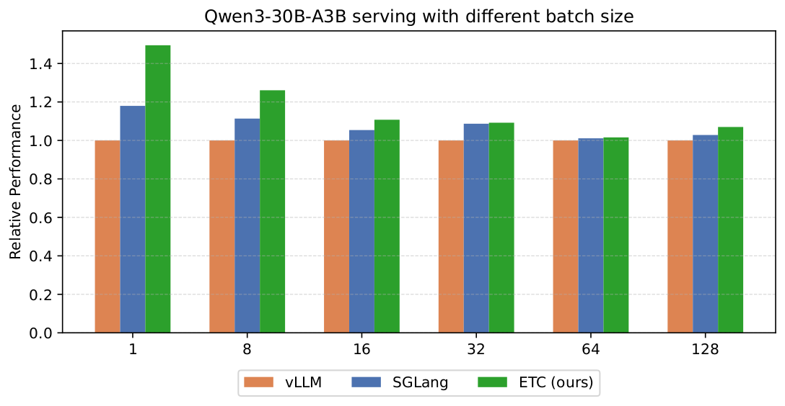

*图 16（原文 Figure 16，第 16 页）：Qwen3-30B-A3B 在单张 B200 上的原始 kernel 相对性能。*

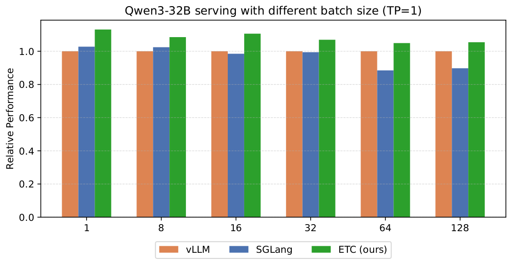

*图 17（原文 Figure 17，第 16 页）：Qwen3-32B 在单张 B200 上（TP=1）的原始 kernel 相对性能。*

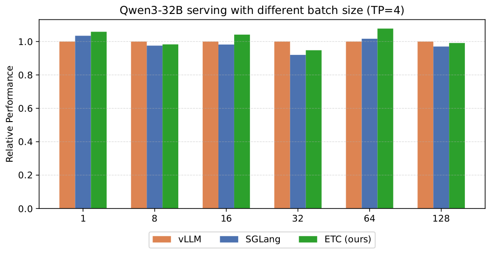

*图 18（原文 Figure 18，第 17 页）：Qwen3-32B 在四张 B200、张量并行（TP=4）下的原始 kernel 相对性能。*

**图中文字翻译与读法**：三张图都是分组柱状图，横轴 batch size（1、8、16、32、64、128），纵轴 Relative Performance（相对性能，越高越快），**以 vLLM 为 1.0**（橙色柱）；蓝色柱 SGLang，绿色柱 ETC (ours)。读图近似值（约，±0.01）：

| 子图 | 系统 | 1 | 8 | 16 | 32 | 64 | 128 |
| --- | --- | ---: | ---: | ---: | ---: | ---: | ---: |
| 图 16：Qwen3-30B-A3B | SGLang | 1.18 | 1.11 | 1.05 | 1.09 | 1.01 | 1.03 |
| 图 16：Qwen3-30B-A3B | ETC | 1.49 | 1.26 | 1.10 | 1.09 | 1.01 | 1.07 |
| 图 17：Qwen3-32B，TP=1 | SGLang | 1.02 | 1.02 | 0.98 | 0.99 | 0.88 | 0.89 |
| 图 17：Qwen3-32B，TP=1 | ETC | 1.13 | 1.08 | 1.10 | 1.07 | 1.05 | 1.05 |
| 图 18：Qwen3-32B，TP=4 | SGLang | 1.03 | 0.97 | 0.98 | 0.92 | 1.02 | 0.97 |
| 图 18：Qwen3-32B，TP=4 | ETC | 1.06 | 0.98 | 1.04 | 0.95 | 1.08 | 0.99 |

**读图与论文结论**：

- **Qwen3-30B-A3B**：ETC 在各 batch size 上都取得稳定的加速，最显著的是 batch size 1 时比 vLLM 快 1.49 倍、比 SGLang 快 1.27 倍（正文数字；图上 1.49/1.18 约为 1.27）。论文把它归因于 Event Tensor 对 MoE 数据相关依赖的支持：在一个 kernel 里执行整个 MoE 模型，实现 attention 算子之间更多的并行、GroupGEMM 之间的细粒度流水、模型权重预取。
- **Qwen3-32B，TP=1**：ETC 在所有 batch size 上都稳定地优于 vLLM 和 SGLang，在 batch size 1 比 vLLM 快最多 1.13 倍，平均提升约 7%（正文数字；按图上读数平均约 8%）。
- **Qwen3-32B，TP=4**：ETC 与基线相当或略好，比 vLLM 快最多 1.08 倍，且随 batch size 增大保持类似的扩展性（正文）。但按图上读数，在 batch size 8（约 0.98）与 32（约 0.95）两点上 ETC 的 kernel 性能略低于 vLLM，所以“相当或更好”要理解为“整体相当，个别点略差”。
- 注意图 14（TPOT）与图 16–18（kernel 时间）的差别：TP=4 时 TPOT 里 SGLang 的优势来自 CPU 侧调度，图 18 里则看不到这种差异，因为附录 D 已排除了 CPU 侧开销。

### 5.5 预热开销（表 1）

**定义**：预热时间（warmup time）是从引擎启动到服务第一个请求的总墙钟时间，包含引擎初始化、模型加载，以及所有 JIT 编译或 CUDA Graph 捕获的开销。论文检验的是：由形状动态支持带来的提前编译（AOT）能否消除运行时 JIT 编译与 CUDA Graph 捕获的成本。

**表 1：Qwen3-32B 模型 serving 使用不同图捕获方法时的预热时间**

| 方法 | 预热时间（秒） | JIT 图捕获次数 |
| --- | ---: | ---: |
| SGLang（JIT） | 583 | 51 |
| vLLM（JIT） | 123 | 67 |
| ETC（AOT） | 35 | 0 |

（原文表 1，第 10 页。）读法：vLLM 需要 123 秒、SGLang 需要 583 秒才能在 Qwen3-32B 上预热完毕，而 ETC 只需 35 秒。基线必须在运行时捕获许多静态 CUDA Graph 来覆盖不同形状（如 vLLM 的 67 次），而 ETC 离线编译一个单一的、常驻的、形状通用的 megakernel（Qwen3-32B 为 107 秒），运行时只需加载预编译好的图，避免了 JIT 与运行时捕获方法固有的重复预热代价。

**口径提醒**：

- 35 秒**不含** 107 秒的离线编译：它消除的是部署启动关键路径上的重复 JIT 与 CUDA Graph 捕获，不是把编译成本变成零。
- 摘要与引言里的“预热开销最多降到 1/3.5”对应 vLLM（$123/35\approx3.5$）；相对 SGLang 是约 16.7 倍（$583/35$，解读者计算）。“35 s 对 583 s 就是总编译快 16 倍”的说法不对，因为两者统计的不是同一个东西（见第 7.2 节）。

### 5.6 静态与动态调度的取舍（表 2、表 3）

**设置**：这一节量化两种调度策略的特点，并与**未融合 megakernel 基线**比较，来量化融合的收益。这个基线在不同算子阶段之间只用一个事件来强制全局同步屏障，模拟“在一次 kernel launch 内顺序执行”的模型；它使用与 ETC 完全相同的算子代码，所以表 2、表 3 里的加速纯粹来自 ETC 细粒度 Event Tensor 依赖所解锁的跨算子并行（即第 5.3、5.4 节讲过的减少 wave quantization、权重预取、并行执行、片上负载均衡），而不是更好的算子实现。数值是相对该未融合 megakernel 的相对性能，越高越好。

**表 2：MoE 层上 ETC 两种调度方法相对未融合 megakernel 的相对性能**（单张 B200，Qwen3-30B-A3B 的 MoE 层）

| token 数 | 1 | 128 | 1024 | 4096 |
| --- | ---: | ---: | ---: | ---: |
| 静态（Static） | 1.03 | 1.02 | 1.04 | 1.02 |
| 动态（Dynamic） | 0.95 | 1.06 | 1.08 | 1.03 |

（原文表 2，第 11 页。）

**表 3：Qwen3-32B 在 TP=4 下 ETC 两种调度方法相对未融合 megakernel 的相对性能**

| batch size | 1 | 16 | 32 | 128 |
| --- | ---: | ---: | ---: | ---: |
| 静态（Static） | 1.09 | 1.06 | 1.07 | 1.06 |
| 动态（Dynamic） | 0.83 | 0.82 | 0.85 | 0.89 |

（原文表 3，第 11 页。）

**读法**：

- **数据相关的负载（表 2，MoE 层）**：除了单 token 的情形，动态调度器优于静态调度器；最大的提升出现在 1024 个 token：比静态快约 4.0%（$1.08/1.04\approx1.038$）、比未融合基线快 8.1%（正文数字；表中两位小数写作 1.08）。原因是 token 的数据相关路由造成固有的负载不均衡，僵硬的静态调度会让某些 SM 累积一队运行较久的 tile，成为拖后腿的 straggler，而其他 SM 空闲。单 token 时动态调度反而更慢（0.95，低于未融合基线），因为任务少，队列 push/pop 和原子操作的开销抵消了负载均衡的收益。
- **规则的稠密负载（表 3，TP=4 的 Transformer 层）**：静态调度是明显的赢家。动态调度器的开销在分布式设置里变得非常大，尤其是要把任务 push 到远程任务队列时（0.82–0.89，比未融合基线还慢）。ETC 静态相对 ETC 未融合版本有稳定的提升（正文写“6–8%”，表中为 1.06–1.09，即 6%–9%），这个收益纯粹来自细粒度流水。
- **与图 11、12、14 的趋势看似不同的解释**：图 11、12 是带宽受限的大 batch（8192 个 token）场景，ETC 通过细粒度信号重叠通信与计算而胜出；图 14 右侧是延迟关键的低 batch 场景，通信开销与 CPU 调度开销暴露出来。这需要不同的调度策略：动态调度有效处理大 batch 的抖动，静态调度为延迟敏感的低 batch 任务最小化开销。
- 论文由此得出：存在清晰的、依赖负载的权衡，证明了在 ETC 框架里同时支持两种调度变换的价值。

**解读者的概括**：动态调度的净收益大致是“负载均衡带来的收益”减去“队列与原子操作的成本”，前者在数据相关抖动大时大，后者在任务数少或需要跨设备 push 时大。这是对论文表 2、表 3 的概括，不是论文里的公式。

## 六、相关工作与定位（论文第 5 节）

- **深度学习编译器**（MLIR、XLA、TVM、PyTorch 编译器）做图级优化，按 kernel 逐个执行；CUDA Graph 大幅降低 launch 开销，但依赖静态输入；垂直融合与水平融合优化 kernel launch 开销；Rammer 与 Roller 对基于 tile 的任务做软件 launch。以上都没有显式的细粒度依赖跟踪与优化抽象，可以受益于 Event Tensor 来做 megakernel 优化。（仓库里有 [Rammer](../rammer/论文中文解读.md)、[Roller](../roller/论文中文解读.md)。）
- **动态张量编译器**（DynaTune、DietCode、SparseTIR）在单 kernel 层面处理动态形状或稀疏；ETC 与之互补，把它们的算子实现融合进 megakernel，解锁 kernel 间并行。
- **LLM 推理系统**（SGLang、vLLM、TensorRT-LLM、Orca）靠 continuous batching、推测执行等系统优化取得高性能；ETC 可以作为这些框架的后端。近期为 LLM 构建 megakernel 的工作（Cheng 等 2025，即 [Mirage Persistent Kernel](../mirage_persistent_kernel/论文中文解读.md)；Spector 等 2025）只支持单 batch 稠密模型推理，且只关注单一调度策略；Event Tensor 为形状动态与数据相关动态提供系统的编译器抽象支持，并同时支持静态和动态调度。CuSync 在不同 CUDA stream 上协同调度独立 kernel，FlashMoE 提供手工优化的分布式 MoE kernel；ETC 的区别是通过系统化的编译流水线把整个子图融合进单个常驻 megakernel，不局限于某个算子模式。
- **任务并行编程模型**：Cilk、Legion、Realm、OpenMP Tasks，多数关注由 CPU 编排的粗粒度任务。Graphene 把线程建模成带同步能力的张量，与 Event Tensor 概念上相关，但它面向单 kernel 优化，不涉及带动态形状和数据相关支持的多算子 megakernel 融合；Cypress 同样优化单个 kernel。
- **结论里的展望**：未来设想更高层的 pass，自动从标准计算图生成 Event Tensor 任务图，进一步减少手工同步的工作量。

## 七、局限、证据边界与常见误读

### 7.1 局限与证据边界

1. **基线并非都处于最佳状态**：论文自己承认 Triton-Dist 对 B200 的支持是实验性的、TP-Async 的粗粒度切分有缺陷；图 11、12 的 1.40 倍参照的是“不重叠”的 cuBLAS+NCCL，对更强的融合基线 cuBLASMp 约为 1.07–1.37 倍（第 5.2 节，解读者计算）。
2. **MoE 层的 1.23 倍以 Triton 为 1.0**，在 1024 个 token 处更好的基线其实是 FlashInfer，对它约 1.19 倍；在 32、128 个 token 处优势只有约 2%（第 5.3 节）。
3. **端到端只覆盖解码阶段与 Qwen3 系列**：合成数据（prefill 512、输出 100 个 token）、batch 1–128、单个节点（B200）、静态调度；论文明确说 prefill 和大 batch 受益很小。
4. **TP=4 下没有赢过 SGLang**：论文把落后归因于 GEMM tile 不如 cuBLAS 和 serving 引擎的 CPU 开销，但没有做控制实验；附录 D 的 kernel 时间在 batch size 8、32 上还略低于 vLLM。
5. **动态调度器并非总是更好，且有可扩展性限制**：集中式全局队列在大规模时可能有争用；在分布式（TP=4）设置里 push 到远程队列的开销很大（表 3 里仅 0.82–0.89）。
6. **静态调度对动态性的处理是近似的**：形状动态用“采样形状、复用下一个更大形状的队列”，数据相关动态用最坏情况的保守同步，论文没有单独量化这种近似的代价。
7. **预热对比不是总成本对比**：ETC 的 35 s 不含 107 s 的离线编译；vLLM 与 SGLang 的数字含 JIT 与图捕获。
8. **与已有 megakernel 工作没有直接比较**：论文称它们无法在动态形状或数据相关负载下公平比较。
9. **论文文字上的小瑕疵**：多处章节号引用有误（把第 4.2、4.3 节写成了 §5.2、§5.3）；“6–8%”与表 3 的 1.06–1.09 不完全吻合；摘要的“最多 3.5 倍预热降低”只对应 vLLM 一个基线；“被集成进一个主要的开源系统”没有说是哪一个。

### 7.2 常见误读

- **“Event Tensor 是普通 tensor 里存 event”**：它是编译器 IR 里的抽象：其形状与索引空间用来表达任务依赖，运行时被降低成整数张量，并不是用户数据张量。
- **“AOT 解决了所有动态形状”**：抽象可以表达符号形状，但静态调度对未见过的形状是复用下一个更大采样形状的队列；具体 kernel 的资源占用、tile 选择与性能仍可能需要特化。
- **“Warmup 35 s 对 583 s 就是总编译快 16 倍”**：不对。ETC 把 107 s 的编译放在离线阶段，比较的是“上线到首请求”，且两边统计的内容不同。
- **“动态调度总比静态好”**：不对。表 2、表 3 显示它在 MoE 的较大 token 数上有益，在单 token 和 TP=4 的稠密场景里更差。
- **“megakernel 一定带来端到端大幅加速”**：端到端的 TPOT 加速在 batch 1 最明显（最高约 1.48 倍），随 batch 增大迅速收窄，TP=4 时只是持平；强抽象不自动带来强 kernel 与成熟的 runtime。

## 八、复现检查清单

- 分开记录**离线编译时间、引擎加载、图捕获/JIT、首请求**，不要把 35 s 与 107 s 混在一起。
- 在**同一份算子实现**下比较静态、动态与未融合 megakernel，这样才能隔离调度收益（论文表 2、表 3 就是这样做的）。
- MoE 必须报告 **token 与专家的分布**（路由偏斜程度），而不只是 token 总数。
- 多 GPU 实验要报告拓扑（8×B200 NVLink）、集合通信库（NCCL、multimem 指令、copy engine）和 CPU 调度器；TP=4 时 SGLang 的 CPU 调度器是关键差异。
- 同时测 **batch 1 与大 batch**，避免只展示动态调度器的甜点区；报告 TPOT 与排除 CPU 开销后的 kernel 时间两种口径。
- 记录版本：PyTorch 2.8.0、CUDA 13.0、驱动 580.82.07、vLLM v0.11.0rc2、SGLang v0.5.3rc0、Triton 3.4.0、FlashInfer 0.2.14.post1、Triton Distributed v0.0.2-rc。
- 明确**基线归一化口径**（图 11、12 以 cuBLAS+NCCL 为 1.0，图 13 以 Triton 为 1.0，图 16–18 以 vLLM 为 1.0）。

## 九、与仓库其他论文的关系

- [Mirage Persistent Kernel](../mirage_persistent_kernel/论文中文解读.md)（MPK）：Event Tensor 论文里“Cheng 等 2025”对应的 megakernel 工作，同样把任务图编进 persistent kernel；Event Tensor 补上的是动态形状与数据相关依赖的编译器抽象，以及静态/动态两种调度的可替换性。
- [Ada-MK](../ada_mk/论文中文解读.md)：同样面向 LLM 推理的 megakernel 优化，可对比它们的任务图与调度搜索思路。
- [Rammer](../rammer/论文中文解读.md)、[Roller](../roller/论文中文解读.md)：本文相关工作里提到的“tile 任务的软件调度”的先驱。
- [TVM](../tvm_compiler/论文中文解读.md)：ETC 构建在 Apache TVM 之上。

## 原文证据导航

- [原论文 PDF](paper.pdf)
- [原文提取文本](paper.txt)
- [论文概要](论文概要.md)
