# 论文中文解读：《Flamingo: a Visual Language Model for Few-Shot Learning》

> **基本信息**：Jean-Baptiste Alayrac、Jeff Donahue、Pauline Luc、Antoine Miech、Karen Simonyan 等（DeepMind），arXiv:2204.14198（v2，2022 年 11 月 15 日），NeurIPS 2022；论文原文 [官方页面](https://arxiv.org/abs/2204.14198)。
>
> **本文的读法**：按原文章节把动机、方法、训练与评测细节、实验和消融讲全，只读中文即可。图均从原文 PDF 裁出，并配有图中文字翻译和读图结论；表为逐格核对后的中文转录，数字保持原样（原文的大表按“基准为行”转置，方便阅读）。从图上读出的数值一律标注“约”，原文正文给出的数字优先。原文把方法细节、数据集细节、扩展消融放在附录，本文按内容就近归入对应小节，并注明附录编号。模型名约定：Flamingo-3B、Flamingo-9B、Flamingo-80B，原文正文中不带后缀的 “Flamingo” 指 80B 模型。

## 一、一句话结论

**问题**：让一个视觉语言模型（Visual Language Model，VLM）只看几个带标注的示例，就能快速适应新的图像或视频任务（描述、问答、对话、分类等），而不是为每个任务收集成千上万条标注再微调。

**做法**：Flamingo 把两个预训练好的单模态大模型**冻结**住，只在它们之间训练少量新模块：

- 视觉端：冻结的 NFNet-F6 视觉编码器（先用对比学习预训练），后接 **Perceiver Resampler**，把任意大小的图像或视频特征压成固定的 64 个视觉 token；
- 语言端：冻结的 Chinchilla 语言模型（1.4B、7B、70B 三种规模），在其各层之间插入新的 **GATED XATTN-DENSE** 层，让文本 token 通过交叉注意力读取视觉 token；每个新层的输出乘以 $\tanh(\alpha)$ 再加回残差，$\alpha$ 初始化为 0，所以训练一开始模型就等价于原语言模型；
- 输入端：用**逐图像的注意力掩码**处理任意交错的“图像/视频 + 文本”序列；
- 训练数据：全部来自网络、不使用为机器学习标注的数据，由交错网页（M3W）、图文对（ALIGN 与新建的 LTIP）和视频文本对（VTP）混合；
- 测试时：把少量（图像，文本）示例和待预测的查询图像交错拼成 prompt，模型直接续写答案（in-context few-shot），不更新任何权重。

**结论**：在 16 个图像/视频语言基准上，Flamingo 刷新了少样本 SOTA；其中 6 个任务上，仅用 32 个示例（不更新权重）就超过了用数千到数万条标注微调的 SOTA（原文称任务专用数据量约少 1000 倍）；再针对任务微调，还能在另外 5 个任务上刷新 SOTA。性能随模型规模和示例数提升。消融表明：交错网页数据、tanh 门控、冻结语言模型、强视觉编码器、逐图像注意力都很关键。

**局限**：继承语言模型的弱点（幻觉、对超长序列泛化差、训练样本效率低）；分类性能落后于对比模型；上下文学习对示例很敏感，示例数超过约 32 个后收益饱和。

## 二、背景与动机

### 2.1 要解决的问题

视觉领域最常用的范式，是先在大量监督数据上预训练，再在目标任务上微调。但成功的微调往往需要数千条标注、对每个任务精心调超参，计算开销也大。近来用对比目标训练的视觉语言模型（如 CLIP、ALIGN，见 [CLIP](../clip/论文中文解读.md)）可以零样本迁移到新任务，不必微调；但它们只给出一段文本和一张图像之间的相似度分数，只能处理“候选结果集合事先给定”的场景（如分类），**不能生成语言**，不适合描述图像（captioning）、视觉问答（VQA）这类开放式任务。另有一些工作探索了以视觉为条件的语言生成，但在低数据情形下表现不够好。

与之对照，大语言模型是出色的少样本学习者：只需把任务的几个例子连同查询输入写成一段 prompt，模型续写即可得到预测。Flamingo 要证明同样的做法可以用于图像和视频理解：这些任务都可以改写成“以视觉输入为条件的文本预测”问题；与纯语言模型唯一的不同，是 prompt 里要能容纳与文本交错的图像或视频。

### 2.2 它能做什么（图 1）

先看一眼 Flamingo-80B 的行为，有助于理解后面的设计。

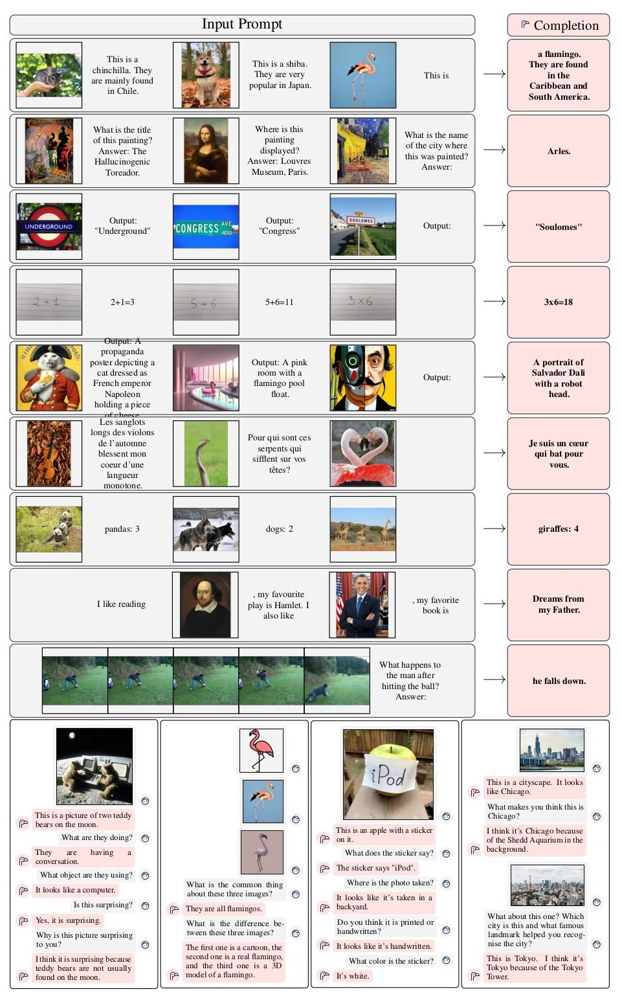

*图 1（原文 Figure 1，第 2 页）：上半部分是少样本 prompt 示例，下半部分是多轮视觉对话。*

**图中文字翻译与读法**：

- **布局**：每个灰色框是一段输入 prompt（Input Prompt），由若干（图像，文字）示例和最后一个只有图像和提示语的查询组成；右侧粉色框是 Flamingo 的续写（Completion）。没有任何权重更新，模型是从 prompt 里的示例“读懂”任务格式的。
- **第 1 行**：示例是 “This is a chinchilla. They are mainly found in Chile.”、“This is a shiba. They are very popular in Japan.”；查询是一只火烈鸟，输出 “a flamingo. They are found in the Caribbean and South America.”。看点：学会了“名称 + 一句分布地区的知识”这个格式，并调用语言模型里的知识补全。
- **第 2 行**：示例分别问一幅画的标题和另一幅画陈列在哪里（答 The Hallucinogenic Toreador；Louvres Museum, Paris）；查询是第三幅画，问“这幅画是在哪个城市画的”，输出 “Arles.”。看点：视觉识别加常识知识。
- **第 3 行**：示例是读出图中的文字（“Underground”、“Congress”），查询是路牌，输出 “Soulomes”。看点：OCR（场景文字识别）。
- **第 4 行**：示例是图片中手写的算式与结果（2+1=3、5+6=11），查询是手写的 3×6，输出 3x6=18。看点：读图后做算术。
- **第 5 行**：示例是对图像的描述（“A propaganda poster depicting a cat dressed as French emperor Napoleon holding a piece of cheese.”、“A pink room with a flamingo pool float.”），查询输出 “A portrait of Salvador Dali with a robot head.”。看点：开放式的图像描述。
- **第 6 行**：示例是配图的法语诗句和法语问句，查询（一对火烈鸟围成的心形）输出 “Je suis un cœur qui bat pour vous.”。看点：输出语言跟随示例语言（法语）。
- **第 7 行**：示例 “pandas: 3”、“dogs: 2”，查询输出 “giraffes: 4”。看点：数数并遵循格式。
- **第 8 行**：这是一段文字中穿插两张人物肖像的 prompt（“I like reading ［莎士比亚肖像］, my favourite play is Hamlet. I also like ［奥巴马肖像］, my favorite book is”），输出 “Dreams from my Father.”。看点：识别图中人物并联想到相关知识。
- **第 9 行**：视频帧序列加问题 “What happens to the man after hitting the ball?”，输出 “he falls down.”。看点：视频理解（时序）。
- **下排四个对话**：不做微调，只给一段简短的对话 prompt（附录 B.1.6），然后用户随时插入图像并连续提问，例如两只“月球上的泰迪熊”、三张图（卡通、真实、3D 模型）的共同点与差异、苹果上贴着的 “iPod” 标签、芝加哥与东京的城市识别。看点：多图、多轮、能回答仅凭文字猜不出的问题。

### 2.3 贡献

1. 提出 Flamingo 系列 VLM：几个输入/输出示例就能完成描述、视觉对话、视觉问答等多种多模态任务；架构创新使其能高效接受任意交错的视觉数据和文本，并以开放方式生成文本；
2. 定量评估如何通过少样本学习适配各种任务；特别保留了一大组**未用于验证任何设计决策或超参数**的留出基准，用来估计无偏的少样本性能；
3. 在 16 个多模态语言和图像/视频理解任务上刷新少样本 SOTA；其中 6 个任务上仅用 32 个任务样本（约比当前 SOTA 少 1000 倍的任务专用训练数据）就超过微调 SOTA；有更多标注预算时，微调后还能在 VQAv2、VATEX、VizWiz、MSRVTTQA、HatefulMemes 这 5 个任务上刷新 SOTA。

## 三、方法

### 3.1 总体结构与概率模型（图 3）

Flamingo 是视觉条件的自回归文本生成模型：输入是与文本交错的图像或视频，输出是自由格式的文本。它对“给定交错视觉输入 $x$ 时文本 $y$ 的似然”建模为

$$
p(y\mid x)=\prod_{\ell=1}^{L}p\big(y_\ell\mid y_{<\ell},\,x_{\le\ell}\big),
$$

其中 $y_\ell$ 是第 $\ell$ 个语言 token，$y_{<\ell}$ 是它之前的所有 token，$x_{\le\ell}$ 是交错序列里位于 $y_\ell$ 之前的图像/视频集合，$p$ 由 Flamingo 模型参数化（原文式 (1)）。能处理交错序列，就自然适合像 GPT-3 的少样本文本提示那样做上下文少样本学习。

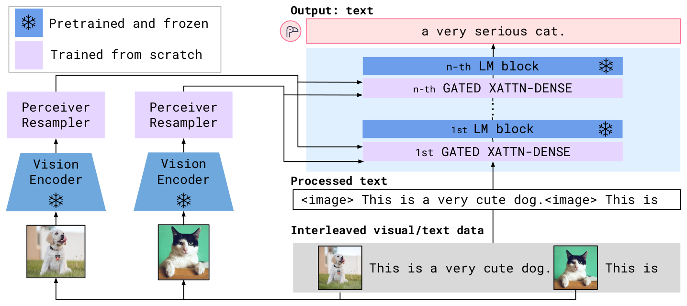

*图 3（原文 Figure 3，第 4 页）：Flamingo 是一族视觉语言模型，输入与文本交错的视觉数据，输出自由格式文本。*

**图中文字翻译与读法**：

- **图例**：蓝色带雪花图标 = Pretrained and frozen（预训练且冻结）；浅紫色 = Trained from scratch（从头训练）。
- **左侧**：两张图像（一只狗、一只猫）各自经过 Vision Encoder（冻结）和 Perceiver Resampler（从头训练），得到固定数量的视觉 token。
- **右侧自下而上**：Interleaved visual/text data（交错的图文数据：狗的图 + “This is a very cute dog.” + 猫的图 + “This is”）→ Processed text（处理后文本：`<image> This is a very cute dog.<image> This is`，图像位置用 `<image>` 标记）→ 一叠“冻结的 LM block + 其前面的 GATED XATTN-DENSE 层”（图中标 1st、n-th）→ Output: text（输出文本 “a very serious cat.”）。左边两个 Perceiver Resampler 的输出连到每一个 GATED XATTN-DENSE 层。
- **读图结论**：只有浅紫色模块（Perceiver Resampler 与 GATED XATTN-DENSE）被训练，视觉编码器与语言模型各层都冻结，从而保留二者预训练时积累的知识。

### 3.2 视觉编码器：从像素到特征

视觉编码器是预训练并冻结的 **Normalizer-Free ResNet（NFNet）**，用 F6 模型（约 435M 参数）。作者先在自己的图文对数据上，用 CLIP 的双向对比损失对它做对比预训练（细节见 3.10 节），取其最后一个 stage 的输出：一个 2D 空间特征网格，展平成 1D 序列。

对视频输入，以 1 帧/秒采样，每帧独立编码，得到 3D 的“时间 × 空间”特征网格，并加上可学习的**时间位置嵌入**，再展平送入 Perceiver Resampler。原文没有给图像特征加显式的空间网格位置编码，因为没有观察到收益；理由大概是 CNN（如 NFNet）本来就会在通道里隐式编码空间信息。

### 3.3 Perceiver Resampler：从可变大小的特征到固定数量的视觉 token

不同分辨率的图像、不同长度的视频，视觉特征的数量差别很大。直接让文本对所有视觉特征做交叉注意力，计算量大且随输入变化。Perceiver Resampler 的作用是把“数量不定的视觉特征”变成“数量固定的 64 个视觉 token”，降低视觉-文本交叉注意力的计算复杂度（借鉴 Perceiver 与 DETR：学习一组预定义数量的 latent 输入查询向量，送入 Transformer 并对视觉特征做交叉注意力）。

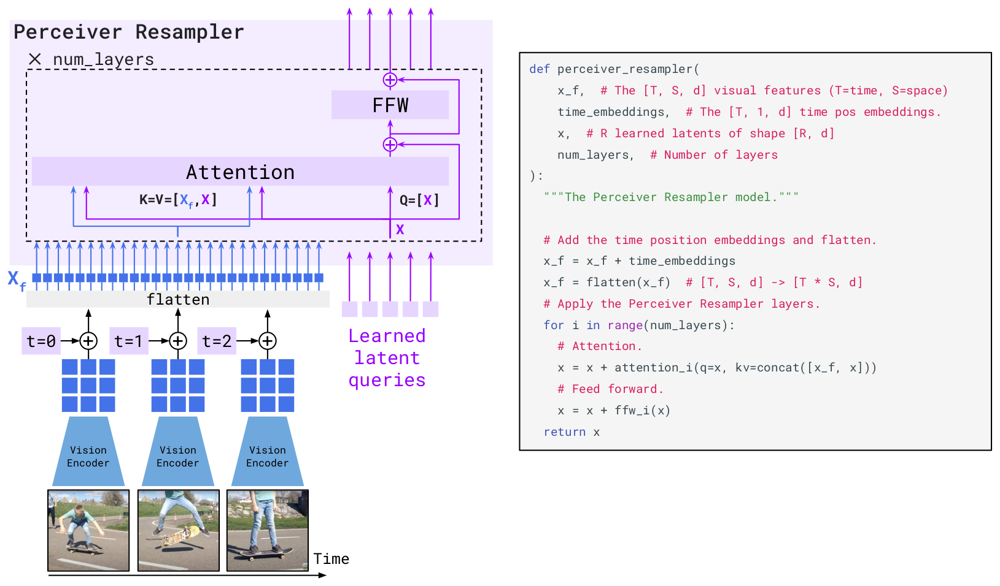

*图 A5（原文附录 Figure 5，第 23 页）：Perceiver Resampler 把可变大小的时空视觉特征网格映射为固定数量（图中画了 5 个）的输出 token。*

**图中文字翻译与读法**：

- **左下**：视频的三帧（t=0、t=1、t=2，一个人玩滑板）各自经过 Vision Encoder 得到网格特征；每帧特征加上时间位置嵌入（⊕ 前面的 t=0、t=1、t=2），然后 flatten（展平）成一条序列 $X_f$。
- **中上**：Perceiver Resampler 重复 num_layers 层；每层是 Attention 加 FFW（前馈），都带残差连接。Attention 的 Query 是学习得到的 latent 查询向量 $X$（Learned latent queries，图下方紫色小方块，其数量就是输出 token 数）；Key 和 Value 是 $[X_f, X]$，即视觉特征与 latent 自身的**拼接**（图中 K=V=[X_f, X]）。
- **右侧伪代码**（与原文一致，只翻译注释）：

```text
def perceiver_resampler(
    x_f,              # [T, S, d] 的视觉特征（T 为时间，S 为空间）
    time_embeddings,  # [T, 1, d] 的时间位置嵌入
    x,                # R 个学到的 latent，形状 [R, d]
    num_layers,       # 层数
):
    """Perceiver Resampler 模型。"""
    # 加上时间位置嵌入并展平。
    x_f = x_f + time_embeddings
    x_f = flatten(x_f)  # [T, S, d] -> [T * S, d]
    # 应用 Perceiver Resampler 的各层。
    for i in range(num_layers):
        # 注意力。
        x = x + attention_i(q=x, kv=concat([x_f, x]))
        # 前馈。
        x = x + ffw_i(x)
    return x
```

- **读图结论**：输出 token 数等于 latent 数 $R$（Flamingo 取 64），与输入图像分辨率或视频帧数无关。与 DETR、Perceiver 不同的是，这里 Key/Value 里还拼接了 latent 自己算出的 Key/Value，作者发现这样略好。

**规格**：Resampler 的 Transformer 有 6 层、隐藏维 1536、16 个头、前馈激活为 Squared ReLU（表 4），Key/Value 维度 $D/H=96$，三种规模的 Flamingo 都使用同样大小（约 194M 参数，表 5）。扩展消融（表 10 (i)）比较了 Small、Medium（默认）、Large 三种大小：Medium 最好；而且随冻结 LM 一起放大 Resampler 时训练会不稳定，所以所有模型都保守地用同样的 Medium 规格。与 MLP、普通 Transformer 相比，Perceiver Resampler 也更好（表 3 (vi)，见第五节）。

### 3.4 在冻结的语言模型里插入 GATED XATTN-DENSE 层

文本生成由 Transformer 解码器完成，以 Perceiver Resampler 输出的视觉表示为条件。做法是：把预训练并冻结的纯文本 LM 块，与从头训练的、会对视觉输出做交叉注意力的块**交错**排列。

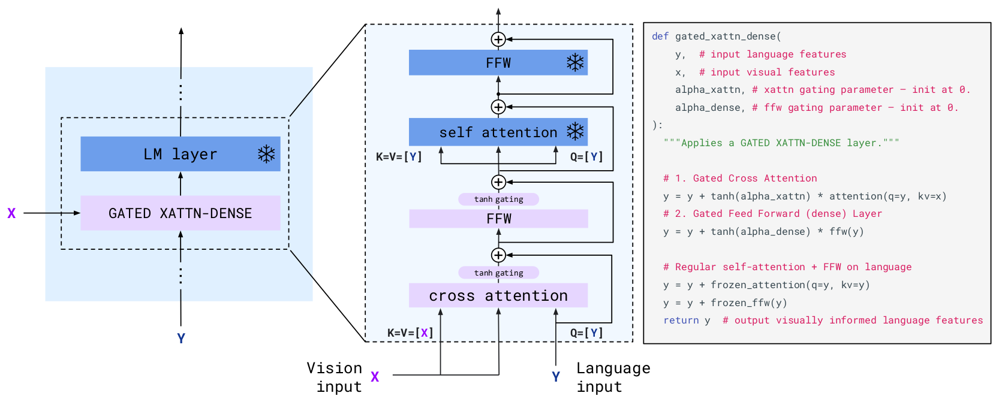

*图 4（原文 Figure 4，第 5 页）：在冻结的预训练 LM 层之间插入新的交叉注意力层；Key 和 Value 来自视觉特征，Query 来自语言输入；后接稠密前馈层；带 tanh 门控，使 LM 在初始化时保持不变。*

**图中文字翻译与读法**：

- **左图**：一个 LM layer（冻结）前面插入一个 GATED XATTN-DENSE；视觉输入 $X$ 从左边进入该新层，语言输入 $Y$ 从下方进入。
- **中图（放大）**：自下而上依次为：cross attention（交叉注意力，Query = [Y]，Key = Value = [X]）→ tanh gating（tanh 门控）→ 加回残差（⊕）→ 稠密前馈 FFW → tanh gating → 加回残差 → 冻结 LM 的 self attention（Key = Value = [Y]，Query = [Y]）→ ⊕ → 冻结 LM 的 FFW → ⊕ → 输出。浅紫色模块是新增、从头训练的，蓝色带雪花的是冻结的。
- **右侧伪代码**（中文注释版）：

```text
def gated_xattn_dense(
    y,           # 输入的语言特征
    x,           # 输入的视觉特征
    alpha_xattn, # 交叉注意力的门控参数，初始化为 0
    alpha_dense, # 前馈层的门控参数，初始化为 0
):
    """应用一个 GATED XATTN-DENSE 层。"""
    # 1. 带门控的交叉注意力
    y = y + tanh(alpha_xattn) * attention(q=y, kv=x)
    # 2. 带门控的前馈（稠密）层
    y = y + tanh(alpha_dense) * ffw(y)

    # 语言上常规的自注意力 + 前馈（冻结的 LM 部分）
    y = y + frozen_attention(q=y, kv=y)
    y = y + frozen_ffw(y)
    return y  # 输出：带有视觉信息的语言特征
```

用公式写，一个 GATED XATTN-DENSE 层对语言特征 $y$ 做的是（$x$ 为视觉 token）：

$$
y\leftarrow y+\tanh(\alpha_{\mathrm{xattn}})\cdot\mathrm{Attn}(q=y,\;kv=x),\qquad
y\leftarrow y+\tanh(\alpha_{\mathrm{dense}})\cdot\mathrm{FFW}(y).
$$

**为什么要 tanh 门控**：每个新层的输出先乘以 $\tanh(\alpha)$，再加到来自残差的输入表示上；$\alpha$ 是每层各有一个的可学习标量，初始化为 0（借鉴 ReZero；门控思想来自 LSTM）。因此初始化时 $\tanh(0)=0$，新层的输出被完全抹掉，整个模型的输出与预训练 LM **完全一致**，从而提高训练稳定性和最终性能。消融（表 3 (iii)）：去掉门控，总体得分降 4.2%，并且观察到训练不稳定。

**激活函数**：冻结 LM 原本用 GeLU，新加的可训练 Transformer 层（Resampler、GATED XATTN-DENSE）用 Squared ReLU，作者发现更好（附录 A.1.4）。

**门控值如何随训练变化（图 A6）**：作者记录了 Flamingo-3B（共 24 个 LM 层）里各层门控值 $|\tanh(\alpha)|$ 随训练进度的变化。

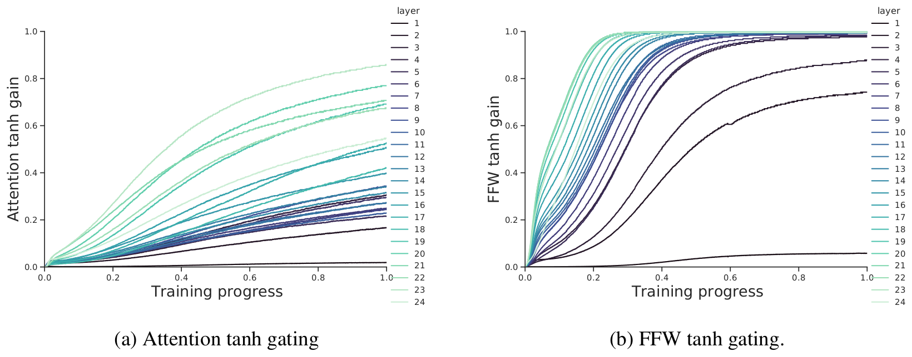

*图 A6（原文附录 Figure 6，第 24 页）：Flamingo-3B 中不同层 tanh 门控绝对值随训练的演化。*

**图中文字翻译与读法**：

- **坐标轴**：左图 (a) Attention tanh gating（注意力的 tanh 门控），纵轴 Attention tanh gain（注意力 tanh 增益，$|\tanh(\alpha)|$）；右图 (b) FFW tanh gating（前馈的 tanh 门控），纵轴 FFW tanh gain；横轴都是 Training progress（训练进度，0 到 1）；图例 layer 1 到 24 是各层，颜色由深到浅。
- **读图结论**：门控值都从 0 起步并很快增长，说明冻结 LM 的所有层都在利用视觉信息；总体上越深的层门控值越大（原文提示这点不能下强结论，因为门控前激活的尺度也可能随深度变化）。图上读出的大致情形：前馈门控 (b) 在多数层很快接近 1，注意力门控 (a) 增长更慢，最后多在约 0.2 到 0.85 之间；第 1 层的门控一直接近 0（图上约 0.02 与 0.06）。

### 3.5 三种模型规模

作者基于 Chinchilla（Hoffmann 等 2022，见 [Chinchilla](../chinchilla/论文中文解读.md)）的 1.4B、7B、70B 参数语言模型，分别得到 Flamingo-3B、Flamingo-9B 和 Flamingo-80B。随着冻结 LM 和可训练的 GATED XATTN-DENSE 模块增大，视觉编码器和 Resampler 的规模保持不变（相对整个模型都较小）。

- Flamingo-3B：1.4B 冻结 LM，**每个** Transformer 块前面都加 GATED XATTN-DENSE（共 24 层）；
- Flamingo-9B：7B 冻结 LM，从第一层起每隔 4 个块加一个（共 10 层）；
- Flamingo-80B：70B 冻结 LM，从第一层起每隔 7 个块加一个（共 12 层）。

插入频率是内存限制与下游性能之间的折中：先在小模型上找到最优折中，再迁移到大模型。表 3 (v) 的消融显示每层都加最好，但会显著增加可训练参数和时间；每 4 层加一个可使训练提速约 66%（原文说法；表中步时间 1.74s 对 1.02s），总体得分只降 1.9%。

**表 4：Flamingo 各 Transformer 组件的超参数**

| 模型 | Resampler 层数 L | D | 头数 H | 激活 | GATED XATTN-DENSE 层数 L | D | 头数 H | 激活 | 冻结 LM 层数 L | D | 头数 H | 激活 |
|---|---:|---:|---:|---|---:|---:|---:|---|---:|---:|---:|---|
| Flamingo-3B | 6 | 1536 | 16 | Sq. ReLU | 24 | 2048 | 16 | Sq. ReLU | 24 | 2048 | 16 | GeLU |
| Flamingo-9B | 6 | 1536 | 16 | Sq. ReLU | 10 | 4096 | 32 | Sq. ReLU | 40 | 4096 | 32 | GeLU |
| Flamingo（80B） | 6 | 1536 | 16 | Sq. ReLU | 12 | 8192 | 64 | Sq. ReLU | 80 | 8192 | 64 | GeLU |

（原文表 4，第 25 页。L：层数，D：Transformer 隐藏维度，H：头数，Sq. ReLU：Squared ReLU。每个前馈 MLP 的隐藏维是 $4D$；Key/Value 维度为 $D/H$：Resampler 为 96，GATED XATTN-DENSE 与冻结 LM 为 128。）

**表 5：各 Flamingo 模型的参数量**

| 模型 | 需要模型分片 | 冻结：语言模型 | 冻结：视觉编码器 | 可训练：GATED XATTN-DENSE（插入频率） | 可训练：Resampler | 总计 |
|---|---|---:|---:|---|---:|---:|
| Flamingo-3B | 否 | 1.4B | 435M | 1.2B（every） | 194M | 3.2B |
| Flamingo-9B | 否 | 7.1B | 435M | 1.6B（every 4th） | 194M | 9.3B |
| Flamingo（80B） | 是 | 70B | 435M | 10B（every 7th） | 194M | 80B |

（原文表 5，第 28 页。）读法：80B 模型里约 90% 的权重（70B 的 LM 加视觉编码器）是冻结的，需要训练的主要是 10B 的交叉注意力层与 194M 的 Resampler；所谓“新增连接模块”并不小，大模型里它的绝对规模已达 10B，只是相对整个模型占比不高。

### 3.6 多图像输入：逐图像的注意力掩码（图 A7）

交错序列里可能有多张图像或多段视频。Flamingo 用**掩码**限制每个文本 token 能通过交叉注意力看到哪些视觉 token：在给定的文本 token 处，模型只对**交错序列中紧挨在它前面的那张图像**的视觉 token 做交叉注意力，而不是对此前所有图像。虽然交叉注意力一次只直接看一张图，但对更早图像的依赖仍然通过语言模型里的自注意力保留下来。

形式化（附录 A.1.3）：每个样本含文本序列 $y$、图像/视频序列 $x$ 和图像在文本里的位置。定义函数 $\varphi:[1,L]\mapsto[0,N]$，给每个文本位置指派“此位置之前最后出现的图像/视频的下标”（若之前没有任何视觉数据，则为 0）。式 (1) 中能用来预测第 $\ell$ 个 token 的视觉输入集合就是 $x_{\le\ell}\triangleq\{x_i\mid i\le\varphi(\ell)\}$，而文本前缀 $y_{<\ell}=(y_1,\dots,y_{\ell-1})$。

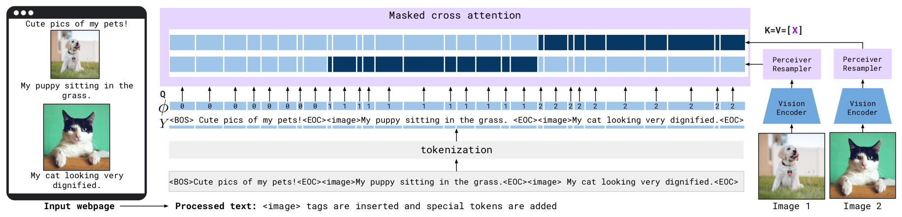

*图 A7（原文附录 Figure 7，第 24 页）：一个网页（含两张图像和三段文字）如何被处理，以及对应的掩码交叉注意力。*

**图中文字翻译与读法**：

- **左侧 Input webpage（输入网页）**：文字 “Cute pics of my pets!”，一张小狗图配 “My puppy sitting in the grass.”，一张猫图配 “My cat looking very dignified.”。
- **底部 Processed text（处理后文本）**：插入 `<image>` 标签并加上特殊 token：`<BOS>Cute pics of my pets!<EOC><image>My puppy sitting in the grass.<EOC><image> My cat looking very dignified.<EOC>`（`<BOS>` 表示序列开始，`<EOC>` 表示 end of chunk，块结束）。
- **中间**：tokenization（分词）之后，每个文本 token 下方的数字就是 $\varphi$（图中 $\phi$），即它可以关注的图像：第一张图之前的 token 为 0（看不到任何图像）；第一张图之后到第二张图之前的 token 为 1；第二张图之后的 token 为 2。
- **上方 Masked cross attention（掩码交叉注意力）**：两行色条分别对应 Image 1 和 Image 2（右侧各经 Vision Encoder 和 Perceiver Resampler 得到 K=V=[X]）；深蓝色是可见（未被掩码），浅蓝色是被掩码。下面一行（Image 1）只有 $\varphi=1$ 的文本 token 是深蓝，上面一行（Image 2）只有 $\varphi=2$ 的是深蓝。
- **读图结论**：每个文本 token 只会直接看到一张图，且这一设计使模型可以泛化到任意数量的视觉输入：训练交错数据时每个序列最多只用 5 张图，而评测时模型能受益于多达 32 对（图像，文本）“shots”。

**为什么只看最近一张图**（第 3.3 节与附录 B.3.1）：把交叉注意力改成可以看**所有**此前图像，总体得分下降 7.2%（表 10 (ii)：70.7 对 63.5，见第五节）。一种解释是，看所有图像时，交叉注意力的输入里没有显式的方法区分不同图像；虽然近期工作表明因果注意力机制可以隐式做到这点，作者还试了显式的方案（在图像标记里加下标如 `<image 1>`，或给每张图的交叉注意力特征加学习的绝对下标嵌入），但当序列里图像数量在训练和测试之间变化时，这些方案都不如单图交叉注意力稳健。训练时用 $N=5$ 减少每个序列的图像数以提高效率，测试时却要泛化到 $N=32$，所以保留单图方案。

**M3W 的图像对应随机化**（附录 A.3.2）：网页上文字与图像的对应关系一般未知（例如“This is my dog! 〈狗图〉”里图在文后，“〈狗图〉 That was my dog!”里图在文前）。作者假设与某处文字最相关的图像，要么是这个 token 之前最后出现的图，要么是紧跟其后的图，并在训练时对每个采样的网页以概率 $p_{\text{next}}=\tfrac12$ 选择“映射到下一张图”（其余映射到前一张）。这意味着约一半时候做的是语义上“不自然”的选择，但消融（表 10 (iii)）发现 $p_{\text{next}}=\tfrac12$ 略优于 0（总是前一张）和 1（总是后一张），这表明随机化起到了某种数据增强的作用。

### 3.7 训练数据：三类数据，全部来自网络

Flamingo 在三类数据的混合上训练，全部抓取自网络，且不使用任何为机器学习目的而标注的数据。

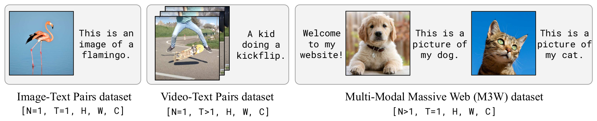

*图 A9（原文附录 Figure 9，第 26 页）：不同格式的训练数据集混合。*

**图中文字翻译与读法**：从左到右三种数据：Image-Text Pairs dataset（图像-文本对，$[N=1,T=1,H,W,C]$，例：一张火烈鸟图配 “This is an image of a flamingo.”）、Video-Text Pairs dataset（视频-文本对，$[N=1,T>1,H,W,C]$，例：滑板视频帧配 “A kid doing a kickflip.”）、Multi-Modal Massive Web（M3W）dataset（多模态大规模网页数据，$[N>1,T=1,H,W,C]$，例：“Welcome to my website!” 接小狗图配 “This is a picture of my dog.” 再接猫图配 “This is a picture of my cat.”）。$N$ 是单个样本的视觉输入个数（图文对与视频文本对 $N=1$），$T$ 是视频帧数（图像 $T=1$），$H,W,C$ 是高、宽、通道数。**读图结论**：三类数据在“视觉输入个数”和“是否有时间维”上不同，Flamingo 的架构（Resampler 把任意形状压成 64 个 token，掩码处理多图）正是为统一处理它们而设计的。

**M3W：交错图文数据集（MultiModal MassiveWeb）**。少样本能力依赖于在交错的文本与图像数据上训练，为此作者收集了 M3W。

- 从约 4300 万个网页（数据表给出 43.3M 个文档）的 HTML 中提取文本与图像，按 DOM 中文本和图像元素的相对位置确定图像相对文字的位置；总计 185M 张图像、182 GB 文本；
- 构造样本：在纯文本里图像所在位置插入 `<image>` 标签，并在每张图像之前、以及文档结尾插入一个特殊的 `<EOC>`（end of chunk）token（加入词表并学习）；
- 每篇文档随机采样一个长 $L=256$ 个 token 的子序列，取其中**前 $N=5$ 张**图像，更多的图像丢弃以节省计算；
- 收集过程类似 MassiveWeb：滤掉非英文文档和未通过内部内容过滤（识别图像、视频、文本中的露骨内容）的文档；没有抓到图像的文档丢弃；应用类似的文本启发式过滤以去除低质量文档和重复；图像过滤去掉太小（宽或高小于 64 像素）、过宽或过窄（长宽比任一方向大于 3）或明显低质（如单色图）的图像；过滤后不含图像的文档丢弃。数据集不对外发布（数据表中“是否分发给第三方”答案为否）。

**图文对与视频文本对**：

- **ALIGN**（Jia 等）：18 亿张图像配 alt-text；规模大但噪声多且只有图像；平均每条文本 12.4 个 token；
- **LTIP**（Long Text & Image Pairs）：作者新建的 3.12 亿对图文，描述更长更优质（平均 20.5 个 token）；
- **VTP**（Video & Text Pairs）：2700 万个短视频（平均约 22 秒），配句子描述。
- LTIP 与 VTP 通过抓取不到十个以高质量、丰富图像描述为目标的网站得到。配对数据按与 M3W 一致的语法处理：在每条训练文本前加 `<image>`（位于 `<BOS>` 之后），文本后加 `<EOC>`（在 `<EOS>` 之前）。

**对评测集去重**（附录 A.3.4）：用内部去重工具，把训练图像和评测数据的图像映射到一个“重复的更接近”的嵌入空间，再做近似最近邻检索。LTIP 与 ALIGN 对 ImageNet（训练、验证）、COCO、OK-VQA、VQAv2、Flickr30k、VisDial（训练、验证、测试）做了去重；没有对 VizWiz、HatefulMemes、TextVQA 去重，因为这三个评测是在训练完之后才做的，但作者认为影响不大（VizWiz 图像来自特定手机应用且只供下载，HatefulMemes 的 meme 由研究者制作，TextVQA 图像来自 OpenImages，都不太可能被网络抓取）。M3W 没有做去重（一个训练样本是含多张图的整个网页，不太可能包含评测图像）；对 M3W 的 1.85 亿张图做近重复统计，在 ImageNet、COCO、OK-VQA、VQAv2、Flickr30k、VisDial 的验证集与测试集中共发现 1314 个潜在重复，其中只有 125 个是精确重复。VTP 的 2700 万个视频也没有去重，因为视频评测数据集都来自 YouTube 或 Flickr，而 VTP 没有来自这两个来源的视频。

### 3.8 训练目标

训练目标是各数据集上文本负对数似然的加权和（原文式 (2)）：

$$
\sum_{m=1}^{M}\lambda_m\cdot\mathbb{E}_{(x,y)\sim\mathcal{D}_m}\Big[-\sum_{\ell=1}^{L}\log p\big(y_\ell\mid y_{<\ell},\,x_{\le\ell}\big)\Big],
$$

其中 $\mathcal{D}_m$ 和 $\lambda_m$ 是第 $m$ 个数据集及其权重。调好各数据集的权重 $\lambda_m$ 是性能的关键：四个数据集 M3W、ALIGN、LTIP、VTP 的权重分别取 1.0、0.2、0.2、0.03（在小模型上凭经验得到，之后固定）。作者对所有数据集**累积梯度**，发现优于“轮流更新”（round-robin）的做法（表 3 (ii)：70.7 对 62.9）。

### 3.9 训练细节与基础设施

- **数据增强与预处理**：对配对数据集的文本，以 0.5 的概率在最前面随机加一个空格，因为分词器会按词前是否有空格把同一个词映射到不同 token；这样强制模型对这种分词假象保持不变性，作者观察到跨任务的显著提升。视觉输入缩放到 $320\times320$（保持长宽比，必要时用均值填充），高于视觉编码器对比预训练用的 $288\times288$（受 FixRes 启发：CNN 在更高的测试分辨率下性能更好；视觉编码器被冻结，无需对其反向传播，所以增加分辨率的代价不大）；另有随机左右翻转和颜色增强。视频训练时，从每个训练视频中以 1 fps 采样一个 8 帧的片段；推理时输入 30 帧、3 FPS，办法是对 Resampler 里学到的时间位置嵌入做线性插值。
- **优化**：AdamW，全局范数裁剪 1；Perceiver Resampler 不用权重衰减，其他可训练参数权重衰减 0.1；学习率在前 5000 步从 0 线性升到 $10^{-4}$，之后保持不变（衰减学习率没有带来改进）；默认训练 50 万步。
- **基础设施**：用 JAX 和 Haiku 实现，全部训练与评测在 TPUv4 上完成；80B 模型在 1536 块芯片上训练 15 天，切分到 16 个设备上（Megatron 式 16 路模型并行，用于所有 Embedding、自注意力、交叉注意力、前馈层，NFNet 视觉层不分片）；用 ZeRO stage 1 切分优化器状态；所有可训练参数和优化器累加器以 float32 存储和更新，激活和梯度用 bfloat16 计算（参数先从 float32 降为 bfloat16），冻结参数以 bfloat16 存储和使用。
- **文本处理**：输入文本用词表大小 32,000 的 SentencePiece 分词器（模型卡）。

### 3.10 视觉编码器的对比预训练（附录 B.1.3）

视觉编码器与一个语言编码器一起从头训练：图像和文本分别编码，投影到共享嵌入空间并做 L2 归一化；用与 CLIP 相同的损失，包含文本到图像、图像到文本两个对比项，配对的图文是正样本，batch 里其余为负样本。可学习温度参数放在最后的 log-softmax 层。设 $V_i$、$L_i$ 分别是 batch 中第 $i$ 个元素的视觉和语言归一化嵌入，$\beta$ 是可训练的逆温度，$N$ 是 batch 大小：

$$
\mathcal{L}_{\text{txt2im}}=-\frac1N\sum_{i=1}^{N}\log\frac{\exp(L_i^{\top}V_i\beta)}{\sum_{j=1}^{N}\exp(L_i^{\top}V_j\beta)},
$$

$$
\mathcal{L}_{\text{im2txt}}=-\frac1N\sum_{i=1}^{N}\log\frac{\exp(V_i^{\top}L_i\beta)}{\sum_{j=1}^{N}\exp(V_i^{\top}L_j\beta)},
$$

最小化二者之和（原文式 (3)、(4)）。对比损失的详细讲解见 [CLIP](../clip/论文中文解读.md)。

- 语言编码器用 BERT 架构；语言和视觉编码器的输出分别在 token 和空间位置上做平均池化后再投影到共享空间（嵌入维度 1376）。**Flamingo 主模型只使用对比模型里的视觉编码器权重**。
- 在 ALIGN 和 LTIP 上预训练；训练图像分辨率 $288\times288$，batch size 16,384；训练 120 万步参数更新（每步包含两次梯度计算），用 512 块 TPUv4；学习率从 $10^{-3}$ 线性衰减到 0；训练时随机颜色增强和水平翻转；使用 Jia 等（ALIGN）的分词器；Adam 优化器，标签平滑 0.1；对 NFNet 编码器用 $10^{-2}$ 的自适应梯度裁剪（AGC），对 BERT 编码器用全局范数 10 的梯度裁剪。
- 评测：零样本 ImageNet 分类用图像与类名之间的图文检索，沿用 CLIP 的提示集成（如 “A photo of a {class_name}” 等多个模板的嵌入取平均）。

**这个编码器有多好（表 9）**：它在图文检索上超过此前的双编码器对比模型。

**表 9：对比预训练模型的零样本图文检索（R@K，%，越大越好）**

| 模型 | Flickr30K 图→文 R@1 | R@5 | R@10 | Flickr30K 文→图 R@1 | R@5 | R@10 |
|---|---:|---:|---:|---:|---:|---:|
| Florence | **90.9** | **99.1** | - | 76.7 | 93.6 | - |
| ALIGN | 88.6 | 98.7 | **99.7** | 75.7 | 93.8 | 96.8 |
| CLIP | 88.0 | 98.7 | 99.4 | 68.7 | 90.6 | 95.2 |
| Ours（本文） | 89.3 | 98.8 | **99.7** | **79.5** | **95.3** | **97.9** |

| 模型 | COCO 图→文 R@1 | R@5 | R@10 | COCO 文→图 R@1 | R@5 | R@10 |
|---|---:|---:|---:|---:|---:|---:|
| Florence | 64.7 | 85.9 | - | 47.2 | 71.4 | - |
| ALIGN | 58.6 | 83.0 | 89.7 | 45.6 | 69.8 | 78.6 |
| CLIP | 58.4 | 81.5 | 88.1 | 37.7 | 62.4 | 72.2 |
| Ours（本文） | **65.9** | **87.3** | **92.9** | **48.0** | **73.3** | **82.1** |

（原文表 9，第 35 页；原表把两个数据集并排排成一张宽表，这里拆成两张表。）读法：本文的对比模型在多数检索指标上最好，仅 Flickr30K 图到文的 R@1、R@5 略低于 Florence。作者认为，选择视觉编码器时应更看重检索指标而不是分类：他们的目标是把它当特征提取器来捕捉**整个场景**，而不只是主要物体；他们发现在与标签类似的短文本上训练会大幅帮助 ImageNet，却不利于需要捕捉丰富场景描述的检索。零样本分类上，它落后于 ImageNet 上的 SOTA（BASIC，在带标签的 JFT-3B 上训练）和 Kinetics700 上的 CLIP（表 7）。

**数据与组合方式（附录 B.3.2，表 11）**：训练关键之一是新数据集 LTIP 与 ALIGN 一起使用。作者训练了一个小模型（NFNet-F0 视觉编码器、BERT-mini 语言编码器、batch size 2048、100 万步梯度计算）来比较。

**表 11：对比预训练数据集及其组合策略的效果**

| 数据集 | 组合策略 | ImageNet top-1 | COCO 图→文 R@1 | R@5 | R@10 | COCO 文→图 R@1 | R@5 | R@10 |
|---|---|---:|---:|---:|---:|---:|---:|---:|
| LTIP | 无 | 40.8 | 38.6 | 66.4 | 76.4 | 31.1 | 57.4 | 68.4 |
| ALIGN | 无 | 35.2 | 32.2 | 58.9 | 70.6 | 23.7 | 47.7 | 59.4 |
| LTIP + ALIGN | Accumulation（梯度累积） | **45.6** | **42.3** | **68.3** | **78.4** | **31.5** | **58.3** | **69.0** |
| LTIP + ALIGN | Data merged（合并成一个 batch） | 38.6 | 36.9 | 65.8 | 76.5 | 15.2 | 40.8 | 55.7 |
| LTIP + ALIGN | Round-robin（轮流更新） | 41.2 | 40.1 | 66.7 | 77.6 | 29.2 | 55.1 | 66.6 |

（原文表 11，第 37 页。前两行是只在单个数据集上训练；后三行是不同的合并策略：Data merged 把各数据集样本合并进同一个 batch；Round-robin 交替用各数据集的 batch 更新参数；Accumulation 为每个数据集的一个 batch 算梯度，加权求和后再更新。）读法：只用较小的 LTIP（原文说比 ALIGN 小 5 到 6 倍）训练，反而比只用 ALIGN 好，说明数据质量可能比数量更重要；两者合用优于各自单独；而且组合方式很重要：梯度累积全面优于其他两种。

### 3.11 任务适配：少样本 in-context 学习（图 A8）

训练好之后，用多模态交错 prompt 让 Flamingo 完成视觉任务，做法类比 GPT-3：把若干支持样本（support examples，形如（图像，文本）或（视频，文本））和随后的查询视觉输入（query）按顺序交错拼成 prompt。

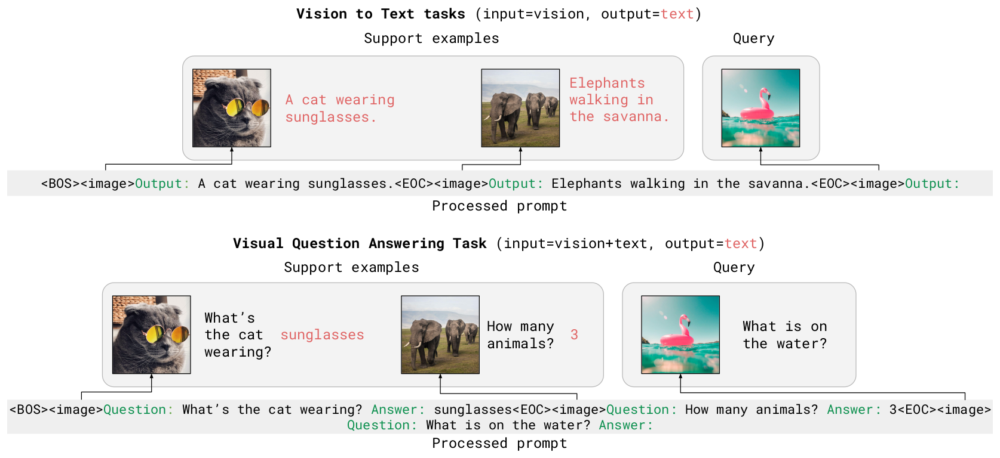

*图 A8（原文附录 Figure 8，第 25 页）：给定若干任务相关的少样本示例（支持样本）和一个要预测的查询，把图像与对应文本交错起来构造 prompt。*

**图中文字翻译与读法**：

- **上半 Vision to Text tasks（input=vision, output=text，视觉到文本任务）**：Support examples（支持样本）是（戴墨镜的猫，“A cat wearing sunglasses.”）、（大象，“Elephants walking in the savanna.”）；Query（查询）是一张游泳圈火烈鸟的图。Processed prompt（处理后的 prompt）：`<BOS><image>Output: A cat wearing sunglasses.<EOC><image>Output: Elephants walking in the savanna.<EOC><image>Output:`。
- **下半 Visual Question Answering Task（input=vision+text, output=text，视觉问答任务）**：支持样本是（猫图，“What's the cat wearing?”，答案 sunglasses）、（大象图，“How many animals?”，答案 3）；查询是游泳圈火烈鸟图加 “What is on the water?”。处理后的 prompt 为 `<BOS><image>Question: What's the cat wearing? Answer: sunglasses<EOC><image>Question: How many animals? Answer: 3<EOC><image>Question: What is on the water? Answer:`。
- **读图结论**：格式规则很简单：所有“视觉到文本”任务在期望的回答前加 “Output:”；视觉问答任务用 “Question: {question} Answer: {answer}” 格式。示例之间用 `<EOC>` 分隔，每个图像前有 `<image>`。除非另有说明，示例的拼接顺序是随机的。

**开放式与封闭式评测**：

- **开放式**（open-ended）：取模型在查询图像之后采样的文本作为预测，遇到第一个 `<EOC>` 预测就停止；除非另有说明，一律用束宽为 3 的束搜索（beam search）；
- **封闭式**（close-ended）：把所有可能的输出分别接在查询图像之后，用模型估计的对数似然给每个序列打分，据此从最有把握到最没把握排序。

**零样本**（附录 A.2）：没有少样本示例时，常见做法是靠提示工程，用合适的自然语言任务描述作条件，但验证这类 prompt 需要标注样本，不能算真正的零样本，且这类验证流程在只有少量验证样本时一般不稳健。为此本文报告零样本时，用**两个来自下游任务、但去掉了对应图像或视频的文本示例**构建 prompt。例如对图 A8 上半的任务，prompt 为 `<BOS>Output: This is a cat wearing sunglasses.<EOC>Output: Three elephants walking in the savanna.<EOC><image> Output:`，并且不给模型任何支持图像。作者发现只给一个文本示例（而不是两个）有很大副作用，因为模型会偏向生成与这一个示例相似的文本；给两个以上只有边际帮助；因此所有零样本结果都用两个文本示例。对封闭式任务，零样本 prompt 里甚至不需要提供文本示例。

**RICES**（Retrieval-based In-Context Example Selection，Yang 等 2021）：当支持集大到无法全放进 prompt 时（太贵，也有 prompt 长度超过训练序列长度后泛化变差的风险），做 prompt 选择：给定查询图像，用冻结的预训练视觉编码器提取视觉特征，在支持集中检索相似图像，取最相似的 top-$N$ 个拼成 prompt；由于 LM 对 prompt 里的顺序敏感（近因偏差），把示例**按相似度从低到高**排列，使最相似的支持样本紧挨在查询之前。这在有几百个类别、每类给一张或多张图像的分类设定里尤其有效（表 7）。

**Prompt 集成**：封闭式设定下还可以对多个 prompt 的输出做集成，并可与 RICES 结合（对排序后的最近邻做多种排列）。具体做法：对给定答案，对模型在所选少样本示例的 6 种随机排列下估计的对数似然取平均。

## 四、实验

### 4.1 评测基准与协议

作者选取 16 个流行的图像/视频与语言基准（附录统计时连同 ImageNet、Kinetics700 两个标准分类基准，共 18 个，见表 6）。为了在项目过程中验证设计决策，其中 5 个多模态基准加上两个分类基准被用作开发集（DEV）：COCO、OKVQA、VQAv2、MSVDQA、VATEX，外加 ImageNet 和 Kinetics700。DEV 基准上的性能估计可能因模型选择而有偏（用类似基准验证和消融设计决策的前人工作也是如此）。为此，作者另外报告 **11 个留出基准**的结果，涵盖描述、视频问答，以及视觉对话、多选问答等较少被探索的能力；这 11 个基准上没有验证任何设计决策，只用来估计无偏的少样本性能。全部评测超参数在所有基准上固定不变。

**表 6：评测基准汇总**

| 数据集 | DEV | 生成式 | 自定义 prompt | 任务描述 | 评测集 | 指标 |
|---|---|---|---|---|---|---|
| ImageNet-1k（图像） | 是 | - | - | 物体分类 | Val | Top-1 acc. |
| MS-COCO（图像） | 是 | 是 | - | 场景描述 | Test | CIDEr |
| VQAv2（图像） | 是 | 是 | - | 场景理解问答 | Test-dev | VQA acc. |
| OKVQA（图像） | 是 | 是 | - | 外部知识问答 | Val | VQA acc. |
| Flickr30k（图像） | - | 是 | - | 场景描述 | Test (Karpathy) | CIDEr |
| VizWiz（图像） | - | 是 | - | 场景理解问答 | Test-dev | VQA acc. |
| TextVQA（图像） | - | 是 | - | 文字阅读问答 | Val | VQA acc. |
| VisDial（图像） | - | - | - | 视觉对话 | Val | NDCG |
| HatefulMemes（图像） | - | - | 是 | 梗图（meme）分类 | Seen Test | ROC AUC |
| Kinetics700 2020（视频） | 是 | - | - | 动作分类 | Val | Top-1/5 avg |
| VATEX（视频） | 是 | 是 | - | 事件描述 | Test | CIDEr |
| MSVDQA（视频） | 是 | 是 | - | 事件理解问答 | Test | Top-1 acc. |
| YouCook2（视频） | - | 是 | - | 事件描述 | Val | CIDEr |
| MSRVTTQA（视频） | - | 是 | - | 事件理解问答 | Test | Top-1 acc. |
| iVQA（视频） | - | 是 | - | 事件理解问答 | Test | iVQA acc. |
| RareAct（视频） | - | - | 是 | 组合动作检索 | Test | mWAP |
| NextQA（视频） | - | 是 | - | 时序/因果问答 | Test | WUPS |
| STAR（视频） | - | - | - | 多选问答 | Test | Top-1 acc. |

（原文表 6，第 31 页。“生成式”指从 VLM 采样文本；非生成式任务用 VLM 在给定有限集合里给答案打分。大多数任务使用共同的默认 prompt，以尽量减少任务专用调参。）

**四种 prompt 模板**（附录 B.1.5）：除 HatefulMemes 和 RareAct 外，所有非问答任务用 “Output: {output}”，所有问答/视觉对话任务用 “Question: {question} Answer: {answer}”；对 VisDial，对话中每个问题/回答按此编码，提供的图像描述（caption）直接放在对话历史最前面、不加模板；HatefulMemes 用专门的 prompt 来纳入 OCR 信息：“is an image with written: "{meme_text}" on it. Is it hateful? Answer: {answer}”（答案为 yes 或 no；这是**唯一**显式把 OCR 文本作为输入提供给 Flamingo 的数据集）；TextVQA 不使用提供的 OCR 转录，直接依赖 Flamingo 自带的 OCR 能力；RareAct 是零样本基准，把动词改成第三人称、名词前加冠词，用 “Caption: a person {verb + object}”。在 DEV 基准的验证子集上联合优化评测超参数，不做任何基准专用的交叉验证（上述几处例外除外），因为少样本学习中选超参数实际上等于增加了示例数，若不计入这部分，常常会高估少样本性能。

**支持集与查询集的划分**（附录 B.1.4）：估计少样本性能需要两个不相交的子集：支持样本和查询样本。对 DEV 基准，要用四个子集：验证支持、验证查询、测试支持、测试查询。测试查询集用以往工作报告结果的那个子集（便于对比）；验证查询集和两个支持集用训练集的不相交子集。具体规模：描述任务，COCO 与 Karpathy 划分一致评测 5000 个样本；VATEX 因训练集有限只评测 1024 个样本；问答任务评测 1024 个样本；图像分类每类评测 10 张图（ImageNet 共 10,000，Kinetics700 共 7000）；支持集除分类外每个任务 2048 个样本，分类任务每类 32 个样本。对 YouTube 来源的视频数据集（除 NextQA 与 STAR 外的所有视频数据集），评测的是 2022 年 4 月时所有公开可用的视频。

### 4.2 少样本主结果（图 2、表 1）

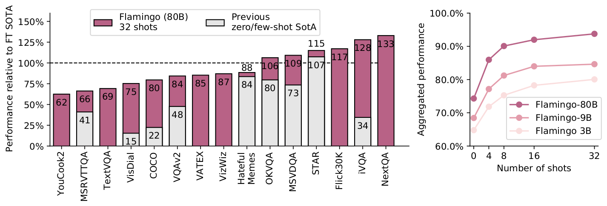

*图 2（原文 Figure 2，第 3 页）：左，最大的 Flamingo 模型在没有微调的情况下，在所考虑的 16 个任务里的 6 个上超过微调的 SOTA；右，Flamingo 的性能随模型规模和示例数提高。*

**图中文字翻译与读法**：

- **左图**：纵轴 Performance relative to FT SOTA（相对微调 SOTA 的性能，%），虚线为 100%（等于微调 SOTA）；图例：Flamingo (80B) 32 shots（Flamingo 80B，32 个示例，粉色柱）、Previous zero/few-shot SotA（此前的零/少样本 SOTA，灰色柱）。16 个任务里没画 RareAct，因为它是没有可比的微调结果的零样本基准。柱上数字（原图标注）：YouCook2 62、MSRVTTQA 66（此前 41）、TextVQA 69、VisDial 75（此前 15）、COCO 80（此前 22）、VQAv2 84（此前 48）、VATEX 85、VizWiz 87、HatefulMemes 88（此前 84）、OKVQA 106（此前 80）、MSVDQA 109（此前 73）、STAR 115（此前 107）、Flick30K 117、iVQA 128（此前 34）、NextQA 133。过 100% 的 6 个任务是 OKVQA、MSVDQA、STAR、Flickr30K、iVQA、NextQA。对有已发表少样本结果的 9 个任务，Flamingo 都刷新了少样本 SOTA（即图中有灰色柱的 9 个）。
- **右图**：横轴 Number of shots（示例数 0、4、8、16、32），纵轴 Aggregated performance（聚合性能，约 60% 到 100%）；三条线 Flamingo-3B、Flamingo-9B、Flamingo-80B。按表 1 的数字重算（15 个任务上“得分 / 微调 SOTA”的平均，不含 RareAct），3B 在 0/4/32-shot 约为 64.7%/71.8%/80.0%，9B 约为 68.4%/77.1%/84.5%，80B 约为 74.3%/86.1%/93.3%，与图上曲线吻合；8-shot 与 16-shot 的点只出现在图上（80B 约 90% 与 92%）。
- **读图结论**：模型越大、示例越多，聚合性能越高；原文称最大的模型更能利用更多示例（按表 1 重算，从 0-shot 到 32-shot，80B 约提升 19 个点，9B 约 16 个点，3B 约 15 个点）。
- **原文内部的小出入**：图 2 中 Flick30K 为 117，而表 1 里 75.4 对 67.4 直接相除约为 112；COCO、VisDial 的柱高（80、75）与表 1 直接相除（约 79、74）也略有差异，原文未说明。本文以表 1 为准。

原文对结果的总结：Flamingo 以大幅优势超越此前所有零样本或少样本方法，只需**四个示例**就能做到，说明了视觉模型适配新任务是实用而高效的。更重要的是，Flamingo 常常能与再用多达数十万条标注微调过的 SOTA 竞争；在 6 个任务上，用同一套模型权重和仅 32 个任务样本就超过了微调 SOTA。尽管设计决策只用到了 DEV 基准，结果对其他基准泛化良好，证实了方法的通用性。

下面两张表是原文表 1（带有粗体和下划线的原图在后）。为便于阅读，转置成“基准为行”，并拆成两张：先是 80B 模型与 SOTA 的对比，再是 3B、9B 的结果。

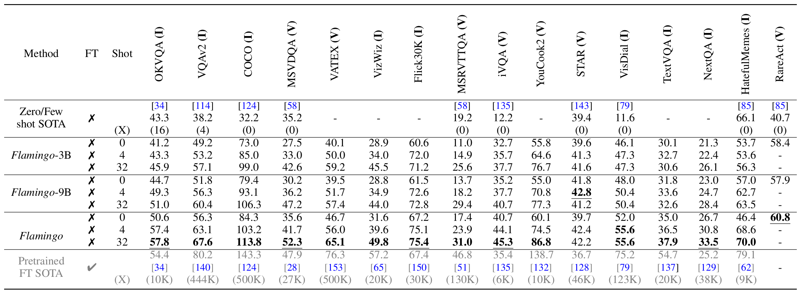

*表 1（原文 Table 1，第 7 页）：一个 Flamingo 模型通过少样本学习，在大量图像（I）和视频（V）理解任务上达到 SOTA。粗体是最好的少样本数字，下划线是总体最好的数字。*

**表 1（上）：Flamingo-80B 与此前零/少样本 SOTA、微调 SOTA 的对比**

| 基准（类型） | 指标 | 此前零/少样本 SOTA | Flamingo 0-shot | 4-shot | 32-shot | 微调 SOTA（所用标注样本数） | 32-shot 超过微调 SOTA？ |
|---|---|---|---:|---:|---:|---|---|
| OKVQA（图像，DEV） | VQA acc. | 43.3（16-shot） | 50.6 | 57.4 | **57.8** | 54.4（10K） | 是 |
| VQAv2（图像，DEV） | VQA acc. | 38.2（4-shot） | 56.3 | 63.1 | **67.6** | 80.2（444K） | 否 |
| COCO（图像，DEV） | CIDEr | 32.2（0-shot） | 84.3 | 103.2 | **113.8** | 143.3（500K） | 否 |
| MSVDQA（视频，DEV） | Top-1 acc. | 35.2（0-shot） | 35.6 | 41.7 | **52.3** | 47.9（27K） | 是 |
| VATEX（视频，DEV） | CIDEr | - | 46.7 | 56.0 | **65.1** | 76.3（500K） | 否 |
| VizWiz（图像） | VQA acc. | - | 31.6 | 39.6 | **49.8** | 57.2（20K） | 否 |
| Flickr30k（图像） | CIDEr | - | 67.2 | 75.1 | **75.4** | 67.4（30K） | 是 |
| MSRVTTQA（视频） | Top-1 acc. | 19.2（0-shot） | 17.4 | 23.9 | **31.0** | 46.8（130K） | 否 |
| iVQA（视频） | iVQA acc. | 12.2（0-shot） | 40.7 | 44.1 | **45.3** | 35.4（6K） | 是 |
| YouCook2（视频） | CIDEr | - | 60.1 | 74.5 | **86.8** | 138.7（10K） | 否 |
| STAR（视频） | Top-1 acc. | 39.4（0-shot） | 39.7 | 42.4 | 42.2 | 36.7（46K） | 是 |
| VisDial（图像） | NDCG | 11.6（0-shot） | 52.0 | **55.6** | **55.6** | 75.2（123K） | 否 |
| TextVQA（图像） | VQA acc. | - | 35.0 | 36.5 | **37.9** | 54.7（20K） | 否 |
| NextQA（视频） | WUPS | - | 26.7 | 30.8 | **33.5** | 25.2（38K） | 是 |
| HatefulMemes（图像） | ROC AUC | 66.1（0-shot） | 46.4 | 68.6 | **70.0** | 79.1（9K） | 否 |
| RareAct（视频） | mWAP | 40.7（0-shot） | **60.8** | - | - | - | 无微调结果 |

**表 1（下）：Flamingo-3B 与 Flamingo-9B**

| 基准 | 3B 0-shot | 3B 4-shot | 3B 32-shot | 9B 0-shot | 9B 4-shot | 9B 32-shot |
|---|---:|---:|---:|---:|---:|---:|
| OKVQA | 41.2 | 43.3 | 45.9 | 44.7 | 49.3 | 51.0 |
| VQAv2 | 49.2 | 53.2 | 57.1 | 51.8 | 56.3 | 60.4 |
| COCO | 73.0 | 85.0 | 99.0 | 79.4 | 93.1 | 106.3 |
| MSVDQA | 27.5 | 33.0 | 42.6 | 30.2 | 36.2 | 47.2 |
| VATEX | 40.1 | 50.0 | 59.2 | 39.5 | 51.7 | 57.4 |
| VizWiz | 28.9 | 34.0 | 45.5 | 28.8 | 34.9 | 44.0 |
| Flickr30k | 60.6 | 72.0 | 71.2 | 61.5 | 72.6 | 72.8 |
| MSRVTTQA | 11.0 | 14.9 | 25.6 | 13.7 | 18.2 | 29.4 |
| iVQA | 32.7 | 35.7 | 37.7 | 35.2 | 37.7 | 40.7 |
| YouCook2 | 55.8 | 64.6 | 76.7 | 55.0 | 70.8 | 77.3 |
| STAR | 39.6 | 41.3 | 41.6 | 41.8 | **42.8** | 41.2 |
| VisDial | 46.1 | 47.3 | 47.3 | 48.0 | 50.4 | 50.4 |
| TextVQA | 30.1 | 32.7 | 30.6 | 31.8 | 33.6 | 32.6 |
| NextQA | 21.3 | 22.4 | 26.1 | 23.0 | 24.7 | 28.4 |
| HatefulMemes | 53.7 | 53.6 | 56.3 | 57.0 | 62.7 | 63.5 |
| RareAct | 58.4 | - | - | 57.9 | - | - |

（原文表 1，第 7 页。“-”表示没有该项；“（16-shot）”等是此前 SOTA 使用的示例数；微调 SOTA 一栏括号里是其微调时用的标注样本数，如 10K 表示一万。此前零/少样本 SOTA 的来源，按原文引用依次为：OKVQA 来自 KAT（16-shot）；VQAv2 来自 Frozen（4-shot）；COCO 来自 SimVLM；MSVDQA、MSRVTTQA 来自 BLIP；iVQA 来自 Just Ask；STAR 来自 MERLOT Reserve；VisDial 来自 Murahari 等；HatefulMemes、RareAct 来自 CLIP；以上均为 0-shot（OKVQA、VQAv2 除外）。微调 SOTA 中，如 VQAv2 来自 Florence，COCO 来自 SimVLM，MSVDQA 来自 VIOLET，MSRVTTQA 来自 All-in-One，TextVQA 来自 TAP，等等。表头里 NextQA 被标成图像（I），而表 6 与附录文字都把它归为视频，应为原文笔误。）

**读法**：

- **在哪些任务上超过微调 SOTA**：80B 的 32-shot 在 OKVQA（57.8 对 54.4）、MSVDQA（52.3 对 47.9）、Flickr30k（75.4 对 67.4）、iVQA（45.3 对 35.4）、STAR（42.2 对 36.7）、NextQA（33.5 对 25.2）这 6 个任务上超过微调 SOTA，而这些 SOTA 用了 6K 到 46K 条标注样本，Flamingo 只用 32 个。原文表 1 的图题写的是“seven tasks”，但表里数字、引言、贡献小结和图 2 都支持 **6 个**。
- **在哪些任务上仍明显落后**：需要大量领域内训练的任务，如 VQAv2（67.6 对 80.2）、COCO（113.8 对 143.3）、YouCook2（86.8 对 138.7）、TextVQA（37.9 对 54.7）、VisDial（55.6 对 75.2）。这些微调 SOTA 用了 10K 到 500K 条标注。
- **只需 4 个示例就能超过此前所有少样本/零样本方法**：如 HatefulMemes 的 0-shot 只有 46.4（低于此前 CLIP 的零样本 66.1），MSRVTTQA 的 0-shot 17.4 也略低于 BLIP 的 19.2，但 4-shot 就升到 68.6 与 23.9，超过此前最好结果，这正是原文所说的“as few as four examples”。
- **规模与示例数**：模型越大越好（如 32-shot 的 OKVQA：45.9、51.0、57.8；COCO：99.0、106.3、113.8）；示例越多通常越好；但也有少数例外，32-shot 低于 4-shot：3B 在 Flickr30k（72.0 变 71.2）、TextVQA（32.7 变 30.6），9B 在 STAR（42.8 变 41.2）、TextVQA（33.6 变 32.6），80B 在 STAR（42.4 变 42.2）。这与第六节讲的“超过约 32 个示例后收益饱和”一致。
- **VisDial 的特殊性**：对话很长，32 个 shots 的 prompt 超过 LM 训练序列长度（2048），所以 VisDial 只报告到 16-shot；表中三个模型的 4-shot 与 32-shot 数字完全相同，原文没有解释原因。
- **训练只用 5 张图，却能用 32 张图**：尽管训练交错数据时序列限于 5 张图，推理时仍能受益于多达 32 张图或视频，这显示了架构处理可变数量视觉输入的灵活性。

### 4.3 微调 Flamingo（表 2、表 8）

微调不是本文重点，但作者验证了：有更多数据时，Flamingo 也可以通过微调权重来适应任务。做法是对最大的 Flamingo，在**不限制标注预算**的情况下按任务微调：用小学习率、短训练计划；同时额外**解冻视觉主干**，并把输入分辨率从 $320\times320$ 提高到 $480\times480$（附录 B.2.2：LM 层保持冻结，训练的 Flamingo 层与预训练时相同；解冻视觉编码器通常能提升结果，部分原因是分辨率更高）。每个任务的部分超参数用训练集验证子集上的网格搜索选择：学习率（$3\times10^{-8}$ 到 $1\times10^{-5}$）、衰减策略（以 10 倍为因子指数衰减）、训练步数、batch size（8 或 16），以及是否使用视觉数据增强（颜色增强、随机水平翻转）。

在 Flamingo 少样本没能达到 SOTA 的 9 个任务上微调，结果在其中 5 个上刷新了 SOTA：VQAv2、VATEX、VizWiz、MSRVTTQA、HatefulMemes。原文表 2（正文）和表 8（附录，多了几行对比方法）如下合并（表 8 把 SOTA 拆成“受限”与“无限制”两行）。

**表 2 与表 8：微调 Flamingo 与 SOTA 的对比**

| 任务（划分） | Flamingo 32-shot | Flamingo 微调 | 受限 SOTA（单模型、不直接优化测试指标） | 无限制 SOTA（可含集成、CIDEr 优化等） |
|---|---:|---:|---|---|
| VQAv2（test-dev） | 67.6 | **82.0** | 80.2（Florence） | 81.3†（[133]） |
| VQAv2（test-std） | - | **82.1** | 80.4（Florence） | 81.3†（[133]） |
| COCO（test） | 113.8 | 138.1 | 143.3（SimVLM） | 149.6†（OFA） |
| VATEX（test） | 65.1 | **84.2** | 76.3（[153]） | 81.4†（[153]） |
| VizWiz（test-dev） | 49.8 | **65.7** | - | 57.2†（[65]） |
| VizWiz（test-std） | - | **65.4** | - | 60.6†（[65]） |
| MSRVTTQA（test） | 31.0 | **47.4** | 46.8（All-in-One） | - |
| VisDial（valid） | 56.8 | 61.8 | 75.2（[79]） | - |
| VisDial（test-std） | - | 59.7 | 74.5（[79]） | 75.4†（VD-BERT） |
| YouCook2（valid） | 86.8 | 118.6 | 138.7（VLM） | - |
| TextVQA（valid） | 36.0 | **57.1** | 54.7（TAP） | - |
| TextVQA（test-std） | - | 54.1 | 73.7（[84]） | - |
| HatefulMemes（test seen） | 70.0 | **86.6** | 79.1（[62]） | 84.6†（[152]） |

（原文表 2，第 8 页；表 8，第 34 页。加粗为原表中加粗的微调 Flamingo 格子，即刷新 SOTA 的 5 个任务（TextVQA valid 的 57.1 也被原表加粗，因为它超过了受限 SOTA 的 54.7，但 test-std 上 54.1 远低于 73.7，原文不把 TextVQA 算作刷新 SOTA 的任务）；† 表示使用了模型集成或直接优化测试指标等技巧的方法；单独的 “-” 表示无此项。表 8 另列了 VQAv2 与 COCO 上的 SimVLM（80.0/80.3；143.3）、OFA（79.9/80.0；149.6）和 Florence（80.2/80.4）三个对比行，数字与受限/无限制 SOTA 行中的相应来源一致。来源名按原文引用编号对应：[133] Yan 等（Achieving human parity on visual question answering），[153] Zhu 等的 VATEX 2020 挑战赛方案，[65] Liu 等的 VizWiz 2021 挑战赛方案，[79] Murahari 等，[84] Qiao 等的 TextVQA 2021 挑战赛 Mia 队方案，[62] Lippe 等，[152] Zhu 的 Hateful Memes 挑战赛冠军方案，VD-BERT 即 Wang 等的 VD-BERT。表 2、表 8 的 32-shot 行在 VisDial（56.8）与 TextVQA（36.0）上与表 1 的数字（55.6、37.9）不同，其余任务一致，原文未解释。）

**读法**：

- 例如 VQAv2 上，微调到 82.0%，超过 32-shot 上下文少样本的结果，也超过此前 SOTA 的 81.3%（Yan 等，使用了集成）。（原文 B.2.2 节把 32-shot 的 VQAv2 写成 67.3%，而表 1 与表 8 写 67.6%，原文内部略有出入。）
- 微调结果在某些任务上落后于 SOTA，部分原因是作者只优化对数似然，没有使用常见的任务专用技巧，如 COCO 描述的 CIDEr 优化、VisDial 上在稠密标注上微调（Murahari 等报告该技巧在 NDCG 上有 10% 的相对提升）。
- 这些微调结果计算代价高，且有超参数调优等挑战；但它们进一步显示：即使有大量任务专用训练数据，VLM 预训练仍有价值。

### 4.4 作为分类器：ImageNet 与 Kinetics700（附录 B.2.1，表 7）

Flamingo 也可用于 ImageNet、Kinetics700 等标准分类。ImageNet 每类一张示例就有 1000 张，放不进 prompt；因此作者用 RICES 从最多 5000 个支持样本中选取相似示例。

**表 7：分类任务上的少样本结果**

| 模型 | 方法 | Prompt 大小 | 每类示例数 | ImageNet top-1 | Kinetics700 top-1/5 平均 |
|---|---|---:|---:|---:|---:|
| SotA | 微调 | - | 全部 | 90.9 | 89.0 |
| SotA | 对比（零样本） | - | 0 | **85.7** | **69.6** |
| NFNetF6 | 本文的对比模型 | - | 0 | 77.9 | 62.9 |
| Flamingo-3B | RICES | 8 | 1 | 70.9 | 55.9 |
| Flamingo-3B | RICES | 16 | 1 | 71.0 | 56.9 |
| Flamingo-3B | RICES | 16 | 5 | 72.7 | 58.3 |
| Flamingo-9B | RICES | 8 | 1 | 71.2 | 58.0 |
| Flamingo-9B | RICES | 16 | 1 | 71.7 | 59.4 |
| Flamingo-9B | RICES | 16 | 5 | 75.2 | 60.9 |
| Flamingo-80B | 随机选 | 16 | ≤ 0.02 | 66.4 | 51.2 |
| Flamingo-80B | RICES | 8 | 1 | 71.9 | 60.4 |
| Flamingo-80B | RICES | 16 | 1 | 71.7 | 62.7 |
| Flamingo-80B | RICES | 16 | 5 | 76.0 | 63.5 |
| Flamingo-80B | RICES + 集成 | 16 | 5 | 77.3 | 64.2 |

（原文表 7，第 33 页。SOTA 两行的来源：ImageNet 微调 90.9 来自 Model soups，Kinetics700 微调 89.0 来自 Multiview Transformers；零样本对比 ImageNet 85.7 来自 BASIC，Kinetics700 69.6 来自 CLIP。Prompt 大小是放进 prompt 的示例数；每类示例数是供检索的支持集里每类的样本数（1 即每类 1 个、共 1000 个，5 即每类 5 个、共 5000 个），随机选一行是随机放进 16 个示例，平均每类不到 0.02 个。）

**读法**：

- 与其他实验一致：模型越大越好，示例越多越好；
- 支持集比 prompt 能装下的更大时，RICES 带来很大增益：原文称在 ImageNet 上，从 5000 个支持样本里用 RICES 选 16 个，比随机选 16 个提升 9.2%（按表中 76.0 对 66.4 相减为 9.6，原文数字略有出入）；再加 prompt 集成进一步提升到 77.3；
- 但 Flamingo 的分类性能**落后于主流的对比范式**，在 ImageNet 上甚至略低于它自己所用的对比视觉编码器（77.3 对 77.9；Kinetics700 上则略高，64.2 对 62.9）。作者认为，这是因为对比目标直接优化文图检索，分类可看作其特例；而 VLM 的语言建模目标不是这样。（Zhao 等指出 LM 对训练数据分布、prompt 中的样本集及其顺序有各种偏差；如果能假设标签空间上有某个先验分布，如均匀分布，则可用校准技术缓解，但这个假设一般不成立。）ImageNet 上的零样本 SOTA（BASIC、LiT）是专门针对分类优化的，它们在带标签的 JFT-3B 上训练。

## 五、消融分析

消融用 Flamingo-3B，在 5 个 DEV 基准的**验证子集**上、用 4 个示例评测，并且使用比最终模型更小的 batch 与更短的训练。**Overall score**（总体得分）是把每个基准的得分除以表 1 里该基准的微调 SOTA，再对 5 个基准取平均（用表中数字重算，基线为 70.6，与表中 70.7 吻合）。

**表 3：消融研究（Flamingo-3B）**

| 编号 | 被消融设置（原值 → 改动后的值） | 参数量 | 步时间 | COCO CIDEr | OKVQA top1 | VQAv2 top1 | MSVDQA top1 | VATEX CIDEr | 总体得分 |
|---|---|---:|---:|---:|---:|---:|---:|---:|---:|
| - | **Flamingo-3B 基线** | 3.2B | 1.74s | 86.5 | 42.1 | 55.8 | 36.3 | 53.4 | **70.7** |
| (i) | 训练数据：全部数据 → 去掉视频-文本对 | 3.2B | 1.42s | 84.2 | 43.0 | 53.9 | 34.5 | 46.0 | 67.3 |
| (i) | 训练数据：全部数据 → 去掉图像-文本对 | 3.2B | 0.95s | 66.3 | 39.2 | 51.6 | 32.0 | 41.6 | 60.9 |
| (i) | 训练数据：全部数据 → 图像-文本对换成 LAION | 3.2B | 1.74s | 79.5 | 41.4 | 53.5 | 33.9 | 47.6 | 66.4 |
| (i) | 训练数据：全部数据 → 去掉 M3W | 3.2B | 1.02s | 54.1 | 36.5 | 52.7 | 31.4 | 23.5 | 53.4 |
| (ii) | 优化：Accumulation（梯度累积） → Round Robin | 3.2B | 1.68s | 76.1 | 39.8 | 52.1 | 33.2 | 40.8 | 62.9 |
| (iii) | tanh 门控：有 → 无 | 3.2B | 1.74s | 78.4 | 40.5 | 52.9 | 35.9 | 47.5 | 66.5 |
| (iv) | 交叉注意力架构：GATED XATTN-DENSE → VANILLA XATTN | 2.4B | 1.16s | 80.6 | 41.5 | 53.4 | 32.9 | 50.7 | 66.9 |
| (iv) | 交叉注意力架构：GATED XATTN-DENSE → GRAFTING | 3.3B | 1.74s | 79.2 | 36.1 | 50.8 | 32.2 | 47.8 | 63.1 |
| (v) | 交叉注意力频率：每层 → 只在中间放一个 | 2.0B | 0.87s | 71.5 | 38.1 | 50.2 | 29.1 | 42.3 | 59.8 |
| (v) | 交叉注意力频率：每层 → 每 4 层 | 2.3B | 1.02s | 82.3 | 42.7 | 55.1 | 34.6 | 50.8 | 68.8 |
| (v) | 交叉注意力频率：每层 → 每 2 层 | 2.6B | 1.24s | 83.7 | 41.0 | 55.8 | 34.5 | 49.7 | 68.2 |
| (vi) | Resampler：Perceiver → MLP | 3.2B | 1.85s | 78.6 | 42.2 | 54.7 | 35.2 | 44.7 | 66.6 |
| (vi) | Resampler：Perceiver → Transformer | 3.2B | 1.81s | 83.2 | 41.7 | 55.6 | 31.5 | 48.3 | 66.7 |
| (vii) | 视觉编码器：NFNet-F6 → CLIP ViT-L/14 | 3.1B | 1.58s | 76.5 | 41.6 | 53.4 | 33.2 | 44.5 | 64.9 |
| (vii) | 视觉编码器：NFNet-F6 → NFNet-F0 | 2.9B | 1.45s | 73.8 | 40.5 | 52.8 | 31.1 | 42.9 | 62.7 |
| (viii) | 冻结 LM：是 → 否（随机初始化） | 3.2B | 2.42s | 74.8 | 31.5 | 45.6 | 26.9 | 50.1 | 57.8 |
| (viii) | 冻结 LM：是 → 否（预训练初始化） | 3.2B | 2.42s | 81.2 | 33.7 | 47.4 | 31.0 | 53.9 | 62.7 |

（原文表 3，第 8 页。每一行都应与最上面的基线比较；步时间是在所有训练数据集上完成一次梯度更新所花的时间；参数量与步时间越小越好，其余越大越好。）

**逐项读法**：

- **(i) 训练数据**：数据混合非常重要。去掉交错网页数据集 M3W，总体下降超过 17%（70.7 到 53.4），其中视频任务 VATEX 从 53.4 跌到 23.5；去掉常规图像-文本对也下降 9.8%（70.7 到 60.9）；去掉视频-文本对则在所有视频任务上变差（VATEX 53.4 到 46.0）；把图文对数据换成公开的 LAION-400M，性能略降。说明需要不同类型的数据集。
- **(ii) 优化**：梯度累积优于轮流更新（70.7 对 62.9）。
- **(iii) tanh 门控**：去掉 0 初始化的 tanh 门控，总体降 4.2%，并观察到训练不稳定。
- **(iv) 交叉注意力架构**：VANILLA XATTN 是原始 Transformer 解码器里的普通交叉注意力；GRAFTING（来自 VC-GPT 一类做法）则不在冻结 LM 里插入任何层，而是在冻结 LM 的输出之上从头训练一叠自注意力与交叉注意力交错的层。GATED XATTN-DENSE 最好。
- **(v) 算力/内存与性能的折中**：每层都加最好，但可训练参数和时间复杂度显著增加；每 4 层加一个能让训练快约 66%，总体只降 1.9%。因此在硬件限制下尽量多加层：Flamingo-9B 每 4 层、Flamingo-80B 每 7 层加一个。
- **(vi) Resampler**：在相同参数预算下，MLP 和普通 Transformer 都不如 Perceiver Resampler，而且更慢。
- **(vii) 视觉编码器**：自己对比预训练的 NFNet-F6 比公开的 CLIP ViT-L/14（224 分辨率）高 5.8%，比较小的 NFNet-F0 高 8.0%，说明强视觉主干很重要。
- **(viii) 冻结 LM 防止灾难性遗忘**：若 LM 从头训练，总体降 12.9%；有趣的是，微调预训练好的 LM 也会降 8.0%，这是“灾难性遗忘”（catastrophic forgetting）的一个实例：模型在学习新目标时逐渐忘掉预训练内容。在本文设定下，冻结语言模型是比“把预训练数据集 MassiveText 也混进训练”更好的选择。

**扩展消融（附录 B.3.1，表 10）**：同样用 Flamingo-3B，在 5 个 DEV 基准的验证子集上以 4 个示例评测；batch size 为 M3W 256、ALIGN 512、LTIP 512、VTP 64，训练 100 万个梯度步（基线因为累积四个数据集的梯度，对应 25 万次梯度更新）。

**表 10：补充消融研究（Flamingo-3B，短训练）**

| 编号 | 被消融设置（原值 → 改动后的值） | 参数量 | 步时间 | COCO CIDEr | OKVQA top1 | VQAv2 top1 | MSVDQA top1 | VATEX CIDEr | 总体得分 |
|---|---|---:|---:|---:|---:|---:|---:|---:|---:|
| - | **Flamingo 3B 基线（短训练）** | 3.2B | 1.74s | 86.5 | 42.1 | 55.8 | 36.3 | 53.4 | **70.7** |
| (i) | Resampler 大小：Medium → Small | 3.1B | 1.58s | 81.1 | 40.4 | 54.1 | 36.0 | 50.2 | 67.9 |
| (i) | Resampler 大小：Medium → Large | 3.4B | 1.87s | 84.4 | 42.2 | 54.4 | 35.1 | 51.4 | 69.0 |
| (ii) | 多图注意力：只看最后一张 → 看所有此前图像 | 3.2B | 1.74s | 70.0 | 40.9 | 52.0 | 32.1 | 46.8 | 63.5 |
| (iii) | 图像对应的随机化概率 $p_{\text{next}}$：0.5 → 0.0 | 3.2B | 1.74s | 85.0 | 41.6 | 55.2 | 36.7 | 50.6 | 69.6 |
| (iii) | 图像对应的随机化概率 $p_{\text{next}}$：0.5 → 1.0 | 3.2B | 1.74s | 81.3 | 43.3 | 55.6 | 36.8 | 52.7 | 70.4 |
| (iv) | LM 预训练：MassiveText → C4 | 3.2B | 1.74s | 81.3 | 34.4 | 47.1 | 60.6 | 53.9 | 62.8 |
| (v) | 冻结视觉编码器：是 → 否（随机初始化） | 3.2B | 4.70s* | 74.5 | 41.6 | 52.7 | 31.4 | 35.8 | 61.4 |
| (v) | 冻结视觉编码器：是 → 否（预训练） | 3.2B | 4.70s* | 83.5 | 40.6 | 55.1 | 34.6 | 50.7 | 68.1 |
| (vi) | 在 MassiveText 上联合训练 LM：否 → 是（随机初始化） | 3.2B | 5.34s* | 69.3 | 29.9 | 46.1 | 28.1 | 45.5 | 55.9 |
| (vi) | 在 MassiveText 上联合训练 LM：否 → 是（预训练） | 3.2B | 5.34s* | 83.0 | 42.5 | 53.3 | 35.1 | 51.1 | 68.6 |
| (vii) | 数据集与视觉编码器：M3W+ITP+VTP 与 NFNetF6 → LAION400M 与 CLIP | 3.1B | 0.86s | 61.4 | 37.9 | 50.9 | 27.9 | 29.7 | 54.7 |
| (vii) | 数据集与视觉编码器：M3W+ITP+VTP 与 NFNetF6 → M3W+LAION400M+VTP 与 CLIP | 3.1B | 1.58s | 76.3 | 41.5 | 53.4 | 32.5 | 46.1 | 64.9 |

（原文表 10，第 35 页。(*)：由于内存占用更高，这些模型用了 4 倍多的 TPU 芯片训练，所以累积步时间乘以了 4。表中 (iv) 的 C4 行，MSVDQA 印的是 60.6，这与正文“该设置下 MSVDQA 等问答任务明显下降”矛盾；按总体得分 62.8 反推，该值应约为 31，原文疑为笔误。其余各行的总体得分都能由前五列重算出来。）

**读法**：

- **(i) Resampler 大小**：Medium（默认）最好；随冻结 LM 一起放大 Resampler 时训练会不稳定，因此所有模型保守地采用同一个 Medium 规格。
- **(ii) 看多少图像**：只看最近一张图比看所有此前图像总体好 7.2%（70.7 对 63.5）。
- **(iii) $p_{\text{next}}$**：随机化（0.5）最好，两个极端略差。
- **(iv) LM 预训练**：把预训练用的 MassiveText 换成更小、过滤更少的 C4，总体降 7.9%；原文称降幅集中在更依赖语言理解的问答任务（OKVQA、VQAv2、MSVDQA），而 COCO、VATEX 基本持平；说明用高质量纯文本数据预训练 LM 很重要。
- **(v) 冻结视觉编码器**：视觉编码器从头训练，降 9.3%；用对比预训练权重初始化再训练，仍降 2.6%，且训练计算更贵。
- **(vi) 联合训练文本数据而不是冻结 LM**：另一种防止灾难性遗忘的办法是把 MassiveText 加入训练混合（权重 1.0，序列长度 2048，设置与 Chinchilla 预训练文本损失一致；这时必须解冻 LM、仍冻结视觉编码器）。从预训练 LM 出发（LM 学习率乘 0.1）或从头训练，总体得分都低于基线，说明冻结 LM 是更好的策略，而且更便宜：不需要更新 LM 权重，也不需要额外训练数据集，这一点对最大的 80B 模型更重要，因为它冻结了几乎 90% 的权重。
- **(vii) 用公开数据与权重复现**：作者另给了两组更易复现的参考数字，用 CLIP ViT-L/14 权重和 LAION-400M 数据集。

## 六、质性结果与局限（附录 C、D）

**质性结果**（附录 C）：除图 1 外，作者给出了单图（图 10）、多轮对话（图 11）和视频（图 12）的样例（本文未转载这三张样例图），质性结果都用贪心解码（不是定量评测中的束宽 3 束搜索），以加快采样。要点：模型虽未专门针对问答格式训练，预训练 LM 的能力使其能适应；很多样例里 Flamingo 能做至少一步隐式推理（问题里没点名的物体，直接查询其属性，模型凭视觉输入回忆相关知识并作答）；经对比训练的视觉网络已被证明会学到字符识别能力（CLIP），Flamingo 在完整模型中保留了这一能力，有时是相对图像很小的文字；多轮对话（提供简短对话 prompt，附录 B.1.6，之后用户插入图像）里，即便经过几轮交互，模型仍能关注图像并回答单靠语言猜不出的问题，且多张图像可被分别关注，能做简单的比较与推断；对视频，它能在某些情况下整合多帧信息并回答涉及时序的问题（如含 “after” 的问题）。

图 1 下排与附录图 11 的对话，用的是下面这段固定的对话 prompt（附录 B.1.6）作为前缀，里面有 3 张示例图；之后用户与 Flamingo 轮流发言，用户随时插入新图像：

```text
This is a conversation between a human, User, and an intelligent
visual AI, Flamingo. User sends images, and Flamingo describes
them.
User:     <a cat image>
Flamingo: That is a cat. It's a tiny kitten with really cute big
ears.
User:     <a dinner image>
Flamingo: This is a picture of a group of people having dinner.
They are having a great time!
User:     Can you guess what are they celebrating?
Flamingo: They might be celebrating the end of a successful
project or maybe a birthday?
User:     <a graph image>
Flamingo: This is a graph, it looks like a cumulative density
function graph.
```

大意：这是一段人类 User 与视觉 AI Flamingo 的对话，User 发送图像，Flamingo 描述它们；示例包括一只小猫、一张聚餐照（并追问大家在庆祝什么）、一张累积分布函数图。

**幻觉与无依据的猜测**（图 A13）：

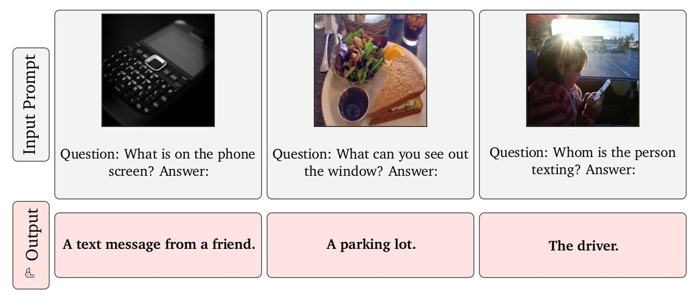

*图 A13（原文附录 Figure 13，第 42 页）：开放式视觉问答中的幻觉与无依据的猜测。*

**图中文字翻译与读法**：三个例子（上方 Input Prompt，下方 Output）。左：一张黑色手机的图，问 “What is on the phone screen?”，答 “A text message from a friend.”；图中看不到屏幕上有任何可读的内容，模型却生成了只看文字时显得“合理”的答案，即幻觉；中：一张三明治和沙拉的图，问 “What can you see out the window?”，答 “A parking lot.”，这是用与图无关的问题诱发的幻觉；右：一个孩子低头看手机，问 “Whom is the person texting?”，答 “The driver.”，图中根本无从得知，模型做出了无依据的猜测。**读图结论**：语言模型的先验一般有帮助，但也会导致偶发的幻觉和无依据的猜测；少样本示例和更精细的 prompt 设计可能缓解，但这是改进开放式视觉对话应用的重要研究方向。

**局限**（正文第 5 节与附录 D.1）：

1. **继承语言模型的弱点**：LM 先验通常有帮助，但可能导致偶发幻觉和无依据的猜测；因果建模的条件输入，表达力严格弱于双向建模；LM 对明显长于训练序列的测试序列泛化很差：例如 VisDial 的一个 shot 是一张图加 21 句对话，32 个 shots 至少 $32\times21=672$ 句，prompt 长度 4096 到 8192 个 token，远超 LM 训练的最大序列长度 2048，所以 VisDial 只报告到 16 shots；经验上从 16-shot 到 32-shot，VisDial 的相对性能大降约 30%；语言模型的训练样本效率也很差。
2. **分类性能落后于对比模型**：对比目标直接优化文图检索，分类是其特例；而 Flamingo 的语言建模目标不是。如何在一个统一的方法里兼顾两者是重要的研究方向。
3. **上下文学习的取舍**：优点是几乎不需要调超参数、在极低数据量（几十个示例）下表现不错、只需推理即可部署；缺点是：
   - **推理计算成本**：上下文学习的计算量，如果可以为多个查询复用少样本 prompt（缓存 key/value），随示例数线性增长，否则二次增长；基于梯度的少样本方法在推理时与示例数无关；
   - **对 prompt 敏感**：对示例的顺序、格式等“令人不安地”敏感；
   - **示例数超过 32 后性能快速饱和**：这与基于梯度的方法（正确配对的训练数据量是性能关键）形成鲜明对比；RICES 能在分类上缓解这点，但仍面临类似问题；
   - **任务定位（task location）**：已有研究提示，上下文学习更可能是在“识别任务”而不是真的从示例的输入输出映射里“学习”新任务（Reynolds 与 McDonell；Min 等指出示例的格式比输入到输出的映射更重要）。本文也观察到不带图像的 prompt 就有非平凡的零样本性能，说明任务格式很重要。直觉上，几个样例往往足以定位任务，但模型通常无法利用更多样例。
   - 作者的结论：没有适合所有场景的“黄金”少样本方法，最佳选择取决于应用特点，其中一个重要因素是标注样本的数量；本文表明上下文学习在数据匮乏的区间（32 个样本及以下）很有效，结合不同方法、在数据受限但不极端的区间（如几百个样本）可能有机会。
4. **扩展视觉与文本接口**：自然语言虽是描述视觉任务的强大通用接口，但对需要以边界框（及其时间、时空版本）为条件或预测的任务，或空间/时间上稠密的预测，可能很笨拙；预测光流这类连续空间输出，也不是模型开箱即用能处理的；还可考虑加入音频等其他模态。
5. **视觉语言模型的缩放规律**：本文把 Flamingo 扩到 80B，给出了跨评测基准的初步缩放趋势（图 2）。语言领域有大量关于缩放规律的研究，视觉领域有 Zhai 等的工作，而视觉语言模型（包括对比模型和 Flamingo 这样的）尚无类似工作；原文推测，以聚合的下游评测性能而不是困惑度建立此类趋势，可能对目的更直接有用。

## 七、社会影响与风险（原文第 5 节、附录 D.2、E、F）

**益处**：任务泛化能力使它适用于以往视觉研究不太关注的场景；以“聊天”界面做开放式对话，可以让非专家用户把这类模型用于几乎没有任务专用数据的低资源问题；本文在 VizWiz（辅助视障人士的视觉识别挑战）上有强表现；对话界面也有助于理解和解释 VLM，并暴露模型从训练数据中学到的偏见、公平性和毒性问题。另一个角度是“模型回收”：Flamingo 训练算力昂贵，但它充分复用了预训练的冻结语言模型和视觉编码器，证明新模态可以引入冻结模型而避免昂贵的重训，这从环境和实际角度都越来越重要。

**风险**：Flamingo 由构造决定会继承大语言模型的风险：没给图像时它就退回到 LM 行为，可能输出冒犯性语言、传播社会偏见和刻板印象、泄漏隐私信息（Chinchilla 论文对性别偏见与无提示毒性有分析，原文引用）；视觉输入带来额外风险，如与输入图像内容相关的性别和种族偏见。作者做了初步调查：

- **性别与种族偏见**：按 Zhao 等的做法，在 COCO 上比较按性别和肤色划分的子集上的描述质量（CIDEr）。由于只有一个模型副本（训练代价高），他们对逐样本的 CIDEr 做统计检验（不等方差双尾 $t$ 检验），而不是跨 5 个模型汇总。结果（表 12）显示四项比较里最小的 $p$ 值是 0.25，远高于常见显著性阈值（如 0.05），所以差异与随机波动无法区分。原文也指出，没拒绝零假设并不意味着没有差异，更大的样本量下可能显示出差异。
- **带图像提示时的毒性**：用 Perspective API 评估给定 COCO 测试图像时生成描述的毒性；有些描述被分类器标为可能有毒，但人工检查没有发现明确的毒性；作者在项目过程中对“安全工作场景”（safe-for-work）图像也没有观察到毒性输出，但这不等于模型无法产生毒性输出，尤其是遇到“不适合工作场景”的图像和（或）毒性文本时；若投入生产需要更彻底的研究。
- **缓解**：Flamingo 能在低资源设置下快速适配，可自己用于缓解上述问题，比如经适当条件设定或微调后用于过滤训练数据里的有毒样本，或对输出降级、排除；HatefulMemes 上的结果是在这个方向上的一步。

**表 12：Flamingo 在 COCO 描述上的偏见评估**

| 模型 | CIDEr 差：女性 − 男性 = $\Delta$ | CIDEr 差：肤色较深 − 较浅 = $\Delta$ | CIDEr 总体 |
|---|---|---|---:|
| AoANet | - | +0.0019 | 1.198 |
| Oscar | - | +0.0030 | 1.278 |
| Flamingo，0-shot | 0.899 − 0.870 = +0.029（$p=0.52$） | 0.955 − 0.864 = +0.091（$p=0.25$） | 0.843 |
| Flamingo，32-shot | 1.172 − 1.142 = +0.030（$p=0.54$） | 1.128 − 1.152 = −0.025（$p=0.76$） | 1.138 |

（原文表 12，第 44 页。使用 Zhao 等提供的按性别和肤色划分的 COCO 数据划分。）

**模型卡与数据表**（附录 E、F）：Flamingo 仅为研究目的开发，不应在未经风险分析和缓解的情况下用于具体应用；训练数据源自网络，未过滤毒性内容（只去掉露骨内容），数据里“无疑包含有毒和有偏见的内容”，很可能含有个人信息；数据主要是英文，因此不适合训练需要多语言能力的模型；M3W、LTIP、VTP 不对外分发。数据规模：M3W 共 43.3M 个文档、185M 张图像、182 GB 文本；LTIP 3.12 亿对图文；VTP 2700 万对视频文本；2021 年用数月收集。模型卡称评测一共用了 18 个基准。

## 八、相关工作（原文第 4 节，简述）

- **语言建模与少样本适配**：先大规模预训练、再适配下游任务已成为标准。本文以 70B 的 Chinchilla 为基础语言模型。让 LM 用少量示例适应新任务的技术有：加小型适配器模块、微调 LM 的一小部分、在 prompt 中给上下文示例、通过梯度下降优化 prompt 等。本文选择上下文少样本学习，而不是基于度量学习或元学习的更复杂方法；
- **语言遇上视觉**：BERT 启发了大量视觉语言工作，与它们不同，Flamingo 不需要在新任务上微调；另一族模型基于对比学习，Flamingo 与它们不同在于**能生成文本**，尽管它的视觉编码器就建立在对比模型之上；也有能自回归生成文本的 VLM；一条思路是冻结预训练 LM 权重以防灾难性遗忘，本文沿用这一思路，冻结 Chinchilla 各层并在其中加入可学习层；区别在于本文提出了第一个能接受任意交错的图像、视频和文本的 LM；
- **网络规模视觉语言训练数据**：人工标注的视觉与语言数据集昂贵、规模小（1 万到 10 万量级）；已有工作自动抓取配对的视觉-文本数据。除配对数据外，本文展示了在整个交错图文的多模态网页上训练的重要性。同期工作 CM3 提议从网页生成 HTML 标记，而本文只生成纯文本以简化任务；本文强调少样本学习和视觉任务，CM3 主要在纯语言基准上做零样本或微调评测。

## 九、复现检查清单

- **冻结与训练范围**：视觉编码器（NFNet-F6，约 435M）与语言模型都冻结，只训练 Perceiver Resampler 和 GATED XATTN-DENSE 层（预训练阶段）；微调阶段才解冻视觉编码器，分辨率由 $320\times320$ 提高到 $480\times480$；
- **Resampler**：64 个 latent，6 层，Key/Value 拼接 $[X_f, X]$，只加时间位置嵌入、不加空间位置嵌入；
- **门控**：每个新层各一个 $\alpha_{\text{xattn}}$ 与 $\alpha_{\text{dense}}$，初始化为 0，$\tanh$ 后乘在分支输出上；插入频率 3B 每层、9B 每 4 层、80B 每 7 层；
- **掩码**：文本 token 只对紧邻其前的那一张图做交叉注意力；用 $\varphi$ 记录每个位置对应的图像；M3W 训练时每个序列 $L=256$ 个 token、最多 $N=5$ 张图，并以 $p_{\text{next}}=0.5$ 随机映射到前一张或后一张图；`<EOC>` 要加入词表并学习；
- **数据与权重**：M3W、ALIGN、LTIP、VTP 的权重 1.0、0.2、0.2、0.03；梯度累积而非轮流更新；配对数据文本前以 0.5 概率加空格；对评测集去重要覆盖训练图像（但原文未对 VizWiz、HatefulMemes、TextVQA 去重）；
- **优化**：AdamW，全局范数裁剪 1，Resampler 无权重衰减、其余 0.1，学习率前 5000 步线性升到 $10^{-4}$ 后恒定，默认 50 万步；
- **评测**：支持集与查询集分离，DEV 与留出基准分开；固定的 prompt 模板（“Output:”、“Question: … Answer:”以及 HatefulMemes 与 RareAct 的专用 prompt）；开放式用束宽 3 的束搜索并在第一个 `<EOC>` 停止，封闭式用对数似然排序；零样本 prompt 用两个不带图像的文本示例；分类用 RICES（按相似度从低到高排列）并可加 6 种排列的集成；
- **报告口径**：区分 DEV 基准和留出基准、说明 shots 数、说明 VisDial 只到 16 shots、说明是否使用了 OCR 文本（只有 HatefulMemes 用了）。

## 十、常见误读

- **Flamingo 不是把图像先转成自然语言再交给 LM**：视觉 token 由 Perceiver Resampler 产生，经 GATED XATTN-DENSE 层以连续特征的形式注入语言模型。
- **“只训练连接模块”不等于“很小”**：80B 模型里可训练的 GATED XATTN-DENSE 层有 10B 参数（外加约 194M 的 Resampler），只是相对 70B 的冻结 LM 占比不高。
- **逐图像掩码不是“屏蔽未来图像”**：它的含义是每个文本 token 只对紧邻其前的那一张图做交叉注意力，更早的图像经 LM 自注意力间接可见；训练 M3W 时还以 0.5 的概率把文字映射到“下一张”图像作为数据增强。
- **tanh 门控初始化是 0 而不是“接近 0”**：$\tanh(0)=0$，初始时新层输出为零，模型严格等于原 LM。
- **少样本强不等于视觉事实可靠**：幻觉和无依据的猜测依然存在（图 A13）；示例过多后收益饱和，对 prompt 格式和顺序敏感。
- **“超过微调 SOTA”有条件**：只在 6 个任务（OKVQA、MSVDQA、Flickr30k、iVQA、STAR、NextQA）上成立，且这些任务的微调 SOTA 所用标注数据相对较少（6K 到 46K）；在 VQAv2、COCO、YouCook2、TextVQA 等任务上仍明显落后。
- **DEV 与留出基准的区别**：设计决策是在 5 个 DEV 基准上定的，只有其余 11 个基准的数字才是无偏估计。
- **分类不是强项**：ImageNet 上 Flamingo-80B 即便用 RICES 加集成（77.3），也不如它自己的对比视觉编码器零样本（77.9），更不如专门优化的 BASIC、LiT。

## 十一、与相关论文的关系

- 视觉编码器的对比预训练直接沿用 [CLIP](../clip/论文中文解读.md) 的双向损失，并在表 3 (vii) 中与公开的 CLIP ViT-L/14 比较；
- 冻结的语言模型是 [Chinchilla](../chinchilla/论文中文解读.md)（1.4B、7B、70B）；上下文少样本学习的思路来自 [GPT-3](../openai_gpt3/论文中文解读.md)；
- 另一条“冻结 + 少量连接”的开放路线是 [LLaVA](../llava/论文中文解读.md)：用 CLIP ViT-L/14 视觉特征加一个线性投影接入语言模型，再做视觉指令微调，连接模块极小，与 Flamingo 的交叉注意力式连接形成对比；
- 与对比表征模型（CLIP、ALIGN）相比，Flamingo 能生成文本，但分类性能不如它们。

## 原文证据导航

- [原论文 PDF](paper.pdf)
- [原文提取文本](paper.txt)
- [论文概要](论文概要.md)

按内容定位原文页（PDF 页码与印刷页码一致）：

| 内容 | 位置 |
|---|---|
| 摘要、引言、图 1、图 2 | [第 1–3 页](paper.pdf#page=1) |
| 方法：架构、Resampler、GATED XATTN-DENSE、掩码、训练数据 | [第 4–6 页](paper.pdf#page=4) |
| 少样本评测、主结果（表 1）、微调（表 2）、消融（表 3） | [第 7–9 页](paper.pdf#page=7) |
| 相关工作、局限与社会影响、结论 | [第 9–10 页](paper.pdf#page=9) |
| 附录 A：方法细节（Resampler 图 5、门控图 6、掩码图 7、表 4、few-shot 评测图 8、数据集与去重、表 5） | [第 23–28 页](paper.pdf#page=23) |
| 附录 B：训练与评测细节、基准（表 6）、分类（表 7）、微调（表 8）、对比模型（表 9）、扩展消融（表 10、11） | [第 28–37 页](paper.pdf#page=28) |
| 附录 C：质性结果（图 10–13） | [第 37–42 页](paper.pdf#page=37) |
| 附录 D：局限、风险与缓解（表 12） | [第 38–45 页](paper.pdf#page=38) |
| 附录 E、F：模型卡、数据表 | [第 45–53 页](paper.pdf#page=45) |
