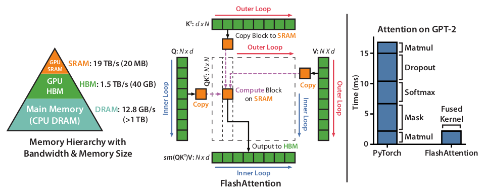
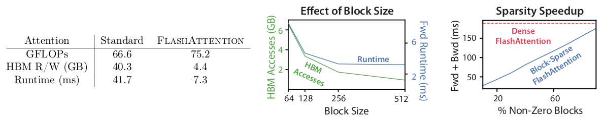
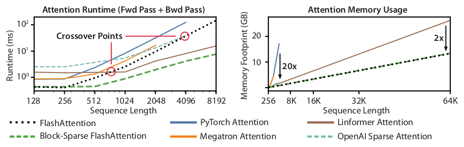

# 论文中文解读：《FlashAttention: Fast and Memory-Efficient Exact Attention with IO-Awareness》

> **基本信息**：Tri Dao、Daniel Y. Fu、Stefano Ermon、Atri Rudra、Christopher Ré（Stanford / University at Buffalo），arXiv:2205.14135，2022 年 6 月；论文原文 [官方页面](https://arxiv.org/abs/2205.14135)。
>
> **本文的读法**：图和表均取自论文原文，图为从 PDF 中按图裁出的原图，表为逐格核对后的中文转录（数字与原文一致，表头翻译为中文）。每张图后有中文图题、图例/坐标轴翻译和读图结论，因此不必再翻英文版。

## 一、一句话结论

标准 attention 慢，主要不是因为算得多，而是因为要把 $N\times N$ 的中间矩阵 $S$、$P$ 反复写进、读出 GPU 的高带宽显存（HBM）。FlashAttention 通过**分块（tiling）+ 在线 softmax + 反向重计算**，让整个 attention 在一个 CUDA kernel 里、只在片上 SRAM 中完成，不把 $N\times N$ 矩阵写回 HBM。它得到的是**精确**的 attention（不是近似），额外显存只有 $O(N)$，并且在 GPT-2 上的 attention 部分最高快 7.6 倍。

## 二、背景：为什么 attention 会慢

### 2.1 GPU 的内存层次

GPU 的存储由快到慢、由小到大分为几层：片上 SRAM（每个流多处理器 SM 内部的共享内存和寄存器）、HBM（显存）、主机 DRAM。以 A100 为例：HBM 为 40–80 GB，带宽约 1.5–2.0 TB/s；每个 SM 有 192 KB 片上 SRAM，共 108 个 SM，聚合带宽约 19 TB/s。SRAM 比 HBM 快一个数量级，但容量小几个数量级。

随着算力增长快于访存带宽，越来越多的算子受限于 HBM 访问而不是计算。

### 2.2 compute-bound 与 memory-bound

用**算术强度**（arithmetic intensity，每访问一字节内存所做的运算次数）区分：

| 类型 | 瓶颈 | 典型算子 |
|---|---|---|
| compute-bound（计算受限） | 运算次数；HBM 访问时间远小于计算时间 | 内维度很大的矩阵乘、通道数很多的卷积 |
| memory-bound（访存受限） | 内存访问次数；计算时间远小于访存时间 | 逐元素算子（激活、dropout、mask）、归约（sum、softmax、BatchNorm、LayerNorm） |

加速 memory-bound 算子最常见的手段是 **kernel fusion**：对同一输入做多个运算时，只从 HBM 读一次。但训练时反向传播需要保存中间值，这些中间值仍要写回 HBM，朴素的 kernel fusion 因此效果有限。

### 2.3 标准 attention 的实现（原文 Algorithm 0）

给定 $Q,K,V\in\mathbb{R}^{N\times d}$（$N$ 为序列长度，$d$ 为 head 维度），

$$
S=QK^\top\in\mathbb{R}^{N\times N},\qquad P=\mathrm{softmax}(S)\in\mathbb{R}^{N\times N},\qquad O=PV\in\mathbb{R}^{N\times d},
$$

其中 softmax 按行进行。标准实现分三步，每一步都经过一次 HBM：

1. 分块读入 $Q,K$，算出 $S=QK^\top$，**把 $S$ 写回 HBM**；
2. 从 HBM 读 $S$，算 $P=\mathrm{softmax}(S)$，**把 $P$ 写回 HBM**；
3. 读入 $P$ 和 $V$，算 $O=PV$，写回 $O$。

通常 $N\gg d$（GPT-2 中 $N=1024$、$d=64$），因此 $S$、$P$ 的 $O(N^2)$ 读写主导了运行时间。mask、dropout 等逐元素操作又会对 $N\times N$ 矩阵各多读写一遍。把 mask 与 softmax 融合只是局部缓解。

### 2.4 论文的核心主张

近似 attention（稀疏、低秩等）降低了 FLOPs，但很多方法并没有换来真实的墙钟时间（wall-clock）加速。论文认为缺失的原则是 **IO-aware**：算法设计必须显式计入 GPU 各级存储之间的读写量。

## 三、方法：分块 + 在线 softmax + 重计算

### 3.1 总体结构（图 1）

*图 1（原文 Figure 1，第 2 页）：左，GPU 存储层次；中，FlashAttention 的分块流程；右，GPT-2 上 attention 部分的耗时对比。*

**图中文字翻译与读法**：

- **左图 Memory Hierarchy with Bandwidth & Memory Size（内存层次：带宽与容量）**：金字塔自上而下为 GPU SRAM（19 TB/s，20 MB）、GPU HBM（1.5 TB/s，40 GB）、Main Memory / CPU DRAM（12.8 GB/s，>1 TB）。越靠上越快越小。
- **中图 FlashAttention**：$K^\top$（$d\times N$）沿顶部、$Q$（$N\times d$）沿左侧、$V$（$N\times d$）沿右侧排成绿色小块；底部为输出 $\mathrm{softmax}(QK^\top)V$（$N\times d$）。橙色方块表示被拷入 SRAM 的块。“Outer Loop（外循环，红色）”遍历 $K,V$ 的块，“Inner Loop（内循环，蓝色）”遍历 $Q$ 的块。“Copy Block to SRAM”把块从 HBM 拷到 SRAM；“Compute Block on SRAM”在片上算 $QK^\top$ 的这一小块及其 softmax、再乘 $V$ 的块；“Output to HBM”把结果写回。虚线框中的 $N\times N$ 矩阵 $QK^\top$ 从未完整出现，只在 SRAM 中以块的形式短暂存在。
- **右图 Attention on GPT-2（GPT-2 上的 attention）**：纵轴 Time (ms)。PyTorch 实现由下往上堆叠为 Matmul、Mask、Softmax、Dropout、Matmul 五个独立 kernel，总计约 17 ms；FlashAttention 把它们融合成一个 Fused Kernel，约 2 ms 多。图题给出的结论是 attention 计算加速 7.6×。

**读图结论**：收益来自“不读写 $N\times N$ 矩阵”而不是少算；右图中 PyTorch 的 Mask/Softmax/Dropout 三个访存受限算子占据了大部分时间。

### 3.2 在线 softmax：为什么分块后结果仍然精确

softmax 的难点是分母要把一整行的所有列加起来。论文用数值稳定形式分解。对向量 $x\in\mathbb{R}^B$：

$$
m(x)=\max_i x_i,\qquad f(x)=\big[e^{x_1-m(x)},\ \dots,\ e^{x_B-m(x)}\big],\qquad \ell(x)=\sum_i f(x)_i,\qquad \mathrm{softmax}(x)=\frac{f(x)}{\ell(x)}.
$$

对拼接向量 $x=[x^{(1)}\ x^{(2)}]\in\mathbb{R}^{2B}$：

$$
m(x)=\max\big(m(x^{(1)}),\,m(x^{(2)})\big),
$$

$$
f(x)=\big[e^{m(x^{(1)})-m(x)}f(x^{(1)})\ \ e^{m(x^{(2)})-m(x)}f(x^{(2)})\big],
$$

$$
\ell(x)=e^{m(x^{(1)})-m(x)}\ell(x^{(1)})+e^{m(x^{(2)})-m(x)}\ell(x^{(2)}).
$$

因此只要对每一行额外记录两个统计量 $(m,\ell)$，就能一块一块地合并 softmax——这被论文称为“代数聚合”（algebraic aggregation）。每处理完一个新块，旧的累积结果乘上缩放因子 $e^{m_{\text{old}}-m_{\text{new}}}$ 修正，再加入新块的贡献。最终结果与整行一次性 softmax 完全一致，只是求值顺序不同。

### 3.3 Algorithm 1 逐行解释

输入：$Q,K,V\in\mathbb{R}^{N\times d}$ 位于 HBM，片上 SRAM 大小为 $M$。

1. 设块大小 $B_c=\lceil M/4d\rceil$，$B_r=\min(\lceil M/4d\rceil,\,d)$。分母里的 4 来自同一时刻 SRAM 里要放 $K_j,V_j,Q_i,O_i$ 四类块。
2. 在 HBM 中初始化 $O=0\in\mathbb{R}^{N\times d}$、$\ell=0\in\mathbb{R}^N$、$m=-\infty\in\mathbb{R}^N$。
3. 把 $Q$ 分成 $T_r=\lceil N/B_r\rceil$ 块 $Q_1,\dots,Q_{T_r}$（每块 $B_r\times d$），把 $K,V$ 分成 $T_c=\lceil N/B_c\rceil$ 块（每块 $B_c\times d$）。
4. 把 $O,\ell,m$ 也按 $Q$ 的方式分成 $T_r$ 块。
5. **外循环** $j=1,\dots,T_c$（遍历 $K,V$ 的块）：
6. 　把 $K_j,V_j$ 从 HBM 载入 SRAM。
7. 　**内循环** $i=1,\dots,T_r$（遍历 $Q$ 的块）：
8. 　　把 $Q_i,O_i,\ell_i,m_i$ 载入 SRAM。
9. 　　片上计算 $S_{ij}=Q_iK_j^\top\in\mathbb{R}^{B_r\times B_c}$。
10. 　　片上计算块内行最大值 $\tilde m_{ij}=\mathrm{rowmax}(S_{ij})$、$\tilde P_{ij}=\exp(S_{ij}-\tilde m_{ij})$、块内行和 $\tilde\ell_{ij}=\mathrm{rowsum}(\tilde P_{ij})$。
11. 　　合并新旧统计量：$m_i^{\text{new}}=\max(m_i,\tilde m_{ij})$，$\ell_i^{\text{new}}=e^{m_i-m_i^{\text{new}}}\ell_i+e^{\tilde m_{ij}-m_i^{\text{new}}}\tilde\ell_{ij}$。
12. 　　更新输出并写回 HBM：$O_i\leftarrow \mathrm{diag}(\ell_i^{\text{new}})^{-1}\big(\mathrm{diag}(\ell_i)\,e^{m_i-m_i^{\text{new}}}O_i+e^{\tilde m_{ij}-m_i^{\text{new}}}\tilde P_{ij}V_j\big)$。
13. 　　写回 $\ell_i\leftarrow\ell_i^{\text{new}}$、$m_i\leftarrow m_i^{\text{new}}$。
14. 返回 $O$。

第 12 行的含义：旧输出 $O_i$ 已经除过旧分母 $\ell_i$，所以先乘回 $\mathrm{diag}(\ell_i)$ 还原为未归一化的分子，再按新旧最大值之差缩放；加上新块贡献 $\tilde P_{ij}V_j$，最后除以新分母。

**Theorem 1**：Algorithm 1 返回 $O=\mathrm{softmax}(QK^\top)V$，用 $O(N^2d)$ FLOPs，除输入输出外只需 $O(N)$ 额外显存（即 $\ell,m$）。

注意本文的循环顺序是**外层 $K,V$、内层 $Q$**，因此每个 $O_i$ 在外循环中被反复读写；FlashAttention-2 后来把顺序对调以减少这类读写。

### 3.4 反向传播：重计算而不是存储

标准反向需要 $S,P\in\mathbb{R}^{N\times N}$ 来求 $Q,K,V$ 的梯度。FlashAttention 前向只保存输出 $O$ 和 softmax 统计量 $(m,\ell)$，反向时在 SRAM 里用 $Q,K,V$ 的块重新算出 $S,P$ 的对应块。这是一种“选择性梯度检查点”。传统梯度检查点用速度换显存；这里因为减少了 HBM 访问，**即使 FLOPs 增加，反向也更快**。完整的反向推导在论文附录 B。

### 3.5 kernel 融合

分块使整个流程（矩阵乘、softmax、可选的 mask 和 dropout、再一次矩阵乘）能写进**一个** CUDA kernel：从 HBM 读输入，所有中间步骤都在片上完成，再把结果写回。这也是为什么论文的实现需要手写 CUDA（后文局限一节会提到这一点）。

## 四、理论分析：IO 复杂度

### 4.1 结论

设 $N$ 为序列长度，$d$ 为 head 维度，$M$ 为 SRAM 大小，且 $d\le M\le Nd$。

**Theorem 2**：标准 attention 需要 $\Theta(Nd+N^2)$ 次 HBM 访问，FlashAttention 需要 $\Theta(N^2d^2M^{-1})$ 次。

对典型值 $d=64$–$128$，$M$ 约 100 KB，$d^2$ 比 $M$ 小很多，所以 FlashAttention 的 HBM 访问量远小于标准实现。

证明思路：SRAM 大小为 $M$ 时，每次可装入大小 $\Theta(M)$ 的 $K,V$ 块；每个 $K,V$ 块都要遍历一遍所有 $Q$ 块，因此对 $Q$ 做 $\Theta(NdM^{-1})$ 趟扫描，每趟读 $\Theta(Nd)$ 个元素，合计 $\Theta(N^2d^2M^{-1})$。反向的结论相同（附录 B）。

**Proposition 3（下界）**：不存在对 $[d,Nd]$ 内所有 $M$ 都做到 $o(N^2d^2M^{-1})$ 次 HBM 访问的精确 attention 算法。证明依据：当 $M=\Theta(Nd)$ 时任何算法至少要读写 $\Omega(Nd)$。这类“只在 $M$ 的某个子区间上成立”的下界在流式算法文献里很常见；对 $M$ 的参数化复杂度下界论文留作未来工作。

### 4.2 实验验证：HBM 访问量才是决定因素（图 2）

*图 2（原文 Figure 2，第 6 页）：左，标准 attention 与 FlashAttention 的 GFLOPs、HBM 读写量、运行时间；中，块大小的影响；右，block-sparse 的稀疏加速。*

**左图（表）：GPT-2 medium，序列长度 1024，head 维度 64，16 个 head，batch size 64，A100，前向+反向合计**

| 指标 | 标准 attention | FlashAttention | 变化 |
|---|---:|---:|---|
| GFLOPs（浮点运算量） | 66.6 | 75.2 | 多约 13%（反向重计算所致） |
| HBM 读写量（GB） | 40.3 | 4.4 | 少约 9.2 倍 |
| 运行时间（ms） | 41.7 | 7.3 | 快约 5.7 倍 |

倍数由表中数字相除得到。这张表直接说明：FLOPs 更多，但 HBM 读写少了近一个数量级，运行时间也因此大幅下降。

**中图 Effect of Block Size（块大小的影响）**：横轴为块大小 $B_c$（64、128、256、512），左纵轴（绿色）为 HBM Accesses（HBM 访问量，GB），右纵轴（蓝色）为 Fwd Runtime（前向运行时间，ms）。块变大 → 对输入的扫描趟数变少 → HBM 访问下降、运行时间下降；块大小超过 256 以后运行时间趋于平缓，因为瓶颈转移到算术运算等其他因素，并且更大的块也放不进小小的 SRAM。（设置：序列长度 1024，head 维度 64，16 个 head，batch size 64，A100。）

**右图 Sparsity Speedup（稀疏加速）**：横轴为 % Non-Zero Blocks（非零块比例），纵轴为 Fwd + Bwd 耗时（ms）。红色虚线为稠密 FlashAttention（与稀疏度无关的水平参考线），蓝色实线为 Block-Sparse FlashAttention，耗时随非零块比例近似线性下降。（序列长度 4K。）

## 五、扩展：Block-Sparse FlashAttention

给定掩码 $\tilde M\in\{0,1\}^{N\times N}$，计算

$$
S=QK^\top,\qquad P=\mathrm{softmax}\big(S\odot\mathbb{1}_{\tilde M}\big),\qquad O=PV,
$$

其中 $(S\odot\mathbb{1}_{\tilde M})_{kl}=S_{kl}$ 若 $\tilde M_{kl}=1$，否则为 $-\infty$。要求 $\tilde M$ 具有**块结构**：对块大小 $B_r,B_c$，存在 $M\in\{0,1\}^{N/B_r\times N/B_c}$ 使 $\tilde M_{kl}=M_{ij}$，其中 $i=\lfloor k/B_r\rfloor$，$j=\lfloor l/B_c\rfloor$。

算法与 Algorithm 1 相同，只是**跳过全零的块**（论文附录 Algorithm 5）。

**Proposition 4**：Block-sparse FlashAttention 需要 $\Theta\big(Nd+N^2d^2M^{-1}s\big)$ 次 HBM 访问，其中 $s$ 是掩码中非零块的比例。稀疏度直接乘在 IO 复杂度的主导项上。长序列时常令 $s=N^{-1/2}$ 或 $N^{-1}\log N$，从而得到 $\Theta(N\sqrt N)$ 或 $\Theta(N\log N)$ 的 IO 复杂度。下游实验使用固定的 butterfly 稀疏模式，该模式被证明能近似任意稀疏模式。

注意：block-sparse 版本是**近似** attention（因为掩掉了一些位置），而稠密 FlashAttention 是精确的。

## 六、实验结果

### 6.1 训练速度

**BERT-large**（序列长度 512，Wikipedia，从 MLPerf 提供的同一初始化出发，训练到掩码语言建模准确率 72.0%，8×A100，10 次平均）：

| BERT 实现 | 训练时间（分钟） |
|---|---:|
| Nvidia MLPerf 1.1 | 20.0 ± 1.5 |
| FlashAttention（本文） | 17.4 ± 1.4 |

即比 MLPerf 1.1 的速度纪录快约 15%（原文表 1，第 7 页）。

**GPT-2**（OpenWebText，8×A100）：FlashAttention 不改变模型定义，因此困惑度（ppl）与基线一致；与 HuggingFace 相比最高快 3×，与 Megatron-LM 相比最高快 1.7×。

| 模型与实现 | OpenWebText 困惑度（ppl） | 训练时间（加速比） |
|---|---:|---|
| GPT-2 small，HuggingFace | 18.2 | 9.5 天（1.0×） |
| GPT-2 small，Megatron-LM | 18.2 | 4.7 天（2.0×） |
| GPT-2 small，FlashAttention | 18.2 | 2.7 天（3.5×） |
| GPT-2 medium，HuggingFace | 14.2 | 21.0 天（1.0×） |
| GPT-2 medium，Megatron-LM | 14.3 | 11.5 天（1.8×） |
| GPT-2 medium，FlashAttention | 14.3 | 6.9 天（3.0×） |

（原文表 2，第 8 页。加速比以同一模型尺寸的 HuggingFace 为 1.0×。表标题与正文写“最高 3×（对 HuggingFace）、1.7×（对 Megatron-LM）”；表内 small 行按 9.5 天 / 2.7 天实际为 3.5×，比标题的说法更大，引用时应注明取的是哪一行。）

**Long-Range Arena（LRA）**：序列长度 1024–4096，比较标准 Transformer、FlashAttention、block-sparse FlashAttention 与多种近似 attention。各任务的数字为准确率（%），Avg 为五项平均，加速比相对标准 Transformer。

| 模型 | ListOps | Text（文本） | Retrieval（检索） | Image（图像） | Pathfinder | 平均 | 加速比 |
|---|---:|---:|---:|---:|---:|---:|---:|
| Transformer（标准实现） | 36.0 | 63.6 | 81.6 | 42.3 | 72.7 | 59.3 | - |
| FlashAttention | 37.6 | 63.9 | 81.4 | 43.5 | 72.7 | 59.8 | 2.4× |
| Block-sparse FlashAttention | 37.0 | 63.0 | 81.3 | 43.6 | 73.3 | 59.6 | 2.8× |
| Linformer | 35.6 | 55.9 | 77.7 | 37.8 | 67.6 | 54.9 | 2.5× |
| Linear Attention | 38.8 | 63.2 | 80.7 | 42.6 | 72.5 | 59.6 | 2.3× |
| Performer | 36.8 | 63.6 | 82.2 | 42.1 | 69.9 | 58.9 | 1.8× |
| Local Attention | 36.1 | 60.2 | 76.7 | 40.6 | 66.6 | 56.0 | 1.7× |
| Reformer | 36.5 | 63.8 | 78.5 | 39.6 | 69.4 | 57.6 | 1.3× |
| Smyrf | 36.1 | 64.1 | 79.0 | 39.6 | 70.5 | 57.9 | 1.7× |

（原文表 3，第 8 页。）读法：FlashAttention 与标准实现精度相当且快 2.4×；block-sparse 版本在这批方法里速度最快（2.8×）且精度仍与标准实现持平；Linformer 虽然 2.5× 但平均精度掉了约 4.4 个点。论文脚注指出 LRA 精度对调参很敏感，其复现的基线好于原 LRA 论文报告。

### 6.2 更长序列带来更好的模型

**长上下文语言建模**（GPT-2 small，8×A100）：FlashAttention 把上下文从 1K 提到 4K，仍比 Megatron-LM 的 1K 版本快约 30%，同时困惑度低 0.7。

| 模型与实现 | 上下文长度 | OpenWebText 困惑度（ppl） | 训练时间（加速比） |
|---|---:|---:|---|
| GPT-2 small，Megatron-LM | 1k | 18.2 | 4.7 天（1.0×） |
| GPT-2 small，FlashAttention | 1k | 18.2 | 2.7 天（1.7×） |
| GPT-2 small，FlashAttention | 2k | 17.6 | 3.0 天（1.6×） |
| GPT-2 small，FlashAttention | 4k | 17.5 | 3.6 天（1.3×） |

（原文表 4，第 8 页。）

**长文档分类**：在预训练 RoBERTa 上把序列长度加长（重复位置嵌入，做法同 Longformer），数据集为 MIMIC-III（ICU 出院小结，多标签；平均 2,395 个 token，最长 14,562）和 ECtHR（欧洲人权法院案件，映射到被指称违反的公约条款；平均 2,197 个 token，最长 49,392）。指标为 micro $F_1$。

| 数据集 | 512 | 1024 | 2048 | 4096 | 8192 | 16384 |
|---|---:|---:|---:|---:|---:|---:|
| MIMIC-III | 52.8 | 50.7 | 51.7 | 54.6 | 56.4 | 57.1 |
| ECtHR | 72.2 | 74.3 | 77.1 | 78.6 | 80.7 | 79.2 |

（原文表 5，第 9 页。）MIMIC-III 在 16K 比 512 高 4.3 分，ECtHR 在 8K 比 512 高 8.5 分；两者平均约 6.4 分，对应摘要里的“6.4 points of lift”。ECtHR 在 16K 反而比 8K 略低，论文把两个数据集的差异归因于分布偏移（MIMIC 是专业医学文本，对文档长度分布变化更敏感）；这是论文的解释，并非经过实验验证的结论。

**Path-X 与 Path-256**：LRA 中最难的任务——判断 $128\times128$（Path-X，序列长度 16K）或 $256\times256$（Path-256，序列长度 64K）黑白图像里两点是否有路径相连，图像逐像素送入 Transformer。以往所有 Transformer 要么显存溢出，要么只有随机水平。作法：先在 Path-64 上预训练，再通过对位置嵌入做空间插值迁移到 Path-X。表中 ✗ 表示失败（随机水平或显存溢出）。

| 模型 | Path-X | Path-256 |
|---|---:|---:|
| Transformer | ✗ | ✗ |
| Linformer | ✗ | ✗ |
| Linear Attention | ✗ | ✗ |
| Performer | ✗ | ✗ |
| Local Attention | ✗ | ✗ |
| Reformer | ✗ | ✗ |
| SMYRF | ✗ | ✗ |
| FlashAttention | 61.4 | ✗ |
| Block-sparse FlashAttention | 56.0 | 63.1 |

（原文表 6，第 9 页。）这是首个在 Path-X 上取得高于随机水平的 Transformer，block-sparse 版本又把序列扩到 64K，在 Path-256 上取得 63.1%。脚注说明 Path-256 序列更长但路径相对更短，所以更容易取得较高准确率；因此 Path-256 的 63.1 不能和 Path-X 的数字直接横向比较。

### 6.3 attention 本身的运行时间与显存（图 3）

*图 3（原文 Figure 3，第 9 页）：左，前向+反向的运行时间；右，attention 的显存占用。*

测试条件：单张 A100（40 GB HBM），带 dropout 与 padding mask，扫描序列长度。

**图中文字翻译与读法**：

- **左图 Attention Runtime (Fwd Pass + Bwd Pass)（attention 运行时间，前向+反向）**：横轴 Sequence Length（序列长度，128 到 8192），纵轴 Runtime（ms，对数刻度）。图例：FlashAttention（黑色点线）、Block-Sparse FlashAttention（绿色虚线）、PyTorch Attention（蓝色）、Megatron Attention（橙色）、Linformer Attention（棕色）、OpenAI Sparse Attention（青色虚线）。红圈 Crossover Points（交叉点）标出 FlashAttention 与部分近似/稀疏方法运行时间相交的位置。精确 attention 的运行时间随序列长度二次增长，FlashAttention 比各精确基线快得多，比 PyTorch 实现最高快 3×；许多近似/稀疏方法线性增长，但短序列时 FlashAttention 因访存少仍更快，两者在序列长度约 512–1024 之间开始交叉；Block-sparse FlashAttention 在所有序列长度上都比已知的精确、稀疏、近似实现更快。
- **右图 Attention Memory Usage（attention 显存占用）**：横轴 Sequence Length（256 到 64K），纵轴 Memory Footprint（GB）。FlashAttention 与 Block-sparse FlashAttention 的显存占用相同且随序列长度线性增长；图中箭头标注“20×”表示相对精确 attention 基线最高节省 20 倍，“2×”表示在 64K 处比 Linformer 省 2 倍。除 Linformer 外，其他算法在 64K 之前就在 A100 上显存溢出（图中其曲线提前终止）。

读图时要区分两件事：运行时间仍是 $O(N^2)$（精确 attention），线性增长的是**显存**；论文也明确这么说。

## 七、局限与未来方向（论文第 5 节）

1. **每个新 attention 变体都要手写 CUDA kernel**：需要用比 PyTorch 低得多的语言实现，工程量大，且可能无法跨 GPU 架构移植。作者希望有能从高层语言（如 PyTorch）编译成 IO-aware CUDA 实现的方法，类比图像处理中的 Halide。
2. **IO-aware 深度学习**：attention 只是 Transformer 里最吃内存的部分，网络的每一层都访问 HBM，作者希望这种思路扩展到更多模块（附录 D 讨论）。
3. **多 GPU**：论文的实现在单 GPU 上、在常数因子内最优；多 GPU 还要把 GPU 间的数据传输计入 IO 分析。

## 八、复现检查清单

- 用普通 PyTorch attention 作为 reference，检查前向输出以及 $Q,K,V$ 梯度的相对误差（“精确”指数学目标相同，不是浮点逐位一致）。
- causal mask 的块边界、序列长度不能被块大小整除的情形要单独测试。
- 基准测试要做 warmup、同步 GPU，分别报告前向与反向，并固定 head 维度、batch size、dropout 与 mask 设置。
- 区分 kernel 时间与端到端训练时间：其他层和通信会稀释收益（论文自己的 BERT 只快 15%，GPT-2 最高 3×，而 attention kernel 单独最高 7.6×）。

## 九、常见误读

- FlashAttention **没有**把计算复杂度降为线性：FLOPs 仍是 $O(N^2d)$，降下来的是 HBM 访问量和额外显存。
- 它**不是**近似方法：稠密 FlashAttention 与标准 attention 数学等价；近似的是 block-sparse 版本。
- 速度倍数依赖硬件和设置：图 2、图 3 的数字来自 A100 与论文指定的序列长度、head 维度和 batch size；换 GPU、head 维度或 mask 类型，倍数会变。
- 反向的 FLOPs 反而更多（75.2 对 66.6 GFLOPs），变快的原因是访存减少，不是少算。

## 十、与后续论文的关系

- FlashAttention-2 对调循环顺序、改进并行划分与 warp 分工；
- FlashAttention-3 面向 Hopper（异步、低精度）；
- FlashAttention-4 面向 Blackwell。

四篇建议连续阅读。

## 原文证据导航

- [原论文 PDF](paper.pdf)
- [原文提取文本](paper.txt)
- [论文概要](论文概要.md)
