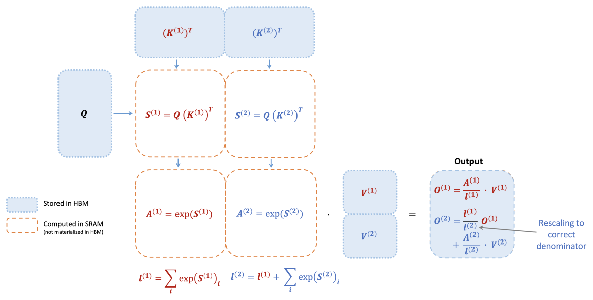
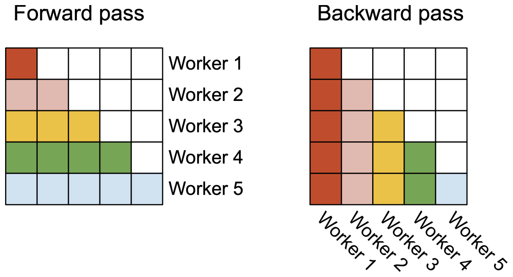
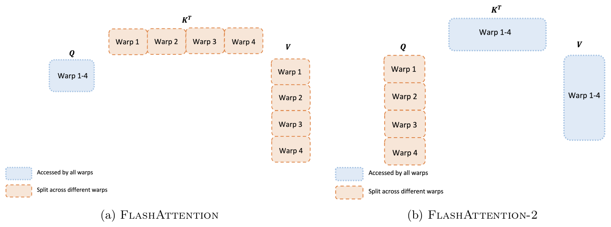
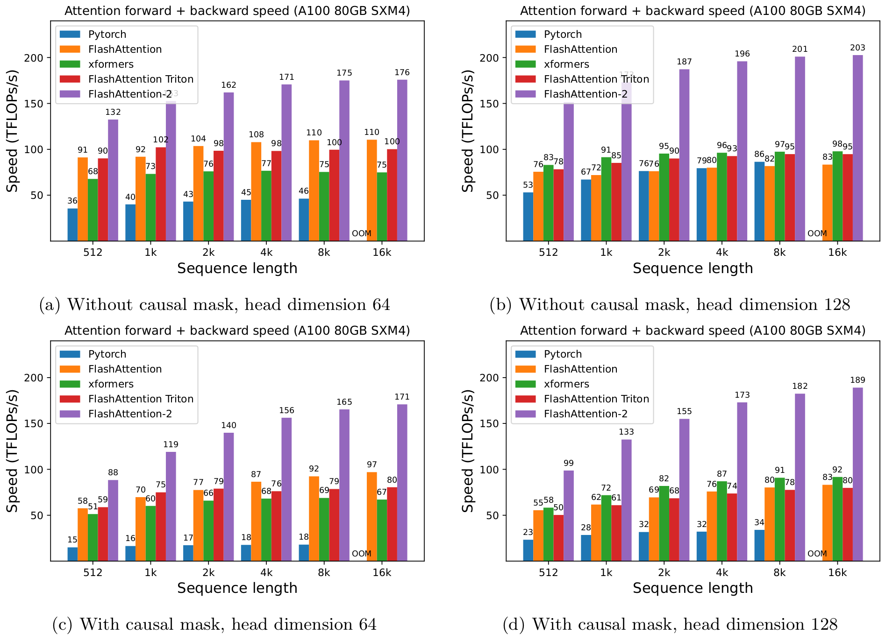
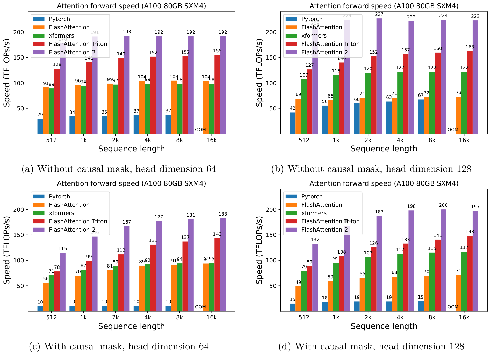
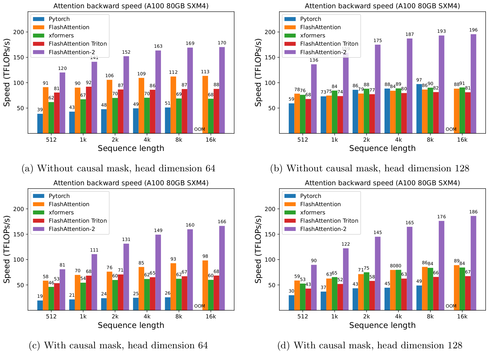
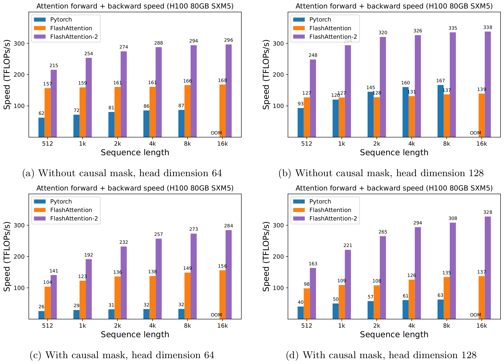

# 论文中文解读：《FlashAttention-2: Faster Attention with Better Parallelism and Work Partitioning》

> **基本信息**：Tri Dao（Princeton University 计算机系 / Stanford University 计算机系），arXiv:2307.08691，2023 年 7 月；论文原文 [官方页面](https://arxiv.org/abs/2307.08691)；代码 [Dao-AILab/flash-attention](https://github.com/Dao-AILab/flash-attention)。
>
> **本文的读法**：图均从论文 PDF 中按图裁出原图，每张图后有中文图题、图例/坐标轴翻译和读图结论；性能柱状图（图 4–7）柱顶的全部数字已转录成表，并与 PDF 文本层逐项核对过；表 1 为逐格转录。本篇是 FlashAttention 系列的第二篇：前置知识（IO 感知、分块、在线 softmax）见 [FlashAttention 第一篇解读](../flash_attention/论文中文解读.md)，后续见 [FlashAttention-3 解读](../flash_attention_3/论文中文解读.md)。

## 一、一句话结论

FlashAttention（下称 FA1）已经把 attention 的额外显存从 $O(N^2)$ 降到 $O(N)$，并且是精确计算，但论文作者测得它在 A100 上只用到理论峰值算力的 25–40%（前向、反向的具体比例见 2.4 节），远低于优化过的矩阵乘（GEMM）的 80–90%。FlashAttention-2（下称 FA2）**不改变数学结果**，而是改进它在 GPU 上的工作划分：

1. 改写在线 softmax 的更新式，减少“非矩阵乘”的浮点运算（这类运算在 A100 上每次比矩阵乘贵约 16 倍）；
2. 除了 batch 和 head 维度外，再沿**序列长度**并行（前向按行块，反向按列块），使长序列、小 batch 时也能占满所有 SM；
3. 同一个 thread block 内部，让 4 个 warp 各自负责 $Q$ 的一块、共享 $K,V$，去掉 FA1 的 “split-K” 与随之而来的 shared memory 读写（见 3.3 节）。

结果（A100 80GB SXM4）：前向最高约 227 TFLOPs/s（约占 312 TFLOPs/s 峰值的 73%），前向+反向最高 203 TFLOPs/s，约为 FA1 的 2 倍（逐配置 1.32–3.39 倍，取决于前向/反向和配置）；端到端训练 GPT3-2.7B（8k 上下文）达到 225 TFLOPs/s/GPU，即 72% 的模型 FLOPs 利用率（MFU）。同一份代码不做任何 Hopper 专用优化直接跑在 H100 上，图 7 最高柱为 338 TFLOPs/s（正文写“最高 335”）。

## 二、背景与动机

### 2.1 GPU 的执行模型（原文 2.1 节）

读 FA2 需要先分清几个 GPU 术语，它们决定了“工作划分”这四个字的含义：

| 术语 | 含义 |
|---|---|
| SM（streaming multiprocessor，流多处理器） | GPU 上的基本计算单元；A100 有 108 个，每个 SM 带 192 KB 片上 SRAM |
| 片上 SRAM / shared memory（共享内存） | 每个 SM 内部的高速存储，带宽估计约 19 TB/s；同一 thread block 内的线程用它交换数据 |
| HBM（高带宽显存） | 即通常说的显存；A100 为 40–80 GB，带宽 1.5–2.0 TB/s |
| kernel | 在 GPU 上由海量线程并行执行的一个函数；每个 kernel 从 HBM 读入输入到寄存器和 SRAM，计算后把输出写回 HBM |
| thread block（线程块） | 一组线程，作为一个整体被调度到某一个 SM 上运行 |
| warp | thread block 内每 32 个线程为一组；同一 warp 内的线程可以用 shuffle 指令快速交换数据，也可以协同完成一次矩阵乘；不同 warp 之间只能通过读写 shared memory 通信 |
| Tensor Core | 专门加速低精度矩阵乘（FP16/BF16）的硬件单元 |
| occupancy（占用率） | GPU 资源被使用的比例；thread block 数量不够多时，一部分 SM 会空闲 |
| non-matmul FLOPs | 不能走 Tensor Core 的运算，例如 exp、取最大值、逐元素乘除 |

A100 的数字（原文 2.1 节、3.1 节）：FP16/BF16 矩阵乘的理论峰值 312 TFLOPs/s，而非矩阵乘的 FP32 运算只有 19.5 TFLOPs/s，两者相差 $312/19.5=16$ 倍；也就是说，一次非矩阵乘 FLOP 的时间代价约等于 16 次矩阵乘 FLOP。L2 cache 不能由程序员直接控制，所以原文的讨论只围绕 HBM 和 SRAM。

### 2.2 标准 attention 及其反向（原文 2.2 节）

给定 $Q,K,V\in\mathbb{R}^{N\times d}$（$N$ 为序列长度，$d$ 为 head 维度），

$$
S=QK^\top\in\mathbb{R}^{N\times N},\qquad P=\operatorname{softmax}(S)\in\mathbb{R}^{N\times N},\qquad O=PV\in\mathbb{R}^{N\times d},
$$

softmax 按行进行。多头注意力（MHA）就是在许多 head 和 batch 内的多个序列上并行做同样的计算。为叙述清楚，原文略去了 $QK^\top$ 的缩放（通常是除以 $\sqrt d$，原文脚注写成 $1/d$，疑为笔误）以及对 $S$ 的 mask 和对 $P$ 的 dropout。

反向：设 $dO\in\mathbb{R}^{N\times d}$ 为损失对 $O$ 的梯度，链式法则给出

$$
dV=P^\top dO,\qquad dP=dO\,V^\top,\qquad dS=\operatorname{dsoftmax}(dP),\qquad dQ=dS\,K,\qquad dK=dS^\top Q .
$$

原文 2.2 节把最后一式印成 $dK=Q\,dS^\top$，维数上不成立（$N\times d$ 乘 $N\times N$），算法 2 第 16 行写的 $dS^\top Q$ 才是对的。softmax 的梯度：若 $p=\operatorname{softmax}(s)$，输出梯度为 $dp$，则输入梯度 $ds=(\operatorname{diag}(p)-pp^\top)\,dp$。

标准实现把 $S$ 和 $P$ 都写到 HBM，占用 $O(N^2)$ 显存（通常 $N$ 为 1k–8k，$d$ 为 64–128，$N\gg d$）：先调用 GEMM 算 $S=QK^\top$ 写回 HBM，再读 $S$ 算 softmax 写回 $P$，最后调用 GEMM 算 $O=PV$；反向还要保存 $P$。多数操作受限于访存带宽，所以访存次数多就慢。

### 2.3 FA1 回顾：分块 + 在线 softmax（原文 2.3 节）

**前向**。FA1 用经典的分块（tiling）减少 HBM 读写：把输入的块从 HBM 读入 SRAM，在块上算 attention，再更新输出，而不把大矩阵 $S,P$ 写回 HBM。因为 softmax 把整行耦合在一起，需要用**在线 softmax**：对每个块算“局部” softmax，再在后续块中对已有输出重新缩放，最终得到精确结果。

原文用最简单的两块情形说明。设某一行块 $S=[S^{(1)}\ S^{(2)}]$，$S^{(1)},S^{(2)}\in\mathbb{R}^{B_r\times B_c}$（$B_r,B_c$ 为行、列块大小），对应 $V=\begin{bmatrix}V^{(1)}\\ V^{(2)}\end{bmatrix}$，$V^{(1)},V^{(2)}\in\mathbb{R}^{B_c\times d}$。

标准 softmax 一次性算整行：

$$
m=\max\big(\operatorname{rowmax}(S^{(1)}),\operatorname{rowmax}(S^{(2)})\big),\qquad
\ell=\operatorname{rowsum}(e^{S^{(1)}-m})+\operatorname{rowsum}(e^{S^{(2)}-m}),
$$

$$
P=[P^{(1)}\ P^{(2)}]=\operatorname{diag}(\ell)^{-1}\big[e^{S^{(1)}-m}\ \ e^{S^{(2)}-m}\big],\qquad
O=\operatorname{diag}(\ell)^{-1}\big(e^{S^{(1)}-m}V^{(1)}+e^{S^{(2)}-m}V^{(2)}\big).
$$

在线 softmax 则一块一块地算：

$$
m^{(1)}=\operatorname{rowmax}(S^{(1)}),\quad \ell^{(1)}=\operatorname{rowsum}(e^{S^{(1)}-m^{(1)}}),\quad O^{(1)}=\operatorname{diag}(\ell^{(1)})^{-1}e^{S^{(1)}-m^{(1)}}V^{(1)},
$$

$$
m^{(2)}=\max\big(m^{(1)},\operatorname{rowmax}(S^{(2)})\big)=m,\qquad
\ell^{(2)}=e^{m^{(1)}-m^{(2)}}\ell^{(1)}+\operatorname{rowsum}(e^{S^{(2)}-m^{(2)}})=\ell ,
$$

$$
O^{(2)}=\operatorname{diag}\!\Big(\frac{e^{m^{(1)}-m^{(2)}}\,\ell^{(1)}}{\ell^{(2)}}\Big)O^{(1)}+\operatorname{diag}(\ell^{(2)})^{-1}e^{S^{(2)}-m^{(2)}}V^{(2)}=O .
$$

最后一式中旧输出 $O^{(1)}$ 的系数，原文印成 $\operatorname{diag}(\ell^{(1)}/\ell^{(2)})^{-1}$，既漏了指数因子 $e^{m^{(1)}-m^{(2)}}$，又多了 $-1$ 次方；上面给出的是按推导得到的正确系数（FA1 论文的 Algorithm 1 写法也与此一致）。直觉：旧输出 $O^{(1)}$ 当年除以的是旧分母 $\ell^{(1)}$，现在要换成新分母 $\ell^{(2)}$，同时旧的指数是相对旧最大值 $m^{(1)}$ 算的，要乘 $e^{m^{(1)}-m^{(2)}}$ 换成相对新最大值。

下图把这个两块的流程画了出来：

*图 1（原文 Figure 1，第 4 页）：K 与 V 各被切成两块时，FlashAttention 前向如何逐块计算并通过重新缩放得到正确结果，同时避免把中间矩阵 $S,P$ 写回 HBM。图为简化版，省略了 softmax 中“减去行最大值”的步骤。*

**图中文字翻译与读法**：

- **图例**：蓝色点线圆角框 “Stored in HBM”（存放在 HBM 中）；橙色虚线圆角框 “Computed in SRAM (not materialized in HBM)”（在 SRAM 中计算，不在 HBM 中物化）。
- **输入侧**：$Q$、$(K^{(1)})^T$、$(K^{(2)})^T$ 以及右侧的 $V^{(1)}$、$V^{(2)}$ 都在 HBM 中；红色表示第 1 块的计算，蓝色表示第 2 块的计算。
- **SRAM 中的计算**：$S^{(1)}=Q(K^{(1)})^T$、$S^{(2)}=Q(K^{(2)})^T$，再各自取指数得到 $A^{(1)}=\exp(S^{(1)})$、$A^{(2)}=\exp(S^{(2)})$；这些方块都是橙色虚线框，即不写回 HBM。
- **行和**：图底部 $l^{(1)}=\sum_i\exp(S^{(1)})_i$，$l^{(2)}=l^{(1)}+\sum_i\exp(S^{(2)})_i$（图中的小写 $l$ 即正文的 $\ell$）。
- **Output（输出）**：$O^{(1)}=\frac{A^{(1)}}{l^{(1)}}\cdot V^{(1)}$；$O^{(2)}=\frac{l^{(1)}}{l^{(2)}}O^{(1)}+\frac{A^{(2)}}{l^{(2)}}\cdot V^{(2)}$。蓝色注释 “Rescaling to correct denominator”（重新缩放以修正分母）指向系数 $l^{(1)}/l^{(2)}$。
- **读图结论**：每个块只在片上算，$N\times N$ 的 $S,P$ 从不整体出现；第 2 块处理完时，对第 1 块的输出按分母之比缩放再加上新块的贡献，就得到整行 softmax 与 $V$ 相乘的精确结果。

**反向**。FA1 在反向时，把 $Q,K,V$ 的块读入 SRAM 后重新计算 $S,P$，因此不必保存 $N\times N$ 的中间矩阵，显存随序列长度线性增长，比标准实现节省 10–20 倍（视序列长度而定），速度也快 2–4 倍。反向在概念上比前向简单（没有 softmax 重缩放），但实现起来复杂得多：前向只有 2 个矩阵乘，反向有 5 个，需要同时放在 SRAM 里的量更多。

### 2.4 FA1 慢在哪里（原文第 1 节）

原文第 1 节给出的诊断是：FA1 虽然比标准实现快 2–4 倍，但前向只达到设备理论峰值的 30–50%（原文引用图 5），反向在 A100 上只达到 25–35%（原文引用图 6），摘要里概括为“25–40%”；而优化的 GEMM 能达到峰值的 80–90%。通过细致 profile，作者发现 FA1 在 GPU 上，thread block 之间和 warp 之间的工作划分都不够好，导致两类问题：

- **低 occupancy**：并行度只来自 batch × head，长序列（通常意味着小 batch 或少 head）时 thread block 数量不够；
- **多余的 shared memory 读写**：thread block 内部各 warp 之间要经 shared memory 归约中间结果。

再加上第三个因素：**非矩阵乘 FLOPs**虽然在总 FLOPs 里只占一小部分，但 GPU 有专用的矩阵乘单元，矩阵乘吞吐最高可以是非矩阵乘的 16 倍，所以它们占的时间远大于占的 FLOPs，应尽量减少。

这三点正好对应 FA2 的三项改动（原文第 1 节列出的三个贡献）。

## 三、方法

### 3.1 算法层面：减少非矩阵乘 FLOPs（原文 3.1 节）

#### 3.1.1 前向：两处微调

沿用上面的两块例子，原文做了两处微调：

**微调 1：不必每一步都把两项都除以分母。** 原来的更新式要对“旧输出”和“新块贡献”都乘 $\operatorname{diag}(\ell^{(2)})^{-1}$。FA2 改为维护**未归一化**的输出 $\tilde O$，只在整个循环结束后才除以最后的 $\ell$：

$$
\tilde O^{(1)}=e^{S^{(1)}-m^{(1)}}V^{(1)},\qquad
\tilde O^{(2)}=\operatorname{diag}\big(e^{m^{(1)}-m^{(2)}}\big)\,\tilde O^{(1)}+e^{S^{(2)}-m^{(2)}}V^{(2)}=e^{S^{(1)}-m}V^{(1)}+e^{S^{(2)}-m}V^{(2)},
$$

$$
O^{(2)}=\operatorname{diag}(\ell^{(2)})^{-1}\,\tilde O^{(2)}=O .
$$

注意：原文在这里的两处写法都有问题。其一，第 5 页点 1 写成 $\tilde O^{(2)}=\operatorname{diag}(\ell^{(1)})^{-1}O^{(1)}+e^{S^{(2)}-m^{(2)}}V^{(2)}$，对已经归一化过的 $O^{(1)}$ 又除了一次 $\ell^{(1)}$；其二，第 6 页的展开式把第一项的系数印成 $\operatorname{diag}(e^{m^{(1)}-m^{(2)}})^{-1}$，其 $-1$ 次方是笔误——按字面理解会把旧输出放大 $e^{m^{(2)}-m^{(1)}}\ge1$ 倍，与它自己最后等号右边的结果矛盾。上式是按推导得到的正确写法。关键点是：新块的指数 $e^{S^{(2)}-m^{(2)}}$ 一开始就相对**新**最大值计算，所以只有旧累加量需要乘一个缩小系数，不再有“对新旧两项分别归一化”的逐元素运算。

**微调 2：反向只需保存 logsumexp，不必同时保存最大值和指数和。** 令

$$
L^{(j)}=m^{(j)}+\log\big(\ell^{(j)}\big),
$$

反向只存这一个长度为 $N$ 的向量 $L$（FA1 要同时存 $m$ 和 $\ell$ 两个向量）。因为 $\exp(S-L)=\exp(S-m)/\ell$，恰好就是 softmax 的概率。

#### Algorithm 1：FA2 前向（原文第 6 页）

输入：$Q,K,V\in\mathbb{R}^{N\times d}$ 在 HBM 中，块大小 $B_c,B_r$。逐行解释：

1. 把 $Q$ 切成 $T_r=\lceil N/B_r\rceil$ 块 $Q_1,\dots,Q_{T_r}$（每块 $B_r\times d$）；把 $K,V$ 切成 $T_c=\lceil N/B_c\rceil$ 块（每块 $B_c\times d$）。
2. 把输出 $O$ 也切成 $T_r$ 块 $O_i$（每块 $B_r\times d$），把 logsumexp 向量 $L$ 切成 $T_r$ 块 $L_i$（每块长 $B_r$）。
3. **外循环**：遍历 $Q$ 的行块 $i=1,\dots,T_r$。（FA1 的外循环是 $K,V$ 的块、内循环是 $Q$ 的块；FA2 把顺序对调。不同的 $i$ 之间互不依赖，可以交给不同的 thread block，见 3.2 节。）
4. 把 $Q_i$ 从 HBM 读入片上 SRAM，整个内循环中它一直留在片上。
5. 片上初始化：$O_i^{(0)}=0$（$B_r\times d$），$\ell_i^{(0)}=0$（长 $B_r$），$m_i^{(0)}=-\infty$（长 $B_r$）。
6. **内循环**：遍历 $K,V$ 的列块 $j=1,\dots,T_c$。
7. 把 $K_j,V_j$ 从 HBM 读入 SRAM。
8. 片上计算分数块 $S_i^{(j)}=Q_iK_j^\top\in\mathbb{R}^{B_r\times B_c}$。
9. 片上依次计算三项：新的行最大值 $m_i^{(j)}=\max\big(m_i^{(j-1)},\operatorname{rowmax}(S_i^{(j)})\big)$；用**新**最大值逐元素取指数 $\tilde P_i^{(j)}=\exp\big(S_i^{(j)}-m_i^{(j)}\big)$（这里 $\tilde P$ 尚未除以行和，是“未归一化的概率”）；新的行和 $\ell_i^{(j)}=e^{m_i^{(j-1)}-m_i^{(j)}}\ell_i^{(j-1)}+\operatorname{rowsum}\big(\tilde P_i^{(j)}\big)$。
10. 更新未归一化的输出累加器：$O_i^{(j)}=\operatorname{diag}\big(e^{m_i^{(j-1)}-m_i^{(j)}}\big)O_i^{(j-1)}+\tilde P_i^{(j)}V_j$。（原文该行的对角矩阵带 $-1$ 次方，理由同上，是笔误。）这是内循环里唯一一次对输出的逐元素缩放，其余计算都是矩阵乘。
11. 内循环结束。
12. **只在内循环全部结束后**做一次归一化：$O_i=\operatorname{diag}\big(\ell_i^{(T_c)}\big)^{-1}O_i^{(T_c)}$。
13. 计算 logsumexp：$L_i=m_i^{(T_c)}+\log\big(\ell_i^{(T_c)}\big)$。
14. 把 $O_i$ 写回 HBM，作为 $O$ 的第 $i$ 块。
15. 把 $L_i$ 写回 HBM，作为 $L$ 的第 $i$ 块。
16. 外循环结束。
17. 返回输出 $O$ 和 logsumexp $L$。

和 FA1 的区别：(a) 循环顺序对调，$O_i,\ell_i,m_i$ 在内循环中一直留在片上、只在外循环每轮结束时写一次；(b) 内循环里不再做除以 $\ell$ 的逐元素运算；(c) 保存的统计量由 $(m,\ell)$ 两个向量变成 $L$ 一个向量。

**因果 mask（causal masking）**。自回归语言建模需要对 $S$ 加因果 mask：$j>i$ 的元素 $S_{ij}$ 置为 $-\infty$。因为 FA1/FA2 本来就按块工作：

1. 凡是整个块的列下标都大于行下标的块（序列很长时约占一半），整块**跳过**不算，相比无 mask 的 attention 约有 1.7–1.8 倍加速；
2. 只有“跨越对角线”的块才需要真正施加 mask，所以假设块为方形时，每一行只需对 1 个块加 mask。

原文第 2 条的措辞是 “row indices are guaranteed to be strictly less than the column indices”，与第 1 条（该情形是被跳过的块）重复，按上下文应指行下标严格大于列下标的块（完全在对角线下方，不需要 mask）；这是原文措辞的笔误。

**正确性、复杂度**。与 FA1 相同：Algorithm 1 返回精确的 $O=\operatorname{softmax}(QK^\top)V$（无近似），用 $O(N^2d)$ FLOPs，除输入输出外只需 $O(N)$ 额外显存（用来存 $L$）；证明与 FA1 的 Theorem 1 几乎相同，原文省略。

#### 3.1.2 反向（Algorithm 2）

FA2 的反向与 FA1 几乎一样，只做了一处微调：只用逐行 logsumexp $L$，不再同时使用逐行最大值和指数和。输入：$Q,K,V,O,dO\in\mathbb{R}^{N\times d}$ 与 $L\in\mathbb{R}^{N}$ 在 HBM 中。逐行解释（原文第 7 页）：

1. 分块：同前向，$Q$ 切成 $T_r$ 块，$K,V$ 切成 $T_c$ 块。
2. 把 $O$、$dO$ 各切成 $T_r$ 块（每块 $B_r\times d$），把 $L$ 切成 $T_r$ 块。
3. 在 HBM 中把 $dQ$ 初始化为 0 并切成 $T_r$ 块；把 $dK,dV$ 切成 $T_c$ 块（每块 $B_c\times d$）。
4. 预计算 $D=\operatorname{rowsum}(dO\circ O)$（逐元素乘后按行求和；原文把它的维度写成 $\mathbb{R}^d$，应为 $\mathbb{R}^N$，每行一个数），写到 HBM 并切成 $T_r$ 块 $D_i$。
5. **外循环**：遍历 $K,V$ 的列块 $j=1,\dots,T_c$（反向的外循环在列块上）。
6. 把 $K_j,V_j$ 读入 SRAM。
7. 在 SRAM 中把 $dK_j,dV_j$ 初始化为 0。
8. **内循环**：遍历 $Q$ 的行块 $i=1,\dots,T_r$。
9. 把 $Q_i,O_i,dO_i,dQ_i,L_i,D_i$ 从 HBM 读入 SRAM。
10. 重新计算 $S_i^{(j)}=Q_iK_j^\top$。
11. 重新算出概率 $P_i^{(j)}=\exp\big(S_{ij}-L_i\big)$——有了 $L$ 就不必存 $P$。
12. $dV_j\leftarrow dV_j+\big(P_i^{(j)}\big)^\top dO_i$。
13. $dP_i^{(j)}=dO_i\,V_j^\top$。
14. $dS_i^{(j)}=P_i^{(j)}\circ\big(dP_i^{(j)}-D_i\big)$。
15. 从 HBM 读入 $dQ_i$，在片上更新 $dQ_i\leftarrow dQ_i+dS_i^{(j)}K_j$，再写回 HBM（不同列块都会累加到同一个 $dQ_i$，所以这一步需要原子加，见 3.2 节）。
16. $dK_j\leftarrow dK_j+\big(dS_i^{(j)}\big)^\top Q_i$。
17. 内循环结束。
18. 把 $dK_j,dV_j$ 写回 HBM。
19. 外循环结束。
20. 返回 $dQ,dK,dV$。

这里包含 5 次矩阵乘（第 10、12、13、15、16 行），前向只有 2 次，这就是后面算 FLOPs 时“反向 = 前向的 2.5 倍”的来源。

补充一个原文没有展开的小推导，说明第 4、14 行为什么成立：对某一行，$ds_j=p_j\,dp_j-p_j\sum_kp_k\,dp_k=p_j\,(dp_j-D_i)$，其中 $D_i=\sum_kp_k\,dp_k$；由于 $dp_k=dO_{i}\cdot V_k$（$dO_i$ 为该行的输出梯度，$V_k$ 为 $V$ 的第 $k$ 行），$D_i=dO_i\cdot\sum_kp_kV_k=dO_i\cdot O_i$。所以只需要 $O$ 与 $dO$ 逐行内积就能得到 $D$，不必先把整行的 $dP$ 算出来。

**MQA / GQA**。多查询注意力（MQA）和分组查询注意力（GQA）让多个 query head 共享同一个 key/value head，用来减小推理时的 KV cache。FA2 不真的复制 $K,V$ 的 head，而是通过隐式地改变 head 的索引来完成同样的计算；反向时需要把被隐式复制的各个 head 上的 $dK,dV$ 梯度加起来。

### 3.2 并行：沿序列长度再切（原文 3.2 节）

FA1 只在 batch 和 head 上并行：**一个 thread block 处理一个 attention head**，总共 batch size × head 数个 thread block，每个 block 被调度到一个 SM 上（A100 有 108 个 SM）。当这个数字很大（原文说“比如 ≥ 80”）时能用满几乎所有 SM；但长序列通常意味着小 batch 或少 head，此时很多 SM 闲置。举例（本文换算，原文未列）：论文基准里总 token 数固定为 16k，序列长 16k 时 batch 只有 1，head 维度 64 对应 32 个 head、128 对应 16 个 head，FA1 就只能启动 32 或 16 个 thread block，远少于 108 个 SM。

FA2 在此基础上**再沿序列长度并行**：

- **前向**：外循环（遍历行块 $i$）“天然并行”，各行块之间不需要通信，因此把它们安排到不同的 thread block 上；同时仍沿 batch、head 并行。序列长度维度增加的并行度提高了 batch 和 head 数都较小时的 occupancy。（若取 $B_r=128$，序列长 16k 时每个 head 有 128 个行块，本文换算，原文未列。）
- **反向**：不同列块之间唯一共享的计算是 Algorithm 2 第 15 行对 $dQ_i$ 的更新（从 HBM 读入、片上累加、写回）。于是为反向的每个**列块**安排 1 个 thread block，并用**原子加**（atomic add）让不同 thread block 之间通过 HBM 累加 $dQ$。

原文还说明：对调循环顺序（外循环行块、内循环列块），以及沿序列长度并行，最早是 Phil Tillet 在 Triton 实现中提出并实现的（原文脚注 3：Triton 教程中的 fused attention 示例），这也是后面基准里“FlashAttention Triton”这一基线很强的原因之一（这一句是读图后的推断，原文未直接说明）。

*图 2（原文 Figure 2，第 8 页）：前向（左）中，每个 worker（thread block）负责 attention 矩阵的一个行块；反向（右）中，每个 worker 负责一个列块。*

**图中文字翻译与读法**：

- **左图 Forward pass（前向）**：$5\times5$ 的方格是被切成块的 attention 矩阵，右侧标注 Worker 1–5 的五个颜色各占一**行**：Worker 1 负责第 1 行（1 个着色格），Worker 2 负责第 2 行，……，Worker 5 负责第 5 行（5 个着色格）。
- **右图 Backward pass（反向）**：同一个矩阵，下方标注 Worker 1–5（斜排的文字）的颜色各占一**列**：Worker 1 负责第 1 列（5 个着色格），……，Worker 5 负责第 5 列（1 个着色格）。
- **白色方格**没有被着色，即不需要计算；着色区域呈下三角形（含对角线），对应因果 mask 的情形（原文图题没有明说，这是从图形读出的）。
- **读图结论**：前向按行分工，每个 worker 独立算出自己那几行输出；反向按列分工，每个 worker 独立算出自己那几列的 $dK,dV$，但各列都会向同一批行的 $dQ$ 累加，因此要靠原子加通信。另外，三角形说明不同 worker 的工作量不相等，原文没有对此展开讨论。

### 3.3 同一 thread block 内的 warp 工作划分（原文 3.3 节）

在确定了 thread block 的调度后，还要决定每个 thread block 内的各个 warp 如何分工。原文说通常每个 thread block 用 4 或 8 个 warp，划分方式见图 3。

*图 3（原文 Figure 3，第 9 页）：前向中 warp 之间的工作划分。(a) FlashAttention：切分 $K,V$；(b) FlashAttention-2：切分 $Q$。*

**图中文字翻译与读法**：

- **图例**：蓝色点线框 “Accessed by all warps”（所有 warp 都访问）；橙色虚线框 “Split across different warps”（在不同 warp 之间切分）。
- **(a) FlashAttention**：$Q$ 是一整块蓝框 “Warp 1-4”，4 个 warp 都读它；$K^T$ 横向切成 Warp 1、Warp 2、Warp 3、Warp 4 四份，$V$ 纵向切成 Warp 1–4 四份。
- **(b) FlashAttention-2**：$Q$ 纵向切成 Warp 1–4 四份（每个 warp 负责若干行）；$K^T$ 和 $V$ 都是蓝框 “Warp 1-4”，4 个 warp 共享整块 $K,V$。

**前向**。FA1 把 $K,V$ 切给 4 个 warp，$Q$ 对所有 warp 可见：每个 warp 用整块 $Q$ 与自己那份 $K$ 相乘，得到 $QK^\top$ 的一个“切片”，再与自己那份 $V$ 相乘，得到的只是输出的**部分和**，各 warp 必须把部分和相加才能得到结果。这叫 “split-K” 方案（矩阵乘 $PV$ 的归约维度被切给不同 warp）。它的低效在于：所有 warp 都要把中间结果写到 shared memory、同步、再读出求和，这些 shared memory 读写拖慢了前向。

FA2 改为把 $Q$ 切给 4 个 warp，$K,V$ 对所有 warp 可见：每个 warp 算出自己那些行的 $QK^\top$ 切片之后，只需乘整块 $V$，就直接得到自己那些行的输出，**warp 之间不需要通信**。由此减少的 shared memory 读写带来加速（4.1 节验证）。（可以推论：softmax 的逐行最大值、行和也都在同一个 warp 内完成，这一点原文没有专门写出。）

**反向**。反向同样选择避免 split-K；但由于 $Q,K,V,O,dO,dQ,dK,dV$ 之间的依赖更复杂，仍需要一些同步。即便如此，避免 split-K 仍然减少了 shared memory 读写，同样带来加速。

**块大小的调优**。增大块一般会减少 shared memory 的读写，但需要更多寄存器和更多 shared memory。块大到一定程度，寄存器溢出（register spilling）会显著拖慢，或者所需 shared memory 超过 GPU 容量导致 kernel 根本无法运行。通常取 $\{64,128\}\times\{64,128\}$ 的块大小，视 head 维度 $d$ 和设备的 shared memory 大小而定。由于总共只有 4 种选择，作者对每个 head 维度手工调参，认为将来可以自动调优，留作未来工作。

### 3.4 FA1 与 FA2 对照

| 维度 | FlashAttention（FA1） | FlashAttention-2 |
|---|---|---|
| 前向循环顺序 | 外层 $K,V$ 块、内层 $Q$ 块 | 外层 $Q$ 行块、内层 $K,V$ 列块 |
| 前向输出缩放 | 更新输出时两项都按新分母归一化 | 维护未归一化的 $\tilde O$，循环结束后除一次 $\ell$ |
| 反向所需统计量 | 最大值 $m$ 与指数和 $\ell$ 两个向量 | 只存 logsumexp $L$ 一个向量 |
| 线程块并行维度 | batch × head | batch × head × 序列长度（前向按行块，反向按列块） |
| 前向 warp 划分 | 切分 $K,V$（split-K），$Q$ 共享 | 切分 $Q$，$K,V$ 共享，无需 warp 间归约 |
| 反向对 $dQ$ 的累加 | （原文未单独说明） | 不同列块的 thread block 之间用原子加累加 $dQ$ |
| 精确性 | 精确 | 精确，数学结果与 FA1 相同 |

## 四、实验

### 4.1 设置

原文第 4 节声明的评估内容：

- **基准测试 attention**：在不同序列长度上，把 FA2 的运行时间与 PyTorch 标准实现、FA1、Triton 里的 FlashAttention 比较，另外还有 xformers 里的 FlashAttention（“cutlass” 实现）；
- **端到端训练速度**：训练 1.3B 与 2.7B 的 GPT 风格模型，序列长度 2k 或 8k。

**attention 基准的设置（4.1 节）**：A100 80GB SXM4；设置有/无因果 mask、head 维度 64 或 128 共四种组合；序列长度取 512、1k、……、16k，batch 的大小使**总 token 数固定为 16k**；hidden dimension 固定为 2048，head 维度为 64 或 128（即 32 个或 16 个 head）。

**FLOPs 的计算方式**：前向用

$$
4\cdot\mathrm{seqlen}^2\cdot\text{head dimension}\cdot\text{number of heads},
$$

即两个矩阵乘（$QK^\top$ 与 $PV$）各 $2\cdot\mathrm{seqlen}^2\cdot d$。有因果 mask 时再除以 2（只算了大约一半的元素）；反向的 FLOPs 取前向的 2.5 倍（前向 2 个矩阵乘，反向 5 个矩阵乘，因为包含重计算）。图里的 TFLOPs/s 都是用这个公式折算的“有效”吞吐。

### 4.2 A100 上的 attention 速度（图 4、图 5、图 6）

先看前向+反向合计的速度（图 4）：

*图 4（原文 Figure 4，第 10 页）：A100 80GB SXM4 上 attention 前向+反向的速度（TFLOPs/s，越高越好）。*

**图中文字翻译与读法**：

- **标题与坐标**：“Attention forward + backward speed (A100 80GB SXM4)”（A100 80GB SXM4 上 attention 前向+反向速度）；纵轴 Speed (TFLOPs/s)（速度），横轴 Sequence length（序列长度，512 到 16k）。
- **四个子图**：(a) 无因果 mask、head 维度 64；(b) 无因果 mask、head 维度 128；(c) 有因果 mask、head 维度 64；(d) 有因果 mask、head 维度 128。
- **图例（每组从左到右 5 根柱）**：蓝色 Pytorch（图中拼写如此，即 PyTorch 标准实现）、橙色 FlashAttention（FA1）、绿色 xformers（xformers 库中的 FlashAttention cutlass 实现）、红色 FlashAttention Triton（Triton 实现）、紫色 FlashAttention-2；柱顶的数字是 TFLOPs/s。**OOM** 表示显存溢出（PyTorch 在序列长 16k 时溢出，没有柱）。
- 个别柱顶数字被图例遮挡（(a) 中 1k 的 FA2，(b) 中 512 与 1k 的 FA2）；下表中这几个数取自 PDF 文本层，与柱高吻合。

图 4 的全部数字（TFLOPs/s；OOM 为显存溢出）：

| 子图 | 实现 | 512 | 1k | 2k | 4k | 8k | 16k |
|---|---|---:|---:|---:|---:|---:|---:|
| (a) 无 causal，d=64 | PyTorch | 36 | 40 | 43 | 45 | 46 | OOM |
| (a) | FlashAttention | 91 | 92 | 104 | 108 | 110 | 110 |
| (a) | xformers | 68 | 73 | 76 | 77 | 75 | 75 |
| (a) | FlashAttention Triton | 90 | 102 | 98 | 98 | 100 | 100 |
| (a) | **FlashAttention-2** | **132** | **153** | **162** | **171** | **175** | **176** |
| (b) 无 causal，d=128 | PyTorch | 53 | 67 | 76 | 79 | 86 | OOM |
| (b) | FlashAttention | 76 | 72 | 76 | 80 | 82 | 83 |
| (b) | xformers | 83 | 91 | 95 | 96 | 97 | 98 |
| (b) | FlashAttention Triton | 78 | 85 | 90 | 93 | 95 | 95 |
| (b) | **FlashAttention-2** | **151** | **173** | **187** | **196** | **201** | **203** |
| (c) 有 causal，d=64 | PyTorch | 15 | 16 | 17 | 18 | 18 | OOM |
| (c) | FlashAttention | 58 | 70 | 77 | 87 | 92 | 97 |
| (c) | xformers | 51 | 60 | 66 | 68 | 69 | 67 |
| (c) | FlashAttention Triton | 59 | 75 | 79 | 76 | 79 | 80 |
| (c) | **FlashAttention-2** | **88** | **119** | **140** | **156** | **165** | **171** |
| (d) 有 causal，d=128 | PyTorch | 23 | 28 | 32 | 32 | 34 | OOM |
| (d) | FlashAttention | 55 | 62 | 69 | 76 | 80 | 83 |
| (d) | xformers | 58 | 72 | 82 | 87 | 91 | 92 |
| (d) | FlashAttention Triton | 50 | 61 | 68 | 74 | 78 | 80 |
| (d) | **FlashAttention-2** | **99** | **133** | **155** | **173** | **182** | **189** |

（原文图 4，第 10 页；d 表示 head 维度。）

**读图结论**：

- FA2 在全部 24 个（4 子图 × 6 个序列长度）组合里都是最高的柱。
- 非因果 head 维度 128（子图 b）数值最高，序列长 16k 时 FA2 达 203 TFLOPs/s，约为 A100 峰值 312 TFLOPs/s 的 65%；同一格里 FA1 只有 83。
- 用图中数字自行相除，FA2 对 FA1 的倍数：(a) 1.45–1.66，(b) 1.99–2.46，(c) 1.52–1.82，(d) 1.80–2.28；即 head 维度 128 时普遍在 2 倍上下，head 维度 64 非因果时只有约 1.5–1.7 倍。
- 对 Triton 版：1.47–2.36 倍；对 xformers：1.71–2.55 倍；对 PyTorch 标准实现：2.34–9.17 倍。
- FA2 的速度随序列变长而上升并趋于平稳；有因果 mask 的 FA2 在短序列时明显低于非因果（512 时约为非因果的 0.66–0.67），到 16k 时接近（约 0.93–0.97）；原文没有解释这一趋势，大致与“只能跳过约一半的块、对角块还要加 mask，因此因果下实际加速 1.7–1.8 倍而不是 2 倍”的说法一致（见 3.1.1）。
- PyTorch 标准实现并不跳过被 mask 的元素，而这里的 TFLOPs/s 对所有实现都按“因果时 FLOPs 减半”折算，所以它在有因果时的数字更低（本文推断）。

接着是只看前向（图 5）：

*图 5（原文 Figure 5，第 11 页）：A100 80GB SXM4 上 attention 前向速度（TFLOPs/s，越高越好）。*

**图中文字翻译与读法**：标题为 “Attention forward speed (A100 80GB SXM4)”；坐标轴、四个子图、图例颜色与图 4 完全相同，只是只测前向。(a) 中 512 与 1k 的 FA2 柱顶（178、191）、(b) 中 512 与 1k 的 FA2（209、224）、(c) 中 1k 的 FA2（146）、(d) 中 1k 的 FA2（168）被图例遮挡了一部分，数字取自文本层。

图 5 的全部数字：

| 子图 | 实现 | 512 | 1k | 2k | 4k | 8k | 16k |
|---|---|---:|---:|---:|---:|---:|---:|
| (a) 无 causal，d=64 | PyTorch | 29 | 34 | 35 | 37 | 37 | OOM |
| (a) | FlashAttention | 91 | 96 | 99 | 104 | 104 | 104 |
| (a) | xformers | 89 | 94 | 97 | 99 | 98 | 98 |
| (a) | FlashAttention Triton | 128 | 141 | 149 | 152 | 152 | 155 |
| (a) | **FlashAttention-2** | **178** | **191** | **193** | **192** | **192** | **192** |
| (b) 无 causal，d=128 | PyTorch | 42 | 56 | 60 | 63 | 67 | OOM |
| (b) | FlashAttention | 69 | 66 | 71 | 71 | 72 | 73 |
| (b) | xformers | 107 | 115 | 120 | 122 | 122 | 122 |
| (b) | FlashAttention Triton | 127 | 140 | 152 | 157 | 160 | 163 |
| (b) | **FlashAttention-2** | **209** | **224** | **227** | **222** | **224** | **223** |
| (c) 有 causal，d=64 | PyTorch | 10 | 10 | 10 | 10 | 10 | OOM |
| (c) | FlashAttention | 56 | 70 | 81 | 89 | 91 | 94 |
| (c) | xformers | 71 | 82 | 89 | 92 | 94 | 95 |
| (c) | FlashAttention Triton | 78 | 99 | 112 | 131 | 137 | 143 |
| (c) | **FlashAttention-2** | **115** | **146** | **167** | **177** | **181** | **183** |
| (d) 有 causal，d=128 | PyTorch | 15 | 18 | 19 | 19 | 19 | OOM |
| (d) | FlashAttention | 49 | 59 | 65 | 68 | 70 | 71 |
| (d) | xformers | 79 | 95 | 107 | 112 | 115 | 117 |
| (d) | FlashAttention Triton | 89 | 108 | 126 | 133 | 141 | 148 |
| (d) | **FlashAttention-2** | **132** | **168** | **187** | **198** | **200** | **197** |

（原文图 5，第 11 页。）

**读图结论**：

- 前向最高值出现在非因果、head 维度 128、序列长 2k：227 TFLOPs/s，约为 312 的 72.8%，对应原文“最高 230 TFLOPs/s、73%”的说法（文字取整到 230）。
- FA2 对 FA1：(a) 1.85–1.99，(b) 3.03–3.39，(c) 1.95–2.09，(d) 2.69–2.91 倍。head 维度 128 时前向的提升（约 2.7–3.4 倍）比图 4 的前向+反向更大。
- FA2 对 Triton 版：1.24–1.65 倍（原文写“1.3–1.5 倍”）；对 xformers：1.62–2.03 倍；对 PyTorch 标准实现：3.34–18.1 倍（因果、head 维度 64 时 PyTorch 只有 10 TFLOPs/s，FA2 达 115–183）。
- 这里 FA1 的前向只有约 49–104 TFLOPs/s，按 312 换算为峰值的 16%–33%（head 维度 64 时非因果为 29%–33%、因果最高 30%，head 维度 128 时只有 16%–23%），与原文第 1 节“前向只达 30–50%”的说法不完全吻合；原文没有说明这个百分比的口径。

再看只看反向（图 6）：

*图 6（原文 Figure 6，第 12 页）：A100 80GB SXM4 上 attention 反向速度（TFLOPs/s，越高越好）。*

**图中文字翻译与读法**：标题 “Attention backward speed (A100 80GB SXM4)”；坐标轴、子图排布与图例同图 4、图 5，只测反向。(b) 中 1k 的 FA2 柱顶 159 被图例遮挡了一部分，数字取自文本层。

图 6 的全部数字：

| 子图 | 实现 | 512 | 1k | 2k | 4k | 8k | 16k |
|---|---|---:|---:|---:|---:|---:|---:|
| (a) 无 causal，d=64 | PyTorch | 39 | 43 | 48 | 49 | 51 | OOM |
| (a) | FlashAttention | 91 | 90 | 106 | 109 | 112 | 113 |
| (a) | xformers | 62 | 67 | 70 | 70 | 69 | 68 |
| (a) | FlashAttention Triton | 81 | 92 | 87 | 86 | 87 | 88 |
| (a) | **FlashAttention-2** | **120** | **141** | **152** | **163** | **169** | **170** |
| (b) 无 causal，d=128 | PyTorch | 59 | 73 | 86 | 88 | 97 | OOM |
| (b) | FlashAttention | 78 | 75 | 79 | 84 | 86 | 88 |
| (b) | xformers | 76 | 84 | 88 | 89 | 90 | 91 |
| (b) | FlashAttention Triton | 68 | 74 | 77 | 80 | 82 | 81 |
| (b) | **FlashAttention-2** | **136** | **159** | **175** | **187** | **193** | **196** |
| (c) 有 causal，d=64 | PyTorch | 19 | 21 | 24 | 25 | 26 | OOM |
| (c) | FlashAttention | 58 | 70 | 76 | 85 | 93 | 98 |
| (c) | xformers | 46 | 54 | 60 | 62 | 62 | 60 |
| (c) | FlashAttention Triton | 53 | 68 | 71 | 65 | 67 | 68 |
| (c) | **FlashAttention-2** | **81** | **111** | **131** | **149** | **160** | **166** |
| (d) 有 causal，d=128 | PyTorch | 30 | 37 | 43 | 45 | 49 | OOM |
| (d) | FlashAttention | 59 | 63 | 71 | 80 | 86 | 89 |
| (d) | xformers | 53 | 65 | 75 | 80 | 84 | 84 |
| (d) | FlashAttention Triton | 43 | 52 | 58 | 63 | 66 | 67 |
| (d) | **FlashAttention-2** | **90** | **122** | **145** | **165** | **176** | **186** |

（原文图 6，第 12 页。）

**读图结论**：

- 反向最高值：非因果、head 维度 128、序列长 16k，196 TFLOPs/s，约为 312 的 62.8%，对应原文“反向最高达理论峰值的 63%”。
- FA2 对 FA1：(a) 1.32–1.57，(b) 1.74–2.24，(c) 1.40–1.75，(d) 1.53–2.09 倍。
- FA2 对 Triton 版：1.48–2.78 倍（原文写“约 2 倍”）；对 xformers：1.70–2.77 倍；对 PyTorch 标准实现：1.99–6.15 倍。
- FA1 自己的反向在 A100 上只有 58–113 TFLOPs/s，约为峰值的 19%–36%，与原文引言“反向 25–35%”大体相当。
- 以上倍数均由图中取整后的数字相除得到，可能有舍入误差。

#### 原文文字说法与图中数字的对照

| 原文文字说法 | 由图中数字自行相除/换算的范围 |
|---|---|
| FA2 比 FA1 快 1.7–3.0 倍（第 4 节要点）；约 2 倍（4.1 节） | 前向+反向 1.45–2.46；前向 1.85–3.39；反向 1.32–2.24 |
| 比 Triton 版 FA 前向快 1.3–1.5 倍，反向快约 2 倍 | 前向 1.24–1.65；反向 1.48–2.78 |
| 比 PyTorch 标准实现快 3–10 倍（最高 10 倍） | 前向+反向 2.34–9.17；前向 3.34–18.1；反向 1.99–6.15 |
| A100 上最高 230 TFLOPs/s，73% 峰值 | 图 5 最高柱 227（227/312 ≈ 72.8%） |
| 反向最高达理论峰值的 63% | 图 6 最高柱 196（196/312 ≈ 62.8%） |
| H100 上最高 335 TFLOPs/s | 图 7 最高柱 338（16k），335 是同一曲线 8k 处的值 |

读法：原文“约 2 倍”“1.7–3.0 倍”是对不同配置的概括，并不是每个配置都成立；head 维度 64、非因果时前向+反向只有约 1.5 倍。引用时应写明是前向、反向还是合计，以及 head 维度和是否因果。

### 4.3 H100 上不做任何专用优化的结果（图 7）

原文 4.1 节末尾：直接在 H100 上运行同一份实现（没有使用 TMA、第四代 Tensor Core 等新特性的专用指令），最高得到 335 TFLOPs/s（图 7）；预期使用新指令后还能再有 1.5–2 倍加速，留作未来工作。

*图 7（原文 Figure 7，第 13 页）：H100 80GB SXM5 上 attention 前向+反向速度（TFLOPs/s，越高越好）。*

**图中文字翻译与读法**：

- 标题 “Attention forward + backward speed (H100 80GB SXM5)”；纵轴 Speed (TFLOPs/s)，刻度 100、200、300；横轴 Sequence length（512 到 16k）。四个子图的含义同图 4（有无因果 mask、head 维度 64/128）。
- 图例只有三种：蓝色 Pytorch（PyTorch 标准实现）、橙色 FlashAttention（FA1）、紫色 FlashAttention-2；没有 xformers 与 Triton。**OOM** 为显存溢出。(b) 中 1k 的 FA2 柱顶（294）被图例遮住一部分，数字取自文本层。

图 7 的全部数字：

| 子图 | 实现 | 512 | 1k | 2k | 4k | 8k | 16k |
|---|---|---:|---:|---:|---:|---:|---:|
| (a) 无 causal，d=64 | PyTorch | 62 | 72 | 81 | 86 | 87 | OOM |
| (a) | FlashAttention | 157 | 159 | 161 | 161 | 166 | 168 |
| (a) | **FlashAttention-2** | **215** | **254** | **274** | **288** | **294** | **296** |
| (b) 无 causal，d=128 | PyTorch | 93 | 120 | 145 | 160 | 167 | OOM |
| (b) | FlashAttention | 127 | 127 | 128 | 131 | 137 | 139 |
| (b) | **FlashAttention-2** | **248** | **294** | **320** | **326** | **335** | **338** |
| (c) 有 causal，d=64 | PyTorch | 26 | 29 | 31 | 32 | 32 | OOM |
| (c) | FlashAttention | 104 | 123 | 136 | 138 | 149 | 156 |
| (c) | **FlashAttention-2** | **141** | **192** | **232** | **257** | **273** | **284** |
| (d) 有 causal，d=128 | PyTorch | 40 | 50 | 57 | 61 | 63 | OOM |
| (d) | FlashAttention | 98 | 109 | 108 | 126 | 135 | 137 |
| (d) | **FlashAttention-2** | **163** | **221** | **265** | **294** | **308** | **328** |

（原文图 7，第 13 页。）

**读图结论**：FA2 在 H100 上同样在全部组合中最高，最高 338 TFLOPs/s（非因果、head 维度 128、序列长 16k）；对 FA1 的倍数为 (a) 1.37–1.79，(b) 1.95–2.50，(c) 1.36–1.86，(d) 1.66–2.45。与图 4 同配置的 A100 数字相除，H100 上的 FA2 约是 A100 的 1.6–1.7 倍。原文在这里不给出 H100 的理论峰值；而 H100 的 FP16 稠密峰值远高于这里的 338 TFLOPs/s（见后续 [FlashAttention-3 解读](../flash_attention_3/论文中文解读.md)），这正是 FA3 针对 Hopper 新特性重写 kernel 的动机。

### 4.4 端到端训练速度（表 1）

设置：8×A100 80GB SXM，训练 1.3B 与 2.7B 参数的 GPT 风格模型（原文写作 GPT3-1.3B、GPT3-2.7B），上下文长度 2k 或 8k；比较“不使用 FlashAttention 的基线”、FA1 与 FA2。FLOPs 采用 Megatron-LM 以及许多论文和库沿用的公式：

$$
6\cdot\mathrm{seqlen}\cdot\text{number of params}+12\cdot\text{number of layers}\cdot\text{hidden dim}\cdot\mathrm{seqlen}^2 .
$$

第一项是权重与输入相乘的 FLOPs，第二项是 attention 的 FLOPs。原文指出：由于因果 mask 只需算大约一半的元素，第二项本来可以除以 2；但为了与文献一致，作者选择**不**除以 2。

表 1：GPT 风格模型在 8×A100 上的训练速度（TFLOPs/s/GPU，越高越好）。

| 模型 | 不使用 FlashAttention | FlashAttention | FlashAttention-2 |
|---|---:|---:|---:|
| GPT3-1.3B，2k 上下文 | 142 | 189 | **196** |
| GPT3-1.3B，8k 上下文 | 72 | 170 | **220** |
| GPT3-2.7B，2k 上下文 | 149 | 189 | **205** |
| GPT3-2.7B，8k 上下文 | 80 | 175 | **225** |

（原文表 1，第 12 页；原文单位写作 “TFLOPs/s”，其中一格写成 “72 TFLOPS/s”，为排版不一致。）

按表中数字自行换算（本文计算，保留两位小数或整数百分比）：

| 模型 | FA2 / 不用 FA | FA2 / FA1 | FA2 的 MFU（TFLOPs/s ÷ 312） |
|---|---:|---:|---:|
| GPT3-1.3B，2k | 1.38 | 1.04 | 63% |
| GPT3-1.3B，8k | 3.06 | 1.29 | 71% |
| GPT3-2.7B，2k | 1.38 | 1.08 | 66% |
| GPT3-2.7B，8k | 2.81 | 1.29 | 72% |

读法：

- 最佳点是 GPT3-2.7B、8k 上下文：225 TFLOPs/s/GPU，72% MFU，比 FA1 的 175 快约 1.29 倍，比无 FlashAttention 的 80 快约 2.8 倍；原文说“比 FA1 快 1.3 倍、比无 FlashAttention 快 2.8 倍”（原文这句把 1.3 倍的对象误写成了 FlashAttention-2，应为 FlashAttention）。
- 2k 上下文时 FA2 相对 FA1 只快 4%–8%，上下文拉到 8k 才拉开到约 1.3 倍。长上下文下，attention 在总计算里的占比变大，FA2 的 kernel 级提升才更明显地传到端到端；基线（无 FlashAttention）在 8k 时只有 72–80 TFLOPs/s（推断原因是标准实现要物化 $N\times N$ 的矩阵，原文没有在此单独说明）。
- 原文文字写“最高 2.8 倍”，但表中 GPT3-1.3B 8k 一行是 220/72 ≈ 3.06 倍，2.8 倍对应的是 2.7B/8k 一行。
- 这里的 MFU 用的是**没有把因果 attention 的 FLOPs 减半**的公式；若按严格口径把第二项减半，同样的实测时间会换算出更低的 TFLOPs/s 与 MFU（原文没有给出该口径下的数字）。
- 原文只报告了训练吞吐，没有给出模型质量（困惑度等）的对照。

## 五、讨论与未来方向（原文第 5 节）

- FA2 比 FA1 快约 2 倍，意味着用同样的成本，可以训练 16k 上下文的模型，而之前只能训练 8k 上下文的模型；作者期望它用于理解长书籍与报告、高分辨率图像、音频和视频，并加速现有模型的训练、微调和推理。
- 近期计划：与研究者和工程师合作，使 FlashAttention 在更多设备（H100、AMD GPU）和新数据类型（如 FP8）上广泛可用；最直接的下一步是针对 H100 优化，使用新硬件特性（TMA、第四代 Tensor Core、FP8）。
- 把 FA2 的底层优化与高层算法改动（局部、膨胀、块稀疏 attention 等）结合，可能训练出上下文长得多的模型。
- 与编译器研究者合作，使这些优化技术可以方便地编程实现。

## 六、局限、证据边界与原文笔误

**局限与证据边界**：

1. 所有 attention 基准只在 A100（和一组 H100 结果）上、FP16/BF16 精度、head 维度 64 与 128、序列长 512–16k、总 token 数固定 16k、hidden dimension 2048 的设置下测得；换 GPU、head 维度、batch 与序列长度的搭配，倍数会变。
2. 速度用名义 FLOPs 公式折算成 TFLOPs/s，因果 mask 一律减半；对不跳过被 mask 元素的实现（如 PyTorch 标准实现），这个口径会让它的数字偏低。
3. 论文没有给出数值误差或模型质量的实验，“精确”来自算法与 FA1 等价的论证（Theorem 1 的证明被省略）。
4. 块大小仅有 4 种组合，需按 head 维度手工调参。
5. 在 H100 上的结果来自没有使用新特性的同一份实现；FA2 只是“能跑”，不是针对 Hopper 优化的结果。
6. FA2 没有改变 $O(N^2d)$ 的计算量，也没有给出新的 IO 复杂度理论；贡献是工程层面的工作划分与操作重排。

**原文自身的几处笔误或不一致**（本文按推导或上下文改正后讲解，不影响结论）：

- 2.2 节 $dK=Q\,dS^\top$ 应为 $dK=dS^\top Q$；脚注 2 的缩放因子 “1/d” 应为 $1/\sqrt d$。
- 2.3.1 末行、3.1.1 微调 1（第 5、6 页的两处）与 Algorithm 1 第 10 行中，旧输出的缩放系数的写法带有多余的 $-1$ 次方、遗漏 $e^{m^{(1)}-m^{(2)}}$，或对已归一化的 $O^{(1)}$ 重复除以 $\ell^{(1)}$（见上文）。
- Algorithm 2 第 4 行 $D$ 的维度应为 $\mathbb{R}^N$（原文写作 $\mathbb{R}^d$）。
- 因果 mask 第 2 条中“行下标严格小于列下标”的方向与第 1 条矛盾（见上文）。
- 4.2 节“1.3×（相比 FlashAttention-2）”应为相比 FlashAttention；“最高 2.8×”与表 1 的 3.06× 不一致。
- 引言所述 FA1 前向“30–50%”与图 5 中 FA1 柱高（约 16%–33%）不完全吻合。

## 七、复现检查清单

- 吞吐口径：用原文公式 $4\cdot\mathrm{seqlen}^2\cdot d\cdot\text{heads}$ 折算前向 FLOPs，因果减半，反向乘 2.5，再与实测时间换算 TFLOPs/s；否则数字不可比。
- 基准设置：固定总 token 数 16k，序列长度从 512 扫到 16k，hidden dimension 2048，head 维度 64（32 个 head）和 128（16 个 head）分别测，有无因果 mask 都测。
- 正确性：分别验证前向输出以及 $dQ,dK,dV$ 与参考实现的数值误差；测试因果/非因果、序列长不能被块大小整除、不同 head 维度、dropout，以及 MQA/GQA 下 $dK,dV$ 的跨 head 求和。
- 区分 kernel 与端到端：端到端训练包含优化器、通信和其他层，收益会被稀释（表 1 里 2k 上下文只提升 4%–8%）。
- 报告时注明 GPU 型号（A100 80GB SXM4 或 H100 80GB SXM5）、编译参数与 dtype，并说明基线版本（xformers cutlass、Triton 版）。

## 八、常见误读

- FA2 **不是**新的 attention 模型，也**没有**通过近似减少 FLOPs；它把完全相同的数学计算更好地映射到 GPU 上。
- 相对 FA1 的收益来自三件事：减少非矩阵乘运算、沿序列长度并行、warp 内去掉 split-K，而不是简单的“更大的 tile”。
- FA2 的 warp 划分是**切分 $Q$、共享 $K,V$**；切分 $K,V$ 的是 FA1。反向则是每个 thread block 负责一个**列块**，用原子加累加 $dQ$，而不是各自写独立的 $dQ$。
- “快 2 倍”“73% 峰值”都不是普适数字：它们来自特定 GPU、head 维度、是否因果、序列长度和前向/反向的选择（见 4.2 节的对照表）。
- 端到端的 72% MFU 采用的是不对因果 attention 减半的 FLOPs 公式。

## 九、与相邻论文的关系

- 上一篇：[FlashAttention](../flash_attention/论文中文解读.md)，提出 IO 感知的分块、在线 softmax 与重计算；FA2 保留其算法核心。
- 下一篇：[FlashAttention-3](../flash_attention_3/论文中文解读.md) 面向 Hopper（异步、低精度）；之后的 [FlashAttention-4](../flash_attention_4/论文中文解读.md) 面向 Blackwell。四篇建议连续阅读。

## 原文证据导航

- [原论文 PDF](paper.pdf)
- [原文提取文本](paper.txt)
- [论文概要](论文概要.md)
