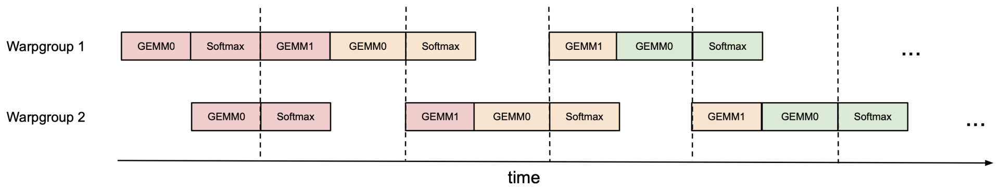
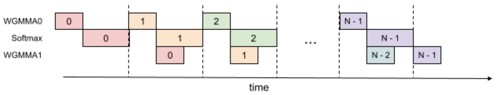
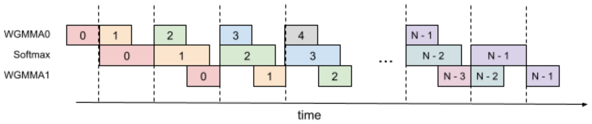
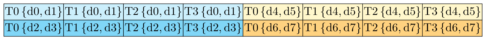
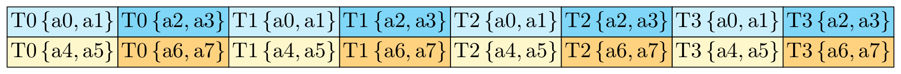
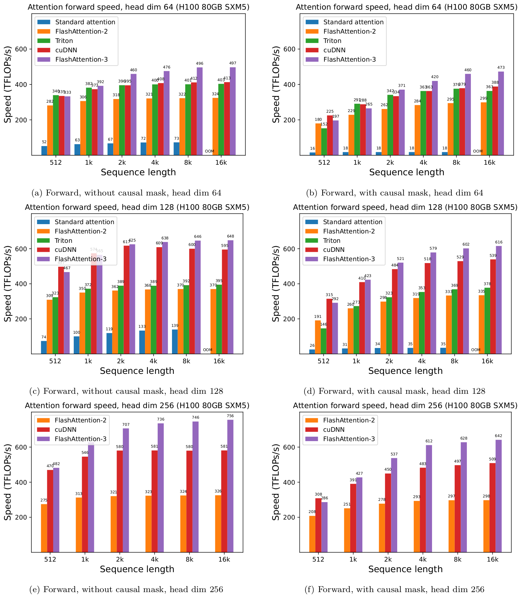
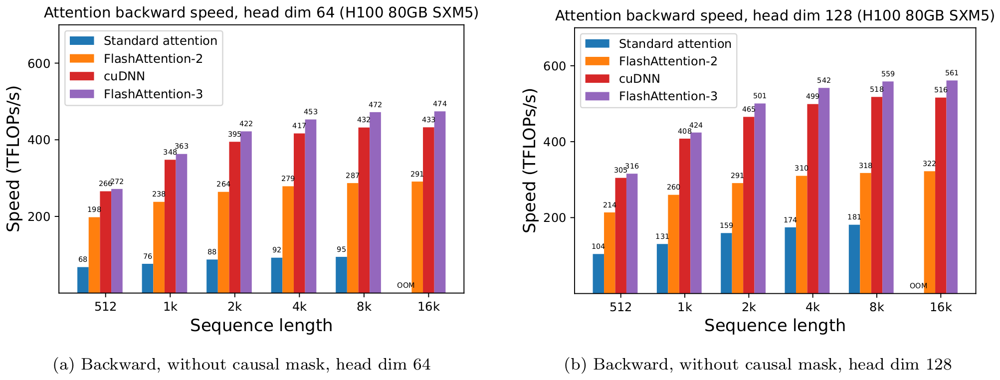
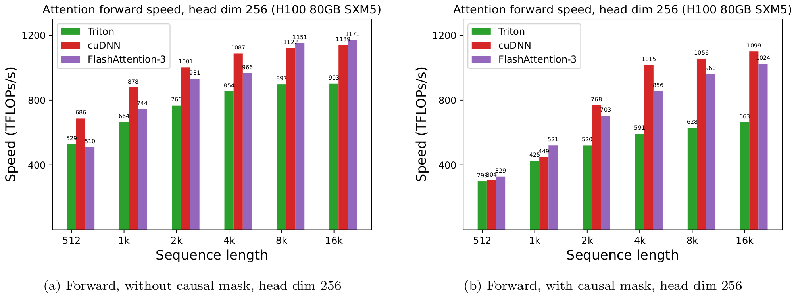
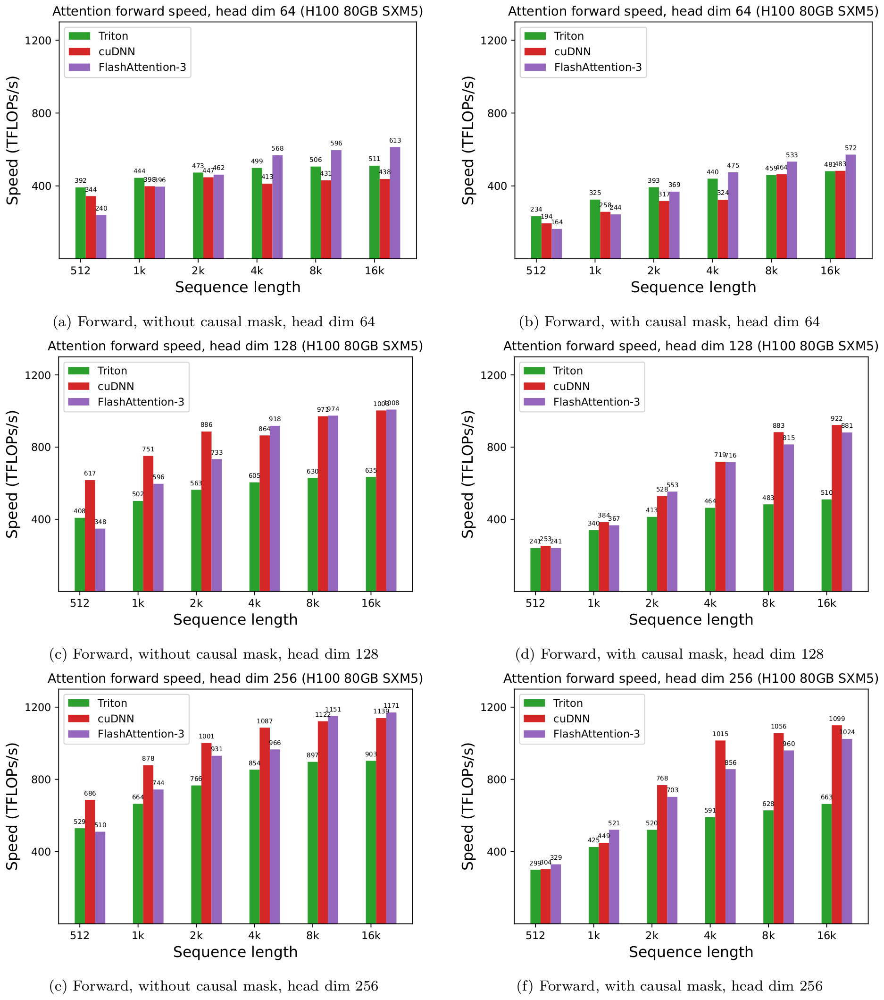

# 论文中文解读：《FlashAttention-3: Fast and Accurate Attention with Asynchrony and Low-precision》

> **基本信息**：Jay Shah\*、Ganesh Bikshandi\*（Colfax Research）、Ying Zhang（Meta）、Vijay Thakkar（NVIDIA / Georgia Tech）、Pradeep Ramani（NVIDIA）、Tri Dao（Princeton University / Together AI）（\* 为共同第一作者），arXiv:2407.08608，2024 年 7 月；论文原文 [官方页面](https://arxiv.org/abs/2407.08608)；代码 [Dao-AILab/flash-attention](https://github.com/Dao-AILab/flash-attention)。
>
> **本文的读法**：图均从论文 PDF 中按图裁出原图，每张图后有中文图题、图例/坐标轴翻译和读图结论；三张原文表与性能柱状图（图 5–7、图 9）柱顶的全部数字已转录成表，并与 PDF 文本层逐项核对过；两个异步流水线算法、反向算法与 3-stage 变体都逐行讲解。前置知识见 [FlashAttention 解读](../flash_attention/论文中文解读.md) 与 [FlashAttention-2 解读](../flash_attention_2/论文中文解读.md)；后续 Blackwell 上的工作见 [FlashAttention-4 解读](../flash_attention_4/论文中文解读.md)。

## 一、一句话结论

FlashAttention-2（FA2）在 H100 上只用到约 35% 的理论峰值算力，而优化过的矩阵乘（GEMM）能达到 80–90%。原文给出的原因有两层：一是实现层面没有使用 Hopper 专用指令；二是更根本的，FA2 的算法遵循“简化的同步模型”，没有显式利用硬件的**异步**与**低精度**能力。FlashAttention-3（FA3）针对 Hopper 提出三项技术：

1. **生产者–消费者异步**：用 warp specialization（warp 专门化）把数据搬运（TMA）与矩阵乘/softmax 计算分到不同的 warpgroup，让搬运延迟被隐藏；
2. **把 softmax 藏到异步矩阵乘的阴影里**：两个 warpgroup 之间做 pingpong 调度，同一个 warpgroup 内部再做 2-stage 的 GEMM–softmax 流水；
3. **硬件加速的低精度**：前向支持 FP8 Tensor Core，处理 WGMMA 对数据布局的要求，并用 block quantization（逐块量化）与 incoherent processing（非相干处理）降低 FP8 误差。

结果（H100 80GB SXM5）：FP16 前向比 FA2 快约 1.5–2.0 倍（逐配置从图中数字相除为 1.09–2.32 倍），图中最高 756 TFLOPs/s（占 989 TFLOPs/s 峰值的约 76%，原文正文写“最高 740、75%”）；FP16 反向比 FA2 快 1.37–1.76 倍，最高 561；FP8 前向最高 1171 TFLOPs/s（接近 1.2 PFLOPs/s）；序列较长时 FP16 超过 NVIDIA cuDNN 的实现，FP8 与 cuDNN 互有胜负。数值上，FP16 的 FA3 与 FA2 误差相同（RMSE 1.9e-4，标准实现 3.2e-4）；FP8 的 FA3 在带离群值的合成数据上 RMSE 为 9.1e-3，比 per-tensor 缩放的 FP8 基线（2.4e-2）低 2.6 倍。

## 二、背景与动机

### 2.1 Multi-Head Attention 与反向（原文 2.1 节）

设 $Q,K,V\in\mathbb{R}^{N\times d}$ 为某个 head 的查询、键、值（$N$ 为序列长度，$d$ 为 head 维度），

$$
S=\alpha QK^\top\in\mathbb{R}^{N\times N},\qquad P=\operatorname{softmax}(S)\in\mathbb{R}^{N\times N},\qquad O=PV\in\mathbb{R}^{N\times d},
$$

softmax 按行进行，通常 $\alpha=1/\sqrt d$；实际计算时会先从 $S$ 中减去逐行最大值，避免指数运算数值不稳。多头注意力（MHA）就是在多个 head 和 batch 上并行做同样的计算。

设 $\phi$ 为标量损失，$d(\cdot)=\partial\phi/\partial(\cdot)$ 表示梯度，已知 $dO\in\mathbb{R}^{N\times d}$，则

$$
dV=P^\top dO,\quad dP=dO\,V^\top,\quad dS=\operatorname{dsoftmax}(dP),\quad dQ=\alpha\,dS\,K,\quad dK=\alpha\,dS^\top Q,
$$

其中对向量有 $ds=(\operatorname{diag}(p)-pp^\top)\,dp$（$p=\operatorname{softmax}(s)$），$\operatorname{dsoftmax}$ 表示逐行作用的这个公式。与 FA2 论文相比，这里把缩放系数 $\alpha$ 写进了公式。

### 2.2 Hopper GPU 的特点与执行模型（原文 2.2 节）

FA3 的全部设计都建立在 H100（Hopper 架构）的新特性上，所以先把这些硬件概念弄清楚。

**存储层次**（容量与带宽成反比）：GMEM（global memory，全局内存，即 HBM）是所有 SM 共享的片外 DRAM，数据经过片上 L2 cache 透明缓存；每个 SM 内部有小容量、由程序员管理、分成多个 bank 的片上缓存 SMEM（shared memory，共享内存）；最后是每个 SM 内部的寄存器文件 RMEM。

表 1：NVIDIA Hopper H100 SXM5 的“线程–存储”层次。

| 硬件层级 | 并行单元 | 数据存放位置 | 容量 @ 带宽 |
|---|---|---|---|
| Chip（整颗芯片） | Grid（网格） | GMEM（全局内存，HBM） | 80 GiB @ 3.35 TB/s |
| GPC | Threadblock Clusters（线程块簇） | L2 | 50 MiB @ 12 TB/s |
| SM | Threadblock (CTA)（线程块） | SMEM（共享内存） | 每个 SM 228 KiB，整个 GPU 31 TB/s |
| Thread（线程） | Thread | RMEM（寄存器） | 每个 SM 256 KiB |

（原文表 1，第 3 页。原文脚注 4：SMEM 带宽取自 Luo 等人的测量，每个 SM 每个时钟周期 128 字节，乘以 132 个 SM 和 1830 MHz 的加速时钟得到 31 TB/s。）

**线程层次**（由细到粗）：thread（线程）→ warp（32 个线程）→ **warpgroup（4 个连续的 warp，即 128 个线程）**→ threadblock（线程块，也叫 CTA，cooperative thread array）→ threadblock cluster（线程块簇，Hopper 新增）→ grid。两套层次是联动的：同一个 CTA 内的线程被调度到同一个 SM 上；同一个 cluster 的 CTA 被调度到同一个 GPC 上；SMEM 可被 CTA 内所有线程直接寻址，而每个线程最多私有 256 个寄存器（RMEM）。

**异步与 warp specialization**：GPU 是吞吐型处理器，靠大量并发和异步来隐藏访存和执行的延迟。Hopper 的两个关键异步硬件：

- **TMA（Tensor Memory Accelerator，张量内存加速器）**：专用硬件单元，负责在 GMEM 与 SMEM 之间做异步块拷贝；发起一次拷贝只需要一个线程，发起后不会因为等待其他拷贝完成而阻塞。
- **WGMMA（warpgroup 级别的矩阵乘累加指令）**：Hopper 的 Tensor Core 通过它暴露出来，与 Ampere 等早期架构不同，它是**异步**的，并且可以**直接从 shared memory 取操作数**。发射 WGMMA 之后，线程可以继续执行其他指令，直到显式等待它完成。

硬件的异步支持使得 **warp-specialized kernel（warp 专门化的 kernel）** 成为可能：把一个 CTA 内的 warp 分成 producer（生产者）和 consumer（消费者）两类角色，各自只发出数据搬运指令或只发出计算指令；一般而言这能改善编译器生成最优指令调度的能力。此外 Hopper 支持用 `setmaxnreg` 在 warpgroup 之间**动态重新分配寄存器**：做矩阵乘的 warp 可以比只发 TMA 的 warp（只需一个线程）分到更多寄存器。

**低精度格式**：现代 GPU 有专门的低精度计算单元。例如 WGMMA 可以使用 Hopper 的 FP8 Tensor Core，每个 SM 的吞吐是 FP16/BF16 的 2 倍。但要正确调用 FP8 WGMMA，必须理解它对操作数布局的限制。设 GEMM 计算 $A\times B^\top$，$A$ 为 $M\times K$，$B$ 为 $N\times K$：若 $A$ 或 $B$ 沿外侧的 $M$ 或 $N$ 维连续存放，称为 **mn-major**；若沿内侧的 $K$ 维（归约维）连续存放，称为 **k-major**。对 FP16 的 WGMMA，位于 SMEM 的操作数两种格式都可以；但 FP8 的 WGMMA **只支持 k-major**。而且在 attention 这类需要把两个相邻 GEMM 融合进同一个 kernel 的场景里，FP32 累加器的寄存器布局与 FP8 操作数的寄存器布局互相冲突，使得第二个 FP8 WGMMA 无法直接以第一个 GEMM 的结果为输入。这些限制对算法的修改见 3.4 节。

### 2.3 标准 attention 与 FlashAttention，以及为什么要有 FA3（原文 2.3 节与第 1 节）

沿用 FlashAttention 论文的说法，**标准 attention**指把中间矩阵 $S,P$ 物化到 HBM 的实现。FlashAttention 的核心思想是用逐块的“局部 softmax”避免这些昂贵的读写，把 attention 融合进单个 kernel。局部 softmax 对应下文算法 1 消费者主循环的第 18–19 行以及对 $O$ 的逐块重缩放；推导见 FA2 论文 2.3.1 节（本仓库的 [FA2 解读](../flash_attention_2/论文中文解读.md) 也有）。FA2 在此基础上增加了沿序列长度的并行，并把前向的内循环放在 $K,V$ 的块上，提高了 occupancy 和工作分布。

但原文观察到，FA2 在新 GPU 上相对优化 GEMM 的利用率很低：H100 上约 35%，对比 GEMM 的 80–90%。原文把原因分成两层：

- **实现层面**：没有用 Hopper 专用指令替换 Ampere 指令来驱动 Tensor Core。ThunderKittens 和 cuDNN 9 已经表明，利用 Hopper 专用指令和基于 tile 的抽象可以加速 attention 并简化实现。
- **算法层面**（更根本）：FA2 遵循简化的同步模型，设计中没有显式使用异步和低精度。异步是硬件专门化的结果：专门做矩阵乘的 Tensor Core、专门做内存加载的 TMA，与执行逻辑、整数、浮点运算的普通 CUDA core 是分开的；低精度（Hopper 的 FP8、Blackwell 的 FP4，延续 Pascal 的 FP16、Ampere 的 BF16 的趋势）则是在相同功耗和芯片面积下获得两倍或四倍吞吐的成熟手段。

技术挑战在于：异步要求在 matmul 与 softmax 之间重叠计算，即使两者存在数据依赖（softmax 依赖第一个 GEMM 的输出，第二个 GEMM 又依赖 softmax 的输出）；低精度要求小心控制量化误差，尤其是 LLM 中存在离群特征（outlier features）的情形。原文脚注 1 指出，所提算法适用于任何具备足够强的异步执行与低精度能力的 GPU 架构，只是结果在 Hopper 上给出。

## 三、方法

### 3.1 生产者–消费者异步：warp specialization（原文 3.1 节上半与算法 1）

和 FA2 一样，FA3 的前向在 batch、head 数、query 序列长度三个维度上是“天然并行”的，因此只需要给出 CTA 视角的算法：一个 CTA 处理查询矩阵的一个 tile $Q_i$，算出输出的对应 tile $O_i$。为简化描述，原文先给出**没有 GEMM–softmax 重叠**的 warp specialization 方案，带一个循环的 SMEM 缓冲区。记 $d$ 为 head 维度，$N$ 为序列长度，固定查询块大小 $B_r$，把 $Q$ 分成 $T_r=\lceil N/B_r\rceil$ 块。

**算法 1：FA3 前向（无 consumer 内部重叠，CTA 视角，原文第 5 页）**。输入：$Q_i\in\mathbb{R}^{B_r\times d}$ 与 $K,V\in\mathbb{R}^{N\times d}$ 在 HBM，键块大小 $B_c$，$T_c=\lceil N/B_c\rceil$。逐行解释：

1. 初始化一个 pipeline（流水线）对象，用来管理 barrier 同步，带一个 $s$ 级的循环 SMEM 缓冲区（$s$ 个 stage，每个 stage 装一对 $K_j,V_j$）。
2. 如果当前是**生产者 warpgroup**：
3. 释放一部分预先设定数量的寄存器（`setmaxnreg` 降低寄存器上限，因为生产者几乎只发搬运指令）。
4. 发出把 $Q_i$ 从 HBM 加载到 shared memory 的指令（TMA）。
5. 加载完成后，提交（commit）通知消费者 $Q_i$ 已就绪。
6. 对 $j=0,\dots,T_c-1$ 循环：
7. 等待缓冲区第 $(j\bmod s)$ 个 stage 被消费者用完（可被覆盖）。
8. 发出把 $K_j,V_j$ 从 HBM 加载到缓冲区第 $(j\bmod s)$ 个 stage 的指令。
9. 加载完成后提交，通知消费者 $K_j,V_j$ 已就绪。
10. 循环结束。
11. 否则（当前是**消费者 warpgroup**）：
12. 按消费者 warp 的数量，申请预先设定数量的更多寄存器。
13. 片上初始化 $O_i=0\in\mathbb{R}^{B_r\times d}$，$\ell_i=0$，$m_i=-\infty$（均为长 $B_r$ 的向量）。
14. 等待 $Q_i$ 已加载到 shared memory。
15. 对 $j=0,\dots,T_c-1$ 循环：
16. 等待 $K_j$ 已加载到 shared memory。
17. 计算 $S_i^{(j)}=Q_iK_j^\top$（SS-GEMM：两个操作数都来自 shared memory），提交并等待完成。
18. 保存旧最大值 $m_i^{\text{old}}=m_i$，计算 $m_i=\max\big(m_i^{\text{old}},\operatorname{rowmax}(S_i^{(j)})\big)$。
19. 计算 $\tilde P_i^{(j)}=\exp\big(S_i^{(j)}-m_i\big)$，并更新 $\ell_i=\exp(m_i^{\text{old}}-m_i)\,\ell_i+\operatorname{rowsum}\big(\tilde P_i^{(j)}\big)$。（第 18–19 行就是局部 softmax。）
20. 等待 $V_j$ 已加载到 shared memory。
21. 计算 $O_i=\operatorname{diag}\big(\exp(m_i^{\text{old}}-m_i)\big)O_i+\tilde P_i^{(j)}V_j$（RS-GEMM：第一个操作数 $\tilde P$ 来自寄存器，第二个 $V_j$ 来自 shared memory），提交并等待完成。（原文把对角矩阵写成带 $-1$ 次方，与 FA2 论文相同的笔误：旧输出应乘以缩小系数 $e^{m^{\text{old}}-m}\le1$。）
22. 释放缓冲区第 $(j\bmod s)$ 个 stage，让生产者可以覆盖它。
23. 循环结束。
24. 做一次归一化并计算 logsumexp：$O_i=\operatorname{diag}(\ell_i)^{-1}O_i$，$L_i=m_i+\log\ell_i$。
25. 把 $O_i$ 和 $L_i$ 写回 HBM，作为 $O$ 和 $L$ 的第 $i$ 块。
26. 结束。

实现要点（原文）：在 Hopper 上，寄存器的重新分配用 `setmaxnreg`，$Q_i$ 与 $\{K_j,V_j\}$ 的加载用 TMA，消费者主循环里的 GEMM 用 WGMMA；前缀 SS 或 RS 表示第一个操作数来自 shared memory 还是寄存器文件。理解执行流程时要注意：TMA 的发射不会因为等待其他加载完成而阻塞（异步）；生产者主循环的前 $s$ 次迭代也不会发出等待，因为缓冲区正在被填满。

这个算法里消费者的每一步都是“提交并等待”，所以消费者内部仍是 GEMM → softmax → GEMM 串行；这一步带来的收益是：下一块 $K_j,V_j$ 的搬运由生产者在背景中完成，搬运延迟和指令发射延迟被隐藏。

### 3.2 Pingpong 调度：用另一个 warpgroup 的 GEMM 盖住 softmax（原文 3.1 节下半）

异步 WGMMA、TMA 加上 warp specialization，使得可以把一个 warpgroup 的 softmax 与另一个 warpgroup 的 GEMM 重叠。动机是：现代加速器上非矩阵乘运算的吞吐远低于矩阵乘。H100 SXM5 的 FP16 矩阵乘峰值是 989 TFLOPS，而特殊函数（如 softmax 必需的指数）只有 3.9 TFLOPS（原文脚注 5：CUDA 编程指南给出每个 SM 每个时钟周期 16 次特殊函数运算，乘以 132 个 SM 和 1830 MHz 时钟得到 3.9 TFLOPS）。对 head 维度 128 的 FP16 前向：矩阵乘的 FLOPs 是指数运算次数的 512 倍（每个分数元素对应两个矩阵乘共 $4d=512$ 次浮点运算，一次指数），但指数的吞吐低 256 倍（$989/3.9\approx254$，原文取 256），所以指数运算所需的时间可达矩阵乘的 50%（本文按原文数字换算：指数时间与矩阵乘时间之比 $=256/512=0.5$）。FP8 下更糟：矩阵乘吞吐翻倍而指数吞吐不变。

指数由独立的硬件单元（multi-function unit，多功能单元，MUFU）执行，所以理想情况是在 Tensor Core 做矩阵乘的同时去算指数。做法：用同步 barrier（`bar.sync` 指令）强制 warpgroup 1 的两个 GEMM（本次迭代的 GEMM1，即 $PV$，与下一次迭代的 GEMM0，即 $QK^\top$）排在 warpgroup 2 的 GEMM 之前。这样 warpgroup 1 的 softmax 就会在 warpgroup 2 做 GEMM 的时候执行；然后角色互换，warpgroup 2 做 softmax 时 warpgroup 1 做 GEMM，所以叫“pingpong”（乒乓）调度，见图 1。实际中调度并不像图里这么干净，但原文发现它通常能提升性能（例如 head 维度 128、序列长度 8192 的 FP16 前向，从 570 TFLOPS 提升到 620–640 TFLOPS）。原文致谢指出，pingpong 调度改编自 CUTLASS 中 warp-specialized pingpong GEMM 的实现。



*图 1（原文 Figure 1，第 6 页）：两个 warpgroup 通过 pingpong 调度重叠 softmax 与 GEMM：一个 warpgroup 的 softmax 应该安排在另一个 warpgroup 的 GEMM 运行的时候。相同颜色表示同一次迭代。*

**图中文字翻译与读法**：

- **横轴 time（时间）**；上行 Warpgroup 1，下行 Warpgroup 2。方块里的 GEMM0 是 $QK^\top$，GEMM1 是 $PV$，Softmax 是局部 softmax；同一种颜色（粉、橙、绿……）表示同一次迭代（同一个 $K,V$ 块）。竖直虚线标出两个 warpgroup 交换角色的时刻（从图形读出，原文图题未说明虚线）。
- **Warpgroup 1** 的节奏是：GEMM0（粉）→ Softmax（粉）→ GEMM1（粉）→ GEMM0（橙）→ Softmax（橙）→ 空闲一段 → GEMM1（橙）→ GEMM0（绿）→ Softmax（绿）→ ……；每次 Softmax 之后紧跟“本次迭代的 GEMM1 + 下一次迭代的 GEMM0”这一对。**Warpgroup 2** 的节奏相同，但整体错后一拍。
- **读图结论**：以 Tensor Core 为中心看，两个 warpgroup 的“GEMM1 + 下一次迭代的 GEMM0”这一对矩阵乘轮流上场、首尾相接：Warpgroup 1 的一对在第 1、2 条虚线之间，Warpgroup 2 的一对在第 2、3 条虚线之间，Warpgroup 1 的下一对在第 3、4 条虚线之间，依此类推，所以 Tensor Core 基本被连续占满；每个 warpgroup 的 Softmax 都落在对方这一对矩阵乘的时段内（例如 Warpgroup 1 的第一个 Softmax（粉）与 Warpgroup 2 的第一个 GEMM0（粉）同时进行，Warpgroup 2 的 Softmax（粉）与 Warpgroup 1 的 GEMM1（粉）同时进行，Warpgroup 1 的 Softmax（橙）与 Warpgroup 2 的 GEMM1（粉）同时进行）。每个 warpgroup 在自己的 Softmax 之后会空等一小段（图中的空白），等对方的这一对矩阵乘做完。原文强调这是理想化的示意图，实际调度没有这么干净。

**多查询/分组查询注意力**（原文“Attention variants”）：对 MQA 和 GQA，沿用 FA2 的做法，调整张量索引以避免在 HBM 中复制 $K$ 和 $V$。

### 3.3 Warpgroup 内部重叠 GEMM 与 softmax：2-stage 流水（原文 3.2 节与算法 2）

即使在一个 warpgroup 内部，也可以把 softmax 的一部分指令与 GEMM 的一部分指令重叠。主循环内的操作有顺序依赖，妨碍单次迭代内的并行：局部 softmax（算法 1 第 18–19 行）依赖第一个 GEMM 的输出 $S_i^{(j)}$，第二个 GEMM 又以它的结果 $\tilde P_i^{(j)}$ 为操作数；算法 1 第 17 行和第 21 行的 wait 语句把 softmax 与 GEMM 串行化了。打破依赖的办法是**跨迭代做流水**，借助寄存器里多保存的缓冲。原文提出下面的两阶段（2-stage）GEMM–softmax 流水算法，见图 2。（脚注 6：重叠方案的级数受限于循环 SMEM 缓冲区的级数 $s$，但不必与之相等。）



*图 2（原文 Figure 2，第 6 页）：两阶段的 WGMMA–softmax 流水。*

**图中文字翻译与读法**：

- 三条泳道自上而下：**WGMMA0**（第一个 GEMM，即 $QK^\top$）、**Softmax**、**WGMMA1**（第二个 GEMM，即 $PV$）；横轴 time。方块里的数字 0、1、2、……、N−1 和颜色是 $K,V$ 块的序号，竖直虚线把时间切成一段一段。
- 第 $k$ 段里依次是：WGMMA0（块 $k$）→ Softmax（块 $k$，依赖前者的结果），同时 WGMMA1（块 $k-1$，即上一块的 $PV$）与 Softmax（块 $k$）在时间上重叠。最后一段里 WGMMA1（块 N−1）单独完成收尾。
- **读图结论**：每个块内部 WGMMA0 → Softmax → WGMMA1 的依赖链没有被打破；流水的办法是跨块错开，使得“上一块的 $PV$ 矩阵乘”和“当前块的 softmax”同时进行。

**算法 2：FA3 消费者 warpgroup 的前向（原文第 7 页）**。它替代算法 1 中的消费者路径，与算法 1 的生产者路径合起来构成完整的 FP16 FA3。逐行解释（其中 $S_{\text{cur}},\tilde P_{\text{cur}}$ 是当前块的分数与指数，$S_{\text{next}}$ 是下一块的分数）：

1. 按消费者 warp 数重新分配寄存器。
2. 片上初始化 $O_i=0$，$\ell_i=0$，$m_i=-\infty$。
3. 等待 $Q_i$ 与 $K_0$ 加载到 shared memory。
4. 用 WGMMA 计算 $S_{\text{cur}}=Q_iK_0^\top$，提交并等待。
5. 释放 $K$ 缓冲区第 0 个 stage。
6. 根据 $S_{\text{cur}}$ 计算 $m_i$、$\tilde P_{\text{cur}}$、$\ell_i$，并对 $O_i$ 重新缩放。
7. 对 $j=1,\dots$ 循环（原文写作 $1\le j<T_c-1$；按流水推演应一直循环到 $j=T_c-1$，见第六节的笔误说明）：
8. 等待 $K_j$ 已加载。
9. 用 WGMMA 计算 $S_{\text{next}}=Q_iK_j^\top$，**提交但不等待**。
10. 等待 $V_{j-1}$ 已加载。
11. 用 WGMMA 计算 $O_i=O_i+\tilde P_{\text{cur}}V_{j-1}$（上一块的 $PV$），**提交但不等待**。
12. 等待 WGMMA $Q_iK_j^\top$ 完成。
13. 根据 $S_{\text{next}}$ 计算 $m_i$、$\tilde P_{\text{next}}$ 和 $\ell_i$（此时第 11 行发出的 $PV$ 矩阵乘还在异步执行，这就是重叠）。
14. 等待 WGMMA $\tilde P_{\text{cur}}V_{j-1}$ 完成，然后对 $O_i$ 重新缩放。
15. 释放 $K$ 缓冲区第 $(j\bmod s)$ 个 stage、$V$ 缓冲区第 $((j-1)\bmod s)$ 个 stage。
16. 把 $S_{\text{next}}$ 拷贝到 $S_{\text{cur}}$（对应的 $\tilde P_{\text{next}}$ 也要变成下一轮的 $\tilde P_{\text{cur}}$，伪代码没有单独写出这一步）。
17. 循环结束。
18. 等待 $V_{T_c-1}$ 已加载。
19. 计算 $O_i=O_i+\tilde P_{\text{last}}V_{T_c-1}$，提交并等待。
20. 收尾（epilogue）：根据 $m_i$（及 $\ell_i$）对 $O_i$ 做最终缩放，计算 $L_i$，把 $O_i$ 和 $L_i$ 写回 HBM。

原文把 WGMMA 当作“异步 GEMM”的代名词：主循环（第 8–16 行）里，第二个 WGMMA（第 11 行，上一块的 $PV$）与下一块的 softmax（第 13 行）重叠。（原文的表述是“第 $j$ 次迭代的第二个 WGMMA 与第 $j+1$ 次迭代的 softmax 重叠”，这里把迭代记号统一为块号，含义相同。）

流水结构在理论上能提升性能，但实践中有几点要注意：

- **编译器重排（compiler reordering）**：伪代码是理想的执行顺序，但 NVCC 常常为了优化重排指令，可能破坏精心设计的 WGMMA 与非 WGMMA 指令的流水顺序，导致意外行为或收益打折。原文对 SASS（GPU 汇编）的分析表明编译器生成了预期的重叠代码（附录 B.2，见下）。
- **寄存器压力（register pressure）**：要保持高性能就要尽量避免寄存器溢出，但两阶段流水需要额外的寄存器存放中间结果、维持阶段之间的上下文，具体来说要多保留一份 $S_{\text{next}}$，每个 threadblock 额外占用 $B_r\times B_c\times\text{sizeof(float)}$ 的寄存器。这与同样耗寄存器的“更大块大小”优化冲突，实践中要根据 profile 结果折中。
- **3-stage 流水**：把两阶段扩展为三阶段，进一步让第二个 WGMMA 也与 softmax 重叠，理论上能得到更高的 Tensor Core 利用率，但需要更多寄存器，使 tile 大小与流水深度更难平衡。详情见附录 B.3（下文）。

#### 附录 B.2：2-stage 流水的 SASS 分析

原文给出了消费者 warpgroup 主循环内部的简化 SASS（GPU 汇编）。下面保留关键指令，注释为本文所加：

```text
// 求 row_max：FMNMX 为浮点取最大，SHFL.BFLY 为 warp 内蝶形 shuffle（跨线程归约）
FMNMX.FTZ R0, R24, R6, !PT ;
SHFL.BFLY PT, R185, R2, 0x2, 0x1f ;
... FMNMX and SHFL.BFLY ...

// 做 exp2 与 row_sum，并重新缩放 O（MUFU.EX2 是多功能单元上的 2^x）
FMUL.FTZ R2, R4, UR9 ;
MUFU.EX2 R185, R184 ;
FFMA.FTZ R24, R24, UR9, -R6.reuse ;
FADD.FTZ R24, R211, R24 ;
... FMUL, FFMA, FMUL, MUFU.EX2, FADD ...

// FP32 -> FP16 的转换与 exp2、row_sum、O 重新缩放交错
F2FP.F16.F32.PACK_AB R231, R25, R231 ;
... F2FP, FMUL, MUFU, FFMA, FADD ...

// 启动第一个 WGMMA，拆成 8 条 HGMMA，前 7 条连续排在一起
WARPGROUP.ARRIVE ;
HGMMA.64x192x16.F32 R24, gdesc[UR44], RZ, !UPT ;
... HGMMA x 6 ...

// FP32->FP16、exp2、row_sum、O 重新缩放与 HGMMA 交错执行
F2FP.F16.F32.PACK_AB R214, R214, R187 ;
MUFU.EX2 R234, R5 ;
FADD.FTZ R237, R187, R2 ;
... F2FP, MUFU, FADD ...

// 最后一条 HGMMA 在这里发射，不需要等待
HGMMA.64x192x16.F32 R24, gdesc[UR44], R24, gsb0 ;

// 启动第二个 WGMMA，拆成 12 条 HGMMA，全部连在一起，不与其他指令交错
WARPGROUP.ARRIVE ;
HGMMA.64x128x16.F32 R120, R228, gdesc[UR8].tnspB, R120 ;
... HGMMA x 10 ...
HGMMA.64x128x16.F32 R120, R184, gdesc[UR8].tnspB, R120, gsb0 ;

// 末尾的 wgmma.wait_group
WARPGROUP.DEPBAR.LE gsb0, 0x0 ;
```

原文的四点观察：(1) softmax 被重排到最开头，甚至在第一个 WGMMA 之前；(2) 第一个 WGMMA 与 softmax 以及 $S$ 的 FP32 → FP16 类型转换交错，说明 WGMMA 与非 WGMMA 指令确实并行执行；(3) exp2、row_sum、$O$ 重新缩放与 FP32 → FP16 转换交织在一起；(4) 第二个 WGMMA 不与其他指令重叠，符合预期。总体上 SASS 表明两阶段流水的想法按预期工作。

补充一点指令形状的推断（本文推断，原文没有写）：$QK^\top$ 的归约维是 $d$、$PV$ 的归约维是 $B_c$，每条 HGMMA 的归约长度是 16；第一个 WGMMA 拆成 8 条 `64x192x16`，$8\times16=128$，第二个拆成 12 条 `64x128x16`，$12\times16=192$，因此这段 SASS 大致对应 head 维度 $d=128$、键块大小 $B_c=192$。

#### 附录 B.3：3-stage 流水（负面结果）

原文还尝试了 3-stage 流水：同时并行“第 $j+2$ 块的第一个 WGMMA（$QK^\top$）、第 $j+1$ 块的 softmax、第 $j$ 块的第二个 WGMMA（$PV$）”，见图 8 和算法 4。结果比 2-stage 更差，原因有二（见下）。



*图 8（原文 Figure 8，第 20 页）：3-stage 流水。*

**图中文字翻译与读法**：三条泳道仍是 WGMMA0（$QK^\top$）、Softmax、WGMMA1（$PV$），数字与颜色是块序号。每一段时间里同时出现三个不同块的操作：WGMMA0 处理块 $k$、Softmax 处理块 $k-1$、WGMMA1 处理块 $k-2$（例如图中某一段是 WGMMA0 的“3”、Softmax 的“2”、WGMMA1 的“1”）。与图 2 相比多了一级重叠。

**算法 4：3-stage 流水的消费者 warpgroup 前向（原文第 20 页）**。每个 warpgroup 读 1 个 $Q_i$ 块，遍历 $T_c$ 个 $K,V$ 块，输出 1 个 $O_i$ 块和 1 个 logsumexp 块 $L_i$。逐行解释：

1. 初始化：把 $Q_i$ 载入 SRAM，初始化 $O_i,\ell_i,m_i$ 与 `scale_o`（用来重新缩放 $O_i$ 的系数向量）。
2. 等生产者把 $K_0$ 载入。
3. 用 WGMMA 算 $S=Q_iK_0^\top$，提交并等待。
4. 根据 $S$ 计算 $m_i,\tilde P_i,\ell_i,$ `scale_o`。
5. 等生产者载入 $K_1$。
6. 用 WGMMA 算 $S=Q_iK_1^\top$，提交并等待。
7. 对 $j=2,\dots$ 循环（原文上界写作 $j<T_c-2$，同样疑似偏小，见第六节）：
8. 等 $K_j$ 载入。
9. 算 $S_{\text{next}}=Q_iK_j^\top$（WGMMA），提交但不等待。
10. 等 $V_{j-2}$ 载入。
11. 按 `scale_o` 重新缩放 $O_i$。
12. 算 $O_i=O_i+\tilde P_iV_{j-2}$（WGMMA），提交但不等待。
13. 根据 $S$ 计算 $m_i$、$\tilde P_{i,\text{next}}$、$\ell_i$、`scale_o`（与第 9、12 行的两个 WGMMA 同时进行）。
14. 等待之前所有的 WGMMA 完成。
15. 把 $S_{\text{next}}$ 拷到 $S$。
16. 把 $\tilde P_{i,\text{next}}$ 拷到 $\tilde P_i$。
17. 循环结束。
18–24. 收尾：依次等待 $V_{T_c-2}$ 载入、重新缩放、算 $O_i=O_i+\tilde P_iV_{T_c-2}$、再根据 $S$ 算出最后一块的 $m_i,\tilde P_i,\ell_i,$ `scale_o`、等待 $V_{T_c-1}$、重新缩放、算最后一次 $O_i=O_i+\tilde P_iV_{T_c-1}$。
25. 收尾：根据 $\ell_i$ 缩放 $O_i$，算 $L_i$，把 $O_i,L_i$ 写回 HBM。

3-stage 表现更差的两个原因（原文）：**重叠不如预期**——原文期望 softmax 与（第一个 WGMMA + 第二个 WGMMA）都重叠，但编译器不配合，SASS 显示只有第一个 WGMMA 与 softmax 重叠、第二个没有，原文表示不清楚编译器为什么这样重排；**寄存器压力**——需要额外存一份 $\tilde P_i$ 和 `scale_o`，大小为 $B_r\times B_c\times\text{sizeof(input\_data\_type)}+B_r\times\text{sizeof(float)}$，因此必须选更小的块大小。

### 3.4 FP8 低精度（原文 3.3 节）

用 FP8 精度算 FA3 的前向，相比 FP16 多了布局一致性方面的挑战，也需要处理精度问题。

#### 效率：布局变换

**第一个问题：$V$ 必须沿序列长度方向连续。** 输入张量 $Q,K,V$ 通常沿 head 维度连续存放。对第一个 GEMM $Q_iK_j^\top$，$Q_i$ 和 $K_j$ 的归约维是 $d$，沿 $d$ 连续恰好就是 k-major，没有问题。但第二个 GEMM $\tilde PV_j$ 的归约维是序列方向（键块大小 $B_c$），要满足 FP8 WGMMA 的 k-major 约束，装进 SMEM 的 $V$ 的 tile 必须**沿序列长度维连续**。而 TMA 加载本身不能改变连续的维度，所以要么（1）在 GMEM 里预处理转置 $V$，要么（2）把 $V$ 的 tile 载入 SMEM 之后在 kernel 内部转置。方案（1）可以（1a）把转置融合进前一步（比如 rotary embedding）的 epilogue，或（1b）调用独立的预处理转置 kernel 交换序列与 head 维度的步长（stride）；但（1a）难以集成进标准库，（1b）在推理这类访存受限的场景太浪费。

因此 FA3 FP8 选择方案（2），即 kernel 内转置，利用 `LDSM`（`ldmatrix`）和 `STSM`（`stmatrix`）指令：一个 warp 的线程协同地以 128 字节的粒度把 SMEM 读到寄存器（LDSM）或把寄存器写回 SMEM（STSM）。这两条指令都很省寄存器，所以可以放在生产者 warpgroup 里执行，并且在拷贝时可以顺便转置布局。而且除第一次迭代外，可以把下一块 $V$ 的转置安排在涉及上一块 $V$ 和当前 $K$ 的那两个 WGMMA 的“阴影”里执行。（原文脚注 8：PTX 文档把 LDSM/STSM 描述为拷贝 $8\times8$ 的 16 位元素矩阵，但 FP8 可以两个 8 位元素打包成一个 16 位使用；转置版本的 LDSM/STSM 不能拆分打包的 8 位元素，所以两者之间要做一些寄存器搬运才能真正完成 tile 转置，细节从略。）

**第二个问题：FP8 WGMMA 的累加器布局与操作数 A 的寄存器布局不一致。** 与 FP16 不同，FP8 WGMMA 的 FP32 累加器的存储布局，和它作为寄存器里的操作数 A 时假设的布局不同。原文用图 3、图 4 展示这两种布局的片段（寄存器条目按所列顺序保存在每个线程中）。



*图 3（原文 Figure 3，第 8 页）：FP32 累加器的 WGMMA 寄存器布局：第 0 行与第 8 行，线程 0–3，条目 0–7。*



*图 4（原文 Figure 4，第 8 页）：FP8 操作数 A 的 WGMMA 寄存器布局：第 0 行与第 8 行，线程 0–3，条目 0–7。*

**图中文字翻译与读法**：

- 两张图都是 2 行 × 8 格的小表：**上行是矩阵的第 0 行，下行是第 8 行**；每个格子写着“线程号 {寄存器条目}”，例如 `T1 {d0, d1}` 表示线程 1 的寄存器条目 d0、d1，这两个元素在矩阵里相邻（同一行相邻两列）。两张图横向都覆盖 16 个矩阵列（每格 2 列）。
- **图 3（FP32 累加器）**：上行左半 4 格是 T0–T3 依次持有 {d0,d1}（第 0 行、列 0–7），右半 4 格是 T0–T3 依次持有 {d4,d5}（第 0 行、列 8–15）；下行对应第 8 行，左半是 {d2,d3}，右半是 {d6,d7}。也就是说，每个线程在同一行里持有的是**隔开 8 列的两个相邻对**。
- **图 4（FP8 操作数 A）**：上行每个线程连续持有 4 个相邻元素：T0 持有 {a0,a1}、{a2,a3}（第 0 行列 0–3），T1 持有列 4–7，T2 持有列 8–11，T3 持有列 12–15；下行（第 8 行）是 {a4,a5}、{a6,a7}，排布方式相同。
- **读图结论**：同样是“线程 T0 的前几个寄存器”，在累加器里对应列 0、1、8、9，而在操作数 A 里却要求对应列 0、1、2、3，所以 FP32 累加器转成 FP8 之后不能直接当作下一个 WGMMA 的操作数 A 使用。

**解决办法**：用 byte permute（字节置换）指令把第一个 WGMMA 的累加器变成适合第二个 WGMMA 的格式，并与 kernel 内转置产生的 $V$ tile 布局兼容。具体地，把图 3 里每个线程寄存器条目的顺序改为

$$
\{d0\ d1\ d4\ d5\ d2\ d3\ d6\ d7\},
$$

并且这一置换每 8 个字节重复一次。从 $P$ tile 的逻辑形状看，这相当于置换它的列（例如原来的第 0、1、8、9 列现在成了最前面的四列）。按图 3、图 4 自行推导（本文推导，原文只举了 0189 这一例）：线程 T0–T3 拿到的逻辑列依次是原列 {0,1,8,9}、{2,3,10,11}、{4,5,12,13}、{6,7,14,15}。为了让 WGMMA 算出正确的输出 tile，只要让 kernel 内转置**相应地写出 $V$ tile 的一个匹配的行置换**即可，因为 $P$ 的列和 $V$ 的行是归约维，同时置换不改变乘积。（原文脚注 9：做 kernel 内转置带来的这点额外自由度，免去了用 shuffle 指令在线程之间改变寄存器归属，那是他们之前在 Colfax 的技术博客里描述过的做法。）

#### 精度：block quantization 与 incoherent processing

FP8（e4m3 格式）只用 3 位尾数、4 位指数，数值误差比 FP16/BF16 大得多。而且大模型通常有离群值（outlier），比其他值大得多，让量化更困难。常规做法是 per-tensor 缩放（每个张量一个标量，比如 $Q$、$K$、$V$ 各一个）。FA3 采用两项技术降低 FP8 attention 的误差：

1. **Block quantization（逐块量化）**：每个块保留一个缩放标量，也就是把 $Q,K,V$ 各自切成 $B_r\times d$ 或 $B_c\times d$ 的块并分别量化。这个量化可以与 attention 之前的一个操作（比如 rotary embedding）融合，不增加额外耗时（因为 rotary embedding 受限于内存带宽）。FA3 的算法天然是分块的，所以可以在 $S$ 的每个块上乘以相应的缩放来抵消块量化，没有额外计算开销。
2. **Incoherent processing（非相干处理）**：在量化为 FP8 之前，用一个随机正交矩阵 $M$ 同时乘 $Q$ 和 $K$。因为 $M$ 正交，$MM^\top=I$，所以 $(QM)(KM)^\top=QK^\top$，同时乘 $Q$ 和 $K$ 不会改变 attention 的输出。它的作用是把离群值“摊开”：$QM$ 或 $KM$ 的每个元素是 $Q$ 或 $K$ 若干元素的随机和，从而减小量化误差。实践中沿用 Chee 等（QuIP）与 Tseng 等（QuIP#）的做法，把 $M$ 取为随机 ±1 对角矩阵与 Hadamard 矩阵的乘积，这样乘法的代价是 $O(d\log d)$ 而不是 $O(d^2)$，并且可以与 rotary embedding 融合，没有额外计算开销。

原文称这两项技术合起来最多把数值误差降低 2.6 倍（见 4.6 节）。

### 3.5 反向：加一个 dQ writer 角色（附录 B.1 与算法 3）

反向同样用 warp specialization 处理异步。与前向“生产者 + 消费者”的简单模式不同，反向多了一个角色 **dQ writer（$dQ$ 写入者）**：因为需要把每个 thread block 算出的 $dQ$ 累加到全局的 $dQ$ 上。这个累加有内存竞争（很多 thread block 写同一个位置），所以让一个专门的 warp 去处理（并利用异步），可以避免阻塞 thread block 内其他 warp 进行下一步矩阵乘。

**算法 3：FA3 带 warp specialization 的反向（原文第 18 页）**。输入：$Q,K,V,O,dO\in\mathbb{R}^{N\times d}$ 与 logsumexp $L\in\mathbb{R}^N$ 在 HBM，块大小 $B_c,B_r$。逐行解释：

1. 在一个预处理 kernel 中计算 $D=\operatorname{rowsum}(dO\circ O)$（原文把维度写成 $\mathbb{R}^d$，应为 $\mathbb{R}^N$），写到 HBM 并分成 $T_r$ 块 $D_i$。
2. 把 $Q$ 切成 $T_r=\lceil N/B_r\rceil$ 块，$K,V$ 切成 $T_c=\lceil N/B_c\rceil$ 块。
3. 把 $dO$ 切成 $T_r$ 块，把 $L$ 切成 $T_r$ 块。
4. 初始化 pipeline 对象，管理 $s$ 级循环 SMEM 缓冲区的 barrier 同步。
5. 如果在**生产者 warpgroup**：
6. 释放一部分寄存器。
7. 发出把本 CTA 负责的 $K_j,V_j$ 从 HBM 加载到 shared memory 的指令。
8. 加载完成后提交，通知消费者。
9. 对 $i=1,\dots,T_r$ 循环：
10. 等待缓冲区第 $(i\bmod s)$ 个 stage 被消费。
11. 发出把 $Q_i,dO_i$ 加载到该 stage 的指令。
12. 加载完成后提交，通知消费者。
13. 循环结束。
14. 否则如果在**消费者 warpgroup**：
15. 按消费者 warp 数重新分配（更多的）寄存器。
16. 片上初始化 $dK_j=0$，$dV_j=0$。
17. 等待 $K_j,V_j$ 已加载。
18. 对 $i=1,\dots,T_r$ 循环：
19. 等待 $Q_i$ 已加载。
20. 把 $L_i,D_i$ 从 HBM 读到片上 SRAM。
21. 计算 $S_i^{(j)}=Q_iK_j^\top$（SS-GEMM），提交。
22. 等待 $dO_i$ 已加载。
23. 计算 $dP_i^{(j)}=dO_iV_j^\top$（SS-GEMM），提交。
24. 等待 $S_i^{(j)}$，然后计算 $P_i^{(j)}=\exp(S_{ij}-L_i)$。
25. 等待 $dP_i^{(j)}$，然后计算 $dS_i^{(j)}=P_i^{(j)}\circ(dP_i^{(j)}-D_i)$。
26. 计算 $dV_j\leftarrow dV_j+(P_i^{(j)})^\top dO_i$（RS-GEMM），提交。
27. 计算 $dK_j\leftarrow dK_j+(dS_i^{(j)})^\top Q_i$（RS-GEMM），提交并等待 $dV_j$ 与 $dK_j$ 都完成。
28. 计算 $dQ_i^{(\text{local})}=dS_i^{(j)}K_j$（SS-GEMM），写入 smem，并通知 dQ writer。
29. 循环结束。
30. 否则如果在 **dQ writer warp**：
31. 对 $i=1,\dots,T_r$ 循环：
32. 等待 $dQ_i^{(\text{local})}$ 在 smem 中就绪。
33. 用 semaphore（信号量）把 $dQ_i^{(\text{local})}$ 原子地加到全局内存里的 $dQ_i$ 上。
34. 循环结束。
35. 结束。

与 FA2 的反向相比，数学内容相同（每个 CTA 负责一个列块，外循环在 $K,V$ 块、内循环在 $Q,dO$ 块，$dQ$ 靠原子加累加），区别是用 warp specialization 把数据搬运和 $dQ$ 的全局累加各自分给专门的 warp。算法 3 的伪代码里没有出现 pingpong 与 2-stage 流水（原文也没有说反向使用它们），FP8 也只描述了前向的改造。

### 3.6 FA2 与 FA3 对照

| 维度 | FlashAttention-2 | FlashAttention-3 |
|---|---|---|
| 目标硬件 | A100（Ampere） | H100（Hopper） |
| 数据搬运 | 遵循简化的同步模型，设计中没有显式使用异步 | TMA 异步搬运，由 producer warpgroup 专职发起，经多级循环 SMEM 缓冲 |
| Tensor Core 指令 | 没有使用 Hopper 专用指令（沿用 Ampere 指令） | 异步 WGMMA，操作数可直接取自 SMEM |
| warp 角色 | 没有 producer / consumer 分工 | producer / consumer 分工，用 `setmaxnreg` 重分配寄存器；反向另有 dQ writer |
| softmax 与 GEMM | 串行 | warpgroup 之间 pingpong + warpgroup 内 2-stage 流水 |
| 精度 | FP16/BF16 | FP16/BF16，另有 FP8 前向（block quantization + incoherent processing） |
| H100 上的利用率 | 约 35%（原文） | FP16 前向最高约 76%（图中 756/989） |

## 四、实验

### 4.1 实验设置（原文第 4 节与附录 C.1、C.2）

实现使用 CUTLASS 的 WGMMA 与 TMA 抽象。原文要验证的三点：

- **Attention 基准测试**：在不同序列长度下，把 FA3 与 PyTorch 标准实现、FA2、Triton 里的 FA2（它使用了 H100 专用指令）以及 cuDNN 里针对 H100 优化的厂商版 FA2 比较。原文结论：FA3 比 FA2 最多快 2.0 倍、比 Triton 的 FA2 快 1.5 倍；最高 740 TFLOPs/s，约为 H100 理论峰值的 75%。
- **消融**：验证 warp specialization 与 GEMM–softmax 流水这两项算法改进确实带来加速。
- **FP8 attention 的精度**：验证 block quantization 与 incoherent processing 把 FP8 FA3 的数值误差降低 2.6 倍。

**基准设置**：H100 80GB SXM5（700 W），FP16 输入；有/无因果 mask，head 维度 64、128 或 256；序列长度取 512、1k、……、16k，batch 取使总 token 数为 16k；hidden dimension 为 2048，所以 head 维度 64、128、256 分别对应 32、16、8 个 head。FLOPs 的算法与 FA2 相同：前向取 $4\cdot\mathrm{seqlen}^2\cdot\text{head dimension}\cdot\text{number of heads}$，因果时除以 2；反向取前向的 2.5 倍（前向 2 个矩阵乘，反向因重计算共 5 个）。FP8 前向在类似设置下测量，正文只报告 head 维度 256（图 7），完整结果在附录（图 9）。

**软硬件版本与测量方法（附录 C.1）**：CUDA 12.3、cuDNN 9.1.1.17、CUTLASS 3.5、FlashAttention 2.5.8、Triton nightly 3.0.0.post20240424212437、PyTorch 2.3.0（均为 2024 年 5 月写作时的最新版本）。为减小波动，GPU 时钟固定在 1830 MHz（这正是计算 FP16 理论峰值 989 TFLOPS 所用的时钟），每个基准重复 100 次取平均。

**FP8 的序列长度（附录 C.2）**：FP8 基准使用序列长度 512、1024、2048、4224、8448、16896；当序列长度不小于 4k 时，还取能被 132（H100 SXM5 的 SM 数）整除的值，以避免 wave quantization（线程块总数不是 SM 数的整数倍时，最后一“波”只填满部分 SM，利用率下降）。因此图 7、图 9 中标注的 4k、8k、16k 实际是 4224、8448、16896。

### 4.2 FP16 前向速度（图 5）



*图 5（原文 Figure 5，第 10 页）：H100 80GB SXM5 上 attention 前向速度（FP16/BF16，TFLOPs/s，越高越好）。*

**图中文字翻译与读法**：

- **标题与坐标**：“Attention forward speed, head dim 64/128/256 (H100 80GB SXM5)”（H100 80GB SXM5 上 head 维度 64/128/256 的 attention 前向速度）；纵轴 Speed (TFLOPs/s)，横轴 Sequence length（512 到 16k）。
- **六个子图**：(a) 无因果 mask、head 维度 64；(b) 有因果 mask、head 维度 64；(c) 无因果、128；(d) 有因果、128；(e) 无因果、256；(f) 有因果、256。
- **图例（每组从左到右）**：蓝色 Standard attention（标准 attention）、橙色 FlashAttention-2、绿色 Triton（Triton 实现的 FA2，使用 H100 专用指令）、红色 cuDNN（厂商实现）、紫色 FlashAttention-3；head 维度 256 的子图 (e)(f) 只有 FlashAttention-2、cuDNN、FlashAttention-3 三项（原文没有说明为何缺另两项）。柱顶的数字是 TFLOPs/s；**OOM** 表示显存溢出（标准 attention 在 16k 溢出，没有柱）。
- 个别柱顶数字被图例遮挡：(c) 中 512 的 cuDNN（497）、1k 的 cuDNN（574）与 FA3（565），(e) 中 1k 的 FA3（627）；下表这几个数取自 PDF 文本层，与柱高吻合。

图 5 的全部数字（TFLOPs/s；d 表示 head 维度；OOM 为显存溢出）：

| 子图 | 实现 | 512 | 1k | 2k | 4k | 8k | 16k |
|---|---|---:|---:|---:|---:|---:|---:|
| (a) 无 causal，d=64 | Standard attention | 52 | 63 | 67 | 72 | 73 | OOM |
| (a) | FlashAttention-2 | 282 | 306 | 318 | 321 | 322 | 324 |
| (a) | Triton | 340 | 382 | 396 | 400 | 401 | 403 |
| (a) | cuDNN | 335 | 373 | 395 | 408 | 412 | 413 |
| (a) | **FlashAttention-3** | **333** | **392** | **460** | **476** | **496** | **497** |
| (b) 有 causal，d=64 | Standard attention | 16 | 18 | 18 | 18 | 18 | OOM |
| (b) | FlashAttention-2 | 180 | 229 | 262 | 284 | 295 | 299 |
| (b) | Triton | 152 | 291 | 342 | 363 | 376 | 363 |
| (b) | cuDNN | 225 | 288 | 334 | 363 | 379 | 388 |
| (b) | **FlashAttention-3** | **197** | **265** | **371** | **420** | **460** | **473** |

| 子图 | 实现 | 512 | 1k | 2k | 4k | 8k | 16k |
|---|---|---:|---:|---:|---:|---:|---:|
| (c) 无 causal，d=128 | Standard attention | 74 | 100 | 119 | 133 | 139 | OOM |
| (c) | FlashAttention-2 | 309 | 350 | 362 | 368 | 370 | 370 |
| (c) | Triton | 323 | 372 | 389 | 389 | 392 | 395 |
| (c) | cuDNN | 497 | 574 | 617 | 609 | 600 | 595 |
| (c) | **FlashAttention-3** | **467** | **565** | **625** | **638** | **646** | **648** |
| (d) 有 causal，d=128 | Standard attention | 26 | 31 | 34 | 35 | 35 | OOM |
| (d) | FlashAttention-2 | 191 | 260 | 298 | 319 | 333 | 335 |
| (d) | Triton | 146 | 273 | 323 | 353 | 369 | 378 |
| (d) | cuDNN | 315 | 410 | 484 | 518 | 529 | 539 |
| (d) | **FlashAttention-3** | **292** | **423** | **521** | **579** | **602** | **616** |

| 子图 | 实现 | 512 | 1k | 2k | 4k | 8k | 16k |
|---|---|---:|---:|---:|---:|---:|---:|
| (e) 无 causal，d=256 | FlashAttention-2 | 275 | 313 | 321 | 323 | 324 | 326 |
| (e) | cuDNN | 470 | 546 | 580 | 581 | 580 | 581 |
| (e) | **FlashAttention-3** | **482** | **627** | **707** | **736** | **746** | **756** |
| (f) 有 causal，d=256 | FlashAttention-2 | 208 | 251 | 278 | 293 | 297 | 298 |
| (f) | cuDNN | 308 | 391 | 450 | 483 | 497 | 509 |
| (f) | **FlashAttention-3** | **286** | **427** | **537** | **612** | **628** | **642** |

（原文图 5，第 10 页。）

**读图结论**（倍数均由图中取整后的数字相除得到，保留两位小数）：

- **峰值**：FA3 最高值是 (e) 无因果、head 维度 256、序列长 16k 的 756 TFLOPs/s，按 989 TFLOPs/s 峰值约为 76%；原文正文与摘要写“最高 740 TFLOPs/s、75%”（740 不是图中的某个柱值，最接近的是 4k 的 736 和 8k 的 746）。head 维度越小利用率越低：无因果时 FA3 的利用率 (a) d=64 为约 34%–50%，(c) d=128 为约 47%–66%，(e) d=256 为约 49%–76%。
- **对 FA2**：FA3/FA2 在六个子图分别为 (a) 1.18–1.54、(b) 1.09–1.58、(c) 1.51–1.75、(d) 1.53–1.84、(e) 1.75–2.32、(f) 1.38–2.15 倍。原文的“1.5–2.0 倍”大体对应 head 维度 128 及以上、序列长度较长的配置（例如 (c) 4k 以上约 1.73–1.75，(d) 4k 以上约 1.81–1.84）；head 维度 64 时只有约 1.5 倍（长序列）甚至更低（短序列 1.09–1.28），head 维度 256 则可达 2.3 倍。
- **对 cuDNN**：FA3/cuDNN 为 0.88–1.30。序列长度 2k 及以上，FA3 在六个子图里都高于 cuDNN；512 时除 (e) 外 FA3 都不高于 cuDNN（(a) 的 333 对 335 基本持平，(b)(c)(d)(f) 明显更低）；1k 时 (b) 的 265 低于 cuDNN 的 288、(c) 的 565 低于 574。因此原文“序列长度 1k 及以上 FA3 超过 cuDNN”需要改为“2k 及以上”才对所有子图成立。
- **对 Triton**：FA3/Triton 为 0.91–2.00，d=64 时与 Triton 接近（(a) 的 512 反而是 Triton 的 340 高于 FA3 的 333，(b) 的 1k 是 Triton 的 291 高于 FA3 的 265），d=128 时 FA3 快 1.45–2.00 倍。
- **对标准 attention**：约 4.65–25.56 倍（有因果、d=64、8k：460/18）；原文写“最高 3–16 倍”，与图中数字相除的最大值不一致。
- **因果与非因果**：同等配置下因果的吞吐明显更低，且短序列差距更大（例如 FA3 的 d=128：512 时 292 对 467，16k 时 616 对 648）。原文没有解释这一点。

### 4.3 FP16 反向速度（图 6）



*图 6（原文 Figure 6，第 11 页）：H100 80GB SXM5 上 attention 反向速度（FP16/BF16，TFLOPs/s，越高越好）。*

**图中文字翻译与读法**：标题 “Attention backward speed, head dim 64/128 (H100 80GB SXM5)”；子图 (a) 无因果 mask、head 维度 64；(b) 无因果 mask、head 维度 128（原文反向只给了这两个无因果配置）。图例：蓝色 Standard attention、橙色 FlashAttention-2、红色 cuDNN、紫色 FlashAttention-3；横轴序列长度 512 到 16k；OOM 为显存溢出。

图 6 的全部数字（TFLOPs/s）：

| 子图 | 实现 | 512 | 1k | 2k | 4k | 8k | 16k |
|---|---|---:|---:|---:|---:|---:|---:|
| (a) 无 causal，d=64 | Standard attention | 68 | 76 | 88 | 92 | 95 | OOM |
| (a) | FlashAttention-2 | 198 | 238 | 264 | 279 | 287 | 291 |
| (a) | cuDNN | 266 | 348 | 395 | 417 | 432 | 433 |
| (a) | **FlashAttention-3** | **272** | **363** | **422** | **453** | **472** | **474** |
| (b) 无 causal，d=128 | Standard attention | 104 | 131 | 159 | 174 | 181 | OOM |
| (b) | FlashAttention-2 | 214 | 260 | 291 | 310 | 318 | 322 |
| (b) | cuDNN | 305 | 408 | 465 | 499 | 518 | 516 |
| (b) | **FlashAttention-3** | **316** | **424** | **501** | **542** | **559** | **561** |

（原文图 6，第 11 页。）

**读图结论**：

- FA3 在所有 12 个组合里都是最高的柱，最高 561 TFLOPs/s（(b)，16k），约为 989 的 57%。
- FA3/FA2：(a) 1.37–1.64，(b) 1.48–1.76，合计 1.37–1.76 倍；原文“反向 1.5–1.75 倍”大体成立，只有短序列 d=64 偏低（512 时 1.37）。
- FA3/cuDNN：1.02–1.09 倍，差距很小；FA3/标准 attention：3.04–4.97 倍。
- 原文没有给出因果反向、head 维度 256 的反向结果，也没有 FP8 反向。

### 4.4 FP8 前向速度（图 7 与附录图 9）



*图 7（原文 Figure 7，第 11 页）：H100 80GB SXM5 上 FP8 attention 前向速度（head 维度 256，TFLOPs/s，越高越好）。*

**图中文字翻译与读法**：标题 “Attention forward speed, head dim 256 (H100 80GB SXM5)”；子图 (a) 无因果 mask，(b) 有因果 mask；图例：绿色 Triton、红色 cuDNN、紫色 FlashAttention-3；横轴序列长度（标注 512 到 16k，实际为 512、1024、2048、4224、8448、16896，见 4.1 节）；纵轴 Speed (TFLOPs/s)，刻度 400、800、1200。注意 FP8 图的纵轴比 FP16 的图（最高 800 左右）大得多。

图 7 的全部数字（TFLOPs/s，FP8，head 维度 256）：

| 子图 | 实现 | 512 | 1k | 2k | 4k | 8k | 16k |
|---|---|---:|---:|---:|---:|---:|---:|
| (a) 无 causal，d=256 | Triton | 529 | 664 | 766 | 854 | 897 | 903 |
| (a) | cuDNN | 686 | 878 | 1001 | 1087 | 1122 | 1139 |
| (a) | **FlashAttention-3** | **510** | **744** | **931** | **966** | **1151** | **1171** |
| (b) 有 causal，d=256 | Triton | 299 | 425 | 520 | 591 | 628 | 663 |
| (b) | cuDNN | 304 | 449 | 768 | 1015 | 1056 | 1099 |
| (b) | **FlashAttention-3** | **329** | **521** | **703** | **856** | **960** | **1024** |

（原文图 7，第 11 页；与附录图 9 的 (e)(f) 完全相同。）

完整的 FP8 结果在附录 C.2 的图 9：



*图 9（原文 Figure 9，第 22 页）：H100 80GB SXM5 上 FP8 attention 前向速度的完整结果（TFLOPs/s，越高越好）。*

**图中文字翻译与读法**：六个子图依次为 (a) 无因果、head 维度 64；(b) 有因果、64；(c) 无因果、128；(d) 有因果、128；(e) 无因果、256；(f) 有因果、256；其中 (e)(f) 即图 7。图例与图 7 相同（Triton、cuDNN、FlashAttention-3）。个别数字被柱重叠（如 (c) 中 8k、16k 的 cuDNN 与 FA3 值很接近）；下表取自 PDF 文本层，与柱高吻合。

图 9 中 head 维度 64 与 128 的数字（TFLOPs/s，FP8；head 维度 256 见上面图 7 的表）：

| 子图 | 实现 | 512 | 1k | 2k | 4k | 8k | 16k |
|---|---|---:|---:|---:|---:|---:|---:|
| (a) 无 causal，d=64 | Triton | 392 | 444 | 473 | 499 | 506 | 511 |
| (a) | cuDNN | 344 | 398 | 447 | 413 | 431 | 438 |
| (a) | **FlashAttention-3** | **240** | **396** | **462** | **568** | **596** | **613** |
| (b) 有 causal，d=64 | Triton | 234 | 325 | 393 | 440 | 459 | 481 |
| (b) | cuDNN | 194 | 258 | 317 | 324 | 464 | 483 |
| (b) | **FlashAttention-3** | **164** | **244** | **369** | **475** | **533** | **572** |
| (c) 无 causal，d=128 | Triton | 408 | 502 | 563 | 605 | 630 | 635 |
| (c) | cuDNN | 617 | 751 | 886 | 864 | 971 | 1003 |
| (c) | **FlashAttention-3** | **348** | **596** | **733** | **918** | **974** | **1008** |
| (d) 有 causal，d=128 | Triton | 241 | 340 | 413 | 464 | 483 | 510 |
| (d) | cuDNN | 253 | 384 | 528 | 719 | 883 | 922 |
| (d) | **FlashAttention-3** | **241** | **367** | **553** | **716** | **815** | **881** |

（原文图 9，第 22 页。）

**读图结论**：

- **峰值**：FA3 的 FP8 前向最高 1171 TFLOPs/s（无因果、head 维度 256、16k），对应原文“接近 1.2 PFLOPs/s”。原文没有给出 FP8 的理论峰值；原文 2.2 节说 FP8 WGMMA 的每 SM 吞吐是 FP16 的 2 倍，按 $989\times2$ 推算约 1978 TFLOPs/s（本文推算），1171 约为其 59%。FP8 的 FA3 比同配置的 FP16 快：head 维度 256 无因果 16k 时 1171 对 756，约 1.55 倍（本文换算，不到理论上的 2 倍）。
- **对 cuDNN**：head 维度 64 时，序列长度达到 2k 以上 FA3 领先（无因果：2k 462 对 447，16k 613 对 438，最多 1.40 倍；有因果：2k 起领先，16k 572 对 483），512 与 1k 落后；head 维度 128 无因果时，2k 及以下 cuDNN 明显更快（2k：886 对 733），4k 起 FA3 略领先或持平（4k 918 对 864，8k 974 对 971，16k 1008 对 1003）；head 维度 128 有因果时，除 2k（553 对 528）外，cuDNN 持平或更快；head 维度 256 无因果时，4k 及以下 cuDNN 更快，8k 与 16k FA3 略领先（1151 对 1122，1171 对 1139）；head 维度 256 有因果时，仅 512、1k FA3 领先，2k 起 cuDNN 更快（4k 856 对 1015）。这与原文脚注 2 的概括一致：head 维度 64 时 FA3 FP8 领先，128 与 256 在无因果时持平、有因果时落后。FA3 对 cuDNN 的比值全范围为 0.56–1.47。
- **对 Triton**：FA3/Triton 全范围为 0.61–1.73；head 维度 128、256 的长序列上 FA3 明显领先，短序列 d=64 时 Triton 反而更快（512：392 对 240）。
- **原因**：原文脚注 10 解释：FP16 的 FA3 在基准里使用了 persistent kernel（持久化 kernel，CTA 常驻并循环领取任务）与负载均衡策略，而 FP8 的 FA3 没有，这部分解释了为什么 FP8 FA3 在小序列长度和因果 mask 下不如 FP8 的 cuDNN kernel。

### 4.5 消融：warp specialization 与 GEMM–softmax 流水（表 2）

原文对非因果 FP16 的 FA3 做消融，固定参数 {batch, seqlen, nheads, hdim} = {4, 8448, 16, 128}：

表 2：流水线消融测量。

| 配置 | 时间 | TFLOPs/s |
|---|---:|---:|
| FlashAttention-3 | 3.538 ms | 661 |
| 去掉 GEMM–softmax 流水（保留 warp specialization） | 4.021 ms | 582 |
| 保留 GEMM–softmax 流水、去掉 warp specialization | 4.105 ms | 570 |

（原文表 2，第 11 页；原文第 2、3 行写作 “No GEMM-Softmax Pipelining, Warp-Specialization” 与 “GEMM-Softmax Pipelining, No Warp-Specialization”，上面的括号说明是按字面含义补充的。）

读法：

- 完整 FA3 比两个消融版本都快：去掉流水，吞吐从 661 降到 582（降约 12%，时间多 13.7%）；去掉 warp specialization，降到 570（降约 14%，时间多 16%）。原文结论：异步（warp specialization）与 GEMM–softmax 重叠两项算法改进都带来明显加速，“从 570 到 661 TFLOPs”。
- 数字自洽（本文核算）：按 4.1 节 FLOPs 公式，$4\times8448^2\times128\times16\times4\approx2.34\times10^{12}$ FLOPs，除以 3.538 ms 约 661 TFLOPs/s，除以 4.021 ms 约 582，除以 4.105 ms 约 570，与表一致。
- 局限：没有“两者都去掉”的一行，也没有单独消融 pingpong 的一行；pingpong 的收益只在 3.2 节用一句话给出（head 维度 128、序列长度 8192 的 FP16 前向，570 提升到 620–640 TFLOPS）。表 2 的“570”与那句话里的“570”是不同设置下的两个数字，不要混为一谈。

### 4.6 FP8 与 FP16 的数值误差（表 3）

原文把 FA2、FA3 与标准 attention 同 FP64 的参考实现比较。为模拟 LLM 里的离群特征和激活，$Q,K,V$ 的每个元素按下面的分布生成：

$$
\mathcal{N}(0,1)+\mathcal{N}(0,100)\cdot\operatorname{Bernoulli}(0.001),
$$

即每个元素服从均值 0、标准差 1 的正态分布，但其中 0.1% 的元素再加上一个独立的、标准差为 10 的正态项。度量是均方根误差 RMSE（越小越好）。

表 3：FP16 与 FP8（e4m3）的数值误差比较（RMSE）。

| 方法 | Baseline FP16（标准实现） | FlashAttention-2 FP16 | FlashAttention-3 FP16 |
|---|---:|---:|---:|
| RMSE | 3.2e-4 | **1.9e-4** | **1.9e-4** |

| 方法 | Baseline FP8（per-tensor 缩放） | FlashAttention-3 FP8 | 去掉 block quantization | 去掉 incoherent processing |
|---|---:|---:|---:|---:|
| RMSE | 2.4e-2 | **9.1e-3** | 9.3e-3 | 2.4e-2 |

（原文表 3，第 12 页。）

读法：

- **FP16**：FA2 与 FA3 的 RMSE 都是 1.9e-4，比标准实现的 3.2e-4 低 1.7 倍（$3.2/1.9\approx1.68$），原因是中间结果（softmax）保持在 FP32。
- **FP8**：基线 FP8 attention 使用 per-tensor 缩放，矩阵乘累加器为 FP32，softmax 中间结果保持 FP16。FA3 FP8 靠 block quantization 与 incoherent processing，比这个基线准 2.6 倍（$2.4\times10^{-2}/9.1\times10^{-3}\approx2.64$）。
- **消融**：去掉 block quantization 时 RMSE 为 9.3e-3，几乎不变（9.1e-3 → 9.3e-3）；去掉 incoherent processing 时 RMSE 回到 2.4e-2，与基线相同。也就是说，在这个合成数据上，几乎全部收益来自 incoherent processing，逐块量化的边际作用很小。可能的原因（本文推断，原文未给出）：这里的离群值是随机撒在 0.1% 的元素上，几乎每个块里都有离群值，逐块缩放帮助有限。
- **要注意的边界**：2.6 倍是相对 FP8 基线而言。把 FA3 FP8 的 9.1e-3 与 FP16 的 1.9e-4 比，误差仍高约 48 倍（本文换算）；FP8 的提速是以明显更大的数值误差为代价的。该实验只度量前向输出对 FP64 参考的 RMSE、数据是合成的，没有下游任务质量，也没有反向或训练实验。

## 五、相关工作（附录 A）与讨论、局限（原文第 5 节）

**相关工作**（附录 A）：(1) 近似 attention（稀疏、低秩及其组合）通常没有标准 attention 的模型质量，大规模模型很少采用；MQA、GQA、MLA 等变体只改变 $Q,K,V$ 的获得方式，不改变训练时的核心计算 $\operatorname{softmax}(QK^\top)V$，所以对标准 attention 的任何效率改进都会让它们受益；分布式 attention（Ring attention 及变体）把 FlashAttention 当作基本组件，FA3 的提升同样会惠及它们。(2) 替代架构（RWKV、H3、MEGA、RetNet、Mamba、xLSTM 等线性注意力/RNN 系）在中小规模上可与 Transformer 持平，但追求最高质量时仍会使用许多层 attention。(3) 低精度 attention：量化多用于压缩推理的 KV cache；QuIP 与 QuIP# 用 incoherent processing 降低量化误差，FA3 把这项技术用到了 FP8 attention 上；但训练中的量化仍具挑战，因为通常需要更高精度才能稳定训练。(4) 硬件感知算法：本文聚焦于针对微架构的调优，并采用原生异步编程模型；LeanAttention 针对推理解码阶段的低 occupancy 与高带宽需求，用类似 Stream-K 的负载均衡接近峰值占用率；GEMM 领域也有大量针对特定硬件的优化，用到许多相同技术。

**讨论与局限**（第 5 节）：FA3 展示了异步与低精度这类新编程技术与硬件特性对 attention 的效率与精度可以有巨大影响：比 FA2 快 1.5–2.0 倍，FP8 数值误差比标准 per-tensor 量化降低 2.6 倍。作者希望将来解决的局限：(1) 为 LLM 推理优化；(2) 把 persistent kernel 设计集成进 FP8 kernel；(3) 理解低精度 attention 在大规模训练中的效果。作者预期这里的技术也适用于其他硬件加速器；并希望更快更准的 attention 原语能解锁长上下文的新应用。

## 六、证据边界、原文笔误与常见误读

**证据边界**：

1. 所有性能数字都来自单一机型（H100 80GB SXM5，700 W）、固定 1830 MHz 时钟、特定软件版本（CUDA 12.3、cuDNN 9.1.1.17 等）以及总 token 数固定 16k、hidden dimension 2048 的设置；换 GPU、时钟、head 维度与 batch/序列搭配，倍数和利用率都会变。
2. 反向只测了非因果 head 维度 64 与 128；FP8 只有前向；没有训练收敛或下游任务质量的实验。
3. FP8 数值实验只用一种合成的离群值分布，只测前向 RMSE。
4. 对 cuDNN 的比较：FP16 在 2k 及以上领先；FP8 互有胜负，且 FP8 FA3 没有 persistent kernel。
5. 利用率口径：989 TFLOPS 对应 1830 MHz；原文没有给出 FP8 的理论峰值。
6. 没有给出 CTA 内 warpgroup 数量、tile 大小与寄存器分配的具体数值（仅在 SASS 的指令形状里能反推 $B_c=192$、$d=128$ 一例）。

**原文自身的笔误或不一致**（本文按推导或上下文改正后讲解，不影响结论）：

- 算法 1 第 21 行旧输出的缩放系数写作 $\operatorname{diag}(\exp(m^{\text{old}}-m))^{-1}$，其 $-1$ 次方是笔误（同 FA2 论文），应为缩小系数 $e^{m^{\text{old}}-m}$。
- 算法 2 第 7 行循环上界 $1\le j<T_c-1$ 与第 18–19 行的收尾（用 $V_{T_c-1}$ 与最后一块的 $\tilde P$）不自洽，按流水推演上界应为 $j\le T_c-1$；算法 4 第 7 行的 $j<T_c-2$ 同理偏小。这是本文按块序号推演的判断，原文未说明。
- 算法 3 第 1 行 $D$ 的维度应为 $\mathbb{R}^N$（原文写作 $\mathbb{R}^d$），同 FA2 论文。
- 摘要与第 4 节的“最高 740 TFLOPs/s（75%）”与图 5(e) 的最高柱 756（约 76%）不完全一致。
- 4.1 节“1k 及以上超过 cuDNN”与图 5(b)(c) 的 1k 数字不符；“最高 3–16 倍于标准 attention”小于图中由数字相除得到的最大值（约 25.6 倍）。
- 表 2 的第 2、3 行名称含义需要按字面理解（见 4.5 节）。

**常见误读**：

- FA3 **不是**把 FA2 重新编译到 H100：它显式围绕 TMA、WGMMA 与异步执行重新设计了调度。
- FA3 的 warp specialization 是 **producer（TMA 搬运）与 consumer（WGMMA 矩阵乘 + softmax）** 的分工，softmax 不是单独的角色；反向才多出 dQ writer。
- “softmax 与 GEMM 重叠”在 2-stage 流水里是**上一块的 $PV$ 矩阵乘**与**当前块的 softmax** 重叠，不是当前块的 $QK^\top$ 与它自己的 softmax 重叠（后者有数据依赖）。
- FP8 加速**不是无损**：2.6 倍是相对 FP8 per-tensor 基线，FP8 FA3 的 RMSE（9.1e-3）仍比 FP16 FA3（1.9e-4）高约 48 倍；原文只评估前向输出误差，没有梯度误差。
- “75% 利用率”是最佳配置（head 维度 256、非因果、长序列）；head 维度 64 的因果情形 FA3 的利用率只有约 20%–48%。
- 1.5–2.0 倍是典型范围，不是每个配置：图中 FA3/FA2 最小 1.09，最大 2.32。

## 七、复现检查清单

- **硬件与软件**：H100 SXM5（132 个 SM），CUDA 12.3、cuDNN 9.1.1.17、CUTLASS 3.5、FlashAttention 2.5.8、Triton nightly 3.0.0.post20240424212437、PyTorch 2.3.0；固定 GPU 时钟 1830 MHz；每个基准重复 100 次取平均。
- **吞吐口径**：前向 FLOPs $=4\cdot\mathrm{seqlen}^2\cdot d\cdot\text{heads}$，因果减半，反向乘 2.5；总 token 数固定 16k，hidden dimension 2048；FP8 使用 512、1024、2048、4224、8448、16896，并让不小于 4k 的长度能被 132 整除。
- **消融**：{batch, seqlen, nheads, hdim} = {4, 8448, 16, 128}，非因果 FP16；对照表 2 的 3.538 / 4.021 / 4.105 ms。
- **数值**：以 FP64 为参考，$Q,K,V$ 按 $\mathcal{N}(0,1)+\mathcal{N}(0,100)\cdot\operatorname{Bernoulli}(0.001)$ 生成，报告 RMSE；FP8 基线是 per-tensor 缩放、FP32 累加、FP16 softmax 中间量。
- **工程检查**：用 SASS 检查 WGMMA 与 softmax 指令是否真的重叠；关注寄存器溢出（2-stage 多占 $B_r\times B_c\times4$ 字节寄存器）；barrier 与 producer/consumer 的 SMEM 缓冲生命周期要做竞态检查；FP8 的 $V$ 转置与累加器寄存器置换要保证 $P$ 的列置换与 $V$ 的行置换一致。

## 八、与相邻论文的关系

- 上一篇：[FlashAttention-2](../flash_attention_2/论文中文解读.md) 在 A100 上通过减少非矩阵乘运算、沿序列长度并行与 warp 内去掉 split-K 提速；FA2 在 H100 上的利用率只有约 35%，是 FA3 的出发点。
- 本篇：用 Hopper 的异步硬件（TMA、WGMMA）与 FP8 把 H100 上的 attention 推到约 76% 的 FP16 利用率与约 1.2 PFLOPs/s 的 FP8 吞吐。
- 下一篇：[FlashAttention-4](../flash_attention_4/论文中文解读.md) 面向 Blackwell；原文引言提到的 Blackwell 上的 FP4 低精度，可看 [FP4 attention 的相关解读](../fp4_flash_attention_4/论文中文解读.md)。四篇建议连续阅读。

## 原文证据导航

- [原论文 PDF](paper.pdf)
- [原文提取文本](paper.txt)
- [论文概要](论文概要.md)
