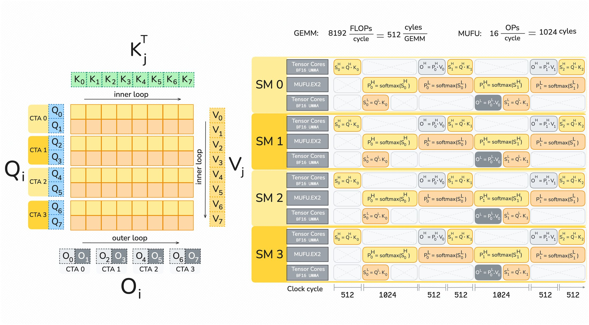
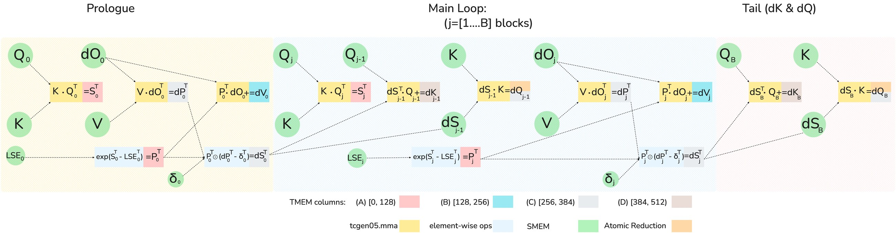
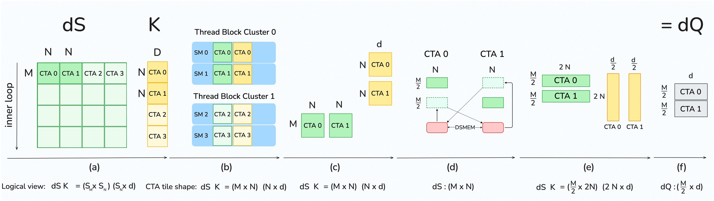
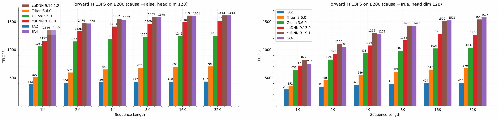
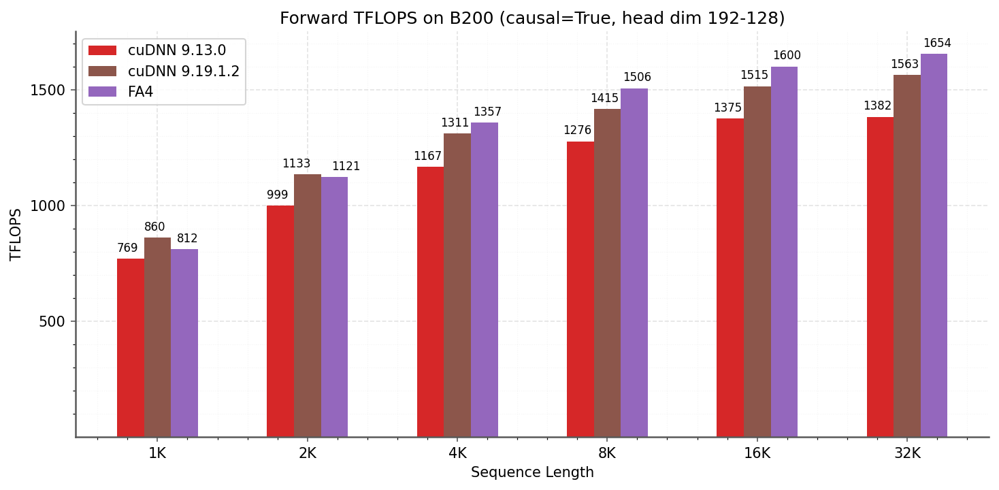
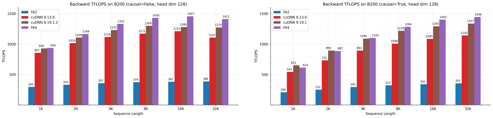
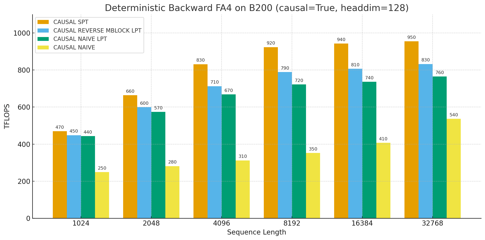
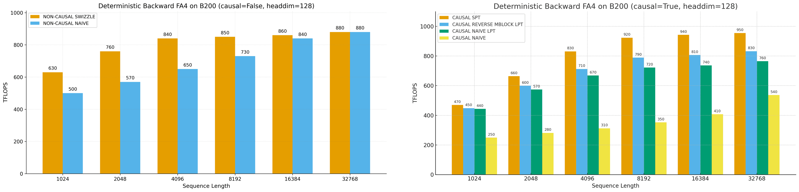

# 论文中文解读：《FlashAttention-4: Algorithm and Kernel Pipelining Co-Design for Asymmetric Hardware Scaling》

> **基本信息**：Ted Zadouri\*（Princeton University / Together AI）、Markus Hoehnerbach\*（Meta）、Jay Shah\*（Colfax Research）、Timmy Liu（NVIDIA）、Vijay Thakkar（Meta / Georgia Tech）、Tri Dao（Princeton University / Together AI）（\* 为共同第一作者），arXiv:2603.05451，2026 年 3 月 5 日；论文原文 [官方页面](https://arxiv.org/abs/2603.05451)；代码在 [flash-attention 仓库的 flash_attn/cute 目录](https://github.com/Dao-AILab/flash-attention/tree/main/flash_attn/cute)。
>
> **本文的读法**：图均取自论文 PDF 内嵌的原图（并列的两个子图在 PDF 里本来就是两张并排的图片，这里拼在一起）；性能柱状图是位图、没有文本层，柱顶数字由放大后逐个读出并二次核对，已转录成表；四张原文表逐格转录。该论文没有算法伪代码框，本文把正文与图里的流程归纳成逐步说明，并标明哪些是本文归纳、哪些是本文推导。前置知识见 [FlashAttention-2 解读](../flash_attention_2/论文中文解读.md) 与 [FlashAttention-3 解读](../flash_attention_3/论文中文解读.md)（FA3 解读里有 warpgroup、TMA、WGMMA、pingpong 等 Hopper 概念）。

## 一、一句话结论

FlashAttention-3（FA3）把 attention 优化到了 Hopper（H100），但 Blackwell（B200、GB200）的硬件演进是**不对称**的：矩阵乘单元（tensor core）吞吐翻倍（FP16/BF16 稠密约 2.25 PFLOPS，对 H100 的约 1 PFLOPS），而 shared memory 带宽、指数单元等几乎不变。结果是 attention 的瓶颈从矩阵乘转到指数运算与 shared memory 流量；同时 Hopper 的 MMA 指令在 Blackwell 上不能前向兼容，FA3 在 B200 上根本跑不了（原文脚注）。FlashAttention-4（FA4）从算法和 kernel 流水两方面协同设计：

1. **重新设计的流水**：用 Blackwell 的全异步 MMA、tensor memory（TMEM）和更大的 tile（128×128 累加器），前向用两个 Q tile 做 ping-pong，由 2 个 softmax warpgroup（每线程负责一整行）、1 个 correction warpgroup 与 1 个驱动 tensor core / TMA 的 warpgroup 分工；
2. **缓解指数瓶颈（前向）**：用 FMA 单元以多项式软件模拟 $2^x$（每行 10–25% 的元素），并用“条件 softmax 重缩放”跳过大多数重缩放；
3. **减少 shared memory 流量与原子加（反向）**：用 TMEM 存更多中间量；用 2-CTA MMA 模式，每个 CTA 只暂存一半的操作数 B，并据此重构 $dQ$ 的计算，使全局原子加减半；另有确定性反向模式；
4. **调度与资源分配**：LPT（最长任务优先）CTA 调度、针对 Blackwell 的寄存器分配；
5. **实现方式**：全部用 Python 内嵌的 CuTe-DSL 编写，无 C++，单个 kernel 的编译时间前向从 55 s 降到 2.5 s（22 倍）、反向从 45 s 降到 1.4 s（32 倍）。

结果（B200，BF16，head 维度 128，序列长 1K–32K，总 token 数 32k）：前向最高 1613 TFLOPs/s（约为 2.25 PFLOPS 峰值的 71%）；相对 cuDNN 9.13 快约 1.04–1.25 倍（图中数字相除；原文写 1.1–1.3 倍）、相对 Triton 快 2.1–2.7 倍；反向最高 1457 TFLOPs/s，相对 cuDNN 9.13 快 1.09–1.29 倍。但需要注意：原文同一张图里的较新版本 cuDNN 9.19.1 已经吸收了 FA4 的一些技术，FA4 相对它在前向上基本持平（0.91–1.02 倍），反向为 0.94–1.14 倍。

## 二、背景与动机

### 2.1 Multi-Head Attention 与反向（原文 2.1 节）

设 $Q,K,V\in\mathbb{R}^{N\times d}$ 为某个 head 的查询、键、值，

$$
S=\alpha QK^\top,\qquad P=\operatorname{softmax}(S),\qquad O=PV,
$$

softmax 按行进行，$\alpha=1/\sqrt d$，实际计算时先减去逐行最大值保证数值稳定。已知 $dO$，反向为

$$
dV=P^\top dO,\quad dP=dO\,V^\top,\quad dS=\operatorname{dsoftmax}(dP),\quad dQ=\alpha\,dS\,K,\quad dK=\alpha\,dS^\top Q,
$$

其中 $ds=(\operatorname{diag}(p)-pp^\top)\,dp$（$p=\operatorname{softmax}(s)$）。反向共 5 个矩阵乘，前向 2 个。这些与 FA3 论文相同。

### 2.2 Blackwell 的硬件特点（原文 2.2 节）

先把本文反复出现的几个新概念列出来：

| 术语 | 含义 |
|---|---|
| Blackwell / B200 / GB200 | NVIDIA 新一代数据中心 GPU 架构及其产品；B200 有 148 个 SM（原文由 2.25 PFLOPS ÷ 1850 MHz ÷ 148 个 SM 得到每 SM 每周期 8192 次运算） |
| TMEM（tensor memory，张量内存） | Blackwell 新增的一级片上存储，每个 SM 256 KB，专门存放 tensor core 运算的中间结果；以 warp 同步方式访问，与 tensor core 紧耦合；以 32 列（16 KB）为粒度分配，需要程序员显式管理分配、释放和搬运 |
| UMMA（`tcgen05.mma`） | Blackwell 的 tensor core 矩阵乘指令（图 1 里称 UMMA，图 2 图例写作 tcgen05.mma；“UMMA”原文没有定义，应是 CUTLASS 对这类指令的称呼，属本文推断） |
| SS-MMA / TS-MMA | SS（shared-shared）：两个操作数都来自 shared memory；TS（tensor-shared）：操作数 A 来自 tensor memory，操作数 B 来自 shared memory |
| 2-CTA MMA | 同一 thread block cluster 里的一对 CTA 协作执行一次 MMA |
| DSMEM（distributed shared memory，分布式共享内存） | 同一 cluster 内的 CTA 可以互相访问对方的 shared memory |
| MUFU（multi-function unit，多功能单元） | 计算指数等特殊函数的硬件单元（FA3 解读里已介绍），是 attention 里 $e^x$ 的瓶颈 |
| roofline 分析 | 估算一个 kernel 在各硬件资源（tensor core、shared memory、指数单元……）上各需多少周期，其中最大者就是该 kernel 的下界瓶颈 |

**存储层次**：GMEM（HBM）、L2、SMEM（shared memory，片上、程序员管理、分 bank）、RMEM（寄存器）与 Hopper 相同；Blackwell 新增 TMEM。MMA 单元可以把输出**直接写进 TMEM 而不占用寄存器**，这缓解了困扰 Hopper kernel 的极端寄存器压力，也使更大的 tile 成为可能。

**线程层次**：thread、warp（32 线程）、warpgroup（4 个连续 warp）、threadblock（CTA）、threadblock cluster、grid；同一 CTA 的线程调度在同一个 SM 上，同一 cluster 的 CTA 调度在同一个 GPC 上；每个线程最多 256 个寄存器。

**第五代 tensor core 与更强的异步**：每条 MMA 指令处理 $128\times N$ 的 tile（$N$ 通常为 128 或 256），Hopper 是 $64\times N$；Blackwell 的 MMA **异步写 TMEM**，而 Hopper 的 MMA 写寄存器。这种完全异步使计算与其他操作更好地重叠，因为 MMA 单元不再因寄存器写回而阻塞。同样支持 warp-specialized kernel（warp 分为只发搬运指令的 producer 和只发计算指令的 consumer）。

**2-CTA tensor core**：Blackwell 支持一种 2-CTA MMA 模式：同一 thread block cluster 里的一对 CTA 协作执行同一条 MMA，使这条操作可以读写双方的 tensor memory。由其中一个线程发起，但对端 CTA 必须已启动且在操作进行期间保持存活。单 CTA 的 MMA 把维度 $M$ 限制为 128；成对模式支持 $M=128$ 或 256：把 A tile 与累加器沿 $M$ 维分给两个 CTA，把 B tile 沿 $N$ 维分给两个 CTA，使每个 CTA 只在自己的 shared memory 里暂存一半的 B，而硬件做乘法时用的是合并后的完整 B tile。这减少了冗余的 shared memory 容量与带宽；代价是 CTA 必须成对启动，并且整个 kernel 要一致使用 2-CTA 模式处理 tensor memory 与 tensor core 操作。

**瓶颈迁移与三个关键吞吐**：Blackwell 的 FP16/BF16 tensor core 吞吐是 Hopper 的两倍，而 shared memory 带宽和指数单元吞吐不变或增长更慢，于是瓶颈从矩阵乘移向 shared memory 流量和 softmax 这类非矩阵乘运算。B200（及 GB200）上的数字：

1. **Tensor core**：BF16 MMA 每个 SM 每个周期 8192 次运算，是 Hopper 的 4096 的两倍（由理论峰值 2.25 PFLOPS ÷ 1850 MHz ÷ 148 个 SM = 8192 推出）；
2. **指数单元（MUFU）**：每个 SM 每个周期 16 次运算，与 Hopper 相同；原文说明 B300、GB300 把指数吞吐翻倍到每周期 32 次，但写作时还未广泛可用；
3. **SMEM**：读吞吐每个 SM 每个周期 128 字节，与 Hopper 相同（微基准测得）。

汇总（均来自原文第 1、2 节，倍数为本文计算）：

| 资源 | H100（Hopper） | B200（Blackwell） | 倍数 |
|---|---|---|---:|
| FP16/BF16 稠密峰值 | 约 1 PFLOPS（4096 次运算/周期/SM） | 约 2.25 PFLOPS（8192 次运算/周期/SM） | 2× |
| 指数单元（MUFU） | 16 次/周期/SM | 16 次/周期/SM | 1× |
| SMEM 读带宽 | 128 字节/周期/SM | 128 字节/周期/SM | 1× |
| 每条 MMA 指令的 tile | $64\times N$ | $128\times N$（$N$ 为 128 或 256） | — |
| MMA 累加器位置 | 寄存器 | TMEM（256 KB/SM），MMA 异步直接写入 | — |

一个直观的账（本文按原文数字换算）：对 head 维度 $d=128$，每个分数元素对应两个矩阵乘共 $4d=512$ 次运算和 1 次指数。H100 上矩阵乘时间 $512/4096=0.125$ 周期、指数时间 $1/16=0.0625$ 周期，指数约占矩阵乘时间的 50%（与 FA3 论文的结论一致）；B200 上矩阵乘时间降为 $512/8192=0.0625$ 周期，指数时间不变，两者**持平**。$d=64$ 时矩阵乘只剩一半，指数时间反而是矩阵乘的两倍。这就是“非对称扩展”的含义，也是 FA4 的出发点。

## 三、前向算法

### 3.1 Roofline：前向的瓶颈在哪里（原文 3.1.1 节）

原文先做 roofline 分析来说明瓶颈，指导 kernel 设计。设一次迭代处理的 tile 在序列方向上的形状是 $M\times N$（$M$ 为 Q 的行数，$N$ 为 K 的行数），head 维度为 $d$。这是一个简化分析，没有计入浮点运算、寄存器带宽、L2 带宽等资源，但足以指出瓶颈。

**MMA 计算**：前向每次迭代两个 MMA：$QK^\top$（由 $M\times d$ 和 $d\times N$ 得到 $M\times N$）与 $PV$（由 $M\times N$ 和 $N\times d$ 得到 $M\times d$），各 $2MNd$ 次浮点运算。tensor core 每周期 8192 次运算，所以

$$
T_{\text{MMA}}=\frac{4MNd}{8192}\ \text{周期}.\tag{1}
$$

**Shared memory 流量**：两个 MMA 中，$QK^\top$ 是 SS-MMA（Q 和 $K^\top$ 都从 shared memory 读），$PV$ 是 TS-MMA（$P$ 从 tensor memory 读，$V$ 从 shared memory 读）。每条 MMA 指令的 tile 是 $128\times128$，算 $M\times N$ 的输出需要 $\lceil M/128\rceil\times\lceil N/128\rceil$ 条指令，而当需要多条指令时，shared memory 里的操作数要被读多次。$QK^\top$ 共读 $\lceil M/128\rceil\lceil N/128\rceil\times256d$ 个元素；$PV$ 共读 $\lceil M/128\rceil\lceil d/128\rceil\times128N$ 个元素。按每个元素 2 字节（BF16）、每周期 128 字节带宽（假设 $M,N,d$ 是 128 的倍数），

$$
T_{\text{smem}}=\frac{2\lceil\frac{M}{128}\rceil\lceil\frac{N}{128}\rceil\cdot256d+2\lceil\frac{M}{128}\rceil\lceil\frac{d}{128}\rceil\cdot128N}{128}=\frac{3MNd}{8192}\ \text{周期}.\tag{2}
$$

（本文核算：分子的两项是字节数，再除以每周期 128 字节。）

**指数单元**：前向对 $M\times N$ 个值做指数，吞吐每周期 16 次：

$$
T_{\exp}=\frac{MN}{16}\ \text{周期}.\tag{3}
$$

表 1：注意力前向的 roofline 分析（周期数）。

| 资源 | $128^3$（$M=N=d=128$） | $256\times128^2$（$M=256$，$N=d=128$） |
|---|---:|---:|
| MMA 计算 | **1024** | **2048** |
| 共享内存 | 768 | 1536 |
| 指数单元 | **1024** | **2048** |

（原文表 1，第 6 页；原文用粗体标出两个瓶颈：MMA 计算与指数单元。本文核算：把 $M=N=d=128$ 代入公式 (1)–(3) 依次得 1024、768、1024，$M=256$ 时 2048、1536、2048，与表一致。）

读法：两种 tile 下，MMA 与指数单元的周期数完全相同、都是瓶颈，shared memory 略低，所以三项资源“比较平衡”。较大的 tile（$M=256$）会让 shared memory 流量上升到 1536 周期（因为 MMA 操作数被重复读取），而 MMA 与指数都翻倍到 2048。这导出三条设计目标：(1) 使用大 tile，最大化 MMA 与 softmax 的重叠；(2) 用别的硬件单元提高指数吞吐；(3) 减少不必要的非矩阵乘运算。（原文引言说 shared memory 流量和指数运算“超出 MMA 计算 25–60%”，与这里表 1 里两者与 MMA 持平的数字对不上；见第八节。）

### 3.2 新流水：重叠矩阵乘与 softmax（原文 3.1.2 节与图 1）

由于 Blackwell 的 tensor core 算力又翻了一倍，让 softmax 与 tensor core 操作重叠比 Hopper 上更加关键。FA4 沿用 FA3 的 ping-pong 调度：每个 thread block 计算两个输出 tile；一个 tile 在执行 tensor core 操作时，另一个 tile 在做 softmax。与 Hopper 的两点区别：Hopper 的 tensor core 把累加器放在寄存器里、每行由四个线程交错持有；Blackwell 的 tensor core 把累加器放在 tensor memory 里，而且单个累加器 tile 是 $128\times128$（Hopper 是 $64\times128$）。

**线程分工**。自然的分法是用两个各 128 线程的 warpgroup 做 softmax，**每个线程处理一整行**。这样不再需要 warp 之间的 shuffle 去归约行最大值，每个线程也不需要多份统计量寄存器。和 FA3 一样，两个 softmax warpgroup 被显式同步，使它们的临界区（指数计算部分）不重叠。每个 softmax warpgroup 的过程是：先把整行读入寄存器，再求最大值，再算 softmax（减最大值、缩放、取指数、转成输入精度），最后求行和。

另一个与 FA3 的区别：因为 $P$ 是通过 tensor memory 而不是寄存器文件传递的，可以把对输出 $O$ 的**重缩放**交给单独的“correction（修正）”warpgroup，从而把它移出关键路径。结合后面提到的寄存器分配，一个 CTA 里共有四类 warpgroup：2 个 softmax warpgroup、1 个 correction warpgroup、1 个用来驱动 tensor core 与 TMA 的 warpgroup。

**TMEM 划分**。两个输出 tile 要占去一半的 tensor memory（head 维度 128 时：两个 $128\times128$ 的 FP32 累加器各 128 列，共 256 列，TMEM 一共 512 列，见图 2 图例的列区间），剩下一半放 $S$ 和 $P$：这一半能存两份 $S$（FP32，每份 128 列），或四份 $P$（BF16/FP16 输入时每份 64 列）。所以剩下的划分大致有两种：一个 $S$ tile 加两个 $P$ tile，或者两个 $S$ tile 且与 $P$ 重叠。FA4 选后者，因为可以立刻算出两个 $S$ tile 来启动软件流水，也留出一些 tensor memory 向 correction warpgroup 传递重缩放所需的统计量。

**寄存器压力**。更大的 tile 与这样的线程分工带来一个问题：除非从 tensor memory 重新读，每个线程要把整整一行 128 个元素放在寄存器里。再加上两个 softmax warpgroup、一个 correction warpgroup、一个驱动 tensor core 与 TMA 的 warpgroup，给 softmax 分配足够的寄存器、避免寄存器溢出至关重要。BF16 输入时需要 128 个寄存器放输入，另外可能还要 64 个寄存器放输出（再加杂项和临时寄存器）。为降低寄存器压力，FA4 把 $P$ 的写出**分阶段**：前四分之三写一次（并触发相应的 MMA 操作），最后四分之一单独写。

下面这张图是前向流水的示意：



*图 1（原文 Figure 1，第 6 页）：FlashAttention-4 的前向流水。上标 $H$ 表示对应“高”Q tile 的矩阵，上标 $L$ 表示对应“低”Q tile 的矩阵；每个 Q tile 对应 128 个 query token。*

**图中文字翻译与读法**：

- **左半（数据布局）**：顶部 $K_j^T$ 被切成 $K_0\ldots K_7$（绿色虚线框），横向箭头 “inner loop（内循环）”；左侧 $Q_i$：CTA 0 负责 $Q_0,Q_1$，CTA 1 负责 $Q_2,Q_3$，CTA 2 负责 $Q_4,Q_5$，CTA 3 负责 $Q_6,Q_7$，即每个 CTA 同时处理两个 Q tile；中间的格子是注意力分块：每个 CTA 对应两行，**上面一行（黄色）是 H（高）tile，下面一行（橙色）是 L（低）tile**；右侧 $V_j$ 被切成 $V_0\ldots V_7$，纵向箭头 “inner loop”；底部 $O_i$：每个 CTA 的两个输出 tile（如 $O_0,O_1$），横向箭头 “outer loop（外循环）”遍历各 CTA。
- **右半（流水时间线）**：顶部公式 “GEMM: 8192 FLOPs/cycle = 512 cycles/GEMM”（一个 $128\times128\times128$ 的 GEMM 需要 $2\times128^3/8192=512$ 周期）与 “MUFU: 16 OPs/cycle = 1024 cycles”（对一个 $128\times128$ 的 tile 做指数需要 $128^2/16=1024$ 周期）。SM 0 至 SM 3 是四个 SM，各自运行同样的三条泳道：上面和下面两条 “Tensor Cores BF16 UMMA”（分别是 H tile 和 L tile 的矩阵乘），中间一条 “MUFU.EX2”（指数）。底部 “Clock cycle（时钟周期）” 标尺依次是 512、1024、512、512、1024、512、512。
- **读图（以 SM 0 为例）**：H 泳道依次是 $S_0^H=Q^H\cdot K_0$（前 512 周期）、空档（1024 周期，等 softmax）、$O^H=P_0^H\cdot V_0$、$S_1^H=Q^H\cdot K_1$、空档、$O^H=P_1^H\cdot V_1$、$S_2^H=Q^H\cdot K_2$；L 泳道是 $S_0^L=Q^L\cdot K_0$（第二个 512 周期）、……、$O^L=P_0^L\cdot V_0$、$S_1^L=Q^L\cdot K_1$；MUFU 泳道从第 512 周期起依次是 $P_0^H=\operatorname{softmax}(S_0^H)$、$P_0^L=\operatorname{softmax}(S_0^L)$、$P_1^H=\operatorname{softmax}(S_1^H)$、$P_1^L=\operatorname{softmax}(S_1^L)$，各占 1024 周期，首尾相接。
- **读图结论**：两个 tile 错开半拍，轮流使用 tensor core：H tile 做一对 MMA（$O^H=P^H\cdot V$ 与下一块 $S^H=Q^H\cdot K$，各 512 周期，共 1024 周期），H tile 在等 softmax 的 1024 周期里，L tile 做它自己的一对 MMA（$O^L$ 与下一块 $S^L$，共 1024 周期）；指数单元则连续地先后算 H、L 两个 tile 的 softmax（各 1024 周期）。于是每 2048 周期里 tensor core 与指数单元都被占满，这是图示的理想情形，与表 1 中 MMA 和指数同为 1024 周期的结论对应。

**前向一次迭代的流程**（本文据 3.1.2 节与图 1 归纳，原文没有给出伪代码）：

1. 负责 tensor core / TMA 的 warpgroup：用 TMA 把 $K_j,V_j$ 搬进 SMEM，并发射 $S=QK_j^\top$（SS-MMA，结果累加到 TMEM 的 $S$ tile）。
2. 某个 softmax warpgroup（128 线程，每线程一整行）：把 $S$ 的一行从 TMEM 读入寄存器，求行最大值，做减最大值、缩放、指数（其中一部分元素用下一节的多项式模拟）、转成 BF16，求行和；把 $P$ 写回 TMEM（前 3/4 先写并触发对应的 $PV$ MMA，最后 1/4 另写），并把重缩放需要的统计量写进 TMEM。
3. tensor core 发射 $O\mathrel{+}=PV_j$（TS-MMA，$P$ 来自 TMEM，$V_j$ 来自 SMEM）。
4. correction warpgroup：在需要时（见 3.4 节的条件重缩放）对 TMEM 里的 $O$ 做重缩放；全部 $K,V$ 块处理完之后，输出要按最终的 $\ell$ 做归一化（原文未说明这一步由哪个 warpgroup 完成）。
5. 两个 Q tile（H 与 L）按图 1 的方式错开，一个在算 softmax 时另一个在用 tensor core。

### 3.3 指数函数的软件模拟（原文 3.1.3 节与表 2）

**指数吞吐瓶颈**：现代 GPU 上指数由多功能单元（MUFU）计算，吞吐远低于做矩阵乘的 tensor core。B200 与 GB200 上 MUFU 每个 SM 每周期 16 次，而矩阵乘是每周期 8192 次运算。softmax 需要大量指数，这个差距使指数函数成为 attention kernel 的关键瓶颈。

**用多项式做软件模拟**：为提高指数吞吐，FA4 用浮点 FMA 单元实现 $2^x$ 的软件模拟，FMA 可以与 MUFU 并行工作。做法是经典的范围缩减（Cody–Waite）加多项式逼近。关键是把指数分解：

$$
2^{x}=2^{\lfloor x\rfloor}\,2^{x-\lfloor x\rfloor},\tag{4}
$$

其中 $\lfloor x\rfloor$ 是整数部分，$x-\lfloor x\rfloor\in[0,1)$ 是小数部分。整数部分 $2^{\lfloor x\rfloor}$ 可以用对 IEEE 754 浮点表示做位操作来算：指数域直接表示 2 的幂，所以 $2^{\lfloor x\rfloor}$ 就是对指数位做一次移位加法，可以用整数 ALU 指令完成。小数部分用多项式逼近：

$$
2^{x_{\text{frac}}}\approx\sum_{i=0}^{n}p_i\,x_{\text{frac}}^{\,i},\tag{5}
$$

$p_0=1.0$，其余系数用 Sollya 软件包在 $[0,1)$ 上最小化相对逼近误差；多项式用 Horner 法配合 FMA 指令计算，吞吐高。完整算法的五步（原文）：

1. 把 $x$ 夹到不小于 $-127$，避免下溢；
2. 用“向下取整”舍入模式计算 $\lfloor x\rfloor$：先给 $x$ 加上 $2^{23}+2^{22}$（迫使小数位被挤进尾数而丢掉），再在向下取整模式下减回去；
3. 计算小数部分 $x_{\text{frac}}=x-\lfloor x\rfloor$；
4. 计算多项式得到 $2^{x_{\text{frac}}}$；
5. 合并整数部分与小数部分：把 $\lfloor x\rfloor$ 移位加进指数域，并加上 $2^{x_{\text{frac}}}$ 的尾数位。

下面是对这五步的示意写法（本文示意，非原文代码；3 次多项式时 Horner 法用 3 条 FMA）：

```text
输入 x：以 2 为底的指数（FP32）
1. x  = max(x, -127)
2. t  = x + (2^23 + 2^22)            # 魔数加法
   fl = t - (2^23 + 2^22)            # 向下取整模式下得到 floor(x)
3. f  = x - fl                       # 小数部分，位于 [0, 1)
4. p  = ((p3*f + p2)*f + p1)*f + p0  # Horner 法，p0 = 1，每一步一条 FMA
5. 结果的位模式 = 位模式(p) + (fl 左移 23 位)   # 把 floor(x) 加进指数域
```

通过把指数运算分摊给 MUFU 和 FMA 两种单元，实际等于提高了指数吞吐。

**部分模拟**：多项式模拟虽然提高了指数吞吐，但代价是更多的寄存器（存中间值和系数）、更高的寄存器带宽消耗，以及比 MUFU 指令更长的延迟。对所有指数都用模拟会增加寄存器压力，可能引起溢出而抵消吞吐收益。所以 FA4 只对每个 softmax 行里的一部分元素（10–25%）做模拟，其余仍用硬件 `MUFU.EX2`；具体比例按给定 tile 配置下 MMA 与指数吞吐之比经验调优。（本文换算：若模拟比例 $f$ 的元素完全不占 MUFU，则 $T_{\exp}$ 变为 $(1-f)\cdot1024$ 周期，$f=10\%$–$25\%$ 对应 922–768 周期，低于表 1 里 MMA 的 1024 周期，指数不再是瓶颈；这里忽略了 FMA 与寄存器的开销。）

**数值精度**：表 2 比较不同次数多项式与硬件 `MUFU.EX2` 的精度，在 $[0,1)$ 上的 400 万个（4M）随机输入上测量，对照 FP64 参考。报告两种指标：FP32 级别误差（量化前）与 BF16 级别误差（把 FP32 输出舍入到 BF16 之后）。

表 2：$2^x$ 多项式模拟在 $[0,1)$ 上的精度（相对 FP64 参考，4M 个随机输入）。FP32 两列度量多项式的原始输出，BF16 两列度量舍入到 BF16 之后；“e-3”表示 $\times10^{-3}$。

| 方法 | FP32 对 FP64：最大相对误差 | FP32 对 FP64：平均相对误差 | BF16 对 FP64：最大相对误差 | BF16 对 FP64：平均相对误差 |
|---|---:|---:|---:|---:|
| 理想（FP64 → BF16） | — | — | 3.89e-3 | 1.41e-3 |
| 硬件 `MUFU.EX2` | 1.41e-7 | 3.04e-8 | 3.89e-3 | 1.41e-3 |
| 3 次多项式 | 8.77e-5 | 5.43e-5 | 3.90e-3 | 1.41e-3 |
| 4 次多项式 | 3.05e-6 | 1.84e-6 | 3.89e-3 | 1.41e-3 |
| 5 次多项式 | 1.44e-7 | 5.48e-8 | 3.89e-3 | 1.41e-3 |

（原文表 2，第 8 页。）

读法：

- 在 FP32 级别，3 次多项式的最大相对误差是 8.8e-5，约为硬件的 600 倍（$8.77\times10^{-5}/1.41\times10^{-7}\approx622$）；每升一次，误差大幅下降；5 次多项式的最大相对误差（1.44e-7）与硬件（1.41e-7）相当，代价是比 3 次多多两条 FMA。
- 但舍入到 BF16 之后，所有次数 $\ge3$ 的多项式与硬件几乎无法区分：BF16 本身的量化误差（约 3.9e-3，即“理想 FP64 → BF16”一行）压倒了多项式逼近误差。3 次多项式在 99% 的输入上与硬件相差不超过 1 个 BF16 ULP（最低有效位），对于 softmax 输出以 BF16 精度被使用的 attention 已经足够。
- 原文没有说明实际 kernel 采用了几次多项式，也没有给出指数模拟单独带来的加速（见第八节）。

### 3.4 条件 softmax 重缩放（原文 3.1.4 节）

**FlashAttention 的在线 softmax**：对第 $j$ 个块，$S_j=QK_j^\top$，在线 softmax 跟踪

$$
m_j=\max\big(m_{j-1},\operatorname{rowmax}(S_j)\big),\qquad
\ell_j=e^{m_{j-1}-m_j}\ell_{j-1}+\operatorname{rowsum}\big(e^{S_j-m_j}\big),
$$

其中 $m_j$ 是运行最大值，$\ell_j$ 是指数和（归一化量）。中间输出的更新是

$$
O_j=e^{m_{j-1}-m_j}O_{j-1}+e^{S_j-m_j}V_j,
$$

重缩放因子 $e^{m_{j-1}-m_j}$ 在遇到更大的值时重新归一化先前结果，保证数值稳定。

**条件重缩放**：其中 $e^{m_{j-1}-m_j}O_{j-1}$ 一步需要一次向量乘法。原文有两点简单的观察：

1. 只有 $m_j>m_{j-1}$（发现了更大的值）时才需要重缩放；
2. 可以容忍一些“松弛”：只在 $m_j-m_{j-1}>\tau$ 时才重缩放，$\tau$ 是阈值，通常取 $\log_2(256)=8.0$，对应缩放因子 256.0。只要记录好统计量（已做过的总缩放），最后仍能得到真实的分母，从而得到正确的最终输出。

FA4 把更新式改成

$$
O_j=\begin{cases}e^{m_{j-1}-m_j}O_{j-1}+e^{S_j-m_j}V_j,&m_j-m_{j-1}>\tau,\\[2pt] O_{j-1}+e^{S_j-m_{j-1}}V_j,&\text{否则。}\end{cases}\tag{6}
$$

当 $m_j-m_{j-1}\le\tau$ 时，跳过对 $m$ 的更新、继续使用 $m_{j-1}$。这样做仍然正确，因为计算结束时所有累加值都会被真实最大值 $m_{\text{final}}$ 和最终归一化量 $\ell_{\text{final}}$ 重新归一化：

$$
\text{Output}=\frac{1}{\ell_{\text{final}}}\,O_{\text{final}}.
$$

这显著减少重缩放次数，同时保持数值精度，因为最后的归一化会校正跳过中间重缩放带来的小偏差。实践中为避免 warp 发散（divergence），只要同一个 warp 里有任一线程需要重缩放，就整个 warp 一起重缩放。

补充说明（本文推导，原文未展开）：“否则”分支里，$\ell$ 也应以同一个参考最大值 $m_{j-1}$ 累加（$\ell_j=\ell_{j-1}+\operatorname{rowsum}(e^{S_j-m_{j-1}})$），使 $O$ 与 $\ell$ 始终相对同一个参考值，最后的比值 $O/\ell$ 才与精确 softmax 一致；代价是 $e^{S-m}$ 的上界由 1 放宽到约 256（$\tau=8$ 对应的缩放因子）。另外原文公式 (6) 写的是底为 $e$ 的指数，而阈值以 $\log_2$ 给出、对应因子 256，推测这里的 $m,S$ 实际是以 2 为底的指数域里的量（kernel 用的是 `MUFU.EX2`）。

## 四、反向算法

### 4.1 Roofline：反向的瓶颈在哪里（原文 3.2.1 节与表 3）

与前向类似，先做 roofline 分析，这里为简化 shared memory 周期数的公式，假设 $M=N=d=128$（仍保留变量名以便阅读）。

**MMA 计算**：反向每次迭代 5 个 MMA，每个涉及一个 $M\times N$ 矩阵、一个 $M\times d$ 矩阵和一个 $d\times N$ 矩阵（交替成为输出），各 $2MNd$ 次浮点运算：

$$
T_{\text{MMA}}=\frac{10MNd}{8192}\ \text{周期}.\tag{7}
$$

**Shared memory 流量**：5 个 MMA 里，三个是 SS 型（两个操作数都从 shared memory 读）：$S^\top=KQ^\top$、$dP^\top=VdO^\top$、$dQ=dSK$；两个是 TS 型（操作数 A 从 tensor memory 读、B 从 shared memory 读）：$dV=P^\top dO$、$dK=dS^\top Q$。SS 型共从 shared memory 读 $2Md+3Nd+MN$ 个元素（$K,Q$；$V,dO$；$dS,K$ 各一对），TS 型共读 $2Md$ 个元素（$dO$ 与 $Q$ 各一次）。按每周期 128 字节、每个元素 2 字节（BF16），

$$
T_{\text{smem,MMA}}=\frac{4Md+3Nd+MN}{64}\ \text{周期}.\tag{8}
$$

此外算法还要把中间梯度 $dS$（$M\times N$，BF16）写进 shared memory，需要 $2MN$ 字节即 $MN/64$ 周期；梯度 $dQ$（$M\times d$）以 FP32（每元素 4 字节）写进 shared memory，再通过 TMA 读回做归约，共 $8Md$ 字节的 shared memory 流量，即 $Md/16$ 周期。shared memory 的总访问时间是

$$
T_{\text{smem}}=\frac{4Md+3Nd+MN}{64}+\frac{MN}{64}+\frac{Md}{16}\ \text{周期}.\tag{9}
$$

**指数单元**：反向对 $M\times N$ 个值做指数，

$$
T_{\exp}=\frac{MN}{16}\ \text{周期}.\tag{10}
$$

表 3：反向的 roofline 分析（$M=N=d=128$；周期数）。

| 资源 | 1-CTA（$M=128$，$N=d=128$） | 2-CTA（$M=256$，$N=d=128$） |
|---|---:|---:|
| MMA 计算 | 2560 | 2560 |
| 共享内存（MMA 操作数） | 2048 | 1536 |
| 共享内存（$dS$ 写入） | 256 | 256 |
| 共享内存（$dS$ 经 DSMEM） | 0 | 384 |
| 共享内存（$dQ$ 写入 + 读出） | 1024 | 512 |
| **共享内存合计** | **3328** | **2688** |
| 指数单元 | 1024 | 1024 |

（原文表 3，第 11 页；原文把合计一行加粗并加下划线。原文题注：1-CTA 下 shared memory 流量是瓶颈，比 MMA 计算多约 30%；2-CTA 设置 $M=256$、$N=d=128$ 时（$dQ$ 的 MMA 例外，其 $M=N=128$、$d=256$），shared memory 流量比 MMA 计算多约 5%。）

本文核算：把 $M=N=d=128$ 代入公式 (7)–(10) 依次得 2560、2048+256+1024=3328、1024，与 1-CTA 一列一致；$3328/2560=1.30$，$2688/2560=1.05$，与题注的 30% 和 5% 一致；2-CTA 使 shared memory 总量下降 $1-2688/3328\approx19\%$。题注里 $dQ$ 的 MMA “$d=256$”，本文理解为对应这次 MMA 的归约维 $2N=256$（见 4.3 节；这是本文的解读，原文没有展开）。表中 2-CTA 一列的 2048 → 1536、1024 → 512、新增的 DSMEM 384 等数字，原文没有给出推导，这里仅转录。

读法：反向里 shared memory 流量（3328 周期）既超过 MMA 计算（2560），也远超指数单元（1024），所以是主要瓶颈（“不过没有全局内存流量那么严重”，原文）。这促使 kernel 设计要最大化 MMA 与其他计算的重叠以隐藏 shared memory 延迟。

### 4.2 新流水：1-CTA 反向（原文 3.2.2 节与图 2）

FA 的反向共 5 个 MMA，对应：重新计算 $S$、由 $QK$ 引出的两个梯度计算（得到 $dQ$ 和 $dK$）、由 $PV$ 引出的两个（得到 $dP$ 和 $dV$）。在 FA3 里累加器放在寄存器，而寄存器是有限资源，这带来很强的顺序约束，实际上把计算图串行化了：依次算 $S,dP,dV,dQ,dK$，只有 TMA 加载可以明显乱序。除此之外，算法相似：沿 KV 序列方向迭代，计算的值相对前向是转置的（因为 $dV$ 与 $dK$ 的计算需要从 tensor memory 读一个操作数，需要这种布局）；$dQ$ 通过原子加累加。

FA4 里，TMEM 带来了更多可选的调度，能让 MMA 与非 MMA 操作显著重叠。与前向一样，目标是隐藏 softmax 计算的延迟。FA3 里 softmax 与 $dP$ 的 MMA 重叠；而按前面的分析，Blackwell 上至少需要同时运行两个 MMA 操作。FA4 的做法是让**上一次迭代的 $dQ$ 与 $dK$ 的 MMA**与当前迭代的逐元素计算并行。这要求仔细管理 shared memory 与 tensor memory 资源，在加载、MMA、计算和归约之间调度。特别是 tensor memory 放不下 5 个累加器 tile：最多放 4 个 $128\times128$ 的 tile，而 $dV$ 与 $dK$ 是持续累加的，不能共用空间。FA4 的实现里：$S$ 和 $P$ 共用一块 tmem（偏移 0），$dP$、$dS$ 和 $dQ$ 共用另一块。



*图 2（原文 Figure 2，第 10 页）：FlashAttention-4 反向计算图（5 个 MMA 操作 + 2 个逐元素操作），展示了 1-CTA MMA 模式下的软件流水顺序，包括 prologue（序幕）、主循环和 tail（收尾）。*

**图中文字翻译与读法**：

- **三大段**：Prologue（序幕，处理第 0 块）、Main Loop（主循环，$j=[1\ldots B]$ 个块）、Tail (dK & dQ)（收尾，处理最后一块的 $dK$ 与 $dQ$）。
- **图例**：黄色框 `tcgen05.mma`（tensor core 矩阵乘）；浅蓝框 element-wise ops（逐元素运算）；绿色圆圈 SMEM（放在 shared memory 里的张量）；橙色 Atomic Reduction（原子归约）；右侧彩色小块标出结果存放的 TMEM 列区间：(A) [0,128) 粉红、(B) [128,256) 青色、(C) [256,384) 浅灰、(D) [384,512) 棕灰。
- **Prologue**：输入 $Q_0$、$dO_0$、$K$、$V$、$LSE_0$（logsumexp）、$\delta_0$（即 FA2/FA3 里的 $D=\operatorname{rowsum}(dO\circ O)$）。依次：$K\cdot Q_0^T=S_0^T$（存进 A）；$V\cdot dO_0^T=dP_0^T$（存进 C）；逐元素 $\exp(S_0^T-LSE_0^T)=P_0^T$（覆盖 A）；$P_0^T\cdot dO_0\mathrel{+}=dV_0$（存进 B）；逐元素 $P_0^T\odot(dP_0^T-\delta_0^T)=dS_0^T$（存进 C）。
- **Main Loop（第 $j$ 块）**：$K\cdot Q_j^T=S_j^T$（A）；$dS_{j-1}^T\cdot Q_{j-1}\mathrel{+}=dK_{j-1}$（D，上一块的 $dK$）；$dS_{j-1}\cdot K=dQ_{j-1}$（C，橙色表示结果做原子归约写到全局内存）；$V\cdot dO_j^T=dP_j^T$（C）；$P_j^T\cdot dO_j\mathrel{+}=dV_j$（B）；逐元素 $\exp(S_j^T-LSE_j^T)=P_j^T$ 与 $P_j^T\odot(dP_j^T-\delta_j^T)=dS_j^T$。其中 $dS_{j-1}$ 是放在 SMEM 里的上一块的结果。
- **Tail**：输入 $Q_B$、$K$、$dS_B$（最后一块）：$dS_B^T\cdot Q_B\mathrel{+}=dK_B$（D）与 $dS_B\cdot K=dQ_B$（橙色，原子归约）。
- **读图结论**：每一轮主循环里，上一块的 $dK$、$dQ$ 两个 MMA 与当前块的逐元素计算（指数、$dS$）可以并行：这就是“用上一次迭代的 $dQ$ 与 $dK$ MMA 来隐藏 softmax 梯度的延迟”。tensor memory 的四块列区间分别装 $S/P$（A）、$dV$（B）、$dP/dS/dQ$（C）、$dK$（D）。

### 4.3 2-CTA 反向：减少 shared memory 流量与全局原子加（原文 3.2.3 节与图 3）

即使有了更好的流水、且十个 GEMM 操作数里有两个常驻 tensor memory，shared memory 带宽仍然主导反向：五个 GEMM 里其余八个 BF16 操作数要从 shared memory 加载来喂 tensor core，这部分 shared memory 流量比 tensor core 计算多约 30% 的周期。为进一步缓解，FA4 使用 Blackwell 的 **2-CTA MMA 模式**：输出累加器沿 $M$ 维划分。MMA tile 形状取 $M=256$、$N=K=128$ 时，两个 CTA 相当于一个更大的 tile：每个 CTA 加载并暂存一半的操作数 B，只保留自己那一片累加器。

**Shared memory 流量**：五个 GEMM 都用 $M=256$、$N=K=128$ 的 MMA tile，使操作数 B 的 shared memory 流量大约减半。在 FA 的反向里，每个 CTA 固定持有一个 KV tile（外循环在 $N$ 方向上跨 CTA 并行），并在内循环里遍历 $M$ 方向的 tile。$dQ$ 的累加是对 KV 序列的归约（外循环方向）。但 2-CTA MMA 只切分输出 tile，不切分归约轴，而 $dQ$ 这个 MMA 的归约维是 $N$，它天然被分在这对 CTA 里（每个 CTA 持有不同的 KV tile）；结果是每个 CTA 仍然需要自己所拥有的那些行的完整归约。为解决归约轴上的这个冲突，FA4 用 **DSMEM**（同一 cluster 内的 CTA 可以互访 shared memory）在两个 CTA 之间交换一半的 $dS$。这种做法把 $dS$ 重新打包，使它沿**非归约轴**划分：每个 CTA 拥有自己的 $M/2$ 行，并持有完整的 $2N$ 归约。于是每个 CTA 的 $dQ$ MMA tile 形状是 $(M/2,\ 2N)(2N,\ d)$，在 tensor memory 里累加出 $(M/2,\ d)$ 的 tile。

在 2-CTA MMA 模式下，$S$、$dP$、$dV$、$dK$ 的 MMA 用 tile $M=256$，而 $dQ$ 用 $M=128$（每个 CTA 的行数 $M/2$），但归约维加倍为 $2N=256$。然后相对 1-CTA 版本重新排了软件流水来隐藏 DSMEM 延迟：先算**当前** tile 的 $dP$，再算**上一次迭代** tile 的 $dQ$。$dQ$ tile 小到可以和 $P$ 一起放进 TMEM，复用 $S$ 的那块 TMEM 区域，所以不再像 1-CTA 模式那样让 $dP$ 与 $dQ$ 共用同一块 TMEM 区域。采用这种流水顺序后，当前 tile 的逐元素 $dS$ 可以与上一次迭代 tile 的 $dQ$ MMA 并行。



*图 3（原文 Figure 3，第 11 页）：在 2-CTA 反向的 $dQ$ 一步里，这对 CTA 用 DSMEM 交换一半的 $dS$ tile，使每个 CTA 形成一个 $(\frac{M}{2}\times2N)$ 的操作数，从而可以做一次归约维加倍的 CTA 对 UMMA。*

**图中文字翻译与读法**：

- **(a) 逻辑视图**：$dS\,K=(S_M\times S_N)(S_N\times d)$。左边是 $dS$（行方向 $M$，沿 $M$ 的“inner loop”向下；列方向分成 4 块，对应 CTA 0 至 CTA 3 各负责一个宽 $N$ 的列块），右边是 $K$（每个 CTA 对应 $N$ 行、$D$ 列）。
- **(b) CTA 的物理位置**：Thread Block Cluster 0 含 SM 0 上的 CTA 0 与 SM 1 上的 CTA 1，Thread Block Cluster 1 含 SM 2、SM 3 上的 CTA 2、CTA 3；绿色块是各 CTA 的 $dS$ tile，黄色块是 $K$ tile。
- **(c) 每个 CTA 的 tile 形状**：$dS\,K=(M\times N)(N\times d)$：CTA 0 与 CTA 1 各有一个 $M\times N$ 的 $dS$ tile 和一个 $N\times d$ 的 $K$ tile。
- **(d) DSMEM 交换**：每个 CTA 把自己的 $dS$（$M\times N$）分成两个 $\frac M2\times N$ 的半块，通过 DSMEM 把对方需要的那一半发给对方（虚线框是对端传来的半块，红色圆角框是 DSMEM 两端）。
- **(e) 交换之后**：$dS\,K=(\frac M2\times2N)(2N\times d)$：CTA 0 持有上半 $\frac M2$ 行、拼好了两个 CTA 的 $N$ 列共 $2N$；CTA 1 持有下半 $\frac M2$ 行；$K$ 一侧是 $2N\times d$，沿 $d$ 切成两个 $d/2$ 的竖条，分别由两个 CTA 暂存（这就是“每个 CTA 只暂存一半的 B”）。
- **(f) 输出**：$dQ$：$(\frac M2\times d)$，CTA 0 与 CTA 1 各得一半的行。
- **读图结论**：2-CTA 的 $dQ$ MMA 把归约维从 $N$ 变成 $2N$，输出 tile 的行数变成 $M/2$；每个 CTA 只产生 $dQ$ 的一半行。

**$dQ$ 的原子加**：这个分解的另一个好处是全局原子归约次数减半。原子更新会引入非确定性，而且开销大，因为它出现在内循环的每一次迭代里。因此每个 CTA 只写出一半的 $dQ$ tile，只做 1-CTA 版本一半数量的全局原子归约。

（本文核算：按整个问题计，$dQ$ 的全局原子加总量正比于“query 行数 $\times\,d\,\times$ KV 方向上被各自独立加到全局的 tile 个数”。1-CTA 下每个 CTA 对自己的 $N=128$ 个 KV 列各自加一次；2-CTA 下一对 CTA 在加到全局之前已经对 $2N=256$ 个 KV 列做完归约，KV 方向上的有效 tile 个数减半，所以总量减半，这与原文“每个 CTA 做一半数量的全局原子归约”相符。）

### 4.4 确定性反向（原文 3.2.4 节）

反向 kernel 里，跨 CTA 在全局内存的归约会引入梯度计算的非确定性（一般影响 $dQ$，GQA 时还影响 $dK/dV$）。为保证可复现、便于训练调试，FA4 还提供确定性执行模式。标准方案（FA4 也采用）是用 **semaphore 锁**把全局归约串行化：每个向同一个 $dQ$ tile 写入的 CTA 必须按预先规定的顺序获取锁，完成自己的归约后，通过递增 semaphore 计数器释放锁。

这种基于锁的方法有两个性能代价：(1) 要发出内存栅栏（fence）以保证 semaphore 写入在整个设备上可见（正确的 acquire–release 语义要求）；(2) 每个 CTA 要等待同一 $dQ$ tile 上排在前面的 CTA 归约完成，引入停顿。在负载不均衡的情形下，随意选择 CTA 顺序会严重拖慢性能。一般做法是在 head 与 batch 维度上做 CTA swizzle（重排）以减少停顿（以 L2 cache 容量为限，参见下一节）。对因果 mask，另外：按**降序**启动 KV 块，按**升序**从对角线开始遍历 query 块，并按 query 块下标**降序**排列 $dQ$ 的归约。这种“shortest-processing-time-first（SPT，最短任务优先）”调度保证没有 CTA 在它的第一次 $dQ$ 写入上就被卡住。

## 五、CTA 调度（原文 3.3 节）

在因果 mask 或变长序列（varlen）等情形，attention kernel 天然负载不均衡：分给 SM 的 worktile 的主循环长度不同，有的需要更多加载与 MMA。同时还可以选择 SM 处理 tile 的顺序，比如规定网格坐标的线性化方式。抽象掉 attention 的具体特点，就可以用关于相同并行处理器上 makespan 最小化的一般结果。FA4 用经典的 **LPT（longest-processing-time-first，最长任务优先）** 调度（原文强调这个用法在所有 GPU 架构上都适用，并且也被验证能改进 Hopper 上的 FA3）。

**因果 mask 的 LPT**：标准 attention 网格是 $(\text{mblocks},\text{heads},\text{batches})$，按从左到右递增的顺序遍历；但对角线以上的分数被 mask 掉，所以对固定的 head 与 batch，SM 实际是从最短到最长依次处理 worktile，效率低。朴素的 LPT 顺序也不是最优：不同 batch 的主循环 KV 加载在 L2 里命中不了；若先加载所有 KV head，超过 L2 容量时会把 L2 冲垮（thrash）。因此：始终把 batch 作为最外层维度，在 head 上做 swizzle：把 head 分成不会撑爆 L2 的若干“段”，tile 调度器依次按“段内的 head、反向的 mblock、各段、最后 batch”遍历网格；特别地，对 MQA 或 GQA，总是先遍历一个 KV head 对应的所有 query head，再改变 mblock。实测这种 LPT 顺序很有效：BF16、head 维度 128 时，MHA 的 FLOPS 提升 4–8%，MQA 8 提升 7–14%（原文这些数字是在 **H200** 上测得的，不是 B200）。

**变长序列的 LPT**：varlen 时还要面对不同 batch 之间的负载差异。例如解码负载里各个 batch 注意的上下文长度不同，混合批处理或连续批处理里有的 batch 在做 prefill、有的在做 decode。每个 batch 的 query 与 KV 长度列表通常作为注意力元数据存放在设备上，标准 varlen kernel 在运行时读取这些整数并按递增顺序处理各 batch。但给定的 batch 顺序对负载均衡可能任意地差，比如较短的方形 prefill 后面跟着长上下文的 decode。为此可以通过一个预处理 kernel 按每个 worktile 的最大执行时间对 batch 排序，写出“虚拟 batch 下标到实际 batch 下标”的映射元数据，供 attention kernel 读回、按排序后的顺序遍历 batch；这份元数据可以缓存，所以排序不造成性能损失。

## 六、语言与框架（原文第 4 节）

FA4 完全用嵌入 Python 的 **CuTe-DSL** 编写，没有任何 CUDA C++ 部分。CuTe-DSL 编译器接收 Python 源码，降低（lower）到 PTX，再用 PTX 编译器 `ptxas` 生成汇编（SASS）。

- **完整的表达力与干净的抽象**：CuTe-DSL 的编程模型与 CUTLASS C++ 同构，因此 FA4 保留了底层 GPU 编程的全部表达力，同时享有 Python 元编程与快速 JIT 编译的生产力。CuTe-DSL 提供对 PTX 的直接访问作为“逃生口”：对尚未在 CuTe-DSL API 中完整暴露的操作，FA4 用了自定义的 PTX 序列（原文说这些将在未来版本里集成）。
- **JIT 带来的快速编译**：编译时间一直是历代 FlashAttention 实现的瓶颈，因为 C++ 模板元程序很复杂。借助嵌入 Python 的 CuTe-DSL 与即时（JIT）编译，FA4 的编译明显更快。

表 4：单个 kernel 的编译时间：FA3（C++ 模板）与 FA4（CuTe-DSL）。

| 方法 | 前向 | 反向 |
|---|---:|---:|
| FlashAttention-3 | 55 s | 45 s |
| FlashAttention-4 | 2.5 s | 1.4 s |
| 加速比 | 22× | 32× |

（原文表 4，第 14 页；原文题注补充：FA2 与 FA3 通常需要为不同的 attention 变体预编译几百个 kernel。摘要与正文写“快 20–30 倍”，表中是 22 倍和 32 倍。）

- **灵活性与可及性**：基于 FA4，开发者已经成功构建了 FlexAttention 与块稀疏 attention 变体，无需修改核心框架；有几个月 GPU 编程经验的研究者和工程师就能做出有意义的扩展。原文的愿景是提供构建各种 attention 变体的综合框架：把公共功能分解为互相独立、可组合的原语（块稀疏模式、mask 策略、变长序列处理、工作调度等），可以自由组合，同时仍通过编译成高效 GPU kernel 达到最佳性能。

## 七、实验

### 7.1 设置（原文第 5 节与附录 A）

**对比对象**：PyTorch 标准实现、FlashAttention-2（FA3 不能在 B200 上运行，所以图里的 FA 基线是 FA2）、Triton（使用了 B200 专用指令）、Gluon（比 Triton 控制更精细的底层 GPU 编程语言）、以及 cuDNN（厂商库，针对 B200 优化）；图里出现的 cuDNN 有 9.13.0 与较新的 9.19.1(.2) 两个版本。原文结论：FA4 比 cuDNN 9.13 最多快 1.3 倍，比 Triton 最多快 2.7 倍，最高 1613 TFLOPs/s，约为 B200 理论峰值的 71%。

**基准设置**：B200，BF16 输入，有/无因果 mask，head 维度 64、128 以及 (192, 128)；序列长度 1k、2k、……、32k，batch 取使总 token 数为 32k；hidden dimension 为 2048，head 维度 64 或 128 分别对应 32 个或 16 个 head；(192, 128) 配置取自 DeepSeek V3，16 个 head；原文写作“192 个 query 维度、128 个 key/value 维度”，而 $QK^\top$ 要求 Q、K 维度一致，按 DeepSeek V3 的设置应理解为 Q/K 为 192 维、V 为 128 维。FLOPs 公式与前几篇相同：前向 $4\cdot\mathrm{seqlen}^2\cdot\text{head dimension}\cdot\text{number of heads}$，因果除以 2，反向乘 2.5（前向 2 个矩阵乘、反向因重计算共 5 个）。（原文没有说明 (192, 128) 的 FLOPs 如何折算。）

**测量与软件（附录 A.1）**：原文写“在 B100 180GB SXM6（1000 W）上”测速（与正文的 B200 不一致，应是笔误）；预热 5 次，重复 10 次取平均；软件版本为 CUDA 13.1、FlashAttention 2.8.3、Triton 3.6、PyTorch 2.10.0、CuTe-DSL 4.4.1；正文对比 cuDNN 9.13 与最新的 cuDNN 9.19.1.2。原文说明从 9.13 与 9.14 版本起，作者与 cuDNN 团队合作，把 FA4 的一些技术并入了 cuDNN。

### 7.2 前向速度（图 4、图 5）



*图 4（原文 Figure 4，第 15 页）：B200（FP16/BF16）上 head 维度 128 的前向 TFLOPS。左：非因果注意力；右：因果注意力。原文题注：FA4 比 cuDNN 9.13.0 快 1.1–1.3 倍、比 Triton 快 2.1–2.7 倍；自本实现首次发布以来，新版 cuDNN 已吸收了本文的许多技术，性能与 FA4 相近。*

**图中文字翻译与读法**：

- 标题 “Forward TFLOPS on B200 (causal=False/True, head dim 128)”（B200 上前向 TFLOPS，非因果/因果，head 维度 128）；纵轴 TFLOPS，横轴 Sequence Length（序列长度 1K 到 32K）。
- 每组 6 根柱，从左到右：蓝 FA2、橙 Triton 3.6.0、绿 Gluon 3.6.0、红 cuDNN 9.13.0、棕 cuDNN 9.19.1.2（右图图例写 9.19.1）、紫 FA4；柱顶是 TFLOPS 数值。左图的图例框遮住了 1K 一组上方的一部分（棕、紫两根柱顶的 1346、1355 画在图例上），数字仍可读。

图 4 的全部数字（TFLOPs/s，B200，BF16，head 维度 128，前向）：

非因果：

| 实现 | 1K | 2K | 4K | 8K | 16K | 32K |
|---|---:|---:|---:|---:|---:|---:|
| FA2 | 383 | 406 | 420 | 427 | 430 | 432 |
| Triton 3.6.0 | 507 | 594 | 648 | 676 | 695 | 703 |
| Gluon 3.6.0 | 1060 | 1147 | 1198 | 1226 | 1242 | 1250 |
| cuDNN 9.13.0 | 1157 | 1328 | 1413 | 1460 | 1488 | 1517 |
| cuDNN 9.19.1.2 | 1346 | 1474 | 1552 | 1585 | 1609 | 1613 |
| **FA4** | **1355** | **1468** | **1532** | **1579** | **1601** | **1613** |

因果：

| 实现 | 1K | 2K | 4K | 8K | 16K | 32K |
|---|---:|---:|---:|---:|---:|---:|
| FA2 | 292 | 343 | 375 | 395 | 404 | 408 |
| Triton 3.6.0 | 351 | 455 | 546 | 609 | 647 | 670 |
| Gluon 3.6.0 | 638 | 824 | 938 | 982 | 1023 | 1037 |
| cuDNN 9.13.0 | 717 | 929 | 1076 | 1168 | 1285 | 1266 |
| cuDNN 9.19.1 | 822 | 1103 | 1295 | 1430 | 1509 | 1540 |
| **FA4** | **744** | **1053** | **1279** | **1426** | **1526** | **1576** |

（原文图 4，第 15 页。）

**读图结论**（倍数均由图中取整后的数字相除得到）：

- **峰值**：FA4 非因果最高 1613 TFLOPs/s（32K），按 2.25 PFLOPS 峰值约为 71.7%，对应摘要的“1613 TFLOPs/s（71% 利用率）”；因果最高 1576（约 70%）。
- **对 cuDNN 9.13.0**：非因果 1.06–1.17 倍，因果 1.04–1.25 倍（32K 时最大）；原文题注写“1.1–1.3 倍”，两端都略宽。
- **对 Triton**：非因果 2.29–2.67 倍，因果 2.12–2.36 倍，与原文“2.1–2.7 倍”一致。对 Gluon：非因果约 1.28–1.29 倍，因果 1.17–1.52 倍。对 FA2：非因果 3.5–3.7 倍，因果 2.5–3.9 倍。
- **对 cuDNN 9.19.1(.2)**：非因果 0.99–1.01 倍，基本持平（1K 高 0.7%，2K 到 16K 反而低 0.4%–1.3%，32K 相等同为 1613）；因果 1K 与 2K 时低 9.5% 与 4.5%（744 对 822，1053 对 1103），4K 与 8K 略低，16K 与 32K 略高（1526 对 1509，1576 对 1540）。这与原文题注“新版 cuDNN 已吸收了这些技术，性能与 FA4 相近”相符，也意味着正文“4k 及以上 FA4 在所有设置下一致地超过全部基线”只对旧基线成立。
- **长序列趋势**：各实现的吞吐随序列变长而上升并趋于平稳；因果在短序列上明显低于非因果（FA4 在 1K 时 744 对 1355），差距随序列变长缩小。原文把因果情形下的更大收益归因于 LPT 调度器。



*图 5（原文 Figure 5，第 15 页）：B200（FP16/BF16）上 cuDNN 与 FA4 的前向 TFLOPS 对比，head 维度 (192, 128)，因果注意力（DeepSeek V3 架构常用）。*

**图中文字翻译与读法**：标题 “Forward TFLOPS on B200 (causal=True, head dim 192-128)”；三种柱：红 cuDNN 9.13.0、棕 cuDNN 9.19.1.2、紫 FA4；横轴 1K 到 32K。

图 5 的全部数字（TFLOPs/s）：

| 实现 | 1K | 2K | 4K | 8K | 16K | 32K |
|---|---:|---:|---:|---:|---:|---:|
| cuDNN 9.13.0 | 769 | 999 | 1167 | 1276 | 1375 | 1382 |
| cuDNN 9.19.1.2 | 860 | 1133 | 1311 | 1415 | 1515 | 1563 |
| **FA4** | **812** | **1121** | **1357** | **1506** | **1600** | **1654** |

（原文图 5，第 15 页。）

**读图结论**：FA4 对 cuDNN 9.13.0 在各长度都领先（1.06–1.20 倍）；对 cuDNN 9.19.1.2，4K 起领先 1.04–1.06 倍，而 1K 与 2K 时落后（812 对 860，1121 对 1133）。FA4 在 32K 达 1654 TFLOPs/s，高于摘要里写的“最高 1613”（后者是 head 维度 128 的最高值），按 2.25 PFLOPS 约 73.5%；原文没有说明 (192, 128) 的 FLOPs 如何折算，所以这一数字与 head 维度 128 的结果不宜直接比较。

### 7.3 反向速度（图 6）



*图 6（原文 Figure 6，第 16 页）：B200（FP16/BF16）上 head 维度 128 的反向 TFLOPS。左：非因果注意力；右：因果注意力。*

**图中文字翻译与读法**：标题 “Backward TFLOPS on B200 (causal=False/True, head dim 128)”；四种柱：蓝 FA2、红 cuDNN 9.13.0、棕 cuDNN 9.19.1.2（右图写 9.19.1）、紫 FA4；横轴 1K 到 32K。原文没有给出反向里 Triton、Gluon 的结果。

图 6 的全部数字（TFLOPs/s，B200，BF16，head 维度 128，反向）：

非因果：

| 实现 | 1K | 2K | 4K | 8K | 16K | 32K |
|---|---:|---:|---:|---:|---:|---:|
| FA2 | 295 | 333 | 357 | 374 | 381 | 386 |
| cuDNN 9.13.0 | 857 | 1016 | 1116 | 1171 | 1212 | 1107 |
| cuDNN 9.19.1.2 | 928 | 1108 | 1231 | 1300 | 1280 | 1274 |
| **FA4** | **936** | **1166** | **1331** | **1430** | **1457** | **1412** |

因果：

| 实现 | 1K | 2K | 4K | 8K | 16K | 32K |
|---|---:|---:|---:|---:|---:|---:|
| FA2 | 208 | 252 | 295 | 323 | 341 | 355 |
| cuDNN 9.13.0 | 543 | 732 | 893 | 1008 | 1085 | 1142 |
| cuDNN 9.19.1 | 651 | 894 | 1090 | 1218 | 1293 | 1337 |
| **FA4** | **614** | **887** | **1102** | **1284** | **1402** | **1446** |

（原文图 6，第 16 页。）

**读图结论**（倍数由图中数字相除）：

- FA4 反向最高 1457 TFLOPs/s（非因果，16K），按 2.25 PFLOPS 约 64.8%；因果最高 1446。原文没有给出反向的利用率数字。
- 对 cuDNN 9.13.0：非因果 1.09–1.28 倍，因果 1.13–1.29 倍；对 cuDNN 9.19.1(.2)：非因果 1.01–1.14 倍，因果 0.94–1.08 倍（1K 与 2K 时略低：614 对 651，887 对 894，4K 起领先）。对 FA2：非因果 3.2–3.8 倍，因果 3.0–4.1 倍。
- 原文只写“FA4 在长序列与因果 mask 下取得一致的加速，说明 2-CTA 反向的有效性”；没有单独的 2-CTA 与 1-CTA 对比、也没有 TMEM 流水的消融。

### 7.4 确定性反向的消融（图 7、图 8）

原文还展示确定性反向的性能（图 7）：精心的 swizzle 与调度使确定性反向快得多，最高达到非确定性 1-CTA 反向速度的 75%。



*图 7（原文 Figure 7，第 16 页）：B200（FP16/BF16）上 head 维度 128 的确定性反向消融：因果注意力，比较 SPT、带反向 mblock 顺序的 LPT、LPT 与没有 batch/head swizzle 的朴素调度。*

**图中文字翻译与读法**：标题 “Deterministic Backward FA4 on B200 (causal=True, headdim=128)”；四种柱：橙 CAUSAL SPT（最短任务优先）、蓝 CAUSAL REVERSE MBLOCK LPT（反向 mblock 顺序的 LPT）、绿 CAUSAL NAIVE LPT（朴素的 LPT）、黄 CAUSAL NAIVE（没有 batch/head swizzle 的朴素顺序）；横轴序列长度 1024 到 32768。

图 7 的全部数字（TFLOPs/s；数值在原图里是十位取整的标注）：

| 调度 | 1024 | 2048 | 4096 | 8192 | 16384 | 32768 |
|---|---:|---:|---:|---:|---:|---:|
| **CAUSAL SPT** | **470** | **660** | **830** | **920** | **940** | **950** |
| CAUSAL REVERSE MBLOCK LPT | 450 | 600 | 710 | 790 | 810 | 830 |
| CAUSAL NAIVE LPT | 440 | 570 | 670 | 720 | 740 | 760 |
| CAUSAL NAIVE | 250 | 280 | 310 | 350 | 410 | 540 |

（原文图 7，第 16 页；与图 8 右图相同。）

**读图结论**：SPT 在所有序列长度上最高，比朴素调度快 1.76–2.68 倍（最大在 4K），比次优的 REVERSE MBLOCK LPT 快 1.04–1.17 倍。

附录 A.2 补充了非因果的确定性反向：



*图 8（原文 Figure 8，第 20 页）：B200 上 head 维度 128 的确定性反向消融。左：非因果，带 batch/head swizzle 与朴素顺序的对比；右：因果，SPT、带反向 mblock 顺序的 LPT、LPT 与没有 batch/head swizzle 的朴素调度（与图 7 相同）。*

**图中文字翻译与读法**：左图标题 “Deterministic Backward FA4 on B200 (causal=False, headdim=128)”，橙 NON-CAUSAL SWIZZLE（带 swizzle）、蓝 NON-CAUSAL NAIVE（朴素）；右图即图 7。

图 8 左图的全部数字（TFLOPs/s）：

| 调度 | 1024 | 2048 | 4096 | 8192 | 16384 | 32768 |
|---|---:|---:|---:|---:|---:|---:|
| **NON-CAUSAL SWIZZLE** | **630** | **760** | **840** | **850** | **860** | **880** |
| NON-CAUSAL NAIVE | 500 | 570 | 650 | 730 | 840 | 880 |

（原文图 8，第 20 页。）

**读图结论**：非因果下 swizzle 比朴素顺序快 1.00–1.33 倍，短序列收益大，到 16K 以上基本消失（16K：860 对 840，32K：均为 880）。

**与非确定性版本比较（本文核算）**：把确定性版本的数字与图 6 的非确定性 FA4 相除：因果 SPT 为 0.66–0.77（1K：470/614≈0.77，32K：950/1446≈0.66），非因果 SWIZZLE 为 0.59–0.67。原文正文说“最高达到非确定性 1-CTA 反向速度的 75%”，但图里没有 1-CTA 版本的非确定性数字，所以这个 75% 无法由图核对；与图 6 的 FA4 数字相比，因果短序列处约 0.72–0.77，接近这个说法。

## 八、讨论、局限与原文笔误

**原文结论（第 6 节）**：FA4 针对不对称硬件扩展：tensor core 快到主要瓶颈转移到 shared memory 流量和指数吞吐，因而需要算法与 kernel 协同设计。围绕全异步 MMA 重新设计流水，使 softmax 与更大 tile 的矩阵乘重叠；引入软件模拟指数与条件 softmax 重缩放来减少非矩阵乘运算；利用 tensor memory 与 2-CTA MMA 模式减少 shared memory 流量，且 2-CTA 使全局原子累加得以重构、原子加减半。FA4 完全用嵌入 Python 的 CuTe-DSL 实现，保留底层控制的同时编译时间比 C++ 模板 kernel 快 20–30 倍。虽然针对 Blackwell 优化，其中一些算法可以推广到其他加速器，因为算力仍在继续超过非矩阵乘单元。

**证据边界**：

1. 所有性能来自 B200（附录写作 B100 180GB SXM6，疑为笔误）、BF16、head 维度 128（前向另有 (192, 128) 因果）、序列长 1K–32K、总 token 数 32k；原文说测了 head 维度 64，但没有展示；(192, 128) 的非因果与反向也没有展示；没有端到端模型训练或推理的数据。
2. 摘要和正文的“最高快 1.3 倍于 cuDNN”是相对 cuDNN 9.13；原文图中较新的 cuDNN 9.19.1 已吸收了 FA4 的技术，两者基本持平。
3. 没有给出每项技术（指数软件模拟、条件重缩放、TMEM 流水、2-CTA）各自带来多少加速的消融；唯一的消融是确定性反向的调度（图 7、图 8）。条件重缩放的数值精度也只有论证，没有输出误差的实验；指数模拟只有表 2 的逐元素精度。
4. 原文没有说明 kernel 实际采用几次多项式，以及模拟比例在各配置下取多少（只说 10–25%）。
5. LPT 的收益数字（4–8%、7–14%）是在 H200 上测的。
6. 吞吐是按名义 FLOPs 公式折算的 TFLOPs/s；因果时折半。
7. 确定性反向的柱顶标注是十位取整的数字，且“75%”无法由图核对。
8. 需要成对启动的 CTA 与整个 kernel 一致的 2-CTA 模式，是 Blackwell 专有机制；其他架构不能直接得到同样的收益。原文名义上面向 B200 和 GB200，但实测只在 B200 上（附录写作的型号有误）。

**原文自身的不一致或笔误**（本文按上下文或核算处理）：

- 引言说 shared memory 流量和指数运算“超出 MMA 计算 25–60%”，但表 1 里前向指数与 MMA 持平（1024 对 1024，2048 对 2048）、shared memory 更低，表 3 里反向 shared memory 比 MMA 多约 30%（1-CTA）或约 5%（2-CTA），与 25–60% 对不上。
- 摘要“最高 1613 TFLOPs/s（71%）”与图 5 里 (192, 128) 因果 32K 的 1654 不一致（后者的 FLOPs 折算方式未说明）。
- 5.1 节“4k 及以上在所有设置下一致地超过全部基线”与图 4 里 cuDNN 9.19.1.2 的数字不符（见 7.2 节）。
- 摘要“编译快 20–30 倍”与表 4 的 22 倍、32 倍不完全一致。
- 附录 A.1 写“B100 180GB SXM6（1000 W）”，与正文的 B200 不一致；写“写作时（2025 年 3 月）的最新版本”，但文章日期是 2026 年 3 月、所列 CUDA 13.1、PyTorch 2.10.0、cuDNN 9.19.1.2 也是更晚的版本，疑为年份笔误。
- 图 6 右图图例写 cuDNN 9.19.1，左图写 9.19.1.2，应是同一版本；图 4 同理。
- 公式 (6) 底数为 $e$，而阈值 $\tau=\log_2 256$ 以 2 为底（见 3.4 节）。
- “最高达到非确定性 1-CTA 反向速度的 75%”缺少 1-CTA 的对照数字。

## 九、复现检查清单

- **硬件与版本**：B200（148 个 SM，BF16 峰值 2.25 PFLOPS，时钟 1850 MHz 推算）；CUDA 13.1、FlashAttention 2.8.3、Triton 3.6、PyTorch 2.10.0、CuTe-DSL 4.4.1；cuDNN 9.13（对照旧版）与 9.19.1.2（对照新版）；预热 5 次、重复 10 次取平均。
- **吞吐口径**：前向 FLOPs $=4\cdot\mathrm{seqlen}^2\cdot d\cdot\text{heads}$，因果减半，反向乘 2.5；总 token 数 32k，hidden dimension 2048；$(192,128)$ 的折算方式需向作者确认。
- **指数模拟**：在 $[0,1)$ 上取 4M 个随机输入，分别对 FP64 报告 FP32 与 BF16 舍入后的最大/平均相对误差，对照表 2；确认模拟比例（10–25%）与寄存器溢出情况。
- **条件重缩放**：构造最大值逐块缓慢上升和突然跳变的输入，对比关闭条件重缩放时的输出，检查 $O/\ell_{\text{final}}$ 是否与精确 softmax 一致；检查 warp 内“任一线程需要即整 warp 重缩放”的逻辑。
- **反向**：分别验证 $dQ,dK,dV$；确定性模式要逐位比较多次运行；非确定性模式检查 $dQ$ 原子加的数值波动；2-CTA 模式要求 CTA 成对启动、cluster 内 DSMEM 交换正确。
- **调度**：因果与 varlen 下分别验证 LPT / SPT 的收益；LPT 的 head swizzle 段大小应不撑爆 L2。
- **编译时间**：区分首次 JIT 编译与缓存命中；表 4 只是单个 kernel 的编译时间。

## 十、常见误读

- FA4 **不是**把 FA3 移植到 Blackwell：Hopper 的 MMA 指令在 Blackwell 上不能前向兼容，FA3 不能在 B200 上运行；FA4 围绕 TMEM、完全异步 MMA 与 2-CTA 重新设计。
- 软件模拟指数**不是**用多项式替换所有指数：只对每行 10–25% 的元素做，其余仍用硬件 MUFU；而且在 BF16 输出下，3 次及以上多项式的误差被 BF16 舍入误差淹没，不是“无误差”。
- 条件重缩放**不是**近似：最后的 $O/\ell_{\text{final}}$ 保证精确（容忍的“松弛”只放宽 $e^{S-m}$ 的数值范围，上界约为 256）。
- “快 1.3 倍”与“1613 TFLOPs/s”都是特定条件下的数字：相对 cuDNN 9.13；head 维度 128；而较新的 cuDNN 已追平。
- FA4 仍是精确的 dense attention，计算量仍是 $O(N^2d)$；创新在于把依赖关系映射到 Blackwell 的异步单元，并在寄存器、TMEM 与 shared memory 的预算内保持尽可能多的阶段并行。
- “2-CTA 让原子加减半”指全局 $dQ$ 的原子归约次数，不等于整个反向快一倍。

## 十一、与相邻论文的关系

- [FlashAttention](../flash_attention/论文中文解读.md) 提出 IO 感知的分块、在线 softmax 与重计算；[FlashAttention-2](../flash_attention_2/论文中文解读.md) 改进 A100 上的并行与 warp 分工；[FlashAttention-3](../flash_attention_3/论文中文解读.md) 面向 Hopper 的 TMA、WGMMA 与 FP8。
- 本篇的主题是“非对称硬件扩展”：矩阵乘单元越来越快，而指数单元与 shared memory 不变，导致 attention 的瓶颈再次迁移；这也预示低精度 matmul 变得更快后，softmax 与格式转换会进一步成为瓶颈，可看 [fp4_flash_attention_4 目录里的后续论文](../fp4_flash_attention_4/论文中文解读.md)。四篇建议连续阅读。

## 原文证据导航

- [原论文 PDF](paper.pdf)
- [原文提取文本](paper.txt)
- [论文概要](论文概要.md)
