# 论文中文解读：《Hardware-Aware FP4 FlashAttention-4》

> **基本信息**：Robert Hu（Graphcore Research，单作者技术报告），副标题 “Full-FP4 forward inference, quantized causal backward, and transformer training”，arXiv:2609.04105，2026 年 9 月（v1 于 9 月 3 日提交）；论文原文 [官方页面](https://arxiv.org/abs/2609.04105)；作者的公开代码见原文附录 E（github.com/MrHuff/fp4-fa4）。注意：这不是 FlashAttention 原作者团队的论文，而是第三方在 HAO AI Lab 的 FP4 FA4 实现与 FA4 流水之上做的工作，kernel 用 ThunderKittens（TK）编写。
>
> **本文的读法**：图均从论文 PDF 裁出，折线图、散点图上读出的近似值标明“约”；表为逐格转录并与 PDF 文本层核对（原文的第 25 表有 36 行，只放原图并摘出头条形状的行）；原文的三个算法框已逐行讲解。页码均指 PDF 文件页码（比页脚印刷的页码大 1，因为第 1 页是封面）。前置知识见 [FlashAttention-3 解读](../flash_attention_3/论文中文解读.md) 与 [FlashAttention-4 解读](../flash_attention_4/论文中文解读.md)（其中有 TMEM、TMA、MMA、2-CTA、roofline 等概念）。

## 一、一句话结论

Blackwell 的 4 位浮点（FP4）tensor core 做矩阵乘比 BF16 快得多，但 attention 里夹在两个矩阵乘中间的那段工作——softmax 要规约每个分数 tile、算指数、构造带 scale 的概率 tile、再让它能被第二个矩阵乘使用——并不会因为 FP4 而变快。矩阵乘越快，这段“中间过程”越成为瓶颈。论文分两条线处理：

1. **非因果推理，Direct-P**：把归一化后的分数**直接映射**成 MXFP4 的概率码（E2M1），并用**被表示出来的那份概率**做归一化；Q/K 用 NVFP4，P/V 用 MXFP4，四个 attention 操作数都是 FP4（“全 FP4”只指这四个操作数，不是整个 Transformer）。在 NVIDIA GB200 上，前向吞吐最高为 BF16 FA4 的 2.13 倍（S8192/H64 一行 2.125 倍）；9 个 D128 形状的几何平均 2.023 倍、峰值 2998 TFLOP/s；B300 上最高 3159 TFLOP/s。代价是精度：相对 BF16 的相对 L2 误差约 0.33，明显高于 FP8 的概率路径。
2. **因果训练**：前向把保存的 NVFP4 Q/K 载荷、scale 与 softmax 的 LSE 直接交给反向，反向据此重建概率；梯度乘积用 FP8（E4M3，输出梯度 dO 用 E5M2）。结果：含投影的 attention 子层前向+反向快 1.245 倍，单 GPU 80 亿参数模型的完整更新最多快 1.14 倍；但在 64 卡匹配的 1000 亿 token 预训练里，所测的**每一条 MXFP4 的 P/V 训练轨迹都发散**，保留下来的训练路线仍用 FP8 的 P/V（该路线训练稳定，吞吐是 BF16 的 1.112 倍，同更新点验证 loss 比 BF16 高 0.090）。

论文的硬件结论是：在 head 维度 128 下，限制 QK、softmax、PV 重叠程度的不是算术吞吐，而是 **TMEM 的容量与“归属”**（两个 FP32 分数 bank 加两个 FP32 输出累加器恰好占满 512 列，没有第三个能让下一次 QK 提前写入的目的地）。

## 二、背景：为什么 FP4 tensor core 不等于 FP4 attention 自动加速

### 2.1 attention 与全文要回答的问题

attention 由两个矩阵乘和中间的 softmax 组成（原文式 1）：

$$
S=QK^\top/\sqrt d,\qquad P=\operatorname{softmax}(S),\qquad O=PV .
$$

原文把两个矩阵乘记作 QK 和 PV；$S$ 是相似度分数，$P$ 是概率，$O$ 是输出。FlashAttention 分块计算这些式子，使二次的分数矩阵与概率矩阵不必写回 HBM；FA2、FA3 改进了工作划分与重叠；FA4 把分块算法适配到 Blackwell 的异步矩阵硬件。本文分开研究两件事：

- **前向推理**：能否让 Q、K、P、V 四个操作数**都**用 FP4，并且仍比 BF16 的 FA4 快？
- **因果训练**：反向能否复用前向已经产生的低精度状态？

原文列出三项贡献：(1) Direct-P 在有利的 Blackwell 形状上达到 BF16 前向吞吐的最多 2.13 倍，并在固定输入的评估里与 FP8 概率路径比较误差；(2) 把前向量化传给反向，加速含投影的 attention 与单 GPU 80 亿参数更新，同时分布式诊断选择 FP8 的 P/V，因为所测的 MXFP4 P/V 轨迹全部发散；(3) 硬件剖析指出 tensor memory 的归属是限制重叠的主要因素，并据此提出需要“另一个可分配的分数目的地”。

### 2.2 记号与硬件术语（表 1）

表 1：原文的“读者指南”，主要记号与 Blackwell 硬件术语。

| 术语 | 含义 |
|---|---|
| B、S、H、Hq、Hkv、D | batch 大小、序列长度、head 数、query head 数、key/value head 数、每个 head 的维度 |
| 形状简写 | 把每个取值依次接在字母后面：B1/S4096/H24/D128 表示 batch 1、序列长 4096、24 个 head、head 维度 128 |
| FP32、BF16、FP8、FP4 | 32/16/8/4 位浮点族；位数越少，矩阵吞吐越高，但需要显式的 scale |
| NVFP4 与 MXFP4 | 本文用到的两种块缩放 FP4：NVFP4 用细粒度、依赖数据的 scale；MXFP4 让每 32 个值共享一个 2 的幂次 scale |
| SM 与 CTA | GPU 含若干流多处理器（SM）；协作线程阵列（CTA）就是调度到某个 SM 上的 CUDA 线程块 |
| TMEM | Tensor memory：Blackwell 片上、专为异步矩阵运算准备的累加器暂存区 |
| TMA 与 MMA | Tensor Memory Accelerator（TMA）搬运 tile；矩阵乘累加（MMA）指令执行 tensor core 乘积 |

（原文表 1，第 3 页。）原文另说明：$\mathrm{E}x\mathrm{M}y$ 表示有 $x$ 个指数位、$y$ 个显式小数位的浮点格式，例如 E4M3 是 8 位格式，E2M1 是本文所研究的两种 FP4 格式共用的载荷（payload）。

下面这些术语在后文反复出现，先集中解释一次：

| 术语 | 含义 |
|---|---|
| `tcgen05` | Blackwell 的 tensor core 指令族；本文的 “tcgen05 矩阵乘”即其带块缩放的 MMA 指令 |
| 分数 bank、输出 bank | TMEM 里一块 128 列的 FP32 区域：分数 bank 先接收 QK 的结果，之后被临时复用来放 P 与 scale；输出 bank 长期放一个 query stage 的 FP32 在线输出累加器 |
| N32、K64 | N32 表示 32 列宽的分数或概率片段；Kx 表示矩阵乘的内维（归约维）为 x，所以 K64 要消耗两个相邻的 N32 片段 |
| “quarter”（四分块） | softmax warpgroup 把 128 列的分数 tile 读成四个 N32 片段 $Q_0,Q_1,Q_2,Q_3$，这四个片段供两条 K64 的 PV 指令使用 |
| `EX2`、MUFU/SFU | 硬件的以 2 为底的指数指令，由特殊函数单元（SFU，也叫 MUFU）执行，吞吐低 |
| `FFMA2`、`F2FP` | `FFMA2`：一条指令对两个值同时做融合乘加（packed FMA）；`F2FP`：一条指令把两个浮点值一起转换成低精度并打包（这里用来产出 E2M1 载荷） |
| `DP4A`、`PRMT` | 四路整数点积累加；字节置换 |
| SASS | NVIDIA GPU 的机器码；SASS 条数多代表指令更多 |
| LSE | 每行的 log-sum-exp softmax 归一化量，前向保存、反向用来重建概率 |
| GQA、RoPE、CCE | 分组查询注意力；旋转位置编码；cut cross entropy（一种省显存的交叉熵实现） |
| 覆盖（overlay） | 让 P 与它的 scale 页占用已经“退休”的分数地址，不另占 TMEM |

### 2.3 FP4 的数值格式

两种 FP4 都使用带符号的 E2M1 载荷：1 位符号、2 位指数、1 位小数。忽略符号，E2M1 的非负幅值只有 8 个（式 10）：

$$
\mathcal{F}_{\text{E2M1}}=\Big\{0,\ \tfrac12,\ 1,\ \tfrac32,\ 2,\ 3,\ 4,\ 6\Big\}.
$$

因为只有这 8 个值，真正承担动态范围的是**块 scale**。两种格式的区别（原文表 2）：

表 2：本文使用的块缩放 FP4 格式。

| 格式 | 块大小 | 编码的 scale | 主要优点 | 在本文中的角色 |
|---|---:|---|---|---|
| NVFP4 | 16 | E4M3，可附加张量级 scale | 局部放置精细 | 带符号的 Q 和 K |
| MXFP4 | 32 | E8M0 振幅，2 的幂次 | 指数范围宽 | P 与 V 操作数 |

（原文表 2，第 7 页。）E4M3 是 8 位浮点（4 位指数、3 位小数，最大有限值 448）；E8M0 只有 8 位指数、没有小数位，只能表示 2 的幂次，因而范围极宽但 scale 取值很粗。

对一个最大值为 $a_B$、全局编码因子为 $G$ 的 NVFP4 P 块，解码后的块 scale 约为（式 11）

$$
s_B^{\mathrm{NV}}=\frac{Q_{\text{E4M3}}\big(G\,a_B/6\big)}{G}.
$$

其中 6 是 E2M1 的最大码；$Q_{\text{E4M3}}$ 表示舍入到 E4M3。如果这个 E4M3 scale 舍入为零，**整个块都会消失**。MXFP4 则存储一个接近 $a_B$ 的 2 的幂次振幅（式 12）：

$$
\alpha_B\in\big\{2^{\lfloor\log_2a_B\rfloor},\ 2^{\lceil\log_2a_B\rceil}\big\},\qquad \delta_B=\frac{\alpha_B}{6},
$$

其中 $\alpha_B$ 是写进 scale 页的 E8M0 值，$\delta_B$ 是有效的重建步长。由于最大的 E2M1 码是 6，本文的约定是把一个操作数重建为 $\alpha_Bq/6$，并对 MXFP4 的 P/V 乘积再乘 $1/36$ 作校正（P、V 各有一个 $1/6$）。这个振幅可以自然地折进以 2 为底的分数变换，并且与 32 列的生产者片段（N32）对齐。原文强调：这是“延迟与范围”的权衡，不是说 E8M0 本质上比 E4M3 更准。

### 2.4 在线 softmax 复习（式 2–5）

对一个 query 行，精确的 attention 是

$$
O_i=\frac{\sum_je^{z_{ij}}V_j}{\sum_je^{z_{ij}}},\qquad z_{ij}=Q_iK_j^\top/\sqrt d .
$$

FlashAttention 按 tile 访问 key。设新到的 tile 的最大值为 $\tilde m_i$，则更新运行最大值 $m_i$、分母 $\ell_i$ 与输出 $o_i$（块记作 $B$）：

$$
m_i'=\max(m_i,\tilde m_i),\qquad
\ell_i'=e^{m_i-m_i'}\ell_i+\sum_{j\in B}e^{z_{ij}-m_i'},\qquad
o_i'=e^{m_i-m_i'}o_i+\sum_{j\in B}e^{z_{ij}-m_i'}V_j .
$$

这个递推避免了在 HBM 里存完整的分数和概率矩阵，代价是一个严格的依赖：**一个分数 tile 必须先被规约、转成概率，这些概率才能乘 V**。Blackwell 上，异步的 `tcgen05` 操作把 FP32 的分数 tile 与输出 tile 累加在 TMEM 里，TMA 提供 shared memory 操作数，不同的 warp 分别发射矩阵操作、算 softmax、修正在线输出。（这些细节参见 [FA4 解读](../flash_attention_4/论文中文解读.md)。）

### 2.5 实现基线：HAO 的 FP4 FA4 与相关工作

Direct-P 以 HAO AI Lab 的 FP4 FA4 实现为起点。该实现支持块缩放 FP4 的 QK 配 BF16 或 FP8 的 PV，以及一条处处使用 NVFP4 的稳定化路径；它与 Attn-QAT（一项 attention 量化感知训练研究）都指出“在线量化 P 与 scale 的搬运”是核心成本。SageAttention3 给出了相关的数值思路——Q/K 平滑、两级 P 缩放、在在线 softmax 中复用块最大值——但它面向消费级 Blackwell 的接口，与本文数据中心 Blackwell 上的异步 tensor core + tensor memory 接口不同。作者借用其数值思想，**执行调度则继承 HAO 与 FA4**。

下文把 HAO 的 BF16 FA4（CuTe-DSL 生成的 kernel）称作“BF16 基线”，把 HAO 原有的全 NVFP4 路径称作 “HAO NV/NV”，把 NVFP4 QK 配 FP8 PV 的路径称作 “NV/FP8”（路线命名规则：按 QK/PV 的格式命名，NV/MX 即 NVFP4 的 QK 加 MXFP4 的 PV）。

### 2.6 HAO 的两 query 流水与所有权协议（算法 1）

在 head 维度 128（D128）下，一个 16 个 warp 的 CTA 同时推进两个 128 行的 query tile（M128），称为 stage 0 与 stage 1。一个加载 warp 让 K、V 通过 TMA 喂到 shared memory 的环形缓冲里；一个 warp 按顺序发射 QK 与 PV 两种 MMA；两个 softmax warpgroup（各 4 个 warp）以乒乓方式处理两个 query stage；另外的 warp 修正在线状态并写最终输出。小的硬件 barrier 被当作“事件计数器”，而不是让整个 CTA 停下来；它们宣告“分数就绪”“前半 P 就绪”“尾部 P 就绪”“输出已释放”。

**算法 1**（原文以表格形式给出）：HAO 继承来的“两 query 的分数到 PV 所有权协议”。对 query stage $q\in\{0,1\}$ 的事件顺序（stage 0 与 stage 1 的操作在依赖允许时交错，下表给出的是一个分数 bank 的必需顺序，不是整个 CTA 的串行循环）：

| 步骤 | 责任方 | 事件 |
|---:|---|---|
| 1 | 加载 warp | 把下一个 K/V tile 预取到 shared memory 环形缓冲 |
| 2 | MMA warp | 等分数 bank $S_q$ 空闲；把 QK 发射到 $S_q$ 并发布“分数就绪” |
| 3 | softmax WG $q$ | 读 N32 四分块 $Q_0,Q_1$，在已退休的分数地址里生成打包的 P 与 scale，然后发布第一个合法的 K64 操作数 |
| 4 | MMA warp | 观察到“前半”事件，把异步的 $PV_{q,0}$ 发射到长期的输出 bank $O_q$ |
| 5 | softmax WG $q$ | 处理 $Q_2,Q_3$ 并发布尾部的 K64 操作数 |
| 6 | MMA warp | 发射 $PV_{q,1}$；同时为另一个 stage $1-q$ 发射合法的工作 |
| 7 | correction WG | 更新在线状态；key 循环结束时 epilogue 归一化并存储 |
| 8 | MMA warp | 尾部 PV 消耗完覆盖区之后，把 $S_q$ 发布为空闲，供下一个 QK tile 使用 |

（原文算法 1，第 5 页。）

为什么用两个 query stage：一个 CTA 做两个 query 任务并**共用同一条 K/V 流**，在 head 数多时有好处；若用单 query 的拓扑，独立 CTA 数翻倍，可能在所有 SM 被占满之后又增加一个调度波次。第三个 query stage 本可以提供更多前瞻，但 TMEM 布局已经没有多余的 bank。

### 2.7 为什么 D128 的 TMEM 布局看不到更远（图 1）

SM100 与被测的 SM103 路径都暴露 512 个逻辑 TMEM 列。D128 的一个 FP32 分数 tile 或输出累加器占 128 列，因此**两个分数 bank 加两个输出 bank 刚好用满全部 512 列**。

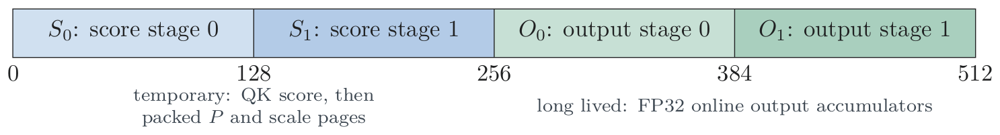

*图 1（原文 Figure 1，第 5 页）：继承自 HAO 的 D128 TMEM 布局。P 与面向指令的 scale 只有在对应分数片段退休之后才复用分数存储；没有一块没人拥有的 128 列 bank。*

**图中文字翻译与读法**：一条表示 512 个 TMEM 列的横条，从 0 到 512 被分成四段：$S_0$（分数 stage 0，0–128 列）、$S_1$（分数 stage 1，128–256 列）、$O_0$（输出 stage 0，256–384 列）、$O_1$（输出 stage 1，384–512 列）。左边两段下方标注 “temporary: QK score, then packed $P$ and scale pages”（临时：先是 QK 分数，之后是打包的 P 与 scale 页）；右边两段下方标注 “long lived: FP32 online output accumulators”（长期存在：FP32 在线输出累加器）。结论：能被临时复用的只有分数 bank，输出累加器必须一直占着。

HAO 对每个分数 bank 的复用顺序是（式 6）：

$$
\text{QK 分数}\ \to\ \text{读 N32 片段}\ \to\ \text{P/scale 覆盖}\ \to\ \text{PV 消耗}\ \to\ \text{释放}.
$$

下一个 QK tile 写得太早，会在 PV 还要用 P 的时候把 P 冲掉；等待则让矩阵发射者空闲。所以这是一个**存储所有权交接**问题，不只是 barrier 信号不够：barrier 能报告“存储已空闲”，却造不出另一个目的地。

### 2.8 为什么概率 tile 分两半发布（图 2）

QK 仍然写出一个 128 行 × 128 列（M128×N128）的 FP32 分数 tile。“四分块”指一个 softmax warpgroup 把它读成并变换四个 N32 片段（式 7）：

$$
S=[Q_0\,|\,Q_1\,|\,Q_2\,|\,Q_3],\qquad Q_k\in\mathbb{R}^{128\times32},
$$

而不是说 QK 变成了四个更小的矩阵乘；分数 bank 的 TMEM 分配仍是 128 列。HAO 路径使用的带缩放 FP4 的 PV 指令消耗 K64 而非 K32，所以必须等**两个相邻的片段**都完成，才能发射有用的矩阵工作（式 8）：

$$
(Q_0,Q_1)\ \to\ PV^{(0)}_{K64},\qquad (Q_2,Q_3)\ \to\ PV^{(1)}_{K64}.
$$

四分块减少了活跃的寄存器片段，并让 P 覆盖不再需要的分数地址；它不会减少分数 bank 的 TMEM 占用。它的性能价值在 $Q_1$ 之后的那个事件：前半的 PV 可以开始，同时 $Q_2/Q_3$ 与另一个 query stage 提供独立工作。

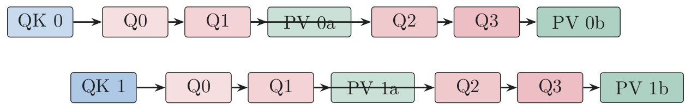

*图 2（原文 Figure 2，第 6 页）：两个 query stage 的依赖示意。方框宽度不是实测时间。每个前半 PV 都要等两个 N32 生产者四分块；另一个 stage 的工作覆盖了这段延迟的一部分。*

**图中文字翻译与读法**：上行（stage 0）依次是 `QK 0`（蓝）→ `Q0` → `Q1`（粉）→ `PV 0a`（绿）→ `Q2` → `Q3`（粉）→ `PV 0b`（绿）；下行（stage 1）同样依次是 `QK 1`、`Q0`、`Q1`、`PV 1a`、`Q2`、`Q3`、`PV 1b`，整体向右错开。箭头串起各步的先后依赖，穿过 `PV 0a`、`PV 1a` 的箭头表示这个 PV 是在 $Q_1$ 完成后异步发射、与后续四分块并行。读图结论：PV 的第一半依赖 $Q_0,Q_1$ 两个生产者四分块（原文第 8.2 节称之为“成对的汇合”），stage 1 的工作被安排在 stage 0 等待的时间里。

原文说明：这个外层流水、TMEM 生命周期与发布协议**原封不动地继承**，同时它们也暴露了剩下的问题：PV 在 softmax 构造、缩放、打包并发布两个相邻的概率片段之前无法开始。

## 三、什么阻碍了全 FP4 的加速

HAO 的调度已经让 QK、softmax、PV 在依赖允许时尽量重叠。把它的 FP8 概率-数值乘积换成 FP4 之后，剩下两个相互关联的问题：一个是时间上的，一个是数值上的。

### 3.1 问题一：P 在关键路径上

在分块 attention 里，P 是在 kernel 内部产生的，不是从外面载入的。对全 FP4 的 attention，第一条有用的 PV 指令要先等待（式 9）：

$$
S\ \to\ \text{最大值}\ \to\ \text{scale}\ \to\ \text{概率}\ \to\ \text{E2M1 打包}\ \to\ \text{发布}.
$$

FP4 加速的是 QK 和 PV，不加速分数规约、指数、同步和 scale 发布；还要求在两个乘积之间把 P 转换格式。**在第一个合法 P tile 之前去掉的工作可以缩短关键路径；在发布之后去掉的工作则可能不改变延迟。**

### 3.2 问题二：P 既要范围，又要便宜的 scale

P 的取值落在 $[0,1]$ 而且跨度极大。表 3 把“数值范围”与“kernel 调度”分开：它先构造精确的高斯 softmax 概率，把对齐的 N32 块量化，重新归一化被表示出来的 P，再乘同一个 FP32 的 V。稳定化的 NVFP4（G=448）是高保真对照，未缩放的 NVFP4（G=1）暴露下溢。

表 3：D128 下的概率格式范围。“零 scale”是 scale 被编码成零的块所占比例；“丢失质量”是被映射成零的精确概率质量；“零载荷”是载荷码为零的比例。这是数值诊断，不是 kernel 计时。

| 序列长 $S$ | 格式 | 零 scale | 零载荷 | 丢失质量 | P 相对 L2 | PV 余弦 | PV 相对 L2 |
|---:|---|---:|---:|---:|---:|---:|---:|
| 1024 | NVFP4 G=1 | 0.706299 | 0.831829 | 0.683773 | 1.715156 | 0.700819 | 1.685442 |
| 1024 | NVFP4 G=448 | 0.000000 | 0.155418 | 0.029314 | 0.114408 | 0.993854 | 0.113687 |
| 1024 | MXFP4 | 0.000000 | 0.188683 | 0.040178 | 0.146380 | 0.989846 | 0.144944 |
| 4096 | NVFP4 G=1 | 0.996063 | 0.999438 | 0.994332 | 13.815642 | 0.217328 | 13.876892 |
| 4096 | NVFP4 G=448 | 0.000000 | 0.156454 | 0.029760 | 0.114091 | 0.993747 | 0.114582 |
| 4096 | MXFP4 | 0.000000 | 0.189755 | 0.040494 | 0.147209 | 0.989338 | 0.148716 |
| 8192 | NVFP4 G=1 | 0.999634 | 0.999977 | 0.999284 | 12.467307 | 0.096774 | 12.389232 |
| 8192 | NVFP4 G=448 | 0.000000 | 0.160613 | 0.030691 | 0.114725 | 0.993841 | 0.113660 |
| 8192 | MXFP4 | 0.000000 | 0.194189 | 0.041630 | 0.147318 | 0.989660 | 0.146237 |

（原文表 3，第 7 页。）

读法：

- **NVFP4 不加全局因子（G=1）会塌**：序列越长，每个块的概率越小，E4M3 的 scale 越容易舍入为零；$S=4096$ 时 99.6% 的块 scale 为零、99.4% 的概率质量丢失，PV 余弦只有 0.217。
- **NVFP4 加全局因子（G=448）保真最好**：PV 相对 L2 约 0.114，但实际 kernel 里需要行级的范围校正，那会在在线路径上增加状态。
- **MXFP4 全程没有零 scale**，因为 E8M0 的指数范围能表示很小的概率块：PV 相对 L2 约 0.145–0.149，略粗于稳定化的 NVFP4，随序列长度几乎不变。

所以几种选择的代价不同：稳定化 NVFP4 保真最好，却需要行级范围校正；FP8 避开了 4 位的范围问题，但放弃了 FP4 的 PV 指令；MXFP4 在与生产者片段相同的 N32 粒度上提供 2 的幂次 scale，但对概率放置更粗。**Direct-P 选择 MXFP4，并重新设计这个操作数的产生与归一化方式。**

## 四、Direct-P：修复 FP4 概率路径

### 4.1 总览

Direct-P 只在很窄的边界内改动：保留 HAO 的外层调度，只修改“从一个就绪的 FP32 分数片段，到一个合法的、供 PV 使用的 FP4 概率操作数”之间的区段。表 4 区分继承来的机制与本文的改动。

表 4：继承的结构与本文所做的改动。

| 组件 | 继承自 HAO | 本文工作 |
|---|---|---|
| CTA 与 TMEM | 两个 query stage、两个分数 bank、两个 FP32 输出 bank、一个有序的 MMA 发射者 | 保留 |
| P 的发布 | N32 生产者四分块、前半与尾部 barrier、分数/P 覆盖 | 保留；每个事件之前的工作更少 |
| 格式 | 全 FP4 对照：NVFP4 的 Q/K/P/V，稳定化的 P | NVFP4 的 Q/K，MXFP4 的 P/V |
| P 的算术 | 指数运算之后做块 scale 量化 | 直接 log-分数到 E2M1 的映射，并有选择地使用硬件指数 |
| 归一化 | 分母由浮点指数值累加 | 分母由 PV 实际消耗的被表示的 P 累加 |

（原文表 4，第 8 页。）

在非因果前向的基准边界内，Q、K、V 是预先量化好的。QK 使用 NVFP4，相邻的 K64 的 Q/K scale 由一个均方误差（MSE）规则离线折叠；对 P/V，每个 N32 概率块使用一个 MXFP4 的 E8M0 scale；P 载荷与 scale 页覆盖已退休的分数地址，与算法 1 的生命周期完全一致。Direct-P 做了三个相互关联的选择：

1. 把归一化分数**直接映射**到 PV 消耗的 E2M1 载荷，缩短关键路径；
2. 用**同一批被舍入的载荷**计算归一化量，使分子与分母描述同一个近似算子；
3. 只对 logits 极端的模型层增加范围守卫。

第一条解决时间问题，后两条保证更便宜的表示在数值上仍然是良定义的。

### 4.2 修复一：把分数直接映射成 E2M1 码（式 13–18，算法 2）

常规做法是先算一个较准确的指数，再把它舍入到 8 个非负 E2M1 幅值之一，而那份中间精度根本到不了 PV。Direct-P 把构造概率看成一个**码分类问题**：决定每个归一化分数应落入哪一个 E2M1 的箱（bin）。

设 $m_i$ 是行参考值，$a_B=\max_{j\in B}\exp(z_{ij}-m_i)$。对非零的 N32 块，设 $u_B$ 为带偏置的 E8M0 字节，$e_B=u_B-127$ 是其指数，$\alpha_B=2^{e_B}$ 是存储的振幅。有效的 E2M1 重建步长是 $\delta_B=\alpha_B/6$，于是 Direct-P 把一个概率表示为（式 13）

$$
\tilde p_{ij}=\delta_B\,q_{ij}=\alpha_B\,q_{ij}/6,\qquad q_{ij}\in\mathcal{F}_{\text{E2M1}} .
$$

所以 $u_B$ 编码的是 $\alpha_B$ 而不是 $\delta_B$；带缩放的矩阵指令用的是 $\alpha_Bq_{ij}$，它的输出 epilogue 再对 MXFP4 的 P 和 V 施加固定的 $1/36$ 校正。理想的转换器输入是（式 14、15）

$$
x_{ij}=(z_{ij}-m_i)\log_2e-e_B+\log_26,\qquad q_{ij}=Q_{\text{E2M1}}\big(2^{x_{ij}}\big).
$$

（本文核对：$\tilde p/\delta_B=e^{z-m}/(\alpha_B/6)=6\cdot2^{(z-m)\log_2e-e_B}=2^{x}$，所以 $q=Q_{\text{E2M1}}(2^x)$ 就是把概率除以步长后舍入到最近的 E2M1 码。）只有码 $q_{ij}$ 会到达 PV，所以先算一个精确的 FP32 的 $2^x$、再把它的几乎全部精度丢掉是不必要的。

正的 E2M1 码在 7 个舍入边界处变化（相邻码的中点，式 16）：

$$
\Big\{\tfrac14,\ \tfrac34,\ \tfrac54,\ \tfrac74,\ \tfrac52,\ \tfrac72,\ 5\Big\}.
$$

因此作者在“值空间”里拟合一个仿射分类器（式 17）

$$
\hat u(x)=\max(0,\ Ax+B),\qquad \hat q(x)=Q_{\text{E2M1}}\big(\hat u(x)\big),
$$

目标是最大化 **E2M1 码的一致率**，而不是实数指数的精度。分数变换、$e_B$ 与 $\log_26$ 项都折进打包 FMA 的系数里（本文推断：$x$ 本身是分数 $z$ 的仿射函数，所以整个映射只需要对每两个分数一条 `FFMA2` 加一条 `F2FP`）。一条打包的两路 FMA 指令（`FFMA2`）处理两个分数，一条打包的浮点转换指令（`F2FP`）产出它们的 E2M1 载荷；当有利于机器调度时，被选中的一对分数也可以改用原生的 `EX2`（Blackwell 以 2 为底的指数指令）。

**算法 2：一个 N32 分数片段的直接 MXFP4 概率生产（原文第 9 页）**。逐行解释：

1. 从已完成的 TMEM 分数 tile 中，每行读 32 个分数，规约出块最大值。
2. 由这个最大值和行参考值 $m_i$，选出 2 的幂次振幅 $\alpha_B=2^{e_B}$ 与带偏置的 E8M0 字节 $u_B=e_B+127$；$u_B=0$ 表示零块。
3. 对每一对打包的分数，形成 $x=(z-m_i)\log_2e-e_B+\log_26$。
4. 计算 $\max(0,Ax+B)$（或对选定的一对用原生的 $2^x$），再用打包转换指令产出 E2M1 码 $q$。
5. 把四个载荷字打包起来（32 个码 × 4 位 = 128 位，正好四个 32 位字），并解码出这些码的和 $c_B=\sum_{j\in B}q_{ij}$（一个很小的量）。
6. 累加分母贡献 $d_{iB}=\alpha_B(c_B/6)$，使用与 PV 相同的振幅和码。
7. 把 P 载荷与经过重排（swizzle）的 scale 页覆盖到已退休的分数地址上；在两个相邻的 N32 片段构成一个合法的 K64 操作数之后发布。

常数的选取：通用的 fast 拟合用 $A=1.50,\ B=1.20$；Wan 激活上的评估选出同样代价的一对 $A=1.60,\ B=0.95$。这些常数移动 7 个判决边界（式 18）

$$
x_j=(t_j-B)/A,
$$

其中 $t_j$ 是某个 E2M1 的边界。它们是**量化器的校准参数**，不是对精确 softmax 的改动。作者也试过逐层的映射，但没有保留：在 BF16 教师轨迹上做的孤立替换，并不能预测组合起来的全 FP4 轨迹（附录 B.5）。整数阈值树、查表（LUT）与自定义的半字节（nibble）打包生成的机器码（SASS）比“打包 FMA 加 Blackwell 原生转换器”更多；二次和三次拟合改进了实数函数的误差，却把额外的依赖 FMA 直接放在发布之前。

（本文说明：FA4 把以 2 为底的指数用 FMA 单元上的三次多项式模拟，只要输出是 BF16 就够精确；本文更进一步——既然 P 只被当成 8 个幅值之一，只需要判对“落在哪个码”，一次仿射就够。FA4 的做法见 [FA4 解读](../flash_attention_4/论文中文解读.md) 第三节。）

### 4.3 修复二：用被表示出来的概率归一化（式 19–21）

分子用的是被舍入的 FP4 概率，所以一个独立近似的浮点分母描述的就是另一个算子。Direct-P 改为由 PV 实际消耗的**码与块 scale** 来构造分母。对块 $B$，被近似算子实际消耗的分子与分母是

$$
\tilde N_{iB}=\frac{\alpha_B}{6}\sum_{j\in B}q_{ij}\,\hat V_j,\qquad
\tilde L_{iB}=\frac{\alpha_B}{6}\sum_{j\in B}q_{ij},
$$

其中 $\hat V_j$ 是重建出的 MXFP4 的 V 值（含它自己的 $1/6$ 校正）。输出为

$$
\tilde O_i=\frac{\sum_B\tilde N_{iB}}{\sum_B\tilde L_{iB}} .
$$

这样就避免了把一个 E2M1 的分子，除以一个与之无关的近似 FP32 指数和。实现上，四个打包的载荷字用字节置换、无进位的字节加法和一条四路整数点积累加指令（`DP4A`）规约（本文推断：E2M1 的 8 个幅值都是 0.5 的整数倍，所以码值之和可以用整数精确完成）。逐字流式累加或保留成对的部分和，在代数上等价但更慢，因为会拉长活跃范围并改变指令交错。

FA4 把一部分指数运算从特殊函数单元（SFU）转移到普通算术流水；本文对“码映射”采用同样的均衡原则：GB200 的 D128 fast 全部用仿射；accurate 在大约四分之一的分数对位置使用原生 `EX2`；B300 的 SFU 更强，但广泛地走 `EX2` 仍然更慢，保留的策略只在实测依赖调度有利的四分块与形状区间使用原生 `EX2`。

### 4.4 修复三：只给极端 logits 加守卫（算法 3）

快速的“无平移（shiftless）”路径在合成网格和大多数模型层上有限（不溢出），但 Wan 模型靠后的少数层会产生超过 500、有时超过 1000 的 BF16 logits。若对每个分数扫描或重新载入，就会失去速度优势。作者只把这些层改走算法 3。启动前，把 128 个全局分布的 K/V 行**一起移到第一个物理 key tile 里**；这个置换不改变精确的 attention（因为 attention 对 key 的顺序不敏感）。

**算法 3：采样的 QK 守卫与防下溢的被表示分母（原文第 10 页）**：

1. 在第一个 key tile 里规约全部四个 N32 四分块，设采样锚点 $a_i=\max_{j\in A}z_{ij}$，其中 $\lvert A\rvert=128$。
2. 选编译期的余量 $M$ 与存储 scale 的平移 $L$，满足 $M+L\le126$；行参考值取 $m_i=a_i+M\ln2$。
3. 沿用算法 2，但在形成 $x$ 与 $q$ 之前，把工作用的字节下限抬到 $\bar u_B=\max(u_B,L+1)$，$\bar e_B=\bar u_B-127$；发布的字节为 $u_B'=\bar u_B-L$。
4. 记 $\alpha_B'=2^{u_B'-127}$，$c_B=\sum q_{ij}$；被表示的分母按 $\alpha_B'(c_B/6)$ 的顺序求值。
5. **永远不要**按 $(\alpha_B'/6)c_B$ 求值：在 $u_B'=1$ 时，第一个乘积是次正规数（subnormal），可能把一个有效的块冲成零。

工作下限保证 $\bar u_B-u_B'=L$ 在整个字节范围内成立；若只对发布的字节取下限，会放大 $u_B\le L$ 的块。公共因子 $2^{-L}$ 在分子与分母之间约掉，保存的对数归一化量会恢复相应的指数平移。1.3B 参数的 Wan 模型用 $(M,L)=(110,16)$，14B 用 $(112,14)$，两者都用满 126 级预算；该上界在编译期强制，被翻译的 E8M0 scale 下限取码 1。重排后的求值与出问题的表达式用的是同样两次乘法。在原来的第 39 层失败上，采样锚点其实已经等于精确的行最大值，失败**完全**是次正规的中间量造成的；这个修正不需要第二次扫描、新 barrier 或稳定 softmax 的回退。

### 4.5 两个工作点（表 5）

表 5：保留的两个策略。二者都使用 NVFP4 的 QK、MXFP4 的 P/V、K64 的 PV 发射以及 HAO 的两 query 布局。

| 策略 | K/V 级数 | 锚点 | 原生 EX2 | 分母 | 目标 |
|---|---:|---|---|---|---|
| fast | 12 | 默认无 | GB200 上为 0 | 由生产者（producer）一侧累加 | 最低延迟 |
| accurate | 13 | 固定 32 行 | 约 25% | 由 correction WG 累加 | 更高保真 |

（原文表 5，第 11 页。）Wan 的方案还可以给任一基础策略再加上 128 行的路由守卫。锚点置换与折叠的 Q/K scale 准备不在计时的 attention kernel 之内，部署时应该融合进上游的布局或量化步骤。

## 五、实验设置

### 5.1 测量边界（表 6）

原文把测量边界分开：kernel 速度不包含投影或优化器的工作，一个很短的固定 token 更新也不能证明训练质量。

表 6：论文使用的测量边界。

| 边界 | 包含的工作 | 支持的结论 |
|---|---|---|
| 非因果前向 kernel | QK、在线 softmax、P 发布、PV 与输出 epilogue | 前向延迟与输出误差 |
| 因果反向 kernel | 概率重建与 attention 梯度；操作数在计时之前准备好 | 反向延迟与梯度正确性 |
| 含投影的 attention | QKV 投影、rotary embedding、操作数发布、attention、输出投影及其梯度 | attention 的收益能否在它的直接生产者和消费者处存活 |
| 单 GPU 8B 更新 | 完整的模型前向、loss、反向与优化器 | 固定 local batch 下的端到端 step 时间 |
| 分布式轨迹 | 数据加载、通信、checkpoint 与验证 | 观察到的训练稳定性、loss 与持续吞吐 |

（原文表 6，第 11 页。）

### 5.2 指标与比较规则

每个主要行都存一次确定性用例的延迟与数值误差；故意不完整的 kernel 与种子/计时窗口不同的旧运行只作诊断。设近似输出为 $\hat O$，BF16 参考为 $O$，报告（式 22–24）

$$
\cos(\hat O,O)=\frac{\langle\hat O,O\rangle}{\lVert\hat O\rVert_2\lVert O\rVert_2},\qquad
\text{rel }L_2=\frac{\lVert\hat O-O\rVert_2}{\lVert O\rVert_2},\qquad
\text{RMSE}=\sqrt{\frac1n\sum_r(\hat O_r-O_r)^2}.
$$

余弦可能掩盖幅值误差，RMSE 依赖输出尺度，所以同时报告相对 L2。

### 5.3 算子基准套件

主要的 GB200 套件复现 HAO 的 FP4 FA4 README 里的 D128 形状网格（式 25）：

$$
(B,S,H)\in\{(1,256,16),(1,1024,16),(4,4096,16),(1,32768,16),(4,4096,32),(1,4096,12),(1,32768,12),(1,4096,24),(1,32768,24)\}.
$$

用 QK/PV 的格式命名路线：NV/NV 为 NVFP4/NVFP4，NV/MX 为 NVFP4/MXFP4，NV/FP8 为 NVFP4/FP8。每个用例都是非因果 D128，使用 HAO 的 `create_nvfp4_attention_tensors` 工厂与种子 20260814，预热 300 ms、取 3000 ms 窗口的中位数。TK fast、TK accurate、原生 HAO NV/NV 与 HAO 生成的 CuTe-DSL BF16 kernel 拿到同样准备好的 Q/K/V；两个 TK 二进制在不同进程里运行，但都使用同一份规范 manifest 的控制项。加速比与吞吐定义为（式 26、27）

$$
\text{speedup}(k)=t_{\text{HAO BF16}}/t_k,\qquad \text{ops}=B\,H\,2S^2\,(D_{QK}+D_{VO}),
$$

后者沿用 HAO 的矩阵运算约定（当 $D_{QK}=D_{VO}=d$ 时就是 FA2/FA3/FA4 的非因果公式 $4S^2dH$；本文核对：B1/S4096/H24/D128 的 0.092160 ms 对应 2237 TFLOP/s）。“饱和套件”另加 S4096/H64 与 S8192/H64，以及本地的 HAO 与 TK 的 NV/FP8 对照，六种顺序的测试 harness 消除了短用例里提供者顺序带来的偏差。D64 的矩阵在附录 A.6 单独报告，它使用不同的 tile 与所有权机制，不属于主比较。B300 的 D128 行是最终 SM103 调优里最好的稳定记录，**不是同一个二进制的硬件 A/B**：S4096 用 300/3000 ms 窗口，S6144 与 S32768 用重复窗口，S8192 与波次对齐的 S9472 用 5 个 2000 次迭代的窗口和两个正确性种子。HAO 在 B200 与 GB300 上发布的数值被标成“跨运行的背景”，不是本地计时。

### 5.4 计时范围与操作数约定

kernel 时间包含：分数载入、NVFP4 的 QK、在线状态、P 的近似与打包、MX scale 的发布、MXFP4 的 PV、修正与输出 epilogue；**不包含**动态的 Q/K/V 量化与可选的 K/V 置换，这与 HAO 的 attention-kernel 口径一致，而不是整层延迟。fast 路径要求相邻的 NVFP4 Q/K scale 块按 K64 的访问方式折叠，折叠方式离线按重建 MSE 选择；生产的 QKV 投影应当直接产出这种布局。把二进制与普通的 16 元素块 scale 搭配，即使计时看起来合理，也是**无效的操作数约定**。

因果训练扩展把“可学习投影的格式”与“attention 内部的格式”分开报告：研究交叉 E4M3 与 NVFP4 的 QKV/O 投影，以及 FP8 与 MXFP4 的 attention P/V。QKV 投影的 epilogue 在输出片段还活着时就发布 Q/K/V 的布局，避免单独的量化与转置 kernel。当前的吞吐臂用 NVFP4 的可学习投影，E4M3 是投影精度的对照。历史表格保留它们实际的投影格式与 CCE 的 loss 边界；保留的路线改用稠密的语言模型头与普通交叉熵，仅对 loss 做编译。不同配方世代之间的计时与 loss 数值不能互相转移。

### 5.5 固定输入的模型评估

六项固定输入评估把 Vision Transformer（ViT）与 BERT 里**每一个可替换的 attention 调用**都替换掉：ViT 分类（S256、S1024、S4096）、BERT 掩码语言模型 MLM（S256、S512）、以及 SST-2 分类（S256）。所有提供者拿到同样的权重、样本、mask、准备好的操作数和 BF16 参考摘要；报告 attention 层误差、最终 logits 或隐藏状态误差、预测一致率与任务得分。这些是保持输入不变的推理比较，不是训练稳定性的结论。

ViT-MAE 实验把 100 张 COCO 验证图像在固定 75% patch 掩码下的 12 个编码器自注意力层全部替换；其 D64 的模型 attention 被填充到已有的 S256/H16/D128 特化版本里，填充的 key 被 mask；测量与同一次 BF16 解码器运行成对比较的被掩 patch 的 PSNR、MSE、重建余弦与相对 L2。

Wan2.1 在 S7680 使用原生的非因果 D128 拓扑：1.3B 模型是 30 层、H12，14B 模型是 40 层、H40；每个视频自注意力调用都被替换，交叉注意力与其余部分保持 BF16。fast 路线用全局的 $A=1.60,\ B=0.95$ 映射；算法 3 的采样守卫只路由到 1.3B 模型的第 27–29 层与 14B 模型的第 33–34、38–39 层。1、4、20 步的输出与 HAO 的 CuTe-DSL BF16 成对比较（相同的提示词、种子、guidance 与初始 latent），另用一组 14B 的提示词/种子检验 20 步的修复；kernel 计时用独立预热的 5 秒窗口，并按层数对加守卫与不加守卫的延迟加权。逐层的仿射校准只作为负面对照保留，不属于报告的路线。

## 六、前向结果

### 6.1 算子性能与精度（表 7）

表 7 把同一条有限的 NV/MX 路线放在 GB200 与 B300 系统上，并在形状匹配处加上 HAO 发布的 GB300 NV/FP8 结果。

表 7：Blackwell 各系统的主要前向比较。“毫秒 / TF”表示毫秒与 TFLOP/s；加粗表示独立确认的 B300 超过 3 PFLOP/s 的结果；HAO 的列是跨运行的背景；TK 误差为对 BF16 的余弦 / 相对 L2。

| 形状 | TK GB200：毫秒 / TF | TK B300：毫秒 / TF | HAO GB300 NV/FP8：TF / 余弦 | B300 相对 GB200 的 Δt | TK B300：余弦 / 相对 L2 |
|---|---|---|---|---:|---|
| D128/H24/S4096 | 0.092160 / 2237 | 0.087008 / 2369 | 2046 / 0.9898 | -5.59% | 0.9438 / 0.3363 |
| D128/H64/S4096 | 0.202752 / 2711 | 0.189536 / 2901 | – | -6.52% | 0.9440 / 0.3355 |
| D128/H64/S6144 | 0.452848 / 2731 | 0.418107 / 2958 | – | -7.67% | 0.9432 / 0.3381 |
| D128/H64/S8192 | 0.758336 / 2900 | **0.705684 / 3116** | – | -6.94% | 0.944063–0.944113 / 0.334931–0.335152 |
| D128/H64/S9472 | – | **0.930724 / 3159** | – | – | 0.943960–0.944056 / 0.335198–0.335473 |
| D128/H24/S32768 | 4.400448 / 2998 | 4.480736 / 2945 | 2677 / 0.9899 | +1.82% | 0.9429 / 0.3389 |

（原文表 7，第 14 页；完整的本地 D128 网格是图 3、图 4 的基础，其生成的表放在发布的 artifact 里。无界的 shiftless NV/NV 计时被排除，即使某个输入碰巧有限。）

读法与正文数字：

- 九个 GB200 的 D128 行上，fast 相对 HAO BF16 的几何平均加速为 2.023 倍，峰值 2998 TFLOP/s；accurate 为 1.669 倍、峰值 2416 TFLOP/s。S32768/H24 上，fast 用 4.400448 ms（2998 TFLOP/s），HAO 发布的 NV/FP8 在 B200 上为 2018 TFLOP/s、在 GB300 上为 2677 TFLOP/s。
- **精度**：HAO 的 NV/FP8 更准——平均余弦 0.9899，而 fast 为 0.943789、accurate 为 0.951669；对应的 TK 平均相对 L2 为 0.336602（fast）与 0.327225（accurate），HAO 没有为这些行发布相对 L2。附录 C 衡量了“用本文自己的精确 NV/FP8 路线对齐 HAO 的余弦”要付出的代价。
- B300 在 S4096–S8192 这几行上把 D128 延迟降低 5.6%–7.7%；标准的 S8192/H64 达到 3116 TFLOP/s，波次对齐的 S9472/H64 达到 3159 TFLOP/s。例外是 S32768/H24：B300 为 2945 TFLOP/s，GB200 为 2998（+1.82% 的 Δt）。在 HAO 发布的 D128 形状上，本文的 B300 NV/MX 在 S4096/H24 为 2369 对 2046 TFLOP/s、在 S32768/H24 为 2945 对 2677，但这是不同的实现和 harness，所以这些比较只说明量级，不构成因果的计时差异。
- 本文核对：表中的 $\Delta t$ 与毫秒数自洽，例如 S8192/H64 为 $(0.705684-0.758336)/0.758336=-6.94\%$。

### 6.2 不同形状下的速度-精度（图 3、图 4）

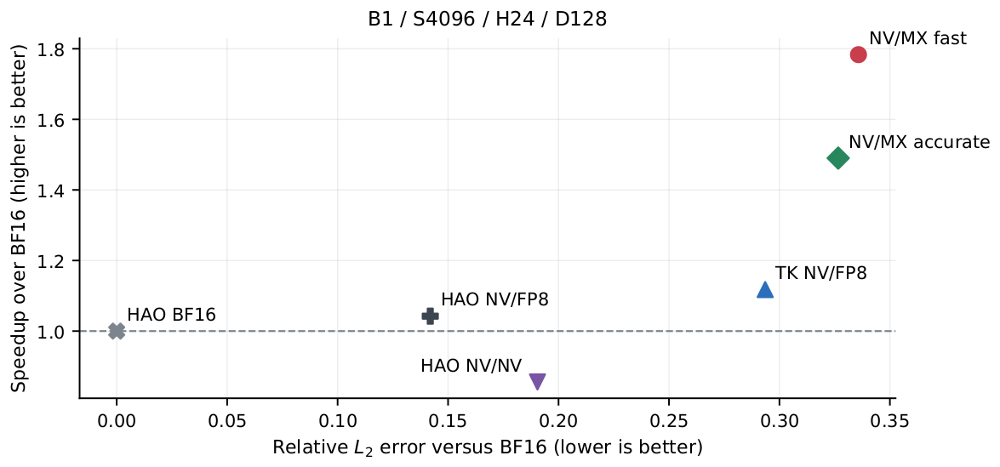

*图 3（原文 Figure 3，第 15 页）：头条形状的“速度-误差”平面，越靠上越快、越靠左越准。最快的全 FP4 点比 HAO NV/NV 或 FP8 的 PV 接受更大的算子误差。*

**图中文字翻译与读法**：标题 “B1 / S4096 / H24 / D128”；横轴 “Relative $L_2$ error versus BF16 (lower is better)”（对 BF16 的相对 L2 误差，越低越好），纵轴 “Speedup over BF16 (higher is better)”（相对 BF16 的加速，越高越好）。六个点（以下误差为从图上读出的近似值，加速比来自原文正文与表）：HAO BF16（灰叉，误差 0、加速 1.0，虚线为 1.0 参考线）；HAO NV/FP8（深色十字，误差约 0.14，加速约 1.04）；HAO NV/NV（紫色倒三角，误差约 0.19，加速 0.856×，比 BF16 还慢）；TK NV/FP8（蓝色三角，误差约 0.29，加速 1.118×）；NV/MX accurate（绿色菱形，误差约 0.33，加速 1.490×）；NV/MX fast（红色圆点，误差约 0.34，加速 1.783×）。读图结论：用更快的 FP4 概率路径，就要接受比 HAO NV/FP8 大约 2.4 倍、比 HAO NV/NV 大约 1.8 倍的相对 L2（按图上读出的近似值）；本地的 TK NV/FP8 对照在此套件里只达到 1.118 倍，所以原文把 HAO 更强的、已发布的 NV/FP8 结果放进主表，而不是从这个本地对照推断。

图 4 加入 H64 的情形。S4096/H64 上，fast 用 0.202752 ms，BF16 用 0.370688 ms（1.828 倍）；S8192/H64 上 fast 用 0.758336 ms，BF16 用 1.611488 ms（2.125 倍）。两 query 的 CTA 在这里很重要：先前的单 query 拓扑会产生两倍的任务数，在 head 多时可能多出一个调度波次。

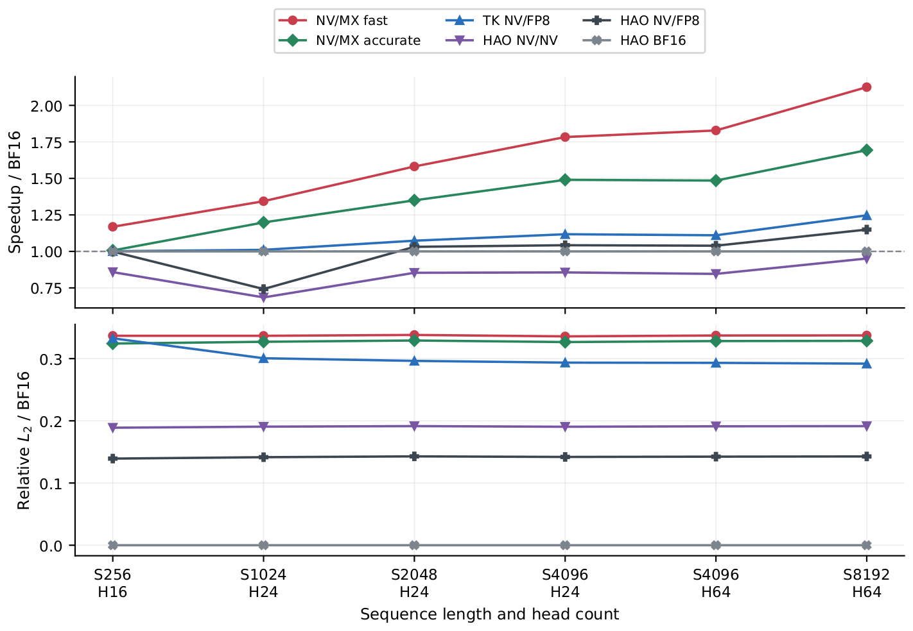

*图 4（原文 Figure 4，第 16 页）：匹配记录下，启动、过渡与饱和三类形状上的相对 BF16 加速与相对 L2 误差。*

**图中文字翻译与读法**：横轴 “Sequence length and head count” 依次为 S256/H16、S1024/H24、S2048/H24、S4096/H24、S4096/H64、S8192/H64；上半图纵轴 “Speedup / BF16”，下半图纵轴 “Relative $L_2$ / BF16”。六条线：红圆 NV/MX fast、绿菱形 NV/MX accurate、蓝三角 TK NV/FP8、紫倒三角 HAO NV/NV、黑十字 HAO NV/FP8、灰叉 HAO BF16。

图中有数字依据的点：NV/MX fast 为 1.169（S256）、1.344（S1024）、1.783（S4096/H24）、1.828（S4096/H64）、2.125（S8192/H64）；NV/MX accurate 为 1.007、1.198、1.490（依次对应 S256/H16、S1024/H24、S4096/H24，见表 8）；HAO NV/NV 为 0.858、0.685、0.854、0.856、0.846、0.951（见表 25）。其余点为从图上读出的近似值：fast 在 S2048/H24 约 1.58；accurate 在 S2048、S4096/H64、S8192/H64 约为 1.35、1.48、1.69；TK NV/FP8 约 1.0、1.01、1.07、1.12、1.11、1.25；HAO NV/FP8 约 1.0、0.75、1.03、1.04、1.04、1.15。下半图的相对 L2 近似为：fast 约 0.336 且几乎不随形状变化，accurate 约 0.325–0.33，TK NV/FP8 约 0.33 逐渐降到约 0.29，HAO NV/NV 约 0.19，HAO NV/FP8 约 0.14，BF16 为 0。

**读图结论**：(1) 加速比随序列变长与 head 数变多而增大：fast 从 1.17 倍升到 2.13 倍（所谓“有利的形状”）；(2) 短序列（S256）上两条 NV/MX 线与 BF16 差距很小（accurate 仅 1.007 倍）；(3) 误差基本与形状无关，所以速度与误差之间的权衡是“格式”造成的，不是“形状”造成的。

### 6.3 ViT 与 BERT 的固定输入评估（表 8）

问题：算子误差在整个 Transformer 里如何传播？表 8 把物理 attention 速度、平均层误差和最终任务表现放在一起。ViT 在 S256 用 1000 个样本，在 S1024/S4096 各用 200 个；BERT MLM 用 800 个 S256 块与 200 个 S512 块；SST-2 用全部 872 个验证样本。

表 8：下游的固定输入权衡。任务得分为“该对象 / BF16”的准确率；最终误差为对 BF16 的余弦 / 相对 L2；加速比属于物理 attention 的形状，不是整个模型的加速；HAO NV/NV 是同输入的对照，因为没有发布 NV/FP8 的任务评估。

| 任务 | 对象 | 加速比 | 任务得分 / BF16（%） | 最终余弦 / 相对 L2 | ΔMLM loss |
|---|---|---:|---|---|---:|
| ViT S256 | TK NV/MX fast | 1.169× | 98.80 / 98.90 | 0.9987 / 0.0514 | – |
| ViT S256 | TK NV/MX accurate | 1.007× | 98.70 / 98.90 | 0.9990 / 0.0452 | – |
| ViT S256 | HAO NV/NV | 0.858× | 98.70 / 98.90 | 0.9997 / 0.0238 | – |
| ViT S1024 | TK NV/MX fast | 1.344× | 95.00 / 96.50 | 0.9971 / 0.0768 | – |
| ViT S1024 | TK NV/MX accurate | 1.198× | 97.00 / 96.50 | 0.9984 / 0.0564 | – |
| ViT S1024 | HAO NV/NV | 0.685× | 97.00 / 96.50 | 0.9995 / 0.0324 | – |
| ViT S4096 | TK NV/MX fast | 1.783× | 88.50 / 88.50 | 0.9887 / 0.1509 | – |
| ViT S4096 | TK NV/MX accurate | 1.490× | 89.00 / 88.50 | 0.9989 / 0.0479 | – |
| ViT S4096 | HAO NV/NV | 0.856× | 88.00 / 88.50 | 0.9992 / 0.0396 | – |
| BERT SST-2 S256 | TK NV/MX fast | 1.169× | 92.32 / 92.43 | 0.9963 / 0.0870 | – |
| BERT SST-2 S256 | TK NV/MX accurate | 1.007× | 92.09 / 92.43 | 0.9967 / 0.0815 | – |
| BERT SST-2 S256 | HAO NV/NV | 0.858× | 92.20 / 92.43 | 0.9991 / 0.0431 | – |
| BERT MLM S256 | TK NV/MX fast | 1.169× | 61.26 / 61.74 | 0.9968 / 0.0796 | +0.035 |
| BERT MLM S256 | TK NV/MX accurate | 1.007× | 61.36 / 61.74 | 0.9971 / 0.0758 | +0.028 |
| BERT MLM S256 | HAO NV/NV | 0.858× | 61.60 / 61.74 | 0.9983 / 0.0577 | +0.016 |
| BERT MLM S512 | TK NV/MX fast | 1.344× | 61.10 / 61.79 | 0.9969 / 0.0782 | +0.037 |
| BERT MLM S512 | TK NV/MX accurate | 1.198× | 61.36 / 61.79 | 0.9971 / 0.0761 | +0.040 |
| BERT MLM S512 | HAO NV/NV | 0.685× | 61.28 / 61.79 | 0.9982 / 0.0604 | +0.028 |

（原文表 8，第 17 页。）

读法：

- 两个 NV/MX 策略都保持有限。ViT S4096 上，fast 与 BF16 的 top-1 准确率持平（88.5%），与 BF16 的预测一致率为 95.5%；accurate 的准确率 89.0%、预测一致率 98.5%；原生 HAO NV/NV 为 88.0% 与 98.0%。fast 的相对 L2 在高斯算子测试里约 0.34、余弦约 0.944，到这个模型输入上的平均层余弦升到 0.9961：残差连接、归一化、后续混合与决策余量都会衰减算子误差，所以独立的相对 L2 有参考价值，但它本身不是任务 loss。
- 在 2272 个分类样本里（1000+200+200 个 ViT 加 872 个 SST-2），fast 改变了 32 个预测，其中 31 个落在 BF16 的 top-2 logit 间隔的最低四分位里；accurate 与 HAO NV/NV 的所有改变也都落在这个四分位。这支持“决策余量”机制，但样本量太小，不足以确立普遍的推理或训练安全性。
- 各行的“加速比”是 attention kernel 的物理形状上的速度，不是整个模型的加速；HAO NV/NV 在每个形状上都比 BF16 慢（0.685–0.858 倍），再次说明“把所有东西换成 FP4”不会自动变快。

### 6.4 Wan 视频扩散（表 9）

问题：当 attention 误差在许多扩散步里累积时，Direct-P 还有限吗？Wan 是一个更大的、原生形状的测试：所有视频自注意力调用都在 S7680/D128 上运行，文本交叉注意力与其余部分保持 BF16。表 9 把每条路线与成对的 HAO CuTe-DSL BF16 输出以及预热后的 kernel 计时比较。

表 9：Wan2.1 的质量与预热后的 GB200 kernel 速度（S7680/D128）。加速比相对 HAO CuTe-DSL BF16；质量为最终 latent 对成对 BF16 运行的余弦 / 相对 L2。

| 模型 | 方法 | 时间（ms） | 加速比 | 1 步 | 4 步 | 20 步 |
|---|---|---:|---:|---|---|---|
| Wan2.1-1.3B | HAO CuTe BF16 | 0.2888 | 1.00× | 1.0000 / 0.0000 | 1.0000 / 0.0000 | 1.0000 / 0.0000 |
| Wan2.1-1.3B | TK NV/MX fast | 0.1653 | 1.75× | 0.9870 / 0.1803 | 0.9671 / 0.2611 | 0.9136 / 0.4163 |
| Wan2.1-1.3B | TK NV/MX accurate | 0.1961 | 1.47× | 0.9862 / 0.1721 | 0.9654 / 0.2637 | 0.9060 / 0.4323 |
| Wan2.1-1.3B | HAO NV/NV | 0.3466 | 0.83× | 0.9878 / 0.1751 | 0.9711 / 0.2405 | 0.9389 / 0.3463 |
| Wan2.1-1.3B | HAO NV/FP8 | 0.2888 | 1.00× | 0.9936 / 0.1184 | 0.9767 / 0.2158 | 0.9530 / 0.3066 |
| Wan2.1-14B | HAO CuTe BF16 | 0.8882 | 1.00× | 1.0000 / 0.0000 | 1.0000 / 0.0000 | 1.0000 / 0.0000 |
| Wan2.1-14B | TK NV/MX fast | 0.4250 | 2.09× | 0.9938 / 0.1179 | 0.9338 / 0.3589 | 0.8496 / 0.5337 |
| Wan2.1-14B | TK NV/MX accurate | 0.5072 | 1.75× | 0.9879 / 0.1563 | 0.9243 / 0.3946 | 0.8447 / 0.5500 |
| Wan2.1-14B | HAO NV/NV | 0.9073 | 0.98× | 0.9908 / 0.1358 | 0.9327 / 0.3640 | 0.9036 / 0.4435 |
| Wan2.1-14B | HAO NV/FP8 | 0.7516 | 1.18× | 0.9893 / 0.1464 | 0.9229 / 0.3877 | 0.8398 / 0.5669 |

（原文表 9，第 17 页。）

读法：

- fast 在 1.3B 模型上比 CuTe BF16 快 1.75 倍，在 14B 上快 2.09 倍；accurate 为 1.47 倍和 1.75 倍；HAO 的 NV/FP8 在 H12（1.3B）上与 BF16 持平，在 H40（14B）上快 1.18 倍。
- 14B 模型 4 步时，fast 为 0.9338 / 0.3589，接近 HAO NV/NV 的 0.9327 / 0.3640；20 步时 fast 为 0.8496 / 0.5337，HAO NV/NV 为 0.9036 / 0.4435；另一组留出提示词上 fast 为 0.8235 / 0.5813。原文的结论是：这条路线有限，但**累积更多漂移**。（本文补充：14B 的 20 步行里，HAO NV/FP8 的 0.8398 / 0.5669 反而比 fast 差，说明扩散轨迹的漂移不能简单按单步算子误差排序；每行只有一条轨迹，没有置信区间。）
- 原来的第 39 层失败并非“锚点没抓住”：采样的行最大值与精确的行最大值相等；是表达式 $(s/6)\sum_ic_i$ 在 E8M0 码 1 处形成了次正规的中间量并被冲成零。算法 3 把它重排成 $s(\sum_ic_i/6)$ 之后，两次 14B 的 20 步运行都完成了全部 1600 次 attention 调用，没有扫描或稳定 softmax 回退。
- 加守卫的层单独看慢 21%–23%，但它们在 1.3B 里只占 3/30 层，在 14B 里只占 4/40 层；按层数加权的时间为 0.165309 ms 与 0.424995 ms，仅比不加守卫的基础高 2.2%–2.3%。历史上逐层的仿射映射因为微小的收益在不同提示词间反转而被舍弃。这些“直接替换 BF16 检查点”的结果**不能复现 Attn-QAT 的训练后质量**，那需要它的 QAT 检查点或训练配方。

### 6.5 成对的图像重建（表 10，图 5）

问题：残余的 attention 误差在重建图像里看得出来吗？表 10 对同样 100 张图和 mask，替换全部 12 个 ViT-MAE 编码器 attention 层。S256 的加速比是物理 kernel 的测量，不是端到端 MAE 速度。

表 10：成对的 ViT-MAE 重建。PSNR Δ 为 FP4 减 BF16，带成对 95% 区间；重建与层误差为对 BF16 的余弦 / 相对 L2。

| 对象 | S256 加速 | PSNR（dB） | PSNR Δ（dB） | MSE Δ（%） | 重建：余弦 / 相对 L2 | 平均层误差：余弦 / 相对 L2 |
|---|---:|---:|---|---:|---|---|
| BF16 | 1.000× | 23.917 | – | +0.00 | 1.00000 / 0.0000 | 1.0000 / 0.0000 |
| HAO NV/FP8 | 0.999× | 23.910 | -0.007 ± 0.012 | +0.16 | 0.99995 / 0.0089 | 0.9938 / 0.1046 |
| HAO NV/NV | 0.858× | 23.906 | -0.010 ± 0.015 | +0.07 | 0.99992 / 0.0113 | 0.9868 / 0.1589 |
| TK NV/MX accurate | 1.007× | 23.893 | -0.024 ± 0.021 | +0.25 | 0.99978 / 0.0184 | 0.9676 / 0.2616 |
| TK NV/MX fast | 1.169× | 23.896 | -0.020 ± 0.026 | +0.29 | 0.99973 / 0.0203 | 0.9600 / 0.2928 |

（原文表 10，第 18 页。）

读法：HAO NV/FP8 最接近 BF16（-0.007 ± 0.012 dB）；HAO NV/NV、accurate、fast 分别为 -0.010 ± 0.015、-0.024 ± 0.021、-0.020 ± 0.026 dB。fast 的重建位移最大，但十二层之后它的输出与 BF16 仍有 0.99973 的余弦、2.03% 的相对 L2。（本文按区间端点核对：只有 accurate 的区间 [-0.045, -0.003] 不含 0，其余三项的区间都含 0；总体上 PSNR 的差别在百分之几分贝量级。）原文还指出：激进的 shiftless TK NV/NV 对照在每个任务的第一个样本上就失败，而 HAO 稳定化的 NV/NV 保持有限；附录 A.7 说明区别在于“稳定化”，而不是使用 NVFP4 的 P 本身。

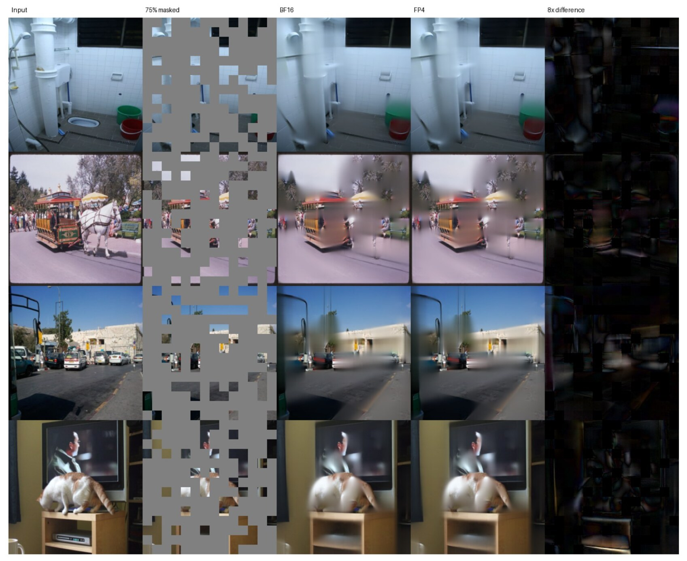

*图 5（原文 Figure 5，第 19 页）：四组成对的 ViT-MAE 样例。最右一列显示 $8\lvert I_{\text{FP4}}-I_{\text{BF16}}\rvert$（把差异放大 8 倍）；BF16 与 fast 两次运行只有编码器 attention 不同。*

**图中文字翻译与读法**：五列依次是 “Input”（原图）、“75% masked”（遮住 75% 的 patch，灰色为被遮部分）、“BF16”（BF16 重建）、“FP4”（FP4 attention 重建）、“8x difference”（差异放大 8 倍）。四行是四个 COCO 样例（浴室、马车、街景、电视前的猫）。读图结论：BF16 与 FP4 的重建在肉眼下几乎一致（都是被遮区域的模糊补全）；差异图（放大 8 倍后）整体接近黑色，亮处主要是边缘和细节结构，说明 FP4 的 attention 误差在这个任务上放大后才可见。

## 七、因果训练：从保存的量化操作数出发

训练比前向多三个约束：因果 attention 要屏蔽未来 token；分组查询注意力（GQA）让多个 query head 共享 key/value head；反向要在不物化完整 $S\times S$ 分数/概率矩阵的前提下恢复梯度。

### 7.1 把前向的量化传给反向（表 11）

前向保存 NVFP4 的 query/key 载荷字节、它们的块 scale、每个 head 的 Q–K 全局因子，以及每行的 LSE 归一化量。反向用这些字节和 scale 重新计算 $QK^\top$，再用 LSE 重建概率。另外，投影的 epilogue 发布 Q、K、V 的行向或列向 FP8 视图，让每个梯度矩阵乘都拿到它所需的物理布局，不需要单独的转置或量化 kernel 的发射。因此下文的“精确”是指**相对量化后的前向载荷精确**，而不是相对未量化的 BF16 输入。行向与列向只是同一批被表示的值与 scale 为不同矩阵指令做的不同排布，没有引入第二套量化规则。

实现针对 Llama 风格的 80 亿参数 attention 形状分派：local batch $B\in\{1,2,4\}$，序列长 $S=4096$，32 个 query head、8 个 key/value head，head 维度 $D=128$。联合的 QKV 投影应用 RoPE，并在输出片段还活着时发布前向与反向所需的各种布局。这**不是**纯 FP4 的端到端训练：可学习投影与 attention 是两个独立的精度边界；E4M3 的投影作数值对照，NVFP4 的投影作更高吞吐的一臂；在 attention 内部，受控的格式比较选择 FP8（而非 MXFP4）作为 P 与 V 的格式，支撑它的消融收在附录 G。

表 11：因果训练的精度约定。可学习投影与 attention 操作数是两个独立的边界。

| 模型部件 | 表示 | 理由 |
|---|---|---|
| 可学习的 QKV 与输出投影 | E4M3 对照或 NVFP4 吞吐臂；FP32 累加 | 把投影误差与 attention 格式比较分开 |
| 前向分数乘积 | NVFP4 的 Q 和 K | 复用沿内维的二维 scale（每 16 个值一块，“行 × K16”） |
| 前向数值乘积 | FP8 的 P 和 V | 保留的训练路线；MXFP4 的替代方案在孤立测试里更快，但在观测到的分布式实验里发散 |
| 反向中的概率重建 | 保存的 NVFP4 Q/K、块 scale 与全局 scale、LSE | 重建与前向相同的被表示概率，不存储 $S\times S$ 矩阵 |
| 反向的梯度乘积 | E4M3 的 Q/K/V/P/dS；E5M2 的 dO | E4M3 提供精度；E5M2 提供小的输出梯度 dO 所需的范围 |
| 梯度输出 | FP32 累加，BF16 的 dQ/dK/dV | 保持累加与面向优化器的梯度稳定 |

（原文表 11，第 21 页。）

### 7.2 反向怎么算（式 28–29，图 6）

设 $dQ,dK,dV,dP,dS$ 为对应 attention 张量的梯度。反向执行五个分块矩阵乘，第一个是用保存的量化操作数重建的 $QK^\top$（式 28）：

$$
dP=dO\,V^\top,\qquad dV=P^\top dO,\qquad dQ=dS\,K,\qquad dK=dS^\top Q .
$$

softmax 的梯度为（式 29）

$$
r_i=\langle O_i,\,dO_i\rangle,\qquad dS=P\odot\big(dP-r\mathbf{1}^\top\big),
$$

所以概率重建与 $dP$ 都要先完成，才能开始 $dQ$ 和 $dK$。因果 mask 会去掉非法的 tile，同时也使工作归属不均匀。

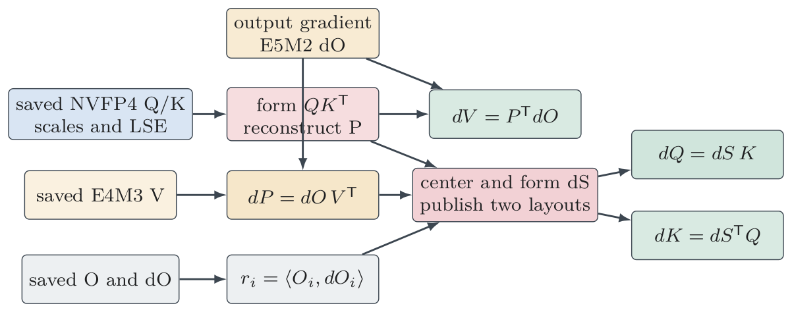

*图 6（原文 Figure 6，第 21 页）：从保存的量化操作数出发的因果反向。串行依赖链是：概率重建与 $dP$ → $dS$ → $dQ/dK$；$dV$ 分支同样消耗 $P$ 与 $dO$，保存的输出与 $dO$ 提供行中心化统计量。输出框里的公式点出了 Q/K 输入，图中没有为它们画额外的交叉箭头。*

**图中文字翻译与读法**：左列四个输入框：“saved NVFP4 Q/K scales and LSE”（保存的 NVFP4 Q/K、scale 与 LSE）、“saved E4M3 V”（保存的 E4M3 的 V）、“saved O and dO”（保存的 O 与 dO），顶部还有 “output gradient E5M2 dO”（E5M2 的输出梯度 dO）。中列：“form $QK^T$ reconstruct P”（形成 $QK^T$ 并重建 P）、“$dP=dO\,V^T$”、“$r_i=\langle O_i,dO_i\rangle$”。右侧：$dV=P^TdO$，以及“center and form dS, publish two layouts”（中心化并形成 $dS$，发布两种布局），再产出 $dQ=dS\,K$ 与 $dK=dS^TQ$。读图结论：关键串行链是“重建 P 与算 $dP$ → 形成 $dS$ → 算 $dQ$、$dK$”，所以 $dS$ 的生产与发布是反向的瓶颈位置。

这套实现从四个方面加速这张图：

1. 用紧凑的前向载荷重建分数，而不创建单独的 BF16 分数路径；
2. 复用被舍入的 P 表示去算 $dV$ 与 $dS$，不解码两次；
3. 从生产者片段发布 $dS$ 的两种物理布局，并在下一个消费者拥有被覆盖的 tensor memory 时立刻释放它；
4. 把 $dO$ 直接发布成 E5M2：在失败的检查点诊断里，E4M3 把观察到的 $dO$ 值约 97% 舍入成了零，而 E5M2 把零比例降到约 14%，发布者的额外开销不到 1%。

D128 的反向仍然受调度限制，每个 SM 只能驻留一个 CTA。详细的占用率与活动计数器只在先前版本的调度上有，所以和那个调度的计时一起放在附录 G，不归到保留的二进制上。

### 7.3 孤立反向（表 12，图 7）

问题：把保存的量化传进反向，kernel 本身会变快吗？先只计时因果 attention 的反向（生产 head 维度 D=128，单个 GB200）。两条路径在计时前都已准备好并绑定。BF16 对照解码同样被表示的 E4M3 的 Q、K、V 与 E5M2 的 dO 操作数，而量化路径用前向保存的 NVFP4 Q/K 载荷。投影、分配、loss 和优化器工作都在这个边界之外。

表 12：孤立的 D128 因果反向（B1/S4096）。延迟是预热后多次运行的中位数；加速比是 BF16 延迟除以该行的延迟。

| 路线 | 延迟（ms） | 加速比 |
|---|---:|---:|
| BF16 FA4 反向 | 0.501 | 1.000× |
| 保存 Q/K 的重建核心 | 0.356 | 1.405× |
| 核心 + E5M2 dO / 统计量发布者 | 0.508 | 0.986× |

（原文表 12，第 22 页。）

读法：重建核心省了 BF16 反向时间的 29%，但保证训练安全的 E5M2 的 dO 与行统计量发布者几乎恰好吃掉了这笔节省——所以单看一个更快的反向 kernel 并不能预测端到端收益。核心通过了“精确零 dO”测试，对非零 dO 返回有限的非零梯度，并通过了对被表示操作数的参考门槛。在成对的含投影检查里，输出与输入梯度对 BF16 的余弦分别是 0.998 与 0.956；Q、K、V 与输出投影权重梯度的余弦在 0.983 到 0.999 之间。这些是局部算子检查，不是收敛结果。

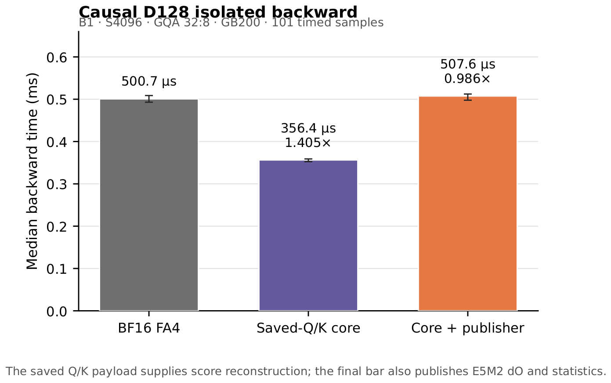

*图 7（原文 Figure 7，第 23 页）：BF16 与“用保存的量化 Q/K 重建 P”这条路径的孤立 D128 因果反向延迟（B1/S4096）。*

**图中文字翻译与读法**：标题 “Causal D128 isolated backward”，副标题 “B1 · S4096 · GQA 32:8 · GB200 · 101 timed samples”（101 个计时样本）；纵轴 “Median backward time (ms)”（反向延迟中位数）。三根柱：灰 BF16 FA4（500.7 µs）、紫 Saved-Q/K core（保存 Q/K 的核心，356.4 µs，1.405×）、橙 Core + publisher（核心加发布者，507.6 µs，0.986×），柱顶有误差棒。底部说明：保存的 Q/K 载荷提供分数重建；最后一根柱还发布了 E5M2 的 dO 与统计量。读图结论同表 12。

### 7.4 含投影的 attention 子层（表 13，图 8）

问题：这笔节省在它的生产者与消费者之间还能保住吗？第二个边界是完整的 attention 子层：打包的 QKV 投影、旋转位置编码、scale 与布局的发布、因果 attention、输出投影及其梯度。它包含了孤立 kernel 测试里被隐藏的生产者与交接成本，但不含周围的 RMSNorm、残差、语言模型 loss 与优化器。BF16 与量化路径使用相同的投影权重和同样的 B1/S4096/D128 模型形状。

表 13：单个 GB200 上含投影的 attention。“只反向”把同样准备好的前向放在计时区间之外；第二行同时计时前向与反向。数值为预热后多次运行的中位数。

| 边界 | BF16（ms） | 量化路线（ms） | 加速比 |
|---|---:|---:|---:|
| 只反向 | 1.572 | 1.397 | 1.125× |
| 前向 + 反向 | 2.656 | 2.133 | 1.245× |

（原文表 13，第 23 页。）

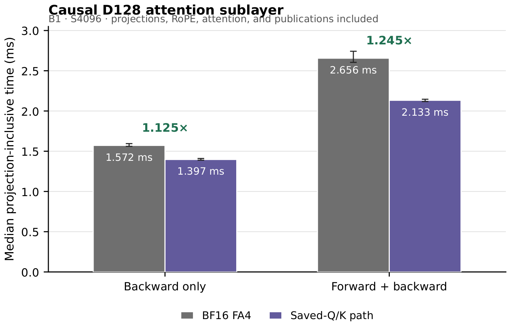

*图 8（原文 Figure 8，第 24 页）：匹配的含投影 attention 前向与反向：B1/S4096/D128 下 BF16 FA4 与保存量化路径的对比。*

**图中文字翻译与读法**：标题 “Causal D128 attention sublayer”，副标题 “B1 · S4096 · projections, RoPE, attention, and publications included”；纵轴 “Median projection-inclusive time (ms)”；两组柱 “Backward only”（只反向）与 “Forward + backward”（前向+反向），灰柱 BF16 FA4，紫柱 Saved-Q/K path（保存 Q/K 的路径）；柱内数字与表 13 一致，柱上标 1.125× 与 1.245×，带误差棒。读图结论：加入投影与布局发布后，只反向的收益是 1.125×，前向与反向合计为 1.245×。（本文推算：两行相减，前向部分 BF16 约 1.084 ms、量化路线约 0.736 ms，即前向部分约快 1.47 倍；这是由两个中位数相减得到的估计，原文没有单独报告前向。）这两个数字都已经包含了生产者与交接成本，比孤立 kernel 的 1.405× 小。

### 7.5 80 亿参数的完整更新（表 14，图 9）

问题：attention 的收益在完整模型更新里还看得见吗？原文测量 Llama-3.1 风格的 8.03B 参数模型（32 层、32 个 query head、8 个 key/value head、head 维度 128）的完整更新：在一个 GB200 上，序列长 4096，local batch 取 1、2、4。每一臂都使用相同的融合 AdamW 优化器与 `torch.compile` 编译的标准稠密交叉熵（CCE 关闭）；每个进程绑定到本 GPU 对应的 CPU 与内存节点；在固定的合成 token 上，10 次预热后报告 21 次更新的中位数。量化各臂使用 NVFP4 的 QKV 与输出投影、attention 内部“行 × K16”的 NVFP4 Q/K，以及 FP8 或 MXFP4 的 P/V；同一 local batch 下它们的反向二进制相同，只有前向的 P/V 实现随格式不同；每个量化测量都与一次新测的打包 QKV 的 BF16 FA4 对照配对。

表 14：S4096、单个 GB200 上的完整 8B 更新。每条 P/V 路线有自己相邻的 BF16 计时括号；时间为毫秒的中位数。

| local batch | FP8 P/V 括号：BF16 | FP8 P/V 括号：低精度 | FP8 P/V 括号：加速比 | MXFP4 P/V 括号：BF16 | MXFP4 P/V 括号：低精度 | MXFP4 P/V 括号：加速比 |
|---|---:|---:|---:|---:|---:|---:|
| B1 | 260.313 | 239.985 | 1.085× | 261.133 | 239.250 | 1.091× |
| B2 | 464.245 | 415.532 | 1.117× | 463.814 | 415.408 | 1.117× |
| B4 | 854.516 | 751.722 | 1.137× | 857.226 | 751.597 | 1.141× |

（原文表 14，第 25 页。）

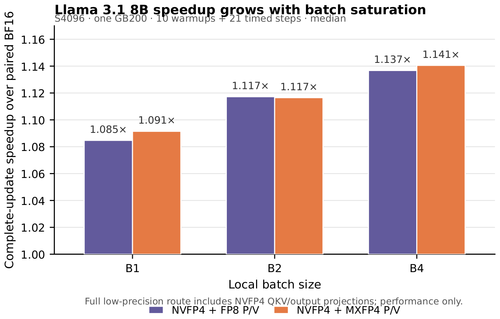

*图 9（原文 Figure 9，第 26 页）：两条量化路线的完整更新加速比随 local batch 的变化。这些全路线的数值包含 NVFP4 的 QKV/输出投影，因此不是只含 attention 或只含 P/V 的加速比。*

**图中文字翻译与读法**：标题 “Llama 3.1 8B speedup grows with batch saturation”（Llama 3.1 8B 的加速随 batch 饱和度增长），副标题 “S4096 · one GB200 · 10 warmups + 21 timed steps · median”；横轴 “Local batch size”（B1、B2、B4），纵轴 “Complete-update speedup over paired BF16”（相对配对 BF16 的完整更新加速）；紫柱为 “NVFP4 + FP8 P/V”，橙柱为 “NVFP4 + MXFP4 P/V”；柱顶：B1 为 1.085× 与 1.091×，B2 为 1.117× 与 1.117×，B4 为 1.137× 与 1.141×。底部注：全低精度路线包含 NVFP4 的 QKV/输出投影；仅为性能。

读法：

- 收益随 GPU 被填满的程度增长：大约 B1 为 1.09 倍、B2 为 1.12 倍、B4 为 1.14 倍。在 FP8 括号里，B4 的吞吐从 19,173 升到 21,795 tokens/s/GPU，测得的模型 FLOP 利用率（MFU）从 41.12% 升到 46.74%；MXFP4 一臂达到 21,799 tokens/s 与 46.75%。（本文核对：$16384/0.854516\approx19173$，$16384/0.751722\approx21795$，$16384/0.751597\approx21799$ tokens/s。）
- 因此 FP8 与 MXFP4 在端到端上**打平**：它们的量化 step 时间相差至多 0.31%，不大于它们各自测的两个 BF16 锚点之间的波动。MXFP4 在计时的前向部分略快，但这个亚毫秒的差异不构成完整更新上的实质性胜利。
- 这个矩阵刻意只看性能。初始 logits 对 BF16 的余弦是 0.416–0.426（FP8 P/V）与 0.373–0.374（MXFP4 P/V），相对 L2 约 1.07 与 1.12。这些很短的固定 token 更新不能确立训练质量；附录 G 里更长的 FP8 与 MXFP4 轨迹是独立的实验，一个又快又有限的计时括号**不能被读成收敛结果**。

### 7.6 训练稳定性选择 FP8 的 P/V

问题：更长的训练里哪种概率格式保持稳定？一个历史的四臂诊断把 E4M3 与 NVFP4 的可学习投影，和 FP8 与 MXFP4 的 P/V 做交叉，同时固定反向路径。两个 FP8 P/V 的臂都保持不发散，并在共同观察到的 555 亿 token 视野内持续下降；两个 MXFP4 P/V 的臂都在约 1 亿 token 附近与它们的 FP8 对照分开，之后出现 loss 上升和非常大的裁剪前梯度范数。随后一次匹配的 B4 启动对“NVFP4 投影 + MXFP4 P/V”显示了同样的失败：它到第 300 次更新之前都紧跟 FP8，然后 loss 从第 325 次更新的 7.01 升到第 350 次的 16.25。这些实验使保留的训练路线选择 FP8 的 P/V；完整的历史曲线与失败分析在附录 G。

### 7.7 匹配的分布式训练（图 10、图 11）

问题：保留的路线与 BF16 在相同的训练坐标上如何比较？匹配研究用 64 张 GPU、local batch 4、4 步梯度累积，有效全局 batch 为 1024（本文核对：$64\times4\times4=1024$）。BF16 与“NVFP4 投影 + FP8 P/V”两臂共享模型、优化器、tokenizer、样本顺序与 token 计划；两条轨迹都支持精确的检查点恢复，并完成了 100,000,595,968 个 token 的计划。最后一次更新保存最终检查点，但不是计划内的指标报告，所以比较取训练在更新 23,825（999.3 亿 token）、留出验证在更新 23,840（999.9 亿 token），即最终更新之前最后的共同计划坐标。

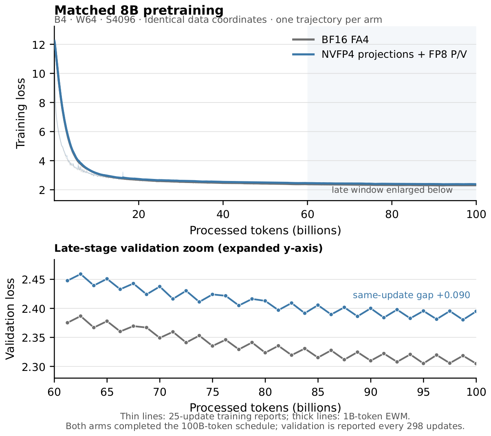

*图 10（原文 Figure 10，第 27 页）：在完整的 1000 亿 token 计划上，token 对齐的训练与留出验证 loss。图中比较 BF16 对照与保留的 FP8-P/V 路线；下半图把 600 亿 token 之后的同更新验证放大，并使用放大的纵轴。每条曲线是一条轨迹，所以图中不提供不确定性估计。*

**图中文字翻译与读法**：上半图标题 “Matched 8B pretraining”，副标题 “B4 · W64 · S4096 · identical data coordinates · one trajectory per arm”（B4、64 卡、S4096、相同数据坐标、每臂一条轨迹）；横轴 “Processed tokens (billions)”，纵轴 “Training loss”；灰线 BF16 FA4，蓝线 “NVFP4 projections + FP8 P/V”；右侧阴影区标注 “late window enlarged below”（后段窗口在下方放大）。两条线从 loss 约 12 同步下降到约 2.4，肉眼几乎重合。下半图 “Late-stage validation zoom (expanded y-axis)”（后段验证放大，纵轴展开），纵轴 “Validation loss”，横轴 60 到 100 十亿 token：蓝线整体高于灰线，标注 “same-update gap +0.090”（同更新差 +0.090）。图脚注：细线为每 25 次更新的训练报告，粗线为 10 亿 token 的指数滑动平均（EWM）；两臂都完成了 100B token 计划，验证每 298 次更新报告一次。

数字：最后一次计划内的训练报告上，BF16 与 FP8 路线的 loss 为 2.3095 与 2.3613，裁剪前梯度范数为 0.0549 与 0.0532；在最后一次同更新的留出验证上，loss 为 2.3048 与 2.3948，**相差 0.0900**。因此 FP8 轨迹稳定且下降，但**与 BF16 不是数值相同**；又因为完整路线同时改变了可学习投影和 attention，这个比较不能把差距归因于 attention。

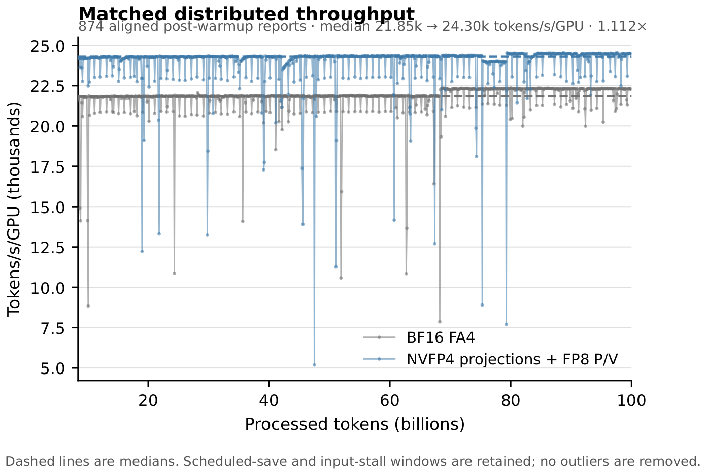

*图 11（原文 Figure 11，第 28 页）：匹配的 B4 实验中全部 874 个共同的热身后观测的分布式吞吐。输入停顿与检查点窗口保留在分布里。*

**图中文字翻译与读法**：标题 “Matched distributed throughput”，副标题 “874 aligned post-warmup reports · median 21.85k → 24.30k tokens/s/GPU · 1.112×”；纵轴 “Tokens/s/GPU (thousands)”，横轴 “Processed tokens (billions)”；灰线 BF16 FA4、蓝线 “NVFP4 projections + FP8 P/V”；虚线为各自的中位数。曲线上的向下尖刺是计划内的保存和输入停顿窗口（原文：不剔除任何离群点）。蓝线整体在约 24.3k，灰线在约 21.9k；（从图上读出）BF16 约在 680 亿 token 之后整体略升到约 22.3k，FP8 路线在约 740–790 亿 token 附近有一段略低的平台（约 24.0k），原文未对这些变化做说明。

数字：从热身结束到更新 23,825 的全部 874 个共同记录坐标上，吞吐中位数是 BF16 为 21,853 tokens/s/GPU、FP8 路线为 24,303 tokens/s/GPU，中位数之比 1.112 倍（本文核对：$24303/21853=1.112$）；成对吞吐比的第 10–90 百分位区间为 1.080–1.114 倍。这个汇总不剔除任何观测，包括输入停顿与检查点窗口；每条路线只有一条轨迹，所以不估计运行间的方差。

三个局部边界（孤立反向、含投影 attention、完整更新）确立了 D128 上的速度；分布式证据确立了 FP8 与 MXFP4 的格式选择，并包含一个同配方的 BF16 对照与同更新的验证。它支持在完整 1000 亿 token 计划上的比较，**但不支持统计等价性或运行间不确定性的结论**。

## 八、讨论：三条硬件结论

前向、反向与训练的结果指向三条硬件结论（表 15）。原文先给结论，再给支持它的测量；被否决的 kernel 变体放在附录。

表 15：硬件结论及其支持证据。

| 结论 | 支持证据 |
|---|---|
| tensor memory 的归属限制了重叠 | 两个 FP32 分数 bank 与两个 FP32 输出累加器用满 $4\times128=512$ 个 tensor memory 列；减少 shared memory 用量并没有提高 CTA 驻留数，也没有降低延迟 |
| 就绪停顿让矩阵吞吐闲置 | 一个匹配的诊断保持同样的 98,304 条 tensor 指令，用真实的概率路径时 tensor 流水只有 18.8% 的活动率 |
| 概率算术不再是主要的差距 | 一个几乎去掉全部概率构造的固定 P 诊断，只把延迟改善了 5.23% |

（原文表 15，第 29 页。）

### 8.1 TMEM 的容量与归属限制了重叠窗口（图 12）

图 2 的两 query 流水已经让 QK、softmax、PV 在两个 query stage 之间重叠。限制更具体：在当前的 D128 布局下，下一次 QK **无法完全与仍被占有的概率与尾部 PV 阶段重叠**。图 1 说明了原因：两个 128 列的分数 bank 与两个 128 列的 FP32 输出累加器占满全部 512 个 TMEM 列。分数 bank 中已退休的部分被复用来放量化的概率与 scale 页，在 PV 消耗完这块覆盖区之前，针对该分数 bank 与该 query stage 的下一次 QK 没有合法的分数目的地；另一个 query stage 仍提供部分重叠。

这是一个存储所有权依赖，不只是 barrier 或 shared memory 不够。在一个匹配的对照里，把动态 shared memory 从 209,920 字节降到 163,840 字节，没有改善延迟，因为 512 列的 TMEM 分配仍然只允许每个 SM 一个 CTA。更多的 shared memory，或更多不能当作另一个分数 bank 分配的片上字节，都不会改变这个调度。

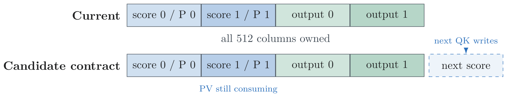

*图 12（原文 Figure 12，第 29 页）：概念性的硬件启示。有用的新增项是**另一个可分配的分数目的地**，加上合法的发射与所有权语义，使下一次 QK 在 PV 仍消耗当前覆盖区的同时就能推进。下面一行不是实测的 kernel，也不是“光增加容量就足够”的主张。*

**图中文字翻译与读法**：上行 “Current”（当前）：四个方块依次是 “score 0 / P 0”、“score 1 / P 1”、“output 0”、“output 1”，下注 “all 512 columns owned”（全部 512 列都有归属）。下行 “Candidate contract”（候选契约）：前四个方块相同，右侧多出一个虚线框 “next score”（下一个分数），上标 “next QK writes”（下一次 QK 写入这里），前两块下注 “PV still consuming”（PV 仍在消耗）。读图结论：希望的是新增一个可分配的分数 bank，而不仅是更大的容量。

### 8.2 张量活动率低是“操作数没就绪”的症状（表 16、表 17）

带缩放的 FP4 PV 指令消耗 K64 内维，所以必须有两个相邻的 32 列概率片段就绪，才能开始有用的 PV 工作；只发布第一个片段并不能让矩阵发射者前进。因此“分数到概率”这条路径产生成对的汇合：$Q_0$ 与 $Q_1$ 使前半 PV 可以开始，$Q_2$ 与 $Q_3$ 使尾部可以开始；试图在前半与尾部 PV 之间发射下一个 QK，会违反“两个 K64 tensor core 累加”的现有顺序。

表 16 是一个匹配的历史剖析检查点：真实与固定概率两个变体执行的 tensor 指令数相同；去掉概率工作缩短了墙钟时间，并提高了归于 tensor 流水的周期比例，但并没有产生更多矩阵工作。源码采样把 2,669 个“未发射”样本中的 1,715 个归因于 NVIDIA 剖析器归类为 long-scoreboard 等待的依赖停顿，主要是最终统计量、分数就绪与输出发布。因此 tensor core 利用率不足是**操作数没就绪**的症状，而不是名义 FP4 吞吐不够。

表 16：匹配的历史剖析，tensor 工作量相同。该诊断早于最终的 Direct-P 二进制，只用来找出停顿机制。

| 概率路径 | 动态指令数 | tensor 指令数 | tensor 活动率 |
|---|---:|---:|---:|
| 真实的概率构造 | 5460 万 | 98,304 | 18.8% |
| 固定概率 | 1190 万 | 98,304 | 26.6% |

（原文表 16，第 30 页；原文数字写作 54.6 million 与 11.9 million。）

最终的 Direct-P 路径已经去掉了大部分暴露的概率成本：在 B1/S4096/H24/D128 上，保留的 kernel 测得 0.092448 ms，重复运行 0.092512 ms。故意写错的“天花板”实验给出剩余差距的上界：

表 17：相对 0.092448 ms 的有效记录的最终 kernel 天花板。这些行刻意去掉了必需的工作，并不计算有效的 attention。

| 诊断 | 时间（ms） | 与 0.092448 ms 的差距 |
|---|---:|---|
| 简化分数打包 | 0.091168 | 1.280 µs（1.38%） |
| 保留行最大值、打包原始分数 | 0.090112 | 2.336 µs（2.53%） |
| 使用固定的概率 tile | 0.087616 | 4.832 µs（5.23%） |

（原文表 17，第 30 页。）

读法：即使是几乎去掉全部概率构造的固定 P 诊断，也只省 5.23%。剩余到“BF16 的四倍”矩阵比值之间的差距，包括分数载入、K64 的发布粒度、scale 的送达、在线修正、输出累加与 epilogue。这也说明为什么“更少的算术指令”不一定有帮助：独立的算术可以在内核等待某个依赖时占用发射槽。

### 8.3 更快的算术并不会让整个 kernel 同比变快（表 18）

Blackwell Ultra 提高了稠密 NVFP4 的吞吐，把重要的特殊函数速率翻倍，并增加了融合的 TMEM 载入/规约指令。但这些改进不会扩大分数/输出的分配，所以整个 attention 循环不会快 1.5 倍；测量结果与“QK、PV 更快使分数规约、scale 发布与修正更显眼”一致。

启动形状也有影响：比 148 个可见的 B300 SM 更宽的持久化网格会产生一个大多为空的第二波，针对设备重新编译就能去掉这条尾巴。修正几何之后，S8192/H64 与波次对齐的 S9472/H64 分别维持 3116 与 3159 TFLOP/s；而 S32768/H24 上 B300 为 2945 TFLOP/s、GB200 为 2998。按每 SM 时钟归一化会偏向 B300，但那只是推断，不是观察到的 GPU 吞吐优势。

表 18：与被测 kernel 相关的硬件性质。从 GB200 到被测的 B300，TMEM 容量并没有增加。

| 性质 | GB200 / SM100 | B300 / SM103 |
|---|---|---|
| 本研究中可见的 SM 数 | 152 | 148 |
| 报告的最大时钟 | 2062 MHz | 2032 MHz |
| 每 SM 的 TMEM | 256 KB | 256 KB |
| 关键指数速率 | 16 次/周期/SM | 32 次/周期/SM |
| 稠密 NVFP4 的 GPU 档位 | 1.0× | 1.5× |
| 融合的 TMEM 载入与规约 | 无 | 有 |

（原文表 18，第 31 页。）

非因果 D64 的测量与不安全格式对照在附录 A.6；它们的 tile 与所有权机制不同，不应由上面的 D128 硬件剖析来推断。

### 8.4 对硬件与 kernel 的启示

被测量的依赖关系引出这些候选改动（原文明确说它们是由测量到的依赖启发出的**假设**，不是已经测到的收益）：

- **另一个可分配的分数 bank**：允许下一次 QK 在 PV 仍占有当前概率覆盖区时写入。这要保持两 query 的 K/V 复用，并给出合法的发射语义；一个朴素的乒乓原型把 query 任务数翻倍，反而慢了 52.8%。
- **K32 的带缩放 FP4 PV**：每个 32 列的概率完成后立刻消耗，不等 K64 对。
- **把 scale 放到 TMEM 之外**：从 shared memory 或寄存器读紧凑的 scale，把面向指令的 scale 页移出覆盖区。已有的 scale 占用探针表明，这一项本身既不会产生完整的 128 列分数目的地，也没有展示出加速。
- **有兼容生命周期的更宽 tile**：B300 更宽的矩阵指令有很高的合成上限，但前提是概率生产、K/V 复用与分数存储能一起被调度。

由此得到的设计含义是：一旦 Direct-P 缩短了概率构造，再做一个多项式近似的价值，很可能不如一个更大的可用重叠窗口。

### 8.5 范围与局限

非因果模型实验是固定输入的推理评估，不是微调或预训练研究；因果测量确立的是算子、完整子层与完整更新的性能；匹配的分布式比较在第 7 节支持“在完整的 1000 亿 token 计划上的训练与验证”的结论，但每条路线一条轨迹，不估计运行间方差；更长的历史对照确立了 FP8 与 MXFP4 的 P/V 格式选择，但它们的配方不同，不能与 BF16 做成对的质量比较；可学习投影的精度也是一个独立边界：E4M3 是数值对照，NVFP4 是实测的吞吐臂。硬件结论是针对形状的：head 维度 64 与其他情形需要各自的 tile 大小、CTA 所有权与 tensor memory 的重叠策略，不应当按类比继承 D128 的调度。

### 8.6 结论

Direct-P 通过缩短“分数”与“数值矩阵乘”之间的串行路径，使全 FP4 前向 attention 变得有用：它把 log-softmax 分数直接映射到 MXFP4 码，并用 PV 实际消耗的被表示概率做归一化；在有利的 GB200 形状上超过 BF16 前向吞吐的两倍。FP8 概率路线仍然更准确，而固定输入的模型评估指出了在哪些情形下，Direct-P 额外的误差在模型输出处仍然较小。

对因果训练，前向把量化的 Q/K 载荷、scale 与 softmax 归一化量交给反向；投影与梯度 epilogue 还发布梯度乘积所需的行向、列向 FP8 视图。这条路径使含投影的 attention 子层加速 1.25 倍，单 GPU 的 8B 更新最多加速 1.14 倍。分布式对照选择 FP8 的 P/V：尽管短计时很有竞争力，所测的每一条 MXFP4 P/V 轨迹都发散。

因此保留的训练路径对 P/V 与反向仍然向 FP8 做了数值上的让步。无符号 E5M3（UE5M3）的块 scale 保留 E2M1 载荷但提供大得多的 scale 范围，并在另一项工作中让 FP4 语言模型预训练变得稳定（原文参考文献 6）；把这个格式用到 P/V 乘积与反向梯度乘积上，是通向完全 FP4 的 attention 训练路径的有希望的方向，但本文没有评估，并且需要高效的硬件实现。更快的矩阵算术本身是不够的：在 head 维度 128 下，tensor memory 的归属与操作数就绪限制了 QK、softmax、PV 能重叠多少；低精度 attention 需要更大的可分配重叠窗口，正如它需要更快的 tensor core。

## 九、附录要点

### 9.1 附录 A：历史上的 NV/NV 路线（表 19、表 20）

这部分保留了通向最终设计的 NV/NV 工作，刻意与主结果分开，因为那些 kernel 用不同的 P scale 格式、近似策略，有时还用不同的分母，它们的计时不能与最终 NV/MX 的头部空间混用。

- **A.1 初始的稳定化路径**：第一条数值上稳健的全 FP4 路线按常规顺序：$z\to m\to e^{z-m}\to a_B\to s_{\text{E4M3}}\to\text{E2M1}$（式 30）；它计算精确的在线行最大值、产生浮点概率、规约 N32 块最大值、编码 E4M3 scale、除以该 scale 再打包 E2M1。该路径在下游输入上保持有限，但在 S4096/H24 上约 0.1884 ms，保守而串行：scale 的选择要等浮点概率出来才能开始。对全局 NV 编码因子 $G$，载荷与 scale 可写成 $S_B(G)=Q_{\text{E4M3}}(G\,a_B/6)$、$q_j(G)=Q_{\text{E2M1}}(Gp_j/S_B(G))$、$\hat p_j(G)=S_B(G)\,q_j(G)/G$（式 31–33）。若 $G$ 对分子分母一致地相乘且没有舍入边界变化，它会抵消；一旦考虑 scale 舍入、下溢与饱和，它就不是免费的精度旋钮。
- **A.2 面向码的多项式**：NV/NV 里有用的想法是**直接针对 E2M1 的判决**。曾用三次多项式拟合 E2M1 阈值在以 2 为底下的位置：$p(x)=0.07839806x^3+0.28625049x^2+0.63145205x+0.99202336$（式 34），折进分数与块 scale 后用打包 Horner 运算计算两个值（式 35–37）；这比完整指数快，也比早期的线性拟合准，并确立了“拟合目标应当是 $Q_{\text{E2M1}}(f(x))$ 而不是 $f(x)$”。后来的仿射终点 $\ell(x)=\max(0,\,1.62330034x+0.92083546)$（式 38）把非原生工作降到每对一条打包 FMA；这个机制在保留的 NV/MX 路径里延续，只是系数随策略而定，并配精确的被表示分母。
- **A.3 采样分母**：NV/NV 吞吐路径每个四分块里对 32 个标量概率采样 8 个，估计 $\tilde L_B=A_B\cdot4\sum_{j\in J_q}2^{x_j}$（式 39，因子 4 补偿只采了四分之一）。这省去了完整的分母遍历，但可能漏掉集中的最大值或错估不均匀的尾部。两字、三字的分母规约更快，但下游失败：在 20 张图的 ViT 门槛里与 BF16 的 top-1 一致率分别是 0% 与 75%。保留的 NV/MX 路径改为对全部被表示的 E2M1 载荷字求和。
- **A.4 策略阶梯与分布依赖**：NV/NV 研究暴露出 fast、universal 与 hao-l2 三种风格；在 S4096/H24 上它们的延迟大致分别是 0.10、0.11–0.13、0.188 ms。重要的结果不是某一个延迟数字：fast NV/NV 在高斯分数上余弦可以不错，却在行参考假设变化时产生非有限或严重失真的模型输出；稳定化修复了这些情形，但吃掉了想要的加速。
- **A.5 为什么没有保留 NV/NV**：保留下来的是三个想法（面向码的近似、早期的部分 P 发布、速度与下游精度要一起评估）；放弃它的四个原因：(1) 没有稳健全局因子的 E4M3 P scale 会把低振幅的 N32 块舍入为零，正确地用全局因子修复下溢又把工作还给暴露的 P 路径；(2) 独立的 16 元素块 scale 的工作与 N32 软件生产者不自然对齐；(3) 稳健的稳定化路径太慢，而最快的 shiftless 路径对分布敏感；(4) 继承自 HAO 的 512 列布局与 MXFP4 scale 交接给出了更干净的方式，在不增加分数 bank 的前提下保留小 P 块。

**A.6 B300 的 D64 扫描与范围失败（表 19）**。D64 特化提供了更宽的检验：其 B300 NV/MX 路线结合融合的 TMEM 载入/规约，以及每个分数四分块 8 对原生 `EX2` 与 8 对仿射。24 个形状的矩阵里每个 NV/MX 输出都有限；原始 shiftless 的 NV/NV 对照常常在局部更准（它的 E4M3 scale 能更贴合一个良性的块），但只在 24 个测试用例中的 23 个有限。

表 19：选取的 B300 D64 格式诊断。NV/MX 是保留的有限路线；NV/NV 的计时只用来解释被否决的对照，状态为非有限时不得视为生产性能。

| H | S | NV/MX：ms | NV/MX：TFLOP/s | NV/MX：余弦 | NV/MX：相对 L2 | 原始 NV/NV：ms | 原始 NV/NV：余弦 | 原始 NV/NV：相对 L2 | 状态 |
|---:|---:|---:|---:|---:|---:|---:|---:|---:|---|
| 12 | 4096 | 0.066528 | 775 | 0.955818 | 0.295719 | 0.070464 | 0.962281 | 0.278304 | 有限 |
| 24 | 4096 | 0.093248 | 1105 | 0.955551 | 0.296653 | 0.099296 | 0.962063 | 0.279040 | 有限 |
| 24 | 32768 | 4.601808 | 1434 | 0.956089 | 0.295010 | 4.842496 | 0.962065 | 0.279155 | 有限 |
| 32 | 2048 | 0.039872 | 862 | 0.954553 | 0.299511 | 0.039968 | 0.961772 | 0.280428 | 有限 |
| 32 | 32768 | 6.115360 | 1438 | 0.957303 | 0.291325 | 6.465520 | – | – | 非有限 |
| 64 | 1024 | 0.025568 | 672 | 0.952035 | 0.306387 | 0.025632 | 0.960558 | 0.286304 | 有限 |
| 64 | 4096 | 0.207840 | 1323 | 0.955838 | 0.295956 | 0.218176 | 0.962128 | 0.278683 | 有限 |
| 64 | 32768 | 12.223360 | 1439 | 0.957248 | 0.291501 | 12.919808 | 0.962800 | 0.276050 | 有限 |

（原文表 19，第 36 页。）

读法：在 S4096 及更长的各行里，保留的 NV/MX 比匹配的 B300 BF16 kernel 快 1.124–1.284 倍；密度 2 在 24 个形状中的 23 个上优于或持平密度 1；H32/S2048 与 H64/S1024 因为短的逻辑任务数与完整的 148 个 worker 持久化网格互相干扰，分别需要 136 与 128 的 CTA 网格上限，其余形状保留 148 个 CTA；每个晋升的构建都用 128 个寄存器、1 个 barrier、没有局部内存溢出。决定性的失败在 H32/S32768：种子 20260802 产生恰好 64 个非有限的原始 NV/NV 输出，而 BF16 与 NV/MX 保持有限（换一个种子能通过）；对 E4M3 scale 编码器做饱和可以修复这个失败的分布，用 6.670336 ms（为 BF16 的 1.186 倍）、余弦 0.962921、相对 L2 0.275742，这个“有界模式”大约多花 2%–3%。MXFP4 的 E8M0 scale 并不比 E4M3 更细，但它的指数范围能表示微小的概率块而不需要单独物化的行平移，所以原始 NV/NV 在保持范围内时可以在局部误差指标上胜出，而 NV/MX 因为在整个矩阵上保持有限，才是保留的低延迟路线。

**A.7 下游失败机制的实测（表 20）**。扩展的提供者矩阵把失败孤立出来：原生 HAO 与 TK 的固定调度对照接收同样的 NVFP4 量化 Q、K、V。HAO 先减去行最大值；TK 对照则形成无平移的块 scale $s^{\text{shiftless}}_B=\frac16\max_{j\in B}\exp(z_j)$（式 40）再编码到 E4M3。模型分数会使这个量在每个被测的工作负载上都超过 E4M3 的有限最大值 448；这个对照没有 satfinite 守卫，超范围的 scale 转换会污染依赖它的 P 与分母路径，产生非有限的上下文行。做行最大值稳定化之后，$s^{\text{stable}}_B=\frac16\max_{j\in B}\exp(z_j-m)$，$m=\max_jz_j$（式 41），所以 $0\le s^{\text{stable}}_B\le1/6$。

表 20：模型激活上 shiftless TK NV/NV 的失败。“溢出”是 E4M3 编码之前 N32 的 P scale 超过 E4M3 最大值的比例。

| 任务 | 失败样本 | 非有限行数 | shiftless 溢出（%） | shiftless 最大值 | 稳定化溢出（%） | 稳定化最大值 |
|---|---:|---:|---:|---:|---:|---:|
| ViT S256 | 1 | 2,560 | 8.146 | 1.828e+37 | 0.000 | 0.166667 |
| ViT S1024 | 1 | 127,950 | 8.137 | 5.332e+37 | 0.000 | 0.166667 |
| ViT S4096 | 1 | 539,442 | 7.511 | 5.669e+37 | 0.000 | 0.166667 |
| BERT MLM S256 | 1 | 167 | 1.721 | 5.279e+04 | 0.000 | 0.166667 |
| BERT MLM S512 | 1 | 49,613 | 1.063 | 5.655e+04 | 0.000 | 0.166667 |
| BERT SST-2 S256 | 1 | 21,717 | 1.465 | 4.493e+03 | 0.000 | 0.166667 |

（原文表 20，第 37 页。非有限行数是在该样本所评估的全部 attention 层上累计的。）

### 9.2 附录 B：被否决的 kernel 方向（表 21–23，B.3，B.5）

**B.1 SM103 的启动与 EX2 控制（表 21）**。表 21 记录初始的 B300 兼容性与原生 EX2 密度扫描，它是调优对照，不是晋升策略的集合；152 个 worker 的二进制会在被测的 148 个 SM 的 SKU 上产生一个部分第二波；修正后的行用 148 个 worker，并在保持数值契约不变的情况下改变 EX2 密度。

表 21：测得的 B300 上 TK NV/MX 调优点。每行的速度与误差来自同一份输出。

| 变体 | 网格 | EX2 密度 | 时间（ms） | TFLOP/s | 余弦 | 相对 L2 | RMSE |
|---|---:|---:|---:|---:|---:|---:|---:|
| B300 兼容性 | 152 | 0 | 0.123872 | 1664 | 0.943964 | 0.335825 | 0.008716 |
| B300 密度 0 | 148 | 0 | 0.093216 | 2212 | 0.943964 | 0.335825 | 0.008716 |
| B300 密度 1 | 148 | 1 | 0.097248 | 2120 | 0.947037 | 0.325258 | 0.008442 |
| B300 密度 2 | 148 | 2 | 0.097280 | 2119 | 0.950069 | 0.314812 | 0.008171 |
| B300 密度 4 | 148 | 4 | 0.111584 | 1848 | 0.956047 | 0.294037 | 0.007632 |

（原文表 21，第 37 页。）读法：152 个 worker 比 148 个慢 33%（多出的部分波次）；提高原生 EX2 密度能降低误差（相对 L2 从 0.3358 降到 0.2940），代价是速度：密度 1 与 2 比密度 0 慢约 4%（TFLOP/s 从 2212 降到约 2120），密度 4 慢约 20%（1848）。

**B.2 被否决的 kernel 方向（表 22 与表 23 的浓缩）**。原文的两张表列出主要的负面实验，约束了对保留方法的解读；“计时打平但增加同步、存储或数值风险的方向不被晋升”。浓缩如下：

| 方向 | 想要的收益 | 观察到的失败机制 |
|---|---|---|
| 半 tile 的 QK/PV | 更大的 tensor 工作量、更易重叠 | 第一次发布被延迟、活跃的 tensor memory 压力上升；没有胜过“N32 生产加 K64 消耗” |
| 更深的动态调度器 | 利用 QK 能领先一个逻辑步 | 轮询、代理信号与策略分支增加了控制工作，却没有创造合法的分数目的地 |
| 完整的或只做 QK 的 two-CTA | 加速 QK 并提高占用率 | cluster 级的就绪与 scale 生命周期协调压倒了 QK 的节省；只做 QK 的方案没有消除单 CTA 的 P/PV 所有权 |
| 额外的 barrier 或卸载 WG | 去掉全 CTA 的汇合 | 重复的分数载入与交接信箱的成本超过被隐藏的工作；并发的 TMEM 写入产生了无效输出 |
| 替代的 TMEM 布局 | 增加第二个有用的分数/P 槽 | 两个 128 列的分数加两个 128 列的输出已占满 512 列；scale 压缩释放的是碎片，不是另一个合法的 128 列 bank |
| BF16/FP16 的部分累加器 | 把输出列减半 | 本地的带缩放 FP4 tensor 指令累加到 FP32 的 TMEM；在发射之间做类型转换并没有改变累加器契约 |
| 初始的 NVFP4 投影路径 | 把 FP4 的 tensor 吞吐扩展到可学习的 attention 投影 | 孤立的 D128 归因发现投影误差比 E4M3 大得多（放弃的是那个实现，不是格式；后来的分布式实验把 NVFP4 投影作为更高吞吐的一臂；这条结果不说明 attention 内部的 NVFP4 Q/K） |
| 原始 FP4 或粗的二维 scale | 去掉 scale 页 | 原始 E2M1 失去“四倍级”的块缩放原语；单个 32×32 的 scale 不能应用在块乘积 scale 随 K 变化的规约之后 |
| 直接的码分类器 | 消除打包转换 | 阈值树、整数转换、LUT 访问、LOP3 与 PRMT 打包生成的 SASS 比“打包 FFMA2 加原生 F2FP”更多 |
| 中间的 NV/MX 策略 | 加上锚点但不加 correction warpgroup | S4096/H24 上 0.094560 ms，比 fast 慢，相对 L2 0.356700 比 fast 与 accurate 都差；长 ViT 一致率只是与 accurate 打平，没有 Pareto 价值 |
| 二次/三次多项式的吞吐路径 | 提高码拟合 | Q0 二次拟合把静态 FFMA2 数从 128 升到 160，测得 0.097888 ms，并在其测试上降低了余弦 |
| 采样的最大值/分母 | 缩短 P 准备 | 32 取 8 的采样省不到 0.5 µs 且误差很大；更少的采样不稳定 |
| 结构化稀疏 PV | 提高 tensor 吞吐 | Blackwell 的稀疏 FP4 路径使用逻辑 K128，失去了早期的 K64 交接；值感知的选择增加了太多指令 |
| 尾部交错 | 把 $Q_3$ 的工作拉到 $Q_2$/PV 延迟之下 | 增加 1.4–3.2 µs；连续的“先 Q2 后 Q3”调度在局部更好 |
| 流式分母 | 隐藏精确的分母规约 | 输出完全一致，但把干净的 fast 构建分别拖慢了 2.11% 与 1.83% |

（原文表 22、表 23，第 38–39 页。）

**B.3 四分块局部的“光速”实验**：在历史上 0.102400 ms 的 NV/NV 路径上，把选定四分块的变换换成原始打包后测得：只去 Q0 为 0.104736 ms（无收益）、只去 Q1 为 0.102400（无收益）、去 Q0+Q1 为 0.099328、去 Q2+Q3 为 0.096416、全部四块为 0.090112（总共省 12.288 µs）。**成对的行为是关键发现**：加速一个 N32 生产者并不能推进一条 K64 的 tensor 命令。12.288 µs 这个总量也不是当前 NV/MX 的天花板——第 8 节给出的是最终的 2.336 µs 原始分数打包差距。（本文核对：原文的“增益”列在 Q0+Q1 与 Q2+Q3 两行分别写 4.064 µs 与 7.008 µs，按 0.102400 ms 的基线算应为 3.072 µs 与 5.984 µs，相差约 1 µs，只有“全部四块”的 12.288 µs 与基线自洽。）

**B.4 scale 占用实验**：几种探针试图通过“在 32×32 块之间共享 scale、折叠相邻的 ID、或把源 scale 经 shared memory 搬运”来减少 scale 存储。紧凑的源存储有用，但 `tcgen05` 仍然消耗面向指令的 scale 布局，所以更小的源张量并不会自动产生空闲的 TMEM 列；保留的折叠 K64 的 Q/K 表示减少了载入与算术，并不声称得到了新的 128 列分数槽。

**B.5 联合仿射路线搜索**：作者还对全部非守卫层同时优化仿射 E2M1 系数（用常驻的模型 worker 筛选精确的、同代价的二进制），得到很大的“表观”固定输入收益，但新的模型进程拒绝了每一个提议的生产改动。例如 Wan14B 最好的正则化映射改动 4 层，在 4 个提示词上把复用 worker 的平均相对 L2 从 0.398533 降到 0.392793，换到新的城市提示词运行却从 0.432932 升到 0.453884；Wan1.3B 的单层第 9 层改动在复用 worker 上从 0.299884 降到 0.290924，新的海岸与雪景运行则分别从 0.247742 升到 0.258156、从 0.230262 升到 0.233996。（一次新的森林运行在守卫层 38 变成非有限，被追溯到 E8M0 分母下溢 bug，对仿射映射既不是支持也不是反对的证据。）路线常数不改变 kernel 延迟，所以拒绝完全是数值上的：复用流水线的排序就可以把最终扩散 latent 移动超过候选的余量，使很小的排名不稳定。要做统计上严谨的联合优化，需要在多个新模型进程与留出提示词上给每条路线打分，这个代价不值得；生产清单只保留全局的 (1.60, 0.95) 一对。

### 9.3 附录 C：对齐精度的 FP8 对照（表 24）

主要的 NV/MX 结果是一个速度-精度权衡，所以另设一个对照：要求 TK 路线匹配 HAO 报告的 NV/FP8 余弦时会怎样？表 24 用 B1/S32768/H24/D128 的 B300 记录；HAO 的行由发布的 TFLOP/s 重建，是跨运行的背景，HAO 没有发布相对 L2。

表 24：对齐精度的 B300 对照。上标 p 表示 HAO 发布的跨运行数值。

| 对象 | 时间（ms） | TFLOP/s | 余弦 | 相对 L2 |
|---|---:|---:|---:|---:|
| TK NV/MX fast | 4.481 | 2945 | 0.9429 | 0.3389 |
| TK NV/FP8 optimized | 7.584 | 1740 | 0.9573 | 0.2913 |
| TK NV/FP8 exact | 8.854 | 1490 | 0.9897 | 0.1433 |
| HAO NV/FP8（p） | 4.929 | 2677 | 0.9899 | – |
| HAO BF16（p） | 8.607 | 1533 | 1.0000 | – |

（原文表 24，第 41 页。）

读法：精确的 TK NV/FP8 路线达到 0.9897 的余弦，在显示精度下与 HAO 发布的 0.9899 实际等价，用 8.854 ms、1490 TFLOP/s，而 HAO 是 4.929 ms、2677 TFLOP/s，它还略低于 HAO 发布的 BF16 吞吐；中间的“optimized”TK NV/FP8 路线提高了速度，但余弦只有 0.9573。这个实验区分了两个结论：HAO 衍生的流水线在结构上是可行的；本文保留的 NV/MX 的高速度来自“让暴露的 P 路径更便宜并接受更低的算子保真”；而按 HAO 的精度去匹配当前精确的 TK FP8 路径，会把这个优势还回去。

### 9.4 附录 D：完整的固定调度格式矩阵（表 25）

主文报告头条的固定调度对照，因为“保留策略的前沿”是主要结果；表 25 给出每个统一形状上的对应对照。每个形状上的四个 TK 行使用同一套变换与调度预算，只改变 QK 与 P/V 的 scale 格式（NV/NV、MX/NV、NV/MX、MX/MX，依次是 QK 格式/PV 格式）；原生 HAO NV/NV 与 BF16 作为外部对照。计时与三个误差指标来自同一次确定性的形状记录，并用与主表相同的规范 BF16 参考。该矩阵涉及的是只做前向的 attention kernel 内部的 Q/K/P/V 格式，不含可学习的 QKV/O 投影，也不暗示纯 FP4 的端到端训练路线。表有 36 行，不便逐行转录，下面给出原表图像，并摘出头条形状 B1/S4096/H24 的六行。

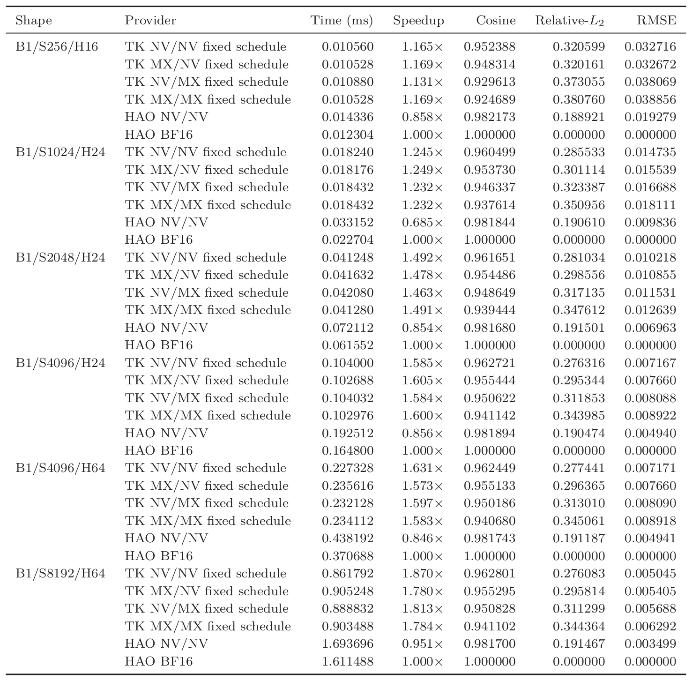

*表 25（原文 Table 25，第 42 页）：完整的固定调度格式矩阵。每行同时报告延迟与输出误差，没有任何计时与另一次运行的精度配对。列依次为：形状、对象、时间（ms）、加速比、余弦、相对 L2、RMSE。*

摘出的头条形状行（B1/S4096/H24）：

| 对象 | 时间（ms） | 加速比 | 余弦 | 相对 L2 | RMSE |
|---|---:|---:|---:|---:|---:|
| TK NV/NV 固定调度 | 0.104000 | 1.585× | 0.962721 | 0.276316 | 0.007167 |
| TK MX/NV 固定调度 | 0.102688 | 1.605× | 0.955444 | 0.295344 | 0.007660 |
| TK NV/MX 固定调度 | 0.104032 | 1.584× | 0.950622 | 0.311853 | 0.008088 |
| TK MX/MX 固定调度 | 0.102976 | 1.600× | 0.941142 | 0.343985 | 0.008922 |
| HAO NV/NV | 0.192512 | 0.856× | 0.981894 | 0.190474 | 0.004940 |
| HAO BF16 | 0.164800 | 1.000× | 1.000000 | 0.000000 | 0.000000 |

（原文表 25，第 42 页，B1/S4096/H24 的六行。）

读法：同一调度预算下，四种 QK/PV 格式组合的速度几乎一样（1.58–1.61 倍），差别主要在误差：NV/NV 最准（相对 L2 0.276），MX/MX 最粗（0.344）；在整张表里 NV/NV 甚至在多数形状上略快、略准（如 S8192/H64：1.870× 对 NV/MX 的 1.813×，相对 L2 0.276 对 0.311）。原文承认“NV/NV 在某个合成指标上能胜过 NV/MX”，但格式范围（表 3）和下游实验（表 20）说明，这个孤立结果不足以选定生产路线。HAO NV/NV 在所有形状上都比 BF16 慢（0.685–0.951 倍）。

### 9.5 附录 E、F、H：复现、术语与溯源

- **E 复现**：公开代码含 TK 前向与反向 kernel、CuTe-DSL 对照与原型 kernel、实验配置、已提交的证据和构建论文的脚本。测量计划由 `tools/plan_fa4_measurements.py` 生成（它不下载数据、不运行 CUDA、不提交作业，缺失的证据不会被猜测的命令代替）；各任务需要一份按字节数与 SHA256 绑定模型/数据修订的资产清单。历史的 Wan 表是历史 artifact（部分校准与提供者 JSON 缺失，不宣称能完整重建）；HAO 的低精度 Wan 对照因为没有保留扩展构建标识而受阻；B300 只发布了已提交的聚合摘要，没有原始集群捕获档案。
- **必需的操作数契约**：两个保留的策略都要求按 MSE 选出的、折叠成 K64 的 Q/K scale；accurate 还要求对 K 与 V 做同一个固定的 32 行置换。把折叠 scale 的二进制与普通的 16 元素块 Q/K scale 配对，可能给出看似合理的计时与无效的精度。
- **保留的编译期策略**：fast 用 12 级 K/V 环、全仿射、四字被表示分母、成对的 scale 复用、早期异步 P-scale 交接与 200/208/56 的寄存器划分；accurate 用 13 级 K/V、原生 EX2 采样、32 行锚点与 correction warpgroup 归一化；其余历史探针（NV/NV、稀疏、采样分母、two-CTA 等）保持编译开关关闭。
- **F 术语、H 溯源**：F 给出术语表（本文第 2.2 节已吸收）；H 说明因果扩展的数值来自持久的仓库回执而不是终端回滚，9 月 1 日的曲线是历史诊断，9 月 3 日的回执定义了健康的匹配 B4 比较，9 月 2 日的快照保留 MXFP4-P/V 的失败诊断。

### 9.6 附录 G：因果训练里试过又放弃的东西

保留的方法是更大搜索的终点；这个附录给出有用的教训，而不要求读者按 kernel 的编写顺序阅读。

**G.1 投影精度与 attention 精度是两回事。** 可学习的 QKV 与输出投影把激活乘以学到的权重；attention 再消耗得到的 Q、K、V。在 attention 里成功使用 FP4，并不意味着学到的权重与激活也能用同一种格式。在一个孤立的 8B Transformer 块里，E4M3 的 QKV 投影约有 0.0375 的相对 L2 误差，NVFP4 的 QKV 为 0.1459；把解码后的低精度操作数传给精确的 BF16 attention 时，attention 输出误差已经是 0.3614，而原生 attention kernel 在这些相同的被表示操作数上只额外增加 0.0216 的相对 L2：多数误差在进入 attention kernel 之前就已产生。这就是主实验把投影精度当成独立变量的原因（E4M3 为数值对照，NVFP4 为更高吞吐的一臂），这个孤立块本身不决定最终的投影格式。更早的“固定 head 缩放规则”在 8B 形状上立刻失败；换成二维“行 × K16”的 Q/K scale 之后，短门槛里的裁剪前梯度范数从约 20,000 降到 161–184，并恢复了类似 BF16 的行为，这是表示上的修正，不是矩阵调度的改动。

**G.2 两个独立的反向 scale 失败。** 反向最初产生有限但错误的张量，涉及两个相互独立的 256 倍因子：(1) 分数重建消耗一个“抬升过”的统计量 $\ell_i=8-L_i\log_2e$（$L_i$ 是保存的自然对数 LSE），漏掉 $+8$ 会把概率重建在预期尺度的 1/256；(2) 梯度输出 epilogue 有它自己的 1/256 校正，那是一个独立的矩阵布局约定，不能并进 LSE 的修复里。修正之后，检查点诊断暴露出另一个问题：E4M3 把约 97.1% 的 $dO$ 值舍入为零；E5M2 小数位少但指数范围更宽，把 $dO$ 发布成 E5M2 使观察到的零比例降到约 14.4%，而 E5M2 发布者只比 E4M3 发布者慢 0.7%–0.9%。所以最终方法用了两种不同的 FP8 格式，而不是把所有 8 位值当成可互换的。

**G.3 原生反向调度的演化（表 26）。** 表 26 把内部开发标签对应到各自检验的想法；标签不是公开的方法名。部分测量只适用于先前版本的调度：在 v501 B2 owner4 路线里，$dK$ 与 $dV$ 有唯一的写入者，所以在精确的 B2/S4096 形状上只需清零 $dQ$；同一前身版本的一次有限剖析测得 21% 的 warp 占用、30% 的 tensor 活动与 9% 的外部内存活动，尽管 SM 活动为 95%；保留的 v509 入口总是清零其输出，最终的二进制没有对应的性能剖析。被舍入 P 的复用、双布局的 $dS$ 发布与早期的 tensor memory 释放仍是有用的设计想法，但前身的计数器不是最终路线速度的证据。

表 26：内部的反向版本图（节选翻译）。

| 标签 | 主要目的 | 结果 |
|---|---|---|
| v416 | D64 原生 owner 调度 | 与生成的原生指数参考同速（对等）；用于早期 1.2B 集成 |
| v454/v482 | D128 B1/B2 所有权、被舍入 P 的复用、早期 tensor-memory 释放 | 比匹配的生成参考快 1.21–1.24 倍 |
| v501 | 修正的 LSE 抬升、特定形状的清零、被表示的 E4M3 梯度操作数 | 有限的短运行系统原型，历史 8B 括号的基础 |
| v503 | 反向中共同行的 MXFP4 V 近似 | 比最初的 MX 尝试快且端到端打平；完整配方没通过观察到的分布式数值门槛，但没有把消费者孤立为原因 |
| v506/v507 | 直接的共享 MX 生产者与精确的四锚点消费者 | 数值上有用的对照，但对生产门槛太慢 |
| v509 | 精确的前向 NVFP4 分数重建，配 E5M2 的 dO | 保留的量化因果反向实现；已为 Llama 风格 D128 形状验证了精确 batch 的 B1/B2/B4 二进制 |

（原文表 26，第 47 页。）

**G.4 历史上的孤立反向计时（表 27、28）。** 最长的匹配 BF16 序列扫描用的是生成的 CuTe kernel，不是保留的实现；它记录了那条更早的低精度路径从 512 扩展到 16,384 token 时的表现。

表 27：历史上的孤立 D64 因果反向（GB200）。低精度路线是生成的 CuTe kernel；两列都含必需的输出清零。

| 序列长 | 精确 BF16（µs） | 低精度（µs） | 加速比 |
|---:|---:|---:|---:|
| 512 | 111.456 | 102.176 | 1.091× |
| 1024 | 149.504 | 138.560 | 1.079× |
| 2048 | 203.808 | 189.632 | 1.075× |
| 4096 | 347.104 | 319.808 | 1.085× |
| 8192 | 879.168 | 770.848 | 1.141× |
| 16384 | 2765.984 | 2621.376 | 1.055× |

（原文表 27，第 48 页。）在 D128，把优化过的原生前身与使用同样被表示操作数的生成低精度参考比较，这只隔离出调度改进，不是低精度对 BF16 的比较。

表 28：历史上的孤立 D128 因果反向，S4096/Hq32/Hkv8，GB200。原生列是 v454/v482 前身家族。

| 形状 | 生成参考（µs） | 原生调度（µs） | 加速比 |
|---|---:|---:|---:|
| B1/D128 | 381.376 | 315.360 | 1.209× |
| B2/D128，旋转 A | 620.032 | 514.272 | 1.206× |
| B2/D128，旋转 B | 639.328 | 515.040 | 1.241× |

（原文表 28，第 48 页。）

**G.5 为什么反向里没有保留 MXFP4 的 V。** MXFP4 的 P/V 在前向里很有吸引力：孤立的 D128/B2 核心测得 259.072 µs，而 FP8 的 P/V 为 295.008 µs。但完整训练步还需要 V 具有适合 $dP$ 的布局与格式，所以最初的 MX 路线为前向发布一份 MXFP4 的 V，又为反向发布第二份 E4M3 的 V，在反向开始之前就吃掉了孤立节省的大部分。作者试图去掉第二次发布：共享 tile 的生产者对每个 D32×S32 的 V tile 只量化一次，并写出两种物理方向。一个精确的四锚点反向与它被表示的 oracle 一致，但用了 581.632 µs，而 E4M3-V 对照是 485.376 µs；更快的“共同行”消费者减少了时间，却改变了 $dQ/dK$（相对 E4M3-V 路线余弦约 0.989、相对 L2 约 0.145）。整个训练步尺度上，共享 MX 在中位数只快 0.194%、持续时间只快 0.102%——是打平，不是有用的吞吐结果。小的 S256 随机舍入测试把 MX 值解码成 E4M3，所以只是数值代理，没有运行打包 MX 的 kernel，也没有测端到端时间；这些代理与更大 batch 的检查没有改变最终选择：精确的 MX 消费者太慢，而完整的近似消费者配方没通过观察到的分布式数值门槛（失败没有被孤立到该消费者上）。因此保留的训练路径在反向里保留 E4M3 的 V 视图，在前向选择 FP8 的 P/V。

**G.6 历史上的本地速度括号（表 29）。** 早期的端到端括号是有价值的工程检查，但使用较旧的可学习投影格式与 cut-cross-entropy（CCE），所以不是当前稠密交叉熵配方的计时。

表 29：历史上的饱和单 GPU 括号。每个加速比只在其行组内有效，不能转移到最终训练配方。

| 模型/形状 | attention 路线 | 更新时间 | 对 BF16 |
|---|---|---:|---:|
| 1.2B，B16/S4096 | BF16 FA4 | 673.396 ms | 1.000× |
| 1.2B，B16/S4096 | NVFP4-QK + FP8-PV | 615.682 ms | 1.094× |
| 1.2B，B16/S4096 | NVFP4-QK + MXFP4-PV | 614.842 ms | 1.095× |
| 8B，B2/S4096 | BF16 FA4 | 489.821 ms | 1.000× |
| 8B，B2/S4096 | NVFP4-QK + FP8-PV | 434.014 ms | 1.129× |
| 8B，B2/S4096 | NVFP4-QK + 双发布的 MXFP4-PV | 435.992 ms | 1.124× |

（原文表 29，第 49 页。）8B 的 FP8 与双发布 MX 路线用同一个反向；它们反向的中位数只差 0.084 ms，而完整的 MX 更新慢了 1.978 ms。这解释了表观的悖论：孤立的 MX 前向 kernel 可以明显更快，而它每个 32 层模型大约一毫秒的节省，小到会被发布成本和常规的 step 级波动抹掉。

**G.7 历史上的训练背景（图 13）。** 9 月 1 日的快照含两条在共同的 555 亿 token 视野内保持不发散的 FP8-P/V 轨迹。图 13 还加入一条更老的 BF16 因果 FA4 运行作为合理性参照。在该视野上，10 亿 token 指数滑动平均的 loss 是：E4M3 投影 + FP8 P/V 为 2.534，NVFP4 投影 + FP8 P/V 为 2.542，历史 BF16 为 2.756。这些坐标**不能解读为相对的模型质量**：BF16 运行用了不同的拓扑、全局 batch、样本顺序与历史采样密度。

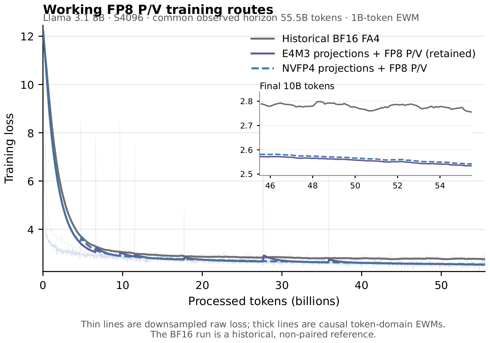

*图 13（原文 Figure 13，第 50 页）：到共同 555 亿 token 视野的历史 80 亿参数训练背景。细线是降采样的训练 loss，粗线是半衰期为 10 亿 token 的因果指数滑动平均。FP8-P/V 臂使用 64 路复制的数据并行、全局 batch 64；BF16 参照使用 32 路完全分片的数据并行、全局 batch 32，不是配对对照。*

**图中文字翻译与读法**：标题 “Working FP8 P/V training routes”（能工作的 FP8 P/V 训练路线），副标题 “Llama 3.1 8B · S4096 · common observed horizon 55.5B tokens · 1B-token EWM”；横轴 “Processed tokens (billions)” 0–55，纵轴 “Training loss”。三条线：灰 “Historical BF16 FA4”、紫实线 “E4M3 projections + FP8 P/V (retained)”（保留）、蓝虚线 “NVFP4 projections + FP8 P/V”；右上角插图 “Final 10B tokens”（最后 100 亿 token，纵轴 2.5–2.8）：两条 FP8 线在约 2.53–2.58，历史 BF16 线在约 2.76–2.8。读图结论：两条 FP8 轨迹都平稳下降、几乎重合，说明 FP8 路线可训练；灰线更高是因为配方不同，不能当作 BF16 质量更差的证据。

**G.8 分布式失败确立了什么（表 30，图 14、15）。** 第一次长的分布式 MX 运行同时结合了可学习的 NVFP4 投影、CCE 与共同行的 MX 反向，所以它的失败无法识别单一原因：在匹配的检查点上它的 loss 是 7.0805（FP8 为 6.5887），裁剪前梯度范数 157,696（FP8 为 6.41），之后超过 150 万，即便做了梯度裁剪。最终的四臂诊断消除了这种歧义，它把可学习投影格式与前向 P/V 格式交叉，同时固定反向：四条曲线到更新 300（7860 万 token）为止彼此接近；MXFP4 的两臂在更新 400（1.049 亿 token）附近明显分开，并在更新 500（1.311 亿 token）时无歧义地分裂：两个 MXFP4 臂的 loss 都是 7.97，而它们的 FP8 对照是 5.41。两条 MX 路线在不同的可学习投影格式下都失败，而两条 FP8 路线直到快照时都保持不发散；所以**前向的 MXFP4 P/V，或它诱发的模型状态，是共同的分界因素**。这是强的析因证据，但不是“某一条 kernel 指令导致发散”的形式化证明。

表 30：最初冻结的滚动日志截止点，为溯源而保留。各作业开始的时间不同，所以这是状态观察，不是对齐的 loss 或吞吐比较。

| 投影 | 前向 P/V | 更新 | token 数 | loss | 梯度范数 | 状态 |
|---|---|---:|---:|---:|---:|---|
| E4M3 | FP8 | 10,381 | 27.21 亿 | 2.9743 | 0.2197 | 截止时仍正常 |
| E4M3 | MXFP4 | 10,075 | 26.41 亿 | 8.8265 | 358,400 | 发散 |
| NVFP4 | FP8 | 10,884 | 28.53 亿 | 3.1637 | 0.2051 | 截止时仍正常 |
| NVFP4 | MXFP4 | 11,061 | 29.00 亿 | 8.4801 | 3,915,776 | 发散 |

（原文表 30，第 51 页；原文 token 数写作 2.721B、2.641B、2.853B、2.900B。）

旧的滚动日志回执首次保留“坏观测”是在更新 4020（10.54 亿 token，E4M3+MX）与更新 4722（12.38 亿 token，NVFP4+MX）附近；完整历史（图 15）表明这些只是截断标记，不是发散起点的估计。在共同的 555 亿 token 视野上，10 亿 token 滑动平均的 loss 对 E4M3+MX 与 NVFP4+MX 分别是 8.94 与 8.18，而它们的 FP8 对照是 2.53 与 2.54；MX 的梯度范数反复达到百万量级。后来的 B4 实验支持在更大有效 batch 下的同一选择：NVFP4 投影 / MXFP4 P/V 一臂在最初匹配的区间之后不久发散；第二臂把可学习投影换成 E4M3 而保留 MXFP4 的 P/V，同样出现了反复的、有限的梯度爆炸，并在更新 2550 被取消，其最后一次完成的留出验证是更新 2384 的 7.4481；匹配的 BF16 与 NVFP4 投影/FP8 P/V 轨迹保持稳定。两条失败的运行改变了投影精度、却保留 MXFP4 的 P/V，所以 P/V 表示是共同因素；这并不证明 MXFP4 在根本上不适用，也没有说明究竟是前向量化、保存的 V 载荷还是它在反向里的使用造成了问题。

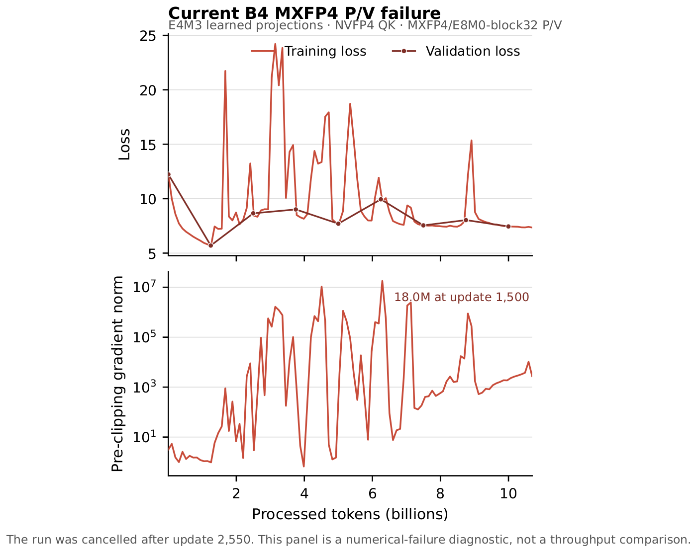

*图 14（原文 Figure 14，第 52 页）：匹配的 B4 MXFP4-P/V 失败诊断。该臂使用 E4M3 的可学习投影、attention 内部的 NVFP4 Q/K 与 MXFP4 的 P/V。上半图为训练与留出验证 loss，下半图为裁剪前梯度范数。该运行在更新 2550 后被取消，并排除在健康路线的吞吐比较之外。*

**图中文字翻译与读法**：标题 “Current B4 MXFP4 P/V failure”，副标题 “E4M3 learned projections · NVFP4 QK · MXFP4/E8M0-block32 P/V”；上图纵轴 “Loss”（5–25），红线 “Training loss”（训练 loss）、深红带点线 “Validation loss”（验证 loss）；下图纵轴 “Pre-clipping gradient norm”（对数轴，$10^1$ 到 $10^7$），标注 “18.0M at update 1,500”（更新 1500 处达 1800 万）；横轴 “Processed tokens (billions)” 0–10.7。图脚注：该运行在更新 2550 后被取消，这个面板是数值失败诊断，不是吞吐比较。读图结论：训练 loss 反复冲到约 15–24 的尖峰，梯度范数在约 $10^0$ 到 $10^7$ 之间剧烈震荡（最高 1800 万），验证 loss 在约 5.7–10 之间摆动，没有稳定下降。

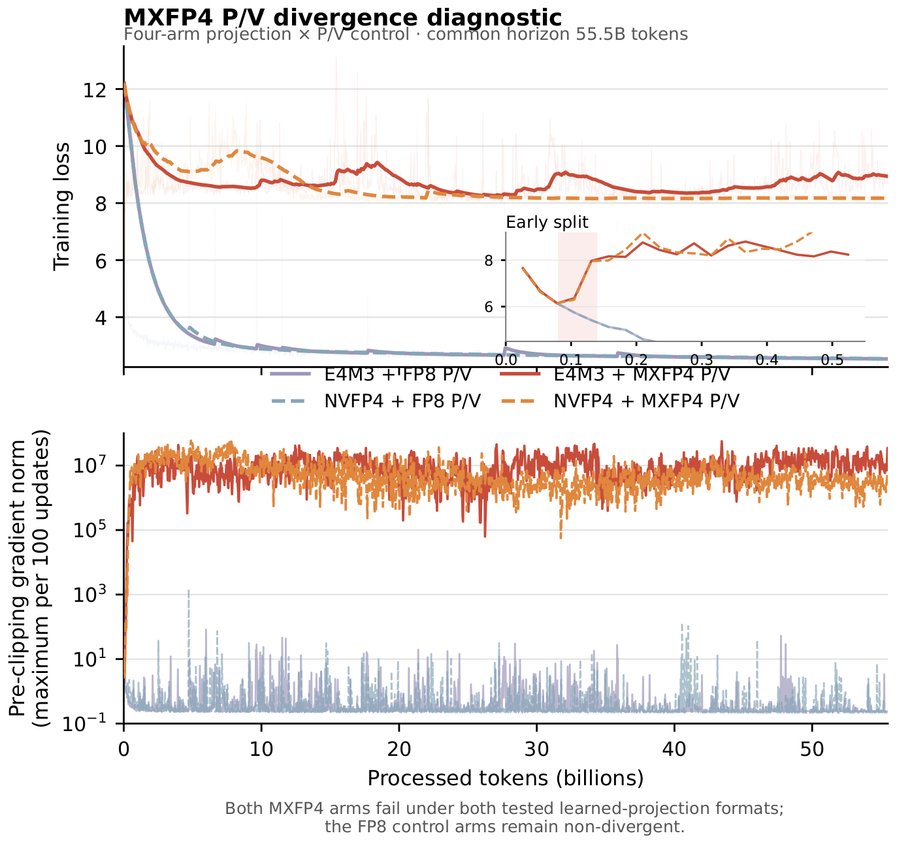

*图 15（原文 Figure 15，第 53 页）：两个发散的 MXFP4-P/V 臂的分离诊断。上半图是 loss，下半图是每 100 次更新显示区间内的最大裁剪前梯度范数（对数轴）。两个 FP8 对照臂被淡化显示，并使用对应的投影格式。插图放大前 5.5 亿 token（0.55 十亿），并定性标出曲线首次分开的区间，约 0.08 到 0.14 十亿 token（即 8000 万到 1.4 亿 token）。*

**图中文字翻译与读法**：标题 “MXFP4 P/V divergence diagnostic”，副标题 “Four-arm projection × P/V control · common horizon 55.5B tokens”（投影 × P/V 四臂对照，共同视野 555 亿 token）；上图 “Training loss”，图例四条线：“E4M3 + FP8 P/V”、“NVFP4 + FP8 P/V”（淡色，两条 FP8 对照）与 “E4M3 + MXFP4 P/V”（红）、“NVFP4 + MXFP4 P/V”（橙虚线）；插图 “Early split”（早期分裂）的横轴是 0 到 0.5 十亿 token，粉色阴影标出约 0.08–0.14 十亿 token（8000 万到 1.4 亿 token）这一段，曲线在这里首次分开，与正文“更新 400（1.049 亿 token）附近明显分开”一致。下图 “Pre-clipping gradient norm (maximum per 100 updates)”（每 100 次更新的最大裁剪前梯度范数），对数轴 $10^{-1}$ 到 $10^7$ 以上。读图结论：两个 FP8 臂的 loss 迅速降到约 2.5，梯度范数多数在约 0.2–30 之间，偶有尖峰到约 $10^3$；两个 MXFP4 臂的 loss 停在 8–9，梯度范数多数在约 $10^6$–$10^8$，偶尔跌到 $10^5$ 左右。

**G.9 证据边界。** 本地括号测量保留的反向、完整的 attention 子层与完整的 8B 更新；分布式历史表明 FP8 路线保持不发散并在观察窗口内继续下降，而 MXFP4 路线不能。同配方的 B4 BF16 对照在完整的 1000 亿 token 计划上提供了同更新的留出验证与吞吐。由于每条路线只有一条轨迹，这些数据不支持运行间波动或统计等价性的结论；输入停顿与检查点窗口保留在吞吐分布里。

## 十、证据边界、原文不一致与常见误读

**证据边界**：

1. 所有速度数字来自 GB200 与 B300 的 D128 形状（D64 只在附录里作为 B300 的诊断）；前向主表是非因果；因果的结果只包括 D128 的反向、含投影子层与 8B 更新；没有 H100、A100 或其他架构的结果。
2. 加速比的分母是 HAO 的 CuTe-DSL **BF16 FA4**，不是 FA2 或 cuDNN；相对 BF16 的“2.13 倍”只在 S8192/H64 一类有利形状上成立，S256/H16 上只有 1.17 倍，accurate 策略在短序列上约等于 BF16（1.007 倍）。
3. 精度是真实代价：fast 的相对 L2 约 0.34（FP8 的 PV 约 0.29，HAO NV/FP8 约 0.14，HAO NV/NV 约 0.19）；下游固定输入的任务指标变化很小，但这些是推理评估，且 Wan 的 20 步轨迹已经显著漂移（14B 余弦 0.85）。
4. 训练结论是“MXFP4 的 P/V 发散、FP8 的 P/V 稳定”，每条路线一条轨迹，没有运行间方差；保留路线与 BF16 同更新验证 loss 差 0.090，不能把差距归因于 attention 单独（同时改了投影）。
5. 完整的单 GPU 更新只快 1.09–1.14 倍：attention 之外的投影、FFN、通信与优化器稀释了收益；该更新里的投影用 NVFP4，加速也包含投影的收益。
6. 单作者的第三方技术报告，附录里有大量内部版本标签、历史/弃用路径与“回执”溯源，部分外部资产的修订没有被记录（历史行只靠回执支持）；B300 的行是调优后的最佳稳定记录，不是同一二进制的硬件 A/B。
7. 对 HAO 的对比有两类：本地复测（NV/NV、BF16）与 HAO 公开发布的跨运行数字（NV/FP8、GB300、B200），后者因 harness 与实现不同，不能作因果比较。

**原文自身的不一致与疑点**（本文逐项核算后标出；不影响主要结论）：

- 附录 B.3 的“增益”列中，Q0+Q1（4.064 µs）与 Q2+Q3（7.008 µs）两行按文中声明的 0.102400 ms 基线算应为 3.072 µs 与 5.984 µs，相差约 1 µs；只有“全部四块”的 12.288 µs 与基线自洽。
- 表 7 之外的九个 GB200 形状的完整表只收在发布的 artifact 里，论文内部无法核对 2.023 倍与 1.669 倍这两个几何平均数（表内的几行与它们自洽，没有矛盾）。

**常见误读**：

- “FP4 tensor core 更快所以 attention 自然更快”是错的：论文的出发点就是它**不会**——HAO NV/NV 在多数形状上比 BF16 还慢（0.685–0.951 倍）。
- “全 FP4”只指 attention 内部的 Q、K、P、V 四个操作数；可学习的 QKV/O 投影是另一个精度边界，保留的训练路线也**不是**纯 FP4 端到端训练（P/V 与梯度乘积用 FP8）。
- Direct-P 的 2.13 倍是**推理前向**的算子速度，不是训练速度；训练里完整更新最多 1.14 倍。
- “MXFP4 的 P/V 训练发散”是实验观察，不是“MXFP4 不可能用于 attention 训练”的证明；原文明确说没有证明，并提出 UE5M3 这类更宽 scale 范围的块格式是值得研究的方向，但本文没有评估。
- 这不是 FlashAttention-5，也不是 FA4 作者团队的论文；它是在 HAO AI Lab 的实现与调度之上、用 ThunderKittens（TK）实现 Direct-P 与量化因果反向的第三方技术报告，应当当作“FA4 之后的 FP4 分支证据”来读。

## 十一、复现检查清单

- **操作数契约**：Q/K 必须是按 MSE 选择折叠成 K64 的 NVFP4 scale 布局（`--nv-qk-fold-k64-scales both`、`--nv-qk-fold-scale-select mse`）；accurate 还需要 K、V 的固定 32 行置换；与普通 16 元素块 scale 搭配的计时无效。
- **基准口径**：非因果 D128，9 个形状网格 + 饱和套件（S4096/H64、S8192/H64），种子 20260814，预热 300 ms、3000 ms 窗口的中位数；吞吐用 $B\,H\,2S^2(D_{QK}+D_{VO})$；加速比相对 HAO CuTe-DSL BF16。
- **误差口径**：对 BF16 的余弦、相对 L2、RMSE 三项同时报告；每个主行的延迟与误差来自同一次确定性记录。
- **模型评估**：ViT（1000/200/200 个样本）、BERT MLM（800 个 S256、200 个 S512 块）、SST-2（872 个验证样本）、ViT-MAE（100 张 COCO 验证图、75% 掩码、成对 PSNR 的 95% 区间）、Wan2.1（S7680，1/4/20 步，守卫层 27–29 与 33–34/38–39，$(M,L)=(110,16)$ 与 $(112,14)$）。
- **训练**：8B Llama 形状（32 层、32/8 个 head、D128）、S4096、local batch 1/2/4、10 次预热 + 21 次计时更新；64 卡、local batch 4、4 步累积、有效全局 batch 1024 的 1000 亿 token 计划；同更新验证对照。
- **检查**：反向用“精确零 dO”测试、非零 dO 的有限性测试与被表示操作数的参考门槛；确认 $\mathrm{LSE}$ 的 $+8$ 抬升（G.2）与 $dO$ 的 E5M2 发布；MXFP4 路线必须配对检查发散。
- **硬件**：区分 GB200（152 个可见 SM）与 B300（148 个）；持久化网格需按设备 SM 数重新编译，避免空的第二波。

## 十二、与相邻论文的关系

- [FlashAttention](../flash_attention/论文中文解读.md)、[FlashAttention-2](../flash_attention_2/论文中文解读.md)、[FlashAttention-3](../flash_attention_3/论文中文解读.md)、[FlashAttention-4](../flash_attention_4/论文中文解读.md) 依次是 IO 感知、A100 上的并行与 warp 分工、Hopper 的异步与 FP8、Blackwell 的非对称硬件扩展。FA4 已指出“矩阵乘越快，softmax 的指数与 shared memory 越成为瓶颈”；本文把这个观察推进到 FP4：矩阵乘进一步变快后，瓶颈变成了“分数 → 概率 → 被缩放的 FP4 操作数”这段串行路径，以及 TMEM 的所有权。
- 本文的方法是 FA4 思想的延伸：FA4 用 FMA 单元上的多项式软件模拟指数（输出到 BF16 就够精确）；本文用“仿射 + 打包转换”直接做 E2M1 的码分类（因为只需判对 8 个码里的哪一个）。
- 相关的第三方工作：HAO AI Lab 的 FP4 FA4（本文的基线与起点）、SageAttention3（消费级 Blackwell 的 FP4 attention 与 8 位训练探索）、Attn-QAT（4 位 attention 的量化感知训练）、UE5M3 FP4 块缩放（本文结论里提到的更宽 scale 范围方向）。

## 原文证据导航

- [原论文 PDF](paper.pdf)
- [原文提取文本](paper.txt)
- [论文概要](论文概要.md)
