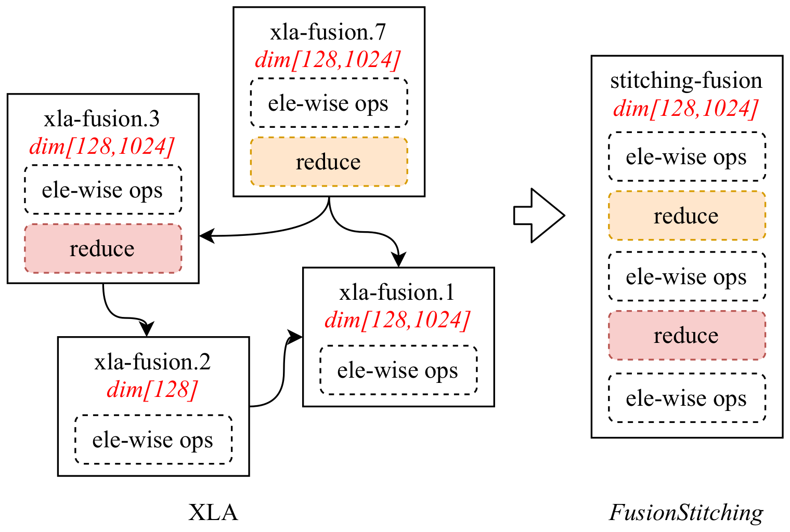
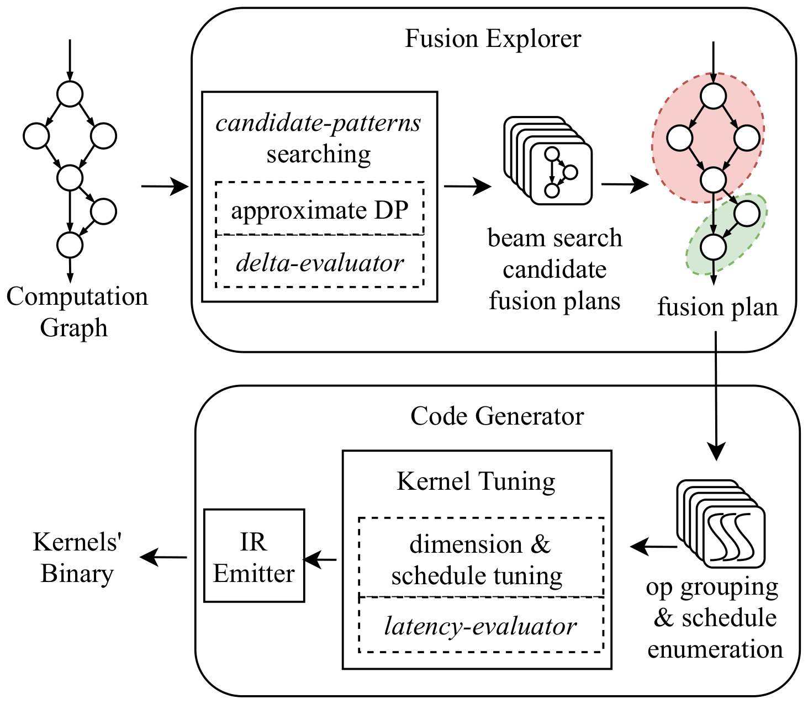
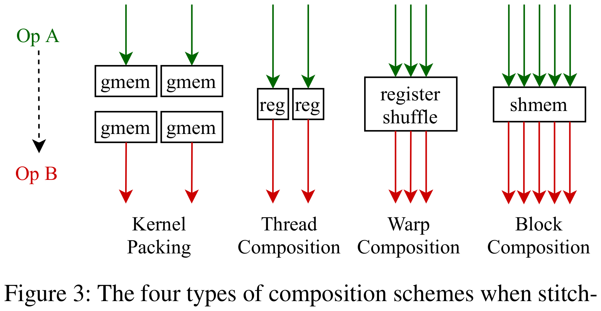
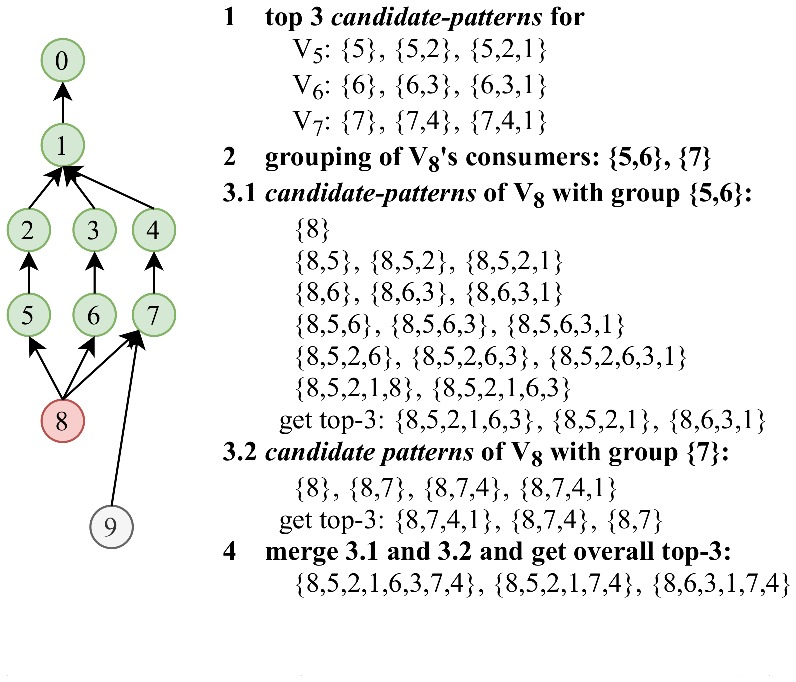
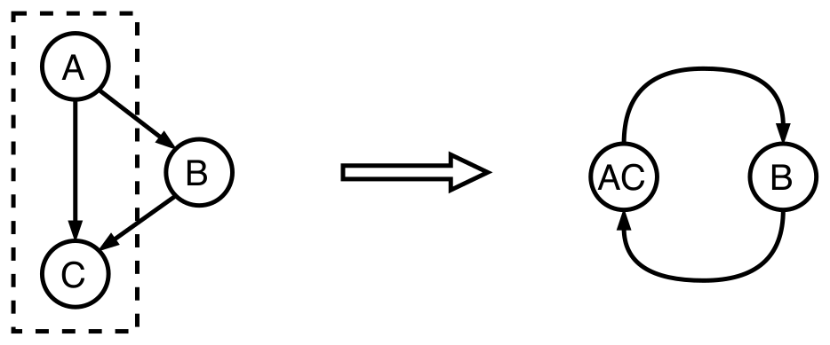
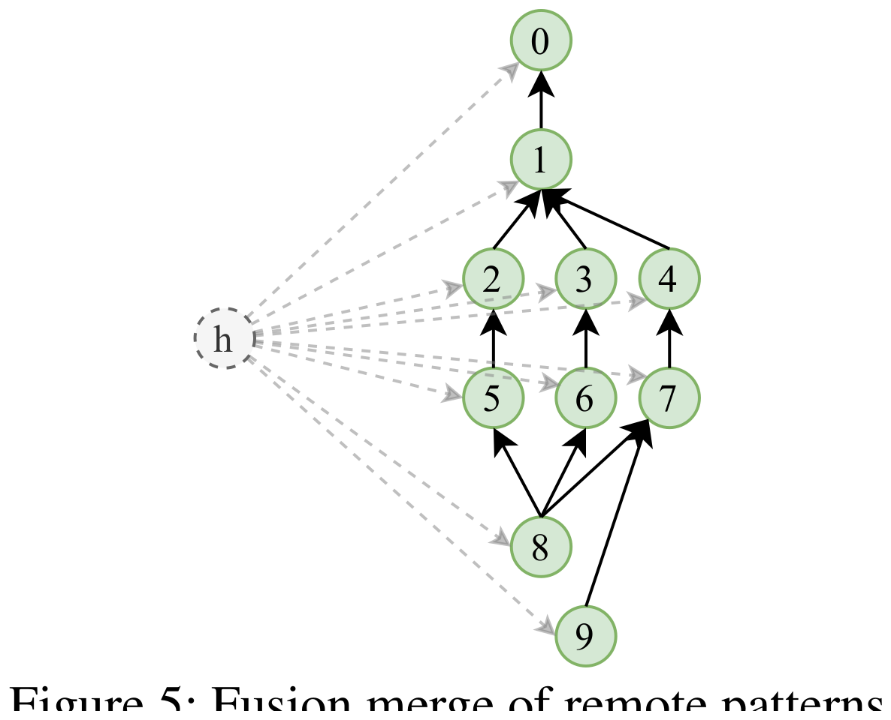
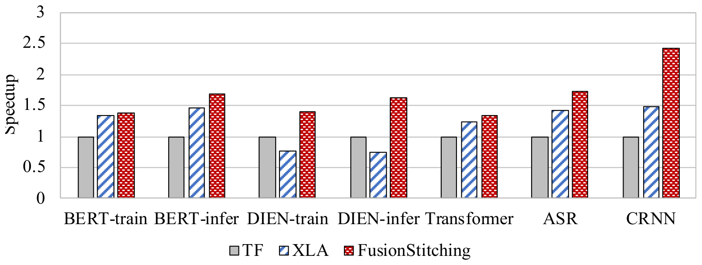

# 论文中文解读：《FusionStitching: Boosting Memory Intensive Computations for Deep Learning Workloads》

> **基本信息**：Zhen Zheng、Pengzhan Zhao、Guoping Long、Feiwen Zhu、Kai Zhu、Wenyi Zhao、Lansong Diao、Jun Yang、Wei Lin（Alibaba Group），arXiv:2009.10924（本文依据 2021 年 12 月 17 日的 v2）；论文原文 [官方页面](https://arxiv.org/abs/2009.10924)。
>
> **本文的读法**：图为从 PDF 中按图裁出的原图，表为逐格核对后的中文转录（数字与原文一致，表头翻译为中文）。每张图后有中文图题、图中文字翻译与读图结论，因此不必再翻英文版。凡是“由表中数字算出”的比值或百分比都注明是本文的计算；原文正文给出的数字优先。标明“说明性示例”的内容是为了讲清机制而编的，不是原文内容。

## 一、一句话结论

深度学习计算图里有大量访存密集算子（原文把不是 GEMM 或卷积的算子都叫 memory intensive ops，如逐元素、transpose、reduction），它们算术强度低，不但反复读写片外显存（global memory），还造成大量 kernel 启动与框架调度开销（CPU-GPU 上下文切换）。当时最好的即时（JIT）融合引擎 XLA 只允许同一个线程内用寄存器传递中间值，遇到 reduce、tan、log 这类代价高的算子就只能让每个线程各自重算，所以规定这些算子只能出现在融合 kernel 的尾部，融合空间很受限。FusionStitching 引入**数据重用**：让同一个 warp 或同一个 block 里的线程通过 register shuffle 或 shared memory 交换中间值，从而允许代价高的算子出现在 kernel 中间，把依赖关系和并行方式都不同的一大批算子“缝合”（stitch）进一个 GPU kernel。它由两部分组成：**代码生成器**（四种 kernel 组合方式、算子分组、基于代价模型的 schedule 与 launch 维度调优）和**融合探索器**（近似动态规划产生候选融合模式，再用 beam search 得到融合方案，并用两层代价模型打分）。在 V100 上对 7 个训练/推理负载，相对 TensorFlow 最高 2.42 倍、平均 1.66 倍，相对 XLA 最高 2.21 倍、平均 1.45 倍；原文还报告已集成进产品并在拥有数千块 GPU 的生产集群里运行 4 个月以上。

## 二、背景与动机

### 2.1 访存密集算子为什么要融合

当时的很多研究关注计算密集算子（GEMM、卷积），它们占许多 DNN 负载的大部分执行时间，并通常由 cuDNN、cuBLAS 等库实现。但新模型结构里访存密集算子占的时间比例很大，而且算子个数可以非常多，带来明显的 GPU kernel 启动和框架调度开销。原文表 2（本文后面转录）收集了各模型在 TensorFlow 下的指标：访存密集算子的执行时间在有的模型上超过计算密集算子，kernel 调用次数最多达 10,406 次。只优化计算密集算子不足以释放这些模型的全部性能潜力。

为访存密集算子做库不可行：单个访存密集算子太简单，而它们的组合随模型千变万化、演进很快。所以现代框架里它们通常用编译技术即时生成（JIT）。常见做法是**计算融合（computation fusion）**：此前在 AI 负载、数据库、图像处理、HPC 上有提前编译（AOT）的融合工作，但在依赖关系不可预测、并行方式不均匀的情况下高效地做 JIT 融合仍是开放问题。

### 2.2 XLA 的做法与它的局限

XLA 只支持线程局部的数据传递：靠索引分析和**重计算**来提升线程局部性。如果不同线程需要同一个中间值，它们就各自独立地重算一遍。对 add、sub、mul 这类很轻的逐元素算子，这没问题；但对 reduction、tan、log 等代价高的算子，重算开销严重。典型坏例子是把一个 reduction 放在融合模式中间：不同线程需要同一个 reduction 结果时，每个线程都要重复算一次 reduction。为避免重计算，XLA 规定代价高的算子（reduction、tan 等）只能出现在融合的尾部，也就是不能在融合内部充当 producer，这样会错过许多优化空间。此外 XLA 的融合探索策略保守：一方面是基于规则，无法覆盖逐元素算子与各种 tensor shape 的各种组合；另一方面是贪心，容易陷入局部解。

**数据重用（data reuse）的想法**：当处理算子 B 的不同线程需要算子 A 产生的同一个值时（B 是 A 的消费者），这些线程可以通过线程间通信读同一份数据，而不必像 XLA 那样冗余重算。原文观察到，一串访存密集算子的 tensor shape 常常因为 reduce、broadcast、gather、slice 等算子而不断收缩和扩张，所以探索数据重用的机会很多。

*图 1（原文 Figure 1，第 3 页）：XLA 与 FusionStitching 对 Layer Normalization 的融合模式差异。*

**图中文字翻译与读法**：

- **左半 XLA**：XLA 把 layer normalization 切成 4 个 fusion：`xla-fusion.7`（形状 dim[128,1024]：若干 ele-wise ops（逐元素算子）后接一个 reduce，橙色）、`xla-fusion.3`（dim[128,1024]：ele-wise ops 后接一个 reduce，红色）、`xla-fusion.2`（dim[128]：ele-wise ops）、`xla-fusion.1`（dim[128,1024]：ele-wise ops）。箭头表示数据流：fusion.7 的输出同时送给 fusion.3 和 fusion.1，fusion.3 的输出送给 fusion.2，fusion.2 的输出送给 fusion.1；
- **右半 FusionStitching**：同样的算子只生成一个 `stitching-fusion`（dim[128,1024]），内部依次是 ele-wise ops、reduce（橙）、ele-wise ops、reduce（红）、ele-wise ops；
- **读图结论**：XLA 的 4 个 kernel 之间的中间结果都要写回、再读回全局显存，并有 4 次 kernel 启动；FusionStitching 让所有中间结果留在片上存储，没有 CPU-GPU 切换，也没有引入重计算（原文 §2.1 的文字描述）。

**本文对图的对应（非原文逐项说明）**：layer normalization 的计算是 $y=\dfrac{x-\mu}{\sqrt{\sigma^2+\epsilon}}\cdot\gamma+\beta$。图中四个 XLA fusion 可以这样对应：fusion.7 对每行求均值（reduce）；fusion.3 算 $(x-\mu)^2$ 并对每行求方差（reduce）；fusion.2 在长度 128 的向量上算 $\sqrt{\cdot}$、倒数这类代价高的算子；fusion.1 做最终的逐元素归一化与缩放平移。原文只说它是 layer normalization，没有逐项给出这个对应。

原文 §7.4 的解释：阻止 XLA 融合得更大的有两个原因：（1）fusion.7 与 fusion.3 里的 reduce：XLA 不探索 producer 算子中间结果的重用，把 reduce 放在 kernel 中间会让不同线程冗余地重算同一个值；（2）fusion.2 里“小张量上的代价高的逐元素算子”：XLA 不倾向于把它放在 kernel 中间，因为融合会引入对代价高的指令的冗余计算。

### 2.3 两个观察

原文分析了第七节的多种负载，得到两个观察（数据见表 2）：

1. **CPU-GPU 上下文切换开销严重**：TensorFlow 实现的 GPU kernel 调用次数（表 2 的 #）最多达 10,406；即使用 XLA 融合后还可达 6,842。因此框架带来的 CPU 端调度与前后处理时间在某些模型上主导了执行时间（如 BERT 推理、DIEN、ASR、CRNN）。
2. **访存密集算子占比大**：表 2 里访存密集算子的执行时间在整体时间中最多占到约 40%。片外访存的时间通常在访存密集算子的总时间里占很大比例。通过融合大量算子，系统可以减少 CPU-GPU 上下文切换开销，并利用高速片上存储在算子之间重用中间数据。

### 2.4 挑战

数据重用虽然是把大范围算子融合在一起并避免冗余重算的潜在机会，但在“给定融合模式怎样应用重用”和“决定融合哪些算子”两个层面都有挑战。

- **评估重用的收益**：重用不总比重算好。重用会带来额外的线程间数据通信，而重计算带来冗余计算但没有线程间通信。此外用 shared memory 做重用可能损害 kernel 的 occupancy，从而损害并行度；
- **怎么重用**：有 warp 内重用（intra-warp reuse）和 block 内重用（intra-block reuse）两种：线程重用同一个 warp/block 里其他线程产生的中间数据。权衡是：warp 内重用的访存开销更小，block 内重用的并行度更好；
- **决定融合哪些算子**：形成带数据重用的融合模式并不总比分开的 kernel 好。重用要求线程块或 warp 内的数据局部性，这可能限制并行度。以 reduction 为例，重用 reduction 的结果要求在一个 block 或 warp 内完成这个 reduction；但有些 reduction 让多个 block 一起做并行度更高，此时不把它与消费者融合反而更快，即使要付出上下文切换和片外访存的开销。block 内重用还因为要额外的 shared memory 而进一步损害并行度。另一个典型问题：算子 A 既能与 B 融合也能与 C 融合，而 B 和 C 因某些限制不能融合在一起时，决定 A 与谁融合并不容易。XLA 这类基于规则的方法无法为各种模型找到有效的融合方案。

## 三、总览

### 3.1 系统结构

FusionStitching 把优化分为两个概念上独立但高度相关的阶段：融合探索（fusion exploration）与代码生成（code generation）。

*图 2（原文 Figure 2，第 4 页）：FusionStitching 总览。*

**图中文字翻译与读法**：

- **左侧**：Computation Graph（计算图）作为输入；
- **上方大框 Fusion Explorer（融合探索器）**：先做 candidate-patterns searching（候选模式搜索），内部是 approximate DP（近似动态规划）与 delta-evaluator（增量评估器）；接着 beam search candidate fusion plans（用 beam search 得到若干候选融合方案，图中是一叠卡片）；最后输出 fusion plan（融合方案，图中把计算图划分成红、绿两个融合区域）；
- **下方大框 Code Generator（代码生成器）**：从融合方案出发，先做 op grouping & schedule enumeration（算子分组与 schedule 枚举），再进入 Kernel Tuning（kernel 调优），内部是 dimension & schedule tuning（维度与 schedule 调优）和 latency-evaluator（延迟评估器），然后是 IR Emitter（IR 发射器），输出 Kernels' Binary（kernel 二进制）；
- **读图结论**：探索器决定“哪些算子放进同一个 kernel（融合方案）”，用便宜的 delta-evaluator 打分；代码生成器决定“一个融合模式内部怎么算（分组、schedule、launch 维度）”，用更准的 latency-evaluator 打分；两层代价模型分别服务这两个阶段。

融合探索器生成可能享受数据重用的候选融合模式，再用 beam search 形成若干候选融合方案，并用代价模型选出最佳方案。代码生成器为探索器产生的每个融合模式生成 GPU kernel。作者为每一类算子预先定义一组 **schedule**（模板）：schedule 描述一个算子怎样并行执行，同时说明这个算子的线程是否与其他线程重用数据、重用范围多大，以及这个算子是否为消费者的重用生产数据。FusionStitching 把一个融合模式里的算子分成几组，枚举各组 schedule 的所有合法组合；用代价模型估计每个 schedule 与 launch 维度设置的性能，选出该融合模式的最佳配置并生成 GPU kernel 代码。

### 3.2 两层代价模型

- 融合探索器要在很大的搜索空间里搜索，用 **delta-evaluator**：快，但不够精确（§5.4）；
- 代码生成器作用在合并后的 GPU kernel 上，需要更准确的性能估计，用 **latency-evaluator**：更准，但更慢（§4.3）。

## 四、代码生成器

代码生成器以一个融合模式为输入，输出实现这些融合算子的 GPU kernel。由于依赖场景和并行方式不兼容，把多个算子融合成一个高性能 GPU kernel 并不简单。访存密集算子的组合模式数不胜数，但基本种类有限，原文分成三类：**轻量逐元素**（大多数逐元素算子）、**代价高的逐元素**（tan、exp 等）和 **reduction** 算子，并为每类预先定义一组 schedule。剩下的问题是：怎样把不同算子缝合进一个 kernel，以及每个算子各用什么 schedule。

### 4.1 四种 kernel 组合方式（composition scheme）

原文研究四种组合方式，涵盖访存密集算子的主要行为。不同方式对应不同的数据依赖与并行行为：从无依赖到复杂的跨线程依赖，从统一的并行度到不均匀的计算。

*图 3（原文 Figure 3，第 5 页）：把算子 A 和 B 缝合在一起时的四种组合方式。Gmem：全局显存（不同方格表示不同内存地址）；Reg：寄存器；Shmem：共享内存。*

**图中文字翻译与读法**：绿色箭头是算子 A 的输出线程，红色箭头是算子 B 的输入线程（左侧虚线箭头表示 A 先于 B）。

- **Kernel Packing（kernel 打包）**：A 与 B 之间没有数据依赖，各自读写自己的 gmem（图中上下各两个方格，互不相连）；只是把它们的计算放进同一个 kernel；
- **Thread Composition（线程组合）**：A 的每个线程把输出放进自己的寄存器（reg），同一线程里的 B 直接读取，一对一；
- **Warp Composition（warp 组合）**：A 的多个线程把输出汇入 register shuffle（同一个 warp 内的寄存器洗牌），B 的多个线程从中读取；
- **Block Composition（block 组合）**：A 的更多线程把输出写入 shmem（共享内存），B 的线程从中读取，需要 block 内同步；
- **读图结论**：从左到右，中间值所在的存储从全局显存、寄存器、warp 内寄存器交换到 block 内共享内存，通信范围逐步变大；需要的数据局部性也从“无”到“同线程”“同 warp”“同 block”。

四种方式的文字说明：

- **Kernel Packing**：打包没有数据依赖的算子的计算。它有助于减少 kernel 启动和框架调度的上下文切换开销，还能降低指令级的循环控制开销：当这些算子的并行维度相同时，做激进的**循环融合**（loop fusion），把尽可能多的逐元素算子合并进同一个循环结构；
- **Thread Composition**：融合有依赖的算子，通过线程本地上下文里的寄存器传递中间结果。这就是 XLA 采用的融合方式，可能在需要同一个值的线程之间引入冗余计算；
- **Warp Composition**：融合有依赖的算子并应用 warp 内重用，用 register shuffle 在同一个 warp 内的线程之间通信。典型情形是 warp 级 reduction 及其消费者：用 warp 级 reduction，并通过寄存器把中间结果传给其消费者的线程；
- **Block Composition**：应用 block 内重用，只要这些计算能在 block 级别通信，就可以把非均匀的计算组合成大的融合 kernel；用 shared memory 传递中间结果以实现数据重用。

Warp composition 与 block composition 是灵活的组合方式，因为它们允许融合 kernel 里不同算子用独立的 schedule 执行；唯一的要求是 producer 与 consumer 之间保持 warp/block 局部性。这两种方式对高效地组合各种并行特征与依赖关系的算子至关重要。原文称 FusionStitching 是第一个就机器学习负载里访存密集算子的即时编译，系统研究上述所有组合技术的工作，而 **XLA 只实现了 kernel packing 与 thread composition**。FusionStitching **不缝合涉及跨 block 通信的算子**，因为那会导致全局显存级的同步，开销很高。

对 reduction 的具体含义（原文 §3.1 的例子）：warp 内重用指每个 warp 对一行数据做 reduction，并把结果存进该 warp 第一个 lane 的寄存器，reduction 的消费者通过 register shuffle 从第一个 lane 读；block 内重用指用 block 里所有线程对这一行做 reduction，并把结果存进 shared memory，消费者从 shared memory 读。两种方式都在避免重计算的同时用片上存储缝合算子；warp 内重用要求 warp 级数据局部性，block 内重用要求 block 级数据局部性。

### 4.2 kernel 生成：算子分组与 schedule 枚举

由于上面讨论的各种组合方式之间要权衡，FusionStitching 里的代码生成不像 XLA 那样直接。它用基于代价模型的调优，并用**算子分组**简化枚举。

**预定义的 schedule**（对应上面的组合方式）：

| 算子类别 | schedule | 对应的组合方式 |
|---|---|---|
| 轻量逐元素算子 | 只有一个模板 | kernel packing 与 thread composition（原文发现二者可以用同一个 schedule 描述） |
| 代价高的逐元素算子、reduction 算子 | 第 1 个 | kernel packing 与 thread composition |
| 同上 | 第 2 个：把中间结果存进每个 warp 的第一个 lane 的寄存器 | warp composition |
| 同上 | 第 3 个：把中间结果存进 shared memory | block composition |

**分组**：FusionStitching 枚举所有算子 schedule 的组合，并按代价模型（§4.3）估计它们。为了简化枚举，把融合模式里的算子分成若干**组**，每组应用一个 schedule，不同组之间用 warp/block 级重用传递中间数据。分组依据算子类型：

- 把一个组的输出算子叫 **sub-root**，把整个融合的输出算子叫 **root**；
- 先识别 sub-root，再生成以 sub-root 和 root 为根的组；**reduce 算子总被当作 sub-root**；代价高的逐元素算子**既枚举为 sub-root 也枚举为非 sub-root**；其他算子都不是 sub-root；
- 结果是一组以 reduction、代价高的逐元素算子和 root 为根的组。

**分组方法的洞察**：非 sub-root 算子的 schedule 可以由 sub-root 的 schedule 通过张量索引传播决定。所以只需要枚举 sub-root 和 root 算子的 schedule，就能传播得到所有算子的 schedule。

FusionStitching 枚举分组策略，并为每个 sub-root/root 算子的 schedule 与融合 kernel 的 launch 维度做模拟。因为数据重用要求重用范围内有正确的数据局部性，**不满足数据局部性要求的 schedule 会被丢弃**。用 latency-evaluator 估计各个枚举项的性能后，选择估计性能最好的代码生成策略。

### 4.3 Kernel 评估：latency-evaluator

FusionStitching 需要对 kernel 性能做准确估计以决定代码生成策略。幸运的是代码生成的搜索空间不大，可以容忍较慢的代价模型。原文的公式 1：

$$
L=N_{\text{wave}}\times L_{\text{warp}},\qquad
N_{\text{wave}}=\frac{N_{\text{warp}}}{\text{Occupancy}},\qquad
L_{\text{warp}}=N_{\text{instruction}}\times \text{CPI}.
$$

符号含义：

- $L$：融合 kernel 的估计执行周期数；
- $N_{\text{wave}}$：GPU 要处理的 warp 的“波数”：大 kernel 的 warp 会被分成几波在 GPU 上执行，同一波里的 warp 并发执行；
- $L_{\text{warp}}$：单个 warp 在融合 kernel 里花费的延迟（周期数）；$N_{\text{wave}}$ 与 $L_{\text{warp}}$ 的乘积就是执行融合 kernel 的总周期数；
- $N_{\text{warp}}$：要发射的 warp 总数，由 launch 维度和张量 shape 算出；
- Occupancy：由 launch 维度、shared memory 用量（§4.4）和估计的寄存器用量算出。寄存器用量通过分析每个中间值的生命周期、取一个线程的最大寄存器用量来估计；shared memory 用量同样用生命周期分析估计。原文称这个方法的精度足以算出 Occupancy。（式中 $N_{\text{wave}}=N_{\text{warp}}/\text{Occupancy}$ 要求 Occupancy 是“一波能同时驻留的 warp 数”，这是本文按公式量纲所做的解读，原文没有明说单位）；
- $N_{\text{instruction}}$：估计的指令总数；CPI：每类算子公开报告的每指令周期数（原文引用的 GPU 微基准研究）。$L_{\text{warp}}$ 就是用它们相乘得到。

**说明性示例（数字为本文编造，非原文）**：设某 kernel 要发射 $N_{\text{warp}}=10240$ 个 warp，在当前 launch 维度与资源用量下整块 GPU 同时能驻留 2560 个 warp，则 $N_{\text{wave}}=4$；若每个 warp 要执行约 400 条指令、平均 CPI 为 4，则 $L_{\text{warp}}=1600$ 周期，$L=6400$ 周期。如果为了用 shared memory 做 block 内重用，使驻留 warp 数降到 1280，则 $N_{\text{wave}}=8$，同样的 $L_{\text{warp}}$ 下总周期翻倍：这就是“重用不一定更好”的量化含义。

### 4.4 Shared memory 优化

适度使用 shared memory 很重要：大量使用会损害 kernel 并行度，在大粒度组合时尤其如此。为了在不损害并行度的前提下尽量多用 shared memory，作者探索了一种基于数据流的 shared memory 共享技术：洞察是 FusionStitching 尽量复用之前已分配的 shared memory，减少不必要的分配。

用**支配树（dominance tree）算法**做 shared memory 的数据流分析：输入计算图和 shared memory 请求，输出分配映射。为优化共享空间，按拓扑序遍历计算图里的算子：

- 如果一个算子不需要共享空间，就把之前的分配信息向前传播；
- 如果一个算子需要共享空间，就合并它所有操作数的分配信息，检验支配关系，看当前算子能否共享之前分配的某块空间，能就复用。

### 4.5 计算重用优化

除了借助 shared memory 与 register shuffle 在 producer 与 consumer 之间重用中间结果，FusionStitching 还减少**线程局部的冗余计算**。线程局部的冗余计算主要来自访存索引计算以及线程局部的中间值：因为融合 kernel 的不同部分可能使用不同的 schedule，索引和某些中间值在每个 schedule 内独立产生，即使在同一个线程里也是如此。生成代码之前，FusionStitching 先分析整体的索引与中间值特征，再组织输出代码，尽可能复用计算和数据。

## 五、融合探索器

原文指出，XLA 基于规则的做法不足以处理复杂的融合决策，FusionStitching 用基于代价的搜索。它提出一种**近似动态规划**去搜索一组有希望的融合模式（这些模式可能相互重叠，§5.2），搜索过程由一个轻量的领域专用代价模型引导（§5.4），最后通过选取融合模式生成整体融合方案（§5.3）。

### 5.1 问题定义

把融合探索表述为子图搜索问题。对计算图 $G=(V,E)$（$V$ 和 $E$ 分别是顶点集与边集），把一个**融合模式（fusion pattern）** $P_i=(V_i,E_i)$ 定义为 $G$ 的子图，$V_i\subseteq V$，$E_i\subseteq E$。一个**融合方案（fusion plan）** 是一组**互不相交**的融合模式的集合 $S=\{P_0,\dots,P_{k-1}\}$。融合模式 $P_i$ 的得分函数记作 $f(P_i)$，性能越好 $f(P_i)$ 越大。因此计算融合问题的目标是找到使 $\sum f(P_i)$ 最大的融合方案 $S$（原文求和下标写作 $i=1$ 到 $k$，而集合下标从 0 到 $k-1$，是原文小的不一致，不影响含义）。

### 5.2 探索融合模式：近似动态规划

暴力枚举所有融合模式在不剪枝时复杂度可达 $O(2^V)$。原文提出复杂度为 $O(V+E)$ 的近似动态规划来找好的融合模式。

**基本思想**：从图中每个顶点出发，按**后序**产生候选模式（candidate-patterns），再用这些候选模式选择并组合出最终融合方案。从顶点 $V_i$ 出发的候选模式，是以 $V_i$ 为 **producer 节点**的融合模式的集合。先对计算图 $G$ 做拓扑排序，按后序，从最后一个顶点到第一个顶点依次为每个顶点产生候选模式，这保证每次搜索得到的融合模式都以当前顶点为 producer。公式 2：

$$
P_i=\mathrm{PatternReduction}(C_i),
$$

其中 $C_i$ 是 $V_i$ 的所有消费者（consumer）的集合；PatternReduction 是根据所有消费者的候选模式得到 $V_i$ 的候选模式的方法。每个顶点只保留得分 $f$ 最高的前 $k$ 个候选模式（原文例子里 $k=3$）。

**PatternReduction 怎么做**（以图 4 为例）：朴素做法是把 $V_8$ 追加到其消费者候选模式集合的所有可能组合上，再在追加后的组合里选前 3；但消费者数和 top-$k$ 大时组合数巨大，而 JIT 要求及时优化。所以设计了一个**近似的分治**过程：先把 $V_8$ 的消费者分成几组，独立地考虑每组去找 $V_8$ 的候选模式，最后把各组的结果合并（reduce）得到最终候选模式；如果消费者数很大，就先分成两组，再把组继续细分直到足够小，递归进行。

*图 4（原文 Figure 4，第 7 页）：为 $V_8$ 生成候选模式（candidate-patterns）的 PatternReduction 例子。*

**图中文字翻译与读法**：

- **左图**：一个 10 个顶点的有向图，箭头方向是数据流（从 producer 指向 consumer）：$V_8\to V_5, V_6, V_7$；$V_9\to V_7$；$V_5\to V_2$，$V_6\to V_3$，$V_7\to V_4$；$V_2,V_3,V_4\to V_1$；$V_1\to V_0$。$V_0$ 是产生整张图输出的根顶点（root）；红色的 $V_8$ 是当前要生成候选模式的顶点；$V_8$ 之前（即后序里更晚的顶点）的候选模式已经生成；
- **右侧文字（以 $k=3$）**：
  1. **top 3 candidate-patterns**（已有结果）：$V_5$：{5}、{5,2}、{5,2,1}；$V_6$：{6}、{6,3}、{6,3,1}；$V_7$：{7}、{7,4}、{7,4,1}；
  2. **grouping of $V_8$'s consumers**（消费者分组）：{5,6}、{7}；
  3. **3.1 group {5,6} 下 $V_8$ 的候选模式**：枚举 $V_5$ 与 $V_6$ 的候选模式的所有组合并追加 $V_8$，共 15 种（含只有 {8} 的空组合）：{8}；{8,5}、{8,5,2}、{8,5,2,1}；{8,6}、{8,6,3}、{8,6,3,1}；{8,5,6}、{8,5,6,3}、{8,5,6,3,1}；{8,5,2,6}、{8,5,2,6,3}、{8,5,2,6,3,1}；{8,5,2,1,8}（图中如此印刷，按上下文应为 {8,5,2,1,6} 的笔误）、{8,5,2,1,6,3}。取 top-3：{8,5,2,1,6,3}、{8,5,2,1}、{8,6,3,1}；
  4. **3.2 group {7} 下 $V_8$ 的候选模式**：{8}、{8,7}、{8,7,4}、{8,7,4,1}；取 top-3：{8,7,4,1}、{8,7,4}、{8,7}；
  5. **4 merge**（合并 3.1 与 3.2）得到整体 top-3：{8,5,2,1,6,3,7,4}、{8,5,2,1,7,4}、{8,6,3,1,7,4}；
- **读图结论**：每个顶点只保留 3 个候选；一个顶点的多个消费者被分组后组内才枚举组合，组数增加时代价线性增长，而不是消费者候选数的连乘。原文正文把最后一步描述为“从上述 6 个临时候选中选前 3 个”，图中展示的是把两组的结果合并（取并集）再取前 3，二者的细节略有差别。所有候选的取舍都依据得分函数 $f$ 验证。

**两个约束**：

- **不允许循环依赖**：图 6 展示融合后产生循环依赖的例子：把 A 和 C 融合成 AC 后，AC 既要给 B 提供输入，又要接收 B 的输出，成环。FusionStitching 在搜索过程中丢弃含环的模式；
- **只探索代码生成器能处理的融合模式**：不形成需要跨 block 通信的融合模式。

*图 6（原文 Figure 6，第 7 页）：循环依赖：把节点 A 和 C 融合在一起后出现循环依赖。*

**图中文字翻译与读法**：左图：A→B、A→C、B→C 三个节点，虚线框把 A 与 C 圈在一起；右图：A、C 合并成节点 AC 之后，AC→B（A 的输出给 B），B→AC（B 的输出给 C），两条边形成环。读图结论：A 与 C 之间有一条路径经过 B，所以不能把 A 和 C 融成一个 kernel，否则这个 kernel 既要先于 B 也要后于 B。

**远程融合（remote fusion）**：为了进一步减少 CPU 与 GPU 之间的上下文切换开销，原文尝试把图中**不相邻**的融合模式合并。如图 5 所示，加入一个虚拟顶点 $h$ 作为所有顶点的 producer，并应用 PatternReduction；最终得到 $V_h$ 的候选模式，其中就包含不相邻的远程模式的融合。远程模式融合有助于减少生成的 kernel 个数，从而减少上下文切换开销。远程融合在代码生成时对应的是 kernel packing。

*图 5（原文 Figure 5，第 7 页）：远程模式的融合合并。*

**图中文字翻译与读法**：与图 4 同一个 10 顶点的图（实线箭头是真实数据流），左侧新增一个虚线圆圈顶点 $h$（虚拟顶点），向图中每个顶点 $V_0$ 到 $V_9$ 各引一条灰色虚线箭头，表示 $h$ 被当作所有顶点的 producer。对 $h$ 做 PatternReduction，就等价于在所有顶点的候选模式里选组合，因此可能把互不相邻的模式一并选入同一个模式。

### 5.3 生成整体融合方案：beam search

所有顶点的所有候选模式（可能相互重叠）构成集合 $E$。形成好融合方案的洞察是：从 $E$ 里选出**互不重叠**、得分 $f$ 高的模式（$f$ 表示该模式节省多少代价，见 §5.4）。FusionStitching 用 beam search（束宽 3）产生前 3 个候选融合方案，最后用 latency-evaluator（§4.3）从这 3 个候选里选出最佳方案。具体做法：

1. 维护 3 个 **buffer 集合**，用来存候选融合方案；
2. 沿计算图 $G$ 从 producer 顶点到 consumer 顶点遍历，对每个顶点的每个候选模式，若不引入重叠，就依次尝试把它追加到每个 buffer 集合；
3. 每轮追加后可能产生多于 3 个临时集合，选累计得分 $f$ 最高的 3 个作为新的 buffer 集合；
4. 遍历完所有顶点后，每个 buffer 集合形成一个候选融合方案；用更准确的代价模型 latency-evaluator 估计哪个候选性能最好，最好的就是最终融合方案。

### 5.4 融合评估：delta-evaluator

FusionStitching 用 delta-evaluator 构成得分函数 $f$。一个洞察是：形成融合模式时只需要估计**性能的增益或损失**，不需要对整体执行时间做精确估计，因此得分函数只表示一个融合模式带来的性能增减。delta-evaluator 有三个主要因素：减少的访存延迟、减少的 CPU-GPU 上下文切换开销、以及 kernel 融合的性能惩罚。公式 3：

$$
f=T_{\text{reduced\_mem}}+T_{\text{reduced\_calls}}-T_{\text{penalty}}.
$$

- **$T_{\text{reduced\_mem}}$（减少的访存延迟）**：用两个因素估计：（1）要融合的算子之间的访存流量大小，可由输入输出张量的 shape 与类型算出；（2）存放中间值的内存类型的变化。作者建了一个**回归模型**，给定访存流量，预测把内存类型从全局显存改为寄存器或 shared memory 时减少的访存延迟；该回归模型基于离线在各种 GPU 厂商的设备上、对各种数据流量收集的延迟数据；
- **$T_{\text{reduced\_calls}}$（减少的调用开销）**：用“被融合的 kernel 个数”乘以一个固定值来估计，这个固定值是事先收集的平均 CPU-GPU 上下文切换时间；
- **$T_{\text{penalty}}$（融合的性能惩罚）**：用 latency-evaluator（§4.3）的**简化版**估计。因为融合方案探索面对很大的搜索空间，直接用 latency-evaluator 对 JIT 优化来说太慢。latency-evaluator 里最耗时的部分是 Occupancy 的估计；为了快速估计，delta-evaluator 用一个固定的数（16）作寄存器数，并用融合模式内任意算子之内及之间的**最大** shared memory 用量作为整体 shared memory 用量；寄存器和 shared memory 的生命周期分析都被舍弃。

**说明性示例（数字为本文编造，非原文）**：设把两个相邻算子融合，节省的中间张量读写按回归模型估计为 30 µs，少启动一个 kernel 按固定值估计为 10 µs，简化 latency-evaluator 估计融合后 occupancy 下降带来的惩罚为 25 µs，则 $f=30+10-25=15\ \mu\text{s}>0$，值得融合；若惩罚是 50 µs，则 $f=-10\ \mu\text{s}$，这个模式的得分为负，不会被选进融合方案。原文说作者试过在 delta-evaluator 里用完整的 latency-evaluator 估计 $T_{\text{penalty}}$：调优时间长得多，但没有得到更好的调优结果，说明简化的代价模型对融合探索足够好。

## 六、实现

融合探索和代码生成技术需要大量实现工作，如果交给用户会成为负担；而且 TensorFlow 演进很快，把实现从一个 TensorFlow 版本移植到另一个版本的工作量很大。为了易用且能移植到任何版本的 TensorFlow，作者把 FusionStitching 做成**独立的附加组件**：用户不改任何模型脚本，只需要指定 FusionStitching 的路径并设置环境，就能在 TensorFlow XLA 之上启用它。具体做法：

- 把 FusionStitching 作为 XLA 框架上的一个**额外 pass**：XLA 完成所有优化（包括它基础的融合 pass）之后，把 XLA 的融合结果输入融合探索器以得到更大范围的融合。不关闭 XLA 的基础融合 pass，因为在基础融合之上再用 FusionStitching 没有冲突，而且基础融合能减少 FusionStitching 的优化时间；
- **IR 发射器**（GPU IR emitter）用代码生成器的技术实现：融合探索器产生的融合方案经过它，依次编译成 LLVM IR、GPU 的 PTX IR，最后是 GPU 二进制；
- FusionStitching 的输入是 XLA 的基础融合结果，不是每个基础融合都会被并入某个 FusionStitching 融合模式；没有被并入更大融合的基础融合，仍然走 XLA 的基础编译流程；
- 以上实现作为 TensorFlow 的一个钩子（hook），在加载 FusionStitching 并设置环境后被调用；
- **异步编译模式**以隐藏优化调优时间：训练时如果用户设置环境为异步优化，最初几次迭代不执行 FusionStitching 生成的二进制，而 FusionStitching 在后台异步运行；当它为模型生成了优化 kernel 之后，后续迭代里用 FusionStitching 的算子替换未优化的算子。

## 七、实验

### 7.1 设置

评估用多个不同领域、特征各异的机器学习应用：图像（CRNN）、语音（ASR）、NLP（Transformer、BERT）、以及互联网规模的电商搜索与推荐系统（DIEN）。这些负载的构件包括感知机、注意力、卷积、RNN 和各种访存密集算子。

**表 1：评估所用工作负载**

| 模型 | 领域 | 模式 | batch size |
|---|---|---|---|
| BERT | NLP | 训练与推理（Both） | 32 |
| DIEN | 推荐（Recommendation） | 训练与推理（Both） | 256 |
| Transformer | NLP | 训练（Training） | 4096 |
| ASR | 语音识别（Speech Recognition） | 推理（Inference） | 8 |
| CRNN | OCR | 推理（Inference） | 8 |

（原文表 1，第 9 页。）这 5 个模型共对应 7 个负载：BERT 与 DIEN 各分训练、推理，另有 Transformer（训练）、ASR 与 CRNN（推理）。原文没有说明 Transformer 的 4096 是句子数还是 token 数。

**对比对象**：默认的 TensorFlow 实现，以及 XLA（“与社区功能保持最新”）。**硬件与软件**：NVIDIA V100 GPU（16 GB 显存）；服务器系统为 Red Hat Enterprise Linux 7.2，CUDA toolkit 10.2，cuDNN 7.6。**测量方式**：在相同 batch size 下比较推理开销或训练一次迭代的时间；测试期间训练每次迭代的精度与推理结果与 TF、XLA 相同；重复 10 次取平均；训练负载取第 11 到第 20 次迭代的执行时间（保证稳定，避免早期迭代的初始化开销）。原文还在 NVIDIA T4 GPU 上测了推理负载，得到类似的加速（没有给出具体数字）。

### 7.2 总体加速（图 7）

*图 7（原文 Figure 7，第 9 页）：FusionStitching 的性能加速（TensorFlow 的执行时间归一化为 1）。*

**图中文字翻译与读法**：

- 横轴是 7 个负载：BERT-train、BERT-infer、DIEN-train、DIEN-infer、Transformer、ASR、CRNN；纵轴 Speedup（加速比，越大越好，0 到 3）；每个负载三根柱子：TF（灰色，恒为 1）、XLA（蓝色斜纹）、FusionStitching（红色点纹）；
- 读图近似值（与下表由表 2 算得的数值一致，图读数约 ±0.03）：XLA 约为 1.34、1.46、0.76、0.74、1.24、1.42、1.48；FusionStitching 约为 1.38、1.68、1.40、1.62、1.34、1.72、2.42；
- **读图结论**：FusionStitching 在每个负载上都高于 TF 与 XLA；XLA 在 DIEN 的训练与推理上低于 TF（负优化，柱高约 0.75），而 FusionStitching 在这两个负载上分别约 1.4 倍和 1.6 倍；最大的增益在 CRNN（约 2.42 倍）。

下面用表 2 的端到端时间（E2E，毫秒）算出各负载的加速比（本文计算，保留 2 位小数）：

| 负载 | XLA 相对 TF | FusionStitching 相对 TF | FusionStitching 相对 XLA |
|---|---|---|---|
| BERT-train | 1.33 | 1.38 | 1.04 |
| BERT-infer | 1.46 | 1.68 | 1.15 |
| DIEN-train | 0.78 | 1.41 | 1.81 |
| DIEN-infer | 0.74 | 1.63 | 2.21 |
| Transformer | 1.24 | 1.34 | 1.08 |
| ASR | 1.43 | 1.73 | 1.21 |
| CRNN | 1.49 | 2.42 | 1.62 |
| 7 个负载的算术平均 | 1.21 | 1.66（精确值约 1.655） | 1.45 |
| 最大值 | 1.49 | 2.42 | 2.21 |

原文结论与上表一致：相对 TensorFlow 最高 2.42 倍、平均 1.66 倍；相对 XLA 最高 2.21 倍、平均 1.45 倍。XLA 在 DIEN 的训练和推理上出现性能退化，而 FusionStitching 在这些案例里都没有负优化。

**生产部署**：原文报告 FusionStitching 在生产中应用并测量收益：一个月里为约 30,000 个任务节省约 7,000 GPU 小时（摘要写法为“平均每月为约 30,000 个任务节省 7,000 GPU 小时”，系统已运行 4 个月以上；§7.2 正文把任务数误印作“30,0000”）。作者指出集群上的性能结果说明 FusionStitching 是稳健的；而 XLA 作为最先进的 JIT 引擎，因为在很多情形下出现负优化，不能在生产里默认启用。

### 7.3 性能分解（表 2）

表 2 给出 kernel 执行的分解信息：访存密集算子（Mem）、计算密集算子（Math）、CPU 时间（CPU，kernel 启动与框架调度）、CUDA memcpy/memset 活动（Cpy）的执行时间（T）以及 kernel 调用次数（#）。注意：分解性能的剖析过程与测量端到端性能的过程不同，因为剖析带来一些开销，使端到端时间不准确。作者直接剖析 Mem、Math、Cpy 的时间，而 CPU 时间由端到端时间减去其他时间得到。

在分析之前原文指出：XLA 会影响矩阵算子（GEMM 与 GEMV）的行为：倾向于把 GEMV 融合进 GEMM，当矩阵共享输入时把几个 GEMM 融合成更大的 GEMM；一些其他代数变换和循环不变量外提也会减少 GEMM 个数，表 2 中 GEMM 个数的差别就源于此。同时，XLA 会影响 TensorFlow 的运行时行为，导致或多或少的 CUDA memcpy/memset 活动；FusionStitching 建立在 XLA 之上，表现出同样的行为。

下面两张表是原文表 2 的转录：它把每个模型×方案的 T（时间，毫秒）和 #（kernel 调用次数）两行交错排列，这里拆成两张表。TF 为原生 TensorFlow，XLA 为 TensorFlow + XLA，FS 为 FusionStitching；Math 是计算密集 kernel，Mem 是访存密集 kernel，Cpy 是 CUDA memcpy 与 memset 调用，E2E 是一次迭代的端到端时间（毫秒）。CPU 一栏没有调用次数（原表记为“-”）。

**表 2（时间 T，毫秒）：kernel 执行时间分解**

| 模型 | 方案 | CPU | Math | Mem | Cpy | E2E |
|---|---|---|---|---|---|---|
| BERT-train | TF | 1.55 | 41.69 | 28.45 | 0.15 | 71.84 |
| BERT-train | XLA | 2.3 | 41.89 | 9.56 | 0.15 | 53.9 |
| BERT-train | FS | 2.8 | 42.11 | 7.02 | 0.03 | 51.96 |
| BERT-infer | TF | 3.24 | 1.65 | 0.83 | 0.14 | 5.86 |
| BERT-infer | XLA | 0.78 | 2.50 | 0.60 | 0.13 | 4.02 |
| BERT-infer | FS | 0.59 | 2.46 | 0.40 | 0.04 | 3.49 |
| DIEN-train | TF | 90.13 | 7.77 | 32.54 | 7.12 | 137.56 |
| DIEN-train | XLA | 124.04 | 9.06 | 37.50 | 6.56 | 177.16 |
| DIEN-train | FS | 48.42 | 7.91 | 35.84 | 5.55 | 97.72 |
| DIEN-infer | TF | 27.36 | 2.58 | 7.55 | 1.99 | 39.48 |
| DIEN-infer | XLA | 44.21 | 2.24 | 6.12 | 0.94 | 53.51 |
| DIEN-infer | FS | 17.54 | 2.45 | 3.51 | 0.7 | 24.20 |
| Transformer | TF | 5.92 | 107.04 | 81.03 | 1.14 | 195.37 |
| Transformer | XLA | 11.59 | 106.58 | 38.33 | 1.20 | 157.70 |
| Transformer | FS | 7.43 | 107.16 | 30.26 | 0.80 | 145.65 |
| ASR | TF | 9.36 | 2.84 | 3.06 | 0.63 | 15.89 |
| ASR | XLA | 6.61 | 0.09 | 4.00 | 0.40 | 11.10 |
| ASR | FS | 5.51 | 0.11 | 3.10 | 0.45 | 9.18 |
| CRNN | TF | 23.31 | 6.05 | 6.14 | 1.60 | 37.10 |
| CRNN | XLA | 12.17 | 0.30 | 11.37 | 1.04 | 24.88 |
| CRNN | FS | 6.35 | 0.31 | 7.69 | 1.01 | 15.36 |

**表 2（kernel 调用次数 #）**

| 模型 | 方案 | Math | Mem | Cpy | E2E（合计） |
|---|---|---|---|---|---|
| BERT-train | TF | 98 | 561 | 102 | 761 |
| BERT-train | XLA | 98 | 200 | 97 | 395 |
| BERT-train | FS | 98 | 98 | 20 | 216 |
| BERT-infer | TF | 70 | 365 | 106 | 541 |
| BERT-infer | XLA | 98 | 277 | 94 | 469 |
| BERT-infer | FS | 98 | 77 | 30 | 205 |
| DIEN-train | TF | 1218 | 10406 | 1391 | 13015 |
| DIEN-train | XLA | 1215 | 6842 | 1996 | 10053 |
| DIEN-train | FS | 1215 | 2109 | 1395 | 4719 |
| DIEN-infer | TF | 406 | 3680 | 225 | 4311 |
| DIEN-infer | XLA | 405 | 2585 | 627 | 3617 |
| DIEN-infer | FS | 405 | 815 | 422 | 1642 |
| Transformer | TF | 399 | 2497 | 522 | 3418 |
| Transformer | XLA | 405 | 903 | 577 | 1885 |
| Transformer | FS | 400 | 423 | 369 | 1212 |
| ASR | TF | 76 | 1359 | 439 | 1942 |
| ASR | XLA | 4 | 386 | 257 | 647 |
| ASR | FS | 4 | 187 | 284 | 475 |
| CRNN | TF | 256 | 3674 | 890 | 4820 |
| CRNN | XLA | 7 | 993 | 406 | 1406 |
| CRNN | FS | 8 | 311 | 388 | 707 |

（原文表 2，第 10 页。）表自身的核对：多数行满足“E2E 时间 = CPU + Math + Mem + Cpy”和“E2E 调用数 = Math + Mem + Cpy”（BERT-infer 的 XLA 行相差 0.01、ASR 的 FS 行相差 0.01，是四舍五入）。但有三处不满足：Transformer 的 TF 行，时间各项相加为 195.13，而 E2E 印刷为 195.37；Transformer 的 FS 行，调用数相加为 400 + 423 + 369 = 1192，而 E2E 印刷为 1212；ASR 的 TF 行，调用数相加为 76 + 1359 + 439 = 1874，而 E2E 印刷为 1942。原文没有解释这些差额（可能是原表的笔误，也可能是未列出的其他 kernel）。

**原文对表 2 的解读，以及本文的核对**：

1. **减少上下文切换开销**：FusionStitching 有效减少了所有负载的访存密集 kernel 调用次数，从而减少 kernel 启动与框架调度开销。原文说：FusionStitching 的访存密集 kernel 调用数平均是 XLA 的 38.0%，范围 27.8% 到 48.4%。本文由表计算 Mem 调用数之比 FS/XLA：BERT-train 49.0%、BERT-infer 27.8%、DIEN-train 30.8%、DIEN-infer 31.5%、Transformer 46.8%、ASR 48.4%、CRNN 31.3%，平均 37.97%；也就是平均值与最小值与原文一致，但最大值其实是 BERT-train 的 49.0%（98/200），原文写的上限 48.4% 偏小；
2. **减少 Cpy 活动**：原文称相比 XLA，FusionStitching 减少了 CUDA memcpy/memset 活动（Cpy time），平均降低 34.3%，原因是融合出更大的 kernel，许多 memcpy/memset 被合并。本文核对：34.3% 其实等于 7 个负载 Cpy **调用次数**（#）降幅的平均值；按 Cpy **时间**（T）逐负载算降幅为 80.0%、69.2%、15.4%、25.5%、33.3%、−12.5%（ASR 上升）、2.9%，平均约 30.5%；
3. **CPU 时间**：表 2 里 CPU 时间的差别反映因 kernel 调用与 memcpy/memset 活动减少而节省的时间。原文称相比 XLA，FusionStitching 最多节省 61.0% 的 CPU 时间，平均 41.0%。本文核对：DIEN-train 为 124.04 → 48.42，降 61.0%（与原文一致）；各负载的降幅依次为 −21.7%（BERT-train，FS 的 CPU 时间 2.8 ms 反而高于 XLA 的 2.3 ms）、24.4%、61.0%、60.3%、35.9%、16.6%、47.8%。“平均 41.0%”恰好是**去掉 BERT-train** 后 6 个负载的平均；7 个负载全部平均则为约 32.0%。原文没有说明剔除了 BERT-train，引用 41.0% 时应注意这个口径；
4. **DIEN-train 的例子**：FusionStitching 的访存密集 kernel 调用数是 2109，XLA 是 6842；CUDA memcpy/memset 活动降到 1395（XLA 为 1996）。由于 kernel 调用减少，FusionStitching 的最终 CPU 时间显著低于 TF 与 XLA。XLA 反而增加了 CUDA memcpy/memset 活动（TF 为 1391 次，XLA 为 1996 次），并导致这里严重的性能下降（E2E 177.16 ms，比 TF 的 137.56 ms 慢）；FusionStitching 避免了因 kernel 粒度变大带来的 memcpy/memset 增加，因而没有这个缺点。DIEN-infer 类似。原文提出：在优化 kernel 融合时考虑运行时行为（如 memcpy 活动）可以作为未来研究课题；
5. **减少访存密集算子的执行时间**：FusionStitching 缩短了访存密集算子的总执行时间：相对 XLA，所有负载上的平均加速为 1.39 倍，最高 1.74 倍（本文由表计算 Mem 时间之比 XLA/FS：1.36、1.50、1.05、1.74、1.27、1.29、1.48，平均 1.38，与原文一致）。加速主要来自全局显存访问减少：激进地融合访存密集算子后，中间值可以缓存在寄存器和 shared memory；
6. **CRNN 的例子**：XLA 读 667.6 MB 全局显存，FusionStitching 把流量降到 225.8 MB，访存密集算子的全局显存访问减少约 66%（本文计算 1 − 225.8/667.6 ≈ 66.2%）；访存密集计算的执行时间因此比 XLA 快 1.48 倍（与上面 Mem 时间之比 11.37/7.69 ≈ 1.48 一致）。

原文总结：FusionStitching 以有效的 kernel 生成支持比 XLA 更复杂的融合模式，放宽了融合条件，从而减少最终的 kernel 个数与中间全局显存事务；这两个因素对访存密集算子的性能至关重要。再加上受控的性能估计和比 XLA 更少的运行时 memcpy 活动，FusionStitching 不太容易出现负优化。

**对读表有用的补充观察（本文计算）**：TF 下访存密集算子时间占 E2E 的比例：BERT-train 39.6%、BERT-infer 14.2%、DIEN-train 23.7%、DIEN-infer 19.1%、Transformer 41.5%、ASR 19.3%、CRNN 16.5%（与原文“最多约 40%”一致）；TF 下 CPU 时间占 E2E 的比例：BERT-infer 55.3%、DIEN-train 65.5%、DIEN-infer 69.3%、ASR 58.9%、CRNN 62.8%，也就是这几个负载的执行时间主要被 CPU 端调度主导，对应原文“CPU 时间主导”的观察；而 BERT-train 与 Transformer（训练，大 batch）的 CPU 占比只有 2.2% 和 3.0%。

### 7.4 融合模式分析：Layer Normalization

原文再取图 1 里的 layer normalization 例子分析 XLA 与 FusionStitching 的融合结果：XLA 形成四个不同的融合 kernel，FusionStitching 把它们全部融合，生成一个更高效的 kernel。作者收集了两个版本所有 kernel 的性能：FusionStitching 的这个 kernel 比 XLA 四个 kernel 之和快 **1.23 倍**；这个测试**没有计入** XLA 版本里 4 个 kernel 的上下文切换开销（计入的话对 XLA 更不利）。阻止 XLA 融合更大粒度的两个原因见 §2.2。FusionStitching 发现这个例子里大粒度融合的潜力，把所有算子融合进一个 kernel，并用数据重用防止冗余计算，避免了中间的全局显存事务与 CPU-GPU 上下文切换。

### 7.5 开销分析

与 XLA 类似，FusionStitching 面向“一次调优、多次运行”的场景，这是深度学习负载的基本特征。训练可能持续数天，FusionStitching 只需要在第一次训练迭代里运行；推理任务的可执行 kernel 也可以准备一次、以后多次运行。作者测量了相对 XLA 的一次性开销：FusionStitching 的 JIT 编译时间减去 XLA 的。结果显示，对本文评估的负载，额外开销**小于 30 分钟**，远小于整个训练时间。

关于代价模型：作者试过用完整的 latency-evaluator 估计 delta-evaluator 里的 $T_{\text{penalty}}$，调优时间长得多，却没有更好的调优结果，说明简化的代价模型对融合探索足够好。

FusionStitching 与 XLA 的一个共同问题是：**无法以较低的调优开销处理动态 shape**（一些深度学习负载里会出现）。原因是 XLA service 框架对动态 shape 不友好，而 FusionStitching 实现在 XLA service 框架之上；原文称这是实现问题，不影响 FusionStitching 的洞察。（这正是同组的 [DISC](../disc_dynamic_shape/论文中文解读.md) 要解决的问题。）

## 八、相关工作（原文第 8 节）

- **只关注计算密集算子的 AI 编译工作**：不关注访存密集算子。XLA 是深入优化访存密集算子的工作之一，提供 JIT 融合引擎来减少上下文切换与片外访存开销，但缺少对中间值数据重用的探索，限制了融合探索空间，并用简单规则探索融合策略，不适应算子与张量 shape 的各种组合。FusionStitching 揭示 JIT 融合里的数据重用机会，提出基于代价的融合搜索与代码生成调优；
- **静态模式的融合优化**：Li 等人探索 GPU kernel 的水平融合以提高线程级并行；Appleyard 等、Diamos 等研究加速 RNN 负载的 kernel 融合技术；这些工作没有研究处理事先未知融合模式的即时融合问题，也没有探索算子组合策略。Abdolrashidi 等人用 PPO 算法探索算子组合策略，这是提前调优，在类似 XLA 的简单融合规则里搜索，没有探索复杂模式的融合；
- **计算密集算子的编译器**：TVM、Ansor 对简单模式有规则式的融合能力；这两个工作通常需要在给定静态计算描述的情况下做很长时间的调优，不是为及时处理各种算子组合而设计的。Tiramisu 采用与 TVM 类似的融合方法；Tensor Comprehensions 提供基于多面体的 JIT 编译器，能把算子融合在一起，关注并行度与数据局部性的权衡；Glow 与 Latte 支持基本融合，不探索复杂的组合场景；Astra 与 Ashari 等人的工作支持 GEMM 与基本逐元素算子融合。这些工作都没有揭示即时地、通过 shared memory 与 register shuffle 在待融合算子之间重用中间数据的融合机会，也缺少对即时融合策略探索的系统研究；
- **其他领域的融合**（HPC、数据库、图像处理）：给定静态计算描述，面对的挑战与 AI 负载的即时编译不同：它们不融合事先未知的 kernel，也不面对在巨大搜索空间里选择融合哪些算子的问题；
- **CUDA Graph**：能减少 kernel 启动开销，但初始化开销更大，且因建图需要大量额外 GPU 内存；它不减少片外访存流量；
- **GPU 与加速器的性能模型**：另一个相关研究方向；本文设计的是针对融合与代码生成需求的领域专用代价模型系统。

## 九、局限、证据边界与常见误读

### 9.1 局限与证据边界

- 基于当时的 XLA、CUDA 10.2、cuDNN 7.6，主要结果在 V100 上（T4 上只说“类似加速”，没有数字），不代表现代编译栈；
- 重点是访存密集子图；GEMM 与卷积等计算密集算子仍用库（cuDNN、cuBLAS）；
- **动态 shape**：与 XLA 一样无法以低调优开销处理（§7.5）；
- FusionStitching 不缝合需要**跨 block 通信**的算子，因为那会引起全局显存级同步；有些并行度更好的跨 block reduction 因此不被融合；
- 代价模型依赖离线收集的设备数据（回归模型、CPU-GPU 切换时间）；delta-evaluator 里寄存器固定为 16 等简化会带来估计误差，原文说明简化模型“足够好”，但没有给出估计误差的统计；
- 生产收益（每月约 30,000 个任务节省约 7,000 GPU 小时）没有公开 workload 组成、排队策略与成本归一化，不能与实验室的加速比直接比较；
- 表 2 有三处内部加总不一致（见 §7.3），“平均降低 41.0% CPU 时间”与“降低 34.3% Cpy 时间”的口径也与表中数字不完全对应，引用时应说明口径。

### 9.2 常见误读

- **“融合就是减少 kernel 数”**：减少 kernel 数只是代理指标；融合的真实收益是节省的访存与调用开销减去 occupancy、同步、冗余计算等惩罚（公式 3）。一个 occupancy 很差的巨型 kernel 可能比多个高效 kernel 更慢；
- **“所有中间值都留在寄存器里”**：中间值可以在寄存器（thread composition 与 warp composition 的 shuffle）或 shared memory（block composition）里，跨线程/warp/block 的依赖决定要用 shuffle 还是 shared memory；thread composition（即 XLA 的做法，可能带来重计算）仍是可选的 schedule（schedule 1 对应 kernel packing 与 thread composition），所以在“重用不划算”时代码生成器仍可以选它（这是本文的归纳）；
- **“平均 1.45 倍可以迁移到现代 GPU”**：论文环境是 V100、CUDA 10.2、2020 年的 XLA；现代的 CUDA Graph、Triton、Inductor 与厂商的融合 kernel 已改变基线；
- **“FusionStitching 取代 XLA”**：它是 XLA 之上的附加 pass：输入是 XLA 基础融合的结果，没有被并入的基础融合仍走 XLA 的编译流程；
- **“四种 composition 是四个可随意选的开关”**：它们对应不同的数据局部性要求，不满足局部性的 schedule 组合会被丢弃，而不是被惩罚。

## 十、复现检查清单

- 固定 GPU（V100 16 GB）、CUDA 10.2、cuDNN 7.6、TensorFlow 与 XLA 版本；论文说 XLA “与社区功能保持最新”，但没有给 commit；
- 工作负载与 batch size 按表 1；训练取第 11 到第 20 次迭代，重复 10 次取平均；
- 同时报告端到端、各类 kernel 的调用数与时间、CPU 时间（由 E2E 减去 Math + Mem + Cpy 得到）、Cpy 活动数；区分剖析与端到端两种测量过程；
- 分离 JIT 编译/调优时间与稳态运行时间；异步编译模式下前几次迭代不用优化 kernel；
- 检查数值语义，尤其 reduction 的求和顺序改变带来的浮点差异（原文只说结果与 TF、XLA 相同）；
- 记录每个融合模式的资源使用（寄存器、shared memory）与 launch 维度，定位性能下降是来自寄存器、shared memory 还是并行度。

## 十一、与相关论文的关系

- **XLA**（[中文解读](../xla_compiler/论文中文解读.md)）：FusionStitching 的出发点与基线；它在 XLA 的基础融合结果上再做更大范围的融合；
- **DISC**（[中文解读](../disc_dynamic_shape/论文中文解读.md)）：作者高度重叠的、后发表的论文，把这类访存密集融合推广到动态 shape（引用 FusionStitching 为“通过算子间中间值复用扩大 JIT 融合范围”的工作）；
- **TVM 与 Ansor**（[TVM](../tvm_compiler/论文中文解读.md)、[Ansor](../ansor/论文中文解读.md)）：原文把它们归为偏重计算密集算子、需要长时间调优的工作，与本文面向 JIT 的及时融合形成对比；
- **Welder**（[中文解读](../welder/论文中文解读.md)）：把融合抽象推进到 tile 与多级存储流量；
- **Korch**（[中文解读](../korch/论文中文解读.md)）：主张先把算子 fission 成更细的原语，再对 kernel 做全局编排（用整数规划选 kernel）；与 FusionStitching 的“基于代价的融合模式探索”相对应。

## 原文证据导航

- [原论文 PDF](paper.pdf)
- [原文提取文本](paper.txt)
- [论文概要](论文概要.md)
