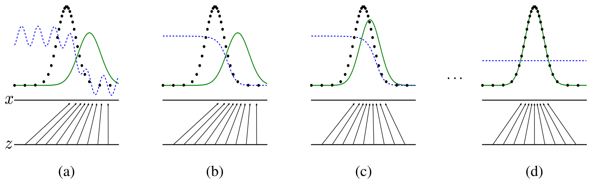
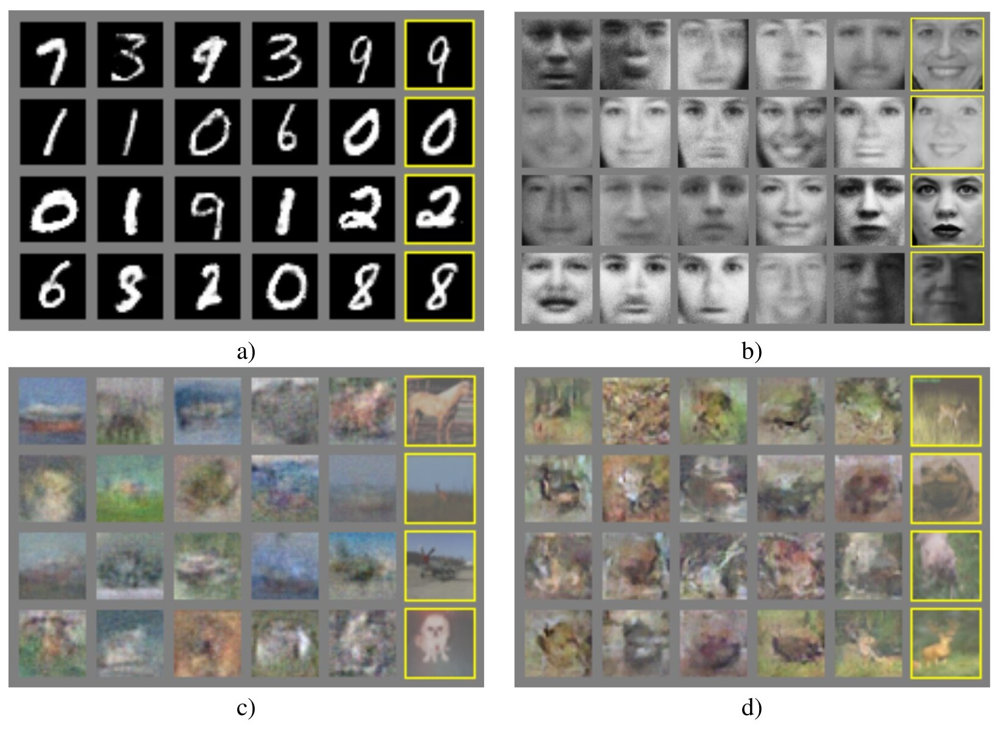
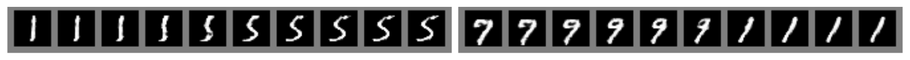

# 论文中文解读：《Generative Adversarial Nets》

> **基本信息**：Ian J. Goodfellow、Jean Pouget-Abadie、Mehdi Mirza、Bing Xu、David Warde-Farley、Sherjil Ozair、Aaron Courville、Yoshua Bengio（Université de Montréal，Département d'informatique et de recherche opérationnelle），arXiv:1406.2661（2014 年 6 月，本地 PDF 为 v1；该文一般引用为 NIPS 2014，本地 PDF 未标会议名）；论文原文 [官方页面](https://arxiv.org/abs/1406.2661)；作者在原文脚注中说明代码与超参数见 `http://www.github.com/goodfeli/adversarial`。
>
> **本文的读法**：本文按“动机 → 对抗框架与训练算法 → 理论（最优判别器、全局最优、收敛）→ 实验 → 优缺点 → 未来工作”的顺序，把原文逐项讲清楚。图均取自论文原文（从 PDF 按图裁出），表为逐格核对后的中文转录，数字与原文一致，每张图表后有中文翻译与读法，因此不必再翻英文版。原文公式编号（1）–（6）在本文中沿用。

## 一、一句话结论

深度生成模型难训练，是因为最大似然及相关方法里有许多难解的概率计算，也很难利用分段线性单元的好处。论文提出一个绕开这些困难的框架：同时训练两个模型，**生成器** $G$ 把随机噪声变成样本，**判别器** $D$ 估计一个样本来自训练数据而不是来自 $G$ 的概率；$G$ 的训练目标是让 $D$ 犯错。这是一个二人极小极大博弈。在任意函数空间里这个博弈有唯一解：$G$ 恢复训练数据分布，$D$ 处处等于 $1/2$。当 $G$ 与 $D$ 都是多层感知机（MLP）时，整个系统可以用反向传播训练，训练和生成样本时都不需要马尔可夫链或展开的近似推断网络。在 MNIST、TFD（Toronto Face Database）和 CIFAR-10 上，样本的定性和定量（Parzen 窗对数似然）评估显示了这个框架的潜力；作者明确说**不**声称样本优于已有方法。

## 二、背景与动机

### 2.1 为什么深度生成模型落后于判别模型（原文第 1 节，第 1 页）

深度学习的愿景是发现丰富的层次化模型，用来表示人工智能应用里遇到的数据（自然图像、含语音的音频波形、自然语言语料中的符号）上的概率分布。截至本文，深度学习最引人注目的成功都在**判别模型**上，通常是把高维、丰富的感官输入映射到类别标签；这些成功主要靠反向传播和 dropout，以及梯度性质特别好的分段线性单元。

深度生成模型影响较小，原因有二：

1. 最大似然估计及相关策略中会出现许多难解的概率计算，近似它们很困难；
2. 在生成模型的场景里难以利用分段线性单元的好处。

论文提出的新估计过程绕开了这两个困难。

### 2.2 对抗框架的直觉

在提出的对抗网络（adversarial nets）框架里，生成模型对抗一个“对手”：判别模型学习判断样本来自模型分布还是数据分布。原文用了一个类比：生成模型像一队**造假币者**，试图造出假币并在不被发现的情况下使用；判别模型像**警察**，试图识别假币。这场竞争推动双方不断改进，直到假币与真币无法区分。

这个框架可以对应许多种模型和优化算法。本文研究的特例是：生成模型把随机噪声输入一个 MLP 来产生样本，判别模型也是一个 MLP，称为对抗网络。此时两个模型都只用反向传播和 dropout 训练，从生成模型采样只需要前向传播，不需要近似推断，也不需要马尔可夫链。

### 2.3 相关工作与差别（原文第 2 节，第 2 页）

- **含隐变量的无向图模型**：受限玻尔兹曼机（RBM）、深度玻尔兹曼机（DBM）及其变体。模型里的相互作用表示为未归一化势函数的乘积，再除以对随机变量所有状态求和/积分得到的全局归一化量（配分函数）。除最平凡的情形外，配分函数及其梯度都难解，只能用 MCMC 估计；依赖 MCMC 的学习算法会遇到严重的混合（mixing）问题。
- **深度信念网络（DBN）**：含一个无向层和若干有向层的混合模型。虽然有快速的近似逐层训练准则，但同时背负无向与有向模型的计算困难。
- **不近似也不界定对数似然的准则**：score matching 与噪声对比估计（NCE）。二者都要求学到的概率密度在解析上可写成“只差一个归一化常数”的形式，而很多有多层隐变量的有趣模型（如 DBN、DBM）连未归一化的可解密度都写不出来。去噪自编码器和收缩自编码器的学习规则与把 score matching 用于 RBM 非常相似。NCE 和本文一样用判别式训练准则来拟合生成模型，但它不是拟合一个单独的判别模型，而是用生成模型自身去区分生成数据与来自**固定**噪声分布的样本；由于噪声分布固定，模型一旦在一小部分观测变量上学到近似正确的分布，学习就会急剧变慢。
- **不显式定义概率分布，而是训练一台“生成机器”去采样**：优点是机器可以设计成用反向传播训练。代表工作有生成随机网络（GSN），它推广了广义去噪自编码器，二者都可以看成定义一条参数化的马尔可夫链，即学习执行生成链一步转移的机器的参数。与 GSN 相比，对抗网络采样时不需要马尔可夫链；生成过程中没有反馈回路，所以更能利用分段线性单元（后者在反馈回路中会遇到激活无界的问题）。更近的例子还有 auto-encoding variational Bayes（即 [VAE](../vae/论文中文解读.md)）和 stochastic backpropagation。

## 三、方法：对抗网络

### 3.1 符号与模型（原文第 3 节，第 2 页）

对抗建模框架在两个模型都是 MLP 时最容易应用。

- 为了学习生成器在数据 $x$ 上的分布 $p_g$，先在输入噪声变量上定义先验 $p_z(z)$，再用 $G(z;\theta_g)$ 表示到数据空间的映射，其中 $G$ 是参数为 $\theta_g$ 的 MLP 所表示的可微函数。
- 再定义第二个 MLP $D(x;\theta_d)$，输出一个标量。$D(x)$ 表示 $x$ 来自数据而不是来自 $p_g$ 的概率。
- 生成器 $G$ 隐式地定义了概率分布 $p_g$：它就是 $z\sim p_z$ 时样本 $G(z)$ 的分布（原文第 4 节开头）。

### 3.2 极小极大博弈（式 1）

训练 $D$ 去最大化“给训练样本和 $G$ 的样本都标对标签”的概率；同时训练 $G$ 去最小化 $\log(1-D(G(z)))$。也就是说 $D$ 与 $G$ 在玩如下带价值函数 $V(G,D)$ 的二人极小极大博弈：

$$
\min_G\max_D V(D,G)=\mathbb E_{x\sim p_{\mathrm{data}}(x)}\big[\log D(x)\big]+\mathbb E_{z\sim p_z(z)}\big[\log\big(1-D(G(z))\big)\big].\qquad\text{(1)}
$$

**符号与读法**：

- 第一项是 $D$ 在**真实数据**上给出正确判断（判为真）的对数概率，$D(x)\to1$ 时最大；
- 第二项是 $D$ 在**生成样本**上给出正确判断（判为假）的对数概率，$D(G(z))\to0$ 时最大；
- $D$ 想让 $V$ 尽量大；$G$ 只出现在第二项里，想让 $V$ 尽量小，也就是让 $D$ 把假样本判成真。

原文在下一节从理论上说明，在 $G$ 和 $D$ 容量足够（非参数极限）时，这个训练准则可以恢复数据生成分布。

### 3.3 训练算法（原文 Algorithm 1，第 4 页）

实践中必须用迭代的数值方法来实现这个博弈。把 $D$ 在训练内循环里优化到收敛，计算上不可行，而且在有限数据集上会过拟合。所以改为**交替**：优化 $D$ 做 $k$ 步，再优化 $G$ 做 1 步。只要 $G$ 变化得足够慢，$D$ 就能一直保持在最优解附近。原文把这个策略类比为 SML/PCD（stochastic maximum likelihood / persistent contrastive divergence）训练：在相邻学习步骤之间保留马尔可夫链的样本，避免每次内循环都重新“烧入”（burn-in）一条链。

**Algorithm 1：生成对抗网络的小批量随机梯度下降训练**（译自原文）。判别器的步数 $k$ 是超参数，实验中用 $k=1$，是最省计算的选项。

```text
for 训练迭代 do
    for k 步 do
        • 从噪声先验 p_z(z) 中采样 m 个噪声样本 {z^(1), ..., z^(m)}
          （原文此处写作 p_g(z)，系笔误）
        • 从数据生成分布 p_data(x) 中采样 m 个样本 {x^(1), ..., x^(m)}
        • 沿随机梯度上升更新判别器：
              ∇_{θ_d} (1/m) Σ_{i=1}^{m} [ log D(x^(i)) + log(1 − D(G(z^(i)))) ]
    end for
    • 从噪声先验中采样 m 个噪声样本 {z^(1), ..., z^(m)}
    • 沿随机梯度下降更新生成器：
          ∇_{θ_g} (1/m) Σ_{i=1}^{m} log(1 − D(G(z^(i))))
end for
```

原文说明：基于梯度的更新可以用任何标准的基于梯度的学习规则，实验中用了动量（momentum）。

**逐行解释**：

1. 外循环每次迭代先做 $k$ 次 $D$ 的更新。每次更新都需要一个小批量的噪声样本（经 $G$ 变成假样本）和一个小批量的真实数据，二者各 $m$ 个。
2. $D$ 的更新是**梯度上升**，目标是式（1）的小批量估计，$G$ 在这一步里是固定的。
3. 之后抽新的噪声小批量，只更新 $G$：对 $\log(1-D(G(z)))$ 做**梯度下降**。梯度要穿过 $D$ 再回到 $G$，所以 $D$ 必须可微。
4. $D$ 的更新不会碰 $G$ 的参数 $\theta_g$，$G$ 的更新也不会碰 $\theta_d$。

### 3.4 实践中的非饱和（non-saturating）生成器目标

在实践中，式（1）可能没有给 $G$ 足够的梯度来学好。学习早期 $G$ 还很差，$D$ 能以很高的置信度拒绝生成样本，因为它们与训练数据明显不同。这时 $\log(1-D(G(z)))$ **饱和**。所以不去训练 $G$ 最小化 $\log(1-D(G(z)))$，而是训练 $G$ **最大化** $\log D(G(z))$。这个目标函数使 $G$ 与 $D$ 的动力学有**相同的不动点**，但在学习早期提供强得多的梯度。

**补充说明**（原文没有展开）：设 $D$ 的输出层是 sigmoid，$D=\sigma(a)$。当 $D$ 很确信样本是假的时 $a\to-\infty$，此时 $\partial\log(1-\sigma(a))/\partial a=-\sigma(a)\to0$，梯度消失；而 $\partial\log\sigma(a)/\partial a=1-\sigma(a)\to1$，梯度仍然很大。

**证据边界**：原文 Algorithm 1 写的是最小化 $\log(1-D(G(z)))$ 的形式，非饱和变体只在正文里提出，原文没有明确说明实验里使用了哪一种，也没有分析非饱和目标对应什么散度。

### 3.5 图 1：一维玩具例子里的训练动力学

为了让读者直观感受“为什么交替训练会把 $p_g$ 推向 $p_{\mathrm{data}}$”，原文给了一个一维示意图。



*图 1（原文 Figure 1，第 3 页）：生成对抗网络通过同时更新判别分布（$D$，蓝色虚线），使其能区分来自数据生成分布（黑色点线）的样本与来自生成分布 $p_g$（$G$，绿色实线）的样本。*

**图中文字翻译与读法**：

- **坐标与线条含义**：下面一条水平线是 $z$ 的采样域，这里 $z$ 是均匀采样；上面一条水平线是 $x$ 域的一部分。向上的箭头表示映射 $x=G(z)$ 如何把非均匀分布 $p_g$ 加在变换后的样本上：$G$ 在 $p_g$ 密度高的区域收缩（箭头密集），在密度低的区域扩张（箭头稀疏）。黑色点线是数据分布（图题里写作 $p_x$，即 $p_{\mathrm{data}}$），绿色实线是 $p_g$，蓝色虚线是判别器 $D$ 的输出。
- **(a)**：考虑一个接近收敛的对抗对：$p_g$ 与 $p_{\mathrm{data}}$ 相似，$D$ 是一个部分准确的分类器（蓝线在数据和生成样本重叠区域起伏不定）。
- **(b)**：在算法的内循环里训练 $D$ 去区分数据与样本，收敛到 $D^*(x)=\dfrac{p_{\mathrm{data}}(x)}{p_{\mathrm{data}}(x)+p_g(x)}$：蓝线在数据占优的左侧较高，在 $p_g$ 占优的右侧趋近于 0。
- **(c)**：更新 $G$ 之后，$D$ 的梯度引导 $G(z)$ 流向更可能被判为数据的区域：绿色曲线向黑色曲线靠拢。
- **(d)**：经过若干步训练，如果 $G$ 和 $D$ 容量足够，会到达双方都无法再改进的点，此时 $p_g=p_{\mathrm{data}}$，判别器无法区分两个分布，即 $D(x)=1/2$（蓝线变成水平线，绿线与黑点完全重合）。
- **读图结论**：这只是示意，说明 $D$ 的梯度如何把 $p_g$ 推向数据，但不构成证明。严格的结论在下一节。

## 四、理论结果（原文第 4 节，第 3–5 页）

这一节的结论是在**非参数**设定下得到的：用无限容量的模型，即在概率密度函数空间里研究收敛。论文先证明这个极小极大博弈在 $p_g=p_{\mathrm{data}}$ 处有全局最优（4.1 节），再证明 Algorithm 1 优化式（1），从而达到想要的结果（4.2 节）。

### 4.1 $p_g=p_{\mathrm{data}}$ 的全局最优性

**Proposition 1（最优判别器）**：固定 $G$，最优判别器是

$$
D_G^*(x)=\frac{p_{\mathrm{data}}(x)}{p_{\mathrm{data}}(x)+p_g(x)}.\qquad\text{(2)}
$$

**证明**：给定任意 $G$，判别器的训练准则是最大化 $V(G,D)$：

$$
V(G,D)=\int_x p_{\mathrm{data}}(x)\log D(x)\,dx+\int_z p_z(z)\log\big(1-D(G(z))\big)\,dz=\int_x\Big[p_{\mathrm{data}}(x)\log D(x)+p_g(x)\log\big(1-D(x)\big)\Big]dx.\qquad\text{(3)}
$$

第二个等号用到：$z\sim p_z$ 时 $G(z)$ 的分布就是 $p_g$，所以对 $z$ 的积分可以改成对 $x$、对 $p_g$ 的积分。对任意 $(a,b)\in\mathbb R^2\setminus\{(0,0)\}$，函数 $y\mapsto a\log y+b\log(1-y)$ 在 $[0,1]$ 上于 $y=\dfrac{a}{a+b}$ 处取最大值（对 $y$ 求导得 $a/y-b/(1-y)=0$）。判别器不需要在 $\mathrm{Supp}(p_{\mathrm{data}})\cup\mathrm{Supp}(p_g)$ 之外有定义。证毕。

**解释**：$D$ 的训练目标可以解释为最大化估计条件概率 $P(Y=y\mid x)$ 的对数似然，其中 $Y$ 指示 $x$ 来自 $p_{\mathrm{data}}$（$y=1$）还是来自 $p_g$（$y=0$）。这样，式（1）的极小极大博弈可以改写为只关于 $G$ 的“虚拟训练准则”：

$$
\begin{aligned}
C(G)&=\max_D V(G,D)\\
&=\mathbb E_{x\sim p_{\mathrm{data}}}\big[\log D_G^*(x)\big]+\mathbb E_{z\sim p_z}\big[\log\big(1-D_G^*(G(z))\big)\big]\\
&=\mathbb E_{x\sim p_{\mathrm{data}}}\big[\log D_G^*(x)\big]+\mathbb E_{x\sim p_g}\big[\log\big(1-D_G^*(x)\big)\big]\\
&=\mathbb E_{x\sim p_{\mathrm{data}}}\left[\log\frac{p_{\mathrm{data}}(x)}{p_{\mathrm{data}}(x)+p_g(x)}\right]+\mathbb E_{x\sim p_g}\left[\log\frac{p_g(x)}{p_{\mathrm{data}}(x)+p_g(x)}\right].
\end{aligned}\qquad\text{(4)}
$$

（原文最后一行分母里把一个 $p_{\mathrm{data}}$ 排成了大写 $P_{\mathrm{data}}$，是排版笔误。）

**Theorem 1**：虚拟训练准则 $C(G)$ 的全局最小值当且仅当 $p_g=p_{\mathrm{data}}$ 时达到，此时 $C(G)=-\log4$。

**证明思路**：

1. 若 $p_g=p_{\mathrm{data}}$，由式（2）有 $D_G^*(x)=1/2$，代入式（4）得 $C(G)=\log\frac12+\log\frac12=-\log4$。
2. 要说明这是最好的取值且只在 $p_g=p_{\mathrm{data}}$ 时达到，注意 $\mathbb E_{x\sim p_{\mathrm{data}}}[-\log2]+\mathbb E_{x\sim p_g}[-\log2]=-\log4$。用 $C(G)=V(D_G^*,G)$ 减去这个量，得到

$$
C(G)=-\log4+\mathrm{KL}\!\left(p_{\mathrm{data}}\,\Big\Vert\,\frac{p_{\mathrm{data}}+p_g}{2}\right)+\mathrm{KL}\!\left(p_g\,\Big\Vert\,\frac{p_{\mathrm{data}}+p_g}{2}\right).\qquad\text{(5)}
$$

（补充验证：$\log\frac{p_{\mathrm{data}}}{p_{\mathrm{data}}+p_g}=\log\frac{p_{\mathrm{data}}}{(p_{\mathrm{data}}+p_g)/2}-\log2$，对 $p_g$ 的那一项同理，两项的 $-\log 2$ 合起来正好是 $-\log4$。）其中 KL 是 Kullback–Leibler 散度。

3. 上式后两项之和正是模型分布与数据生成过程之间的 Jensen–Shannon 散度（JSD）的两倍：

$$
C(G)=-\log4+2\cdot\mathrm{JSD}\big(p_{\mathrm{data}}\,\Vert\,p_g\big).\qquad\text{(6)}
$$

两个分布之间的 JSD 总是非负，且只在两分布相等时为 0，所以 $C^*=-\log4$ 是 $C(G)$ 的全局最小值，唯一解是 $p_g=p_{\mathrm{data}}$，即生成模型完美复制了数据生成过程。

### 4.2 Algorithm 1 的收敛性

**Proposition 2**：若 $G$ 和 $D$ 容量足够，并且在 Algorithm 1 的每一步里判别器都被允许达到给定 $G$ 时的最优，而 $p_g$ 的更新是为了改进准则 $\mathbb E_{x\sim p_{\mathrm{data}}}[\log D_G^*(x)]+\mathbb E_{x\sim p_g}[\log(1-D_G^*(x))]$，那么 $p_g$ 收敛到 $p_{\mathrm{data}}$。

**证明思路**：把 $V(G,D)=U(p_g,D)$ 看成 $p_g$ 的函数。$U(p_g,D)$ 关于 $p_g$ 是凸的（式（3）对 $p_g$ 其实是线性的）。凸函数的上确界的次导数包含取到最大值处那个函数的导数，也就是说，若 $f(x)=\sup_{\alpha\in\mathcal A}f_\alpha(x)$ 且每个 $f_\alpha$ 关于 $x$ 凸，则当 $\beta=\arg\sup_\alpha f_\alpha(x)$ 时 $\partial f_\beta(x)\in\partial f$。这等价于在对应的最优 $D$ 处对 $p_g$ 做一次梯度下降更新。$\sup_D U(p_g,D)$ 关于 $p_g$ 是凸的，并且由 Theorem 1 它有唯一全局最优，因此只要对 $p_g$ 的更新足够小，$p_g$ 就收敛到 $p_{\mathrm{data}}$。（原文最后写作 $p_x$，是笔误。）

### 4.3 理论与实践的差距

原文自己说明：实践中，对抗网络通过函数 $G(z;\theta_g)$ 表示的是 $p_g$ 的一个**有限**分布族，优化的是 $\theta_g$ 而不是 $p_g$ 本身。用 MLP 定义 $G$ 会在参数空间里引入多个临界点。然而 MLP 在实践中的出色表现表明，尽管缺少理论保证，它们仍是合理的模型选择。

所以上面三个结论（最优 $D$、全局最优、收敛）描述的是理想函数空间里的行为：$D$ 每步达到最优、$G$ 直接改变 $p_g$。真实训练里 $k=1$、有限容量、小批量噪声，**没有**全局收敛保证。

## 五、实验（原文第 5 节，第 5–7 页）

### 5.1 数据集与网络设置

下表整理自原文第 5 节与 Algorithm 1 的说明（非原文表格）：

| 项目 | 设置 |
|---|---|
| 数据集 | MNIST、Toronto Face Database（TFD）、CIFAR-10 |
| 生成器 | 激活函数为 rectifier linear（ReLU）与 sigmoid 的混合；噪声只作为生成器**最底层**的输入（理论框架允许在生成器中间层加 dropout 等噪声，但实验没有用） |
| 判别器 | maxout 激活函数；训练判别器时使用 dropout |
| 训练 | 交替更新，$k=1$；梯度更新用动量 |
| CIFAR-10 的两种模型 | 全连接模型；卷积判别器 + “反卷积”生成器（图 2 c、d） |
| 评估方式 | 对生成样本拟合高斯 Parzen 窗，报告测试集在该分布下的对数似然（见 5.2） |

原文没有在正文中给出层数、隐层宽度、学习率等超参数，只说明代码与超参数在其公开的代码库中。

### 5.2 评估方法：高斯 Parzen 窗

生成器没有显式密度，无法直接算测试数据的似然。论文的做法是：用 $G$ 生成的样本拟合一个**高斯 Parzen 窗**（核密度估计），再报告测试集数据在这个分布下的对数似然；高斯的 $\sigma$ 参数通过在验证集上交叉验证得到。这个流程由 Breuleux 等人引入，并被用于多种确切似然难解的生成模型。

**补充说明**（原文只说“拟合高斯 Parzen 窗”）：若用 $n$ 个生成样本 $\{G(z_i)\}$，该窗口的密度是 $\hat p(x)=\frac1n\sum_{i=1}^n\mathcal N\big(x;G(z_i),\sigma^2I\big)$，评分即 $\hat p$ 在测试样本上的平均对数值。

**作者自己指出的局限**：这种估计似然的方法方差较高，在高维空间表现不好，但它是作者所知可用的最好方法；能采样而不能直接估计似然的生成模型的进展，促使人们进一步研究如何评估这类模型。

### 5.3 主结果：Parzen 窗对数似然（表 1）

下表给出各模型在 MNIST 与 TFD 上用 Parzen 窗估计的对数似然（越大越好）。MNIST 上的数字是测试集样本的平均对数似然，标准误是在样本上算的均值标准误；TFD 上的标准误是在数据集的各个 fold 之间计算的，每个 fold 用其验证集选不同的 $\sigma$。MNIST 上与其他模型比较时用的是数据集的实值版本（而不是二值版本）。

| 模型 | MNIST | TFD |
|---|---:|---:|
| DBN | 138 ± 2 | 1909 ± 66 |
| Stacked CAE | 121 ± 1.6 | **2110 ± 50** |
| Deep GSN | 214 ± 1.1 | 1890 ± 29 |
| Adversarial nets（对抗网络） | **225 ± 2** | **2057 ± 26** |

（原文表 1，第 6 页。粗体沿用原文：MNIST 上对抗网络最高；TFD 上 Stacked CAE 与对抗网络都加粗。）

**读法**：

- MNIST 上对抗网络的估计值最高（225 ± 2），其后是 Deep GSN（214 ± 1.1），DBN 与 Stacked CAE 低得多。
- TFD 上 Stacked CAE（2110 ± 50）的数字比对抗网络（2057 ± 26）更高，两者误差范围重叠，原文把二者同时加粗，不能说对抗网络在 TFD 上最好。
- 不同数据集的数值（约 200 与约 2000）因维度和数据不同而不可比；这张表只能说明对抗网络在这个（本身有高方差、高维下表现差的）指标上“有竞争力”。

### 5.4 样本可视化（图 2）

正文说明：作者**不**声称这些样本比现有方法生成的更好，但认为它们至少与文献中较好的生成模型相当，突显了对抗框架的潜力。



*图 2（原文 Figure 2，第 6 页）：模型样本的可视化。a) MNIST；b) TFD；c) CIFAR-10（全连接模型）；d) CIFAR-10（卷积判别器和“反卷积”生成器）。*

**图中文字翻译与读法**：

- **最右一列（黄色框）**：与它左边相邻生成样本最接近的训练样本（最近邻），用来说明模型没有记住训练集。
- **采样方式**（原文图题）：样本是公平的随机抽取，**不是**挑出来的最好看的样本（not cherry-picked）。与多数其他深度生成模型的可视化不同，这些图像展示的是模型分布的**实际样本**，而不是给定隐单元样本时的条件均值。并且由于采样过程不依赖马尔可夫链混合，这些样本之间是不相关的。
- **a) MNIST**：生成的数字笔画清晰，是明显可辨的手写数字；它们与右侧的最近邻训练样本相似，但不是同一张图。
- **b) TFD**：生成的人脸，表情和光照各异，但部分较模糊、有噪点。
- **c) CIFAR-10（全连接）**：图像模糊、有明显颗粒噪声，大多只能看出色块与纹理，难辨具体物体。
- **d) CIFAR-10（卷积）**：比 c) 结构感更强，有动物和草地背景一类的纹理与色块，但同样难以识别具体物体。
- **读图结论**：这些是“生成样本不是训练集拷贝”的定性证据，也是该论文在 2014 年的实际质量水平：MNIST 与 TFD 较好，CIFAR-10 仍然很粗糙。上面对 b)、c)、d) 样本质量的描述是从图上读出的主观判断，原文没有给出对应的定量评价。

### 5.5 隐空间插值（图 3）



*图 3（原文 Figure 3，第 7 页）：在完整模型的 $z$ 空间里，对坐标做线性插值得到的数字。*

**读法**：两条各 10 张的序列。从图上读出：左边一条由数字 1 逐渐过渡到 5，右边一条由 7 过渡到 9 再到 1。相邻 $z$ 给出相似的数字，说明生成器学到的映射在 $z$ 空间里是连续的，而不是只记住了若干孤立点；中间帧会出现笔画变形的过渡形状。这只是定性证据，原文也没有逐张说明每条序列的端点。

## 六、优缺点（原文第 6 节，第 7 页）

原文把对抗网络与以前建模框架的比较总结为表 2。下表逐格转录并翻译：

| 操作 | 深度有向图模型（Deep directed graphical models） | 深度无向图模型（Deep undirected graphical models） | 生成式自编码器（Generative autoencoders） | 对抗模型（Adversarial models） |
|---|---|---|---|---|
| 训练 | 训练时需要推断 | 训练时需要推断；需要 MCMC 来近似配分函数的梯度 | 在混合（mixing）与重构生成能力之间被迫折中 | 让判别器与生成器同步；Helvetica |
| 推断 | 学习得到的近似推断 | 变分推断 | 基于 MCMC 的推断 | 学习得到的近似推断 |
| 采样 | 没有困难 | 需要马尔可夫链 | 需要马尔可夫链 | 没有困难 |
| 评估 $p(x)$ | 不可解，可用 AIS 近似 | 不可解，可用 AIS 近似 | 没有显式表示，可用 Parzen 密度估计近似 | 没有显式表示，可用 Parzen 密度估计近似 |
| 模型设计 | 几乎所有模型都极难处理 | 需要谨慎设计以保证多个性质 | 理论上允许任何可微函数 | 理论上允许任何可微函数 |

（原文表 2，第 7 页，标题为“生成建模中的挑战：不同深度生成建模方法在涉及模型的各主要操作上遇到的困难总结”。原文没有展开 AIS 这个缩写，它通常指 annealed importance sampling；表中“Helvetica”指下面的 Helvetica 情形。）

**缺点**：

1. 没有 $p_g(x)$ 的显式表示；
2. 训练时 $D$ 必须与 $G$ 很好地**同步**：特别是不能在不更新 $D$ 的情况下把 $G$ 训练得太多，以避免“Helvetica 情形”，即 $G$ 把太多的 $z$ 值坍缩到同一个 $x$ 值，从而没有足够的多样性来建模 $p_{\mathrm{data}}$。这与玻尔兹曼机的负链必须在学习步之间保持更新类似。（原文用的是 “the Helvetica scenario” 这个说法；这就是后来常说的 mode collapse，原文没有使用这个词。）

**优点**：

1. 不需要马尔可夫链；
2. 只用反向传播获得梯度；
3. 学习过程中不需要推断；
4. 模型里可以包含很多种函数。

以上优点主要是**计算上**的。对抗模型还可能获得一些**统计上**的优势：生成器网络不是直接用数据样本更新的，而只通过流过判别器的梯度更新，这意味着输入的成分不会被直接拷贝进生成器的参数。另一个优势是对抗网络可以表示非常尖锐、甚至退化的分布，而基于马尔可夫链的方法需要分布有些模糊，链才能在模式之间混合。

## 七、结论与未来工作（原文第 7 节，第 7–8 页）

这个框架允许许多直接的扩展：

1. **条件生成模型** $p(x\mid c)$：把 $c$ 作为输入同时加到 $G$ 和 $D$ 上；
2. **学习得到的近似推断**：训练一个辅助网络，由 $x$ 预测 $z$。这与 wake-sleep 算法训练的推断网络类似，优势是推断网络可以在生成器训练完成之后、针对固定的生成器网络来训练；
3. 通过训练一族共享参数的条件模型，近似地建模所有条件分布 $p(x_S\mid x_{\not S})$（$S$ 是 $x$ 的下标子集）。本质上可用对抗网络实现确定性的 MP-DBM 的随机扩展；
4. **半监督学习**：来自判别器或推断网络的特征可以在有标签数据有限时提升分类器性能；
5. **效率改进**：通过设计更好的协调 $G$ 与 $D$ 的方法，或在训练中确定更好的 $z$ 采样分布，可以大大加速训练。

论文最后说，这篇文章展示了对抗建模框架的可行性，这些研究方向可能会有用。

## 八、证据边界与常见误读

- **全局最优定理不等于训练保证到达该点**：Proposition 1、Theorem 1、Proposition 2 都是在无限容量、每步 $D$ 达到最优的理想设定下成立；真实训练用有限网络和 $k=1$，原文自己承认没有理论保证。
- **损失值不是质量指标**：均衡处的理论值 $C=-\log4$ 对应 $D\equiv1/2$；实际训练中 $D$ 与 $G$ 的损失会随对手变化，不能像普通单目标训练那样看总 loss 下降。需要同时看 $D(x)$、$D(G(z))$、样本多样性和最近邻检查。
- **Algorithm 1 与实践目标的差别**：算法写的是最小化 $\log(1-D(G(z)))$，正文建议实践中最大化 $\log D(G(z))$；两者不是同一个目标，只是有相同的理想不动点。
- **论文没有声称样本更好**：原文明确说不声称样本优于已有方法，只说“至少有竞争力”。TFD 上 Stacked CAE 的 Parzen 估计甚至更高。
- **Parzen 窗似然不可靠**：高方差、在高维空间表现差（作者自己的说明），不能当作今天 FID 等指标那样的可信度。
- **漂亮样本不排除多样性不足**：图 2 的最近邻只能排除“逐像素记忆”，不能排除 Helvetica 情形（只生成很少几种样本）；原文没有对多样性做定量评估。
- 条件 GAN、DCGAN、Wasserstein 距离、谱归一化、StyleGAN 等都是后续工作，本文奠定的是用对抗训练学习隐式分布的原则。

## 九、复现检查清单

- 明确生成器目标用的是 minimax（最小化 $\log(1-D(G(z)))$）还是 non-saturating（最大化 $\log D(G(z))$）。
- 判别器每次更新用真实小批量与生成小批量各 $m$ 个；$k$ 步判别器更新后做 1 步生成器更新；论文设置 $k=1$、带动量。
- 判别器输出概率（sigmoid）；检查生成器梯度是否经过判别器、是否在早期饱和。
- 同时记录 $D(x)$、$D(G(z))$（理想均衡时都趋近 $1/2$）、生成样本多样性与最近邻。
- 评估如果用 Parzen 窗：$\sigma$ 在验证集上交叉验证；报告标准误；不要与二值版本 MNIST 上的结果混比。
- 诊断模式坍缩时按博弈动力学处理（$D$ 与 $G$ 的同步、容量、学习率），而不是按普通单目标过拟合处理。

## 十、与相关论文的关系

- [VAE](../vae/论文中文解读.md)：同时期的另一条生成建模路线，显式似然下界 + 编码器；GAN 不写出似然，没有编码器。表 2 把 GAN 与“深度有向图模型”等方法做了对比。
- [DDPM](../ddpm/论文中文解读.md)：用逐步去噪的方式训练生成模型，不需要对抗训练。
- [Latent Diffusion](../latent_diffusion/论文中文解读.md)：在其自编码器的训练中还用到了对抗（patch-based discriminator）损失，是 GAN 思想的后续应用。

## 原文证据导航

- [原论文 PDF](paper.pdf)
- [原文提取文本](paper.txt)
- [论文概要](论文概要.md)
- 关键位置（PDF 页码）：引言在第 1 页；相关工作与对抗网络定义在第 2 页；式（1）、图 1 在第 3 页；Algorithm 1、Proposition 1 与式（2）–（4）在第 4 页；Theorem 1、式（5）（6）、Proposition 2、实验设置在第 5 页；表 1、图 2 在第 6 页；图 3、表 2、优缺点、结论在第 7 页；未来工作后半部分在第 8 页。
