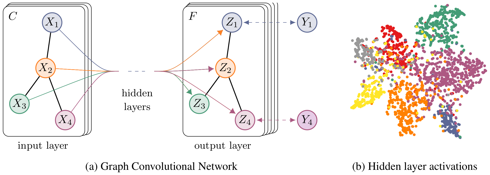
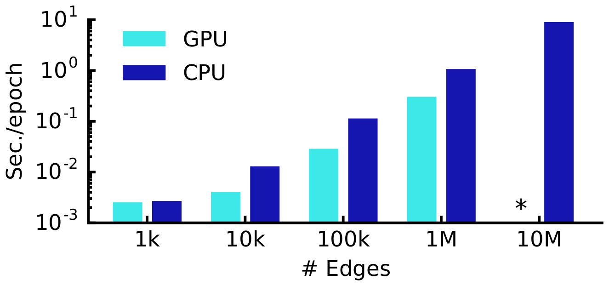
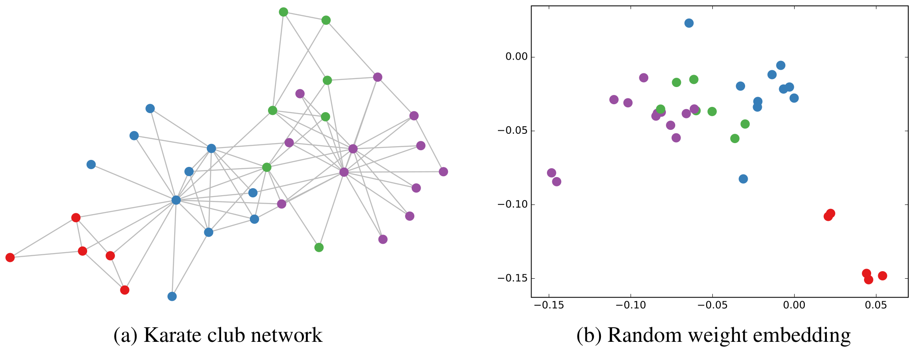
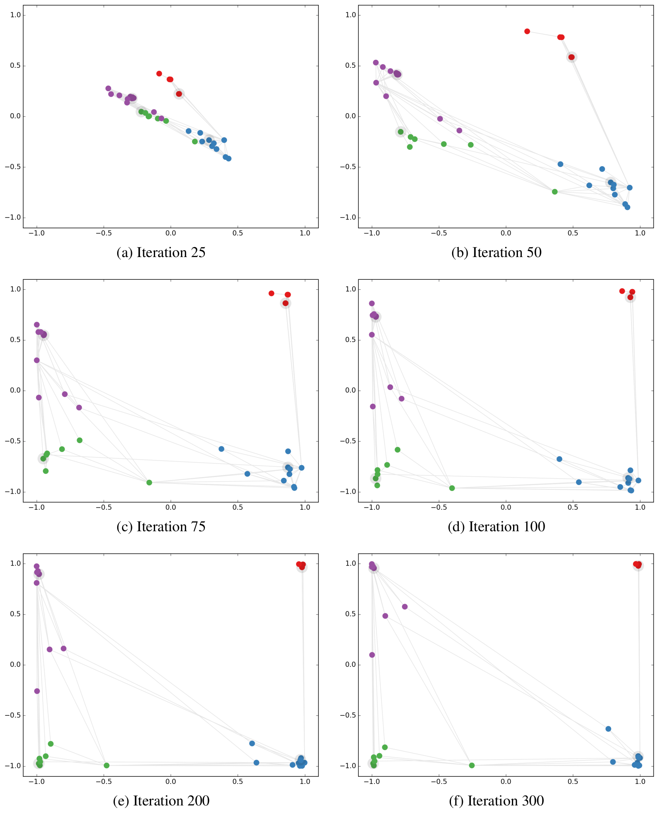
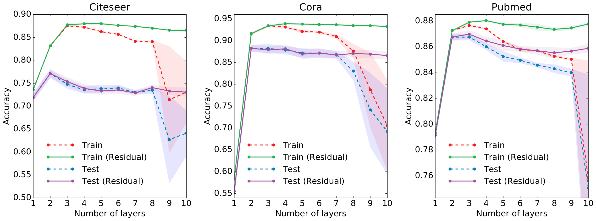

# 论文中文解读：《Semi-Supervised Classification with Graph Convolutional Networks》

> **基本信息**：Thomas N. Kipf、Max Welling（阿姆斯特丹大学；Welling 同时隶属 CIFAR），发表于 ICLR 2017，arXiv:1609.02907（本文依据 v4，2017 年 2 月 22 日）；论文原文 [官方页面](https://arxiv.org/abs/1609.02907)；官方代码 github.com/tkipf/gcn（原文脚注 2，TensorFlow 实现）。
>
> **本文的读法**：图为从论文 PDF 中按图裁出的原图，表为逐格核对后的中文转录（数字、方法名、数据集名保持原样，表头译成中文）；从图上读出的近似数值都标了“约”。每张图后有中文图题、图中文字翻译和读图结论，因此不必再翻英文原文。标明“本文补充”“本文推算”的内容（谱半径推导、小数值例子、参数量等）是为帮助理解自行算出的，原文没有直接写出。附录里的 Weisfeiler-Lehman 解释、空手道俱乐部可视化和模型深度实验也并入对应章节。

## 一、一句话结论

论文研究**图上的半监督节点分类**：图（例如论文引用网络）里只有很少一部分节点带标签，要预测其余节点的类别。以往的做法要么在损失里加图拉普拉斯正则项（隐含“相连的节点标签相近”的假设），要么先用随机游走学节点嵌入、再另训分类器（多步流程）。作者让神经网络 $f(X,A)$ **直接以节点特征矩阵 $X$ 和邻接矩阵 $A$ 为输入**，只在有标签的节点上计算监督损失；网络层间的传播规则是

$$
H^{(l+1)}=\sigma\!\Big(\hat A\,H^{(l)}W^{(l)}\Big),\qquad
\hat A=\tilde D^{-1/2}\tilde A\,\tilde D^{-1/2},\quad
\tilde A=A+I_N,\quad
\tilde D_{ii}=\sum_j\tilde A_{ij}.
$$

这条规则由“谱图卷积的局部一阶（切比雪夫）近似”再加一个“重归一化技巧”得到：每一层让每个节点把自己和一跳邻居的特征按度数归一化后加权求和，再乘一个所有节点共享的权重矩阵。

两层 GCN 在 Citeseer、Cora、Pubmed、NELL 上的测试准确率分别为 70.3%、81.5%、79.0%、66.0%（表 2，固定划分下 100 次随机初始化的平均），都高于表中全部基线；每个 epoch 的计算量与边数成线性关系。需要记住的边界：实验是 transductive（训练时整张图和全部节点的特征都可见）、数据划分固定、网络浅（2–3 层最好）、图是无向的，而且表 2 中大多数基线数字取自他人论文。

## 二、问题、背景与前置知识

### 2.1 问题设定

- 图 $\mathcal{G}=(\mathcal{V},\mathcal{E})$ 有 $N$ 个节点 $v_i$、边 $(v_i,v_j)\in\mathcal{E}$；邻接矩阵 $A\in\mathbb{R}^{N\times N}$（二值或带权）；度矩阵 $D$ 是对角矩阵，$D_{ii}=\sum_jA_{ij}$。
- 每个节点有一个 $C$ 维特征向量（例如文档的词袋向量），拼成 $X\in\mathbb{R}^{N\times C}$。
- 只有一小部分节点（下标集合记为 $\mathcal{Y}_L$）有类别标签；目标是预测其余节点的类别。这被称为**基于图的半监督学习**：训练时用到全部节点的特征和全部的边，但只用很少的标签。

### 2.2 以往的做法：图拉普拉斯正则化（原文式 1）

$$
\mathcal{L}=\mathcal{L}_0+\lambda\,\mathcal{L}_{\mathrm{reg}},\qquad
\mathcal{L}_{\mathrm{reg}}=\sum_{i,j}A_{ij}\,\lVert f(X_i)-f(X_j)\rVert^2=f(X)^{\top}\Delta f(X).
$$

$\mathcal{L}_0$ 是有标签部分上的监督损失，$f(\cdot)$ 可以是可微函数（例如神经网络），$\lambda$ 是权重，$\Delta=D-A$ 是未归一化的图拉普拉斯。这个形式依赖一个假设：**相连的节点很可能有相同的标签**。作者指出这会限制建模能力，因为图的边不一定只表示“相似”，还可能带有别的信息。

（本文核对：对全部有序对 $(i,j)$ 求和时，$\sum_{i,j}A_{ij}\lVert f_i-f_j\rVert^2=2f^{\top}\Delta f$，比原式多一个常数因子 2；不影响含义，这里照录原文。）

### 2.3 本文的出发点

不再在损失里加显式的图正则项，而是用神经网络 $f(X,A)$ 直接编码图结构，并在所有有标签节点上训练监督损失 $\mathcal{L}_0$。让 $f(\cdot)$ 以邻接矩阵为条件，监督损失的梯度就能通过边传到相邻的无标签节点的表示上，模型因此能同时学习有标签和无标签节点的表示。论文的两点贡献：（1）给出一个简单、表现良好的、直接作用在图上的层间传播规则，并说明它如何由谱图卷积的一阶近似推出；（2）展示这种图神经网络可以用于快速、可扩展的半监督节点分类，在精度和效率（以墙钟时间计）上都优于当时最好的半监督方法。

### 2.4 读本文需要的前置知识

以下是通用背景（论文只给出符号，没有展开）：

- **图拉普拉斯**：未归一化的 $\Delta=D-A$；归一化的 $L=I_N-D^{-1/2}AD^{-1/2}$。对每个节点上的标量信号 $f$，有 $f^{\top}\Delta f=\tfrac12\sum_{i,j}A_{ij}(f_i-f_j)^2\ge0$，它衡量信号沿边的“起伏”程度，所以拉普拉斯正则项会惩罚相连节点之间的差异。$L$ 对称半正定，可分解为 $L=U\Lambda U^{\top}$，$\Lambda$ 是特征值对角阵（都在 $[0,2]$ 内），$U$ 的各列是特征向量。
- **图傅里叶变换**：信号 $x\in\mathbb{R}^N$（每个节点一个标量）的图傅里叶变换是 $U^{\top}x$，即把 $x$ 投影到特征向量上。特征值小的分量对应沿边变化缓慢（“低频”）的模式，特征值大的对应变化剧烈（“高频”）的模式。
- **谱滤波**：在傅里叶域里对每个频率分量乘一个系数，再变换回来，就得到滤波后的信号。类比卷积神经网络里“时域卷积等于频域相乘”。
- **多项式滤波**：如果滤波函数是拉普拉斯的多项式，则无需特征分解，直接对矩阵 $L$ 做乘法即可，并且只涉及有限跳数的邻居（见 3.2 节）。
- **transductive**：待预测的无标签节点在训练阶段就已经存在于图中，它们的特征和连边都参与前向传播，只是它们的标签不参与损失。与之相对的 inductive 设定是在训练时没见过的新节点或新图上做预测，本文的主实验不是这种设定。

## 三、方法：从谱卷积到 GCN 层

### 3.1 谱图卷积（原文 2.1 节）

对节点上的标量信号 $x\in\mathbb{R}^N$，用在傅里叶域里参数化的滤波器 $g_\theta=\mathrm{diag}(\theta)$（$\theta\in\mathbb{R}^N$）做谱卷积：

$$
g_\theta\star x=U\,g_\theta\,U^{\top}x,
$$

其中 $U$ 是归一化拉普拉斯 $L=I_N-D^{-1/2}AD^{-1/2}=U\Lambda U^{\top}$ 的特征向量矩阵，$U^{\top}x$ 是 $x$ 的图傅里叶变换，$g_\theta$ 可以看成特征值的函数 $g_\theta(\Lambda)$。直接计算代价太高：乘以特征向量矩阵 $U$ 是 $\mathcal{O}(N^2)$，对大图做特征分解本身也可能贵得不可行。

### 3.2 切比雪夫多项式近似（原文式 4、5）

Hammond 等人（2011）提出用截断到 $K$ 阶的切比雪夫多项式 $T_k$ 来近似 $g_\theta(\Lambda)$：

$$
g_{\theta'}(\Lambda)\approx\sum_{k=0}^{K}\theta'_k\,T_k(\tilde\Lambda),\qquad
\tilde\Lambda=\frac{2}{\lambda_{\max}}\Lambda-I_N,
$$

$\lambda_{\max}$ 是 $L$ 的最大特征值，$\theta'\in\mathbb{R}^{K}$ 是切比雪夫系数（原文这样写，实际系数个数为 $K+1$）。切比雪夫多项式递推定义为 $T_k(x)=2xT_{k-1}(x)-T_{k-2}(x)$，$T_0(x)=1$，$T_1(x)=x$。

回到信号 $x$ 与滤波器的卷积，利用 $(U\Lambda U^{\top})^k=U\Lambda^kU^{\top}$（多项式作用在对角阵上再乘回 $U$，等价于直接作用在 $L$ 上），得到

$$
g_{\theta'}\star x\approx\sum_{k=0}^{K}\theta'_k\,T_k(\tilde L)\,x,\qquad
\tilde L=\frac{2}{\lambda_{\max}}L-I_N.
$$

这个表达式是 **$K$ 局部**的：它是拉普拉斯的 $K$ 次多项式，而拉普拉斯只在对角线和有边的位置非零，所以输出只依赖到中心节点至多 $K$ 步的节点（$K$ 阶邻域）；用稀疏矩阵与向量连乘来算，复杂度是 $\mathcal{O}(\lvert\mathcal{E}\rvert)$，与边数成线性。Defferrard 等人（2016）就是用这种 $K$ 局部卷积定义了图上的卷积神经网络。

### 3.3 层式线性模型（原文 2.2 节）

可以把上面形式的卷积层堆叠起来，每层之后接逐点非线性，就得到基于图卷积的神经网络。现在把每层的卷积限制为 **$K=1$**，也就是对 $L$ 的线性函数。这样仍能通过堆叠多层恢复丰富的滤波函数族，而不再受切比雪夫多项式那种显式参数化的限制。作者的直觉是：这样的模型可以缓解在节点度分布很宽的图（社交网络、引文网络、知识图谱等许多真实图）上对局部邻域结构过拟合的问题；并且在固定的计算预算下，这种逐层线性的形式能搭更深的模型，而加深在许多领域被证明能提高建模能力（引用 ResNet）。

再取 $\lambda_{\max}\approx2$（原文：可以预期神经网络的参数会在训练中适应这种尺度变化）。此时 $\tilde L=L-I_N=-D^{-1/2}AD^{-1/2}$，$T_0(\tilde L)=I_N$，$T_1(\tilde L)=\tilde L$，式 (5) 化简为

$$
g_{\theta'}\star x\approx\theta'_0\,x+\theta'_1\,(L-I_N)\,x=\theta'_0\,x-\theta'_1\,D^{-1/2}AD^{-1/2}\,x,
$$

有两个自由参数 $\theta'_0$ 和 $\theta'_1$，滤波器参数可以在整个图上共享。连续应用 $k$ 次这样的滤波，等效于对节点的 $k$ 阶邻域做卷积，$k$ 是网络里连续滤波的次数（即卷积层数）。

实际中，进一步限制参数个数有助于抑制过拟合，并减少每层的运算（如矩阵乘法）。令单个参数 $\theta=\theta'_0=-\theta'_1$，得到

$$
g_\theta\star x\approx\theta\Big(I_N+D^{-1/2}AD^{-1/2}\Big)x.
$$

### 3.4 重归一化技巧（原文式 7 之后）

上面的算子 $I_N+D^{-1/2}AD^{-1/2}$ 的特征值落在 $[0,2]$ 内。把它反复作用（深层网络里每层一次），会造成数值不稳定，并带来梯度爆炸/消失。为缓解这一问题，作者引入**重归一化技巧**（renormalization trick）：

$$
I_N+D^{-1/2}AD^{-1/2}\ \longrightarrow\ \tilde D^{-1/2}\tilde A\,\tilde D^{-1/2},\qquad
\tilde A=A+I_N,\quad\tilde D_{ii}=\sum_j\tilde A_{ij}.
$$

也就是：先给每个节点加一条自环，再用**加了自环之后**的度矩阵 $\tilde D$ 重新做对称归一化（这就是“重”归一化的含义）。

**本文补充：为什么这样更稳定。** 原文只写了“有数值不稳定和梯度爆炸/消失的风险”，没有给出推导。下面是一个简短的论证（本文补充，原文没有）。设 $A$ 无自环，则 $\tilde D-\tilde A=D-A=\Delta$，于是

- $I-\hat A=\tilde D^{-1/2}\,\Delta\,\tilde D^{-1/2}\succeq0$，所以 $\hat A$ 的特征值都不超过 1；
- $I+\hat A=\tilde D^{-1/2}\,(D+A+2I)\,\tilde D^{-1/2}\succ0$（因为 $D+A$ 半正定：$x^{\top}(D+A)x=\tfrac12\sum_{i,j}A_{ij}(x_i+x_j)^2\ge0$），所以 $\hat A$ 的特征值都大于 $-1$。

因此 $\hat A$ 的谱落在 $(-1,1]$ 内，$\hat A^{k}$ 的谱范数恒为 1；而 $I_N+D^{-1/2}AD^{-1/2}=2I-L$ 总有特征值 2（$L$ 总有特征值 0），它的 $k$ 次幂谱范数恰是 $2^k$。

**本文补充：一个 4 节点的数值例子。** 取图 1(a) 里画的那张小图：节点 $X_2$ 与 $X_1,X_3,X_4$ 各有一条边，其余无边。度数为 $(1,3,1,1)$，加自环后 $\tilde D=\mathrm{diag}(2,4,2,2)$，

$$
\hat A=\begin{pmatrix}
0.5&0.354&0&0\\
0.354&0.25&0.354&0.354\\
0&0.354&0.5&0\\
0&0.354&0&0.5
\end{pmatrix},\qquad 0.354=\frac{1}{\sqrt8}.
$$

- 各行之和约为 0.854、1.311、0.854、0.854，不等于 1，所以 $\hat A$ 的作用**不是“邻居平均”**；
- 中心节点 $X_2$ 对每个邻居的权重（0.354）小于叶子节点对自己的权重（0.5）：度数大的节点的贡献被按 $1/\sqrt{\tilde d_i\tilde d_j}$ 压低；
- 若各节点的标量特征为 $(1,2,3,4)$，则 $\hat A$ 作用后得 $(1.207,\,3.328,\,2.207,\,2.707)$，例如第 1 个节点为 $0.5\times1+0.354\times2$；
- 谱：$I+D^{-1/2}AD^{-1/2}$ 的特征值为 $\{0,1,1,2\}$，$\hat A$ 的特征值为 $\{-0.25,0.5,0.5,1\}$；把这两个算子各作用 $k=1,2,5,10$ 次，前者的谱范数为 2、4、32、1024，后者始终为 1。

### 3.5 推广到多通道与完整的传播规则（原文式 8、式 2）

把单通道信号推广到 $X\in\mathbb{R}^{N\times C}$（每个节点 $C$ 个输入通道）和 $F$ 个滤波器（特征图）：

$$
Z=\tilde D^{-1/2}\tilde A\,\tilde D^{-1/2}X\,\Theta,
$$

$\Theta\in\mathbb{R}^{C\times F}$ 是滤波器参数矩阵，$Z\in\mathbb{R}^{N\times F}$ 是卷积后的信号矩阵。这个滤波操作的复杂度是 $\mathcal{O}(\lvert\mathcal{E}\rvert FC)$，因为 $\tilde AX$ 可以高效地实现为稀疏矩阵与稠密矩阵的乘积。

把它堆成多层，就是论文开头的层间传播规则（原文式 2）：

$$
H^{(l+1)}=\sigma\!\Big(\tilde D^{-1/2}\tilde A\,\tilde D^{-1/2}H^{(l)}W^{(l)}\Big),\qquad H^{(0)}=X.
$$

这里 $W^{(l)}$ 是第 $l$ 层可训练的权重矩阵，$\sigma(\cdot)$ 是激活函数（如 $\mathrm{ReLU}(\cdot)=\max(0,\cdot)$），$H^{(l)}\in\mathbb{R}^{N\times D}$ 是第 $l$ 层的激活矩阵（原文这里的 $D$ 指特征维数，与度矩阵 $D$ 同名，注意区分）。

写成逐节点的形式更直观（本文整理，对应原文附录 A 的向量形式）：设 $h_i^{(l)}$ 是节点 $i$ 在第 $l$ 层的行向量，$\tilde d_i=\tilde D_{ii}$，则

$$
h_i^{(l+1)}=\sigma\!\Big(\sum_{j\in\mathcal{N}(i)\cup\{i\}}\frac{1}{\sqrt{\tilde d_i\,\tilde d_j}}\;h_j^{(l)}\,W^{(l)}\Big).
$$

即每个节点把自己和所有邻居的特征按 $1/\sqrt{\tilde d_i\tilde d_j}$ 加权求和，再经过**所有节点共享**的线性变换和非线性。与 Duvenaud 等人（2015）需要为每种节点度数学一个权重矩阵不同，这里每层只有一个权重矩阵，节点度数的差异靠对邻接矩阵的归一化来处理。

### 3.6 与 Weisfeiler-Lehman 算法的联系（原文附录 A）

原文脚注 1 和附录 A 给出传播规则的另一种解释。**WL-1 算法**（1 维 Weisfeiler-Lehman，用于给图的节点唯一地分配“颜色”标签）是：给定初始节点着色 $(h_1^{(0)},\dots,h_N^{(0)})$，反复对每个节点做 $h_i^{(t+1)}\leftarrow\mathrm{hash}\big(\sum_{j\in\mathcal{N}_i}h_j^{(t)}\big)$，直到着色稳定。其中 $\mathcal{N}_i$ 是节点 $i$ 的邻居下标集合，$\mathrm{hash}(\cdot)$ 是哈希函数。

把哈希函数换成带可训练参数的、神经网络层式的可微函数：

$$
h_i^{(l+1)}=\sigma\!\Big(\sum_{j\in\mathcal{N}_i}\frac{1}{c_{ij}}\,h_j^{(l)}W^{(l)}\Big),
$$

$c_{ij}$ 是为边 $(v_i,v_j)$ 选的归一化常数。取 $c_{ij}=\sqrt{d_id_j}$（$d_i=\lvert\mathcal{N}_i\rvert$ 是节点度数）就恢复出 GCN 的传播规则（式 2 的向量形式；这里隐含假设每个节点已经加了自环）。因此 GCN 可以粗略地看作 **1 维 WL 算法的可微分、参数化的推广**。

## 四、用于半监督节点分类的两层 GCN

### 4.1 模型（原文式 9）

考虑对称邻接矩阵 $A$（二值或带权）上的两层 GCN。先在预处理中算出 $\hat A=\tilde D^{-1/2}\tilde A\tilde D^{-1/2}$，前向模型是

$$
Z=f(X,A)=\mathrm{softmax}\Big(\hat A\;\mathrm{ReLU}\big(\hat A\,X\,W^{(0)}\big)\,W^{(1)}\Big).
$$

各量的形状（$C$ 为输入特征维数，$H$ 为隐藏层特征图数，$F$ 为类别数）：

| 量 | 形状 | 说明 |
|---|---|---|
| $X$ | $N\times C$ | 节点特征（原文对输入特征做了行归一化） |
| $\hat A$ | $N\times N$ | 稀疏矩阵，只预处理一次，非零项个数与边数同阶（加上 $N$ 个自环） |
| $W^{(0)}$ | $C\times H$ | 输入到隐藏层的权重 |
| $\mathrm{ReLU}(\hat AXW^{(0)})$ | $N\times H$ | 隐藏层激活 |
| $W^{(1)}$ | $H\times F$ | 隐藏层到输出的权重 |
| $Z$ | $N\times F$ | 每个节点的类别概率；softmax 逐行作用 |

softmax 的定义是 $\mathrm{softmax}(x_i)=\tfrac1{\mathcal{Z}}\exp(x_i)$，$\mathcal{Z}=\sum_i\exp(x_i)$。两层的含义：第一个 $\hat A$ 聚合一跳邻居的原始特征，第二个 $\hat A$ 再聚合一次，所以每个节点的输出依赖它的 2 阶邻域。

### 4.2 损失与训练（原文式 10）

对半监督多分类，在**所有有标签的节点**上计算交叉熵：

$$
\mathcal{L}=-\sum_{l\in\mathcal{Y}_L}\sum_{f=1}^{F}Y_{lf}\ln Z_{lf},
$$

$\mathcal{Y}_L$ 是有标签节点的下标集合，$Y$ 是 one-hot 标签。没有标签的节点不进入损失，但它们的特征和连边通过 $\hat A$ 参与了前向传播，所以监督信号能影响到它们的表示。

权重 $W^{(0)}$、$W^{(1)}$ 用梯度下降训练。论文用**全数据集的批量梯度下降**，每次迭代都用整个图，只要数据集能放进内存就可行；用稀疏表示存储 $A$，内存需求为 $\mathcal{O}(\lvert\mathcal{E}\rvert)$，与边数成线性。训练过程中的随机性来自 dropout。用 mini-batch 随机梯度下降的省内存扩展留作未来工作。

用伪代码写出一次训练迭代（本文整理，符号按原文）：

```python
# 预处理（一次）
A_tilde = A + I                       # 加自环
d_tilde = A_tilde.sum(axis=1)         # 用加了自环后的度数
A_hat   = D_tilde^{-1/2} @ A_tilde @ D_tilde^{-1/2}   # 稀疏矩阵
X       = row_normalize(X)            # 对输入特征逐行归一化

# 前向（用全图）
H1 = relu(A_hat @ X @ W0)             # N x H，dropout 作用于 H1 及输入
Z  = softmax(A_hat @ H1 @ W1)         # N x F

# 损失：只对有标签的节点
loss = -sum(Y[l, f] * log(Z[l, f]) for l in labeled for f in range(F)) + L2(W0)
```

### 4.3 实现与复杂度

用 TensorFlow 在 GPU 上以稀疏—稠密矩阵乘法高效实现式 (9)；计算复杂度是 $\mathcal{O}(\lvert\mathcal{E}\rvert CHF)$（原文写法），与图的边数成线性。

### 4.4 图 1：模型示意与隐藏层可视化



*图 1（原文 Figure 1，第 4 页）：左：用于半监督学习的多层图卷积网络（GCN）示意图，输入层有 $C$ 个通道，输出层有 $F$ 个特征图；图结构（黑线表示的边）在各层之间共享，标签记为 $Y_i$。右：在 Cora 数据集上用 5% 的标签训练的两层 GCN，其隐藏层激活的 t-SNE 可视化，颜色表示文档类别。*

**图中文字翻译与读法**：

- **(a) Graph Convolutional Network（图卷积网络）**：左侧方框 input layer（输入层），左上角标 $C$（$C$ 个输入通道，后面叠着的几层方框表示多个通道）；里面是 4 个节点 $X_1$–$X_4$，黑线是图的边：$X_1$–$X_2$、$X_2$–$X_3$、$X_2$–$X_4$。中间的虚线与文字 hidden layers（隐藏层）表示若干层图卷积；彩色曲线箭头表示各节点的信息经隐藏层混合后送到输出层。右侧方框 output layer（输出层），左上角标 $F$（$F$ 个特征图），4 个节点 $Z_1$–$Z_4$ 与输入层共用同样的边。只有 $Z_1$ 和 $Z_4$ 通过虚线双向箭头与标签 $Y_1$、$Y_4$ 相连，表示只有部分节点有标签。
- **(b) Hidden layer activations（隐藏层激活）**：把 Cora 上两层 GCN 的隐藏层激活用 t-SNE 降到二维，每个点是一个文档，颜色是类别（图中有 7 种颜色，对应 Cora 的 7 个类别：绿色在右上、红色在上方、灰色在左侧、黄色在左下、橙色在下方、深蓝在右下、紫红色的一大团在右侧）。
- **读图结论**：同色的点大体聚成团，说明只用约 5% 的标签训练，隐藏层的表示也已按类别分开；团的边界处仍有混杂。这是定性展示，图里没有数值。

## 五、实验设置

### 5.1 数据集（表 1）

作者严格沿用 Yang 等人（2016，Planetoid）的实验设置。引文网络数据集（Citeseer、Cora、Pubmed）里节点是文档、边是引用链接；标注率（label rate）指训练所用的有标签节点数除以各数据集节点总数。NELL 是从知识图谱里抽取出来的二部图数据集，含 55,864 个关系节点和 9,891 个实体节点。

**表：数据集统计（Yang 等人 2016 报告的数字）**

| 数据集 | 类型 | 节点数 | 边数 | 类别数 | 特征维数 | 标注率 |
|---|---|---:|---:|---:|---:|---:|
| Citeseer | 引文网络 | 3,327 | 4,732 | 6 | 3,703 | 0.036 |
| Cora | 引文网络 | 2,708 | 5,429 | 7 | 1,433 | 0.052 |
| Pubmed | 引文网络 | 19,717 | 44,338 | 3 | 500 | 0.003 |
| NELL | 知识图谱 | 65,755 | 266,144 | 210 | 5,414 | 0.001 |

（原文表 1，第 5 页。）

**读法与核对（本文推算）**：

- 按“每类 20 个标注”核对标注率：Citeseer $20\times6/3327\approx0.036$，Cora $20\times7/2708\approx0.052$，Pubmed $20\times3/19717\approx0.003$，与表一致。**NELL 对不上**：原文写每类只有 1 个标注，共 210 类，即 210 个标注节点，$210/65{,}755\approx0.0032$，而表里是 0.001。该表引自 Yang 等人，我无法核实哪个数字有误，仅提醒。
- 平均度数（$2\lvert\mathcal{E}\rvert/N$）：Citeseer 约 2.8，Cora 约 4.0，Pubmed 约 4.5，NELL 约 8.1：都是很稀疏的图。
- NELL 节点数核对：$55{,}864+9{,}891=65{,}755$ 与表一致；特征维数核对：$5{,}414+55{,}864=61{,}278$ 与 5.1 节描述的“每个节点 61,278 维稀疏特征向量”一致。

**各数据集的构造**（原文 5.1 节）：

- **引文网络**：数据含每篇文档的稀疏词袋特征向量和文档间的引用链接列表。把引用链接当作无向边，构造二值对称的邻接矩阵 $A$。每个文档有类别标签。训练时每类只用 20 个标签，但用全部特征向量。
- **NELL**：知识图谱是由有向、带标签的边（关系）连接的实体集合。按 Yang 等人的预处理，为每个实体对 $(e_1,r,e_2)$ 分配独立的关系节点 $r_1$ 和 $r_2$，写成 $(e_1,r_1)$ 和 $(e_2,r_2)$。实体节点由稀疏特征向量描述；作者再为每个关系节点分配唯一的 one-hot 表示，把 NELL 的特征扩展成每个节点 61,278 维的稀疏向量。半监督任务取极端情形：训练集里每类只有 **1 个**有标签的例子。邻接矩阵取二值对称：只要两个节点之间有一条或多条边，就令 $A_{ij}=1$。
- **随机图**（只用于测训练时间）：对有 $N$ 个节点的数据集，随机均匀地分配 $2N$ 条边；输入特征矩阵取单位阵 $I_N$（即“无特征”，模型只知道每个节点的身份）；给每个节点加一个哑标签 $Y_i=1$。（本文推算：图 2 的横轴为边数 1k 到 10M，对应节点数 500 到 500 万。）

### 5.2 实验配置

- 除非另有说明，训练**两层 GCN**（见 4.1 节），在 1,000 个有标签的测试样本上评估预测准确率。附录 B 另给出深达 10 层的实验（见 7.3 节）。
- 数据划分与 Yang 等人相同，另外用 500 个有标签的验证集来做超参数优化：所有层的 dropout 率、第一层 GCN 的 L2 正则系数、隐藏单元数；验证集的标签不参与训练。
- 引文网络的超参数**只在 Cora 上优化**，Citeseer 和 Pubmed 沿用同一组参数。
- 所有模型最多训练 200 个 epoch（训练迭代），用 Adam 优化器、学习率 0.01，并早停：验证损失连续 10 个 epoch 没有下降就停止（窗口大小 10）。权重按 Glorot & Bengio（2010）初始化，相应地对输入特征向量做（行）归一化。
- 随机图实验：隐藏层 32 个单元，不加正则化（既不用 dropout 也不用 L2）。

### 5.3 基线

与 Yang 等人相同的基线：标签传播（LP）、半监督嵌入（SemiEmb）、流形正则化（ManiReg）、基于 skip-gram 的图嵌入（DeepWalk）。省略 TSVM，因为它无法扩展到其中一个数据集上的大量类别。

另外与 Lu & Getoor（2003）的迭代分类算法（ICA）比较，配合两个逻辑回归分类器：一个只用局部节点特征，一个用局部特征加聚合算子做关系分类（Sen 等人 2008）。先用全部有标签的训练节点训练局部分类器，再用它为无标签节点自举出类别标签，用来训练关系分类器；用随机节点顺序对所有无标签节点跑 10 次迭代分类。L2 正则参数和聚合算子（count 或 prop）按验证集表现为每个数据集分别选择。

最后与 Planetoid（Yang 等人 2016）比较，对每个数据集总是取它表现最好的变体（transductive 或 inductive）作基线。

## 六、实验结果

### 6.1 半监督节点分类（表 2）

表中数字是分类准确率（%，越高越好）。ICA 报告 100 次随机节点顺序的平均准确率；其余基线结果取自 Planetoid 论文；Planetoid\* 表示论文里各变体中对该数据集最好的那个。GCN 在与 Yang 等人相同的数据划分上训练和测试，报告 100 次随机权重初始化的平均准确率；括号里是训练到收敛的墙钟时间（秒，含验证误差评估），Planetoid 用作者提供的实现、在与 GCN 相同的（带 GPU 的）硬件上训练。

**表：结果汇总（分类准确率，%；括号为训练时间）**

| 方法 | Citeseer | Cora | Pubmed | NELL |
|---|---:|---:|---:|---:|
| ManiReg | 60.1 | 59.5 | 70.7 | 21.8 |
| SemiEmb | 59.6 | 59.0 | 71.1 | 26.7 |
| LP | 45.3 | 68.0 | 63.0 | 26.5 |
| DeepWalk | 43.2 | 67.2 | 65.3 | 58.1 |
| ICA | 69.1 | 75.1 | 73.9 | 23.1 |
| Planetoid\* | 64.7 (26s) | 75.7 (13s) | 77.2 (25s) | 61.9 (185s) |
| **GCN（本文）** | **70.3** (7s) | **81.5** (4s) | **79.0** (38s) | **66.0** (48s) |
| GCN（随机划分） | 67.9 ± 0.5 | 80.1 ± 0.5 | 78.9 ± 0.7 | 58.4 ± 1.7 |

（原文表 2，第 7 页。）超参数：Citeseer、Cora、Pubmed 用 dropout 0.5、L2 正则 $5\cdot10^{-4}$、隐藏单元 16；NELL 用 dropout 0.1、L2 正则 $1\cdot10^{-5}$、隐藏单元 64（原文没有说明 NELL 这组参数如何选出）。“GCN（随机划分）”是在 10 个随机抽取、与 Yang 等人大小相同的数据划分上的结果，给出测试集准确率的均值和标准误。

**读法**：

1. 在固定划分上，GCN 四个数据集都最高。相对表中最好的基线：Cora 81.5 对 Planetoid\* 的 75.7（+5.8）；Citeseer 70.3 对 ICA 的 69.1（+1.2，最好的基线是 ICA 而不是 Planetoid\*）；Pubmed 79.0 对 77.2（+1.8）；NELL 66.0 对 61.9（+4.1）。原文称“显著超出”，但没有做显著性检验。
2. **随机划分**的 GCN 比固定划分低：Citeseer 低 2.4、Cora 低 1.4、Pubmed 低 0.1、NELL 低 7.6 个点。固定划分的结果偏乐观，NELL 上最明显（每类只有 1 个标注，划分影响大；标准误 1.7 也最大，这是本文的解读）。随机划分下 GCN 在 Cora 上（80.1）仍然高于表中全部基线的固定划分结果，但 NELL 上（58.4）已低于 Planetoid\* 的 61.9；基线没有在随机划分上重跑，所以这两组数不能严格对比。
3. **训练时间**：GCN 在 Citeseer（7 秒对 26 秒）、Cora（4 秒对 13 秒）、NELL（48 秒对 185 秒）上更快；**Pubmed 上 GCN（38 秒）反而比 Planetoid\*（25 秒）慢**。所以“效率更高”并不是在每个数据集上都成立，要以表中数字为准。
4. 基线分两类：只用图（LP、DeepWalk）在 Citeseer 上只有 45.3、43.2，说明节点特征很重要；ICA 只聚合标签信息（原文 7.1 节），GCN 在每一层都传播邻居的**特征**信息，这是原文给出的 GCN 优于 ICA 的解释。
5. 作者对图拉普拉斯正则方法（LP、ManiReg、SemiEmb）的解释是：它们受限于“边只表示相似性”的假设；对 skip-gram 方法（DeepWalk 等）的解释是：它们依赖难以优化的多步流程。这是论文的解释，没有做消融去验证。

### 6.2 传播模型的对比（表 3）

在引文网络数据集上比较所提传播模型的各种变体，实验设置同上。原文所用的 GCN 传播模型是“重归一化技巧”这一行；其他各行中，两层网络里**每一层**的传播模型都被替换成该行指定的模型。表中数字是 100 次随机权重初始化的平均分类准确率（%）。如果每层有多个变量 $\Theta_i$，则对第一层的所有权重矩阵加 L2 正则。

**表：传播模型对比（准确率 %）**

| 描述 | 传播模型 | 每层权重矩阵数（本文整理） | Citeseer | Cora | Pubmed |
|---|---|---:|---:|---:|---:|
| 切比雪夫滤波（式 5），$K=3$ | $\sum_{k=0}^{K}T_k(\tilde L)X\Theta_k$ | 4 | 69.8 | 79.5 | 74.4 |
| 切比雪夫滤波（式 5），$K=2$ | $\sum_{k=0}^{K}T_k(\tilde L)X\Theta_k$ | 3 | 69.6 | 81.2 | 73.8 |
| 一阶模型（式 6） | $X\Theta_0+D^{-1/2}AD^{-1/2}X\Theta_1$ | 2 | 68.3 | 80.0 | 77.5 |
| 单参数（式 7） | $(I_N+D^{-1/2}AD^{-1/2})X\Theta$ | 1 | 69.3 | 79.2 | 77.4 |
| **重归一化技巧（式 8）** | $\tilde D^{-1/2}\tilde A\tilde D^{-1/2}X\Theta$ | 1 | **70.3** | **81.5** | **79.0** |
| 仅一阶项 | $D^{-1/2}AD^{-1/2}X\Theta$ | 1 | 68.7 | 80.5 | 77.8 |
| 多层感知机 | $X\Theta$ | 1 | 46.5 | 55.1 | 71.4 |

（原文表 3，第 7 页；“每层权重矩阵数”一列是本文根据传播模型的公式整理的，原文没有这一列。）

**读法**：

1. **去掉图就差很多**：多层感知机（不用邻接矩阵，只有 $X\Theta$）只有 46.5 / 55.1 / 71.4，比完整 GCN 低 23.8 / 26.4 / 7.6 个点；图结构提供的信息是主要来源，在 Pubmed 上增益最小（特征只有 500 维但只有 3 个类别）。
2. **重归一化在三个数据集上都最高**：比“一阶模型”高 2.0 / 1.5 / 1.5 个点，比“单参数”高 1.0 / 2.3 / 1.6，比“仅一阶项”高 1.6 / 1.0 / 1.2。表里没有给标准差，几个点以内的差别不要过度解读。
3. **更高阶的切比雪夫滤波并没有更好**：Pubmed 上 $K=2,3$ 只有 73.8、74.4，明显低于 79.0；Cora 上 $K=2$ 的 81.2 与 81.5 接近。而且它每层需要 3–4 个权重矩阵，比 GCN 的 1 个多。这支持原文 7.1 节的结论：重归一化的传播模型参数和运算更少（乘法、加法），预测性能还更好。
4. “单参数”（式 7）相对“一阶模型”没有稳定优势（Cora 上更差：79.2 对 80.0）；“仅一阶项”不含自身项 $I_N$，也没有胜过重归一化版本，说明自环和重归一化都有帮助；论文没有进一步拆开二者各自的贡献。

### 6.3 每个 epoch 的训练时间（图 2）

在模拟的随机图上测量 100 个 epoch 的平均训练时间（前向、交叉熵计算、反向），单位为墙钟时间秒，比较 TensorFlow 的 GPU 实现与仅用 CPU 的实现。硬件：16 核 Intel Xeon E5-2640 v3 @ 2.60GHz CPU，GeForce GTX TITAN X GPU（原文脚注 4）。



*图 2（原文 Figure 2，第 8 页）：随机图上每个 epoch 的墙钟时间。（\*）表示内存不足错误。*

**图中文字翻译与读法**：

- 横轴 # Edges（边数：1k、10k、100k、1M、10M），纵轴 Sec./epoch（每个 epoch 的秒数，对数刻度，从 $10^{-3}$ 到 $10^{1}$）。每个边数处有两根柱：浅青色 GPU、深蓝色 CPU。10M 处的 GPU 柱缺失，只有一个“\*”，表示内存不足。
- **读图结论**（以下数值为从图上读出的近似值）：GPU 约为 2.5 ms（1k）、4 ms（10k）、29 ms（100k）、0.30 s（1M）；CPU 约为 2.7 ms、13 ms、0.11 s、1.0 s，10M 边时约 8.7 s。从 10k 条边起，边数每增大 10 倍，CPU 时间增大约 8–9 倍，GPU 时间增大约 7–10 倍：与边数大致成线性，符合“每层代价与边数成线性”的主张；边数较少时（1k–10k）GPU 的固定开销占主导，GPU 对 CPU 的优势很小，边数 $\ge10$k 后 GPU 约快 3–4 倍。10M 边（本文推算约 500 万节点）时 GPU 内存不足，但 CPU 仍能训练，这支持原文的说法：GPU 放不下的大图，用 CPU 训练仍然可行。

## 七、可视化与深度分析

### 7.1 随机权重的 GCN 也是有用的节点特征提取器（附录 A.1、图 3）

由上面 WL 的类比可以理解：即使**没有训练**、权重随机的 GCN 也可以是图中节点的强大特征提取器。例子是一个 3 层 GCN：

$$
Z=\tanh\!\Big(\hat A\tanh\!\big(\hat A\tanh(\hat AXW^{(0)})W^{(1)}\big)W^{(2)}\Big),
$$

权重矩阵 $W^{(l)}$ 按 Glorot & Bengio 的方法随机初始化，$\hat A$、$X$、$Z$ 的定义同 4.1 节。把它用在 Zachary 空手道俱乐部网络上：这个图有 34 个节点，由 154 条（无向、无权）边连接（原文数字，我没有与外部数据核对）；每个节点属于四类之一，类别由基于模块度的聚类得到。作者采用**无特征**的做法，令 $X=I_N$（$N$ 为节点数，节点是随机排序的，顺序不含信息）；隐藏层维数取 4，输出为二维以便直接画图（脚注 6：起初试过隐藏层维数 2，但取 4 时 $\tanh$ 单元饱和得较少，可视化效果更好）。



*图 3（原文 Figure 3，第 12 页）：左：Zachary 空手道俱乐部网络，颜色表示基于模块度的聚类得到的社区。右：把一个未训练的、权重随机的 3 层 GCN（式 13）作用在空手道俱乐部网络上得到的嵌入。*

**图中文字翻译与读法**：

- **(a) Karate club network（空手道俱乐部网络）**：灰线是边，34 个节点按社区着色：红 5 个（左下角）、蓝 10 个、绿 7 个、紫 12 个（本文数得的节点数）。
- **(b) Random weight embedding（随机权重嵌入）**：二维散点图，横轴约 $-0.15$ 到 $0.05$，纵轴约 $-0.15$ 到 $0.02$；点的颜色与左图一致。
- **读图结论**：红色社区被明显分开（右下角），蓝色集中在右上方，紫色和绿色在左侧部分混在一起；也就是说，没有任何训练，仅靠“邻居聚合”的结构，社区就已经大体分开。原文称这个结果与 DeepWalk 得到的嵌入相当，而 DeepWalk 要用更贵的无监督训练过程。这是定性展示，原文没有给出定量指标。

### 7.2 半监督训练中嵌入的演化（附录 A.2、图 4）

在这个小例子上，观察半监督分类任务训练时嵌入如何变化，可以看出 GCN 怎样利用图结构（以及后面各层从图结构提取的特征）学出对分类有用的嵌入。设置：在模型（式 13）上加一个 softmax 层，**每类只用 1 个有标签的例子**（共 4 个有标签节点）训练；用 Adam、学习率 0.01 训练 300 次迭代，损失是交叉熵。



*图 4（原文 Figure 4，第 13 页）：GCN 模型经若干次半监督训练迭代后，空手道俱乐部网络节点嵌入的演化。颜色表示类别。训练中提供了标签的节点（每类一个）用灰色轮廓高亮。节点之间的灰线表示图的边。*

**图中文字翻译与读法**：

- 六个子图依次是 (a) Iteration 25、(b) Iteration 50、(c) Iteration 75、(d) Iteration 100、(e) Iteration 200、(f) Iteration 300（迭代次数）；每个子图的横、纵轴都是二维嵌入的两个坐标（范围 $-1$ 到 $1$）。四种颜色（红、紫、绿、蓝）是四个社区，灰色圆圈标出 4 个有标签的节点。
- **读图结论**：迭代 25 时各类的点沿一条斜带排开且互相重叠；到 50–100 次，四个社区开始分到四个角（红在右上、紫在左上、绿在左下、蓝在右下）；200–300 次时四个社区各自聚成紧凑的团，只剩个别离群的点（例如紫色有 3 个点离开左上角的团，一个绿色点落在底边中部）。原文的结论：模型在极少监督和仅凭图结构的情况下，成功地把各社区线性分开；完整训练过程的视频见作者网站。

### 7.3 模型深度的影响（附录 B、图 5）

在 Cora、Citeseer、Pubmed 上用**全部标签**做 5 折交叉验证，研究层数对分类性能的影响。除了标准 GCN（式 2），还报告一个带**残差连接**的变体（He 等人 2016，见本仓库 [ResNet 解读](../resnet/论文中文解读.md)），用来方便深层模型的训练：让模型把前一层的输入带到后一层：

$$
H^{(l+1)}=\sigma\!\Big(\tilde D^{-1/2}\tilde A\,\tilde D^{-1/2}H^{(l)}W^{(l)}\Big)+H^{(l)}.
$$

（注意原文把残差项 $+H^{(l)}$ 放在 $\sigma(\cdot)$ **之外**。）每个交叉验证划分上训练 400 个 epoch（不早停），Adam、学习率 0.01；其他超参数：dropout 率 0.5（第一层和最后一层）、L2 正则 $5\cdot10^{-4}$（第一层）、每个隐藏层 16 个单元。



*图 5（原文 Figure 5，第 14 页）：模型深度（层数）对分类性能的影响。标记点是 5 折交叉验证的平均分类准确率（训练集对测试集），阴影是标准误。虚线表示标准 GCN，实线表示在隐藏层之间加了残差连接的模型。*

**图中文字翻译与读法**：

- 三个子图 Citeseer、Cora、Pubmed；横轴 Number of layers（层数，1 到 10），纵轴 Accuracy（准确率）。图例：Train（红色虚线，标准 GCN 训练集）、Train (Residual)（绿色实线，带残差）、Test（蓝色虚线，标准 GCN 测试集）、Test (Residual)（紫色实线，带残差的测试集）。
- **读图结论**（以下为从图上读出的近似值）：
  - 最好的结果出现在 **2 或 3 层**：Citeseer 的测试准确率在 2 层最高（约 0.77）；Cora 在 2–4 层约 0.88；Pubmed 在 3 层约 0.87（残差版）或 0.868（标准）。1 层最差（例如 Cora 的测试准确率约 0.56）。
  - **7 层以后不带残差的模型开始崩溃**：Citeseer 的训练/测试准确率到 9 层降到约 0.71/0.63；Cora 的测试准确率从 7 层的约 0.87 降到 10 层的约 0.69；Pubmed 到 10 层只剩约 0.75。带残差的版本则几乎不受影响：Cora 的测试准确率在 8–10 层仍约 0.87，Pubmed 约 0.86，Citeseer 约 0.73。
  - 带残差版本的**训练准确率**高且几乎不降（Citeseer 约 0.87、Cora 约 0.93），测试准确率在 3 层以后也不再提高（Citeseer 在 3–10 层约 0.73–0.75，Cora 约 0.87–0.88）。
- 原文的解释：对本文考虑的数据集，最好结果来自 2 或 3 层模型；对于深度超过 7 层的模型，不用残差连接的训练会变得困难，因为每增加一层，每个节点的有效上下文范围就扩大一个 $K$ 阶邻域（$K$ 为层数）；此外随着参数随深度增加，过拟合也会成为问题。

## 八、局限与讨论（原文第 7 节）

原文第 7.1 节的总结：在这些实验里，所提方法在半监督节点分类上明显优于近期的相关方法；基于图拉普拉斯正则的方法很可能受限于“边只编码相似性”的假设，基于 skip-gram 的方法受限于难以优化的多步流程，GCN 能克服这两点，同时在效率上也不输于相关方法；每层传播邻居的特征信息，比 ICA 这类只聚合标签信息的方法分类性能更好；重归一化传播模型比朴素一阶模型（式 6）或更高阶的切比雪夫图卷积模型（式 5）有更高的效率（更少的参数和运算）和更好的预测性能。

第 7.2 节列出的**局限与未来工作**：

1. **内存需求**：当前设置用全批量梯度下降，内存需求随数据集规模线性增长。对 GPU 放不下的大图，用 CPU 训练仍然可行。mini-batch 随机梯度下降可以缓解，但生成 mini-batch 的过程要考虑 GCN 的层数：要得到精确结果，有 $K$ 层的 GCN 需要把 $K$ 阶邻域存在内存里；对非常大且连接稠密的图，可能还需要进一步近似。
2. **有向边和边特征**：框架目前不能自然地支持边特征，只限于无向图（带权或无权）。但 NELL 上的结果表明，可以把原来的有向图表示成一个无向二部图，用额外的节点表示原图里的边，从而同时处理有向边和边特征。
3. **局限性假设**：2 节里的近似隐含地假设了**局部性**（有 $K$ 层的 GCN 只依赖 $K$ 阶邻域）以及**自连接与邻居连接同等重要**。对某些数据集，在 $\tilde A$ 的定义里引入一个权衡参数 $\lambda$ 可能更好：

$$
\tilde A=A+\lambda I_N.
$$

这个参数的作用类似于典型半监督设置中监督损失与无监督损失之间的权衡参数（式 1），不同的是这里可以通过梯度下降学习。

## 九、证据边界与常见误读

**证据边界**：

- **只在固定划分和浅层上验证**：主结果是 Planetoid 的固定划分（每类 20 个标注、500 个验证、1000 个测试；NELL 每类 1 个标注）上的均值；随机划分下数字更低（见 6.1 节）；超参数只在 Cora 的验证集上调，再复用到 Citeseer 和 Pubmed。
- **基线没有重新调参**：表 2 里除 ICA 外的基线数字取自 Planetoid 论文，不同作者实现、调参力度可能不同。
- **“显著优于”没有统计检验**：随机划分只给了标准误；表 3 只给均值。
- **transductive**：训练时整个图（包括测试节点的特征和连边）都参与前向传播，所以结果不能直接解释为对全新图或新节点的 inductive 泛化；论文没有做 inductive 实验。
- **数据都是同质的引文网络和一个知识图谱**：边大体意味着“相似或相关”；论文没有测异配图（相连节点标签往往不同的图）、动态图。
- **深度**：最好的是 2–3 层；更深的模型要么不再提高，要么崩溃（不用残差时）。

**常见误读**：

- **GCN 不是简单的“邻居平均”**：它是由谱近似导出的特定的对称归一化传播，且包含自环；本文 3.4 节的例子里行和不等于 1，度数高的节点的贡献被压低。
- **谱推导只是动机，最终的层是“空间域”的稀疏传播**：最终的层根本没有用到特征向量或特征分解；原文自己也在附录里给出了 WL 的解释；而“重归一化技巧”是为了数值稳定性引入的做法，不是严格由谱近似推出来的，它的好处靠表 3 的实验支持。
- **“过平滑（over-smoothing）”不是这篇论文的概念**：后续研究常把它当作深层 GCN 的问题，但原文没有使用这个概念；原文观察到的是：7 层以上不带残差时训练困难，以及过拟合风险（附录 B）。
- **“可扩展”需要限定**：原文的线性复杂度针对每次全批量迭代；全图放不进显存时需要 mini-batch，而 $K$ 层模型的 $K$ 阶邻域在稠密图上会很大，原文把这点留作未来工作。
- **时间对比的口径**：表 2 里的时间是“训练到收敛（早停）的墙钟时间，含验证误差评估”，Pubmed 上 GCN 并不比 Planetoid 快；图 2 是在随机图和无特征（$X=I_N$）的特殊设置下测的每个 epoch 的时间。

**本文核对时发现的原文疑点**（不影响结论）：

1. 式 (1) 对全部有序对求和等于 $2f^{\top}\Delta f$，原文写成 $f^{\top}\Delta f$，差常数因子 2。
2. 表 1 中 NELL 的标注率 0.001 与“每类 1 个标注、共 210 类”算出的约 0.0032 不一致（引自 Yang 等人，我无法核实）。
3. 附录 A.1 的空手道俱乐部网络边数写 154，没有与外部数据核对。

## 十、复现检查清单

- **预处理**：$\hat A=\tilde D^{-1/2}(A+I_N)\tilde D^{-1/2}$ **只加一次自环**，并用加了自环之后的度数归一化；引文网络把引用链接当成无向边并取二值对称邻接矩阵；输入特征做行归一化；权重用 Glorot 初始化。
- **模型**：两层 $Z=\mathrm{softmax}(\hat A\,\mathrm{ReLU}(\hat AXW^{(0)})W^{(1)})$；隐藏单元 16（引文网络）/64（NELL）；dropout 0.5（引文）/0.1（NELL）；L2 正则只加在第一层，系数 $5\cdot10^{-4}$（引文）/$1\cdot10^{-5}$（NELL）。
- **训练**：全批量；Adam 学习率 0.01；最多 200 个 epoch；验证损失连续 10 个 epoch 不降就早停；损失只在有标签节点上算（交叉熵）；验证集标签只用来选超参数和早停，不用来更新权重。
- **划分**：与 Yang 等人（Planetoid）相同：引文网络每类 20 个训练标注、500 个验证、1000 个测试；NELL 每类 1 个训练标注。报告固定划分上 100 次随机初始化的均值，另报告随机划分（10 次）的均值和标准误；注明两者的区别。
- **稀疏乘法**：用稀疏—稠密矩阵乘法实现，才符合线性复杂度的主张；测时间时要说明是否含验证评估、是否早停、用 CPU 还是 GPU。
- **评测设定**：这是 transductive 评测（整张图可见）；与基线比较时要说明基线数字来自哪里、是否同一划分。
- **深度实验**：5 折交叉验证、用全部标签、400 个 epoch 不早停；残差变体的残差项在 $\sigma(\cdot)$ 之外。

## 十一、与其他论文的关系

- **谱图卷积与 ChebNet**：本文的传播规则是 Defferrard 等人（2016）的 $K$ 局部切比雪夫图卷积在 $K=1$、$\lambda_{\max}\approx2$、共享单参数下的简化，再加重归一化；Bruna 等人（2014）是谱图神经网络的起点。
- **DeepWalk、LINE、node2vec、Planetoid**：基于 skip-gram 的图嵌入（多步流程）和注入标签信息的 Planetoid，是表 2 的主要基线。
- **WL 算法**：见 3.6 节，GCN 是其可微、参数化的推广。
- **ResNet**：附录 B 的残差变体借用了 [ResNet](../resnet/论文中文解读.md) 的残差连接来缓解深层 GCN 的训练困难。
- **后续工作**：用注意力学习邻居权重的 GAT 是在这一框架上的自然扩展；与 [Transformer](../transformer/论文中文解读.md) 的 self-attention 相比，GCN 的连接由图的边预先限定，而 self-attention 通常在所有位置之间学习全连接的权重。

## 原文证据导航

- [原论文 PDF](paper.pdf)
- [原文提取文本](paper.txt)
- [论文概要](论文概要.md)
