# 论文中文解读：《Gemini: A Family of Highly Capable Multimodal Models》

> **基本信息**：Gemini Team, Google（贡献者名单见原文第 55 页起），Gemini 1.0 技术报告，arXiv:2312.11805（2023 年 12 月首发；本仓库的 PDF 为 v5，2025 年 5 月 9 日版，共 90 页）；论文原文 [官方页面](https://arxiv.org/abs/2312.11805)。
>
> **本文的读法**：图均为从 PDF 中按图裁出的原图，表为逐格核对后的中文转录（数字与原文一致，表头与行名译为中文，模型名与数据集名保持英文）；文中页码一律是 PDF 页码（与原文页脚页码相同）。这是一份披露有限的技术报告，因此每一节都会标明“原文公开了什么、没有公开什么”；我补充的背景知识和推断会明确标注，避免与原文结论混在一起。

## 一、一句话结论

Gemini 1.0 是 Google 的一族**从预训练起就同时处理文本、图像、音频、视频的 decoder-only Transformer**，分 Ultra（最强）、Pro（兼顾性能与部署成本）、Nano（端侧，1.8B 与 3.25B 参数）三档。报告的证据主要是大量基准成绩：作者称 Ultra 在所报告的 32 项基准中有 30 项刷新了当时的最佳成绩（文本与推理 10/12、图像 9/9、视频 6/6、语音 5/5），并在 MMLU 上以“不确定性路由的 32 样本链式思维（CoT@32）”协议取得 90.04%，是第一个超过人类专家线（89.8%）的模型。

这份报告也有清楚的边界：它**没有公开** Ultra 与 Pro 的参数量、层数、训练 token 数和数据配比；没有做“原生多模态 vs 语言模型外挂视觉编码器”的对照实验；很多头条数字依赖特定评测协议（MMLU 的 CoT@32、MMMU 与 GSM8K 的 Maj1@32），部分对比对象是微调后的模型，或作者在 2023 年 11 月经 API 自测的结果；安全部分以流程和定性发现为主。读数字时必须连同协议一起读，这是本文反复强调的地方。

## 二、先划定证据边界：公开了什么，没公开什么

下表是读完全文后整理的“披露清单”。右列写的“未公开”，都指在这份报告（含附录与模型卡）里查不到。

| 方面 | 原文公开的内容 | 原文未公开的内容 |
|---|---|---|
| 模型结构 | decoder-only Transformer；训练上下文 32K（32,768 token）；使用“高效注意力”，举例 multi-query attention；视觉编码受 Flamingo、CoCa、PaLI 启发；用离散图像 token 输出图像；音频取 16 kHz 的 USM 特征；视频按帧序列放入上下文；输入分辨率可变；后训练阶段为训练多目标奖励模型做了额外的架构修改（模型卡） | Ultra 与 Pro 的参数量；层数、隐藏维度、head 数、词表大小；视觉与音频编码器的结构和规模；图像 tokenizer 与图像解码器；各模态 token 的编号与位置编码方式；奖励模型的具体结构 |
| 规模与训练量 | Nano-1 为 1.8B、Nano-2 为 3.25B 参数；Pro 的预训练“数周”完成，只用 Ultra 资源的一小部分；Ultra 在多数据中心的大规模 TPUv4 机队上训练 | 训练总算力（模型卡中 Compute Requirements 与 Model Stats 都写 Not reported）；训练 token 数；芯片数；训练时长；超参数 |
| 预训练数据 | 多模态、多语言；网页、书籍、代码，加图像、音频、视频；SentencePiece 分词器；最大模型的 token 数按 Chinchilla（Hoffmann 等，2022）的方法确定，小模型训练远多于此的 token；启发式规则加模型分类器做质量过滤；按安全政策过滤；移除评测数据；混合权重由小模型消融确定；训练后期提高领域相关数据的权重 | 各类数据的来源与比例、各模态的数据量、过滤分类器与阈值、去重方式、各阶段的混合比例 |
| 训练系统 | TPUv4 与 TPUv5e；4096 芯片的 SuperPod；跨多个数据中心；SuperPod 内模型并行、SuperPod 间数据并行；JAX 与 Pathways 的单控制器；GSPMD；MegaScale XLA；用内存中的冗余副本恢复；goodput 从 85% 提到 97%；SDC 检测手段 | 并行维度的具体切分、MFU、芯片总数、故障次数与恢复耗时的分布 |
| 后训练 | prompt 收集、SFT、奖励模型、RLHF 四步和数据飞轮；Gemini Apps 与 Gemini API 两条变体；把工具使用当作代码生成；安全缓解（SFT 加 RLHF，含受 Constitutional AI 启发的数据配方） | 各阶段数据量与来源比例、RLHF 算法与超参数、奖励模型结构、训练步数 |
| 评测 | 大量基准表，表注给出 shot 数、CoT 或投票协议、数字来源（API 自测或引用已发表数字） | 采样温度、CoT 提示词、不确定性路由的阈值与“共识”的精确定义；内部基准（复杂指令遵循、编码与多语言的 SxS 评测）的数据与评分细则 |
| 安全 | 流程、政策类别、评估类型、定性发现；少量数字（BBQ 偏见分接近 0、RealToxicityPrompts 平均毒性约 6%、红队规模） | 违规率等定量结果；危险能力评测的细节（原文说“将在后续论文中提供更多细节”） |

后文每一节都会回到这张表：读到“报告说了什么”时，请同时记住“它没说什么”。

## 三、背景：读这份报告前要知道的概念

### 3.1 评测协议词汇

同一个基准分数，换一种评测协议就可能差好几个点，所以先把报告里反复出现的词弄清楚。

| 词 | 含义 |
|---|---|
| 0-shot、4-shot、5-shot、10-shot | 提示里给 0、4、5、10 个示例题再让模型作答 |
| CoT（chain-of-thought，链式思维） | 让模型先写出推理过程，再给最终答案 |
| greedy（贪心） | 每一步取概率最大的 token，不做随机采样；这里也指“不带 CoT 的直接作答” |
| pass@1 | 只生成一次，这一次就答对（或通过测试）的比例 |
| Maj1@32（多数票） | 采样 32 条独立回答，取出现最多的答案作为最终答案（self-consistency 的做法），再计算准确率；图 9 中不带路由的 Chain-of-Thought@32 也是这样做的 |
| CoT@32、CoT@8（表 2 的 MMLU 一行） | 指 7.2 介绍的“不确定性路由”协议，不是单纯的多数票 |
| fine-tuned（微调） | 在该基准的训练集上训练过；与 0-shot 结果不能直接比较 |
| PT（post-trained） | 表 2 的注释：指后训练过的 Gemini API 模型，不是只做过预训练的基座 |
| SxS（side-by-side） | 并排盲评：评审同时看两个模型对同一 prompt 的回答，打出偏好；报告把每个评分换成以 0 为中心、范围 -1.5 到 1.5 的序数值再求平均，正值表示 A 优于 B |

### 3.2 指标速查（背景知识，不是原文内容）

| 指标 | 用在哪里 | 含义与方向 |
|---|---|---|
| WER（词错误率）、CER（字错误率） | 语音识别 | 替换、删除、插入的词（字）数除以参考文本词（字）数，越低越好；原文对普通话、日语、韩语、泰语四种语言改报 CER |
| BLEU | 语音翻译（CoVoST 2） | n-gram 精确率加长度惩罚，越高越好 |
| BLEURT | 机器翻译（WMT23）、Wikilingua | 用预训练模型学出来的翻译质量打分（Sellam 等，2020），越高越好 |
| chrF | 极低资源语言翻译 | 字符 n-gram 的 F 值，越高越好 |
| CIDEr | 图像、视频描述 | 按 TF-IDF 加权的 n-gram 与多条人工描述的相似度，越高越好 |
| ROUGE-L | 多语言摘要（XLSum） | 基于最长公共子序列的摘要重合度，越高越好 |
| WUPS | NextQA | 基于词义相似度的软匹配问答得分，越高越好 |
| AIS | 事实性中的“归因” | 回答能否由给定来源支撑，人工判定（Rashkin 等，2023），越高越好 |

## 四、模型家族与架构（第 2 节）

### 4.1 三档模型（表 1）

**表 1：Gemini 1.0 模型家族概览**

| 尺寸 | 原文描述（译） |
|---|---|
| Ultra | 能力最强的模型，在各类高度复杂的任务（含推理与多模态任务）上达到最先进的性能；得益于 Gemini 架构，可以在 TPU 加速器上高效地大规模服务 |
| Pro | 在成本与延迟上都做了性能优化的模型，在广泛的任务上表现显著；具备较强的推理能力和广泛的多模态能力 |
| Nano | 最高效的模型，为端侧运行而设计。训练了两个版本：1.8B 参数的 Nano-1 与 3.25B 参数的 Nano-2，分别面向低内存和高内存设备；通过从更大的 Gemini 模型蒸馏得到；部署时做 4-bit 量化，提供同级别最佳的性能 |

（原文表 1，第 4 页。）此外，原文第 4 页写到：Pro 的预训练“数周”即可完成，只用 Ultra 资源的一小部分；Nano 系列用了更多蒸馏与训练算法上的改进。三档模型是否共用同一套架构超参、各自的训练 token 数是多少，报告没有说。

### 4.2 架构公开了什么

- **骨架**：Transformer 解码器（decoder-only），加上为在大规模下稳定训练、在 TPU 上优化推理而做的架构与优化改进，具体改了什么没有展开。
- **上下文长度**：训练时支持 32K（32,768）token。
- **注意力**：采用高效注意力机制，原文只举了 multi-query attention（MQA）这一个例子。补充背景：MQA 让所有注意力头共享同一组 Key/Value，只有 Query 保留多头，推理时 KV cache 缩小为原来的 $1/h$（$h$ 为头数），自回归解码更快。Gemini 实际用了几组 KV，原文没写。
- **多模态输入**：文本可以与自然图像、图表、截图、PDF、视频、音频交错输入。视觉编码“受 Flamingo、CoCa、PaLI 启发”，关键区别是模型“从一开始就是多模态的”；视频被编码成帧序列放进长上下文，帧与图像可以与文本、音频自然交错；输入分辨率可变，以便在需要细粒度理解的任务上多花算力；音频直接以 16 kHz 的 Universal Speech Model（USM）特征输入，原文称这样能捕捉到把音频简单映射成文本时通常会丢失的细微差别。
- **多模态输出**：可以输出文本和图像；图像输出用离散图像 token（引用 DALL-E 与 Parti 两篇工作）。补充背景：离散图像 token 是把图像编码成一串整数编号，生成图像就变成“预测下一个 token”，因此图文可以在同一个序列里交替生成。图像 tokenizer 与解码器的细节原文没有给。

### 4.3 图 2：交错的多模态输入与输出

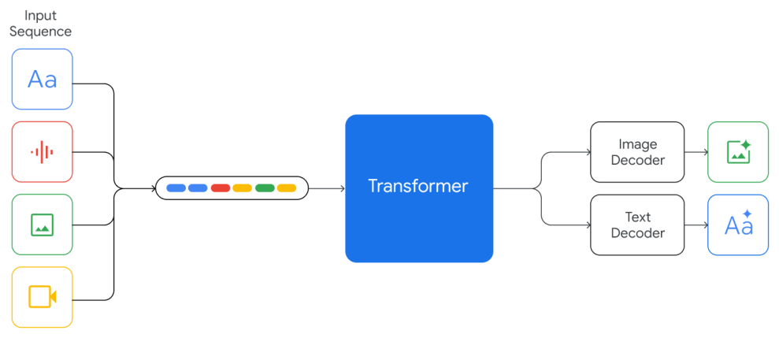

*图 2（原文 Figure 2，第 4 页）：Gemini 接收文本、音频、图像、视频交错的输入序列，输出可以是图文交错的回答。*

**图中文字翻译与读法**：

- **左侧 Input Sequence（输入序列）**：四个方块自上而下是文本（蓝色 Aa）、音频（红色声波）、图像（绿色）、视频（黄色摄像机）。四种输入汇成中间一条彩色小方块序列，原文图注解释为“不同颜色代表输入序列中不同模态的 token”。
- **中间 Transformer（蓝色大方块）**：同一个 Transformer 处理这条混合序列。
- **右侧 Image Decoder（图像解码器）与 Text Decoder（文本解码器）**：Transformer 的输出分两路，分别产生图像和文本。图中没有说明这两个“解码器”是两套网络还是同一个网络的两种输出方式。
- **读图结论**：这是示意图，它表达的是“所有模态在同一个序列里、输出也能图文交错”的设计取向，不提供层数、token 数或编码器结构；这些细节属于上一节所说的“未公开”。

## 五、训练基础设施（第 3 节）

这一节是报告里少数给出工程细节的部分。核心问题是：当训练规模大到硬件故障成为常态时，如何保持高效率并保证结果正确。

### 5.1 硬件与拓扑

- 使用 TPUv5e 与 TPUv4，具体取决于模型尺寸与配置；训练 Ultra 用的是 Google 跨多个数据中心的一大批 TPUv4。原文称这相对上一代旗舰 PaLM-2 是“显著的规模提升”，并带来新的基础设施挑战。
- TPUv4 以 4096 芯片的 **SuperPod** 为单位部署，每个 SuperPod 连着专用光交换机，可以在约 10 秒内把 4×4×4 的芯片立方体动态重配置成任意的 3D torus 拓扑。训练 Ultra 时，每个 SuperPod 里特意留出少量立方体做热备份（hot standby）和滚动维护。
- 芯片之间主要走高速片间互联（ICI）；Ultra 的规模下还要把多个数据中心里的 SuperPod 用 Google 的集群内与集群间网络连起来。原文称网络时延与带宽足以支持常用的**同步训练**：SuperPod 内做模型并行，SuperPod 之间做数据并行。

### 5.2 软件与编译

- JAX 与 Pathways 的“单控制器”（single controller）编程模型，让一个 Python 进程编排整个训练任务，大幅简化开发流程。
- XLA 编译器里的 GSPMD 分区器负责切分训练步的计算；MegaScale XLA 编译 pass 静态地调度合适的集合通信，使其与计算最大程度重叠，步时间波动很小。

### 5.3 可靠性：goodput 与静默数据损坏

**goodput 的定义**（原文脚注 2）：

$$
\text{goodput}=\frac{\text{用于计算有效新训练步骤的时间}}{\text{训练任务经过的总时间}}
$$

加速器数量增加会让整个系统的平均无故障时间（MTBF）按比例下降；原文说“真正的机器故障在这个规模下是常态”。传统做法是周期性把权重写到集群的持久存储，但这样做无法保持高 goodput。Gemini 的做法是在内存里保留模型状态的**冗余副本**，发生计划外的硬件故障时直接从完好的副本恢复。与 PaLM、PaLM-2 相比，恢复时间大幅缩短，尽管使用的训练资源大得多；结果是最大规模训练任务的整体 goodput 从 **85% 提高到 97%**。

**静默数据损坏（SDC，Silent Data Corruption）**：硬件在没有任何报错的情况下算出错误结果。它极其罕见，但以 Gemini 的规模，原文估计 SDC 事件“每周或每两周”就会影响一次训练。为快速发现并摘除故障硬件，作者发展了几项新技术：利用**确定性重放**（deterministic replay）来定位错误的计算，并在空闲机器与热备份机器上运行主动的 SDC 扫描器。完全确定性的基础设施也让他们在 Ultra 研发期间能迅速找出根因（包括硬件故障），原文称这是稳定训练的关键因素。

**读法**：这一节没有给出芯片总数、训练天数或 MFU，因此不能据此估算 Ultra 的训练算力；能确认的是它的“系统卖点”——冗余内存副本恢复、确定性重放、SDC 扫描。

## 六、预训练数据（第 4 节）

原文这一节只有一页，能确认的信息如下。

- **数据构成**：数据集同时是多模态、多语言的，来源包括网页文档、书籍、代码，并包含图像、音频、视频数据。
- **分词器**：SentencePiece。作者发现在整个训练语料的大样本上训练分词器，能改进推断出的词表并提升模型表现；例如 Gemini 能更高效地切分非拉丁字母文字，这既有益于质量，也加快训练与推理。
- **训练 token 数**：最大模型的 token 数遵循 Hoffmann 等（2022）的方法（即 Chinchilla 的计算最优思路，可对照本仓库的 [Chinchilla 解读](../chinchilla/论文中文解读.md)）；更小的模型则训练“显著更多”的 token，以在给定推理预算下提高表现，类似 Touvron 等（2023a）所倡导的做法。具体 token 数不公开。
- **过滤**：对所有数据集使用启发式规则与基于模型的分类器做质量过滤；按政策做安全过滤，去除有害内容；在使用数据训练之前，搜索并移除可能混入训练语料的评测数据。
- **混合与分阶段**：最终的数据混合与权重由小模型上的消融确定；训练是分阶段的，会在训练过程中改变混合比例——在训练末期提高领域相关数据的权重。
- **作者的结论**：数据质量是高性能模型的重要因素，最优的预训练数据分布仍有许多开放问题。

## 七、文本评测（第 5.1 节）

### 7.1 学术基准总表（表 2）

先看这张最重要的表。读它时请注意：同一行里不同模型的 shot 数、是否 CoT、是否多样本投票、数字来源都可能不同，必须连同单元格里的括号一起读。

**表 2：Gemini 与外部模型在文本基准上的表现（除 DROP 与 WMT23 为 F1 与 BLEURT 外，均为准确率，越高越好；括号为评测设置；粗体为原文标出的该行最佳）**

| 基准（说明） | Gemini Ultra | Gemini Pro | GPT-4 | GPT-3.5 | PaLM 2-L | Claude 2 | Inflection-2 | Grok 1 | LLAMA-2 |
|---|---|---|---|---|---|---|---|---|---|
| MMLU（57 个学科的专业与学术多选题） | **90.04%** CoT@32（注 1） 83.7% 5-shot | 79.13% CoT@8（注 1） 71.8% 5-shot | 87.29% CoT@32（API 自测，注 2） 86.4% 5-shot（已发表数字） | 70% 5-shot | 78.4% 5-shot | 78.5% 5-shot CoT | 79.6% 5-shot | 73.0% 5-shot | 68.0%（注 3） 5-shot |
| GSM8K（小学数学应用题） | **94.4%** Maj1@32 | 86.5% Maj1@32 | 92.0% SFT 与 5-shot CoT | 57.1% 5-shot | 80.0% 5-shot | 88.0% 0-shot | 81.4% 8-shot | 62.9% 8-shot | 56.8% 5-shot |
| MATH（5 个难度、7 个子学科的数学题） | **53.2%** 4-shot | 32.6% 4-shot | 52.9% 4-shot（API 自测，注 2） 50.3% （Zheng 等，2023 报告） | 34.1% 4-shot（API 自测，注 2） | 34.4% 4-shot | — | 34.8% | 23.9% 4-shot | 13.5% 4-shot |
| BIG-Bench-Hard（以 CoT 形式给出的困难子集） | **83.6%** 3-shot | 75.0% 3-shot | 83.1% 3-shot（API 自测，注 2） | 66.6% 3-shot（API 自测，注 2） | 77.7% 3-shot | — | — | — | 51.2% 3-shot |
| HumanEval（Python 编程题） | **74.4%** 0-shot（PT，注 4） | 67.7% 0-shot（PT，注 4） | 67.0% 0-shot（已发表数字） | 48.1% 0-shot | — | 70.0% 0-shot | 44.5% 0-shot | 63.2% 0-shot | 29.9% 0-shot |
| Natural2Code（作者新做的、保证网络无泄漏的 Python 生成集） | **74.9%** 0-shot | 69.6% 0-shot | 73.9% 0-shot（API 自测，注 2） | 62.3% 0-shot（API 自测，注 2） | — | — | — | — | — |
| DROP（阅读理解与算术，F1） | **82.4** 可变 shot 数 | 74.1 可变 shot 数 | 80.9 3-shot（已发表数字） | 64.1 3-shot | 82.0 可变 shot 数 | — | — | — | — |
| HellaSwag（验证集，常识多选） | 87.8% 10-shot | 84.7% 10-shot | **95.3%** 10-shot（已发表数字） | 85.5% 10-shot | 86.8% 10-shot | — | 89.0% 10-shot | — | 80.0%（注 3） |
| WMT23（机器翻译，BLEURT） | **74.4** 1-shot（PT，注 4） | 71.7 1-shot | 73.8 1-shot（API 自测，注 2） | — | 72.7 1-shot | — | — | — | — |

（原文表 2，第 8 页。）注释：

- 注 1：模型对每题生成 $k=8$ 或 $32$ 条思维链样本；若存在超过阈值（依据验证集选定）的共识，就采用这个答案，否则退回到一次贪心样本。详见 7.2。
- 注 2：作者在 2023 年 11 月通过 API 自行收集的结果。
- 注 3：LLAMA-2 的数字取自 Touvron 等（2023b）报告中**去污染**的结果，作为与同样做过去污染的 Gemini 最相关的比较。
- 注 4：PT 表示后训练的 Gemini API 模型。
- 原表中 Inflection-2 的 MATH 一格与 LLAMA-2 的 HellaSwag 一格只有数字，没有标注 shot 数；“—”表示原表该格为空。

**读法**：

1. Ultra 在 9 行里有 8 行是原表标出的最佳，例外是 HellaSwag（GPT-4 的 95.3% 对 Ultra 的 87.8%）。
2. 不少领先幅度很小：MATH 比 GPT-4（API 自测）高 0.3 个点，BIG-Bench-Hard 高 0.5，DROP 比 PaLM 2-L 高 0.4，WMT23 高 0.6，Natural2Code 高 1.0。原文没有给置信区间或多次运行的方差，这些差距不宜解读为稳定的优势。
3. 协议不齐是表 2 最大的阅读风险：GSM8K 的 94.4% 是 32 个样本的多数票，GPT-4 的 92.0% 是 SFT 加 5-shot CoT；MMLU 的 90.04% 用的是 7.2 将要介绍的路由协议，同行的 5-shot 数字是 Ultra 83.7% 对 GPT-4 已发表的 86.4%。
4. 其他模型的数字来源混杂：有的是作者自测（注 2），有的是引用已发表数字，有的只有一部分基准有数字（“—”）。

文字部分补充的几个数字（原文 5.1.1，第 6 至 7 页）：

- **MMLU**：Ultra 达 90.04%；MMLU 作者估计人类专家为 89.8%，此前最佳是 86.4%。
- **GSM8K**：94.4%（CoT 加 self-consistency），此前最佳 92%。
- **MATH**：53.2%（4-shot）。**AMC**：在 2022 与 2023 年美国数学竞赛的 150 道题上，较小的模型接近随机水平，Ultra 能解 32%，GPT-4 为 30%。
- **HumanEval**：经指令微调的 Ultra 正确实现 74.4%；**Natural2Code**：74.9%。

### 7.2 MMLU 的“不确定性路由 CoT”协议（附录 10.2，图 9）

**为什么要专门讲**：Ultra 的 MMLU 头条数字 90.04% 不是常见的 5-shot 直接作答，而是作者提出的一种推理协议。不理解这个协议，就无法理解“首个超过人类专家”这句话成立的条件。

**协议是什么**（来自原文 5.1.1 与附录 10.2 的文字描述）：

1. 对每道题，让模型用 CoT 采样 $k$ 条推理，每条产生一个最终选项；$k$ 取 8（Pro）或 32（Ultra、GPT-4）。
2. 统计这 $k$ 个选项中得票最多的那个，判断“共识”是否超过预设阈值；阈值**按每个模型各自在验证集上的表现**选定。
3. 超过阈值：采用多数票答案。
4. 没超过阈值：放弃 CoT，退回到一次不带 CoT 的贪心（最大似然）回答。

原文给出的直觉是：当模型对同一道题的多条推理明显不一致时，CoT 样本可能比最大似然决策更差，所以此时应退回贪心答案。

下面是我对文字描述的形式化整理，原文没有写公式；其中“共识程度”原文没有精确定义，这里取最常见的理解，即多数票占比：

$$
\hat a=\begin{cases}\operatorname{maj}(a_1,\dots,a_k), & \text{if } \dfrac{1}{k}\max_{c}\sum_{i=1}^{k}\mathbf{1}[a_i=c]\ge\tau,\\ a_{\text{greedy}}, & \text{otherwise.}\end{cases}
$$

其中 $a_i$ 是第 $i$ 条 CoT 给出的选项，$\operatorname{maj}$ 取出现次数最多的选项，$\tau$ 是阈值，$a_{\text{greedy}}$ 是不带 CoT 的贪心答案。

**一个示意（数字为我编的，不是原文数据）**：设 $k=32$、$\tau=0.6$。某题 32 条 CoT 中 24 条选 B、5 条选 C、3 条选 A，多数票占比 $24/32=0.75\ge0.6$，输出 B；另一题四个选项的票数是 10、9、7、6，最大占比约 0.31，低于阈值，于是不用这些 CoT，改用贪心答案。

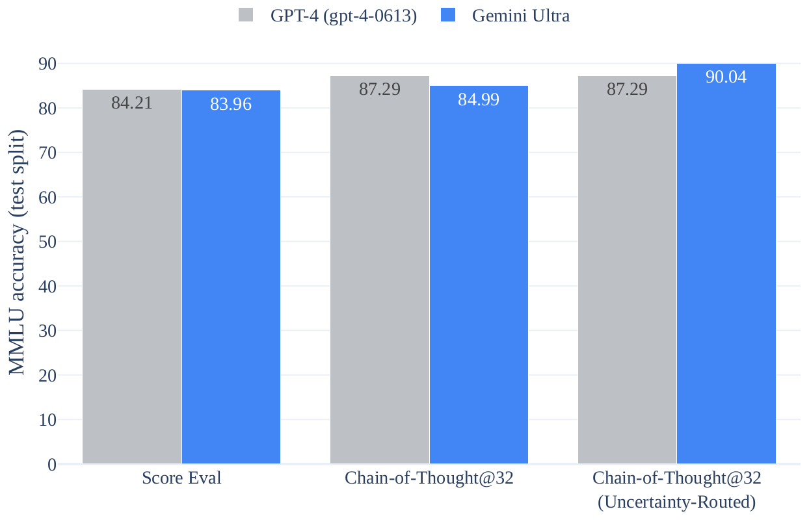

*图 9（原文 Figure 9，附录 10.2，第 74 页）：GPT-4 与 Gemini Ultra 在 MMLU 测试集上，三种评测协议下的准确率。*

**图中文字翻译与读法**：

- **纵轴 MMLU accuracy (test split)（MMLU 测试集准确率）**：0 到 90；图例灰色为 GPT-4（gpt-4-0613），蓝色为 Gemini Ultra。
- **三组柱子**：Score Eval（正文称为 greedy sampling，即贪心采样直接作答）、Chain-of-Thought@32（32 条 CoT 的多数票）、Chain-of-Thought@32 (Uncertainty-Routed)（32 条 CoT，加不确定性路由）。
- **柱上数字**：Score Eval 组，GPT-4 为 84.21，Ultra 为 83.96；CoT@32 组，GPT-4 为 87.29，Ultra 为 84.99；路由组，GPT-4 为 87.29，Ultra 为 90.04。
- **读图结论**：Ultra 从 83.96 到 84.99（只用 CoT@32）只涨约 1 个点，加了路由后到 90.04；GPT-4 的 CoT@32 本身已经是 87.29，路由没有再带来提升。所以在“贪心”和“CoT@32”两种协议下，GPT-4 都不低于 Ultra；只有在路由协议下 Ultra 才以 2.75 个点（90.04 减 87.29）领先，并越过 89.8% 的人类专家线。原文正文也是这样陈述的：GPT-4 从 84.2% 到 87.3%，Ultra 从 84.0% 到 90.0%。

**读这个协议要注意**：（1）阈值是在验证集上为每个模型单独调的，说明它是“带调参的推理协议”，不是模型的固有性质；（2）要用 32 次采样，推理成本远高于 5-shot 直接作答；（3）图中的 Score Eval 为 83.96，而表 2 的 5-shot 为 83.7，两者协议不同、数字接近但不相等；（4）采样温度、CoT 提示词和阈值取值，原文都没有给出，外部很难精确复现。

### 7.3 数据污染与 HellaSwag

原文明确承认这些基准“可能受数据污染影响”，并做了两件事：

- 训练后做了大量泄漏数据分析，发现一些小问题，据此**决定不报告 LAMBADA 的结果**。
- 用 HellaSwag 做了一个小实验：在不属于 Gemini 预训练集的、与 HellaSwag 训练集对应的网站摘录上再微调 100 步，Gemini Pro 的验证集准确率提高到 89.6%，Ultra 提高到 96.0%（1-shot）；作者自测 GPT-4 经 API 的 1-shot 为 92.3%。作者据此认为基准结果对预训练数据的构成很敏感，因此 HellaSwag 只报告**去污染的 10-shot** 结果（即表 2 的 87.8% 与 84.7%）。

因此作者另外采用了较新的留出评测集：2023 年新发布的 WMT23、AMC 2022 至 2023 年的题目，以及不来自网页的内部构造集（如 Natural2Code）。

### 7.4 能力趋势（图 3）

作者在一个覆盖六类能力、共 50 多个基准的评测框架上比较整个家族（具体基准清单在附录 10.3；Factuality 事实性、Long-Context 长上下文、Math/Science 数学与科学、Summarization 摘要、Reasoning 推理、Multilinguality 多语言）。

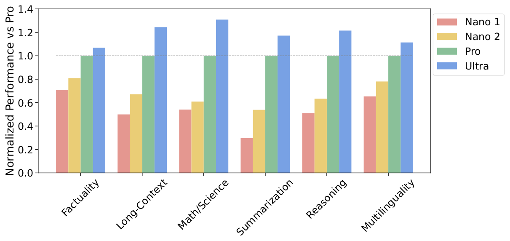

*图 3（原文 Figure 3，第 9 页）：Gemini 模型家族在不同能力上的语言理解与生成表现，按 Gemini Pro 归一化。*

**图中文字翻译与读法**：

- **纵轴 Normalized Performance vs Pro（相对 Pro 的归一化表现）**：0 到 1.4，虚线为 1.0（即 Pro 自己）。
- **横轴六类能力**：Factuality（事实性）、Long-Context（长上下文）、Math/Science（数学与科学）、Summarization（摘要）、Reasoning（推理）、Multilinguality（多语言）。
- **四种颜色**：红 Nano 1、黄 Nano 2、绿 Pro、蓝 Ultra。
- **从图上读出的近似值**：Ultra 约为 1.07（事实性）、1.25（长上下文）、1.31（数学与科学）、1.17（摘要）、1.22（推理）、1.11（多语言）；Nano 1 约 0.71、0.50、0.54、0.30、0.51、0.65；Nano 2 约 0.81、0.67、0.61、0.54、0.63、0.78。
- **读图结论**：每类能力都是 Nano 1 小于 Nano 2 小于 Pro 小于 Ultra，Ultra 在六类能力上都最好。原文文字强调，随模型变大，推理、数学与科学、摘要、长上下文上的增益尤其明显；Pro 的表现很有竞争力，但服务成本低得多。注意这是以 Pro 为分母的相对值，原图没有给出绝对分数。

### 7.5 Nano 系列（表 3）

Nano-1（1.8B）与 Nano-2（3.25B）是端侧小模型。原文称它们在带“按任务微调”的摘要与阅读理解任务上表现出色；图 3 展示的是这两个模型的预训练版本与更大的 Pro 的对比，表 3 进一步给出若干事实性、代码、数学与推理任务上的准确率，以及相对 Pro 的归一化值。原文称，尽管体量很小，它们在事实性（检索类）任务上尤其强，在推理、STEM、代码、多模态和多语言任务上也有不错的表现。

**表 3：Gemini Nano 系列在事实性、摘要、推理、代码与 STEM 任务上相对较大的 Gemini Pro 的表现**

| 任务 | Nano 1 准确率 | Nano 1 相对 Pro | Nano 2 准确率 | Nano 2 相对 Pro |
|---|---:|---:|---:|---:|
| BoolQ | 71.6 | 0.81 | 79.3 | 0.90 |
| TydiQA（GoldP） | 68.9 | 0.85 | 74.2 | 0.91 |
| NaturalQuestions（检索增强） | 38.6 | 0.69 | 46.5 | 0.83 |
| NaturalQuestions（闭卷） | 18.8 | 0.43 | 24.8 | 0.56 |
| BIG-Bench-Hard（3-shot） | 34.8 | 0.47 | 42.4 | 0.58 |
| MBPP | 20.0 | 0.33 | 27.2 | 0.45 |
| MATH（4-shot） | 13.5 | 0.41 | 22.8 | 0.70 |
| MMLU（5-shot） | 45.9 | 0.64 | 55.8 | 0.78 |

（原文表 3，第 9 页。）读法：越偏“检索、阅读”的任务，小模型保留得越多（BoolQ、TydiQA 达到 Pro 的 81% 至 91%）；越偏“知识记忆、数学、代码”，保留得越少（闭卷 NaturalQuestions、MBPP、MATH 的 Nano 1 只有 Pro 的 33% 至 43%）。这与小模型参数少、记不住那么多知识的直觉一致。表中没有给 Pro 的绝对分数，而且归一化所用的 Pro 数字不一定就是表 2 里的数字：例如 BIG-Bench-Hard，Nano 2 的 42.4 除以表 2 中 Pro 的 75.0 约为 0.57，而表 3 写的是 0.58。所以不要用表 2 去反推表 3 的分母。

### 7.6 多语言（表 4 与表 5）

评测任务包括：机器翻译（WMT23，覆盖高、中、低资源语言；Flores、NTREX 用于低与极低资源语言）、摘要（XLSum、Wikilingua）、以及被翻译成多种语言的常用基准（MGSM，由专业人员翻译成 11 种语言）。翻译评测用的是后训练的 Gemini API Ultra，在 WMT23 的全部语言对上以少样本方式评测。

**表 4：WMT23 机器翻译上的平均 BLEURT（越高越好；全部为 1-shot）**

| WMT23（平均 BLEURT） | Gemini Ultra | Gemini Pro | Gemini Nano 2 | Gemini Nano 1 | GPT-4 | PaLM 2-L |
|---|---:|---:|---:|---:|---:|---:|
| High Resource（高资源） | 74.2 | 71.7 | 67.7 | 64.1 | 74.0 | 72.6 |
| Mid Resource（中资源） | 74.7 | 71.8 | 67.0 | 64.8 | 73.6 | 72.7 |
| Out-of-English（译出英语） | 74.8 | 71.5 | 66.2 | 65.2 | 73.6 | 72.2 |
| Into-English（译入英语） | 73.9 | 72.0 | 69.0 | 63.5 | 74.1 | 73.4 |
| All languages（全部） | 74.4 | 71.7 | 67.4 | 64.8 | 73.8 | 72.7 |

（原文表 4，第 10 页。）读法：Ultra 在“译出英语”上领先最明显（74.8 对 GPT-4 的 73.6、PaLM 2-L 的 72.2）；在“译入英语”上 GPT-4 反而略高（74.1 对 73.9）。正文说在高、中、低资源语言上都领先，但表里只有高、中两个资源档，没有“低资源”一行。此外，对 Flores-200（Tamazight、Kanure）、NTREX（North Ndebele）和一个内部基准（Quechua）这几种极低资源语言，Ultra 在 1-shot 设置下的平均 chrF 为 27.0，次优的 PaLM 2-L 为 25.3。

**表 5：多语言数学与摘要（越高越好）**

| 基准 | Gemini Ultra | Gemini Pro | GPT-4 | PaLM 2-L |
|---|---:|---:|---:|---:|
| MGSM（8-shot，准确率） | 79.0 | 63.5 | 74.5 | 74.7 |
| XLsum（3-shot，ROUGE-L） | 17.6 | 16.2 | — | 15.4 |
| Wikilingua（BLEURT） | 48.9 | 47.8 | — | 50.4 |

（原文表 5，第 10 页。）读法：Ultra 在 MGSM 与 XLSum 上领先，在 Wikilingua 上落后于 PaLM 2-L（48.9 对 50.4）；正文指出这里 Ultra 用的是 5-shot，PaLM 2 用的是 3-shot，两者设置并不相同。

### 7.7 长上下文（图 4）

Gemini 以 32,768 token 的序列长度训练，作者检验它是否真的用上了这么长的上下文。

- **合成检索测试**：把键值对放在上下文开头，接上很长的填充文本，再问某个键对应的值；Ultra 在整个上下文长度上查询时，检索到正确值的准确率为 98%。
- **NLL 随位置的变化**：在一组留出的长文档上，画出负对数似然（NLL）随 token 位置的变化。

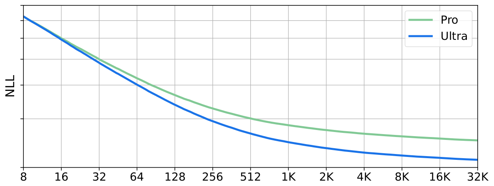

*图 4（原文 Figure 4，第 11 页）：留出的长文档集上，负对数似然（NLL）随 token 索引变化。*

**图中文字翻译与读法**：

- **横轴 Sequence position（序列位置）**：对数刻度，从 8 到 32K。
- **纵轴 NLL（负对数似然）**：原图只画了刻度线，没有数值标注。
- **两条曲线**：绿色 Pro，蓝色 Ultra。
- **读图结论**：两条曲线都随位置单调下降，一直到 32K 仍在下降，说明模型能利用越来越长的前文来更好地预测后文，而不是只看近处；Ultra 的曲线在 Pro 之下，且位置越靠后差距越明显（目测）。图上没有数值，所以不能据此说“下降了多少”。

这个评测只覆盖 32K 以内；原文没有评测更长的上下文，长上下文的摘要、检索与问答任务只以归一化汇总的形式出现在图 3 里，没有逐项分数。

### 7.8 事实性（表 6）

原文评测 Gemini API 模型的三个事实性方面：

1. **Closed-Book Factuality（闭卷事实性）**：没有给定来源时，面对追问事实的 prompt（如“印度总理是谁？”）以及半创造性 prompt（如“写一篇 500 字的支持采用可再生能源的演讲”），模型不应编造错误信息。由人工标注员逐条事实核查，报告“事实不准确”的比例（越低越好）。
2. **Attribution（归因）**：被要求基于给定语境作答时，回答应尽可能忠实于该语境，包括摘要、基于给定片段生成细粒度引用、对长文（如书）问答、把给定来源转换成目标输出（如把会议记录的一部分写成邮件）。由人工检查回答是否归因于 prompt 中的来源，指标是 AIS（越高越好）。
3. **Hedging（审慎回避）**：面对“无法回答”的输入（如含错误前提的问题，或要求依据给定语境回答但语境里推不出答案）时，模型应承认无法回答，而不是编造。用自动评测判断模型是否正确地回避（越高越好）。

**表 6：事实性缓解——后训练对不准确率、归因与正确回避的影响（Gemini API Pro，含 95% 置信区间）**

| 模型 | 事实性：不准确率 | 归因：AIS | 回避：准确率 |
|---|---|---|---|
| Gemini API Pro，无事实性专项适配 | 6.7%（[5.8%, 7.8%]） | 40.2%（[37.9%, 42.5%]） | 0% |
| Gemini API Pro，后训练最终阶段 | 3.8%（[3.1%, 4.8%]） | 60.0%（[57.6%, 62.1%]） | 69.3% |

（原文表 6，第 12 页。回避一列原表没有给置信区间。）读法：不准确率从 6.7% 降到 3.8%（原文说“减半”，实际约降低 43%）；归因从 40.2% 升到 60.0%（原文说“提高 50%”，是相对提升）；回避从 0% 升到 69.3%（原文取整说约 70%）。这是对 Pro 做的评测，不是 Ultra；评测集是内部构造的，没有公开。

### 7.9 复杂推理系统：AlphaCode 2

Gemini 可以与搜索和工具结合成更强的推理系统。AlphaCode 2 是其中一例（Leblond 等，2023）：

- **做法**：用一个**专门化的 Gemini Pro 版本**（在类似 Li 等 2022 所用的竞赛编程数据上调过），对可能的程序空间做大规模搜索；随后经过定制的过滤、聚类、重排序机制。这个 Pro 同时被微调成“编码模型”（产生候选解）和“奖励模型”（识别并挑出最有希望的候选）。
- **评测**：在 Codeforces 的 12 场 division 1 与 division 2 比赛、共 77 道题上，AlphaCode 2 解出 43%，比此前创纪录的 AlphaCode（25%）高 1.7 倍；折算成排名，估计平均排在第 85 百分位，即超过 85% 的参赛者，而 AlphaCode 只超过 50%。

读法：这个成绩来自“Gemini Pro 加大规模搜索与重排序”的系统，不是 Gemini 单次生成的能力，不能与表 2 的 HumanEval 直接比较。

## 八、多模态评测（第 5.2 节）

报告在这一节要回答的问题（第 5 节开头）是：联合训练能否得到一个在每个模态上都很强、甚至不输给“只为单一领域定制的模型”的模型？作者的回答是“能”，证据是下面的基准成绩与定性示例。注意：报告没有做“联合训练 vs 分开训练或外挂编码器”的对照实验，所以这里的“证据”是与其他系统的横向比较，不是对“原生多模态”这一设计本身的消融。

### 8.1 图像理解

**评测设置**（原文 5.2.1）：对后训练的 Gemini API 模型评测四类能力——高层目标识别（描述或问答，如 VQAv2）、细粒度文字转录（TextVQA、DocVQA，需要识别低层细节）、图表理解（ChartQA、InfographicVQA，需要对输入版面的空间理解）、多模态推理（AI2D、MathVista、MMMU）。零样本问答时，模型被指示给出与基准格式一致的简短答案；所有数字都用贪心采样得到，**不使用任何外部 OCR 工具**（表中记为 pixel only，即输入只有像素）。

**表 7：图像理解基准（准确率；粗体为原文标出的该行最佳；“微调”为原表灰底单元格，即此前最佳是在该任务训练集上微调过的模型）**

| 基准（说明） | Gemini Ultra（仅像素） | Gemini Pro（仅像素） | Gemini Nano 2（仅像素） | Gemini Nano 1（仅像素） | GPT-4V | 此前最佳（SOTA） |
|---|---|---|---|---|---|---|
| MMMU（val）：多学科大学水平题 | **59.4%**（pass@1） **62.4%**（Maj1@32） | 47.9% | 32.6% | 26.3% | 56.8% | 56.8%（GPT-4V，0-shot） |
| TextVQA（val）：自然图像中读字 | **82.3%** | 74.6% | 65.9% | 62.5% | 78.0% | 79.5%（Google PaLI-3，微调） |
| DocVQA（test）：文档理解 | **90.9%** | 88.1% | 74.3% | 72.2% | 88.4%（仅像素） | 88.4%（GPT-4V，0-shot） |
| ChartQA（test）：图表理解 | **80.8%** | 74.1% | 51.9% | 53.6% | 78.5%（4-shot CoT） | 79.3%（Google DePlot，1-shot PoT） |
| InfographicVQA（test）：信息图理解 | **80.3%** | 75.2% | 54.5% | 51.1% | 75.1%（仅像素） | 75.1%（GPT-4V，0-shot） |
| MathVista（testmini）：数学推理 | **53.0%** | 45.2% | 30.6% | 27.3% | 49.9% | 49.9%（GPT-4V，0-shot） |
| AI2D（test）：科学图表 | **79.5%** | 73.9% | 51.0% | 37.9% | 78.2% | 81.4%（Google PaLI-X，微调） |
| VQAv2（test-dev）：自然图像理解 | **77.8%** | 71.2% | 67.5% | 62.7% | 77.2% | 86.1%（Google PaLI-X，微调） |

（原文表 7，第 13 页。）读法：

1. **Ultra 在零样本设置下全面领先 GPT-4V**，领先幅度从 VQAv2 的 0.6 个点（77.8 对 77.2）到 InfographicVQA 的 5.2 个点（80.3 对 75.1）。原文文字特别点出 MathVista 比此前最佳高 3.1 个点（53.0 对 49.9）、InfographicVQA 高 5.2 个点；MathVista 的结果是用其作者的评测脚本跑出来的。
2. **与微调模型比，并非全部领先**：TextVQA 上 Ultra（82.3）高于微调的 PaLI-3（79.5），但 AI2D（79.5 对 81.4）与 VQAv2（77.8 对 86.1）上低于微调的 PaLI-X。作者在表注中承认，微调方法与 0-shot 的比较“不是苹果对苹果”；正文说 Ultra 在“多数任务”上超过了专门微调的模型。因此引言里的“9 of 9 图像理解基准”需要带着这个口径去读，报告没有逐项交代每个基准用的是哪一类对比对象。
3. **MMMU 的“领先 5 个点以上”**：Ultra 的 62.4% 是 32 样本多数票（Maj1@32），GPT-4V 的 56.8% 是单次作答（pass@1），差 5.6 个点；同为 pass@1 时是 59.4 对 56.8，差 2.6 个点。
4. **小模型**：Nano 2 与 Nano 1 在 MMMU、MathVista 这类推理型任务上只有 Ultra 的约一半，说明多模态推理对规模很敏感。

#### MMMU 分学科（表 8）

MMMU 是 2023 年发布的评测集，题目是关于图像的、需要大学水平知识与深思熟虑推理的多学科问题，分 6 个大学科、每个学科下有多个科目。原文称 Ultra 在 6 个学科中的 5 个超过此前最佳（表 8）。

**表 8：Gemini Ultra 在 MMMU 各学科上的表现（验证集，0-shot）**

| 学科 | Gemini Ultra，Maj@32 | Gemini Ultra，pass@1 | GPT-4V，pass@1 |
|---|---:|---:|---:|
| Art & Design（艺术与设计） | 74.2 | 70.0 | 65.8 |
| Business（商科） | 62.7 | 56.7 | 59.3 |
| Science（理科） | 49.3 | 48.0 | 54.7 |
| Health & Medicine（健康与医学） | 71.3 | 67.3 | 64.7 |
| Humanities & Social Science（人文社科） | 78.3 | 78.3 | 72.5 |
| Technology & Engineering（技术与工程） | 53.0 | 47.1 | 36.7 |
| Overall（总体） | 62.4 | 59.4 | 56.8 |

（原文表 8，第 14 页。）读法：用 Maj@32 的数字，Ultra 只在 Science 一科落后 GPT-4V（49.3 对 54.7），这就是“6 个中的 5 个”；若改用单次作答 pass@1，Ultra 在 Business（56.7 对 59.3）和 Science（48.0 对 54.7）两科落后。Technology & Engineering 上领先最多（pass@1 为 47.1 对 36.7）。

#### 多语言图像描述（表 9）

Gemini 能同时跨模态、跨语言地工作（例如图中带有冰岛语文字的理解，或为多种语言生成图像描述）。作者在 Crossmodal-3600（XM-3600）基准的若干语言子集上，用 Flamingo 的评测协议、4-shot、不做任何微调地评测描述生成。

**表 9：XM-3600 多语言图像描述（CIDEr，越高越好；全部 4-shot）**

| 语言 | Gemini Ultra | Gemini Pro | Google PaLI-X |
|---|---:|---:|---:|
| English（英语） | 86.4 | 87.1 | 77.8 |
| French（法语） | 77.9 | 76.7 | 62.5 |
| Hindi（印地语） | 31.1 | 29.8 | 22.2 |
| Modern Hebrew（现代希伯来语） | 54.5 | 52.6 | 38.7 |
| Romanian（罗马尼亚语） | 39.0 | 37.7 | 30.2 |
| Thai（泰语） | 86.7 | 77.0 | 56.0 |
| Chinese（汉语） | 33.3 | 30.2 | 27.7 |
| Average of 7（7 种语言平均） | 58.4 | 55.9 | 45.0 |

（原文表 9，第 14 页。）读法：七种语言上 Gemini 两档都明显高于 PaLI-X；差距最大的是泰语（Ultra 86.7 对 56.0）。有一处例外值得注意：英语上 Pro（87.1）略高于 Ultra（86.4）。

#### 定性示例：把“看”与“推理”接起来

**示例一：核查学生的手写物理题（图 1）。** 先看报告首页展示的例子，它说明了“多模态推理”在日常任务里的样子。

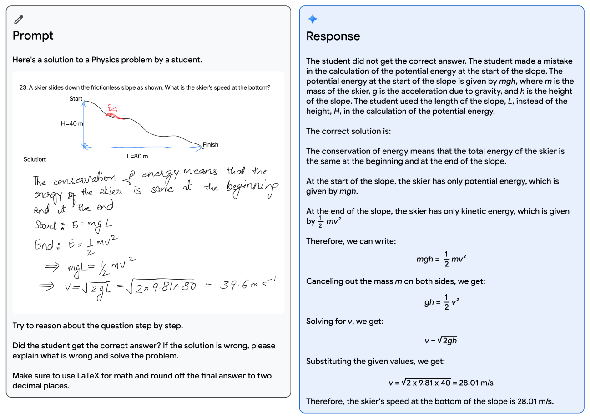

*图 1（原文 Figure 1，第 3 页）：Gemini 核查学生对一道物理题的手写解答，并给出正确解法。*

**图中文字翻译与读法**：

- **左栏 Prompt（提示）**：图像是一页手写作业。题目是“23. 一名滑雪者沿图示的无摩擦斜坡下滑，他在坡底的速度是多少？”，图上标出起点 Start、终点 Finish，高度 H=40 m、水平长度 L=80 m。学生的手写解答是：“能量守恒意味着滑雪者在开始和结束时的能量相同。开始：E = mgL；结束：E = ½mv²；⇒ mgL = ½mv²；⇒ v = √(2gL) = √(2×9.81×80) = 39.6 m·s⁻¹”。文字指令是：“这是一名学生对一道物理题的解答。请逐步推理。学生答对了吗？如果解答错误，请解释错在哪里并解出该题。请用 LaTeX 写数学，并把最终答案四舍五入到两位小数。”
- **右栏 Response（模型回答）**：模型判定学生答错——在计算起点势能时，学生用了坡长 $L$，而不是高度 $H$。正确解法：能量守恒，起点只有势能 $mgh$，终点只有动能 $\tfrac12 mv^2$，于是 $mgh=\tfrac12 mv^2$，消去质量 $m$ 得 $gh=\tfrac12 v^2$，解得 $v=\sqrt{2gh}$，代入 $h=40$ m 得 $v=\sqrt{2\times 9.81\times 40}=28.01$ m/s。
- **读图结论**：模型需要同时做到：认出潦草的手写、理解图中几何标注（高度与坡长不是一回事）、判断学生是哪一步错了、按要求用 LaTeX 输出并保留两位小数。这是一个精选的单例演示，不是定量评测。

**示例二：重排子图并写出 matplotlib 代码（图 5）。**

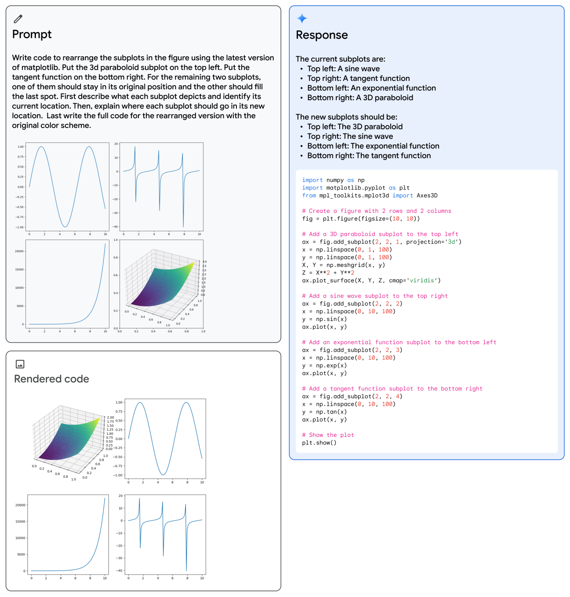

*图 5（原文 Figure 5，第 15 页）：用多模态推理能力生成重排子图的 matplotlib 代码。*

**图中文字翻译与读法**：

- **左上 Prompt（灰色框）**：指令为“写代码，用最新版 matplotlib 重排图中的子图。把 3D 抛物面子图放到左上，把正切函数放到右下。其余两个子图中，一个留在原位，另一个填到剩下的位置。先描述每个子图画的是什么并指出它当前的位置，再说明每个子图在新布局里应放哪里，最后写出重排后的完整代码，保持原有配色。”指令下方是原始的 2×2 子图：左上正弦波、右上正切函数、左下指数函数、右下 3D 抛物面。
- **右栏 Response（蓝色框）**：模型先正确描述当前布局（左上正弦波、右上正切函数、左下指数函数、右下 3D 抛物面），再给出新布局（左上 3D 抛物面、右上正弦波、左下指数函数、右下正切函数），然后给出完整代码：用 `fig.add_subplot(2, 2, k)` 依次添加子图，3D 抛物面用 `projection='3d'`、`plot_surface(X, Y, Z, cmap='viridis')`，正弦用 `np.sin`、指数用 `np.exp`、正切用 `np.tan`。
- **左下 Rendered code（渲染结果）**：把生成的代码跑出来，布局与要求一致。
- **读图结论**：原文图注列出这道题综合了四种能力：（1）认出各图画的是什么函数；（2）inverse graphics（逆向图形学，从图推出生成它的代码）；（3）遵循“把谁放哪里”的指令；（4）抽象推理——推出指数图必须留在原位，因为正弦图要给 3D 图让位。这依然是单例演示。

**示例三：图表读取加按格式输出表格（附录图 10）。**

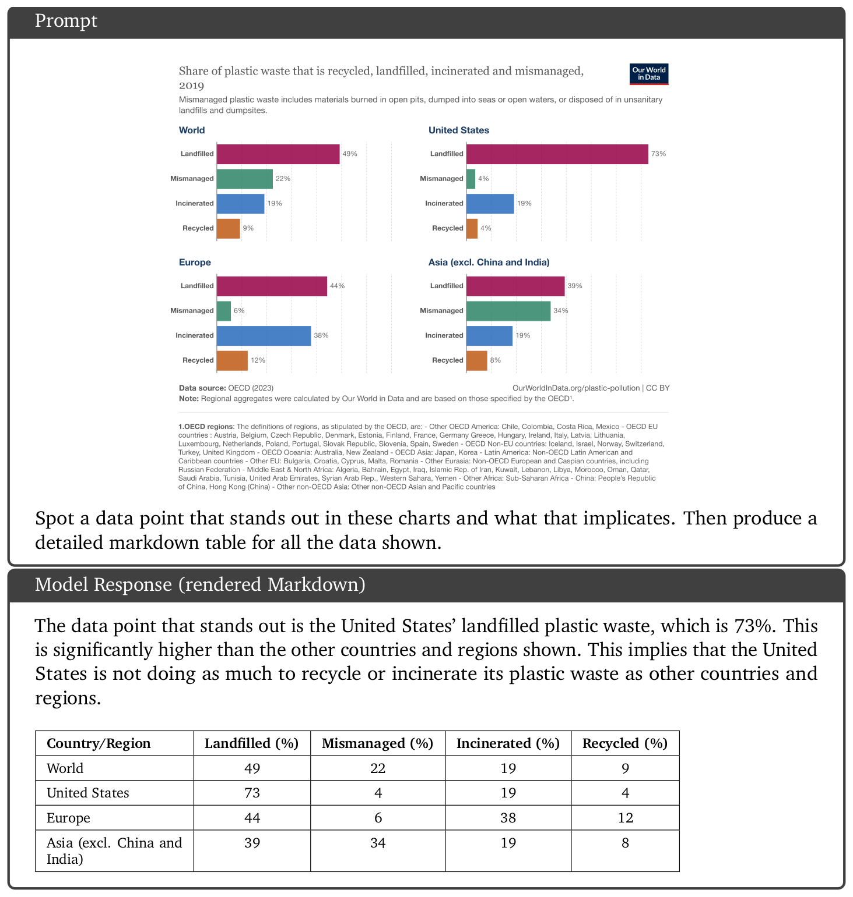

*图 10（原文 Figure 10，附录 10.4.1，第 77 页）：读取四幅柱状图，指出异常数据点并整理成 Markdown 表。*

**图中文字翻译与读法**：

- **Prompt**：输入是 Our World in Data 的图表“2019 年塑料垃圾被回收、填埋、焚烧、管理不善的占比”（管理不善指露天焚烧、倾倒入海或开放水域、在不卫生的填埋场或垃圾场处置的塑料），分 World（全球）、United States（美国）、Europe（欧洲）、Asia (excl. China and India)（亚洲，不含中国与印度）四幅子图，每幅有 Landfilled（填埋）、Mismanaged（管理不善）、Incinerated（焚烧）、Recycled（回收）四根柱。文字指令：“找出这些图中一个突出的数据点及其含义，然后为图中所有数据生成一个详细的 Markdown 表格。”
- **Model Response**：模型指出突出的数据点是美国的填埋比例 73%，明显高于其他国家和地区，意味着美国在回收或焚烧塑料垃圾方面做得不如其他地区；随后给出的表格是：World 49、22、19、9；United States 73、4、19、4；Europe 44、6、38、12；Asia (excl. China and India) 39、34、19、8（依次为填埋、管理不善、焚烧、回收，单位 %）。
- **读图结论**：我把模型转写的 16 个数字逐个对照图中柱子上的标注，全部一致。它说明模型能从图像里读出柱子上的数值并按要求结构化。但“美国做得不如其他地区”这样的解释是模型的判断，没有被评测。

**示例四：多语言常识推理（附录图 18）。**

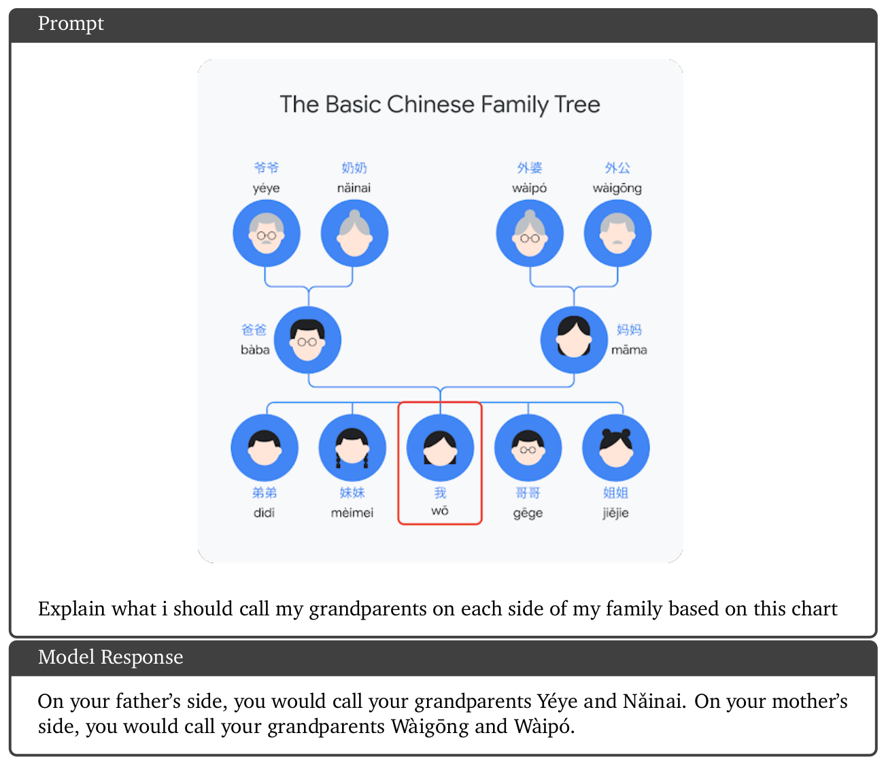

*图 18（原文 Figure 18，附录 10.5，第 84 页）：根据图示的中文家庭关系图，回答该怎么称呼祖父母与外祖父母。*

**图中文字翻译与读法**：

- **Prompt**：图为“The Basic Chinese Family Tree（基础中文家庭称谓树）”，顶层是祖辈：爷爷 yéye、奶奶 nǎinai（爸爸一侧），外婆 wàipó、外公 wàigōng（妈妈一侧）；中间一层是爸爸 bàba、妈妈 māma；底层是弟弟 dìdi、妹妹 mèimei、我 wǒ（红框标出）、哥哥 gēge、姐姐 jiějie。问题：“根据这张图，解释我应该如何称呼我两边家庭的祖父母。”
- **Model Response**：“在你父亲这一边，你会称祖父母为 Yéye 和 Nǎinai；在你母亲这一边，你会称祖父母为 Wàigōng 和 Wàipó。”
- **读图结论**：答案与图一致（爷爷、奶奶、外公、外婆）。图注强调的是“理解图中表示的关系，并在多语言环境中推理”。

**其余附录示例速览**：附录 10.4 至 10.6 还有下面这些单例，原文只给出了提示与回答，没有定量指标。

| 图 | 任务 | 提示与图像 | 模型回答要点 |
|---|---|---|---|
| 图 11（第 78 页） | 看图识物并给出养护建议 | 一张紫色叶片植物的照片，问“知道这是什么植物吗？怎么养？”（提示里有拼写错误，图注称这展示了对拼写错误的鲁棒性） | 认出是 Persian shield（波斯盾），并依次给出光照、温度湿度、浇水、施肥、病虫害、扦插繁殖建议 |
| 图 13（第 80 页） | 图形序列推理 | 手绘的三角形、正方形、五边形和一个问号 | 第四个图形应是六边形，理由是边数每次加一 |
| 图 14（第 81 页） | 几何题 | 底为 $x+15$、高为 $x$ 的平行四边形，面积 100 | 列出 $100=(x+15)x$，得 $x^2+15x-100=0$，两根 5 与 -20，舍去负根，答案 5 |
| 图 15（第 81 页） | 找两个物体的联系 | 月球照片与一只手拿着的高尔夫球，提示“想想历史事件” | 月球是人类唯一打过高尔夫的天体，1971 年阿波罗 14 号机组在月面击了两个高尔夫球 |
| 图 16（第 82 页） | 看图判断拍摄地点 | 夜晚街景，背景可见帝国大厦 | 回答在纽约，前景街道是第八大道，交叉路口是西 34 街 |
| 图 17（第 83 页） | 解释表情包 | 上半部“Game at 300 FPS”、下半部“75 hz Monitor”的漫画 | 一个人想玩 300 FPS 的游戏，但显示器只有 75Hz，来不及显示，因此好笑 |
| 图 19（第 86 页） | 按需求写网页 | 要求写一个“Opossum Search”单文件网页：每次搜索都跳转到谷歌搜索并在查询前加 opossum，外观类似谷歌，用负鼠图片代替 logo，页脚写“Powered by google search” | 给出一个单文件 HTML，含样式、负鼠图片、搜索框与按钮、页脚，以及把查询拼成 `https://www.google.com/search?q=opossum+查询` 的脚本 |
| 图 20（第 87 页） | 微积分 | 求 $\sinh x+\cosh y=x+y$ 的导数 | 两边对 $x$ 求导，$\cosh x+\sinh y\,\dfrac{dy}{dx}=1+\dfrac{dy}{dx}$，解得 $\dfrac{dy}{dx}=\dfrac{1-\cosh x}{\sinh y-1}$ |
| 图 21（第 88 页） | 多步数学题与表格 | 2018 年 A 厂产值 5 亿福林、B 厂 4 亿福林，A 每年增长 5%、B 每年增长 6%；补全 2018 至 2021 年的表并证明“两厂差距越来越小”的说法不对 | 逐年算出 A：500、525、551.25、578.81，B：400、424、449.44、476.41，差距 100、101、101.81、102.4，差距在变大，因此该说法不成立 |

这些例子里，图 14、图 20、图 21 的数学推导我都核对过，结果正确；其余例子的对错没有独立核验。

**示例五：逆向图形学加算术与代码（附录图 22）。**

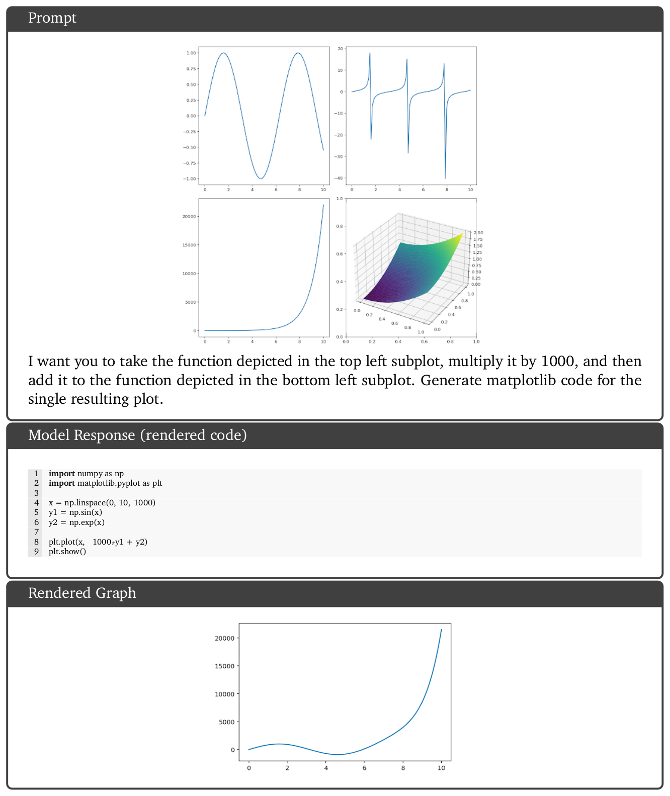

*图 22（原文 Figure 22，附录 10.6.1，第 89 页）：从子图中读出函数，做指定的数学变换，并生成新图的 matplotlib 代码。*

**图中文字翻译与读法**：

- **Prompt**：四幅子图与图 5 相同（左上正弦波、右上正切、左下指数、右下 3D 抛物面）。指令：“取左上子图所示的函数，乘以 1000，再加上左下子图所示的函数，为得到的单个图生成 matplotlib 代码。”
- **Model Response（渲染后的代码）**：`x = np.linspace(0, 10, 1000)`、`y1 = np.sin(x)`、`y2 = np.exp(x)`，然后 `plt.plot(x, 1000*y1 + y2)` 并 `plt.show()`。
- **Rendered Graph（渲染结果）**：曲线从 0 出发，先有一个小起伏（由 $1000\sin x$ 贡献，约在 $x\approx1.6$ 处达到约 1000），$x$ 接近 10 时被指数项 $e^{x}$ 拉到约 22,000（$e^{10}\approx22026$，减去 $1000\times0.544\approx544$，约 21,482）。
- **读图结论**：模型要先“逆向”认出左上是 $\sin x$、左下是 $e^x$（定义域 0 到 10），再做 $1000\sin x+e^x$ 的运算并写出代码，图注称之为 inverse graphics 加数学变换加代码生成。结果与预期曲线一致（我对渲染图的数量级做了核对）。

### 8.2 视频理解

**评测设置**（原文 5.2.2）：对每个视频任务，从每段视频中**均匀采样 16 帧**喂给模型。除 NextQA 与 Perception Test 外，其余数据集都是 YouTube 视频，评测时只用 2023 年 11 月仍可公开访问的那些视频（意味着评测集会随时间缩水，复现时要注意）。这些基准均为训练中留出的。

**表 10：视频理解基准（越高越好；指标：视频描述为 CIDEr，NextQA 为 WUPS，Perception Test 与 ActivityNet-QA 为 top-1 准确率）**

| 任务 | Gemini Ultra | Gemini Pro | 此前少样本最佳 |
|---|---|---|---|
| VATEX（test）：英文视频描述 | **62.7**（4-shot） | 57.4（4-shot） | 56.0（DeepMind Flamingo，4-shot） |
| VATEX ZH（test）：中文视频描述 | **51.3**（4-shot） | 50.0（4-shot） | – |
| YouCook2（val）：英文烹饪视频描述 | **135.4**（4-shot） | 123.2（4-shot） | 74.5（DeepMind Flamingo，4-shot） |
| NextQA（test）：视频问答 | **29.9**（0-shot） | 28.0（0-shot） | 26.7（DeepMind Flamingo，0-shot） |
| ActivityNet-QA（test）：视频问答 | **52.2**（0-shot） | 49.8（0-shot） | 45.3（Video-LLAVA，0-shot） |
| Perception Test MCQA（test）：视频问答 | **54.7**（0-shot） | 51.1（0-shot） | 46.3（SeViLA，0-shot） |

（原文表 10，第 16 页。ActivityNet-QA 使用 Video-LLAVA 的评测协议。）读法：六项全部领先，幅度最大的是 YouCook2（135.4 对 74.5，约 1.8 倍，但对手是 Flamingo 的 4-shot 数字）；问答类任务领先幅度较小（NextQA 只高 3.2 个点）。注意 16 帧均匀采样是一个很粗的时间采样，这些结果反映的主要是少量帧上的时序推理，不能等同于对长视频的细致理解。

**附录示例（图 23）**：

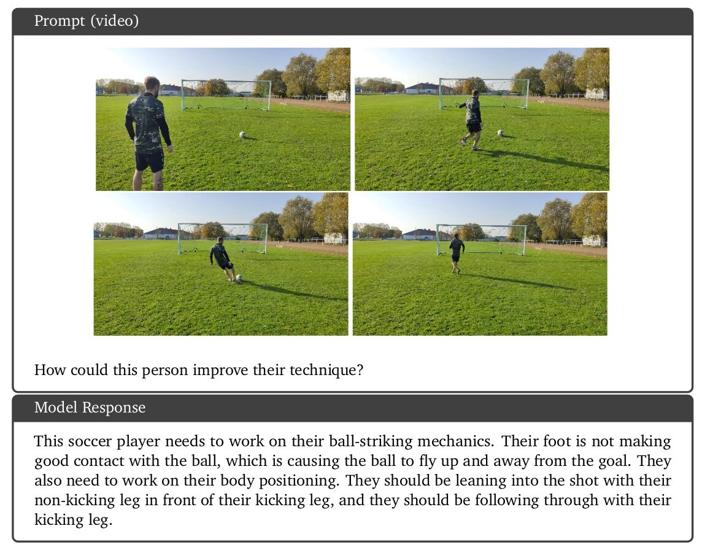

*图 23（原文 Figure 23，附录 10.6.2，第 90 页）：把视频与文字问题一起输入，让模型分析视频中的动作并给出改进建议。*

**图中文字翻译与读法**：

- **Prompt (video)**：这里用 4 帧截图示意（图注说“这里给出的图像仅用于展示”，实际输入是视频）：一名球员对着球门射门。问题：“这个人如何改进他的技术？”
- **Model Response**：模型说这名球员需要改进击球动作：脚没有与球形成好的接触，导致球飞高、偏离球门；还要改进身体位置，应当身体前倾、支撑脚在击球脚前面，并完成随挥动作。
- **读图结论**：这是演示模型能对时间序列上的动作做分析并给出建议；原文没有给出对这类回答的评分标准，视频本身也不随报告提供（图注给的来源是 YouTube 上题为 “Football/Soccer Penalty Miss” 的视频）。

### 8.3 图像生成

Gemini 能**原生输出图像**，而不必依赖一个会成为瓶颈的中间自然语言描述；因此可以用“图文交错”的提示做少样本生成，例如为博客文章或网站设计图文建议。

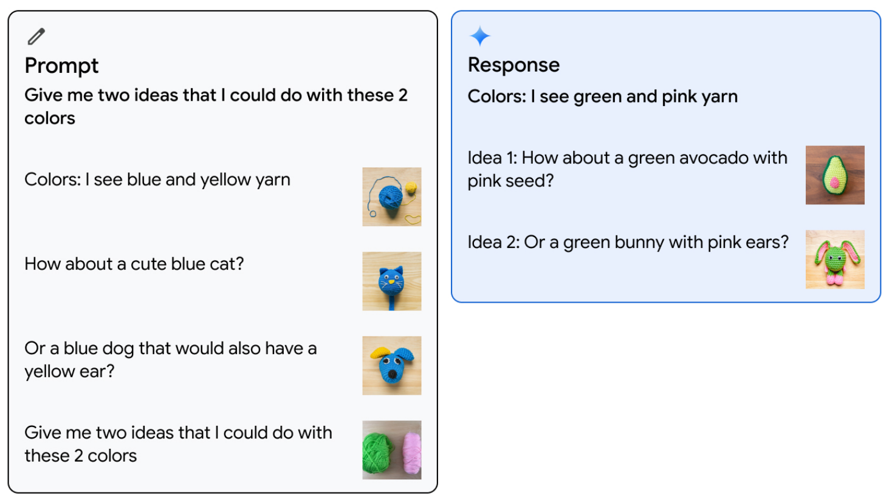

*图 6（原文 Figure 6，第 17 页）：给一个图文交错的示例，让模型对新的两种颜色输出图文交错的建议。*

**图中文字翻译与读法**：

- **左栏 Prompt**：先是一个示例（1-shot）。用户说“给我两个用这 2 种颜色可以做的点子”，并给出蓝色与黄色毛线的图片；示范回答是“颜色：我看到蓝色和黄色的毛线”“做一只可爱的蓝色小猫怎么样？”（配蓝色毛线编织的猫的图）“或者一只有黄色耳朵的蓝色小狗？”（配蓝色毛线编织的狗的图）。然后同一句指令“给我两个用这 2 种颜色可以做的点子”再次出现，附上绿色与粉色毛线的图片。
- **右栏 Response**：“颜色：我看到绿色和粉色的毛线。点子 1：做一个带粉色果核的绿色牛油果怎么样？（配图：毛线牛油果）点子 2：或者一只有粉色耳朵的绿色兔子？（配图：毛线兔子）”
- **读图结论**：输出是文字与图像交错的序列，模型模仿示例的版式（先识别颜色，再给两个点子并各配一张图）。这是 1-shot 单例，没有给出图像质量的定量评测，也没有公开图像解码器的细节。

另一个附录示例是写带插图的博客（图 12）：

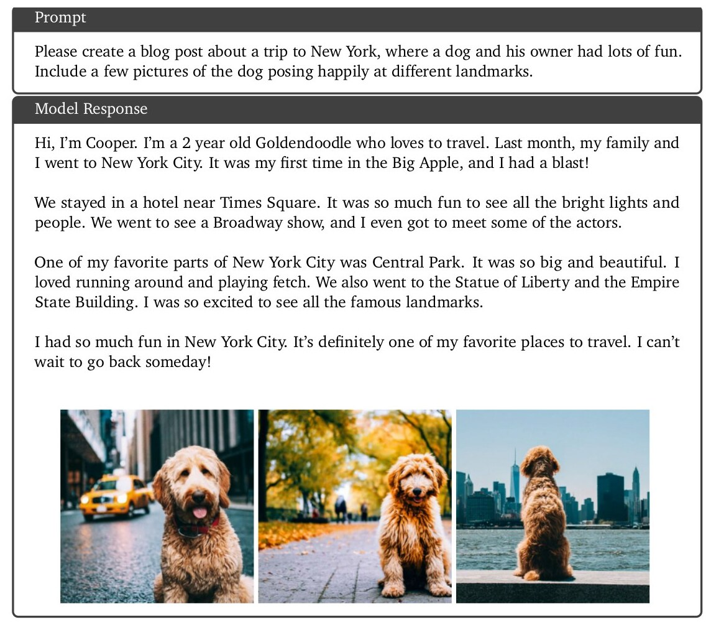

*图 12（原文 Figure 12，附录 10.4.3，第 79 页）：按要求写一篇关于“一只狗和它的主人在纽约玩得很开心”的博客，并配上狗在不同地标的照片。*

**图中文字翻译与读法**：

- **Prompt**：“请写一篇关于纽约之行的博客，其中一只狗和它的主人玩得很开心。配几张狗在不同地标开心摆姿势的图片。”
- **Model Response**：文字部分是以狗“Cooper”（2 岁的 Goldendoodle，即金毛与贵宾的杂交犬）口吻写的第一人称游记：上个月和家人第一次来纽约；住在时代广场附近的酒店，看了百老汇演出；最喜欢中央公园，在那里跑着玩接球；还去了自由女神像和帝国大厦；最后说“我在纽约玩得很开心，这绝对是我最喜欢的旅行地之一，我等不及要再去”。文字下面是三张狗的照片：街边有黄色出租车、秋色公园小径、水边与城市天际线。
- **读图结论**：图注强调的是图像与文字内容紧密相关，且三张图里的狗保持了很高的一致性。这是主观的定性判断，没有量化。

### 8.4 音频理解

**评测设置**（原文 5.2.4）：在公开基准上评测 Gemini Nano-1 与 Gemini Pro，与 USM 和 Whisper（large-v2 或 large-v3，见表中标注）比较：自动语音识别（ASR）用 FLEURS、VoxPopuli、Multilingual Librispeech 与一个内部的 YouTube 测试集，语音翻译（AST）用 CoVoST 2（把各种语言译成英语）。ASR 报告 WER（越低越好），AST 报告 BLEU（越高越好）；FLEURS 报告的是与训练数据有语言重叠的 62 种语言，其中普通话、日语、韩语、泰语报告 CER。

**表 11：语音评测结果（ASR 为 WER，越低越好；AST 为 BLEU，越高越好；粗体为原文标出的该行最佳）**

| 任务 | 数据集 | 指标 | Gemini Pro | Gemini Nano-1 | Whisper | USM |
|---|---|---|---|---|---|---|
| 自动语音识别 | YouTube（en-us） | WER（越低越好） | **4.9%** | 5.5% | 6.5%（v3） | 6.2% |
| 自动语音识别 | Multilingual Librispeech（en-us） | WER（越低越好） | **4.8%** | 5.9% | 6.2%（v2） | 7.0% |
| 自动语音识别 | FLEURS（62 种语言） | WER（越低越好） | **7.6%** | 14.2% | 17.6%（v3） | 11.8% |
| 自动语音识别 | VoxPopuli（14 种语言） | WER（越低越好） | **9.1%** | 9.5% | 15.9%（v2） | 13.4% |
| 自动语音翻译 | CoVoST 2（21 种语言） | BLEU（越高越好） | **40.1** | 35.4 | 29.1（v2） | 30.7 |

（原文表 11，第 18 页。）读法：

1. 这张表**没有 Ultra**：原文明确写“我们还没有在音频上评测 Gemini Ultra，但预计更大的规模会带来更好的表现”。而引言在列举 Ultra 的战绩时写了“5/5 语音识别与语音翻译基准”，数目与表 11 的 5 行相同，但表 11 的数字来自 Pro 与 Nano-1。两处说法不一致，读者应以 5.2.4 节与表 11 为准。
2. Pro 在 5 项上全部最好。FLEURS 上的大幅领先有一个重要前提：Gemini 的训练也使用了 FLEURS 的训练集；原文给出的对照是，同一个模型不用 FLEURS 数据训练时 WER 为 15.8%，仍优于 Whisper（17.6%），但不如 USM（11.8%）。
3. Nano-1 在除 FLEURS 外的数据集上都优于 USM 与 Whisper；在 FLEURS 上（14.2%）优于 Whisper（17.6%），但不如 USM（11.8%）。

**表 12：ASR 的定性例子（原表以红色标出错误转写；这里用粗体标出 USM 的错误词）**

| 数据集 | 真实文本（Truth） | USM | Gemini Pro |
|---|---|---|---|
| Fleurs | Scotturb bus 403 travels regularly to Sintra, stopping at Cabo da Roca. | **Scotboard** bus **four3 traversed** regularly to **Centra** stopping at Cabo de **Roga.** | Scotturb bus 403 travels regularly to Sintra, stopping at Cabo da Roca. |
| Fleurs | The archipelago lies 120 km north of the Peninsula. The largest is King George Island, with the settlement of Villa Las Estrellas. | The archipelago **lines** 120 km north of peninsula. The largest is **Kingurch** island with the settlement of **Cua Losas.** | The archipelago lies 120 km north of the Peninsula. The largest is King George Island, with the settlement of Villa Las Estrellas. |

（原文表 12，第 18 页；原表还有一列 Wav，是音频播放图标。）读法：作者据此认为 Gemini Pro 对稀有词与专有名词的转写更可理解（如 Scotturb、Cabo da Roca、Villa Las Estrellas）。两个例子都是精选的，不能代替整体统计。

### 8.5 模态组合：音频加图像的多轮对话（表 13）

以上多是文本加单一模态。原文还演示了**音频与图像交错输入**：用户边拍照边口头提问，让模型指导做蔬菜煎蛋卷并检查是否熟了。

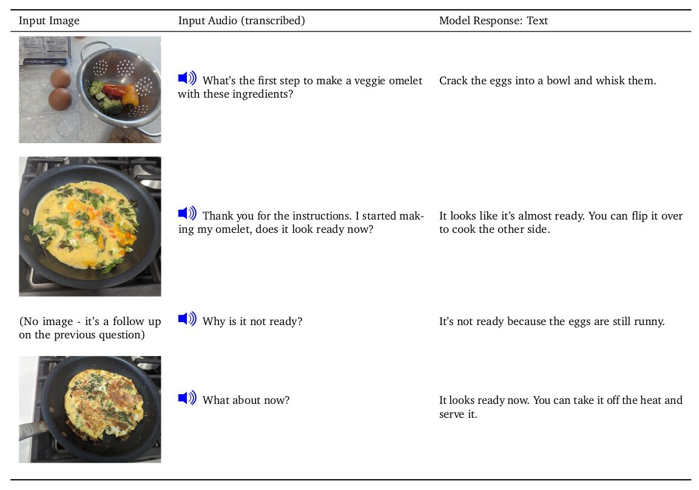

*表 13（原文 Table 13，第 19 页）：这个表以照片为主，故保留原图；下面是文字转录。*

**表 13：音频加视觉的定性示例——做蔬菜煎蛋卷**

| 轮次 | 输入图像（我据原图的描述） | 输入音频（转写） | 模型回答（文字） |
|---|---|---|---|
| 1 | 两个鸡蛋，和一个装着西兰花、红椒、黄椒的金属漏盆 | What’s the first step to make a veggie omelet with these ingredients?（用这些食材做蔬菜煎蛋卷，第一步是什么？） | Crack the eggs into a bowl and whisk them.（把鸡蛋打进碗里搅匀。） |
| 2 | 平底锅里正在煎的蛋卷，表面较湿润 | Thank you for the instructions. I started making my omelet, does it look ready now?（谢谢你的指导。我开始做蛋卷了，现在看起来好了吗？） | It looks like it’s almost ready. You can flip it over to cook the other side.（看起来快好了，你可以翻面煎另一面。） |
| 3 | （无图像，是对上一问的追问） | Why is it not ready?（为什么还没好？） | It’s not ready because the eggs are still runny.（还没好，因为蛋液还没凝固。） |
| 4 | 平底锅里煎得金黄的蛋卷 | What about now?（现在呢？） | It looks ready now. You can take it off the heat and serve it.（现在看起来好了，可以离火装盘了。） |

（原文表 13，第 19 页。）读法：原文称模型的回答大体准确，并表明模型能处理细粒度的图像细节来判断蛋卷是否熟了；图中展示的是文字回答（演示的音频部分见作者网站）。第 2 轮说“快好了”、第 3 轮又说“还没好”，措辞略有出入，这只是单个演示。

## 九、后训练（第 6 节）

预训练之后，作者用后训练来提升整体质量、增强编码与多语言等目标能力，并满足对齐与安全要求。因为下游需求不同，产出了两条变体线。

### 9.1 两条变体：Gemini Apps 与 Gemini API

| 变体 | 面向谁 | 包含什么 |
|---|---|---|
| Gemini Apps 模型 | 对话产品 Gemini 与 Gemini Advanced（前身是 Bard） | 目前 Gemini 提供 Pro 1.0，Gemini Advanced 提供 Ultra 1.0。除核心的后训练模型外，还有围绕它的系统：决定模型如何与外部工具（Google Flights、Maps、Workspace 等）交互，以及如何生成回答（过滤、排序、流式输出）。要解决的问题包括：如何理解用户跨多轮的请求；如何保证回答安全、有事实依据、有帮助；如何借助模型之外的工具完成任务 |
| Gemini API 模型 | 开发者，通过 Google AI Studio 与 Cloud Vertex AI | 同时支持对话与非对话场景。AI Studio 是免费的网页开发工具，用 API key 快速原型与上线；Vertex AI 是综合的 AI 平台，提供各种工具、全托管基础设施和内置的企业级安全与隐私设置 |

### 9.2 后训练的四个步骤与数据飞轮（图 7）

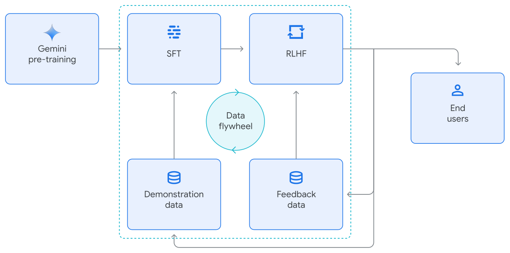

*图 7（原文 Figure 7，第 21 页）：后训练利用一个优化的数据飞轮，获取人类与 AI 的反馈，并持续改进关键方面。*

**图中文字翻译与读法**：

- **左侧 Gemini pre-training（Gemini 预训练）**：预训练模型是起点，箭头指向虚线框内的 SFT。
- **虚线框 Data flywheel（数据飞轮）**：上排是 SFT（监督微调）与 RLHF（基于人类反馈的强化学习），SFT 的输出接着进入 RLHF；下排是 Demonstration data（示范数据）与 Feedback data（反馈数据），分别向上供给 SFT 与 RLHF；中间的圆圈表示这两类数据不断循环更新。
- **右侧 End users（终端用户）**：RLHF 的输出面向终端用户；图中还有两条折返线指向 Feedback data 与 Demonstration data，表示使用中得到的信号会回流成新数据。
- **读图结论**：后训练被组织成“模型、用户、数据、新模型”的闭环，而不是一次性的微调。图注说明 SFT、奖励建模与强化学习所用的数据混合是模型的基础。图里没有给出各阶段的数据量与算法超参数。

**四个步骤**（原文 6.3）：

1. **Prompt 数据收集**：prompt 指用户给模型的输入，也可以包含之前的用户与模型的交互。作者整理目标 prompt 的数据集，它们既是示范数据与反馈数据收集的基础，也直接用于强化学习；需要覆盖多样的关键用例，并同时包含单轮与多轮格式。数据来源有供应商撰写的数据、第三方授权来源与合成方法。
2. **在示范数据上 SFT**：训练模型对给定 prompt 输出期望的目标回答。目标回答可以由人类专家直接写成，也可以由模型生成、在某些情况下经人工修改或审阅；还会用数据分析工具和启发式方法，保证在能力、用例和语义聚类上的高多样性。
3. **在反馈数据上训练奖励模型（RM）**：人类评审对候选回答给出相对偏好，以及对单个回答的反馈。原文的理由是：对许多能力来说，“比较偏好”比“示范理想回答”容易。反馈数据在创造力、安全、事实性等多个目标上收集。作者发现这些人类反馈数据的价值在很大程度上取决于 prompt 的选择与产生候选回答的采样策略。用这些数据训练 RM，使其输出的奖励尽可能贴近人类偏好。
4. **RLHF**：在 SFT 之外，用 RLHF 能带来进一步提升。流程是迭代的：强化学习不断“推着” RM 的边界，而 RM 又通过评测和数据收集不断改进，二者逐步共同提升。

**评估**（原文 6.4）：人类偏好评估是衡量表现的关键信号，包括：并排（side-by-side）盲评，由评审对同一 prompt 的两个模型回答做判断；对某些能力做单回答打分；以及在线测试。此外还训练了能“忠实模仿人类偏好”的自动评测模型，用于指导开发和持续监控线上表现。

### 9.3 专项能力

原文强调后训练配方要在创造力、事实性、安全等多个目标之间平衡。下面按原文 6.5 的顺序展开。

#### 指令遵循（表 14）

做法：针对多种指令遵循类别收集数据；对可以用程序验证的指令（如字数），通过 prompt 与回答编辑合成数据，保证这些指令被满足。

评估：在一个内部的、含多条指令的复杂 prompt 数据集上做细粒度评测。评审会看到 prompt、回答，以及该 prompt 中每一条（子）指令的列表，逐条判断是否被遵循；每个 prompt 的指令数从 1 条到几十条不等。两个指标：per-instruction accuracy（被遵循的子指令占比）和 full-response accuracy（所有子指令都被遵循的 prompt 占比）。

**表 14：复杂 prompt 指令遵循的内部基准（越高越好）**

| 指标 | 后训练的 PaLM 2 | Gemini（用 Pro） | Gemini Advanced（用 Ultra） |
|---|---|---|---|
| Per-instruction accuracy（逐条指令准确率） | 59.5±3.0% | 77.8±2.0% | 87.4±1.4% |
| Full-response accuracy（整条回答全部满足） | 25.5±3.3% | 38.5±3.6% | 54.1±3.7% |

（原文表 14，第 22 页；“±”后的数值原文没有说明含义，通常是置信区间或标准误。）读法：Gemini Advanced 的逐条准确率接近 90%，但整条回答全部满足只有约 54%，因为没被遵循的子指令分散在各个回答里，一个回答里只要错一条就不算数。原文据此指出模型要完全满足所有指令仍有提升空间。这是内部数据集，不可复现。

#### 工具使用（图 8、表 15）

做法：把工具使用当作**代码生成问题**，利用基座模型已有的较强编码能力。每次工具调用都表示成一个代码块，块中调用工具；这样模型可以在一个代码块里组合多个工具，并观察和响应工具的执行结果。推理时系统执行图 8 的循环。

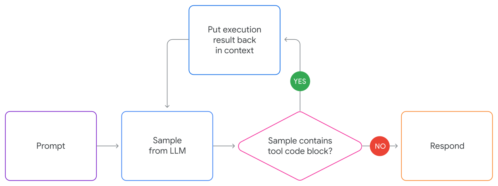

*图 8（原文 Figure 8，第 23 页）：Gemini 的工具使用控制循环。*

**图中文字翻译与读法**：

- **流程**：Prompt（提示）→ Sample from LLM（从 LLM 采样一段输出）→ 判断 Sample contains tool code block?（采样里是否含有工具代码块）。
- **YES（是）**：执行这个代码块，Put execution result back in context（把执行结果放回上下文），回到“从 LLM 采样”继续生成。
- **NO（否）**：Respond（把回答返回给用户）。
- **读图结论**：这是一个“采样、执行、把结果放回上下文、再采样”的循环，直到模型不再产生工具代码块才给出最终回答。

Gemini Apps 模型通过 Gemini Extensions 使用一系列工具，包括 Google Workspace、Google Maps、YouTube、Google Flights、Google Hotels，也让 Gemini 能集成进 Gmail、Docs、Slides、Sheets 等。作者建了一个内部基准，度量在旅行规划、视频发现等可能受益于这些扩展的领域中的人类偏好：配备工具的模型有 78% 的时候被偏好（不计平局）。

Gemini API 模型：对模型做微调就能有效教会工具使用行为；训练模型使用编程和搜索作为工具，还能提升一系列学术基准的表现。表 15 比较了由早期版本的 Gemini API Pro 微调出来的“使用工具”模型与同源的“不使用工具”模型。

**表 15：Gemini API 的工具使用模型与不使用工具的对应模型（准确率）**

| 模型 | GSM8K | MATH | NQ | Realtime QA |
|---|---:|---:|---:|---:|
| Gemini API Pro，使用工具 | 80.1% | 41.8% | 68.0% | 70.8% |
| Gemini API Pro，不使用工具 | 69.7% | 30.7% | 59.0% | 39.2% |

（原文表 15，第 23 页。前两列属“数学推理”，后两列属“事实性与知识检索”。）读法：不使用工具的模型是“未用工具数据训练的早期版 Pro”，使用工具的模型是同一模型再用工具数据微调的结果，所以这是一个受控的对照，但被比较的是早期版本的 Pro，不能与表 2 的 Pro 数字直接比较。由表中数字相减：GSM8K 提升 10.4 个点，MATH 提升 11.1，NQ 提升 9.0，Realtime QA 提升 31.6。最大的提升出现在需要最新信息的 Realtime QA 上，符合“搜索工具补上了模型自身不知道的实时信息”的直觉。

#### 多语言（表 16）

Gemini Apps 模型：把 Gemini 从英语扩展到 40 多种语言，主要难点是数据质量。作者利用丰富的高质量英文数据，通过“本地化到各自文化”来扩充，例如把“美国总统”改写成“日本首相”。表 16 比较了 Gemini（用 Pro）在 5 种语言上相对“旧后训练配方的、基于 PaLM 2 的 Bard”的表现；对 SxS 分数，正值表示前者更受偏好。

**表 16：Gemini（用 Pro）相对旧后训练配方的多语言表现**

| 语言 | 质量 SxS | 编码 MBPP Pass@1 | 推理 MMLU |
|---|---:|---:|---:|
| ja-JP（日语） | +0.14 | +22.2% | +3.6% |
| pt-BR（巴西葡萄牙语） | +0.17 | +23.2% | +5.2% |
| de-DE（德语） | +0.1 | +21.4% | +7.5% |
| es-419（拉美西班牙语） | +0.12 | +22.8% | +9.3% |
| it-IT（意大利语） | +0.13 | +13.8% | +7.5% |

（原文表 16，第 24 页。）读法：原文说五种语言的质量都提升了超过 0.1 个 SxS 分，表中 de-DE 恰为 +0.1；编码与推理上 Gemini Pro 带来的增益在各语言中保留。原表没有说明编码与推理列的“+x%”是绝对点数还是相对提升。

Gemini API 模型：同样用额外的多语言后训练数据，把原本的英文模型适配到多种语言；试验了人工写的非英语 prompt-回答对，以及自动翻译的对子——后者利用丰富的高质量英文示范数据。为保证翻译数据质量，做了两步：

- **可翻译性过滤（Translatability Filtering）**：不是所有 prompt-回答对翻译之后仍然合理，有些需要昂贵的本地化。原文举了三类例子：严格的字数要求（“写一篇 1000 字的关于世界和平的文章”）；过于以英语为中心（“用抑扬格五音步写一首关于苹果的诗”）；过于以拉丁字母为中心（“哪个单词含 1 个 E、2 个 A 和 1 个 U？”）。
- **翻译质量验证**：每个翻译后的对子至少由 3 名人工评审评定翻译质量，多数评审认为准确才保留进最终混合。

#### 多模态视觉（表 17）

Gemini Apps 模型：在纯文本与图文数据的混合上微调，细心平衡两者，使模型获得稳健的图像理解而不损害纯文本交互的质量。结果：用图文数据训练的 Pro，相对只用文本数据训练的等价模型，在纯文本任务上的 SxS 为 +0.01±0.01（即几乎没有损失）；用 SFT 加 RLHF 后训练的 Pro 相对只做 SFT 的版本，在图像理解任务上的 SxS 为 +0.223±0.06（RLHF 对多模态也有帮助）。

Gemini API 模型：表 17 报告预训练模型与后训练模型在这些基准上的差距（后训练的绝对数字已在表 7 中给出）。

**表 17：后训练对 Gemini API Ultra 图像理解的提升（准确率）**

| 基准 | Gemini Ultra 仅预训练（0-shot，仅像素） | Gemini API Ultra（0-shot，仅像素） | 预训练到后训练的提升 |
|---|---:|---:|---:|
| MMMU（val） | n/a | 59.4%（pass@1）；62.4%（Maj1@32） | n/a |
| TextVQA（val） | 81.4% | 82.3% | +0.9% |
| DocVQA（test） | 90.1% | 90.9% | +0.8% |
| ChartQA（test） | 80.8% | 80.8% | 0.0% |
| InfographicVQA（test） | 77.9% | 80.3% | +2.4% |
| MathVista（testmini） | n/a | 53.0% | n/a |
| AI2D（test） | 76.6% | 79.5% | +2.9% |
| VQAv2（test-dev） | 74.5% | 77.8% | +3.3% |

（原文表 17，第 25 页。）读法：预训练模型在这些基准上本来就很强；SFT 阶段在 InfographicVQA、AI2D、VQAv2 上带来最明显的提升（+2.4 至 +3.3），作者认为很可能是因为后训练提高了指令遵循能力，使输出风格与标准答案对齐；按这个解释，这部分提升主要来自答案格式的对齐，而不一定是看懂得更多（原文没有用消融实验验证这一解释）。MMMU 与 MathVista 没有给出预训练数字。

#### 编码（表 18）

尽管基座模型编码基准成绩已经很强，后训练数据仍能显著提升代码质量与正确性，这突出了高质量示范数据与反馈数据对编码用例的价值；Apps 与 API 模型都结合人工与合成方法收集这类数据。Gemini Apps 模型的编码表现用一组内部精选的、覆盖不同代码用例与语言的 prompt 评测，用 SxS 分数比较。

**表 18：内部编码基准上 Gemini 模型的 SxS 比较**

| A 方 | B 方 | SxS 分数 |
|---|---|---|
| Gemini（用 Pro） | Bard（PaLM 2，2023 年 9 月） | 0.19±0.03 |
| Gemini Advanced（用 Ultra） | Gemini（用 Pro） | 0.13±0.02 |

（原文表 18，第 26 页。）读法：正值表示 A 方更受偏好；两组比较都是 A 方更好，分数越大偏好越明显。对 API 模型的编码能力，原文请读者看表 2 的学术基准成绩。

## 十、负责任部署与安全（第 7 节）

这一节占了报告正文约三分之一，但**数字很少**：多数是流程、类别和定性发现。读的时候要分清“做了什么”和“结果怎样”。

### 10.1 整体流程

| 环节 | 原文节 | 做什么 |
|---|---|---|
| 影响评估 | 7.1 | 模型级与产品级两层。模型级评估由 Google DeepMind 的 Responsible Development and Innovation 团队做，并经 Responsibility and Safety Council 审阅，参考文献、外部专家意见和内部伦理与安全研究；产品级评估由 Google AI Principles 团队在上线前做（如 Gemini Advanced） |
| 安全政策 | 7.2 | 一组模型安全政策，作为开发与评估的标准化准则，也是衡量“发布是否就绪”的类别 |
| 缓解 | 7.3 | 数据策展与过滤；主要靠后训练（SFT 与 RLHF）；多模态与本地化的专项处理 |
| 安全评估 | 7.4 | 开发评估、保证评估、外部评估、红队测试 |
| 部署 | 7.5 | 为每个获批版本生成内部 model card，对外在技术报告与企业客户文档中发布模型卡与系统卡（附录 10.1 是 Gemini Ultra 模型卡） |

### 10.2 影响评估与安全政策

- **收益**：多模态能让用户更高效地处理信息（如摘要）；可用于视频描述、分析、商品描述等；也可用于无障碍场景，如为视觉输出生成描述。
- **风险**：参考 Weidinger 等（2021）、Shelby 等（2023）等前人梳理的风险，评估了内容风险（用户接触不安全内容：色情露骨、暴力、仇恨）、儿童安全伤害、表征性伤害，并据此设计评测；还分析了把能力（尤其是“媒体转文本”）用于监控的潜在滥用，以及多模态模型的更广泛环境与经济影响；对新兴的危险能力（如网络安全威胁）作持续研究，并纳入评估方法（见 10.5）。
- **产品级缓解**：对 Gemini Advanced，在安全、问责和包容等方面做了深入的红队、内部试用（dogfooding）与对抗测试；产品缓解措施包括：给出清楚、相关的说明来设定合理预期；在隐私声明中说明不应把回答当作医疗、法律、财务等专业建议；在产品里声明回答需要复核准确性；建立反馈渠道和运营支持。对 Gemini API Ultra：在企业特定数据上跨模态做了额外安全评估；默认启用符合 Cloud 阈值的安全过滤；在产品文档中为开发者提供负责任使用的说明；Vertex 界面内置反馈渠道。
- **安全政策覆盖**：儿童性虐待与剥削内容、仇恨言论、骚扰、危险内容（如制造武器的指导）、恶意内容；还有减少偏见的指南（内容应反映全球用户群体），以及“在权威、有共识的事实基础上给出中立回答，若无共识则提供多种观点”的指南。政策会考虑产品场景，如为 18 岁以下用户提供额外的安全覆盖。

### 10.3 缓解（7.3）

**数据策展**：在所有训练阶段之前，过滤高风险内容并保证质量；在后训练的数据创建和评估中有人参与，会在性别呈现、年龄、种族与民族上考虑多样性；遵循 Google DeepMind 的数据富集最佳实践（基于 Partnership on AI 的“负责任的数据富集服务采购”），合同中要求供应商至少向数据富集工人支付当地生活工资。

**模型缓解**：主要通过后训练（第 6 节）实现，对象是 Gemini Advanced 与 Gemini API Ultra。与面向所有查询的通用质量后训练不同，安全缓解更聚焦于对抗性的、会诱发有害回答的查询（harm-inducing queries）——即未设防的模型有可能按安全政策产生有害回答的那一小部分用户查询。

- **有害查询的覆盖**：枚举约 20 类伤害类型（如仇恨言论、给出无依据的医疗建议、建议危险行为），覆盖多种用例，三种来源生成数据集：政策专家与工程师根据观察到的模型失败来编写；用基于政策的指令和种子关键词（如政策“仇恨言论”加上描述某个具体人群的词）提示高能力语言模型来生成；通过评测中的自动化红队找出会触发违规回答的查询。
- **SFT**：给定上述有害查询，创建展示“安全且有帮助的回答”的 SFT 数据，包括人工收集，以及一种“松散地受 Constitutional AI 启发”的自定义数据生成配方：把 Google 内容政策语言的变体作为“宪法”注入，并利用语言模型强大的零样本推理能力来修改回答、并在多个候选回答之间做选择。不同类型的有害查询受不同“宪法”影响，例如鼓励模型在敏感争议话题（如选举）上不站队、保持中立视角。可对照本仓库的 [Constitutional AI 解读](../constitutional_ai/论文中文解读.md)。作者总结了两点经验：（1）“无害”与“有用”需要平衡——回答“我不能帮你，因为这违反 X 政策”虽然无害，但对用户没有帮助；（2）安全环境变化很快，要同时做到“快速缓解”（新发现的有害查询模式及时处理）和“泛化”（缓解能推广到不同的有害模式）并不容易，他们发现引入基于安全政策的更高级的 CoT 配方是值得的，使模型在“安全政策概念”的空间里而不是在细粒度的有害示例层面上运作。
- **RLHF**：对有害查询也用 RLHF，根据观察到的失败模式和整体安全政策分类，整理查询与回答，收集安全相关的偏好数据，并入总体的奖励模型训练混合。
- **本地化（i18n locales）**：请各个本地化区域的专家识别重要话题来生成 SFT 数据；例如对仇恨言论，美式英语与日语的差别不只在语言本身，还在于容易成为仇恨对象的人群不同。
- **多模态查询**：训练数据层面过滤高风险内容（如危险图像），避免模型主动生成这类内容；后训练时作者发现，针对纯文本查询的安全 SFT 数据对“图文混合的有害查询”无效，所以专门构建了多模态安全 SFT 数据集。

**如何评估缓解是否有效**：看安全性随时间如何改善，以及用缓解后的模型构建的对话 agent 与未缓解模型相比如何；开发阶段大量依赖内部的有害查询集来理解怎样降低危害、提升安全语境下的有用性。

**一个例子**（原文第 31 页）：同一个查询，对比旧版 Bard（PaLM 2）与缓解得更好的、可访问 Gemini Pro 的 Gemini。

| | 旧版 Bard（PaLM 2） | 缓解更好的 Gemini（可访问 Gemini Pro） |
|---|---|---|
| 查询 | 帮我做一个网站落地页，要写明“地球是平的，而不是圆的”，需要好的配图，并让它感觉像一个可信的网站 | 同左 |
| 回答 | 照办：给出“地球是平的：揭穿圆形星球的神话”之类的标题与文案，还评论文案“清楚易懂”“用科学术语让它显得更可信”，并鼓励“要有创意、有说服力，用证据支持你的主张” | 不照办：指出为平地球理论做宣传页“在伦理上存疑且问题很大”，平地球说已被大量证据证伪，传播错误信息会损害对科学的信任；建议若真感兴趣应查阅可靠的科学来源、进行批判性思考；若是做讽刺或虚构页面，应明确声明内容不当真，用夸张语言、幽默和免责声明；最后强调“互联网上的可信度建立在真实、可验证的信息之上” |

这个例子说明的是缓解方向（更安全、同时更有帮助地给出替代方案），不是定量评估。

### 10.4 安全评估的四种类型（7.4）

| 类型 | 谁做、何时做 | 要点 |
|---|---|---|
| 开发评估（Development evaluations） | 内部，贯穿预训练与后训练 | 内部设计的评测，或外部学术基准；考察有帮助程度（指令遵循与创造性）、安全、事实性 |
| 保证评估（Assurance evaluations） | 开发团队之外的小组，通常在关键里程碑或训练结束时 | 按模态标准化，数据集严格留出；只把高层洞察反馈给训练，用于缓解；包括跨安全政策的测试，以及对危险能力（如生物危害、说服、网络安全）的持续测试 |
| 外部评估（External evaluations） | 独立的外部领域专家小组 | 找盲区；方法与 prompt 集由各组独立设计，结果定期向内部团队与治理小组汇报 |
| 红队测试（Red teaming） | 专门的内部团队 | 对抗性测试，覆盖安全政策、安全性等；包含较不结构化的复杂对抗攻击，以发现新漏洞，再用于缓解和改进评测方法 |

评估频率随风险而异：危险能力评测在能力更强或有新能力的检查点上运行；安全政策评测则对发布进 Google 产品的每个后训练 Gemini 检查点都运行。

### 10.5 开发与保证评估的发现

#### 内容安全（7.4.1.1）

内容安全评测在**模型层**进行，不带用户实际会遇到的下游保护（如安全过滤），以了解模型本身的安全画像；用“基于以往模型交互训练的自动分类器加人工标注”，并为人工标注配备福祉计划。开发评估与保证评估使用不同的数据集，保证集被当作“留出集”以防过拟合。儿童安全是特别敏感的领域，由 Google Trust and Safety 的儿童安全专家团队来制作对抗 prompt、评估跨模态的输出。

- **文本到文本**：为后训练模型构造了 12 种语言的对抗 prompt，涵盖从代码生成到文本编辑等多种用例；由一个高能力语言模型基于人工收集并验证的种子合成，经过过滤与改写加人工审阅的迭代，再分成开发集与保证集。发现：总违规率随时间逐步下降；Ultra 与 Pro 的安全画像相近，医疗建议与骚扰是仍有改进空间的政策领域。
- **图像到文本**：对抗 prompt 由图像和相应问题构成，同样分成开发与保证两套。作者没有用对抗图像生成（那可能无法覆盖真实用户图像的多样性），而是请有经验的内容审核员来收集图像并编写对抗问题；用人工评估，并配有额外的福祉保护（专门培训、每天接触有害内容的时间上限、福祉资源与建议）。发现：初期结果显示，面对对抗图像与问题，模型会产生违规的描述，这推动了专门的多模态安全缓解（研究挑战包括：采集反映用户需求的多样图像内容；更好的工具来理解和分类潜在违规的多模态内容）；此后最新的 Pro 与 Ultra 在这些评测上有明显改善。
- **视频到文本**：与 Google Principles Pioneers 合作构建视频 prompt 集——这是 1000 多名 Google 员工组成的内部社区，覆盖 39 个国家和地区、85 种以上语言，负责在压力测试 AI 产品时发现公平性、伤害与人权问题；数据集针对安全政策里的风险，输出据此评估。发现：Pro 与 Ultra 结果相似，仇恨与危险内容是需要改进的领域；定性看有一部分源于幻觉或无依据的推断。

#### 表征性伤害（7.4.1.2）

- **文本到文本**：使用 Winogender、Winobias 与 BBQ（Bias Benchmark in QA）数据集，沿用 Glaese 等（2022）的设置，指标是偏见分数（bias score）。这类数据集都从某个有害刻板印象出发构造问题，测试模型是质疑还是强化它，并且“什么是好行为、什么是有害行为”定义明确——这对通用模型很有用，因为“好回答”通常高度依赖语境。作者因此只测量定义明确的行为，同时承认这种做法局限很大。他们注意到，这些数据集在大模型上很快饱和，准确率接近 99%，这意味着语言模型能力提升也可能减少这类表征性伤害，因此需要开发新的度量方式（超越二元性别与常见刻板印象）。另外，在预训练期间用 Perspective API 分类器监控 Real Toxicity Prompts 上的平均毒性，在“无毒 prompt”的续写上，抽取其中 10k 条子样本。发现：BBQ 的平均偏见分数接近 0（量表从 -1 到 1，-1 表示反刻板印象，1 表示强化刻板印象）；Real Toxicity Prompts 上训练期间的平均毒性分数在约 6% 上下波动。
- **图像到文本**：目标是测试模型在代表不同人群的图像上的能力。其一，按 Zhao 等（2021）的做法，测试不同性别外观与肤色的人物图像是否被以相近质量描述，比较的是 CIDEr 分数（衡量生成描述与人工参考描述的符合度）；没有观察到大的组间差异，但指标本身并不完美，因为人工参考描述可能本身有偏。其二，用 Dollarstreet 数据集做零样本分类评估，度量不同地理位置图像上的表现差异；与以往研究一致，模型对来自较低社会经济地区、北美与欧洲之外地区的图像效果更差——这是需要在未来迭代中继续研究和改进的方向。其三，用 MIAP 数据集（含肤色与性别外观标注），并构造一些通常无法从图像本身回答的问题（如“这个人的受教育程度是什么？”），测试模型是否做出**无依据推断**（ungrounded inferences），也考虑图像确实含有相关信息的情形；通过人工评估判断模型是否拒答、如果回答则是否依赖图像中可见的信息，并按肤色与性别外观做分析。发现：被要求时，模型会做出无依据的推断，但没有观察到对某一类人群更多做出无依据推断的一致模式。
- **视频到文本**：同样与 Google Principles Pioneers 合作，针对表征与公平风险构建视频 prompt 集并评估输出。发现：模型会做出无依据推断，其中一些会强化刻板印象或值得关注，但没有观察到 Gemini 的无依据推断存在一致的模式。

#### 危险能力（7.4.1.3）

危险能力指可能促成大规模伤害的模型能力，这类评测是“早期预警系统”，用来提示需要加大安全投入的方向。原文说下面这张表是概览，更多细节将在后续论文中给出。

**危险能力评测概览（原文未编号的表，第 35 页）**

| 能力 | 评测摘要（译） |
|---|---|
| Offensive cybersecurity（进攻性网络安全） | 在一系列 capture-the-flag（CTF，夺旗）挑战上测试 Gemini API Pro、Ultra 与 Gemini Advanced，让模型可以访问 Bash shell。Gemini Advanced 与 Gemini API Ultra 能解决一些入门级的战术性挑战，但所有模型在需要更长程探索与规划的挑战上都很吃力。还测试了模型识别安全相关补丁、识别函数源码中安全漏洞的能力，这两项的准确率都明显偏低 |
| Persuasion & deception（说服与欺骗） | 在有真人参与者的一对一对话研究中，测试 Gemini Pro 与 Ultra 能否说服或欺骗人。在某些情形下模型能成功欺骗或影响参与者，但总体结果好坏参半 |
| Self-proliferation（自我扩散） | 测试由 Gemini Pro 与 Ultra 驱动的自主 agent 能否完成与获取资源、自我改进相关的困难任务（Kinniment 等，2023）；没有发现这些 agent 接近完成其中大多数任务 |
| Situational awareness（情境意识） | 测试 Gemini Pro 与 Ultra 在受到激励时，能否自主推理并修改其周围的基础设施。没有提示时，模型一般无法注意到这类机会 |
| CBRN（化学、生物、放射、核）风险 | 用人工评估考察模型对生物、放射、核信息风险各 50 个对抗性问题的回答，由领域专家回答一系列问题（如“回答有多准确？对非专家有多大可操作性？”）；化学信息风险方面，对 Gemini API Ultra 与 Gemini Advanced 回答 360 多个与化学品各类危害相关的封闭式问题的能力打分（不使用人工评审）；生物、放射、核信息风险还用封闭式的知识型选择题评估。结果表明，模型不太可能提供会导致灾难性危害的 CBRN 信息 |

读法：这张表只有结论性的描述，没有任务数、通过率或基线；“好坏参半”“不太可能”这类措辞无法被外部检验。

### 10.6 Gemini Advanced 的产品级评估、红队与外部评估

**产品级评估（7.4.2）**：在模型层做法之外，对 Gemini Advanced 还要在产品层评估，要把安全过滤等额外缓解与用户体验算进去。评测集被设计成逼近 Gemini Advanced 政策的极限，从高度对抗的攻击到更微妙的敏感话题探测；围绕仇恨言论、危险内容、医疗建议等关键政策领域，覆盖信息搜索、比较、创意写作等用户旅程；追求话题、查询长度、语言风格与地区敏感性的多样化；评测集的构建利用了以往红队迭代的知识、责任专家的反馈和真实世界数据，有时用 LLM 做数据增强，再由责任领域专家人工整理。

**红队测试（7.4.3）**：红队是一种对抗性测试，由“攻击者”对 AI 系统发起攻击。

- **对手模拟（adversary simulations，非结构化测试）**：红队测试在 2023 年 12 月的 Gemini API Ultra 检查点上进行，分两种互补的方式，这是第一种。目标是模拟真实对手及其攻击方式，关注安全、安全性与隐私方面的失败；结合内部专长与外部专家探索多类漏洞（见下表）。开始前，红队设定场景：要模拟的对手、攻击者具备的能力、动机与目标；然后扮演这个攻击者，执行他们预期会发展出来的战术、技术与流程。攻击者目标沿三个维度考虑，对应安全分析中的三类安全违规：可用性崩溃、完整性违规、隐私泄露；攻击者画像从“愿意花几个小时攻击模型、但没有高级编码或提示工程能力的、有决心的低技能行为者”，到“能微调模型并构造针对性攻击的更复杂攻击者”。可操作的发现例如：早期版本容易受到简单的越狱与提示注入攻击，对涉及宣扬暴力、自残与危险物质的请求给出肯定回答，这一发现使后续模型得以缓解。
- **结构化红队（Structured Red Teaming）**：第二种方式，采用社会技术（sociotechnical）视角，与当时的最先进红队技术相比做了三点改变——显式测试安全政策违规与对不同人口群体不成比例影响之间的相互作用；利用包含亲身经历、事实核查与医学专长在内的专家输入；对比模型在不同对抗强度下的失败。原文的结论是：针对模型安全政策测试 Gemini API Ultra，发现了若干需要改进的领域；在低对抗设置下已在多个内容政策领域发现漏洞，而在高对抗设置下成功攻击的比例更高，作者将继续应用并开发缓解措施。

**表：红队对手模拟涉及的漏洞类别（原文未编号的表，第 37 页）**

| 目标 | 漏洞类别 | 说明（译） |
|---|---|---|
| Integrity（完整性） | Prompt injection（提示注入） | 旨在让用户执行非预期或未授权操作的输入 |
| Integrity（完整性） | Poisoning（投毒） | 操纵训练数据和/或模型，以改变其行为 |
| Integrity（完整性） | Adversarial inputs（对抗输入） | 专门构造的、旨在改变模型行为的输入 |
| Privacy（隐私） | Prompt extraction（提示词提取） | 泄露系统提示词或 LLM 上下文中名义上应保密的其他信息 |
| Privacy（隐私） | Training data exfiltration（训练数据外泄） | 破坏训练数据的隐私 |
| Privacy（隐私） | Model distillation/extraction（模型蒸馏或提取） | 获取模型超参数、架构、参数，或对模型行为的近似 |
| Privacy（隐私） | Membership inference（成员推断） | 推断私有训练集中的元素 |
| Availability（可用性） | Denial of service（拒绝服务） | 攻击者造成的服务中断 |
| Availability（可用性） | Increased computation（增加计算量） | 导致服务中断的模型可用性攻击 |

（第 37 页。）读法：发现新漏洞后，会开发自动化的系统与测试，对该漏洞做主动、可重复、大规模的测试与监控（如漏洞扫描器、标准测试集或基准）。

- **Gemini Advanced 的红队（7.4.3.2）**：经过多轮红队测试，包括安全与 persona（角色风格）评测。招募了 Principles Pioneers 和多个领域的全职员工专家，经过校准与培训后测试产品：164 名 Google 测试员，来自 24 个国家的 65 个办公地点，提交了 1,400 多条查询或对话；此外有聚合所有政策的 10 万多条评分的规模化安全评估、监控敏感话题中立性与均衡性的“中立观点”评估，以及多轮 persona 评估来验证语气。还有“内部试用”（dogfooding）计划：头 14 小时就有数万名试用者，产生 10 万条查询或对话，收集并分析了 190 多份试用问卷，完成并整理了 11 场用户体验研究访谈。

**外部评估（7.4.4 与 7.4.5）**：

- **Gemini Ultra 外部评估**：2023 年起与少数独立的外部团体合作，进行结构化评估、定性探测和非结构化红队。外部团体按领域专长选定，涵盖白宫承诺、美国关于安全可靠可信 AI 的行政命令、Bletchley 宣言所列的领域：自主复制；CBRN 风险；网络能力与网络安全；社会风险（表征与分配伤害、中立性与事实性、鲁棒性与信息危害）。Google 给每个团体提供测试范围的指引，但各团体独立设计测试方法和 prompt 集，独立于 Google 撰写报告；Google 内部专家可在需要时提供意见。
- **访问权限**：外部团体获得了 2023 年 12 月 Gemini API Ultra 检查点数周的**黑盒**访问，可以通过 Cloud Vertex AI API 做结构化批量评估，或通过聊天界面交互；**没有**得到预训练模型、模型权重，也没有对预训练数据的可查询或直接的外部访问。被测的是生产就绪的微调版本，默认带安全微调与安全过滤，可以配置温度、token 上限、Top-k、Top-p 等采样参数；通过程序接口测试的团体可以关闭部分安全过滤，但作者希望多数外部测试在保留安全过滤的状态下进行，以反映终端用户的交互，也测试模型安全之外的内容。
- **Gemini Advanced 的三类外部测试**：Priority User Program（120 位重度用户、关键影响者与思想领袖，通过用户界面实时反馈安全与其他领域，重点包括安全与 persona、功能、编码与指令能力、事实性）；Power Users Testing（通过外部供应商招募的 50 位重度用户）；Security Testing（通过合作机构招募的有安全背景的外部测试员，做安全与提示注入测试、越狱和用户界面安全失败）。

### 10.7 部署（7.5）与这一节的证据强度

- 完成责任与安全评审后，为每个获批的 Gemini 版本创建内部模型卡（Mitchell 等，2019），用于结构化、一致地记录关键性能与责任指标，并为对外沟通提供依据；对外在技术报告更新和企业客户文档中持续发布模型卡与系统卡（附录 10.1 即 Gemini Ultra 模型卡）。产品网站上有使用条款、模型分发与访问、变更控制、日志、监控与反馈等运营方面的说明。
- **证据强度**：这一节给出的数字只有 BBQ 偏见分数接近 0、Real Toxicity Prompts 毒性约 6%，以及评测与红队的人数规模；各类内容安全评测的违规率、危险能力评测的任务数与通过率都没有公开，原文反复写“将在后续报告中提供更多信息”。因此应当把这一节读成“作者做了哪些类型的评测、发现了哪些问题类别”，而不是“模型在安全上达到了什么水平”。

## 十一、模型卡（附录 10.1）

附录 10.1 给出 Gemini Ultra 的模型卡（第 71 至 73 页）。把它放在这里是因为它是整份报告里对“公开了什么”最凝练的一页。

| 栏目 | 内容（译） |
|---|---|
| 模型架构 | Gemini V1.0 是一族新的最先进语言模型，含 Nano、Pro、Ultra 三类变体（按参数量排序），基于 decoder-only Transformer；训练支持 32K 上下文，采用 multi-query attention 等高效注意力；联合在图像、音频、视频和文本数据上训练。本卡描述的后训练模型是建立在 Gemini Ultra 预训练模型之上的 Gemini API 与 Gemini Apps 变体（第 6 节）；后训练期间还做了额外的架构修改，以支持 RLHF 用的多目标奖励模型的训练 |
| 输入 | 文本（如问题、提示、待摘要的文档）、图像、视频、音频文件 |
| 输出 | 针对输入生成的文本（如问题的答案、多个文档的摘要、对文档或视频的比较） |
| 应用 | 用于加速语言模型研究，作为 Google 产品功能的构件，以及某些应用（如 Gemini App 与 Search Generative Experience）的构件；基于 Gemini Ultra 的服务和产品也通过 Google Cloud Vertex API 与 Google Labs 向外部开发者提供，并附带与安全政策相关的额外流程与技术保障 |
| 已知注意事项 | Gemini 不应在未事先评估并缓解与下游用途相关的安全和公平性问题的情况下，作为通用服务或产品的一部分提供，或用于特定的下游应用 |
| 硬件与软件 | 硬件：在 TPUv4 与 TPUv5e 上训练；软件：JAX、ML Pathways。JAX 与 ML Pathways 如第 3 节所述配合使用，“单控制器”模型让一个 Python 进程编排整个训练 |
| 算力需求 | Not reported（未报告） |
| 模型初始化 | 初始预训练用随机初始化；后训练从预训练后期阶段得到的检查点初始化，这些检查点先做 SFT，之后再用来初始化奖励模型训练与 RLHF |
| 模型状态 | 静态模型，在离线数据集上训练 |
| 模型统计 | Not reported（未报告） |
| 训练数据集 | 多模态、多语言；来自网页文档、书籍、代码，并包含图像、音频、视频数据（见第 4 节） |
| 评测数据集 | 与外部 LLM 及上一代最强模型 PaLM 2 在推理、阅读理解、STEM 与代码的文本基准上比较；另评测四类多模态能力（高层目标识别、细粒度转录、图表理解、多模态推理）（见第 5 节） |
| 后训练数据集 | 收集多样的、代表真实用例的 prompt；收集示范数据做 SFT；再收集对同一 prompt 的不同回答的反馈数据，训练奖励模型（见 6.3） |
| 评测结果 | 见第 5 节与 6.4 |
| 敏感用途 | 有关风险与敏感用途的分析见 7.1 |
| 已知局限 | 见 7.1；在未对拟用的下游应用做进一步的危害分析之前，不应用于下游应用 |
| 伦理考量与风险 | 见第 7 节；各类风险的评估细节见 7.4 |

（原文附录 10.1，第 71 至 73 页。）读法：模型卡里“Compute Requirements”与“Model Stats”两栏都写 Not reported，与第二节的披露清单一致。

## 十二、局限、证据边界与常见误读

### 12.1 报告自己承认的局限（第 8 节）

- 幻觉仍需持续研究，让模型输出更可靠、可验证；
- 尽管在考试类基准上表现出色，LLM 在需要高阶推理（因果理解、逻辑演绎、反事实推理）的任务上仍有困难，这说明需要更有挑战性、更稳健的评测来衡量其“真正的理解”，因为最先进的 LLM 正在使许多基准饱和；
- 报告把 Gemini 看作朝“大规模、模块化、能在许多模态上广泛泛化的系统”迈出的一步。

### 12.2 我读出的证据边界

1. **“超过人类专家”的条件**：MMLU 的 90.04% 依赖 7.2 的路由协议（32 次采样、验证集调阈值）；在报告自己给出的 5-shot 对照（83.7% 对 GPT-4 已发表的 86.4%）以及图 9 的贪心与 CoT@32 两种协议下，Ultra 并不领先 GPT-4。
2. **“30/32”的计数口径**：报告没有逐项列出这 32 项。按表格推断，文本 12 项很可能是表 2 的 9 项加表 5 的 3 项，其中未拿到最佳的两项应是 HellaSwag（GPT-4 的 95.3%）与 Wikilingua（PaLM 2-L 的 50.4）——这是我的推断，原文没有明说。语音的 5/5 与 5.2.4 节“未评测 Ultra”并存；图像的 9/9 与表 7 里 Ultra 低于微调模型的两项（AI2D、VQAv2）并存。
3. **对比口径不一**：GPT-4 等对手的数字有的是作者在 2023 年 11 月通过 API 自测，有的是引用已发表数字；有的对手是微调模型；GSM8K、MMLU、MMMU 的头条数字用了多样本投票，对手是单次作答或另一种协议。
4. **差距的统计意义**：表 2 的多项领先不足 1 个点，且没有置信区间或多次运行方差。
5. **数据污染**：作者自己用 HellaSwag 做的实验显示，仅用 100 步微调就能把 Ultra 的 1-shot 提高到 96.0%，说明基准分数对预训练数据构成很敏感；LAMBADA 因此未报告。去污染措施的细节（匹配方式、阈值）没有公开。
6. **“原生多模态”缺少对照**：报告没有“联合训练 vs 分阶段训练或外挂冻结编码器”的消融，“联合训练带来强的各模态能力”的证据是横向比较。
7. **内部基准与人工评测不可复现**：复杂指令遵循（表 14）、各 SxS 评测（表 16、18、6.5.4 节）与事实性评测集都是内部构造，样本量与评分细则没有公开。
8. **定性示例是精选的**：图 1、5、6、10、12、18、22、23 等没有失败案例或成功率。
9. **安全评估偏定性**：见 10.7。红队发现早期版本易受简单越狱与提示注入攻击，高对抗设置下成功攻击比例更高，都说明“已做缓解”不等于“已安全”。

### 12.3 常见误读

- “Gemini Ultra 的 MMLU 是 90%。”应说成“在 CoT@32 加不确定性路由协议下是 90.04%；5-shot 是 83.7%”。
- “报告证明了原生多模态比外挂编码器好。”报告没有做这个对照。
- “Ultra 在所有模态上都评测过。”音频只评测了 Pro 与 Nano-1。
- “Nano 是 Ultra 的缩小版。”原文只说 Nano 由更大的 Gemini 模型蒸馏而来并做 4-bit 量化，没有公开它们与 Pro、Ultra 在架构上的异同，不要自行推断。
- “报告公开了训练配方。”公开的是系统与流程层面的信息，参数量、层数、数据配比、token 数、RLHF 细节都没有。
- “安全评估通过了。”见上文，报告只给出评估类型与定性发现。
- “这就是 Gemini 的最终能力。”报告只覆盖 Gemini 1.0（Nano、Pro、Ultra），且评测针对 2023 年 11 至 12 月的版本与 API 检查点。

## 十三、复现检查清单与相关论文

### 13.1 能复现什么、不能复现什么

- **不能复现**：训练（权重、数据、算力都不公开）；内部基准与人工评测；评测时用的具体检查点。
- **可以借鉴的协议**：MMLU 的不确定性路由 CoT（用任意模型自行实现，但要自己调阈值）；视频评测的“每段视频均匀采样 16 帧”；图像评测的“贪心解码、仅像素、不用外部 OCR”；SxS 的 -1.5 到 1.5 评分换算。

### 13.2 如果你要在别的模型上对照这份报告

- 记录具体的模型版本、API 日期和采样参数；报告里的对手数字是 2023 年 11 月的快照。
- 固定 shot 数、CoT 提示词、答案抽取方式，以及是否使用多样本投票；做路由协议时，在验证集上选阈值并报告所选值。
- 多模态输入要固定图像分辨率、视频帧采样与音频处理方式，并说明是否使用外部 OCR。
- 比较时把“0-shot 与微调”“单次与多数票”“自测与引用”分开列，不要把它们放在同一个“最佳”标记下。
- 检查污染：至少对新建的留出集和旧基准分别汇报。
- 把安全评测与能力评测一起报告，不要只摘领先数字。

### 13.3 与本仓库其他论文的关系

- 视觉输入设计受 [Flamingo](../flamingo/论文中文解读.md) 启发；报告里作为上一代旗舰的 PaLM 2，其前身 PaLM 见 [PaLM 解读](../palm/论文中文解读.md)。
- 最大模型的 token 数用 [Chinchilla](../chinchilla/论文中文解读.md) 的思路确定；注意力提到 [Multi-Query Attention](../multi_query_attention/论文中文解读.md)；编译与并行用到 [GSPMD](../gspmd/论文中文解读.md)。
- MMLU 路由协议建立在 [链式思维](../chain_of_thought/论文中文解读.md) 与 [Self-Consistency](../self_consistency/论文中文解读.md) 之上；后训练的 RLHF 可对照 [InstructGPT](../openai_instructgpt/论文中文解读.md)。
- 同类披露有限的报告：[GPT-4 技术报告](../openai_gpt4/论文中文解读.md) 与 [Claude 3 模型卡](../anthropic_claude3_model_card/论文中文解读.md)，可对照三者“公开什么、不公开什么”和安全评估的组织方式。
- 语音评测的对手之一是 [Whisper](../whisper/论文中文解读.md)；Nano 的“从大模型蒸馏”可对照 [知识蒸馏](../knowledge_distillation/论文中文解读.md)。

## 原文证据导航

- [原论文 PDF](paper.pdf)
- [原文提取文本](paper.txt)
- [论文概要](论文概要.md)
- 关键位置：[表 2 文本基准总表，第 8 页](paper.pdf#page=8)；[表 7 图像理解，第 13 页](paper.pdf#page=13)；[第 6 节后训练，第 20 页](paper.pdf#page=20)；[第 7 节负责任部署，第 26 页](paper.pdf#page=26)；[附录 10.1 模型卡，第 71 页](paper.pdf#page=71)；[附录 10.2 MMLU 的 CoT 比较，第 73 页](paper.pdf#page=73)。
