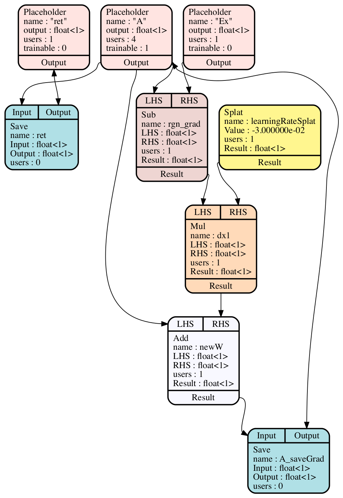
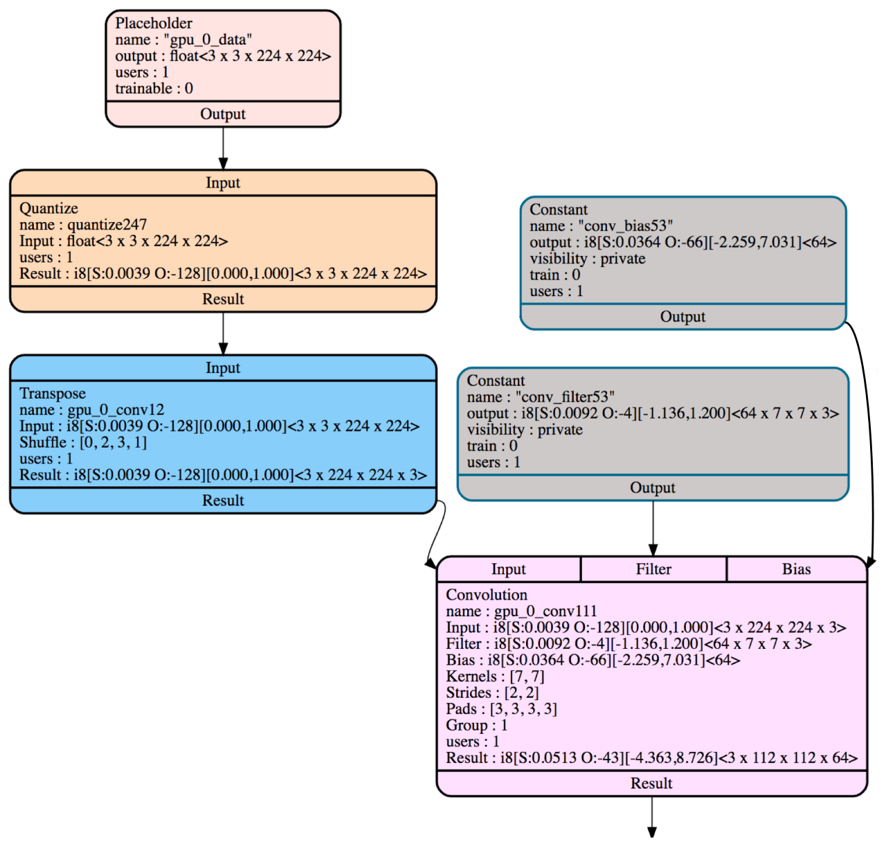
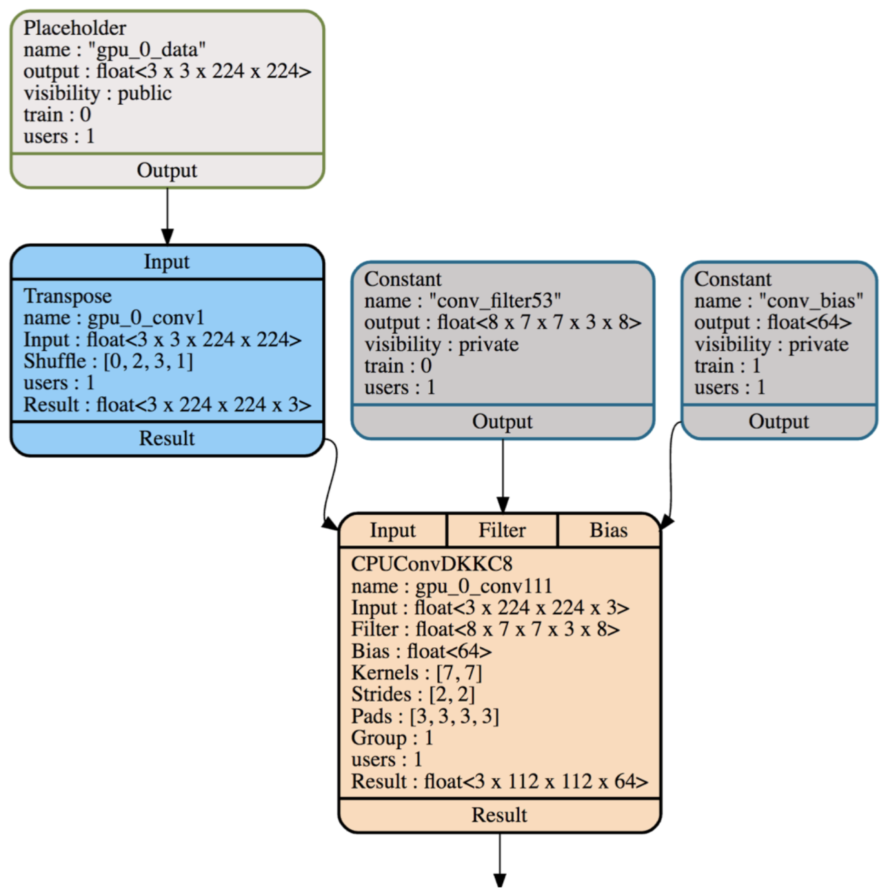
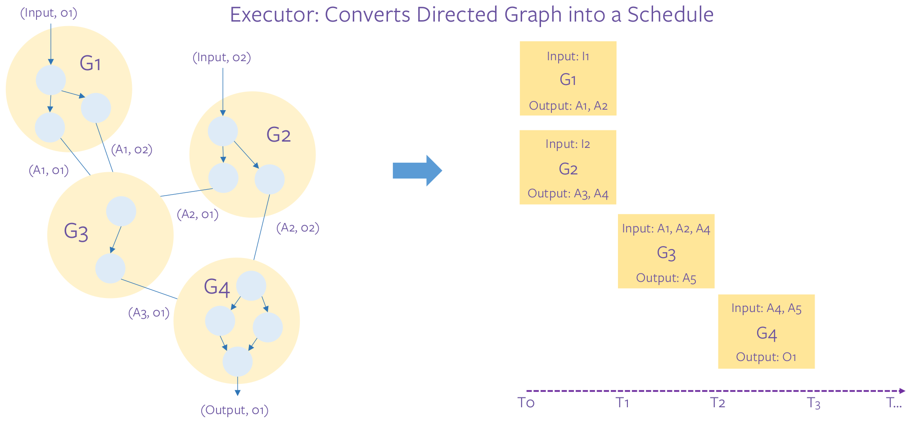
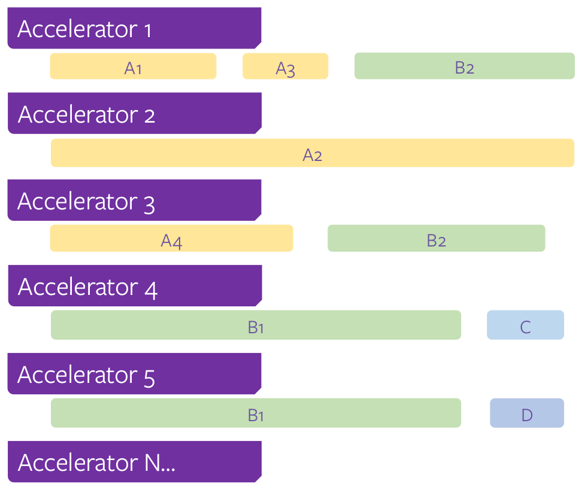
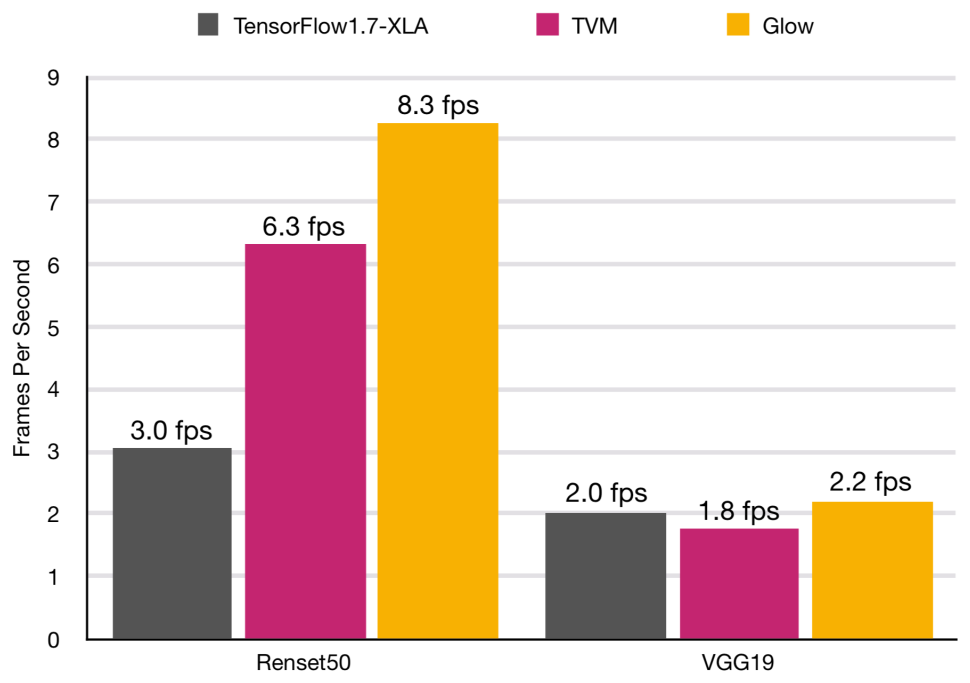

# 论文中文解读：《Glow: Graph Lowering Compiler Techniques for Neural Networks》

> **基本信息**：Nadav Rotem、Jordan Fix、Saleem Abdulrasool、Garret Catron、Summer Deng、Roman Dzhabarov、Nick Gibson、James Hegeman、Meghan Lele、Roman Levenstein、Jack Montgomery、Bert Maher、Satish Nadathur、Jakob Olesen、Jongsoo Park、Artem Rakhov、Misha Smelyanskiy、Man Wang（Facebook），arXiv:1805.00907v3 [cs.PL]，2019 年 4 月；论文原文 [官方页面](https://arxiv.org/abs/1805.00907)，开源代码 github.com/pytorch/glow。
>
> **本文的读法**：图 2、5、7、9、10、11 取自 `paper.pdf` 的原图；原文的图 1、3、4、8 以及图 6 是代码或文字清单，本文用代码块逐字转录并逐行解释，不再放截图。原文没有数据表，只有一张结果图（图 11），其数字就标在图上，本文逐一核对后转成表。标注“（补充）”的内容不在原文里，是帮助读懂的背景知识或笔者的核对。

## 一、一句话结论

Glow（名字来自 Graph-Lowering，“图降低”）是 Facebook 开发的、面向异构硬件的神经网络编译器。它不把神经网络计算图一步编成机器码，而是分层降低：先在**高层 IR**（带强类型的节点图）上做与领域相关的优化，并把 FullyConnected 这样的高层算子“降低”成少量线性代数算子（如矩阵乘加广播加法），使新硬件后端只需实现少数原语；再把图翻译成**低层 IR**（只含地址的、基于指令的表示），做指令调度、静态内存分配和拷贝消除；最后由各个后端做机器相关的代码生成。论文还介绍了基于 profile 的 int8 量化、基于 LLVM 的 CPU 后端（含 operator stacking）和运行时（分区、供给、设备管理、执行器）。唯一的性能实验是在单线程的 Intel Core i7-7600U 上，ResNet50 的吞吐是带 XLA 的 TensorFlow 1.7 的约 2.7 倍、是未调优的 TVM 的约 1.3 倍。

## 二、背景与动机

### 2.1 为什么需要编译器

论文开头的逻辑链如下：

1. 摩尔定律带来的节能红利结束，加上机器学习对算力的需求增长，引发了计算机体系结构的创新浪潮。Hennessy 和 Patterson 提出了机器学习领域专用架构（DSA）的五条设计原则：专用的本地存储、大量算术单元、简单形式的并行、更低的位宽、面向领域的编程模型。要在 DSA 上高效执行神经网络，编译器需要做先进的**整图优化**。
2. 传统机器学习框架按“node-visitor（节点访问者）”的方式遍历图中的节点，一个一个地执行；这种方式即使在传统处理器上也低效。因此框架开始把图交给编译器（论文引用 XLA 和 TVM）去更高效地执行代码。
3. 作者认为未来的框架将专注于提供有吸引力的编程模型，其下面是一层集成了多种目标编译器的软件层。Glow 专注软件栈的**下半部分**：为 PyTorch 和其他框架提供一个低层图和神经网络代码生成器。
4. 作者给“低层图”的定位是：Glow 的低层图**不会取代**机器学习的高层图，就像编译器中的低层 IR 不会取代抽象语法树（AST）一样。
5. 目标是提供一个有用的编译器工具包，让硬件开发者专注于实现高效的加速硬件（各家加速器的能力各不相同），而用 Glow 自动完成指令选择、内存分配和图调度这类编译任务。论文说明，Cadence、Esperanto、Habana、Intel 和 Qualcomm 已承诺在未来的芯片产品中支持 Glow。

### 2.2 现有框架的可扩展性问题

PyTorch、Caffe、TensorFlow 等框架成功地让开发者创建并在特定架构上执行神经网络，但支持新架构和新算子**不可扩展**：新增一个算子，要在每个已支持的架构上各实现一遍；新增一个架构，要为它实现所有算子。Glow 的设计是消费一张神经网络计算图，对它做优化并为多种后端生成代码，方式更具可扩展性，其中包括在面向具体后端之前做与目标无关的优化与分析。

ONNX 是一个用来表示和序列化 AI 模型的开源格式，使不同框架之间可以互操作，例如把 PyTorch 的计算图转成 CNTK 的。

### 2.3 为什么需要高层 IR：一个 C 语言的例子（原文图 1）

论文用一段很小的 C 代码说明为什么直接把图翻成低层循环不够：

```c
for (...) A[i] = 3;
for (...) A[i] = 4;
return A[0];
```

原文图注：当这两个循环来自数据流图中两个不同的节点时，编译器很难分析和优化这段代码。两个循环写同一块内存区域，之后 `return` 读其中一个元素。GCC 和 LLVM 都没能删掉第一个循环（它是冗余的），也没能把这次读取替换成常量 `4`。原因是分析循环和内存很难：编译器需要证明循环下标不会溢出、程序中的指针不会别名（alias）、计算结果准确并符合 C 语言规范。（补充：这是论文 2018 年的说法，本文没有在今天的编译器上重新验证；它想说明的是“让 C++ 编译器反推循环语义很难”，不是对某个编译器版本的评测。）

因此，依赖一个足够好的 C++ 编译器去优化神经网络并不是可行的策略：例如，很难从 7 层循环里反推出这是一个卷积。论文的做法是实现一个**高层 IR**，让编译器能对张量和算子这样的高层构造进行推理和优化。

### 2.4 与已有编译器项目的比较（原文第 2 节）

| 系统 | 论文对它的描述 |
|---|---|
| TensorFlow XLA | 为 CPU、GPU 和加速器编译神经网络，是解决实际问题的实用编译器，在 Google 生产环境驱动大量加速器。它把节点降低成原始线性代数运算，再针对不同后端调用后端专用库（CPU 用 Eigen，GPU 用 cuDNN）完成大部分计算。XLA 对部分节点（如 dot）发出向量化的 LLVM IR，对其余节点依赖 LLVM 向量化器。它的目标是为 TensorFlow 提供后端灵活性，类似于 Glow 正在为 PyTorch 等框架所做的 |
| TVM / NNVM | 把节点降低成一个低层的、基于 Halide 的 IR，可以在上面做基于循环的优化；再用 Halide 生成 LLVM 或 CUDA/Metal/OpenCL 源码 |
| DLVM | 把 DLVM IR 降低成 LLVM IR，受益于 LLVM 成熟的优化器和代码生成器 |
| nGraph | 把框架（如 TensorFlow）的计算图在内部表示成单层 IR，再降低到 cuDNN 和 MKL-DNN 等后端 |
| Tensor Comprehensions | 提供一种语言，让神经网络开发者指定网络，由 JIT 编译器用算法搜索最高效的执行计划，再生成适合具体后端的语言（如 GPU 的 CUDA）并编译。适合想创建现在不存在的新算子并高效执行的程序员 |

论文总结它们与 Glow 的共同点：它们都包含一层或多层 IR 来表示神经网络模型的计算图；和 Glow 一样，许多系统把张量表示成带 shape 和元素类型的一等公民。Glow 的特点是：**在整个栈中使用多层自己的 IR，并把进一步的降低留给各后端按需实现**。例如 Glow 的 CPU 后端执行低层 Glow 指令，并调用自带的 `libjit` 标准库里的算子 kernel（用 C++ 实现，由 LLVM 编译，见第五节）。

## 三、IR 的设计（原文第 3 节）

### 3.1 总体结构

Glow 是一个可重定向（retargetable）的编译器，支持多种后端：编译器的前几个阶段与目标无关，越接近指令选择，IR 越与目标相关。这种设计并非 Glow 独有，许多编译器和虚拟机都用类似技术把程序逐步规范化、优化并降低成指令流。**前两层 IR 为所有编译目标共享**，各后端还可以实现额外的 IR 层。

下表概括论文给出的三个层次（注意节点降低发生在高层图上，见 3.4；IRGen 之后才进入低层 IR，见 3.5）：

| 层次 | 表示 | 能做的优化（论文的说法） |
|---|---|---|
| 高层 IR | 带强类型的、基于节点的数据流图（类似 Caffe 里的图） | 领域相关的优化，如图级优化、常量传播、量化；节点降低（node lowering）也在这一层做 |
| 低层 IR | 基于指令的、只含地址的表示，操作按地址引用的张量 | 与内存有关的优化：指令调度、静态内存分配、拷贝消除、就地（in-place）缓冲区变换 |
| 后端自己的层次 | 由各后端决定 | 机器相关的代码生成，利用专用硬件特性 |

### 3.2 高层 IR

高层 IR 是一张基于节点的数据流图，类似于在 Caffe 内部能看到的图。加载一个神经网络模型时，把**一个算子直接翻译成一个或多个节点**，构成这张图。这是一个简单的图，允许基本变换，例如把某个节点的所有使用替换成另一个节点，或修改编译期已知的输入张量（如预训练权重）的内容。

**强类型。** 图是强类型的：输入和输出都有已知的张量类型（由张量的 shape 和元素类型组成），节点的类型由编译器验证。例如逐元素加法指令的两个操作数必须类型相同。

**为什么不做参数化类型。** 一些强类型语言能以安全的方式表示运行时的动态类型，Swift 的泛型就是一例，它允许对未知但受约束的类型做编译。论文考虑过开发某种参数化的张量类型来支持批大小可变等特性，但最终决定实现一个简单而严格的类型系统，让高层机器学习框架在构造 Glow 图之前先把计算特化。作者评估了现代编程语言实现泛型的机制，结论是大多数硬件加速器不支持其中一些机制。使用 Glow 的生产系统可以为不同的批大小生成多张 Glow 图，或者即时（just-in-time）重新计算图。

**模块、函数、节点。** Glow 图组织成一个**模块（module）**，里面有多个**函数（function）**，函数里有多个**节点**。其中 **Storage 节点**类似 C 程序里的全局变量，归模块所有，同一模块的所有函数都可访问；其余节点归函数所有，代表神经网络的各种运算，例如 Convolution、MaxPool、MatrixMultiply，它们可以引用并访问所在模块拥有的 Storage 节点。

Storage 节点是基类，实现为 **Constant** 和 **Placeholder** 两种节点：

| 节点类型 | 含义 | 优化器能做什么 | 例子 |
|---|---|---|---|
| Constant | 由编译期已知的具体张量支撑 | 优化器可以检查并优化它的内容：删除未使用的 Constant、转置、量化（第四节）、做常量传播等 | 推理时 Convolution 节点的预训练权重输入 |
| Placeholder | 符号节点，其支撑张量可以在编译之后才指定或更换 | 优化器**不能**检查或优化其内容。用不同的支撑张量重新绑定并编译同一个函数，程序语义不变 | 图像分类卷积网络的输入图像张量，不用重新编译就能更换 |

Glow 程序的输入和输出应该用 Placeholder 节点建模。

**端到端例子：训练后转成常量。** 一个模块可以同时包含推理函数和该推理函数的梯度函数。待训练的权重建成 Placeholder 节点，因为训练时它们不是常量；执行梯度函数会更新这些权重 Placeholder 节点背后的张量；推理函数里的节点则可以引用这些权重 Placeholder（它们背后是已经训练好的权重张量）。随后 Placeholder 可以转换成 Constant，编译器知道这些节点是常量之后就能更好地优化推理函数。

编译器有一个调试方法，能输出图的文本和图形表示。图 2 就是这样得到的。



*图 2（原文 Figure 2，第 4 页）：Glow 高层 IR 中一张降低后的计算图，表示对 A 的一次回归，梯度由 Glow 自动求导得到。*

**图中文字翻译与读法**：

- **节点框里的字段**：每个节点框写出类型（Placeholder、Save、Sub、Mul、Add、Splat）、`name`（名字）、操作数与结果类型 `float<1>`（1 维、1 个元素的 float 张量）、`users`（使用者个数）。Placeholder 还带 `trainable`（是否可训练），框底部的 `Output` 是它的输出端口。
- **三个 Placeholder**：`"ret"`（`users : 1`，`trainable : 0`）、`"A"`（`users : 4`，`trainable : 1`，是被回归、被更新的变量）、`"Ex"`（`users : 1`，`trainable : 0`，期望值）。
- **计算链**：`Sub`（`name : rgn_grad`，`LHS`=A，`RHS`=Ex）算出回归的梯度 A 减 Ex；`Splat`（`name : learningRateSplat`，`Value : -3.000000e-02`）把常数 −0.03 铺成张量；`Mul`（`name : dx1`）把梯度乘以 −0.03；`Add`（`name : newW`）把 A 与这个乘积相加，得到新的 A；`Save`（`name : A_saveGrad`）把 `newW` 写回 Placeholder A 背后的张量。另一个 `Save`（`name : ret`）把 A 保存到 Placeholder `ret`。
- **读图结论**：论文说明，Glow 把计算表达式梯度的节点和随机梯度下降（SGD）节点降低成一串低层算子（Sub、Mul、Add 和 Save）。**各后端不需要为 DivGrad 或 SGD 节点实现支持**，只需支持这四种基本算子。（补充：整张图等价于 A ← A − 0.03 × (A − Ex)，即对平方误差做了一步学习率为 0.03 的 SGD；“Splat”是把标量常数铺满成张量的节点，原文没有定义。）

相比之下，不能自动生成融合 kernel（见 5.2 节）的经典机器学习框架，需要为未降低的算子实现数以百计的 CUDA 和 CPU 计算 kernel，这限制了它们支持新硬件的能力，也使它们绑定在一两个主要硬件厂商上。

### 3.3 Predication（谓词执行）

Predication 是一种成熟技术：用一个布尔标志来控制某个节点或指令是否执行。运行时标志为 `false` 时，被谓词控制的节点或指令可以返回任意值；正确的程序应该知道忽略它的输出，因为它可能是零或未初始化的内存。标志的类型必须是布尔值，或与批大小匹配的布尔向量。通过避免一些计算，谓词可以加速某些网络的性能；它对循环神经网络（RNN）特别有用，因为同一批中不同元素的长度可能不同，不必执行相同的计算量。

### 3.4 节点降低（node lowering）

Glow 的编译流水线要解决“把大量算子操作码映射到许多不同目标”的问题。现代机器学习框架在许多不同硬件后端上支持数以百计的算子；经典框架的做法是**为每个硬件目标实现每个操作码**：ReLU 要为 GPU 实现一次、为 CPU 实现一次、为某个移动 DSP 加速器再实现一次，以此类推。随着操作码和硬件目标数量的增长，这种做法无法扩展。

Glow 的做法不同：不直接编译高层算子，而是执行“节点降低”。这个阶段中，编译器把高层算子节点拆成**低层的线性代数算子节点**。例如 FullyConnected 层表示成一个矩阵乘法加一个广播加法（matrix multiplication followed by broadcasted add）。各编译器后端因此不必实现 FullyConnected 层和另外十几个高层操作码，只需实现底层的矩阵乘法。

这个降低阶段**驱动了编译器的许多设计决策**。在 Glow 中，降低是作为上述高层图的一部分来做的，发生在进入低层 IR（3.5 节）**之前**。这样做有三个原因：

1. 降低后的新图可能允许更多图级优化；
2. 新的图结构可能影响指令调度器的决策；
3. 降低之后，允许后端对降低后的图做额外的、与目标相关的优化。

降低发生在**求导之后**。因为降低变换不保持图的语义，对某些算子就无法再求导。例如 Regression 节点（在优化总平方误差时产生梯度）在推理情形下变成空操作（no-op），但在训练情形下被翻译成逐元素减法。如果先降低再求导，就无法对 Regression 节点做正确的降低。

### 3.5 低层 IR 与 IRGen

用与目标无关的优化把图优化过，并从高层算子节点降低成线性代数算子节点之后，代码在一个叫 **IRGen**（IR generation，IR 生成）的阶段被进一步降低成低层 IR。这是一对多的翻译：每个高层节点被翻译成一条或多条指令（原文脚注：IRGen 是可选的，如果后端有自己的软件栈、更愿意直接消费程序的 Node 表示，可以跳过它）。

低层 IR 使得另一类与目标无关的优化成为可能，这是高层图格式做不到的。它是**基于指令的表示**，操作的是**按地址引用的张量**。这让编译器能做低层内存优化，这类优化在高层是不可能的，因为高层没有直接表示内存。一个例子是让某些操作就地（in-place）变换某些缓冲区，比如逐元素算术。

在硬件加速的场景下，低层的、基于指令的表示还允许编译器表示设备相关的操作，例如异步 DMA 操作。隐藏内存操作的延迟，对有效利用硬件执行单元很重要；基于指令的表示让编译器能创建一个隐藏内存操作延迟的调度。

**IR 的组织。** 这个 IR 是强类型的，每种指令操作数都有已知的参数类型。它设计成内存中的形式，也可以输出成人类可读的类汇编格式。一个 IR 形式的函数含有两个部分：`declare`（声明）和 `program`（程序）。第一部分声明若干在程序整个生命期内存在的内存区域，类似于 C 里的全局变量；第二部分是指令列表。每个变量都标注了程序应该做哪种初始化。

对应地有两种内存区域：**全局内存区域**（在 `declare` 中）和**局部分配的区域**（在 `program` 中），后者类似 LLVM IR 的 `alloca`。内存区域是强类型的，即它所代表的张量种类是已知的。指令操作的就是这两种区域。

每个操作数都标注了 `@in`、`@out`、`@inout` 三种限定符之一：

| 限定符 | 含义 |
|---|---|
| `@in` | 该缓冲区被读取 |
| `@out` | 该缓冲区被写入 |
| `@inout` | 指令可能既读又写该缓冲区 |

这些限定符帮助优化器判断何时可以合法地做某些优化，例如拷贝消除（copy elimination）或缓冲区共享（buffer sharing）。指令还可以带其他属性来说明某些优化是否合法。例如有些指令要求前向传播的数据保留到反向传播使用，所以如果程序不是按“仅推理”模式优化的，某些内存优化就不能发生。

**例子（原文图 3：未优化的低层 Glow IR）。** 下面是论文给出的清单（原文用 `...` 省略了若干行）：

```text
declare {
 %input = weight float<8 x 28 x 28 x 1>,
     broadcast, 0.0
 %filter = weight float<16 x 5 x 5 x 1>,
     xavier, 25.0
 %filter0 = weight float<16>, broadcast,
     0.100
 %weights = weight float<10 x 144>, xavier,
     144.0
 %bias = weight float<10>, broadcast, 0.100
 %selected = weight index<8 x 1>
 ...
 %result = weight float<8 x 10>
}

program {
 %allo = alloc float<8 x 28 x 28 x 16>
 %conv = convolution [5 1 2 16] @out %allo,
     @in %input, @in %filter3, @in %bias0
 %allo0 = alloc float<8 x 28 x 28 x 16>
 %relu = max0 @out %allo0, @in %allo
 %allo1 = alloc index<8 x 9 x 9 x 16 x 2>
 %allo2 = alloc float<8 x 9 x 9 x 16>
 %pool = pool max [3 3 0] @out %allo2, @in
     %allo0, @inout %allo1
 ...
 %deal6 = dealloc @out %allo6
 %deal7 = dealloc @out %allo7
 %deal8 = dealloc @out %allo8
 %deal9 = dealloc @out %allo9
}
```

怎么读：

- **`declare` 段**是全局内存区域，每行是“名字 = weight 类型, 初始化方式, 参数”。例如 `%input` 是 `float<8 x 28 x 28 x 1>`（批大小 8、28×28、1 通道）的张量，初始化为 `broadcast, 0.0`（用 0.0 填满）；`%filter` 是 16 个 5×5 单通道卷积核，初始化为 `xavier, 25.0`（Xavier 初始化，参数 25.0 在这里恰是 5×5×1 的扇入，补充）；`%selected` 是 `index` 类型（索引张量）。
- **`program` 段**是指令序列。`%allo = alloc float<8 x 28 x 28 x 16>` 申请一个激活缓冲区；`%conv = convolution [5 1 2 16] @out %allo, @in %input, @in %filter3, @in %bias0` 做卷积，输出写入 `%allo`，输入、卷积核、偏置只读（方括号里的参数，按输出形状推断应是 kernel 大小 5、stride 1、pad 2、输出深度 16，原文没有逐项解释；`%filter3`、`%bias0` 应在被省略的行里声明）。`%relu = max0 ...` 是 ReLU（与 0 取最大值）；`%pool = pool max [3 3 0] ...` 是最大池化，其中 `@inout %allo1` 的 `index<8 x 9 x 9 x 16 x 2>` 缓冲区应是记录最大值位置的辅助输出（供反向传播使用，按形状推断）。
- **关键提示（原文）**：`alloc` 指令**并不真正分配内存**，它只是标记这个激活的**生命期**的开始，`dealloc` 标记结束。低层内存分配器负责把所有缓冲区分配进**一整块合并的区域**。这正是后面能做“缩短生命期并共享内存”的前提。

### 3.6 一条指令的一生（原文 3.6 节）

论文用 9 步概括一条指令如何从编译流水线开头，穿过各层 IR，走到后端：

| 步骤 | 内容 |
|---|---|
| 1 | 通过图加载器（从 ONNX 或 Caffe2 格式）加载图，或通过 C++ 接口构造图 |
| 2 | 如有需要，对图求导 |
| 3 | 优化图 |
| 4 | 做线性代数节点降低（node lowering） |
| 5 | 再做几轮优化，既有与目标无关的，也有与目标相关的 |
| 6 | 把图调度成一个使内存用量最小的线性节点序列 |
| 7 | IRGen 把低层图转换成指令 |
| 8 | 做低层 IR 优化 |
| 9 | 做后端相关的优化与代码生成 |

对照第 3.4 节：第 4 步（降低）发生在第 7 步（IRGen）之前，而且在高层图里完成，这是理解 Glow 两阶段设计的关键。

### 3.7 ClassGen：自动生成节点与指令类（原文 3.7 节，图 4）

Glow 用自动代码生成技术（class-gen）来定义指令和节点。它的目的与 LLVM 的 TableGen 类似：帮助人类开发并维护特定领域的信息记录。目前系统能生成两类类：高层 IR 的 **Node** 和低层 IR 的 **Instruction**。图 4 展示了生成 AvgPool 指令的代码：

```cpp
BB.newInstr("AvgPool")
  .addOperand("Dest", OperandKind::Out)
  .addOperand("Src", OperandKind::In)
  .addMember(MemberType::VectorUnsigned, "Kernels")
  .addMember(MemberType::VectorUnsigned, "Strides")
  .addMember(MemberType::VectorUnsigned, "Pads")
  .autoIRGen()
  .autoVerify(VerifyKind::SameElementType,
              {"Dest", "Src"})
  .addGradientInstr({"Dest"}, {"Dest", "Src"});
```

逐行解释：`newInstr("AvgPool")` 定义一条名为 AvgPool 的指令；两个 `addOperand` 声明操作数 `Dest`（输出）和 `Src`（输入），对应前面的 `@out` 和 `@in`；三个 `addMember` 声明三个无符号整数向量成员 `Kernels`、`Strides`、`Pads`；`autoIRGen()` 让 ClassGen 自动生成从节点到该指令的 IRGen 代码；`autoVerify(VerifyKind::SameElementType, {"Dest", "Src"})` 自动生成验证：`Dest` 和 `Src` 的元素类型必须相同；`addGradientInstr(...)` 声明对应的梯度指令（两组操作数名，原文没有逐项解释）。ClassGen 生成指令需要的大多数方法，例如指令的相等性比较与哈希、克隆、打印、验证等，省去手写。

## 四、量化（原文第 4 节）

在机器学习中，量化是把神经网络从浮点运算转换成整数运算的过程。用小整数做算术比全宽度的浮点计算更高效，并且减少内存用量。Glow 能把基于浮点的网络转成**有符号 8 位整数**网络（规范表示是有符号整数，但也可以支持其他量化格式）。Glow 采用 **profile 引导的量化（profile-guided quantization）**：在推理时观察执行，估计网络每个阶段可能的数值范围；基于训练的量化（training-based quantization）被留作未来工作。

### 4.1 张量表示与换算公式

Glow 中张量是有类型的，可以表示浮点数、量化的非浮点值（目前支持 `Int8`，即 8 位有符号整数）和索引类型。量化张量的类型由底层元素类型（Int8）以及张量里值的可能范围组成，范围用 `scale`（缩放）和 `offset`（偏移）两个字段表示。把 8 位整数范围 `[-128..127]` 换算成它所代表的浮点数，用公式：

```text
value = (input - offset) * scale
```

激活、权重和 Storage 节点都使用同一套类型系统，用统一的方式表示信息。

### 4.2 为什么需要 profile，以及怎么做

网络的不同部分含有不同范围的浮点值：有的部分典型取值在 0 到 1 之间，另一些部分可能达到几百。给整个网络选一个统一的换算 scale 行不通，因为单个 scale 对小值可能不精确，对大值又会截断。

论文用 profile 信息估计网络各阶段的可能数值范围，量化转换分**两个阶段**：

1. **插桩并跑推理**：先静态地给网络插入特殊的 profiling 节点，记录流过网络的激活的范围；把包含 profiling 节点的网络优化一遍，然后运行推理。
2. **重编译并转成量化形式**：再用这份 profile 信息重新编译网络，把它转换成量化形式，从而允许对量化后的图做静态优化。

做法是把网络的部分转成“整数计算的岛”，并力求生成的输出处于原浮点网络产生的范围内。



*图 5（原文 Figure 5，第 7 页）：ResNet50 里的一个量化子图。*

**图中文字翻译与读法**：

- **自上而下的链**：`Placeholder`（名字 `"gpu_0_data"`，类型 `float<3 x 3 x 224 x 224>`，输入图像）经 `Quantize`（名字 `quantize247`）转成 int8，结果类型 `i8[S:0.0039 O:-128][0.000,1.000]<3 x 3 x 224 x 224>`；再经 `Transpose`（`Shuffle : [0, 2, 3, 1]`，名字 `gpu_0_conv12`）把维度重排成 `<3 x 224 x 224 x 3>`（补充：从形状看是由 NCHW 排布换成 NHWC，即批、通道、高、宽变成批、高、宽、通道）；进入 `Convolution`（名字 `gpu_0_conv111`）。
- **卷积的另外两个输入**：`Constant`（名字 `"conv_filter53"`，类型 `i8[S:0.0092 O:-4][-1.136,1.200]<64 x 7 x 7 x 3>`，`visibility : private`）作为 `Filter`；`Constant`（名字 `"conv_bias53"`，类型 `i8[S:0.0364 O:-66][-2.259,7.031]<64>`）作为 `Bias`。卷积属性：`Kernels : [7, 7]`、`Strides : [2, 2]`、`Pads : [3, 3, 3, 3]`、`Group : 1`；结果类型 `i8[S:0.0513 O:-43][-4.363,8.726]<3 x 112 x 112 x 64>`。
- **类型记号的含义（补充）**：`i8[S:0.0039 O:-128][0.000,1.000]` 表示 int8，`S` 是 scale、`O` 是 offset，方括号里是它能表示的浮点范围。按公式验算：`value = (input - offset) * scale`，输入 −128 对应 0.0，输入 127 对应 (127+128)×0.0039 ≈ 1.0，与图上 `[0.000,1.000]` 吻合；卷积核的 `S:0.0092 O:-4` 对应 `[-1.136,1.200]`，偏置的 `S:0.0364 O:-66` 对应 `[-2.259,7.031]`，结果的 `S:0.0513 O:-43` 对应 `[-4.363,8.726]`，都与公式吻合。
- **读图结论**：量化后每个张量都带着自己的 scale 和 offset：输入图像、卷积核、偏置、卷积结果各自使用不同的范围，正好体现 4.2 节说的“不同阶段数值范围不同，不能用单一 scale”。图里的 `Quantize` 是浮点与整数“岛”的边界。

### 4.3 针对量化的编译器优化

Glow 有一系列编译器优化来变换计算图、使之更高效。有几类优化和参数：

1. **尽量减少浮点张量与整数张量之间的转换**（两个方向都是）。有些运算，如 `transpose` 和 `concat`，对两种类型都能操作，改变表示可以减少转换次数。
2. **处理 rescale 节点**。神经网络中含有改变整数范围的 `rescale` 节点；为了模拟原浮点网络，它们是在不同数值范围之间转换所必需的。然而很多情况下可以把 rescale 操作折叠进产生数值的运算里，从而消除它们。
3. **为了让量化运算有快速的硬件实现而重新缩放网络中的值**。例如考虑 `max` 运算：把 `max` 的两边转成同一个 scale，就能让硬件做一次简单的比较。把 `max` 的两边归一化到同一 scale，就启用了这个高效优化。

## 五、CPU 后端（原文第 5 节）

Glow CPU 后端把低层 IR 编译成优化的指令流。它用 LLVM 来优化并发出机器码，在 x86 和 ARM64 上测试过。后端可以把独立的目标文件（object file）写到磁盘，也可以即时（JIT）模式执行代码；它发出调试信息，使人们能在调试器里调试 Glow、在具体算子处设断点，或用性能分析器了解网络的性能。

### 5.1 标准库（`libjit`）

CPU 后端一个有趣的方面是使用了一个**与目标无关的小型标准库**。它需要为 Convolution 和 SoftMax 等机器学习算子生成代码。一种做法是调用 Eigen 这样的外部库，容易实现，许多框架都这么做；缺点是外部二进制库对正被编译的具体操作一无所知：优化实现可能关心的参数有具体的张量大小、缓冲区在内存中的确切地址，以及某个指针是否与另一个指针别名。

Glow 的做法是把随编译器发布的一个小标准库编译成 **LLVM bitcode**。编译时，Glow 从磁盘加载 bitcode，并针对具体上下文**特化**这些算子实现：把表示张量维度或缓冲区地址的函数参数替换成 LLVM 能优化的**常量**，从而生成高效代码。编译器可以决定做哪种、多大程度的算子特化，用编译时间和二进制体积换性能。

大多数算子很简单，LLVM 向量化器能生成非常高效的代码。给出确切的张量维度和循环次数后，向量化器能生成不含循环前置合法性检查、也不含处理余数迭代的标量循环的高效代码。卷积和矩阵乘用 C++ 手工优化，使用 clang 扩展的 OpenCL 向量语法，LLVM 在分配寄存器和编码指令方面做得很好，不需要使用内联汇编。

### 5.2 Operator stacking（算子堆叠）

CPU 后端实现的一个重要优化是**数据并行算子的堆叠**。设想一串逐元素处理的算子，例如 ReLU、Add、Sub：把一个大缓冲区遍历多次是低效的，因为这要求 CPU 多次加载内存，每次都使整个缓存失效。Glow 把算子堆叠起来，在同一个内存位置上一个接一个地执行几个数据并行算子。论文指出，这不是 LLVM 自己能完成的优化，需要专门的高层数据结构。

Operator stacking 类似于算子融合（operator fusion），但有区别：融合多个算子（例如把 Conv 和 ReLU 融在一起）时，所有想支持这个融合算子的后端必须为每种算子**排列组合**各实现一个专用 kernel；而 Glow 的堆叠**自动生成**这些 kernel，所有数据并行节点的所有可能排列都被自动融合成一个快速的 kernel。

堆叠多个操作的优点：

1. 在图中数据并行算子上下相叠的地方，立刻有性能收益；
2. 后端不需要为连续数据并行节点的所有可能排列实现 kernel；
3. 使 Glow 能放心地降低高层算子，因为后端能把它们融合起来、把性能找回来。

例如，Glow 把 SGD（随机梯度下降）算子降低成一串低层原语（加、减、乘）；把 SGD 节点降成低层原语，减少了后端要处理的算子空间，从而简化了编译器设计。operator stacking 还可以通过减少 kernel 启动开销来加速 GPU 上的计算。

**原文图 8：堆叠后的 x86 汇编。** 下面是 Glow CPU 后端生成的一段循环，其中融合了逐元素加法和 ReLU（max）：

```asm
LBB14_1:
  vmovaps 3211264(%rcx,%rax,4), %ymm1
  vmovaps 3211296(%rcx,%rax,4), %ymm2
  vmovaps 3211328(%rcx,%rax,4), %ymm3
  vaddps 6422528(%rcx,%rax,4), %ymm1, %ymm1
  vaddps 6422560(%rcx,%rax,4), %ymm2, %ymm2
  vmovaps 3211360(%rcx,%rax,4), %ymm4
  vaddps 6422592(%rcx,%rax,4), %ymm3, %ymm3
  vaddps 6422624(%rcx,%rax,4), %ymm4, %ymm4
  vmaxps %ymm0, %ymm1, %ymm1
  vmaxps %ymm0, %ymm2, %ymm2
  vmaxps %ymm0, %ymm3, %ymm3
  vmovaps %ymm1, 6422528(%rcx,%rax,4)
  vmovaps %ymm2, 6422560(%rcx,%rax,4)
  vmaxps %ymm0, %ymm4, %ymm1
  vmovaps %ymm3, 6422592(%rcx,%rax,4)
  vmovaps %ymm1, 6422624(%rcx,%rax,4)
  addq $32, %rax
```

怎么读（补充，按指令推断）：`vmovaps` 把 32 字节（8 个 float）从内存载入 256 位的 `ymm` 寄存器，`vaddps` 把另一个内存操作数加到寄存器上，`vmaxps %ymm0, ...` 与 `ymm0` 取最大值（ReLU，`ymm0` 应在循环外被置零），最后 `vmovaps` 把结果写回。每次迭代处理 4 个 `ymm`（共 32 个 float），所以循环末尾 `addq $32, %rax` 把下标加 32。两个输入缓冲区的偏移分别是 3211264 和 6422528 字节，相差 3211264 字节，等于 56×56×256 个 float（可能是 ResNet50 里某层激活的大小，推断），结果写回第二个缓冲区。原文的解释是：编译器把两个互不相关的逐元素运算融合进了同一个循环，Add 和 Max 在同一块内存缓冲区上执行，**不需要读两遍内存**。

### 5.3 用例：为 CPU 优化 ResNet50

ResNet50 是一个含 54 个卷积的残差卷积神经网络，还有逐元素加法、ReLU、批归一化、最大池化与平均池化、全连接和 softmax 等其他算子。Glow 通过高层和低层优化来优化 ResNet50，生成高效的 x86 指令流：

1. **高层变换**：消除冗余的 transpose 操作，并把批归一化（batch normalization）与卷积节点合并。
2. **CPU 后端把图变换成目标相关的图**，以便做设备相关的优化。CPU 后端识别三种卷积：通道数少的卷积、输入激活缓冲区很大的卷积、卷积核权重缓冲区很大的卷积。每一种需要不同的编译策略；随后目标相关的优化器变更图，并生成与所选卷积匹配的代码。每种卷积使用不同的卷积核内存布局和分块（tile）大小。
3. **卷积核布局变换（原文图 6）**：为了让 SIMD 内存访问连续，把卷积核的内存布局从一种排布变成五维排布：

```text
Filter layout before transformation:
   [depth, filter_x, filter_y, channel]
Filter layout after transformation:
   [depth/N, filter_x, filter_y, channel, N]
```

其中 `depth` 指卷积核的输出深度，`channel` 指输入通道。这种 5 维布局允许连续的 SIMD 内存访问。参数 `N` 依据迭代顺序和卷积的分块策略选择。CPU 后端遍历图，把它想用这种方式优化的卷积替换成这种专用卷积。

4. **分块大小**：编译器控制的第二个参数是卷积分块的大小；Glow 选择的处理 tile 取决于处理器的第一级缓存的大小。
5. **低层优化器**：缩短激活的内存分配的生命期，然后把整个网络的内存做一次**静态内存分配，放进单个缓冲区**。这减少了网络的可变内存占用。从此刻起，编译出的代码可以直接引用内存中的指针。
6. **非卷积部分的高效代码生成**：例如图 8 的汇编。



*图 7（原文 Figure 7，第 9 页）：ResNet50 中为 CPU 后端优化过的子图。`CPUConvDKKC8` 节点需要经过内存布局修改（图 6）的权重，以便高效的 SIMD 访问。*

**图中文字翻译与读法**：

- **与图 5 对照**：同样是 ResNet50 的第一个卷积，这里是**浮点**版本、已经被 CPU 后端改写。`Placeholder`（`"gpu_0_data"`，`float<3 x 3 x 224 x 224>`，`visibility : public`）经 `Transpose`（`Shuffle : [0, 2, 3, 1]`）变成 `float<3 x 224 x 224 x 3>`；与两个 `Constant`（`"conv_filter53"`：`float<8 x 7 x 7 x 3 x 8>`，`"conv_bias"`：`float<64>`，都是 `visibility : private`）一起进入 **`CPUConvDKKC8`** 节点；卷积属性不变（`Kernels : [7, 7]`、`Strides : [2, 2]`、`Pads : [3, 3, 3, 3]`、`Group : 1`），结果 `float<3 x 112 x 112 x 64>`。
- **读图结论**：原来卷积核的类型是 `64 x 7 x 7 x 3`（depth、filter_x、filter_y、channel），现在变成 `8 x 7 x 7 x 3 x 8`：`depth/N = 64/8 = 8`，`N = 8`，正是图 6 的五维布局。（补充：8 恰好等于一个 256 位 AVX 寄存器能装的 float 数，但原文只说 `N` 由迭代顺序和分块策略决定；节点名 `DKKC8` 应是 depth、kernel、kernel、channel 加 `8` 的缩写，这两点都是按布局与名字推断。）这个替换发生在 CPU 后端对图的目标相关改写阶段，卷积核常量也被预先转成新布局。

## 六、Glow 运行时（原文第 6 节）

编译好模型之后，Glow 提供一个运行时，能够对模型做分区、排队请求，并在多个设备上执行模型。它提供一个**主机级别的抽象**，用于编译和加载模型，并处理所有这些模型上的并发推理请求。运行时让 Glow 的用户面向同一个接口，不必担心底层硬件的变化；由于它管理着主机的加速卡，它可以利用对硬件的深入了解做出最好的分区。

### 6.1 运行时的组件

| 组件 | 职责（原文） |
|---|---|
| Partitioner（分区器） | 把网络拆成可在多个设备上运行的子网络。取决于每个加速器的可用内存和模型权重的大小，可能想要或需要把输入网络划分成子图分布到多个加速器上，以便把每个加速器喂饱。划分依据不同准则：内存约束、估计的时间开销、设备间的通信开销 |
| Provisioner（供给器） | 把分区后的子图分配给具体设备，并调用后端和 Device Manager 去编译并把每个子图加载到设备上（例子见图 10） |
| Device Manager（设备管理器） | 对物理设备的抽象。负责网络加载、内存传输、在设备上执行，并跟踪硬件状态。就像每种设备类型有一个后端，每种设备类型也有一个 `DeviceManager` 类，主机上每个物理加速器有一个 `DeviceManager` 实例 |
| Executor（执行器） | 处理网络的执行。跟踪每个子网络的执行状态，并传播子网络的输入和输出；负责异步处理收到的推理请求并返回整理好的结果 |

### 6.2 执行流程

**添加一个网络：**

1. Partitioner 把网络拆成一个或多个子网络；
2. Provisioner 编译每个子网络，并把它们分配到一个或多个设备上；
3. 一个或多个 DeviceManager 把子网络及其权重加载到各自关联的设备上。

**处理一个推理请求：**

1. HostManager 创建一个带中间存储的新执行图；
2. Executor 启动第一个子网络的执行；
3. DeviceManager 把输入加载到卡上并开始执行；完成后读出输出并发出完成信号；
4. Executor 触发所有依赖已满足的子网络；
5. 全部完成后，HostManager 返回输出。



*图 9（原文 Figure 9，第 10 页）：一个简单的例子：一张图被划分成多个子图，这些子图自己构成一张有向图，再由 Executor 转换成调度。*

**图中文字翻译与读法**：

- **图标题 Executor: Converts Directed Graph into a Schedule（执行器：把有向图转成调度）**。
- **左：有向的子图图**。四个圆代表四个子图 G1、G2、G3、G4，圆里的小圈是子图内部的节点。`(Input, o1)` 进入 G1，`(Input, o2)` 进入 G2；G1 和 G2 的输出送给 G3，G3 的输出和 G2 的输出再送给 G4；`(Output, o1)` 是 G4 的最终输出。线上的 `(A1, o1)` 等标签表示子图之间传递的张量（原文没有解释这种标签的记法）。
- **右：转成的调度**（时间轴 T0、T1、T2、T3……）：G1（输入 I1，输出 A1、A2）与 G2（输入 I2，输出 A3、A4）在 T0 同时开始；G3（输入 A1、A2、A4，输出 A5）在它的依赖都满足之后（T1）开始；G4（输入 A4、A5，输出 O1）在 T2 开始。
- **读图结论**：没有相互依赖的子图（G1 与 G2）可以并行，有依赖的按拓扑顺序排队，这就是 Executor 的职责：“触发所有依赖已满足的子网络”。（补充：两栏里的张量名并不完全对得上，如左图 G2 的输出写作 A2，右表写作 A3、A4，应以右边的调度表为准，这是原图的小出入。）



*图 10（原文 Figure 10，第 10 页）：四个网络（A、B、C、D）被分配到五个加速器上。A 和 B 被分区，并且 B 被复制到多个加速器上。*

**图中文字翻译与读法**：每一行是一个加速器（Accelerator 1 到 5，以及省略号表示更多），行内的色块是分配给它的（子）网络。**黄色**是网络 A 的分区：A1 与 A3 在加速器 1，A2 在加速器 2，A4 在加速器 3；**绿色**是网络 B：B2 同时出现在加速器 1 和加速器 3，B1 同时出现在加速器 4 和加速器 5（即 B 的每个分区都被复制了两份）；**蓝色**的小网络 C 在加速器 4，D 在加速器 5。**读图结论**：同一台主机上的多个加速器，既能把一个大网络切开放到不同的卡上（A、B），也能把同一个分区放到多张卡上提高吞吐（B1、B2），还能让小网络（C、D）和大网络的分区共用一张卡。

## 七、实验（原文第 7 节）

### 7.1 设置

论文比较 Glow 与 TensorFlow 1.7 和 TVM 的性能。

| 项目 | 原文设置 |
|---|---|
| 硬件 | Kaby Lake Intel Core i7-7600U（不支持 AVX-512），**单个 CPU 核**，2.80 GHz |
| 编译 | 三个框架都编译成支持本机架构 |
| 模型来源 | 用 Keras 库为 TensorFlow 和 TVM 提供并运行预训练模型 |
| 模型 | ResNet50 与 VGG19 |
| TensorFlow | 开启 XLA |
| TVM | 用 LLVM 6.0 编译，**没有启用 auto-tuning，也没有任何专门调的 schedule** |
| 批大小 | 三个框架都用 **8**；各框架的性能（每秒帧数）在批大小 2、4、8 之间没有显著变化 |
| 指标 | 每秒帧数（frames per second），单线程 |

### 7.2 结果（图 11）



*图 11（原文 Figure 11，第 11 页）：Glow 对比 TensorFlow 1.7 和 TVM，在 Intel Core i7-7600U 上，单线程的每秒帧数。*

**图中文字翻译与读法**：纵轴 Frames Per Second（每秒帧数，越大越好）；三色柱依次为 TensorFlow1.7-XLA（深灰）、TVM（洋红）、Glow（黄）；横轴两组为 Resnet50（原图拼写为 Renset50）与 VGG19。每根柱上标着数字，逐一转录如下：

| 模型 | TensorFlow 1.7（XLA） | TVM | Glow |
|---|---:|---:|---:|
| ResNet50 | 3.0 fps | 6.3 fps | **8.3 fps** |
| VGG19 | 2.0 fps | 1.8 fps | **2.2 fps** |

（原文图 11，第 11 页；单线程、批大小 8。）

**读图结论**：

- **ResNet50**：Glow 比 TensorFlow 快，原文写“**最高 2.7×**”（图上取整的数字相除约 2.8×，差异应来自取整，推测）；比 TVM 快，原文写“**最高 1.3×**”（8.3 / 6.3 ≈ 1.3）。
- **VGG19**：三者很接近，Glow 只比 TensorFlow 快约 1.1×、比 TVM 快约 1.2×（由图上数字相除，笔者计算）；TVM 在这个模型上反而比 TensorFlow XLA 慢。所以“最高 2.7×、1.3×”这两个数字是 ResNet50 一个模型上的最好情形，不是普遍结论。
- **论文的归因**：Glow 比 TensorFlow 快，是因为 TensorFlow 调用 Eigen，而 Eigen 用经典的 im2col 加矩阵乘来实现卷积；Glow 则编译**直接卷积**（原文指向 5.2 节，对应本文 5.3 节里的 `CPUConvDKKC8` 等专用卷积），因此避开了 im2col 的开销，并且 Glow 还做了对 shape 敏感（shape-aware）的代码生成。（补充：im2col 把每个卷积窗口展开成矩阵的一列，再做一次大矩阵乘来实现卷积，代价是额外的内存展开与拷贝。）
- **与 TVM 的比较**：TVM 不像 TensorFlow 那样用 im2col；与 Glow 类似，TVM 把节点降低成一个低层 IR，这个 IR 基于 Halide，生成的 LLVM IR 再针对本机架构编译。TVM 和 Glow 都生成内存访问模式高效（例如分块）的代码。论文特别声明：**没有对 TVM 使用自动调优和改进的 schedule，预计这会改善 TVM 的性能**。

## 八、局限、证据边界与小出入

- **只评测了一个后端、一种场景**：实验只测了 CPU 后端，且是单核、批大小 8、两个视觉模型（ResNet50、VGG19）。论文花了很大篇幅讲的加速器路径、量化、运行时分区，都**没有任何性能数据**。
- **没有编译时间、内存占用、量化精度或量化加速的数据**：第三、四、六节讲的 IR 分层、静态内存分配、profile 量化等设计，在实验里没有单独的消融；图 11 无法归因到具体是哪项优化（论文自己的归因是直接卷积与 shape 感知代码生成）。
- **对比条件不对称**：TVM 没有开启自动调优，作者承认调优会提升 TVM；TensorFlow 1.7 经 Keras 提供模型，各框架的预热、重复次数和计时方法原文没有交代。
- **只有“最高”倍数**：2.7× 与 1.3× 都是 ResNet50 一个模型上的最好结果；VGG19 上差距很小（见第七节）。
- **图 11 的小出入**：横轴把 ResNet50 拼成了 Renset50；正文里 direct convolution 指向的“Section 5.2”，对应的专用卷积内容实际在 5.3 节。图 9 左右两栏的张量名也没有完全对上。
- **设计上有，但没评测的东西**：高层 IR 里的自动求导与 SGD 降低（图 2）、predication（3.3 节）。训练型量化被明确留作未来工作；类型系统不支持参数化（动态）shape，批大小变化要靠生成多张图或即时重编译（3.2 节）。
- **时效性**：（补充）这是 2018–2019 年的设计。今天的 Glow 代码和接口与论文有差异（例如论文里的 Placeholder/Constant、IRGen 等术语是否仍保留，请以仓库当前文档为准）；论文对比的 TensorFlow 1.7 和 TVM（2018 年的 NNVM/Halide IR 版本）也已经很旧。

## 九、复现检查

- 先固定 Glow、LLVM（论文对 TVM 用 LLVM 6.0）和对比框架的版本，并记录编译选项（是否开 XLA、是否开 TVM 自动调优）。
- 对比实验要写明核数（本文的论文是单线程）、批大小、模型来源（Keras 预训练模型）和指标定义（frames per second）。
- 检查每一层 IR 之后的 dump：高层图（带 `Placeholder`/`Constant` 节点）、降低之后的图、低层 IR（`declare`/`program`、`alloc`/`dealloc`）。看语义信息在哪一步消失、`alloc` 生命期是否被正确缩短、缓冲区共享是否合法（依赖 `@in`/`@out`/`@inout` 限定符）。
- 量化要保存 profile 数据，以及每个张量的 scale 和 offset，并检查 `rescale` 折叠与饱和统计。
- 新后端要分别测试算子覆盖、降低后的线性代数原语、回退路径，以及设备拷贝与分区（Partitioner/Provisioner/DeviceManager）。

## 十、常见误读

- **“Glow 的低层 IR 就是 LLVM IR”**：不是。Glow 的低层 IR 是自己的、强类型的、基于指令和地址的 IR；CPU 后端才会再借助 LLVM 做优化与机器码生成。
- **“把复杂算子拆成线性代数算子是低层 IR 的工作”**：论文明确说节点降低是在**高层图**里做的，发生在进入低层 IR 之前（3.4 节）；低层 IR 是 IRGen 之后的指令表示。
- **“Glow 只支持推理”**：设计上包含自动求导、SGD 降低和可训练 Placeholder（图 2），只是论文的评测只做了推理，量化也只针对推理。
- **“operator stacking 就是普通的算子融合”**：论文强调区别：融合需要后端为每种算子排列写 kernel，stacking 自动为所有数据并行节点的排列生成 kernel，并且依赖 Glow 自己的高层数据结构，LLVM 无法自己做到。
- **“Glow 比 TVM 快 1.3 倍”**：这是 ResNet50、单核 CPU、TVM 未调优条件下的最高值；不能外推到 GPU、加速器，也不能与今天调优后的 TVM 比。
- **“Glow 是 MLIR 的同义词”**：Glow 是一个完整的神经网络编译器设计与实现，MLIR 是用来构建多层 IR 的通用基础设施，二者可以放在一起对照，但不是同一层的东西。

## 十一、与本仓库其他论文的关系

- 同期的 TVM：[TVM](../tvm_compiler/论文中文解读.md) 把图优化与算子 schedule 分开并用学习型成本模型搜索；Glow 的第七节正是与它对比。
- 同期的 XLA：[XLA / OpenXLA](../xla_compiler/论文中文解读.md) 的 HLO 加后端模式，与 Glow 的“高层图加后端”可对照；Glow 的第七节把带 XLA 的 TensorFlow 作为基线。
- 后来的多层 IR 基础设施：[MLIR](../mlir/论文中文解读.md) 用可扩展的 dialect 与逐步降低（progressive lowering）把“多层 IR”做成通用框架。
- 同期的 TC 基线：[Tensor Comprehensions](../tensor_comprehensions/论文中文解读.md) 是论文相关工作里提到的另一条路线（数学 DSL 加搜索）。
- 部署 runtime 的另一个例子：[TinyIREE](../tinyiree/论文中文解读.md) 同样讨论编译产物、设备抽象和运行时，可与 Glow 的第六节对照。

## 原文证据导航

- [原论文 PDF](paper.pdf)
- [原文提取文本](paper.txt)
- [论文概要](论文概要.md)
