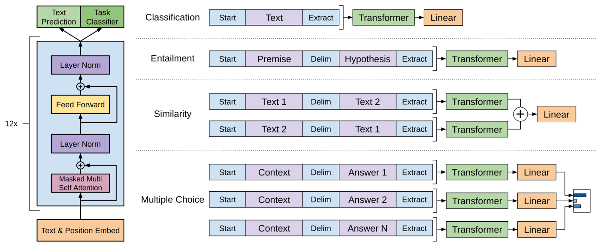
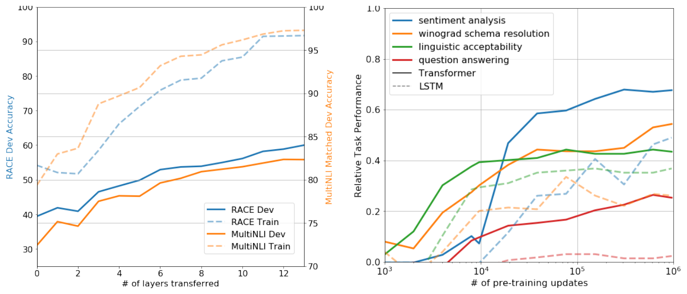

# 论文中文解读：《Improving Language Understanding by Generative Pre-Training》

> **基本信息**：Alec Radford、Karthik Narasimhan、Tim Salimans、Ilya Sutskever（OpenAI），2018 年，OpenAI 技术报告（首页标注 "Preprint. Work in progress."）；[论文 PDF（OpenAI 官方）](https://cdn.openai.com/research-covers/language-unsupervised/language_understanding_paper.pdf)。后人把这个模型称作 GPT-1，但论文本身没有用这个名字，结果表里它叫 "Finetuned Transformer LM"。
>
> **本文的读法**：图取自论文原文 PDF，表为逐格核对后的中文转录（数字与原文一致，表头和方法名里的说明性文字译为中文，模型名、数据集名保持英文）。每张图、表后有读法和结论，因此不必再翻英文原文。凡是“推算”“约”“推断”的内容都是本文自己的整理，会明确标注，不是原文数字。

## 一、一句话结论

自然语言理解（文本蕴含、问答、语义相似度、文本分类等）的标注数据很少，无标注文本却极多。论文用**两阶段**做法利用无标注文本：先在大规模无标注文本（BooksCorpus）上用语言建模目标预训练一个 12 层 Transformer decoder，再用每个任务的少量标注数据做有监督微调。微调时，各任务的结构化输入（句子对、文档加问题加候选答案）都被改写成**一条连续的 token 序列**，所以预训练模型几乎不用改结构，只新增一个线性输出层和几个分隔符嵌入。

在评测的 12 个数据集中，这个与任务无关的单一模型在 9 个上刷新了当时的最好成绩：Story Cloze +8.9、RACE +5.7、MultiNLI +1.5（均为绝对百分点），GLUE 总分 72.8（此前最好 68.9）。消融显示，去掉预训练平均分掉 14.8 分，把 Transformer 换成 LSTM 掉 5.6 分。

## 二、背景与动机

### 2.1 问题：标注数据少，无标注文本多

大多数深度学习方法需要大量人工标注数据，这限制了它们在缺少标注资源的领域里的应用。能利用无标注数据的模型因此很有价值：既能省下收集标注的成本，即便标注很多，无监督学到的好表示也能进一步提高性能。当时最有力的证据是预训练**词向量**（word2vec、GloVe 等）在大量 NLP 任务上带来的提升。

### 2.2 为什么只用词向量不够，难点在哪里

想利用无标注文本中比“词”更高层的信息，有两个悬而未决的问题：

1. **用什么目标函数预训练，学到的表示才对迁移有用？** 已有研究试过语言建模、机器翻译、篇章连贯性，各自在不同任务上占优，没有定论。
2. **怎样把学到的表示迁移到目标任务？** 已有做法包括：针对每个任务改模型结构、使用复杂的学习方案、增加辅助学习目标。这些做法没有共识，使得半监督学习方法很难设计。

### 2.3 相关工作与本文的区别

| 路线 | 代表工作 | 本文与之相比 |
|---|---|---|
| 词级半监督 | word2vec、GloVe 等词向量 | 它们只迁移词级信息；本文要捕获更高层的语义 |
| 短语、句子级表示 | skip-thought 等句向量 | 同上，目标是一个可迁移的整体模型 |
| 语言模型预训练后微调 | Dai and Le，Howard and Ruder（ULMFiT） | 它们用 LSTM，预测能力局限在短程；本文用 Transformer 捕获更长程的语言结构，并在更多类型任务（推断、复述检测、故事补全）上验证 |
| 把预训练模型的隐藏表示当作额外特征 | ELMo、Peters 等、McCann 等（机器翻译模型的表示） | 它们对每个目标任务要新增大量参数；本文迁移时几乎不改模型结构 |
| 辅助训练目标 | Collobert and Weston；Rei（序列标注里加语言模型辅助目标） | 本文也用辅助目标，但发现无监督预训练已经学到了与目标任务相关的多种语言知识 |

论文还强调了选 Transformer 的理由：它提供了比循环网络更“结构化的记忆”，能处理文本中的长程依赖，使迁移效果在多种任务上稳健。

## 三、方法

整体是两个阶段：

```text
阶段 1（无监督预训练）：无标注语料 U  --最大化 L1（语言建模）-->  预训练参数 Θ
阶段 2（有监督微调）  ：带标注数据 C + 输入变换  --最大化 L3 = L2 + λ·L1-->  微调后的参数 Θ、W_y、分隔符嵌入
```

### 3.1 第一阶段：无监督预训练（语言建模）

给定无标注语料的 token 序列 $\mathcal U=\{u_1,\ldots,u_n\}$，用标准语言建模目标最大化下面的似然（原文式 1）：

$$
L_1(\mathcal U)=\sum_i \log P(u_i\mid u_{i-k},\ldots,u_{i-1};\Theta).
$$

含义：对语料里的每个位置 $i$，用它前面 $k$ 个 token 预测当前 token $u_i$，把所有位置的对数概率加起来。$k$ 是上下文窗口大小，条件概率 $P$ 由参数为 $\Theta$ 的神经网络给出，用随机梯度下降训练（实际训练用 Adam，见第四节）。

语言模型是多层 **Transformer decoder**（Liu 等人提出的 Transformer 变体，只保留 decoder 一侧，没有 encoder 和交叉注意力）。它对输入的上下文 token 做多头自注意力，再接逐位置的前馈层，输出目标 token 的分布（原文式 2）：

$$
\begin{aligned}
h_0 &= U W_e + W_p,\\
h_l &= \operatorname{transformer\_block}(h_{l-1}),\quad l\in[1,n],\\
P(u) &= \operatorname{softmax}\big(h_n W_e^{\top}\big).
\end{aligned}
$$

符号含义：

- $U=(u_{-k},\ldots,u_{-1})$：上下文 token 向量（one-hot 形式，乘 $W_e$ 就是查词嵌入表）；
- $W_e$：token 嵌入矩阵；$W_p$：位置嵌入矩阵，论文使用**可学习**的位置嵌入，而不是原始 Transformer 的正弦位置编码；
- $h_0$：第 0 层，即“词嵌入 + 位置嵌入”；$h_l$：第 $l$ 层输出；$n$：层数（12）；
- 输出用 $W_e^{\top}$ 把最后一层 $h_n$ 映射回词表，即输入嵌入与输出层**共享权重**。

两点提醒：原文把 $n$ 同时用作语料长度和层数；式 2 第二行原文写成 $\forall i\in[1,n]$，按上下文应是层号 $l$（原文笔误）。

**为什么是 decoder-only 与 masked self-attention**：训练目标是预测下一个 token，所以位置 $i$ 的注意力只能看到 $i$ 及之前的位置（因果掩码），否则模型会直接看到答案。论文的描述是 “12-layer decoder-only transformer with masked self-attention heads”。

**每个 Transformer 块的结构（图 1 左）**：带掩码的多头自注意力 → 与输入做残差相加 → LayerNorm → 前馈网络（FFN） → 与输入做残差相加 → LayerNorm。这是原始 Transformer 的“先相加再归一化”排布。整个块堆叠 12 次。

### 3.2 第二阶段：有监督微调

假设有带标注数据集 $\mathcal C$，每个样本是一串输入 token $x^1,\ldots,x^m$ 和一个标签 $y$。把输入送过预训练模型，取**最后一层 Transformer 块在最后一个位置的激活** $h_l^m$，接到新增的线性输出层（参数 $W_y$）预测 $y$（原文式 3、4）：

$$
P(y\mid x^1,\ldots,x^m)=\operatorname{softmax}\big(h_l^m W_y\big),
$$

$$
L_2(\mathcal C)=\sum_{(x,y)}\log P(y\mid x^1,\ldots,x^m).
$$

论文还发现，在微调时**把语言建模作为辅助目标**有帮助：(a) 提高有监督模型的泛化；(b) 加速收敛。于是微调的完整目标是（原文式 5，权重 $\lambda$）：

$$
L_3(\mathcal C)=L_2(\mathcal C)+\lambda\, L_1(\mathcal C).
$$

这里的 $L_1(\mathcal C)$ 是在**微调数据的输入文本**上计算的语言建模损失，不是回到原预训练语料上算。$\lambda=0.5$。微调阶段**唯一新增的参数**只有 $W_y$ 和分隔符 token 的嵌入。注意微调会更新预训练模型的**全部参数**，每个任务得到一份独立的模型。

### 3.3 任务相关的输入变换（图 1）

预训练模型只见过连续的文本。分类任务可以直接按上面的方式微调；但蕴含、问答这类任务的输入是有序句子对，或“文档、问题、候选答案”三元组。以前的做法是在迁移来的表示上再设计任务专用结构，这会重新引入大量任务定制，而且这些新增结构得不到迁移学习的好处。论文改用 **traversal-style（遍历式）**做法（来自 Rocktäschel 等人的蕴含工作）：把结构化输入转成预训练模型能处理的**有序序列**，这样跨任务几乎不需要改结构。所有变换都要加上**随机初始化**的起始 token `<s>` 和结束 token `<e>`。



*图 1（原文 Figure 1，第 4 页）：左，本文使用的 Transformer 架构和训练目标；右，针对不同任务的输入变换。*

**图中文字翻译与读法**：

- **左图（架构与训练目标）**：最下面是 Text & Position Embed（词嵌入与位置嵌入）；往上是被 “12x” 括起来的块，由 Masked Multi Self Attention（带掩码的多头自注意力）、⊕（残差相加）、Layer Norm、Feed Forward（前馈网络）、⊕、Layer Norm 组成，重复 12 次；顶部分出两个输出头：Text Prediction（文本预测，即预训练的语言建模目标 $L_1$）和 Task Classifier（任务分类器，即微调的监督目标 $L_2$）。
- **右图（输入变换）**：每一行是一类任务。浅蓝格是特殊 token（Start 起始、Delim 分隔、Extract 抽取），浅紫格是文本片段，绿框是同一个 Transformer，橙框是线性层 Linear。图中的 Extract 应对应正文里的结束标记 `<e>`（图中叫 Extract，因为分类用的正是这个位置的最终层表示 $h_l^m$；这个对应关系是本文的推断，原文没有逐字说明）。
  - **Classification（分类）**：`Start | Text | Extract` → Transformer → Linear；
  - **Entailment（蕴含）**：`Start | Premise | Delim | Hypothesis | Extract`，即前提和假设用分隔符 `$` 拼接；
  - **Similarity（相似度）**：两句话没有天然顺序，所以构造两条序列，`Text 1 | Delim | Text 2` 和 `Text 2 | Delim | Text 1`，各自独立过 Transformer，得到的两个表示**逐元素相加**（图中的 ⊕）再送入 Linear；
  - **Multiple Choice（多选，用于问答和常识推理）**：对每个候选答案 $a_k$ 构造 `Start | Context | Delim | Answer k | Extract`，其中 Context 是文档 $z$ 与问题 $q$ 的拼接，即 $[z;q;\$;a_k]$，各序列独立过 Transformer 和 Linear，最后把所有候选的得分经 softmax 归一化成答案分布（图右下的小柱状图）。
- **读图结论**：整个方法的任务差异只体现在“怎样排输入”，网络主体、预训练权重完全共用。

## 四、训练与实现细节

下表整理自原文 4.1 节正文（原文没有这张表）。微调阶段“未特别说明时沿用预训练的超参数”。

| 项目 | 预训练 | 微调 |
|---|---|---|
| 模型 | 12 层 decoder-only Transformer，masked self-attention；隐藏状态 768 维，12 个注意力头；FFN 内层 3072 维 | 同一模型 + 线性输出层 $W_y$ |
| 位置嵌入 | 可学习（不用正弦版本） | 同左 |
| 激活函数 | GELU（Gaussian Error Linear Unit） | 同左 |
| 词表 | BPE（字节对编码），40,000 次合并 | 同左 |
| 文本预处理 | 用 ftfy 库清洗 BooksCorpus 原文，统一部分标点与空白；用 spaCy 分词 | 同左 |
| 初始化 | $\mathcal N(0,0.02)$（因为大量使用 LayerNorm，这样简单的初始化就够） | 沿用预训练参数 |
| Dropout | residual、embedding、attention 三处均为 0.1 | 分类器上加 dropout 0.1 |
| 权重衰减 | 改进版 L2 正则（Loshchilov and Hutter 提出的做法，后来称 AdamW），$w=0.01$，作用于所有非 bias、非 gain 的权重 | 沿用 |
| 优化器与学习率 | Adam，最大学习率 2.5e-4；前 2000 次更新从 0 线性升到最大值，之后用 cosine 退火到 0 | 多数任务学习率 6.25e-5；线性衰减，warmup 占训练的 0.2% |
| 批大小与序列 | 每批 64 条随机采样的连续序列，每条 512 token | 批大小 32 |
| 训练轮数 | 100 epochs | 多数情况下 3 epochs 就够，微调很快 |
| 辅助目标权重 | - | $\lambda=0.5$ |

论文没有给出参数量。按上表超参数粗算（本文自己的推算，非原文数字）：每层注意力投影约 $4\times768^2\approx2.4$M，FFN 约 $2\times768\times3072\approx4.7$M，12 层合计约 85M；约 4 万词的词嵌入约 31M，位置嵌入约 0.4M，总量约 1.16 亿。

## 五、实验设置

### 5.1 预训练语料：BooksCorpus

- 含 7,000 多本不同的未出版书籍，题材包括 Adventure（冒险）、Fantasy（奇幻）、Romance（爱情）等；
- **关键**是它含有**大段连续文本**，让生成式模型学会基于长程信息做条件预测；
- 对照数据集：ELMo 使用的 1B Word Benchmark，规模大致相同，但**按句子打乱**，破坏了长程结构；
- 本文语言模型在 BooksCorpus 上的 token 级困惑度为 18.4。

### 5.2 评测任务与数据集

四类任务共 12 个数据集（原文表 1，第 5 页）：

| 任务 | 数据集 |
|---|---|
| 自然语言推断（Natural language inference） | SNLI、MultiNLI、Question NLI（QNLI）、RTE、SciTail |
| 问答（Question Answering） | RACE、Story Cloze |
| 句子相似度（Sentence similarity） | MSR Paraphrase Corpus（MRPC）、Quora Question Pairs（QQP）、STS Benchmark（STS-B） |
| 分类（Classification） | Stanford Sentiment Treebank-2（SST-2）、CoLA |

各数据集在做什么、用什么指标（任务说明和来源整理自原文第 4.2 节，指标来自表 2 至表 4 的列标题和注）：

| 数据集 | 任务 | 数据来源或规模（原文给出的） | 指标 |
|---|---|---|---|
| SNLI | 读一对句子，判断关系是 entailment（蕴含）、contradiction（矛盾）还是 neutral（中性） | 图像描述；训练集约 55 万 | accuracy |
| MultiNLI（MNLI） | 同上 | 转写的口语、流行小说、政府报告等；分 matched（m）与 mismatched（mm）两个测试集 | accuracy |
| QNLI | 同上（Question NLI） | 维基百科文章 | accuracy |
| SciTail | 同上 | 科学考试 | accuracy |
| RTE | 同上 | 新闻；只有 2490 个样本 | accuracy |
| RACE | 阅读理解选择题；RACE-m 为初中、RACE-h 为高中 | 初高中英语考试的文章与问题；比 CNN、SQuAD 等数据集含更多推理型问题 | accuracy |
| Story Cloze | 给多句话的故事，从两个候选中选出正确结局（常识推理） | - | accuracy |
| MRPC | 判断两句话语义是否等价（复述检测） | 新闻 | F1 |
| QQP | 同上 | Quora 问题对 | F1 |
| STS-B | 语义相似度 | 训练集约 5.7 千 | Pearson 相关系数 |
| CoLA | 判断句子是否合乎语法（专家标注），检验模型的内在语言偏置 | - | Matthews 相关系数 |
| SST-2 | 二分类情感 | - | accuracy |

其中 MNLI、QNLI、RTE、QQP、MRPC、STS-B、CoLA、SST-2 属于 GLUE 多任务基准，GLUE 总分是论文在表 4、表 5 里报告的汇总指标。

## 六、主要结果

### 6.1 自然语言推断（表 2）

设置：5 个 NLI 数据集，指标均为 accuracy；“5x”表示 5 个模型的集成，“3x”表示 3 个模型集成，本文是**单个模型**；越大越好。表中粗体为原文标出的该列最佳。原文表中 CAFE（单模型）一行的 QNLI、RTE 两格为空白，下面写作 "-"。

| 方法 | MNLI-m | MNLI-mm | SNLI | SciTail | QNLI | RTE |
|---|---:|---:|---:|---:|---:|---:|
| ESIM + ELMo [44]（5x） | - | - | 89.3 | - | - | - |
| CAFE [58]（5x） | 80.2 | 79.0 | 89.3 | - | - | - |
| Stochastic Answer Network [35]（3x） | 80.6 | 80.1 | - | - | - | - |
| CAFE [58] | 78.7 | 77.9 | 88.5 | 83.3 | - | - |
| GenSen [64] | 71.4 | 71.3 | - | - | 82.3 | 59.2 |
| Multi-task BiLSTM + Attn [64] | 72.2 | 72.1 | - | - | 82.1 | **61.7** |
| Finetuned Transformer LM（本文） | **82.1** | **81.4** | **89.9** | **88.3** | **88.1** | 56.0 |

（原文表 2，第 6 页。）读法：5 个数据集中有 4 个超过此前最好，提升分别是 MNLI-m +1.5、SciTail +5.0、QNLI +5.8、SNLI +0.6（与此前最好的数字相减）。**RTE 例外**：本文 56.0，低于多任务 BiLSTM 的 61.7；RTE 只有 2490 个样本，作者认为既然在较大的 NLI 数据集上表现强，该模型很可能也能从多任务训练中受益，但没有实验。

### 6.2 问答与常识推理（表 3）

设置：Story Cloze（二选一选结局）和 RACE（RACE-m 初中、RACE-h 高中、RACE 全部）；指标 accuracy；“9x”表示 9 个模型集成。

| 方法 | Story Cloze | RACE-m | RACE-h | RACE |
|---|---:|---:|---:|---:|
| val-LS-skip [55] | 76.5 | - | - | - |
| Hidden Coherence Model [7] | 77.6 | - | - | - |
| Dynamic Fusion Net [67]（9x） | - | 55.6 | 49.4 | 51.2 |
| BiAttention MRU [59]（9x） | - | 60.2 | 50.3 | 53.3 |
| Finetuned Transformer LM（本文） | **86.5** | **62.9** | **57.4** | **59.0** |

（原文表 3，第 6 页。）读法：Story Cloze 比此前最好的 77.6 高 8.9；RACE 总分比 53.3 高 5.7，其中高中部分 RACE-h 提升最大（57.4 对 50.3，+7.1），初中 RACE-m 提升 2.7。论文把这解读为模型能有效处理长程上下文，因为 RACE 的段落较长、含更多推理型问题；这是论文的解释，表本身只证明准确率更高。

### 6.3 语义相似度与分类（表 4）

设置：这些任务都用 GLUE 基准评测；指标：CoLA 用 Matthews 相关系数（mc），SST-2 用 accuracy（acc），MRPC、QQP 用 F1，STS-B 用 Pearson 相关系数（pc）；最右列是 GLUE 总分。

| 方法 | CoLA（mc） | SST-2（acc） | MRPC（F1） | STS-B（pc） | QQP（F1） | GLUE 总分 |
|---|---:|---:|---:|---:|---:|---:|
| Sparse byte mLSTM [16] | - | **93.2** | - | - | - | - |
| TF-KLD [23] | - | - | **86.0** | - | - | - |
| ECNU（mixed ensemble）[60] | - | - | - | 81.0 | - | - |
| Single-task BiLSTM + ELMo + Attn [64] | 35.0 | 90.2 | 80.2 | 55.5 | 66.1 | 64.8 |
| Multi-task BiLSTM + ELMo + Attn [64] | 18.9 | 91.6 | 83.5 | 72.8 | 63.3 | 68.9 |
| Finetuned Transformer LM（本文） | **45.4** | 91.3 | 82.3 | **82.0** | **70.3** | **72.8** |

（原文表 4，第 7 页。）读法：

- **CoLA** 从此前最好的 35.0 跃升到 45.4（+10.4），论文认为这显示了模型学到的内在语言偏置；
- **STS-B** 高 1 个点（82.0 对 81.0）；**QQP** 比 Single-task BiLSTM + ELMo + Attn 高 4.2（70.3 对 66.1）；
- **SST-2** 91.3，与最好的 93.2（Sparse byte mLSTM）相比有差距，论文称“具有竞争力”；**MRPC** 82.3，低于 TF-KLD 的 86.0，本文并非最好；
- **GLUE 总分** 72.8，比此前最好的 68.9 高 3.9。

### 6.4 汇总：与此前最好成绩的差距

下表由表 2 至表 4 的数字相减得到（本文整理，非原文表），比较对象取对应列里的此前最好值：

| 数据集 | 本文 | 此前最好（来自表） | 差距 |
|---|---:|---|---:|
| MNLI-m / MNLI-mm | 82.1 / 81.4 | 80.6 / 80.1（Stochastic Answer Network，3 模型集成） | +1.5 / +1.3 |
| SNLI | 89.9 | 89.3（ESIM + ELMo、CAFE，5 模型集成） | +0.6 |
| SciTail | 88.3 | 83.3（CAFE） | +5.0 |
| QNLI | 88.1 | 82.3（GenSen） | +5.8 |
| RTE | 56.0 | 61.7（Multi-task BiLSTM + Attn） | -5.7 |
| Story Cloze | 86.5 | 77.6（Hidden Coherence Model） | +8.9 |
| RACE（RACE-m / RACE-h） | 59.0（62.9 / 57.4） | 53.3（60.2 / 50.3）（BiAttention MRU，9 模型集成） | +5.7（+2.7 / +7.1） |
| CoLA | 45.4 | 35.0 | +10.4 |
| SST-2 | 91.3 | 93.2（Sparse byte mLSTM） | -1.9 |
| MRPC | 82.3 | 86.0（TF-KLD） | -3.7 |
| STS-B | 82.0 | 81.0（ECNU，混合集成） | +1.0 |
| QQP | 70.3 | 66.1 | +4.2 |
| GLUE 总分 | 72.8 | 68.9 | +3.9 |

12 个数据集（MNLI 的 m 和 mm 算一个）里，SNLI、MNLI、SciTail、QNLI、Story Cloze、RACE、CoLA、STS-B、QQP 共 9 个超过此前最好，RTE、SST-2、MRPC 三个没有，与摘要的 “9 out of the 12” 一致。论文还指出，方法在不同规模的数据集上都有效，小到 STS-B（约 5.7 千训练样本），大到 SNLI（约 55 万训练样本），并且在许多情况下超过了集成模型。

**原文的一处不一致**：引言说 GLUE 上提升了 5.5%，但表 4 里 72.8 对 68.9 只相差 3.9，原文没有解释 5.5 的来源（可能对比了别的基线，这是推测），引用时应以表 4 为准。

## 七、分析与消融

### 7.1 迁移多少层预训练参数（图 2 左）

先看一个问题：预训练的每一层都有用吗？论文改变“从预训练语言模型迁移到目标任务的层数”，观察 RACE 和 MultiNLI 上的性能如何随之变化。原文没有写明迁移的是哪几层、其余层如何初始化；通常的理解是迁移靠近输入的前若干层、其余随机初始化（这是推断，不是原文）。



*图 2（原文 Figure 2，第 7 页）：左，从预训练语言模型迁移不同层数时在 RACE 和 MultiNLI 上的性能；右，预训练更新步数增加时，零样本表现的演化；每个任务的性能被归一化到“随机猜测基线”与“当前单模型最好成绩”之间。*

**图中文字翻译与读法**：

- **左图**：横轴 “# of layers transferred”（迁移的层数，0 到 12）。**左纵轴**（蓝色）RACE Dev Accuracy（RACE 开发集准确率），**右纵轴**（橙色）MultiNLI Matched Dev Accuracy（MultiNLI matched 开发集准确率）。图例：RACE Dev（蓝实线）、RACE Train（蓝虚线）、MultiNLI Dev（橙实线）、MultiNLI Train（橙虚线）。
  - 两条开发集曲线都随迁移层数基本单调上升：从图上读出，RACE Dev 约从 39 升到 60，MultiNLI Dev 约从 72 升到 82；训练集准确率上升得更快更高。
  - 原文结论：迁移词嵌入本身就有帮助，每多迁移一个 Transformer 层还有进一步增益，在 MultiNLI 上完整迁移最多带来约 9% 的提升；这说明预训练模型每一层都包含对目标任务有用的功能。x=0 具体指什么（是否含词嵌入）原文没有逐字交代。
- **右图**：横轴 “# of pre-training updates”（预训练更新步数，对数坐标，$10^3$ 到 $10^6$），纵轴 “Relative Task Performance”（相对任务性能，0 为随机猜测基线，1 为当前单模型最好成绩）。四种颜色对应四个任务：sentiment analysis（情感分析，蓝）、winograd schema resolution（Winograd 指代消解，橙）、linguistic acceptability（语言可接受性，绿）、question answering（问答，红）；**实线为 Transformer，虚线（颜色较浅）为 LSTM**。
  - Transformer 的各条线随预训练步数大体稳步上升；到约 $10^6$ 步时，从图上读出的大致位置是：情感约 0.68、Winograd 约 0.54、语言可接受性约 0.43、问答约 0.25。
  - LSTM 的零样本表现波动更大（论文称 LSTM 方差更高），多数任务的水平也低于 Transformer，其问答几乎贴着 0。论文据此认为 Transformer 的归纳偏置有助于迁移。

### 7.2 零样本行为：预训练模型自己会做任务吗

论文的假设是：生成式模型为了提高语言建模能力，会学会完成许多下游任务；Transformer 更结构化的注意力记忆比 LSTM 更利于迁移。为此设计了一组**不做任何有监督微调**的启发式做法，直接用预训练语言模型完成任务（图 2 右就是它们的表现随预训练的变化）：

| 任务 | 零样本做法（原文描述） |
|---|---|
| CoLA（语言可接受性） | 把语言模型给样本的平均 token 对数概率当作分数，用阈值判断 |
| SST-2（情感） | 在每个样本后加上 token `very`，并把语言模型的输出分布限制在 `positive` 和 `negative` 两个词上，预测概率更高的那个 |
| RACE（问答） | 以文档和问题为条件，选择平均 token 对数概率最高的答案 |
| DPRD（Winograd 指代消解） | 把定指代词换成两个候选指代对象，选择替换后序列其余部分平均 token 对数概率更高的那种 |

这些启发式的表现稳定、并随预训练持续上升，说明生成式预训练确实在学习各种与任务相关的功能。注意这只是**分析实验**，且每个任务的零样本做法都是手工设计的；它不是论文的主要结果，也不同于后来 GPT-2/GPT-3 提出的零样本、少样本提示。

### 7.3 三个消融（表 5）

设置：在 GLUE 的 8 个任务上做三组对比。“Avg. Score”是所有结果的**无加权平均**。三组消融分别是：(1) 微调时去掉辅助语言建模目标；(2) 把 Transformer 换成单层 2048 单元的 LSTM（其余框架相同）；(3) 完全不预训练，直接在有监督目标任务上训练同一个 Transformer。

| 方法 | 平均分 | CoLA（mc） | SST-2（acc） | MRPC（F1） | STS-B（pc） | QQP（F1） | MNLI（acc） | QNLI（acc） | RTE（acc） |
|---|---:|---:|---:|---:|---:|---:|---:|---:|---:|
| Transformer + 辅助 LM（完整模型） | 74.7 | 45.4 | 91.3 | 82.3 | 82.0 | **70.3** | **81.8** | **88.1** | **56.0** |
| Transformer，无预训练 | 59.9 | 18.9 | 84.0 | 79.4 | 30.9 | 65.5 | 75.7 | 71.2 | 53.8 |
| Transformer，无辅助 LM | **75.0** | **47.9** | **92.0** | **84.9** | **83.2** | 69.8 | 81.1 | 86.9 | 54.4 |
| LSTM + 辅助 LM | 69.1 | 30.3 | 90.5 | 83.2 | 71.8 | 68.1 | 73.7 | 81.1 | 54.6 |

（原文表 5，第 8 页。）表中 MNLI 的 81.8 与表 2 的 MNLI-m 82.1、MNLI-mm 81.4 的平均值（81.75）吻合，推测是两者的平均，原文没有明说。读法：

1. **预训练最关键**：去掉预训练，平均分从 74.7 掉到 59.9，下降 14.8 分，所有任务都变差，其中 STS-B 从 82.0 跌到 30.9，CoLA 从 45.4 跌到 18.9。
2. **Transformer 优于 LSTM**：换成 LSTM 平均分下降 5.6（74.7 到 69.1），LSTM 只在 MRPC 一个数据集上更好（83.2 对 82.3）。
3. **辅助语言建模目标的作用有限且依赖数据集大小**：论文说它在 NLI 任务和 QQP 上有帮助，总体趋势是大数据集受益、小数据集不受益。表里去掉辅助 LM 后，QQP、MNLI、QNLI 变差（69.8、81.1、86.9），而 CoLA、SST-2、MRPC、STS-B 反而变好；RTE 也变差，但它数据很小，不符合“只有大数据集受益”的概括。**平均分上去掉辅助 LM 反而略高（75.0 对 74.7）**，所以不能说辅助目标整体有益，只能说对大数据集的任务有益。

## 八、局限、证据边界与常见误读

**论文自己提到的局限与未验证之处**：

- RTE 只有 56.0，低于多任务 BiLSTM 的 61.7；SST-2、MRPC 也不是最好。作者推测多任务训练可能有帮助，但没有试；
- 辅助 LM 目标对小数据集没有帮助（见 7.3）。

**证据边界**（本文的判断，不是原文的话）：

- 评测集中在 NLU 的分类、打分、多选；没有生成类任务；
- 每个任务都要**更新全部参数**，得到一份独立的模型，且每类任务需要手工设计输入格式；
- 对比的“此前最好”里有集成模型（3x、5x、9x），本文是单模型，所以结论不能理解为“在所有设置下都更强”；
- 原文没有报告多次运行的方差、随机种子，也没有设计“只给很少标注样本”的低资源实验；
- 所有数字是 2018 年的数据集、模型规模和评测协议下的结果，不能和今天的基准直接比较。

**常见误读**：

- “GPT-1 展示了零样本 / in-context learning”：不对。论文的主结果都是**微调**得到的；零样本只是 7.2 节里用手工启发式做的分析；
- “GPT-1 靠规模取胜”：论文的核心是“生成式预训练 + 判别式微调”这个可迁移的接口，模型只有 12 层、768 维，数据只有 BooksCorpus；
- “预训练的收益主要来自低资源场景”：这篇论文没有做低资源实验，只能说去掉预训练后各数据集都显著变差；
- “辅助语言建模目标是必需的”：表 5 里平均分没有它反而略高。

## 九、复现检查清单

- 预训练使用**严格的因果 mask**，不能混入 BERT 式的双向上下文；
- BPE 词表 40,000 次合并，用 ftfy 清洗、spaCy 分词；可学习位置嵌入，序列长度 512，GELU，LayerNorm 为“相加后归一化”的排布；
- 预训练：Adam，最大学习率 2.5e-4，2000 步线性升温后 cosine 退火到 0，批大小 64×512 token，100 epochs，权重衰减 0.01（不作用于 bias 和 gain），三处 dropout 0.1；
- 微调：学习率 6.25e-5，批大小 32，3 epochs，线性衰减加 0.2% 的 warmup，分类器 dropout 0.1，$\lambda=0.5$；
- 输入格式必须一致：`<s>`、`$`、`<e>` 三个 token 的嵌入随机初始化；相似度任务要把两种顺序的表示逐元素相加；多选任务每个候选独立前向，再对候选得分做 softmax；
- 指标各不相同：CoLA 是 Matthews 相关系数、MRPC 和 QQP 是 F1、STS-B 是 Pearson 相关系数，其余是 accuracy，不能混着比；
- 论文没有报告方差，小数据集（RTE、MRPC、STS-B、CoLA）对随机种子敏感，复现时要多次运行再比较。

## 十、与相关论文的关系

- 它的预训练、微调两阶段范式被 [BERT](../bert/论文中文解读.md) 继承：BERT 把单向语言模型换成双向的掩码语言模型（MLM）encoder；
- [GPT-2](../gpt2/论文中文解读.md) 沿着同一条 decoder-only 路线扩大数据和模型，并把“零样本”从分析实验变成主要卖点；
- [T5](../t5/论文中文解读.md) 用 encoder–decoder 和 text-to-text 形式统一所有任务，从另一个方向取消了本文那种逐任务的输入变换；
- 其基础组件来自 [Transformer](../transformer/论文中文解读.md)。

## 原文证据导航

- [原论文 PDF](paper.pdf)
- [原文提取文本](paper.txt)
- [论文概要](论文概要.md)
