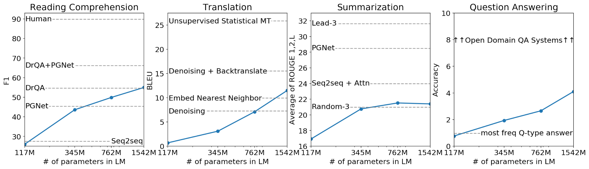
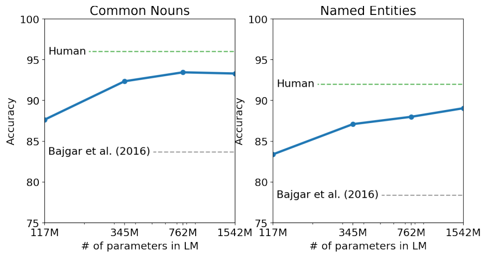
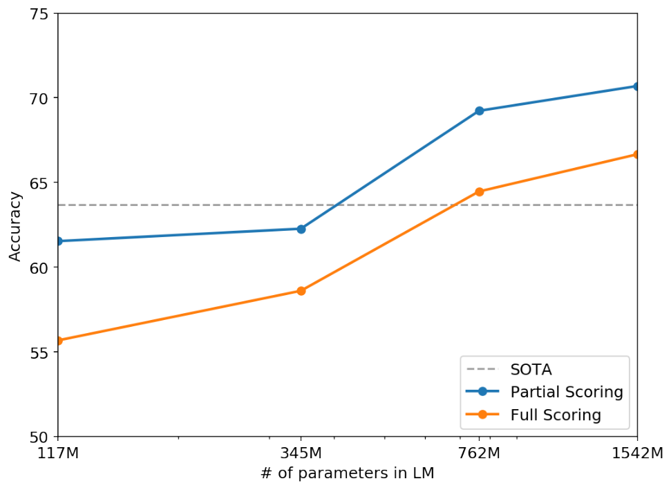
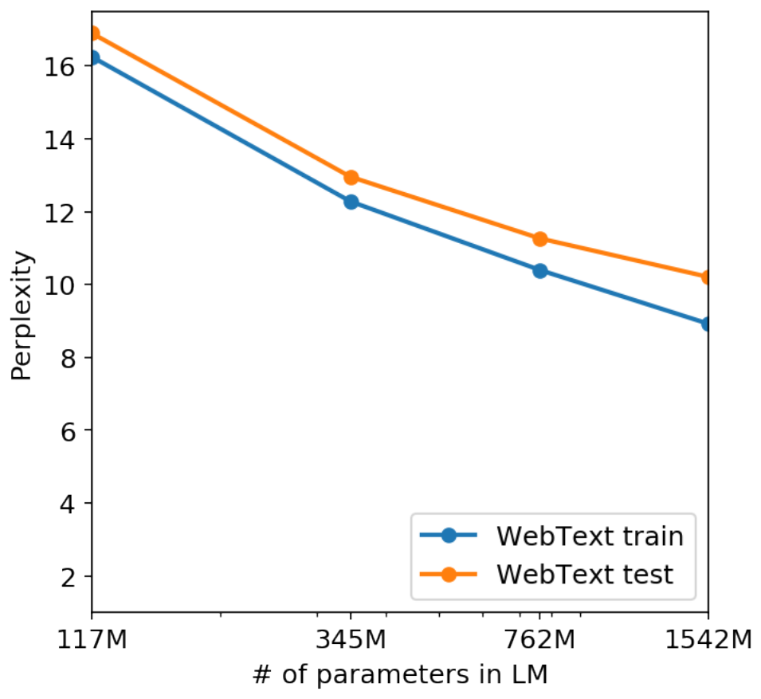
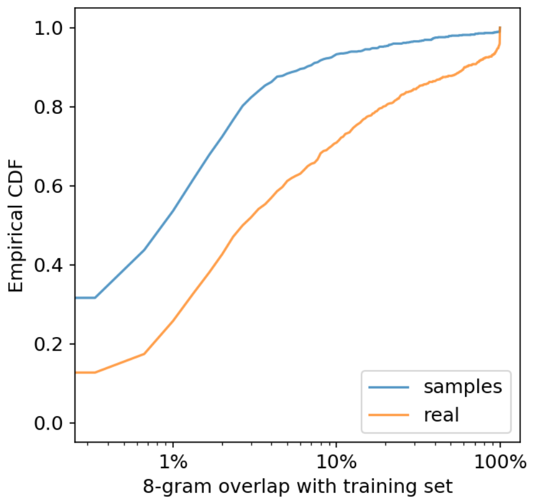

# 论文中文解读：《Language Models are Unsupervised Multitask Learners》

> **基本信息**：Alec Radford、Jeffrey Wu、Rewon Child、David Luan、Dario Amodei、Ilya Sutskever（OpenAI，美国旧金山；原文标注前两位作者与最后两位作者各自为同等贡献），2019 年，OpenAI 技术报告；[论文 PDF（OpenAI 官方）](https://cdn.openai.com/better-language-models/language_models_are_unsupervised_multitask_learners.pdf)。论文脚注 5 给出小模型的初步代码：github.com/openai/gpt-2。论文里的 “GPT-2” 特指最大的 15 亿参数模型，但后人常把整个系列统称 GPT-2。
>
> **本文的读法**：图取自论文原文 PDF，表为逐格核对后的中文转录（数字与原文一致，模型名、数据集名保持英文，表头和说明译为中文）。每张图、表后有读法和结论，因此不必再翻英文原文。凡标注“推算”“推断”“本文的判断”的内容是本文自己的整理，不是原文数字或原话。

## 一、一句话结论

当时的主流做法是为每个任务收集带标注的数据集、单独训练模型，得到的系统是脆弱的“窄专家”。论文提出：只要语言模型足够大、训练文本足够多样，它在**只做“预测下一个 token”这一件事**的过程中，就会开始学会完成各种任务（翻译、问答、阅读理解、摘要），**不需要任何参数更新或结构修改**，也就是**零样本（zero-shot）迁移**。

做法：用 Reddit 外链构造 800 万篇、40 GB 的网页文本 WebText，训练四个规模（1.17 亿到 15.42 亿参数）的 Transformer 语言模型，最大的称为 GPT-2。结果：零样本下在 8 个语言建模数据集中的 7 个刷新当时最好成绩；CoQA 阅读理解达到 55 F1，不用 12.7 万+ 训练样本就追平或超过 4 个基线中的 3 个；规模越大，各任务越好。但摘要、翻译、问答等任务的绝对水平仍然很低，论文自己的评价是：就实际应用而言，零样本表现距离可用仍然很远（原文 “still far from use-able”）。

## 二、背景与动机

### 2.1 单任务训练的局限

机器学习系统靠“大数据集 + 大模型 + 监督学习”在被训练的任务上表现出色（平均而言），但对数据分布的微小变化和任务设定的变化很敏感：论文列举了图像描述、阅读理解、图像分类系统在输入多样性面前的怪异行为。作者的猜测是：**在单一领域的数据集上做单任务训练**是当前系统泛化不足的主要原因。要得到鲁棒的系统，很可能需要在**很多领域、很多任务**上训练和评测（GLUE、decaNLP 就是为此提出的基准）。

### 2.2 多任务学习还很初级

多任务学习（Caruana, 1997）是提升通用性能的有前景的框架，但在 NLP 里还处在萌芽阶段：近期工作只报告了有限的提升，迄今最雄心勃勃的两项工作分别只在 10 个和 17 个（数据集，目标）对上训练。论文用元学习的视角看：每一个（数据集，目标）对相当于元学习里的**一个训练样本**。现有系统需要成百上千个样本才能学到泛化良好的函数，这提示多任务训练可能也需要差不多数量的有效训练对，而继续人工扩大数据集和目标设计的规模将非常困难。这就促使作者探索另一种多任务学习的设定。

### 2.3 预训练加微调的趋势，及本文的位置

当前语言任务上最好的系统组合了预训练和有监督微调，并且转移的形式越来越灵活：先是词向量作为任务专用结构的输入，然后迁移循环网络的上下文表示，最近的工作（Radford 等 2018 即 GPT-1；Devlin 等 2018 即 BERT）表明不再需要任务专用结构，迁移很多自注意力块就够了。但这些方法为了执行任务**仍然需要有监督训练**。另一条线表明，在只有极少或没有监督数据时，语言模型本身就能完成一些特定任务，如常识推理（Schwartz 等 2017）、情感分析（Radford 等 2017）。本文把两条线连起来，把迁移推进到**零样本**：不改参数、不改结构，直接让语言模型做下游任务。

## 三、方法

### 3.1 核心是语言建模：概率分解与任务条件化

语言建模通常被表述为从一组样本 $(x_1,\ldots,x_n)$ 做无监督的分布估计，每个样本是变长符号序列 $(s_1,\ldots,s_n)$。语言有天然的顺序，所以通常把联合概率分解成条件概率的乘积（原文式 1）：

$$
p(x)=\prod_{i=1}^{n}p\big(s_i\mid s_1,\ldots,s_{i-1}\big).
$$

（原文式 1 的右边排成了 $s_n$ 和 $s_{n-1}$，按上下文应是 $s_i$ 和 $s_{i-1}$，属排版笔误；这里写成了正确形式。）这样既能对 $p(x)$ 和任何形如 $p(s_{n-k},\ldots,s_n\mid s_1,\ldots,s_{n-k-1})$ 的条件分布做易处理的采样和估计，近年来能计算这些条件概率的模型表达力显著增强，例如 Transformer。

**学习单个任务**可以表示为估计条件分布 $p(\text{output}\mid\text{input})$。而通用系统要做很多任务，即使输入相同，也应当根据**要执行的任务**给出不同输出，所以应当建模

$$
p(\text{output}\mid\text{input},\ \text{task}).
$$

任务条件化通常在结构层面实现（如任务专用的 encoder 和 decoder），或在算法层面实现（如 MAML 的内外循环优化）。但如 McCann 等人（decaNLP）所示，**语言本身**提供了灵活的方式，可以把任务、输入、输出都写成一个符号序列。论文举例：

- 翻译样本可以写成序列 `(translate to french, english text, french text)`；
- 阅读理解样本可以写成 `(answer the question, document, question, answer)`。

McCann 等人证明，单个模型 MQAN 可以推断并执行这种格式的多种任务。

### 3.2 为什么“无监督的语言建模”可能包含“有监督的任务”

论文的论证（原文第 2 节）：**语言建模原则上也能学会上述任务，而不需要显式监督哪些符号是要预测的输出**。因为有监督目标与无监督目标是同一个函数，只是只在序列的一个子集上求值，所以**无监督目标的全局最小值同时也是有监督目标的全局最小值**。在这个略带“玩具”性质的设定里，关于把密度估计当作训练目标是否合理的担忧（Sutskever 等 2015）就被绕开了，问题变成：实践中能否把无监督目标优化到收敛。初步实验证实，足够大的语言模型确实能在这种设定里做多任务学习，但**学得比显式监督的方法慢得多**。

从“玩具设定”走到“真实世界的语言”还有一大步。Weston（2016）在对话背景下主张要发展能直接从自然语言中学习的系统。论文认为对话方式过于受限；互联网上有大量被动可得、无需交互的信息。作者的**推测**是：容量足够的语言模型，为了更好地预测自然语言序列，会开始推断并执行这些序列里所展示的任务，而不管这些序列是怎么得到的；如果它做到了，实际上就是在做**无监督的多任务学习**。论文通过在大量任务上做零样本评测来检验这一点。

下面是论文表 1 给出的例子：WebText 训练集里到处都有自然出现的英法互译“示范”。模型要把这些文本预测好，就得会翻译（黑体为译文所在部分）。

表 1（原文表 1，第 3 页）：WebText 中自然出现的英译法、法译英示范（原文片段，括号内为中文大意）：

1. “I’m not the cleverest man in the world, but like they say in French: **Je ne suis pas un imbecile [I’m not a fool].**”（我不是世界上最聪明的人，但就像法国人说的：我不是傻瓜。）
2. In a now-deleted post from Aug. 16, Soheil Eid, Tory candidate in the riding of Joliette, wrote in French: “**Mentez mentez, il en restera toujours quelque chose**,” which translates as, “**Lie lie and something will always remain.**”（撒谎，撒谎，总会留下点什么。）
3. “I hate the word ‘perfume,’” Burr says. ‘It’s somewhat better in French: ‘**parfum.**’（Burr 说他讨厌 perfume 这个词，法语的 parfum 好一些。）
4. If listened carefully at 29:55, a conversation can be heard between two guys in French: “**-Comment on fait pour aller de l’autre coté? -Quel autre coté?**”, which means “**- How do you get to the other side? - What side?**”.（两个人用法语对话：怎么去另一边？哪一边？）
5. If this sounds like a bit of a stretch, consider this question in French: **As-tu aller au cinéma?**, or **Did you go to the movies?**, which literally translates as Have-you to go to movies/theater?（法语问句 “As-tu aller au cinéma?” 即 “你去看电影了吗？”，字面直译为“Have-you to go to movies/theater?”。）
6. “**Brevet Sans Garantie Du Gouvernement**”, translated to English: “**Patented without government warranty**”.（政府不担保的专利。）

### 3.3 训练数据：WebText

多数先前工作在单一领域的文本上训练语言模型（新闻、Wikipedia、小说）。本文的做法要求**尽可能大且多样**的数据集，以便在尽可能多的领域和上下文中收集任务的自然语言示范。

- **为什么不用 Common Crawl**：它规模极大，但数据质量问题严重。Trinh and Le（2018）用它做常识推理，指出有大量“内容基本不可理解”的文档，作者在初步实验中也观察到类似问题。Trinh and Le 的最好结果来自挑选与目标数据集（Winograd Schema Challenge）最相似的小子集，这虽然务实，但作者不想预先对要执行的任务做假设。
- **做法**：新建一份强调**文档质量**的网页抓取。只抓取经过人类**策划或筛选**过的网页：手工筛选整个抓取代价极高，所以以 Reddit 上**获得至少 3 个 karma 的所有外链**为起点，把 karma 看作其他用户觉得该链接有趣、有教育意义或搞笑的启发式指标。
- **规模**：WebText 包含这 4,500 万条链接的文本子集；用 Dragnet 和 Newspaper 两个内容提取器从 HTML 中抽出文本。论文所有结果使用的是**初步版本**：不含 2017 年 12 月之后创建的链接，经去重和一些基于启发式的清洗后，**略多于 800 万篇文档，共 40 GB 文本**。
- **去掉了所有 Wikipedia 文档**：因为它是其他数据集的常见数据来源，会因训练数据与测试任务重叠而使分析复杂化。
- 作者还特意**过滤掉了非英语网页**，所以后文翻译的结果让他们很意外（见 5.7）。

### 3.4 输入表示：字节级 BPE

通用的语言模型应当能计算（以及生成）**任何字符串**的概率。现有大规模语言模型的预处理（小写化、分词、未登录词标记）限制了可建模字符串的空间。把 Unicode 字符串当作 UTF-8 字节序列处理可以满足通用性，但在 One Billion Word Benchmark 这样的大数据集上，字节级语言模型不如词级模型（Al-Rfou 等 2018），作者在 WebText 上自己尝试时也观察到类似的差距。

**BPE**（byte pair encoding）是字符级与词级建模之间的折中：对常见符号序列相当于词级输入，对少见的符号序列退回字符级输入。问题在于：

- 常见的 BPE 实现是在 **Unicode 码点**上操作，要容纳全部 Unicode 字符，基础词表就超过 13 万，对比 BPE 常用的 3.2 万到 6.4 万词表，太大；
- **字节级 BPE** 的基础词表只需 256；但直接对字节序列做 BPE，由于 BPE 用贪心的频率启发式建词表，会产生次优合并。作者观察到 BPE 里包含 `dog` 的很多变体（`dog.`、`dog!`、`dog?`），因为它们出现在许多不同写法里，这会浪费有限的词表位置和模型容量。

**解决办法**：**禁止 BPE 在不同字符类别之间合并**（对任何字节序列），但对**空格**做例外，这显著提高压缩效率，而只带来很小的词被切成多个词表 token 的碎片化。最终的词表扩大到 **50,257**。

这一输入表示把词级语言模型的经验优势与字节级方法的通用性结合起来：模型能给**任意 Unicode 字符串**赋概率，因此可以在任何数据集上评测，不受预处理、分词方式或词表大小的限制。

### 3.5 模型：对 GPT-1 的改动与四种规模

模型基于 Transformer，**大体沿用 OpenAI GPT**（即 GPT-1）的细节，仅有少量修改：

1. **LayerNorm 移到每个子块的输入处**（类似 pre-activation 残差网络），并在**最后一个自注意力块之后额外加一个 LayerNorm**；
2. 采用考虑残差路径随模型深度累积的**改进初始化**：初始化时把残差层的权重乘以 $1/\sqrt N$，其中 $N$ 为残差层的数量；
3. 词表扩大到 50,257；
4. **上下文长度从 512 增加到 1024 个 token**；
5. 批大小用 **512**。

关于 $N$ 的说明：原文没有进一步定义“残差层”。常见实现把每个块里注意力和前馈两条残差分支各算一层，即 $N=2\times$ 层数（这是实现惯例，不是原文）。

论文训练并评测了四个**大致按对数均匀间隔**的规模（原文表 2，第 4 页）：

| 参数量 | 层数 | $d_{\text{model}}$（隐藏维度） |
|---:|---:|---:|
| 117M | 12 | 768 |
| 345M | 24 | 1024 |
| 762M | 36 | 1280 |
| 1542M | 48 | 1600 |

（原文表 2。）最小的模型相当于原始 GPT；第二小的相当于 BERT 的最大模型；最大的模型就是论文所称的 **GPT-2**，参数量比 GPT 多一个数量级以上。每个模型的学习率是在 WebText 5% 的留出样本上**手工调整**到最佳困惑度。**所有模型对 WebText 仍然欠拟合**，留出集困惑度还在随训练时间增加而改善。

一个值得注意的数字问题（本文的推算，非原文）：按“$L$ 个块、每块约 $12d^2+13d$ 个参数（注意力 $4d^2$，前馈 $8d^2$，另有偏置和 LayerNorm），再加 50,257 词的嵌入、1024 个位置嵌入和最终 LayerNorm（输出层与词嵌入共享）”的标准结构算，四个模型分别约 124M、355M、774M、1558M，比表 2 的名义参数量 117M、345M、762M、1542M 略大；论文没有解释这个差别。

论文**没有给出**优化器类型、训练步数（或训练 token 数）、学习率数值和训练硬件，复现时需要另外查找。

## 四、评测与“零样本”的含义

“零样本”在本文里的意思是：**不对任何一个评测任务做任何梯度更新或结构修改**，只用 WebText 训练出的语言模型，通过文本上下文（提示）来让它做任务。注意这**不等于提示里没有任何示例**：翻译和问答的提示里就放了示例对（见下表）。后来 GPT-3 把这种“提示里放示例”的做法叫 few-shot。

下面是本文自己整理的各任务的做法总览（来源是原文第 3 节各小节）：

| 任务 | 数据集 | 模型怎么做（提示与解码） | 原文节 |
|---|---|---|---|
| 语言建模 | 8 个数据集（见表 3） | 直接计算数据集在模型下的对数概率，除以“标准预测单元”的个数；用可逆去标记化器消除预处理痕迹 | 3.1 |
| 完形填空 | Children’s Book Test（CBT） | 对 10 个候选词各自计算“候选词 + 句子其余部分”的概率，选概率最高的 | 3.2 |
| 长程依赖 | LAMBADA | 预测句子的最后一个词 | 3.3 |
| 指代消解 | Winograd Schema Challenge（273 例） | 比较两种消解方式的概率（full 与 partial scoring，沿用 Trinh and Le） | 3.4 |
| 阅读理解 | CoQA | 上下文是文档、此前的对话历史，末尾加 `A:`，贪心解码 | 3.5 |
| 摘要 | CNN 与 Daily Mail | 文章后面加 `TL;DR:`，用 top-$k$（$k=2$）随机采样生成 100 个 token，取前 3 句 | 3.6 |
| 翻译 | WMT-14 英法、法英 | 上下文放若干 `english sentence = french sentence` 示例对，最后给 `english sentence =`，贪心解码，取生成的第一句 | 3.7 |
| 问答 | Natural Questions | 上下文里先放示例问答对，让模型推断数据集的简短答案风格 | 3.8 |

先看全局结果，再逐项展开。

*图 1（原文 Figure 1，第 2 页）：WebText 语言模型在多个 NLP 任务上的零样本表现与模型规模的关系。阅读理解为 CoQA，翻译为 WMT-14 法译英，摘要为 CNN 与 Daily Mail，问答为 Natural Questions。*

**图中文字翻译与读法**（横轴都是 # of parameters in LM，即语言模型参数量：117M、345M、762M、1542M；蓝色折线为 GPT-2 四个规模的结果，灰色虚线为各类基线或人类水平；下面的数值是从图上读出的近似值，括号里的原文数字优先）：

- **Reading Comprehension（阅读理解，CoQA，纵轴 F1）**：蓝线约从 26 升到 43.5、50，最大模型为 55（原文数字 55 F1）。虚线从上到下：Human（人类，约 90）、DrQA+PGNet（约 66）、DrQA（约 54.5）、PGNet（约 45）、Seq2seq（约 27）。最大模型超过了 PGNet、DrQA 和 Seq2seq 三个基线，没有超过 DrQA+PGNet；
- **Translation（翻译，WMT-14 法译英，纵轴 BLEU）**：蓝线约从 0.7 升到 3.1、7、11.5（原文 11.5 BLEU）。虚线：Unsupervised Statistical MT（无监督统计机器翻译，约 26）、Denoising + Backtranslate（约 15.5）、Embed Nearest Neighbor（约 10）、Denoising（约 7）。最大模型超过了后两项，但离最好的无监督方法很远（原文提到当前最好的无监督机器翻译是 33.5 BLEU，不在图中）；
- **Summarization（摘要，CNN 与 Daily Mail，纵轴 Average of ROUGE 1,2,L，即三种 ROUGE 的平均）**：蓝线约 16.9、20.7、21.5、21.4，在 345M 之后基本不再上升；虚线 Lead-3（约 31.6）、PGNet（约 28.5）、Seq2seq + Attn（约 24）、Random-3（约 21），最大模型只与“随机选 3 句”相当；
- **Question Answering（问答，Natural Questions，纵轴 Accuracy 准确率，单位 %）**：蓝线约 0.8、1.9、2.7、4.1（原文最大模型 4.1% 精确匹配）；虚线 most freq Q-type answer（对每类问题总是回答最常见答案的简单基线，约 1.0）；图顶部标注 “Open Domain QA Systems”（开放域问答系统）表示它们的水平在坐标范围之上（正文说这类系统有 30% 到 50%）。
- **读图结论**：四项任务都随模型变大而改善，这是论文“**模型容量对零样本迁移的成功至关重要，增大容量使各任务表现近似按对数线性提升**”的主要证据（摘要的说法）；但绝对水平差别很大：阅读理解已接近有监督基线，摘要、翻译、问答只是开始超过很弱的基线；摘要在后两个规模上甚至持平，所谓“对数线性”只是粗略的趋势。

## 五、实验结果

### 5.1 语言建模（表 3）

**评测方法**：语言建模数据集的结果通常用“每个标准预测单元（字符、字节或词）的平均负对数概率”的缩放或指数形式来报告。本文用同样的量：先按 WebText 语言模型算出数据集的对数概率，再除以标准单元的个数。本文的形式化（原文只有文字描述）：$\mathrm{PPL}=\exp\!\big(-\tfrac1N\log p(\text{数据集})\big)$，其中 $N$ 是该数据集的标准单元数；BPB、BPC 是取以 2 为底的对数后按字节、字符平均。

对其中很多数据集，WebText 语言模型相当于**严重分布外**的测试：它们要预测被激进标准化的文本、分词带来的痕迹（如标点和缩写被拆开）、被打乱的句子，甚至是在 WebText 里极少出现的字符串 `<UNK>`（在 400 亿字节里只出现 26 次）。论文表 3 的主结果使用**可逆的去标记化器**（invertible de-tokenizers）尽量去掉这些预处理痕迹。因为可逆，仍能计算数据集的对数概率；它也可以看作一种简单的领域适应。去标记化让 GPT-2 的困惑度改善 2.5 到 5。

零样本结果（原文表 3，第 5 页）。指标：PPL 是困惑度，ACC 是准确率（%），BPB 是每字节比特数，BPC 是每字符比特数；PPL、BPB、BPC 越小越好，ACC 越大越好。表中粗体是原文用来标出“超过此前最好成绩（SOTA）”的结果（本文对粗体含义的推断；其中 CBT-CN 列最大模型的 93.30 同样超过 SOTA 但原文没有加粗，应是遗漏）。**没有对任何结果做训练或微调。**

| 模型 | LAMBADA（PPL） | LAMBADA（ACC） | CBT-CN（ACC） | CBT-NE（ACC） | WikiText2（PPL） | PTB（PPL） | enwik8（BPB） | text8（BPC） | WikiText103（PPL） | 1BW（PPL） |
|---|---:|---:|---:|---:|---:|---:|---:|---:|---:|---:|
| SOTA（此前最好） | 99.8 | 59.23 | 85.7 | 82.3 | 39.14 | 46.54 | 0.99 | 1.08 | 18.3 | **21.8** |
| 117M | **35.13** | 45.99 | **87.65** | **83.4** | **29.41** | 65.85 | 1.16 | 1.17 | 37.50 | 75.20 |
| 345M | **15.60** | 55.48 | **92.35** | **87.1** | **22.76** | 47.33 | 1.01 | **1.06** | 26.37 | 55.72 |
| 762M | **10.87** | **60.12** | **93.45** | **88.0** | **19.93** | **40.31** | **0.97** | **1.02** | 22.05 | 44.575 |
| 1542M | **8.63** | **63.24** | 93.30 | **89.05** | **18.34** | **35.76** | **0.93** | **0.98** | **17.48** | 42.16 |

（原文表 3。数字来源：PTB 和 WikiText-2 的 SOTA 来自 Gong 等 2018；CBT 的来自 Bajgar 等 2016；LAMBADA 准确率的 SOTA 来自 Hoang 等 2018，困惑度的来自 Grave 等 2016；其他来自 Dai 等 2019（Transformer-XL）。）

读法：

- **最大的 1542M 模型在 8 个数据集中的 7 个上零样本刷新最好成绩**（LAMBADA、CBT、WikiText2、PTB、enwik8、text8、WikiText103）。表 3 有 10 列，而原文说“8 个数据集”，只有把 LAMBADA 的 PPL 与 ACC、CBT 的 CN 与 NE 各合并算作一个数据集才凑得出 8 个（本文的推断）。唯一没有赢的是 1BW（42.16 对 21.8）；
- **小数据集上提升特别大**，如 Penn Treebank 和 WikiText-2（只有 100 万到 200 万训练 token）；在测长程依赖的 LAMBADA（PPL 从 99.8 降到 8.63）和 CBT 上提升也很大；
- **1BW 上明显更差**，论文认为可能是因为它既是最大的数据集，又经过了最具破坏性的预处理：1BW 按句子打乱，抹掉了所有长程结构；
- 规模效应：除个别格子（如 CBT-CN 从 762M 到 1542M 略降）外，几乎所有列都随模型变大而改善；最小的 117M 模型只在 LAMBADA 困惑度、CBT、WikiText2 上超过 SOTA，在 LAMBADA 准确率、PTB（65.85 对 46.54）、enwik8、text8、WikiText103 和 1BW 上都不如。

### 5.2 Children’s Book Test（CBT，图 2）

CBT（Hill 等 2015）用来考察语言模型在不同类别的词（命名实体、名词、动词、介词）上的表现。它不报告困惑度，而报告自动构造的完形填空题的准确率：从 10 个候选词里选出被省略的那个。沿用 CBT 原论文提出的语言模型做法：用语言模型算出每个候选词及句子其余部分的概率，选概率最高的。数据重叠分析发现 CBT 测试集中有一本书（Rudyard Kipling 的《丛林之书》）也在 WebText 里，所以报告**验证集**结果（它没有显著重叠）。对 CBT 还用了去标记化器去掉 PTB 风格的分词痕迹。结果：GPT-2 在普通名词（CN）上 93.3%、命名实体（NE）上 89.1%，均为新的最好成绩。

*图 2（原文 Figure 2，第 5 页）：CBT 上的表现与模型容量的关系。人类表现取自 Bajgar 等人（2016），而非原论文里低得多的估计。*

**图中文字翻译与读法**：

- 左图 **Common Nouns（普通名词）**、右图 **Named Entities（命名实体）**；横轴 # of parameters in LM（语言模型参数量），纵轴 Accuracy（准确率，%）；蓝色粗线是 GPT-2 四个规模，绿色虚线是 Human（人类，图上约 96 和约 92），灰色虚线是 Bajgar et al. (2016)（图上约 83.7 和约 78.4）；
- GPT-2 的数字（见表 3）：普通名词 87.65、92.35、93.45、93.30；命名实体 83.4、87.1、88.0、89.05；
- **读图结论**：性能随模型增大稳步上升，逼近人类水平，**缩小了与人类差距的大部分**（原文）；普通名词在 762M 之后趋于饱和（93.45 到 93.30）。

### 5.3 LAMBADA

LAMBADA（Paperno 等 2016）测试系统对文本长程依赖的建模能力：任务是预测句子的最后一个词，这些句子的特点是人类至少需要 **50 个 token 的上下文**才能成功预测。GPT-2 把困惑度的最好成绩从 99.8（Grave 等 2016）降到 8.6，并把语言模型在该测试上的准确率从 19%（Dehghani 等 2018）提高到 52.66%。

检查 GPT-2 的错误发现，大部分预测是句子的合理续写，但不是合理的**句末词**：这说明语言模型没有利用“这个词必须是句子最后一个词”的额外约束。加一个**停用词过滤器**近似这个约束，准确率提高到 **63.24%**，把该任务的总体最好成绩提高了 4%（对应表 3 的 59.23 到 63.24）。此前的最好成绩（Hoang 等 2018）用的是另一种“受限预测”设定：模型输出只能是出现在上下文中的词。对 GPT-2 来说这个限制是有害的，因为 **19% 的答案不在上下文里**。所以本文用的是未经预处理的数据集版本。

### 5.4 Winograd Schema Challenge（图 3）

Winograd Schema Challenge（Levesque 等 2012）通过考察系统消解文本歧义的能力来衡量常识推理。Trinh and Le（2018）用语言模型取得显著进展：**让语言模型对两种消解结果给出的概率做比较，取概率更高的**。本文沿用他们的设定，用 full 和 partial 两种打分方式来画图。（两种打分的定义原文没有展开；按 Trinh and Le，partial scoring 只对代词之后的部分按前文条件计分，这是本文凭对该文的了解补充，未在本仓库核对。）

*图 3（原文 Figure 3，第 6 页）：Winograd Schema Challenge 上的表现与模型容量的关系。*

**图中文字翻译与读法**：横轴 # of parameters in LM，纵轴 Accuracy（准确率，%，范围 50 到 75）。灰色虚线 SOTA（此前最好，约 63.7）；蓝线 Partial Scoring（部分打分），从图上读出四个规模约 61.5、62.2、69.2、70.7；橙线 Full Scoring（完整打分），约 55.6、58.6、64.5、66.6。

- 原文数字：GPT-2 的最好结果 **70.70%**，把最好成绩提高了 **7%**（与图中 63.7 的差）；
- 小模型在 partial scoring 下与 SOTA 接近（117M、345M 低于 SOTA），在 762M 才超过；
- 这个数据集**很小，只有 273 个例子**，论文建议读 Trichelair 等人（2018）来正确看待这个结果。

### 5.5 阅读理解：CoQA

CoQA（Reddy 等 2018）包含来自 7 个不同领域的文档，配有“提问者与回答者围绕文档的自然语言对话”。它既测阅读理解，也测依赖对话历史来回答的能力（如只问一句 “Why?”）。

做法：以文档、此前的对话历史和最后的 `A:` 为条件，对 GPT-2 做**贪心解码**，在开发集上得到 **55 F1**。这**追平或超过了 4 个基线系统中的 3 个**（见图 1），而这些基线是用 **12.7 万+** 条人工标注的问答对训练的，GPT-2 没有用任何一条。有监督的最好成绩是基于 BERT 的系统，已接近人类的 89 F1。论文也指出：检查 GPT-2 的答案和错误可知，它常常使用简单的基于检索的启发式，例如对 who 问题回答文档里出现的某个人名。

附录表 16 与表 17（原文第 23、24 页）给出两个选出的 CoQA 例子，都是在文档和此前问答之后补问一个新问题：

- 表 16（2008 年奥运火炬传递的文章）：问 “And did they climb any mountains?”，模型答 `Everest`，人类标注者的答案是 unknown、yes、Yes、yes；
- 表 17（瑞典养狗要交税的文章）：问 “where does she live?”，模型答 `Stockholm`，人类标注者的答案是 Sweden、Sweden、in Sweden、Sweden。

两例都是模型给出了貌似合理但与标准答案不一致的答案。

### 5.6 摘要（表 4）

在 CNN 和 Daily Mail 数据集（Nallapati 等 2016）上测试摘要。为诱导摘要行为，在文章后面加 **`TL;DR:`**，用 top-$k$ 随机采样（Fan 等 2018）、$k=2$ 生成 100 个 token（比贪心解码减少重复、更鼓励抽象式摘要），取这 100 个 token 里的**前 3 句**作为摘要。

表 4：CNN 与 Daily Mail 上的摘要表现，用 ROUGE F1 衡量（R-1、R-2、R-L 分别是 1-gram、2-gram、最长公共子序列的 ROUGE，R-AVG 是三者平均；越大越好）。Bottom-Up Sum 是 Gehrmann 等人（2018）的 SOTA 模型。

| 方法 | R-1 | R-2 | R-L | R-AVG |
|---|---:|---:|---:|---:|
| Bottom-Up Sum（有监督 SOTA） | **41.22** | **18.68** | **38.34** | **32.75** |
| Lede-3（取文章前 3 句；原文表中拼写为 Lede，图 1 中为 Lead） | 40.38 | 17.66 | 36.62 | 31.55 |
| Seq2Seq + Attn | 31.33 | 11.81 | 28.83 | 23.99 |
| GPT-2 `TL;DR:` | 29.34 | 8.27 | 26.58 | 21.40 |
| Random-3（随机选 3 句） | 28.78 | 8.63 | 25.52 | 20.98 |
| GPT-2 no hint（不加 `TL;DR:` 提示） | 21.58 | 4.03 | 19.47 | 15.03 |

（原文表 4，第 6 页。）读法：

- 生成的摘要在定性上像摘要，但常聚焦文章里较新的内容，或混淆具体细节（如事故里有几辆车、帽子上还是衬衫上有标志）；
- 在常用的 ROUGE 1、2、L 上，GPT-2 只是**刚刚接近经典神经基线，只比“随机选 3 句”略好一点**（21.40 对 20.98；R-2 上甚至低于 Random-3，8.27 对 8.63）；
- **去掉任务提示**后 GPT-2 的总体指标下降 **6.4**（21.40 到 15.03），说明可以**用自然语言激发语言模型的任务特定行为**。

附录表 14（原文第 21 页）给出两个摘要的例子，可以看出与参考摘要的差别：第一篇文章讲亿万富翁的私人潜艇，GPT-2 的摘要只谈某一款 U-Boat Worx 潜艇（能下潜 984 英尺、带浮潜平台等），而参考摘要概括的是“像邦德反派一样的先进潜水器”、可由游艇改装的潜艇和租用套餐；第二篇讲也门难民，GPT-2 写的是“也门处于内战中，沙特阿拉伯领导的联军已轰炸也门两个多月”，参考摘要则写了 Amina Ali Qassim 一家避难、数千人乘船前往吉布提等具体经历。

### 5.7 翻译

测试 GPT-2 是否开始学会翻译。为了让它推断要做翻译，把语言模型的上下文设为若干个格式为 `english sentence = french sentence` 的**示例对**，最后给出 `english sentence =`，用**贪心解码**从模型采样，取生成的第一句作为译文。

- **WMT-14 英译法测试集**：**5 BLEU**，略差于先前无监督词翻译工作中用推断出的双语词典做逐词替换；
- **WMT-14 法译英测试集**：**11.5 BLEU**。GPT-2 能利用其很强的英语语言模型，显著更好；这超过了 Artetxe 等 2017 与 Lample 等 2017 的几个无监督机器翻译基线，但远不如当时最好的无监督机器翻译方法的 33.5 BLEU（Artetxe 等 2019）；
- **令作者意外**：因为在构造 WebText 时特意过滤掉了非英语网页。为了确认，作者用字节级语言检测器（cld2）扫描 WebText，只检测到 **10 MB 的法语数据**，大约比先前无监督机器翻译研究里常用的单语法语语料**小 500 倍**。

附录表 15（原文第 22 页）给出三组英译法、三组法译英的样例，质量参差：例如一句参考译文的大意是“一名男子说，他接受的免费疝气手术将使他能重新工作”，GPT-2 的法译英结果却是 “A man told me that the operation gratuity he had been promised would not allow him to travel”，意思被改反；英译法的结果有时不通顺或夹杂重复。

### 5.8 问答：Natural Questions（表 5）

检验语言模型里包含哪些信息的一个办法，是看它回答事实类问题时多久能生成正确答案。此前展示这类行为的工作（如 A Neural Conversational Model）因缺少高质量评测数据只能给出定性结果；近期的 Natural Questions（Kwiatkowski 等 2019）是更定量的资源。与翻译类似，模型上下文里先放示例问答对，帮助它推断该数据集的**简短答案风格**。

- GPT-2 按 SQuAD 等阅读理解数据集常用的**精确匹配**指标答对了 **4.1%** 的问题。作为对照，最小的模型没能超过一个极其简单的基线（对每类问题——who、what、where 等——总是回答最常见答案）的 1.0% 准确率；原文接着说 GPT-2 “答对的问题多 5.3 倍”，比较对象原文没写明，按图 1 最小模型约 0.8%、4.1 除以 0.8 约等于 5 的数量级，应是相对最小模型（本文的推断）。原文据此认为模型容量是神经系统此前在这类任务上表现差的主要因素；
- GPT-2 赋予所生成答案的**概率校准得很好**：在它最自信的 1% 问题上，准确率为 **63.1%**；
- 但仍远不如把信息检索与抽取式文档问答结合的开放域问答系统的 30% 到 50%（Alberti 等 2019）；
- 论文脚注 3 的小插曲：作者之一 Alec 此前觉得自己很擅长随机冷知识，在与 GPT-2 相同的设置下答 100 个随机样本，答对了 17 个（他其实只对了 14 个，但应该对那另外 3 个）。

表 5：GPT-2 在 Natural Questions 开发集上生成的、概率最高（最自信）的 30 个答案，按 GPT-2 给出的概率排序。按论文第 4 节的方法检查，这些问题都没有出现在 WebText 中。✓ 表示答案正确，✗ 表示错误。

| 序号 | 问题（括号内为中文） | GPT-2 生成的答案 | 是否正确 | 概率 |
|---:|---|---|:---:|---:|
| 1 | Who wrote the book the origin of species?（谁写了《物种起源》） | Charles Darwin | ✓ | 83.4% |
| 2 | Who is the founder of the ubuntu project?（Ubuntu 项目的创始人是谁） | Mark Shuttleworth | ✓ | 82.0% |
| 3 | Who is the quarterback for the green bay packers?（绿湾包装工队的四分卫是谁） | Aaron Rodgers | ✓ | 81.1% |
| 4 | Panda is a national animal of which country?（熊猫是哪个国家的国宝） | China | ✓ | 76.8% |
| 5 | Who came up with the theory of relativity?（谁提出了相对论） | Albert Einstein | ✓ | 76.4% |
| 6 | When was the first star wars film released?（第一部星球大战电影何时上映） | 1977 | ✓ | 71.4% |
| 7 | What is the most common blood type in sweden?（瑞典最常见的血型） | A | ✗ | 70.6% |
| 8 | Who is regarded as the founder of psychoanalysis?（谁被视为精神分析创始人） | Sigmund Freud | ✓ | 69.3% |
| 9 | Who took the first steps on the moon in 1969?（1969 年谁第一个踏上月球） | Neil Armstrong | ✓ | 66.8% |
| 10 | Who is the largest supermarket chain in the uk?（英国最大的连锁超市） | Tesco | ✓ | 65.3% |
| 11 | What is the meaning of shalom in english?（shalom 的英文意思） | peace | ✓ | 64.0% |
| 12 | Who was the author of the art of war?（《孙子兵法》的作者） | Sun Tzu | ✓ | 59.6% |
| 13 | Largest state in the us by land mass?（美国陆地面积最大的州） | California | ✗ | 59.2% |
| 14 | Green algae is an example of which type of reproduction?（绿藻是哪种繁殖方式的例子） | parthenogenesis | ✗ | 56.5% |
| 15 | Vikram samvat calender is official in which country?（Vikram Samvat 历法是哪国官方历法） | India | ✓ | 55.6% |
| 16 | Who is mostly responsible for writing the declaration of independence?（谁主要负责起草《独立宣言》） | Thomas Jefferson | ✓ | 53.3% |
| 17 | What us state forms the western boundary of montana?（哪个州构成蒙大拿州的西界） | Montana | ✗ | 52.3% |
| 18 | Who plays ser davos in game of thrones?（《权力的游戏》中谁演 Ser Davos） | Peter Dinklage | ✗ | 52.1% |
| 19 | Who appoints the chair of the federal reserve system?（谁任命美联储主席） | Janet Yellen | ✗ | 51.5% |
| 20 | State the process that divides one nucleus into two genetically identical nuclei?（一个核分裂成两个遗传相同的核的过程） | mitosis | ✓ | 50.7% |
| 21 | Who won the most mvp awards in the nba?（谁获得 NBA MVP 次数最多） | Michael Jordan | ✗ | 50.2% |
| 22 | What river is associated with the city of rome?（与罗马城相关的河流） | the Tiber | ✓ | 48.6% |
| 23 | Who is the first president to be impeached?（第一位被弹劾的总统） | Andrew Johnson | ✓ | 48.3% |
| 24 | Who is the head of the department of homeland security 2017?（2017 年国土安全部部长） | John Kelly | ✓ | 47.0% |
| 25 | What is the name given to the common currency to the european union?（欧盟共同货币的名称） | Euro | ✓ | 46.8% |
| 26 | What was the emperor name in star wars?（星球大战中皇帝的名字） | Palpatine | ✓ | 46.5% |
| 27 | Do you have to have a gun permit to shoot at a range?（在靶场射击需要持枪许可吗） | No | ✓ | 46.4% |
| 28 | Who proposed evolution in 1859 as the basis of biological development?（1859 年谁提出进化作为生物发展的基础） | Charles Darwin | ✓ | 45.7% |
| 29 | Nuclear power plant that blew up in russia?（在俄罗斯爆炸的核电站） | Chernobyl | ✓ | 45.7% |
| 30 | Who played john connor in the original terminator?（原版《终结者》里谁演约翰·康纳） | Arnold Schwarzenegger | ✗ | 45.2% |

（原文表 5，第 7 页；中文翻译为本文所加。）读法：30 条里有 22 条正确、8 条错误（第 7、13、14、17、18、19、21、30 条，正确答案原文没有给出）；概率越高通常越可靠，前 6 条全对，而错误答案的概率可以在 45% 到 70% 之间，模型的自信并不等于正确。

## 六、泛化还是记忆

训练数据与测试数据重叠会导致对泛化能力的**高估**。计算机视觉里已有例子，如 CIFAR-10 的训练集和测试集之间有 3.3% 的图像重叠。WebText 这么大的数据集也可能有同样问题，所以必须分析有多少测试数据也出现在训练数据里。

**做法**：为 WebText 训练集 token 的 **8-gram** 建 Bloom filter。为提高召回，字符串先被规范化成只含小写字母数字词、用单个空格分隔。Bloom filter 的构造使假阳性率上界为 $1/10^{8}$，并且用生成的 100 万个字符串验证了假阳性率很低（一个也没被误报）。据此可以对任何数据集计算：该数据集中有百分之多少的 8-gram 也出现在 WebText 训练集里。

### 6.1 各数据集的 8-gram 重叠（表 6）

表 6：测试集 8-gram 与训练集重叠的百分比（第一行是各数据集自己的训练集，第二行是 WebText 训练集；原文粗体标出每列中较大者）。

| 重叠对象 | PTB | WikiText-2 | enwik8 | text8 | Wikitext-103 | 1BW |
|---|---:|---:|---:|---:|---:|---:|
| 数据集自己的训练集 | **2.67%** | 0.66% | **7.50%** | 2.34% | **9.09%** | **13.19%** |
| WebText 训练集 | 0.88% | **1.63%** | 6.31% | **3.94%** | 2.42% | 3.75% |

（原文表 6，第 8 页。）读法：

- 常见语言建模数据集的测试集与 WebText 训练集有 **1% 到 6%** 的重叠，**平均 3.2%**（本文用表中六个数相加核对为约 3.16%）；
- 令人有些意外的是，**很多数据集与它们自己的训练集重叠更大，平均 5.9%**（表中六个数的平均约 5.9%）；
- 我们的方法优化的是召回，人工检查发现许多只是常见短语，但也有许多较长的匹配来自**重复数据**。这并非 WebText 独有：例如 WikiText-103 的测试集里有一篇文章同时在其训练集里（测试集只有 60 篇文章，所以至少有 1.6% 的重叠）；1BW 与自己训练集的重叠高达近 13.2%。

### 6.2 对具体任务的影响

- **Winograd Schema Challenge**：只有 10 个 schema 与 WebText 训练集有 8-gram 重叠，其中 2 个是虚假匹配；其余 8 个里，只有 1 个 schema 在某些上下文里泄露了答案；
- **CoQA**：新闻领域的文档约有 **15%** 已在 WebText 中，模型在这些文档上约好 3 F1；CoQA 开发集指标是 5 个领域的平均，由此测得因重叠带来约 **0.5 到 1.0 F1** 的增益。但 WebText 里没有真正的 CoQA 训练问答，因为 CoQA 发布在 WebText 链接截止日期之后；
- **LAMBADA**：平均重叠 1.2%；重叠超过 15% 的样本上 GPT-2 的困惑度约好 2；排除所有有任何重叠的样本后重新计算，结果从 8.6 变成 8.7 困惑度，准确率从 63.2% 降到 62.9%。整体变化很小，可能因为只有大约 1/200 的样本有显著重叠；
- **总体结论**：WebText 训练数据与特定评测数据集之间的重叠对报告的结果提供了**小但一致的好处**；但对大多数数据集，重叠并不显著大于标准训练集与测试集之间本来就有的重叠。论文建议在创建新 NLP 数据集的训练与测试划分时，把基于 n-gram 重叠的去重作为重要的验证和检查步骤。

### 6.3 训练集上的表现与测试集上的表现（图 4）

另一种判断表现是否来自记忆的办法是看模型在**自己的留出集**上的表现。

*图 4（原文 Figure 4，第 9 页）：在 WebText 上训练的语言模型，其表现与模型规模的关系。*

**图中文字翻译与读法**：横轴 # of parameters in LM（语言模型参数量），纵轴 Perplexity（困惑度）；蓝线 WebText train（WebText 训练集），橙线 WebText test（WebText 测试集）。从图上读出，训练集约 16.2、12.3、10.4、8.9，测试集约 16.9、12.9、11.3、10.2。

- 两条线**一起下降**，随模型变大都在改善，测试集略高于训练集且差距随规模略微拉大（约 0.7 到 1.3）；
- 论文据此认为，训练集和测试集上的表现相近并一同改善，说明**即使是 GPT-2 对 WebText 在很多方面仍然欠拟合**，而不是靠记忆。

## 七、讨论、相关工作与局限

### 7.1 论文的讨论（第 6 节）

- 许多研究致力于学习、理解和批判性评估有监督、无监督预训练方法所得的表示。本文的结果表明，**无监督的任务学习**是另一个有前景的研究方向。这些发现也许有助于解释预训练技术在下游 NLP 任务中的广泛成功：在极限情形下，其中一种预训练技术开始**直接学会执行任务，而不需要有监督的适配或修改**；
- **阅读理解**上，GPT-2 的零样本表现与有监督基线相当；但摘要等任务虽然在定性上能执行任务，按定量指标其表现仍只是**初步的**；就实际应用而言，GPT-2 的零样本表现“距离可用还很远”；
- 有许多值得评测的其他任务，在很多实际任务上 GPT-2 **无疑仍不比随机好**。即使在评测过的常见任务如问答和翻译上，语言模型也只有在容量足够时才开始超过平凡基线；
- 零样本只是给出了 GPT-2 在许多任务上潜在表现的**基线**，微调的上限在哪里并不清楚。在一些任务上，GPT-2 的完全抽象式输出与目前在许多问答和阅读理解数据集上最好的、基于指针网络的抽取式输出有很大不同。鉴于此前对 GPT 做微调的成功，作者计划研究在 decaNLP 和 GLUE 上的微调，尤其是不清楚 GPT-2 额外的训练数据和容量是否足以克服 BERT 所展示的**单向表示**的低效。

### 7.2 相关工作（第 5 节）摘要

本文很大一部分工作是衡量**更大的语言模型在更大的数据集上训练**的表现，与 Jozefowicz 等（2016）在 1B Word Benchmark 上扩展 RNN 语言模型的工作相似；Bajgar 等（2016）也曾通过用 Project Gutenberg 构造更大的训练集来提高 CBT 的结果；Hestness 等（2017）全面分析了各种深度学习模型的表现随模型容量和数据集规模的变化，本文的实验虽然在各任务间噪声大得多，但表明类似趋势对某个目标的子任务也成立，并延续到了 10 亿以上参数的范围。启发本文的是 Liu 等（2018）的观察：训练来生成 Wikipedia 文章的模型也学会了在不同语言之间翻译名字。关于预训练还有许多工作：GloVe、Skip-thought、CoVe（用机器翻译模型的表示）、ULMFiT 等。

### 7.3 结论（第 7 节）

当大型语言模型在足够大且多样的数据集上训练时，它能在许多领域和数据集上表现良好。GPT-2 零样本地在 8 个测试的语言建模数据集中的 7 个达到最好水平。模型能在零样本设置下执行的任务的多样性表明，**以最大化足够多样的文本语料的似然为目标的高容量模型，开始学会执行数量惊人的任务，而不需要显式监督**。

## 八、生成样本（原文附录 A）

附录 A 展示了模型生成的文本样本，用来补充定量指标：

- **8.1 模型容量（表 7 到表 11）**：对 WebText 测试集中随机的、模型没见过的文章，给出最小模型与 GPT-2 并排的续写。上下文为 768 个 token（每个表只显示约 256 个 token 的段落），续写 256 个 token；用 top-$k$ 随机采样，$k=40$；**不是挑选过的样本**。按本文对样本内容的评价：最小模型的续写常常语法尚可但内容混乱（例如表 8 里把西班牙史写成“那不勒斯皇帝”的故事）；GPT-2 的续写更连贯、更贴合上下文风格，但仍会编造事实（例如表 8 里写出历史上并不存在的人物和战役时间）；
- **8.2 文本记忆**：对在数据集中重复很多次的较长字符串，如名人名言或演讲，GPT-2 表现出一些记忆行为。以葛底斯堡演说（在 WebText 里出现约 40 次）为例，给定它的第一句半，**argmax 解码能背出整篇演说**；不截断地采样时，模型也会照抄一阵再偏离，通常在 100 到 200 个 token 内偏离，偏离后多样性逐渐变宽。为了量化精确记忆在样本里出现的频率，作者以 WebText 测试集文章为条件生成样本，比较 GPT-2 生成内容与真实续写的重叠率（图 5）；
- **8.3 多样性（表 12）**：同一个随机 WebText 测试集上下文（384 个 token）下，GPT-2 用 $k=40$ 采样得到的 6 个不同续写（各 128 个 token）；
- **8.4 鲁棒性（表 13）**：模型能处理分布外的上下文，但这类样本质量通常更低。表 13 是著名的“会说英语的独角兽”新闻：人写的提示是 “In a shocking finding, scientist discovered a herd of unicorns living in a remote, previously unexplored valley, in the Andes Mountains. Even more surprising to the researchers was the fact that the unicorns spoke perfect English.”（一个令人震惊的发现：科学家在安第斯山脉一个偏远的、此前未被探索的山谷里发现了一群独角兽。更令研究者惊讶的是，这些独角兽说着完美的英语。）GPT-2 接着写出一篇有人名（来自 La Paz 大学的进化生物学家 Jorge Pérez）、有引语、有“四角银白色独角兽被命名为 Ovid’s Unicorn”等细节的新闻，行文流畅但内容当然是编造的。**这个样本是 10 次采样（$k=40$）中挑出来的（cherry pick）**，不能代表平均质量。

图 5 展示了对上述“GPT-2 是否在背训练集”的量化：

*图 5（原文 Figure 5，第 13 页，附录 A）：WebText 测试集文章，以及以 WebText 测试集为条件生成的样本（top-$k$ 截断随机采样，$k=40$），其 8-gram 与 WebText 训练集重叠百分比的累积分布函数（CDF）。大多数样本的重叠低于 1%，其中超过 30% 的样本没有任何重叠；而测试集真实文章的重叠中位数是 2.6%。*

**图中文字翻译与读法**：横轴 8-gram overlap with training set（与训练集的 8-gram 重叠，对数坐标，1%、10%、100%），纵轴 Empirical CDF（经验累积分布，0 到 1）。蓝线 samples（模型生成的样本），橙线 real（真实的测试集文章）。蓝线整体在橙线**上方**，意味着同一重叠水平下，样本里重叠较低的比例更大，即 GPT-2 生成的内容重复训练集文本的程度**比真实的留出文章的基线还低**；图左端蓝线在约 0.32 处起步（约三成样本没有任何重叠），橙线约 0.13 起步。**读图结论**：在这个度量下，没有证据显示 GPT-2 的样本大量照抄训练集；但这并不排除对高频长文本（如名篇演讲）的精确记忆，8.2 的葛底斯堡演说例子就是反例。

## 九、局限、证据边界与常见误读

**论文自己承认的局限**：

- 零样本表现距离实际应用“还很远”；摘要只刚刚超过随机选 3 句，翻译、问答在绝对水平上都很低；
- 不清楚微调的上限，也未评测微调；
- 所有模型对 WebText 仍欠拟合，更大的模型和更多训练预计还会提升；
- 一些任务（如问答、阅读理解）上它常用简单的检索式启发。

**证据边界**（本文的判断，不是原文的话）：

- 论文的“零样本”只说明**没有梯度更新**；翻译、问答的提示里带有示例对，摘要提示用了 `TL;DR:`，每个任务的提示格式、解码方式（贪心、top-$k$、取前 3 句、取第一句）都是作者针对该任务手工设计的，所以不能说模型“自己知道要做什么任务”；
- 零样本语言建模结果依赖可逆去标记化器等手工预处理，论文自己也说这相当于简单的领域适应；
- 数据重叠分析只检查 8-gram 精确重叠，不能排除近似重复或释义；论文没有提供 WebText 的获取方式（只给出了构造方法和统计数字），所以结果难以被独立复核；
- 论文报告的规模趋势只有四个点（117M、345M、762M、1542M），摘要里“对数线性”的说法是粗略的，摘要任务就在 345M 之后几乎持平；
- 论文没有给出训练步数、优化器和硬件，也没有报告多次运行的方差。

**常见误读**：

- **“GPT-2 证明了所有任务都可以归结为语言建模并且零样本即可做好”**：不对。论文只展示了趋势和若干任务上的初步能力，很多任务仍很差；
- **“零样本等于提示里没有示例”**：本文的零样本只指不更新参数；翻译和问答的提示里有示例对。GPT-3 把这类做法称为 few-shot；
- **“GPT-2 是 15 亿参数的 BERT 式模型”**：不对。它是单向的 decoder-only 自回归模型；论文自己也提到不清楚额外数据和容量能否克服 BERT 所展示的单向表示的低效；
- **“GPT-2 论文提出了 RLHF 或指令微调”**：没有。本文里没有任何指令跟随训练。

## 十、复现检查清单

- 数据：WebText 的构造（Reddit 外链 karma ≥ 3、去掉 2017 年 12 月后的链接、Dragnet 与 Newspaper 抽取、去重与启发式清洗、剔除 Wikipedia、剔除非英语）；数据集本身未随论文公开，需自行近似；
- 分词：字节级 BPE，基础词表 256，禁止跨字符类别合并（空格例外），词表 50,257；
- 模型：LayerNorm 在每个子块的输入处，最后一个自注意力块之后再加一个 LayerNorm；残差层权重初始化乘 $1/\sqrt N$；上下文 1024，批大小 512；四个规模的层数与隐藏维度见表 2；
- 缺失的信息（优化器、学习率数值、训练步数、硬件）需要另行查找，论文没有给出；
- 评测提示要与论文一致：CoQA 用 `A:` 结尾；摘要用 `TL;DR:`、$k=2$、100 个 token、取前 3 句；翻译用 `english sentence = french sentence` 示例对、贪心解码、取第一句；LAMBADA 的停用词过滤器；CBT 用验证集；
- 报告语言建模结果时要说明是否使用可逆去标记化器；
- 做数据重叠分析：规范化为小写字母数字词，对训练集建 8-gram Bloom filter；
- 报告生成样本时写清楚采样方式（top-$k$ 的 $k$）以及是否挑选过。

## 十一、与相关论文的关系

- 前驱：[GPT-1](../gpt1/论文中文解读.md) 提出预训练加微调；GPT-2 保持结构基本不变，只改 LayerNorm 位置、初始化、词表和上下文长度，核心变化是数据（WebText）、规模（15 亿参数）和**不微调**的零样本评测；
- 对照：[BERT](../bert/论文中文解读.md) 走双向 encoder、预训练加微调的路线；本文在讨论里明确提到 BERT；
- 结构基础：[Transformer](../transformer/论文中文解读.md)；
- 后续：[T5](../t5/论文中文解读.md) 用 text-to-text 形式统一任务，是另一条把任务写成文本的路线；[GPT-3](../openai_gpt3/论文中文解读.md) 把本文的零样本扩展成 few-shot 的 in-context learning；[InstructGPT](../openai_instructgpt/论文中文解读.md) 再解决“预测文本”与“遵循意图”的目标错位。

## 原文证据导航

- [原论文 PDF](paper.pdf)
- [原文提取文本](paper.txt)
- [论文概要](论文概要.md)
