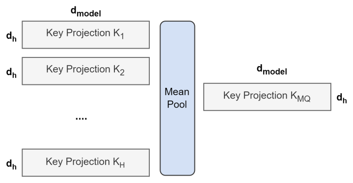
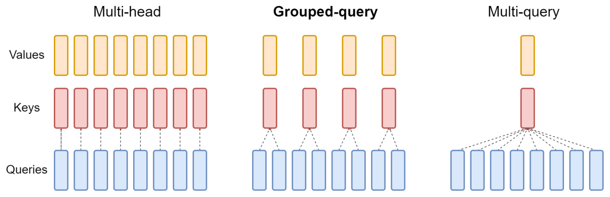
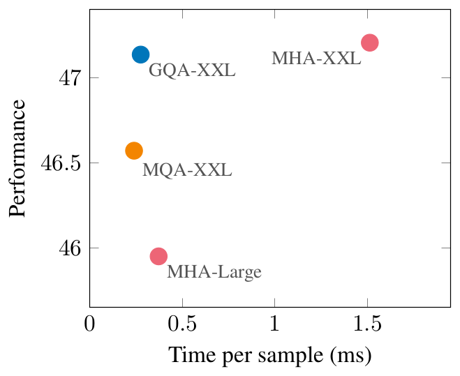
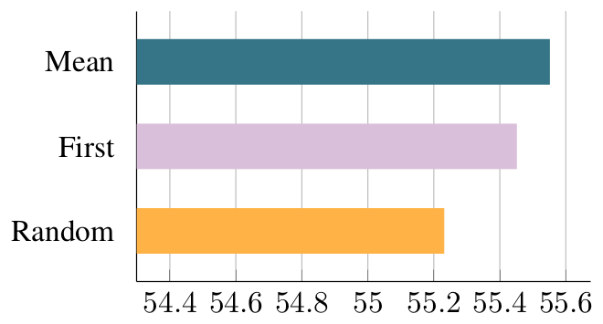
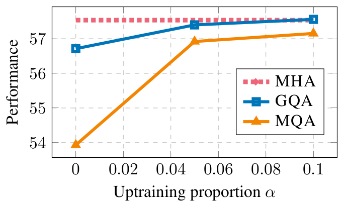
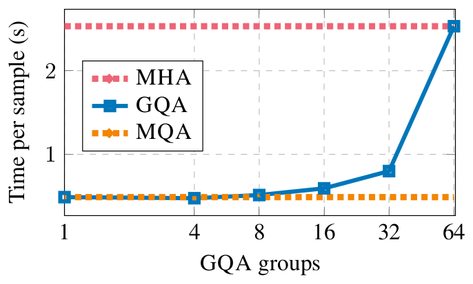

# 论文中文解读：《GQA: Training Generalized Multi-Query Transformer Models from Multi-Head Checkpoints》

> **基本信息**：Joshua Ainslie、James Lee-Thorp、Michiel de Jong（共同一作；de Jong 隶属 University of Southern California，工作完成于 Google Research）、Yury Zemlyanskiy、Federico Lebrón、Sumit Sanghai（Google Research），arXiv:2305.13245（本地 PDF 为 v3，2023 年 12 月）；论文原文 [官方页面](https://arxiv.org/abs/2305.13245)。
>
> **本文的读法**：图均为从论文 PDF 裁下的原图，表为逐格核对后的中文转录（数字与原文一致，表头译成中文，模型名、数据集名保持英文）。每张图后有中文图题、图中文字翻译和读图结论。凡属笔者的推导、核算或判断，都标明“笔者”。读完不必再翻英文版。

## 一、一句话结论

自回归解码的瓶颈是每一步都要从内存里读取模型权重和**全部**注意力的 key、value。Multi-query attention（MQA，只用一组 key/value 头）能大幅降低 K/V 的读取量，但会损失质量、让训练不稳定，而且为了推理速度专门再训练一个模型并不划算。这篇论文做了两件事：

1. **Uptraining 配方**：把已有的多头注意力（MHA）模型检查点，通过把各头的 K/V 投影矩阵**求平均**（mean pooling）合并，再用原始预训练 5% 的计算量继续训练，就得到 MQA 模型；
2. **Grouped-query attention（GQA）**：把 query 头分成 $G$ 组，每组共享一对 K/V 头，是 MHA（$G=H$）与 MQA（$G=1$）之间的插值。

在 T5-XXL 上，5% uptraining 得到的 GQA-8 平均质量 47.1，接近 MHA-XXL 的 47.2，而每个样本的推理时间 0.28（表 1 单位 s）只比 MQA 的 0.24 略高，远低于 MHA-XXL 的 1.51。

## 二、背景与动机

### 2.1 解码为什么受带宽限制

自回归解码时，每生成一个 token，模型都要把所有解码器权重和此前所有位置的 K、V 加载进来做一次很小的计算。这时瓶颈是内存带宽，而不是算力（Shazeer 2019；Pope 等 2022；de Jong 等 2022）。Shazeer 的 MQA 用多个 query 头但单个 key、value 头，使 K/V 的加载量锐减，细节见 [MQA 解读](../multi_query_attention/论文中文解读.md)。

### 2.2 MQA 的问题

- 质量可能下降，训练可能不稳定（附录 A，见 5.5 节）；
- 为推理速度单独训练一个模型往往不可行；
- 虽然已有语言模型使用了 MQA（如 PaLM），很多公开模型没有，包括 T5 和 LLaMA。

所以论文问：能不能把**已有的** MHA 检查点转成快速的模型，并且让质量损失比 MQA 更小？

### 2.3 为什么大模型更需要 GQA（论文的论证）

- 从 MHA 到 MQA 把 $H$ 个 K/V 头减为 1 个，K/V 缓存及需要加载的数据量降低 $H$ 倍。但大模型通常按比例增加头数，所以对大模型而言 MQA 是对内存带宽和容量**更激进**的削减；GQA 能让带宽和容量的下降比例随模型变大保持不变。
- 大模型受注意力访存开销的影响相对较小：KV 缓存随模型维度增长，而模型的 FLOPs 和参数随维度的平方增长。
- 大模型的标准并行切分会把单个 K/V 头复制到每个模型分区上（Pope 等 2022），造成浪费；GQA 去除了这种浪费。
- 因此论文预期 GQA 对更大的模型是特别好的折中。

## 三、方法

### 3.1 Uptraining：把 MHA 检查点转成 MQA（第 2.1 节，图 1）

分两步：先转换检查点，再继续预训练，让模型适应新的结构。

*图 1（原文 Figure 1，第 1 页）：转换示意——把所有头的 key（和 value）投影矩阵做平均池化，合并成一个头。*

**图中文字翻译与读法**：

- **左侧**：$H$ 个 Key Projection（key 投影矩阵）$K_1,K_2,\dots,K_H$，每个矩阵的宽是 $d_{\text{model}}$、高是 $d_h$（每个头的维度），省略号表示中间的头；
- **中间**：Mean Pool（平均池化）；
- **右侧**：合并得到的单个 Key Projection $K_{\text{MQ}}$，大小同样是 $d_h\times d_{\text{model}}$；
- **读图结论**：图中只画了 key，value 的投影矩阵做同样的处理；被平均的是**投影矩阵（权重）**，不是推理时缓存下来的 K/V 激活。论文说这样做优于“只挑其中一个头”和“重新随机初始化 K/V 头”（见 5.3 节的图 4）。

转换后，在**原始预训练配方**上用原始训练步数的一小部分 $\alpha$ 继续预训练。

### 3.2 Grouped-query attention（第 2.2 节，图 2）

GQA 把 $H$ 个 query 头分成 $G$ 组，每组共享**一个** key 头和**一个** value 头。GQA-$G$ 表示 $G$ 组：GQA-1 只有一组，等价于 MQA；GQA-$H$ 每组一个 query 头，等价于 MHA。从多头检查点转成 GQA 检查点时，每个组的 key、value 头由**该组内所有原始头的投影矩阵求平均**得到。

*图 2（原文 Figure 2，第 2 页）：三种注意力。多头注意力有 $H$ 个 query、key、value 头；多查询注意力让所有 query 头共享单个 key、value 头；分组查询注意力让每一组 query 头共享一个 key、value 头，在两者之间插值。*

**图中文字翻译与读法**：

- **左 Multi-head（多头）**：Queries（查询，蓝色）、Keys（键，红色）、Values（值，橙色）各 8 个，一对一连接；
- **中 Grouped-query（分组查询，图中加粗）**：8 个 query 头分成 4 组，每组 2 个 query 共享 1 个 key 和 1 个 value，共 4 对 K/V；
- **右 Multi-query（多查询）**：8 个 query 全部连到同一个 key 和同一个 value；
- **读图结论**：图中取 $H=8$、$G=4$ 作示意；K/V 头数（缓存大小）依次是 8、4、1，query 头数始终是 8。

笔者补充数学写法。设第 $i$ 个头的 key 投影矩阵为 $W^K_i$，value 投影矩阵为 $W^V_i$，第 $g$ 组包含头集合 $\mathcal{S}_g$（每组 $H/G$ 个头），则转换时

$$
\bar W^{K}_{g}=\frac{G}{H}\sum_{i\in\mathcal{S}_g}W^{K}_{i},\qquad
\bar W^{V}_{g}=\frac{G}{H}\sum_{i\in\mathcal{S}_g}W^{V}_{i},
$$

第 $i$ 个 query 头在计算注意力时使用它所属的组 $g(i)$ 的 $\bar W^{K}_{g(i)}$、$\bar W^{V}_{g(i)}$；query 投影与输出投影不变。$G=1$ 是对全部 $H$ 个头求平均，$G=H$ 则不做任何改变。

**平均权重等价于平均各头的 key、value 向量**（笔者推导）：key 是输入 $x$ 的线性函数，$x\bar W^{K}_{g}=\frac{G}{H}\sum_{i\in\mathcal{S}_g}xW^{K}_{i}$，也就是说转换后的组 key 恰好是该组各头原来的 key 的平均，value 同理。所以如果同组各头的 key（value）本来就相同，转换前后的注意力精确相等；各头差异越大，近似越粗，因此需要后面的 uptraining 来适应。这也解释了论文对图 4 的说法：结果的好坏顺序对应“从预训练模型中保留了多少信息”。论文没有说明哪些头被分在同一组（通常按相邻头编号分组，这是笔者的常见做法推测，论文未写）。

**K/V 缓存大小**（笔者）：每个位置每层缓存的元素数为 $2\times(\text{K/V 头数})\times d_h$，MHA 的 K/V 头数是 $H$，GQA-$G$ 是 $G$，MQA 是 1。因此 GQA-$G$ 的缓存是 MHA 的 $G/H$，要加载的数据同样按这个比例下降。图 6 的横轴到 64 并且 $G=64$ 时曲线回到 MHA 的位置，说明论文用的 T5-XXL 有 $H=64$ 个头（笔者由图推断，正文未直接写明），那么 GQA-8 的缓存是 MHA 的 $1/8$，MQA 是 $1/64$。

**不用于 encoder**：GQA 只用在 decoder 的自注意力和 cross-attention，**不**用于 encoder 的自注意力，因为 encoder 表示是并行算出的，内存带宽通常不是主要瓶颈。

## 四、实验设置

- **模型**：全部基于 T5.1.1 架构（Raffel 等 2020），用 JAX、Flax 和 Flaxformer 实现。主实验是 T5 Large 与 XXL 的多头版本，以及用 MQA 和 GQA 做了 uptraining 的 T5 XXL；优化器为 Adafactor，超参数与学习率计划同 T5；
- **Uptraining**：从公开的 T5.1.1 检查点初始化，把 K、V 头平均池化成相应的 MQA 或 GQA 结构，然后在原始预训练数据和设置上继续预训练原始预训练步数的 $\alpha$ 倍；$\alpha=0.05$ 时训练约需 **600 个 TPUv3 chip-days**；
- **数据与指标**：摘要任务 CNN/Daily Mail、arXiv、PubMed、MediaSum、Multi-News（指标 ROUGE-1，下表写作 $R_1$）；翻译任务 WMT 2014 英译德（BLEU）；问答任务 TriviaQA（F1）。论文没有评估 GLUE 这类分类基准，因为自回归推理对它们不太适用；
- **微调**：所有任务统一用常数学习率 0.001，batch size 128，dropout 0.1；CNN/Daily Mail 和 WMT 的输入长 512、输出长 256；其他摘要数据集输入长 2048、输出长 512；TriviaQA 输入长 2048、输出长 32；训练到收敛，选开发集成绩最高的检查点；推理用贪心解码；
- **计时**：报告每个样本、每块 TPUv4 芯片的时间（用 xprof 测量）；计时实验用 8 块 TPU，每块的 batch 尽量大、最多 32，并行方式对每个模型分别优化；
- **消融实验**用任务子集：CNN/Daily Mail（短文摘要）、MultiNews（长文摘要）、TriviaQA（问答）。

## 五、实验结果

### 5.1 主结果：质量与速度的折中（图 3 与表 1）

*图 3（原文 Figure 3，第 3 页）：所有任务的平均性能对每个样本的平均推理时间；比较 T5-Large 和 T5-XXL 多头注意力，以及 5% uptraining 的 T5-XXL MQA 与 GQA-8。*

**图中文字翻译与读法**：

- **坐标轴**：横轴 Time per sample（每样本时间，图中单位写 ms，刻度 0、0.5、1、1.5），纵轴 Performance（平均性能，刻度 46、46.5、47）；
- **四个点**：MHA-Large（粉红，约 0.37、46.0）、MQA-XXL（橙，约 0.24、46.6）、GQA-XXL（蓝，约 0.28、47.1）、MHA-XXL（粉红，约 1.51、47.2）；这些数字与下表一致；
- **图题要点**：uptraining 的 MQA 相对 MHA 有利：比 MHA-Large 质量更高且更快；GQA 以相近的提速取得更好的性能，质量与 MHA-XXL 相当。

**读图结论**：左上角（又快又好）是 GQA-XXL。MHA-XXL 质量最高但慢约 5 倍；MQA-XXL 与 GQA 同样快，但质量低约 0.5。

下表给出完整数字（不同任务的指标：摘要用 ROUGE-1（$R_1$），WMT 用 BLEU，TriviaQA 用 F1；Average 是七个任务指标的平均；$T_{\text{infer}}$ 为每样本推理时间，越小越好）：

| 模型 | $T_{\text{infer}}$（s） | 平均 | CNN（$R_1$） | arXiv（$R_1$） | PubMed（$R_1$） | MediaSum（$R_1$） | MultiNews（$R_1$） | WMT（BLEU） | TriviaQA（F1） |
|---|---:|---:|---:|---:|---:|---:|---:|---:|---:|
| MHA-Large | 0.37 | 46.0 | 42.9 | 44.6 | 46.2 | 35.5 | 46.6 | 27.7 | 78.2 |
| MHA-XXL | 1.51 | 47.2 | 43.8 | 45.6 | 47.5 | 36.4 | 46.9 | 28.4 | 81.9 |
| MQA-XXL | 0.24 | 46.6 | 43.0 | 45.0 | 46.9 | 36.1 | 46.5 | 28.5 | 81.3 |
| GQA-8-XXL | 0.28 | 47.1 | 43.5 | 45.4 | 47.7 | 36.3 | 47.2 | 28.4 | 81.6 |

（原文表 1，第 3 页；表题：T5 Large 和 XXL 多头模型，以及 5% uptraining 的 T5-XXL 多查询与分组查询模型，在开发集上的推理时间与平均成绩。）

**读法**（数字均由上表算出，笔者核算）：

- **质量**：平均分上，MQA-XXL 比 MHA-XXL 低 0.6（46.6 对 47.2），GQA-8-XXL 只低 0.1（47.1）；也就是说 GQA-8 补回了 MQA 与 MHA 之间约 83% 的差距（$(47.1-46.6)/(47.2-46.6)$）。
- **速度**：MQA-XXL 0.24，GQA-8-XXL 0.28，MHA-XXL 1.51；MQA 比 MHA-XXL 快约 6.3 倍，GQA-8 快约 5.4 倍，GQA-8 的时间只是 MQA 的约 1.17 倍。
- **与小模型比**：MQA-XXL（0.24，46.6）比 MHA-Large（0.37，46.0）更快也更好。
- **逐任务看**：GQA-8 与 MHA-XXL 的差在 $-0.3$ 到 $+0.3$ 之间（PubMed 47.7 对 47.5、MultiNews 47.2 对 46.9 反而更高，WMT 同为 28.4）；MQA 在除 WMT 外的六个任务上都低于 MHA-XXL（低 0.3 到 0.8）。
- **单位不一致**：表 1 的 $T_{\text{infer}}$ 单位写 s，而图 3 横轴写 ms，两处数值完全相同（0.24 到 1.51），必有一处标错；本文按表 1 记为秒（图 6 的纵轴也是秒）。
- **证据边界**：论文没有给出方差；附录 A 说 MQA 在不稳定任务上报告的是三次微调的平均；此外 MHA-XXL 是原始检查点，没有接受 uptraining 的那 5% 额外预训练，所以“额外训练”本身的作用与“结构变化”的作用没有被分开（笔者的提醒）。

### 5.2 消融一：检查点转换方法（图 4）

*图 4（原文 Figure 4，第 4 页）：T5-Large 在 $\alpha=0.05$ 下 uptraining 成 MQA 时，不同检查点转换方法的性能。*

**图中文字翻译与读法**：

- **三根横条**：Mean（对所有头的 key、value 投影矩阵求平均）、First（只取第一个头）、Random（K/V 头从头随机初始化）；
- **横轴**：性能，刻度 54.4 到 55.6（应是任务子集 CNN/Daily Mail、MultiNews、TriviaQA 的平均，笔者由数值推断）；
- **读图结论**：Mean 最高（约 55.5，从图上读出），First 次之（约 55.4），Random 最低（约 55.2）。论文的解释是这个顺序对应“从预训练模型中保留了多少信息”：平均保留了所有头的信息，只取一个头丢掉了其余，随机初始化丢掉了全部。

### 5.3 消融二：uptraining 的比例（图 5）

*图 5（原文 Figure 5，第 4 页）：T5-XXL 上 MQA 与 GQA-8 的性能随 uptraining 比例 $\alpha$ 的变化。*

**图中文字翻译与读法**：

- **坐标轴**：横轴 Uptraining proportion $\alpha$（uptraining 占原始预训练步数的比例，0、0.02 到 0.1），纵轴 Performance（任务子集的平均，54 到 57.5）；
- **三条线**：MHA（粉红虚线，水平，约 57.5，不随 $\alpha$ 变化）、GQA（蓝，约 56.7、57.4、57.55，对应 $\alpha=0$、0.05、0.1）、MQA（橙，约 53.9、56.9、57.15）；数字是从图上读出的近似值；
- **笔者核对**：图 5 在 $\alpha=0.05$ 的数值与表 1 吻合——用表 1 的 CNN、MultiNews、TriviaQA 三项平均：MHA-XXL $(43.8+46.9+81.9)/3\approx57.5$，GQA-8-XXL $\approx57.4$，MQA-XXL $\approx56.9$。
- **读图结论**：GQA 在**刚转换完**（$\alpha=0$）就有不错的性能（约 56.7），MQA 则必须 uptraining 才有用（约 53.9）；两者都从 5% uptraining 中受益，到 10% 收益递减。

### 5.4 消融三：组数对速度的影响（图 6）

*图 6（原文 Figure 6，第 4 页）：GQA-XXL 的每样本时间随 GQA 组数的变化，输入长度 2048、输出长度 512。*

**图中文字翻译与读法**：

- **坐标轴**：横轴 GQA groups（GQA 组数：1、4、8、16、32、64），纵轴 Time per sample (s)（每样本时间，秒）；
- **图例**：MHA（粉红虚线，约 2.5 s，水平）、GQA（蓝色实线带方块）、MQA（橙色虚线，约 0.5 s，水平）；
- **读图结论**：GQA 在 1 组（即 MQA）到 8 组之间时间几乎不变（约 0.5 s），之后越来越贵：16 组约 0.6 s，32 组约 0.8 s，64 组时回到 MHA 的约 2.5 s（均为从图上读出的近似值）。论文的解释：对更大的模型，KV 缓存带来的内存带宽开销约束较小，而 K/V 的大小因头数增多而下降得更明显，所以从 MQA 增加组数起初只带来很小的减速，越接近 MHA 代价越大。**论文选 8 组作为有利的中间点。**

注意：论文**只**测了组数对速度的影响，质量只在 $G=8$（以及 MHA 和 MQA 两端）上评估，所以“质量随组数连续变化”这一点并没有被实验画出来。

### 5.5 附录 A：训练稳定性

论文发现 MQA 在微调时可能训练不稳定，尤其配合长输入任务时。作者从头训练了多个带 MQA 的 T5-Large：每一个在预训练中都频繁出现损失尖峰，最终模型在长输入任务上微调时立刻发散。Uptraining 得到的 MQA 模型更稳定，但方差依然很大，所以对不稳定的任务，MQA 的结果报告的是三次微调运行的平均。Uptraining 得到的 GQA 模型看起来稳定，因此作者没有进一步调查 MQA 不稳定的根源。

## 六、相关工作（第 4 节要点）

- Shazeer（2019）最先提出 MQA；后续工作表明 MQA 对长输入尤其有帮助（Pope 等 2022；de Jong 等 2022）；Rabe（2023）独立提出了 GQA 并给出公开实现；其他把注意力头分组以提高计算效率的工作（Park 等 2020；Luo 等 2022；Ni 等 2023）并不专门针对决定内存带宽开销的 key、value 头；
- 其他降低 K/V 访存的办法：FlashAttention（避免显式生成二次方大小的注意力分数，节省内存、加速训练）、量化（降低权重和激活包括 K/V 的精度）、模型蒸馏（缩小模型）、layer-sparse cross-attention（去掉大部分 cross-attention 层）、投机采样（用小模型提出多个 token、大模型并行打分）；
- Uptraining 的思路受 Komatsuzaki 等（2022，sparse upcycling：把稠密 T5 检查点转成稀疏激活的 Mixture-of-Experts）启发。

## 七、局限、证据边界与常见误读

**论文自己承认的局限**：

1. 只关注 K/V 加载造成的内存带宽开销，这在生成较长序列时最重要，而长序列的质量本来就难评估；摘要任务用的 ROUGE 是有缺陷的指标，所以难以确定这些折中一定正确；
2. 由于算力有限，没有把 XXL 的 GQA 模型与从头训练的同类模型比较，所以不知道 uptraining 与从头训练的相对表现；
3. 只在 encoder-decoder 模型上评估了 uptraining 与 GQA。decoder-only 模型没有单独的自注意力和 cross-attention，论文预期 GQA 对 MQA 的优势在其上会更强（这是预期，不是结果）。

**笔者补充的证据边界**：

- 没有预训练困惑度，也没有 decoder-only 或更大规模（几十亿参数以上的 decoder-only）的实验；
- 质量差异很小（GQA-8 与 MHA-XXL 逐任务相差在 $\pm0.3$ 内），而论文没有给出多次运行的方差；
- 速度来自 TPUv4 和各模型分别优化过的并行设置，不能直接外推到 GPU 上的实现或不同的 batch、序列长度；
- 论文评估的是开发集。

**常见误读**：

- GQA 不减少 query 头数，也不改变注意力 $O(T^2)$ 的计算：它只缩小 K/V 的参数和缓存；
- mean pooling 只是把**权重**平均作为初始化，推理时并不是对缓存做平均，之后还要 uptrain 来适应；
- “GQA 被大量模型采用”是论文之外的事实，原论文的实验只有 T5。

## 八、复现检查清单

- 明确 query 头到 K/V 组的映射（哪些头在同一组）并固定 reshape 的顺序；
- 转换检查点时，分别对 K 的投影和 V 的投影按组求平均，不要把不同的权重维度混在一起；query 投影和输出投影保持不变；
- 记录 $\alpha$ 和 uptraining 所需的计算（论文中 $\alpha=0.05$ 约 600 TPUv3 chip-days），并计入转换成本；
- 评估时分开报告质量与速度（若可能，把 prefill 与逐步解码分开），注明 batch、输入输出长度、硬件，并报告 KV 缓存的字节数；不要只看一个 $G$ 的点，因为论文只测了组数对速度的影响；
- GQA 只用于 decoder 的自注意力与 cross-attention，不用于 encoder 自注意力。

## 九、与相关论文的关系

- [MQA（Fast Transformer Decoding）](../multi_query_attention/论文中文解读.md)：本文的起点；GQA 是 MQA 的推广；
- [FlashAttention](../flash_attention/论文中文解读.md)：优化的是注意力中间矩阵的 HBM 读写，与 GQA 优化 K/V 缓存读取针对不同瓶颈，可以叠加；
- [DeepSeek-V2](../deepseek_v2/论文中文解读.md)：沿同一个“压缩 K/V 缓存”方向，用低秩潜在向量（MLA）进一步压缩；
- [LLaMA](../llama/论文中文解读.md)：本文指出 LLaMA 当时没有使用 MQA。

## 原文证据导航

- [原论文 PDF](paper.pdf)
- [原文提取文本](paper.txt)
- [论文概要](论文概要.md)
