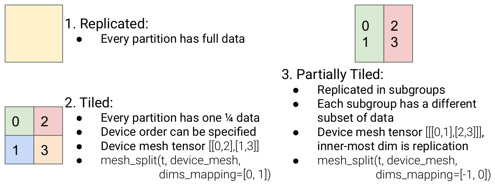
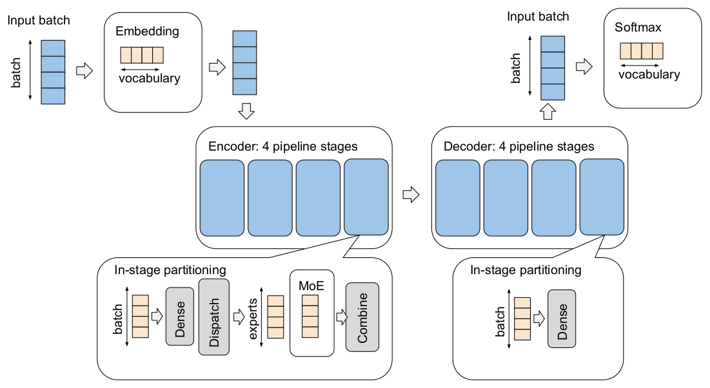
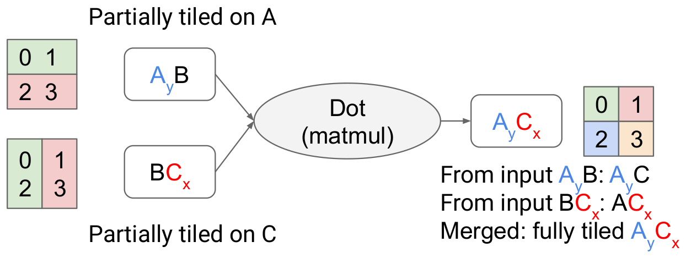
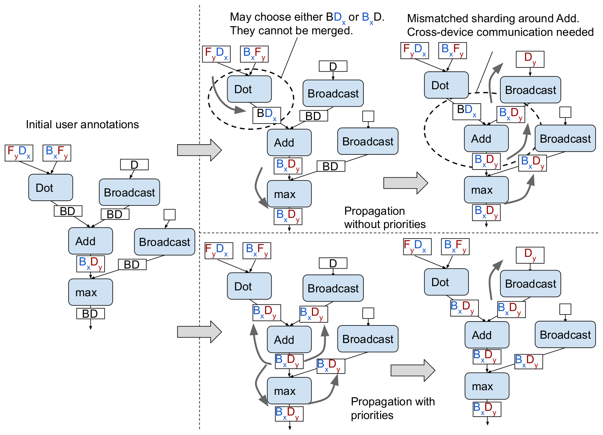
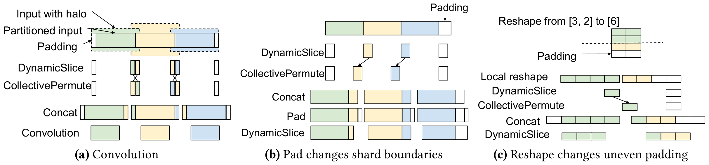
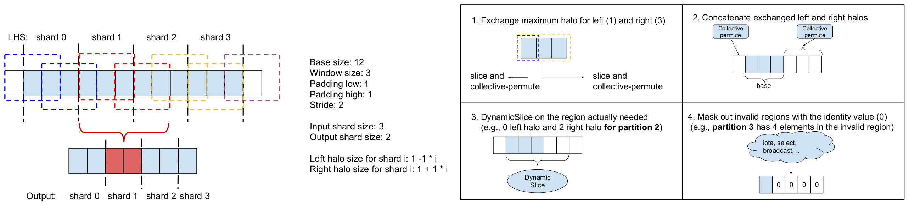
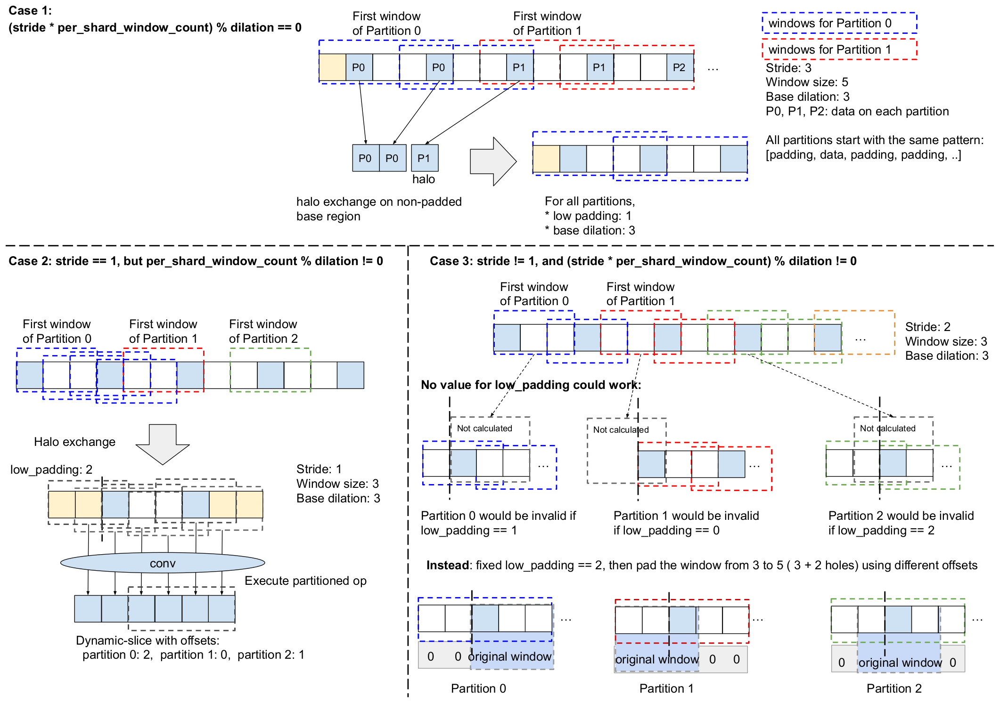
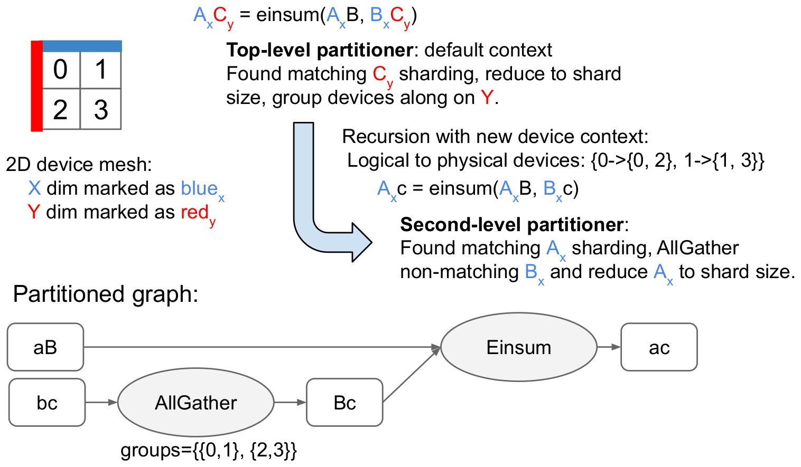
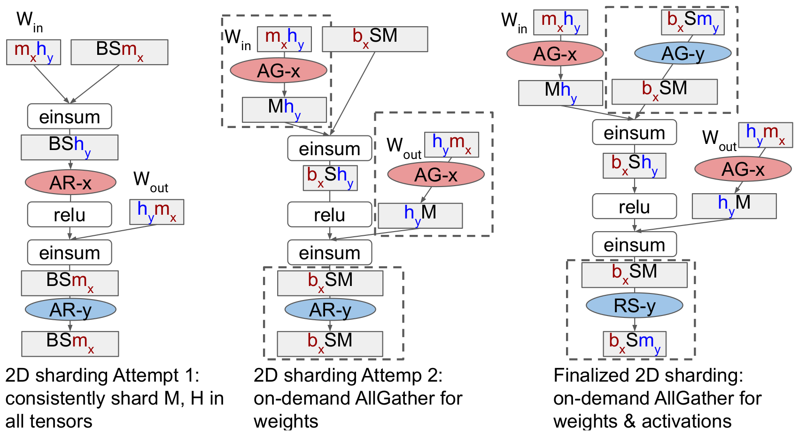
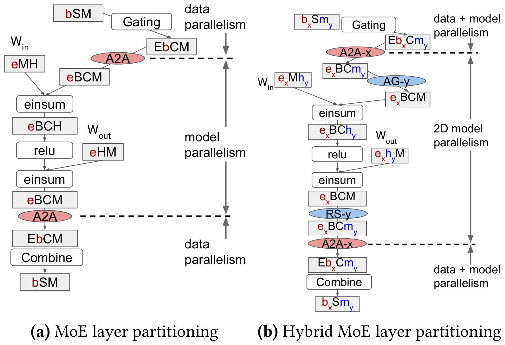

# 论文中文解读：《GSPMD: General and Scalable Parallelization for ML Computation Graphs》

> **基本信息**：Yuanzhong Xu、HyoukJoong Lee、Dehao Chen、Blake Hechtman、Yanping Huang、Rahul Joshi、Maxim Krikun、Dmitry Lepikhin、Andy Ly、Marcello Maggioni、Ruoming Pang、Noam Shazeer、Shibo Wang、Tao Wang、Yonghui Wu、Zhifeng Chen（Google），arXiv:2105.04663（本文依据 2021 年 12 月 23 日的 v2）；论文原文 [官方页面](https://arxiv.org/abs/2105.04663)。
>
> **本文的读法**：图为从 PDF 中按图裁出的原图，表为逐格核对后的中文转录（数字与原文一致，表头翻译为中文）。每张图后有中文图题、图中文字翻译与读图结论，因此不必再翻英文版。凡是“由表中数字算出”的百分比或倍数，都在文中注明是本文的计算；原文正文给出的数字优先。标明“说明性示例”的内容是为了讲清机制而编的，不是原文内容。

## 一、一句话结论

GSPMD 是 Google 做在 XLA 编译器里的自动并行化系统。用户像写单设备程序那样写“巨型张量”的计算图，只在少数几个张量上用 `mesh_split` 标注“这个张量怎样分布到设备网格上”；编译器先沿整张图把其余张量的分片方式**补全**（sharding completion），再把每个算子改写成**每个设备上都运行同一份程序**的局部计算（SPMD partitioning），需要时自动插入 AllReduce、AllGather、AllToAll、CollectivePermute、ReduceScatter 等集合通信。同一套简单的分片表示可以表达数据并行、层内模型并行、图像空间切分、weight-update（优化器状态）分片、MoE 专家并行，并通过一个包装库把流水线并行也归约成张量分片。在最多 2048 个 Cloud TPUv3 核上，GSPMD 训练最大约 1 万亿参数的模型，摘要称取得 50% 到 62% 的计算利用率（论文自己的表里也有更低的数值，见后文）。

## 二、背景与动机

### 2.1 XLA、HLO 与前端框架

GSPMD 的自动分区器实现为 XLA 编译器里的一组变换 pass。XLA 定义了一个与后端无关的中间表示 HLO：把计算建模成数据流图，节点是算子，边是张量。TensorFlow、JAX、PyTorch、Julia 等前端框架都已经有把自己的图转换成 HLO 的逻辑，转换后的 HLO 图再编译成目标加速器的可执行文件。XLA 的算子集合比 TensorFlow 等前端框架小得多，这减轻了实现分区器的负担，又不损害通用性。本文的实验模型用 TensorFlow 写成，通过 TF2XLA bridge 转成 XLA 图；GSPMD 在 JAX 里的接入 API 略有不同，但映射到同一个 XLA 抽象上。

### 2.2 常见的并行模式

原文第 2.2 节列出现代 ML 工作负载里的几种典型并行模式，GSPMD 的目标是统一处理它们：

- **数据并行（data parallelism）**：各设备（副本）持有同样的模型，在不同的训练数据上算出局部梯度，再把梯度求和以保持同步，通常用 MPI 风格的 AllReduce 实现。
- **层内模型并行（within-layer model parallelism）**：把某一层的权重张量切分到多个设备上；当这一层对被切分的维度求和时，还需要跨设备通信（如 AllReduce）。相比数据并行，它通过切分权重可以建出更大的模型。
- **空间切分（spatial partitioning）**：沿图像的空间维度切分输入数据，帮助把大图放进显存有限的设备。
- **weight-update 分片 / 优化器状态分片（weight-update sharding / optimizer-state sharding）**：数据并行的增强：把“把汇总后的梯度应用到权重上”的计算分摊到各副本设备上，对 ADAM 这类昂贵的优化器尤其有用。
- **流水线并行（pipeline parallelism）**：把训练图切成多个 stage，放在不同设备上。前向时每个 stage 把结果送给下游 stage，反向时送给上游 stage；由于前向与反向之间的数据依赖，设备在一个 step 的一部分时间里会空闲，称为“气泡”（bubble），可以用更大的全局 batch 摊薄。

GSPMD 原生支持除流水线之外的全部（即算子内 in-operator 分区），流水线通过一个包装库归约到张量分区问题（第四节）。

### 2.3 为什么选 SPMD，而不是 MPMD

实现分区器有两种选择：（1）给每个分区生成一份定制的程序（多程序多数据，MPMD）；（2）生成一份对所有分区都适用的单一程序（单程序多数据，SPMD）。GSPMD 选 SPMD，因为目标是扩展到**数千个分区**，此时在 MPMD 下编译这么多份程序会慢得不可接受。编译时间是重要的可用性问题：现代 ML 框架通常带 JIT 优化和编译，尤其是面向定制加速器的框架；而且并行化编译并不简单，因为不同程序里的算子可能需要全局调度来维持通信的正确顺序。SPMD 还让通信模式规整（所有设备运行同一程序）。但是在 SPMD 下实现分区器会给生产级 ML 编译器带来独特的挑战（静态形状、不均匀切分等），第六节会讲到这些挑战怎么解决。

### 2.4 GSPMD 的设计目标

引言里列出的四条工程要点：

1. 为所有分区生成**一份**程序（SPMD），这对扩展到上千分区至关重要；
2. 支持**不均匀切分**的维度，允许任何张量在任意设备网格上切分，同时与“编译期形状必须静态已知”的加速器约束兼容；
3. 作为 XLA 的扩展实现，覆盖 XLA 的**全部算子**，包括 Convolution 这类语义复杂的算子；XLA 是多个框架（TensorFlow、JAX、PyTorch、Julia）与多种硬件（CPU、GPU、Cloud TPU）的统一抽象，因此 GSPMD 可以复用；
4. 支持**嵌套**的并行模式：在单个算子层面，不同类型的维度可以沿正交的设备子组切分。原文为此设计了递归的分区方法，使通用性最大化而不用手写大量分区规则。

GSPMD 是从 GShard 的后端泛化而来，已帮助 Google 扩展多个领域的模型，例如语言（LaMDA、GShard-M4）、图像（MetNet-2）、语音（BigSSL）。

## 三、张量分片的表示与 API

GSPMD 把工作分成两个相互独立的编译器变换（“关注点分离”）：**分片补全**（sharding completion，把标注扩展到整张图）和**逐算子分区**（per-operator partitioning）。本节先讲分片怎样表示。

### 3.1 三种分片类型

GSPMD 里每个张量都有一个分片属性（sharding），或由用户显式给出（初始标注），或由补全 pass 推导。分片属性描述数据怎样分布到设备上，共三种类型：

- **Replicated（完全复制）**：所有设备都有完整的数据；
- **Tiled（切块）**：用一个由设备编号组成的多维张量表示（例如图 1 里的 [[0,2],[1,3]]），它的秩必须与数据张量相同；数据的每一维沿着设备张量中相同的维度切分，每个设备占据数据张量中与它在设备张量中的位置对应的那一块。**没有数据重复**；
- **Partially tiled（部分切块，对 GShard 的扩展）**：设备先被分成大小相等的子组，数据张量在每个子组内的设备上复制，在子组之间切块。内部同样表示成设备编号张量，但在末尾多一个维度表示复制子组。

这种表示简单而通用，因为它对所有张量维度一视同仁，不为 batch 维（数据并行）、权重维（模型并行或 weight-update 分片）、图像维（空间切分）做特殊处理。



*图 1（原文 Figure 1，第 3 页）：数据张量上三种分片类型的示例，以及表示它们的 `mesh_split` API 调用。*

**图中文字翻译与读法**：

- **1. Replicated（复制）**：左上，一整块黄色方块；每个分区都有完整数据。
- **2. Tiled（切块）**：左下，方块被分成 4 个 tile，左上为设备 0（绿）、右上为设备 2（红）、左下为设备 1（蓝）、右下为设备 3（橙）。图注：每个分区拥有 1/4 的数据；设备顺序可以指定；设备网格张量是 [[0,2],[1,3]]；对应调用 `mesh_split(t, device_mesh, dims_mapping=[0, 1])`。
- **3. Partially Tiled（部分切块）**：右上，方块被分成左右两半，左半（绿）放在设备 0 和 1 上，右半（红）放在设备 2 和 3 上。图注：在子组内复制；每个子组有数据的不同子集；设备网格张量是 [[[0,1],[2,3]]]，最内层维度是复制；对应调用 `mesh_split(t, device_mesh, dims_mapping=[-1, 0])`。
- **读图结论**：分片完全由“设备编号张量”决定；设备编号在张量中的排布就是切块的排布，因此可以通过重排设备顺序控制通信路径。

### 3.2 用户 API：device mesh 与 `mesh_split`

GSPMD 在上述低层表示之上给出便利的抽象：设备被组织成一个逻辑上的多维张量，称为 **device mesh**（设备网格）。`mesh_split(tensor, device_mesh, dims_mapping)` 是 GSPMD 提供给用户的主要 API。它根据设备网格和一个“数据张量每个维度 $i$ 映射到哪根（可选的）网格维度”的映射 `dims_mapping[i]`，为 `tensor` 生成分片标注：

- `dims_mapping` 里用 `-1` 表示“该维度没有映射”（不切分）；
- 每根网格维度在 `dims_mapping` 里最多出现一次；
- 视 `dims_mapping` 里包含全部、部分还是没有网格维度，它分别表示 tiled、partially tiled 或 replicated。

**说明性示例（按上面的规则推出，非原文）**：设备网格为 $2\times2$ 的 [[0,1],[2,3]]，数据张量有两个维度。`dims_mapping=[0, 1]` 把两个维度分别切到两根网格轴上，每个设备持有 1/4（tiled）；`[0, -1]` 只沿网格第 0 轴切第一个维度，沿网格第 1 轴的两个设备持有相同数据（partially tiled）；`[-1, -1]` 完全复制。

关于设备顺序：GSPMD 生成集合通信算子时**保持 `device_mesh` 里的设备顺序**，所以用户可以按设备网络的拓扑配置 `device_mesh` 来优化通信，例如真实地反映网络拓扑，或重排设备以避免长链路。典型用法是只定义一次 device mesh，然后只关注张量维度的映射；但 GSPMD 并不限制给每个张量用不同的 device mesh，这在模型的不同部分并行模式差异很大时很有用。

### 3.3 用 Einsum 表达算子内并行的例子

TensorFlow（以及 numpy 等库）里有个简洁而有用的算子 Einstein Summation（Einsum），对应 XLA 里的 Dot：一个广义矩阵乘，用户可以定义任意多个、不同类型的维度。Einsum 用字符串方程表示，例如 $ABC,ACD\to ABD$：$A$ 是两个操作数和输出里都有的“尴尬并行”的 **batch 维**；$C$ 是只存在于操作数中、会被求和归约的 **contracting（收缩）维**；$B$ 和 $D$ 是只存在于一个操作数中、被输出继承的 **non-contracting 维**。

用户可以标注操作数和输出来组合不同的并行模式。以典型的全连接投影层 $BD,DF\to BF$ 为例，用户这样标注即可把数据并行和模型并行组合起来：

```python
bd = mesh_split(bd, mesh, [0, -1])
df = mesh_split(df, mesh, [-1, 1])
```

GSPMD 会自动补全输出的分片为 `mesh_split(bf, mesh, [0, 1])`：输入和输出沿网格维度 0 在 batch 维上切分（数据并行），而权重 `df` 和输出沿网格维度 1 在特征维 $F$ 上切分（模型并行）。

如果用户再沿另一根网格维度切分权重，即

```python
df = mesh_split(df, mesh, [0, 1])
```

就会额外触发 weight-update 分片优化：在前向传播中，权重在进入这一层之前按需在 $D$ 维上被“反切分”（unshard）以降低峰值显存；反向传播中梯度用 ReduceScatter 而不是 AllReduce 通信，并在被分片的优化器上更新。

如果这一层是稀疏激活的 MoE（mixture-of-expert）结构，Einsum 方程在两个操作数和输出里还会多一个专家维 $E$，即 $EBD,EDF\to EBF$。要把专家分到不同设备上，用户只需标注这些张量的 $E$ 维，例如：

```python
ebd = mesh_split(ebd, mesh, [0, -1, -1])
edf = mesh_split(edf, mesh, [0, -1, 1])
ebf = mesh_split(ebf, mesh, [0, -1, 1])
```

实际中，激活 `ebd` 和 `ebf` 上的标注可以省略，GSPMD 能从权重推断出它们，除非上游或下游层采用不同的并行模式。

### 3.4 同一个网格在模型不同部分扮演不同角色



*图 2（原文 Figure 2，第 4 页）：16 个设备组织成逻辑 $4\times4$ 网格，对一个编码器-解码器模型（编码器含 MoE 层）的分区策略。蓝色表示沿第一根网格维度 X 切分，黄色表示沿第二根网格维度 Y 切分。*

**图中文字翻译与读法**：

- 从左上到右下是模型的数据流：Input batch（输入 batch）→ Embedding（嵌入层，vocabulary 词表维）→ Encoder: 4 pipeline stages（编码器，4 个流水线 stage）→ Decoder: 4 pipeline stages（解码器，4 个流水线 stage）→ 一列 batch（图中右上角这一列也标作 Input batch，按数据流应是解码器输出的 batch，原图如此标注）→ Softmax（词表维）；
- 蓝色（X 维）在嵌入层和 softmax 层用于数据并行（切 batch），在编码器和解码器用于流水线并行（切 stage）；
- 黄色（Y 维）在不同位置切分不同的维度：嵌入/softmax 层切词表（vocabulary），stage 内部切 batch 或模型的专家维（experts）；
- 放大的 In-stage partitioning（stage 内分区）：编码器的一个 stage 里有 Dense（稠密层）→ Dispatch（分发）→ MoE → Combine（合并），专家维被切分；解码器 stage 只有 Dense，batch 被切分；
- **读图结论**：X、Y 这两根网格维度被“重新赋予”不同含义，从而在模型的不同组件上实现不同的并行模式；这一切只靠各张量上不同的 `mesh_split` 标注，不需要换系统。

## 四、把流水线并行归约成张量分片

流水线并行不切分单个算子或张量，而是把图切成流水线 stage。GSPMD 考虑一个受约束的场景：**所有 stage 是同一段子计算，只是权重值不同**。这在实践中成立，因为扩大模型的常见方式就是堆叠相同模式的层。

**归约思路**：想象把层计算改写成“stage 并行”的形式：给每个张量增加一个前导的层/stage 维度 $L$，计算在这一维上完全并行。这个变换可以用已有前端的向量化支持做到，如 JAX 的 `vmap()` 和 TensorFlow 的 `vectorized_map()`。

**基本的 GPipe 调度**：流水线要求数据被组织成 microbatch，每个 stage 逐个遍历它们。GSPMD 用一个“移位缓冲区”（shifting buffer）在 stage 之间传数据，缓冲区也有前导的 $L$ 维。下面是向量化流水线前向传播的 Python 代码（原文给出）：

```python
# Shifting buffer.
state = zeros([L, ...])
for i in range(num_microbatches + L - 1):
  # Shift state to the right by 1.
  from_prev_stage = pad_left(state, 1)[:-1]
  stage_ids = range(L)  # [0, 1, 2, ...]
  inp = next_input()
  input = elementwise_select(
    stage_ids == 0, inp, from_prev_stage)
  state = vmap(OneStageCompute)(input, ...)
```

逐行解释：每次迭代把 `state` 沿 $L$ 向右移一位，这样前一个 stage 的上一个结果就传给了下一个 stage（`pad_left(state, 1)[:-1]`）；第 0 个 stage 取新的输入 microbatch（`elementwise_select`）；其余 stage 取上一个 stage 的结果；然后用 `vmap(OneStageCompute)` 让所有 stage 同时算一步。循环多跑 `L - 1` 次迭代，等最后一个 stage 处理完所有 microbatch。这些额外迭代对应早期工作里的“气泡”，区别是等待中的设备在填充数据上做计算，而不是空闲。借助 `vmap` 或 `vectorized_map`，这段循环可以包住原有的单 stage 实现 `OneStageCompute`，把它变成流水线计算。

这个用户态循环库**本身不实现分布式执行**，可以在单设备上运行。要把它分布到多设备上，用户只需标注 $L$ 维被切分，GSPMD 就会把缓冲区移位转成跨设备的 CollectivePermute 通信。

这种实现有三个好处：（1）它与 GSPMD 里的其他并行类型自然组合，不需要额外基础设施；（2）它可以只对模型的一部分做流水线，其他部分换成别的并行（见 7.4 节的 Conformer 实验）；（3）它受益于 SPMD 性质，基础设施非常简单，不用维护多个程序之间的接口。它只限于同构的 stage，但这对编码器-解码器模型并不是约束，因为可以为编码器和解码器分别跑各自的流水线；图 2 展示的就是编码器和解码器各有自己的流水线、共享同一组设备、再叠加其他维度的切分。对于无法支持的异构 stage，原文建议把 GSPMD 与其他流水线实现整合，对每个 stage 再做切分。

**循环（circular）调度**：这种方法还允许实现更高级的流水线调度算法。例如把层不连续地分给设备（第 0、4、8 层给设备 0，第 1、5、9 层给设备 1，……），可以在 microbatch 数相同的情况下降低气泡比例。实现方式是增加一个额外维度来表示一个设备内的层，原文称之为循环流水线（circular pipelining），类似 Megatron-LM 论文里的 interleaved 调度。

**手动分区子图与流水线**（原文 3.4 节）：GSPMD 允许高级用户进入**手动分区模式**来精确控制一个子图怎样分区：在该子图内，用户写的是“分片大小”的形状；子图外仍由编译器自动分区，两种模式之间用特殊的转换节点切换。它最初用于绕开 GSPMD 效率不佳的情形，但随着软件成熟和高级优化的加入，大多数这类用法已不再需要。反而是 GSPMD 流水线成了手动模式子图的一个常见用途：它可以替代 TensorFlow 里只支持部分算子的 `vectorized_map()`，直接在 `OneStageCompute` 之前把输入转成手动模式（从而去掉 stage 维），再把输出转回自动模式。为了仍让 GSPMD 对其他维度做数据并行或层内模型并行，手动模式被扩展为支持类似部分复制的**子组**：子组内的设备被手动分区，子组之间的设备自动分区，此时充当流水线 stage 的设备集合就是手动子组。

## 五、分片补全（sharding completion）

本节说明 GSPMD 怎样根据有限的用户标注，为每个张量补全分片。它实现为 XLA 里的一个编译器 pass。

### 5.1 可兼容分片的合并

XLA 算子的结果可以继承不同输入的维度。例如 Dot 是广义矩阵乘，GSPMD 先基于每个操作数分别推断输出的分片；如果来自不同操作数的分片**兼容**，GSPMD 还会尝试把它们合并成更细的分片。一个典型的兼容例子是：在不同张量维度上用 `mesh_split` 创建的两个正交的 partially tiled 分片，见图 3。



*图 3（原文 Figure 3，第 5 页）：分片通过 Dot 算子传播。结果由两个输入合并而来；字母的不同颜色和下标表示沿不同的设备网格维度切分。*

**图中文字翻译与读法**：

- 左侧两个小图是 $2\times2$ 设备网格上的两种 partially tiled 分片：上图 Partially tiled on A（沿 A 部分切块）：设备 0、1 在上半、设备 2、3 在下半；下图 Partially tiled on C（沿 C 部分切块）：设备 0、2 在左半、设备 1、3 在右半；
- 中间 Dot (matmul)（矩阵乘）的两个输入：$A_yB$（A 维沿网格维度 y 切分）和 $BC_x$（C 维沿网格维度 x 切分）；输出 $A_yC_x$；
- 右下三行文字：From input $A_yB$: $A_yC$（只看第一个输入，输出得到 $A_yC$）；From input $BC_x$: $AC_x$（只看第二个输入，得到 $AC_x$）；Merged: fully tiled $A_yC_x$（合并后得到完全切块的 $A_yC_x$），右图为对应的 $2\times2$ 切块，设备 0、1、2、3 分占左上、右上、左下、右下；
- **读图结论**：两个输入各自只切分了输出的一个维度，且用的是不同的网格维度，所以可以合并成同时切分两个维度的更细分片。这正是用简单标注表达“数据并行 + 模型并行”嵌套模式的关键：只要把输入沿一根网格维度切 batch，权重沿另一根网格维度切模型维，这一层的结果就会同时在两根网格维度上被切分。

**形式化的兼容定义**：用 $\mathrm{Offset}(S,d,i)$ 表示在分片 $S$ 下设备 $d$ 在第 $i$ 维上的分片偏移（shard offset），即该设备持有的数据块在分区前原始形状中的位置。两个分片 $S_0$ 和 $S_1$ 是**兼容**的，当且仅当存在一个分片 $S$，对每个设备 $d$ 同时满足

$$
\mathrm{Offset}(S,d,i)=\mathrm{Offset}(S_0,d,i)\ \ (\text{对 }S_0\text{ 中每个被切分的维度 }i),\qquad
\mathrm{Offset}(S,d,j)=\mathrm{Offset}(S_1,d,j)\ \ (\text{对 }S_1\text{ 中每个被切分的维度 }j).
$$

此时 $S$ 称为 $S_0$ 与 $S_1$ 的**合并分片**（merged sharding）。合并兼容分片是用简单标注支持嵌套并行模式的关键：用户想混合数据并行和模型并行，只要把输入沿一根设备网格维度在 batch 维上切分，同时把层的权重沿另一根网格维度在某些模型维上切分，这一层的结果就会沿两根维度传播出分片。

### 5.2 迭代的、基于优先级的传播

**迭代传播**：为了补全所有张量的分片，GSPMD 在整张图上多轮运行传播 pass，并在**前向传播**（从输入到输出）和**反向传播**（从输出到输入）之间交替。它保留用户的初始标注；pass 赋予的分片则可以在迭代中逐步细化：**只有当发现更细粒度的分片（可能是与已有的兼容分片合并而来）时，才会改变一个张量的分片**。这一性质保证 pass 经过有限次迭代后达到不动点。

**优先级**：实际中有些用例需要在不同张量上切换某一维的分片（原文第 5 节的案例，本文第七节），这时每个张量上的分片决策会取决于传播 pass 遍历算子的顺序。为了得到最符合直觉的分片，GSPMD 给每个算子、每个传播方向赋予**优先级**：

- **逐元素（elementwise）算子**在两个方向上都拥有最高的传播优先级，因为只要输入输出的分片一致就没有通信，而且顺着逐元素算子传播最符合用户直觉；
- 像 Dot 这类增删维度的算子优先级较低；
- 不同方向的优先级也不同：例如 Broadcast 通过复制数据给输入增加维度，所以给**反向传播**赋予更高优先级，这有助于避免在更大的形状上因分片不匹配而产生通信。



*图 4（原文 Figure 4，第 6 页）：有无优先级的分片传播算法对比。右上图展示无优先级时一个可能的传播过程：按拓扑序访问张量，因为通过 Dot 传播有多种方式，可能在逐元素算子周围得到不匹配的分片规格；右下图展示逐元素算子优先级更高时的传播过程，所有 BD 形状的张量得到相同的分片。*

**图中文字翻译与读法**：

- **左列 Initial user annotations（初始用户标注）**：一个“线性层 + ReLU”类的小图：Dot 的两个输入已被用户标注为 $F_yD_x$ 和 $B_xF_y$（红色字母沿 y、蓝色字母沿 x 切分）；Add 的输出被标注为 $B_xD_y$；其余 BD 形状的张量（Dot 的输出、Broadcast 的输出、max 的输出等）没有标注；
- **上排 Propagation without priorities（无优先级的传播）**：Dot 的输出可能选 $BD_x$（来自 $F_yD_x$ 的 D 维沿 x），也可能选 $B_xD$（来自 $B_xF_y$ 的 B 维沿 x），图中标注“May choose either $BD_x$ or $B_xD$. They cannot be merged.”（可以任选其一，二者不能合并，因为都用了网格维度 x 去切不同的维度）；若先选了 $BD_x$，传到 Add 时与 Add 输出已有的 $B_xD_y$ 不一致，图中标注“Mismatched sharding around Add. Cross-device communication needed”（Add 周围分片不匹配，需要跨设备通信）；
- **下排 Propagation with priorities（有优先级的传播）**：先让逐元素算子（Add、max 等）把 $B_xD_y$ 传播给所有 BD 形状的张量（Dot 的输出、Broadcast 的输出、max 的输出），Broadcast 的输入 D 得到 $D_y$，结果所有 BD 张量都是 $B_xD_y$，Add 周围一致；
- **读图结论**：对大张量的逐元素算子，输入输出分片必须一致才能避免通信，所以优先让它们统一；而 Dot 的输出本来就有多种推断方式，最后由 Dot 去适配即可。

### 5.3 其他规则

- **保持维度（preserved dimensions）**：XLA 算子通常把输入的某些维度保留到输出。GSPMD 简单地把这类维度的分片从输入传到输出，反之亦然。例如输入 batch 维上的分片标注可以一直传播到所有层的结果（激活），图像空间维度同理。
- **刻意保持简单**：传播不会尝试在维度上创造新的分片模式。结果不一定最优，但对用户最符合直觉；用户可以插入更多标注来指示 GSPMD 按需要分区每个张量。相比之下，全自动方法可以用更高级的算法（原文引用 FlexFlow）在用户标注之外搜索最佳分区策略，但由于表示方式不同、问题描述不完整，作者说还没有适合他们生产需求的可用实现。GSPMD 转而专注于传播用户的意图，不过它也可能有助于为全自动方法界定搜索空间。
- **部分指定（partial specification）**：默认情况下 GSPMD 不改动用户给出的标注。但有时用户只想指定一部分张量维度，例如 GSPMD 流水线的包装库只想指定 stage 维和 `num_microbatches` 维的分片，而让被包住的层自己决定变量和输入的其余维度。这种情形不能用默认方式的部分复制来表达，因为那会阻止传播去细化它们。为此，原文扩展了标注 API，允许把一部分张量维度标成**未指定**，由传播去改动。
- **给用户的指引**：分片传播让用户可以跳过许多中间结果（如 ReLU、Batch Normalization 产生的结果）的手工标注。如果用户想显式控制分片决策，尤其是同一逻辑维在不同张量上被不同方式切分时，只需关注显著改变维度的算子。例如 Dot 的两个输入分片不兼容时，传播有多种推断输出分片的方式，用户可以显式标注输出来精确控制。

### 5.4 与高层框架的集成

GSPMD 的分片 API 本质上是对未分区图的标注。作者在 TensorFlow 里创建了一个包装算子 `XlaSharding`，让用户通过写普通 TensorFlow 程序来使用 GSPMD。从用户角度看，`XlaSharding` 在语义上等价于把输入原样传出的 Identity 算子，只是分片标注作为属性给出；TF2XLA bridge 在把 TensorFlow 程序转成 XLA 程序时保留这个标注。TensorFlow 等框架还支持自动求梯度，这要求每个算子注册对应的梯度计算。作者把 `XlaSharding` 的梯度定义为它自己的拷贝，这样反向计算会自动带上相同的分片标注。

## 六、SPMD 分区器

分区器把“带完整分片标注的单设备图”改写成“每个设备执行的同一份局部图”。本节是论文第 4 节，讲 SPMD 带来的挑战与解决办法。

### 6.1 静态约束

**静态形状**：ML 加速器的性能优势来自专用硬件（如向量和矩阵单元）。实际中 XLA 编译器只支持有限程度的张量形状动态性，以便开发高效的算子 kernel。GSPMD 的设计即使在完全静态形状约束下也能工作，但静态形状给 SPMD 分区带来挑战：并不是所有分区的输入输出形状都相同，因为维度未必能被分区数整除。GSPMD 把形状大小**向上取整到分区数的倍数**，填充区域里的数据可以是任意值。创建某些分区后的算子时，需要把填充区域里的数据屏蔽掉（mask）：例如 reduce 算子要防止填充数据影响结果，所以 GSPMD 先把它们替换成该归约的单位元（identity value）。

填充量在不同分区之间可能不同。虽然形状是静态的，但若干 XLA 算子接受**动态偏移**作为操作数，这让 GSPMD 可以把填充区域表示成分区编号（partition ID）的函数。屏蔽填充数据可以表示成：用 Iota 与基于 PartitionId 的偏移比较得到掩码，再用 Select 按掩码选择。附录 A.1 的表 9 总结了 GSPMD 用来处理“分区之间非一致行为”的 XLA 算子：

**表 9：GSPMD 用来处理分区间非一致行为的 XLA 算子**

| XLA 算子 | 作用 | 在 GSPMD 中的用途 |
|---|---|---|
| `PartitionId()` | 返回当前运行程序的设备的分区编号（整数） | 其他算子的动态偏移常由它算出 |
| `DynamicSlice(operand, start_indices, size_indices)` | 从操作数张量取出形状为 `size_indices` 的切片，偏移以张量形式给出 | 让每个分区选择张量的不同区域，动态偏移常由 PartitionId 算出 |
| `DynamicUpdateSlice(operand, update, start_indices)` | 返回把操作数的某个子区域替换成 `update` 的张量，`start_indices` 给出被更新区域的偏移 | 类似 DynamicSlice，但是让每个分区更新张量的不同区域 |
| `Iota(dimensions, iota_dimension)` | 创建形状为 `dimensions` 的整数张量，沿 `iota_dimension` 从 0 起依次递增（类似多维的 `std::iota()`） | 通过与未分区的维度大小比较，在每个分区上生成被切分张量的掩码 |
| `Select(pred, on_true, on_false)` | 依据谓词张量在两个张量之间逐元素选择，三个张量同形 | 屏蔽张量的某个区域（例如不均匀分区造成的填充区），掩码常由 Iota 算出 |

（原文表 9，附录第 15 页。）

**静态算子配置**：XLA 算子还有静态配置，如 Convolution 里的 padding、stride 和 dilation。但不同分区未必能用同样的算子配置执行。例如对一个 Convolution，最左边的分区在其左侧做 padding，最右边的分区在其右侧做 padding。分区器选择一种保守的配置，使一些分区多产生一点数据，再把无关的部分切掉。

### 6.2 通信原语

因为分区器强制所有设备运行同一个程序，通信模式是规整的。GSPMD 使用 XLA 里提供 MPI 风格集合通信的算子：

- **CollectivePermute**：在一组“源-目的”设备对之间交换数据；
- **AllGather**：按指定顺序把所有参与者的张量拼接起来；
- **AllReduce**：对所有参与者的输入做逐元素归约（如求和）；
- **AllToAll**：每个参与者把输入沿某一维逻辑地切成若干份，分别发送给不同的参与者，收到各方的数据块后再拼接成自己的结果；
- **ReduceScatter**：语义上等价于 AllReduce 后接 DynamicSlice，每个分区得到完全归约后数据的一片；高效实现的代价只有 AllReduce 的一半。

### 6.3 带动态边界的 halo 交换

有些算子的通信模式涉及与相邻分区交换**部分数据**，称为 halo 交换（halo exchange），GSPMD 用 CollectivePermute 在分区之间交换 halo 数据。

- **带窗口的算子（windowed operators）**：halo 交换最典型的用途是对基于窗口的算子（如 Convolution、ReduceWindow）做分区，因为相邻分区可能需要重叠的输入数据（图 5a）。实际中，这些算子的 halo 交换往往要与恰当的 padding、slicing 和 masking 配合，因为窗口配置（dilation、stride、padding）用法高级，且 halo 大小不一致。详细见附录 A.2（本节后面）。
- **非常数的 halo 大小**：不同分区需要的 halo 数据量常常不同。此时 GSPMD 使用所有分区中最大的 halo 大小，再用 DynamicSlice 去掉 halo 里多余的数据。GSPMD 支持 XLA Convolution 算子的全部配置，包括任意 padding 与 dilation；这些配置进一步增加了分区器的复杂度，但可以通过精心的 padding 和 slicing 缓解。
- **用于数据格式化算子的 halo 交换**：halo 交换的另一个用途是改变形状大小的数据格式化算子。例如 Slice 或 Pad 之后张量形状变化，分区之间的边界也随之变化，需要在各分区上重新对齐数据，这可以当作一种 halo 交换处理（图 5b）。其他一些数据格式化算子即使不改变大小也可能需要 halo 交换，因为分区可能不均匀而形状又被限定为静态：例如 Reverse 反转元素顺序，若不均匀分区，就要跨分区移动数据，以保证填充在结果张量逻辑上的右侧；又如 Reshape：把张量从 (3, 2) 变成 (6)，输入在第一维上被不均匀地切成 2 份（分区形状 (2, 2)），输出也被切成 2 份（分区形状 (3)）；输入因不均匀分区有填充，但 Reshape 之后输出张量不再有填充，所以需要类似 Slice 的 halo 交换（图 5c）。



*图 5（原文 Figure 5，第 8 页）：halo 交换的例子。不同颜色表示来自不同分区的数据。*

**图中文字翻译与读法**：

- **(a) Convolution（卷积）**：绿、黄、蓝三个分区各持有输入的一段（Partitioned input，分区后的输入），带窗口的卷积需要相邻分区的边缘数据，所以每个分区要的是“Input with halo”（带 halo 的输入）；图中还画出边缘的 Padding（填充）。流程自上而下：DynamicSlice（取出要发给邻居的边缘数据）→ CollectivePermute（与相邻分区交换）→ Concat（把收到的 halo 与本分区数据拼接）→ Convolution（每个分区本地做卷积，得到各自的输出块）；
- **(b) Pad changes shard boundaries（Pad 改变分片边界）**：整体数据末尾增加 Padding 之后，分区边界移动；通过 DynamicSlice 取出要移动的数据块，经 CollectivePermute 发给相邻分区，再 Concat、Pad、DynamicSlice 得到新边界下的各分区数据；
- **(c) Reshape changes uneven padding（Reshape 改变不均匀填充）**：Reshape from [3, 2] to [6]（把 [3, 2] 变成 [6]）：输入第一维被不均匀切分，其中一个分区含有填充；先做 Local reshape（本地 reshape），再用 DynamicSlice + CollectivePermute 把应属于另一分区的元素挪过去，再 Concat、DynamicSlice 得到没有中间填充的输出分区；
- **读图结论**：三种情形都是同一套“切出边缘数据—CollectivePermute—拼接—必要时再切片”的 halo 交换，只是窗口、Pad、Reshape 引起的边缘数据不同。

附录 A.2 对 halo 交换细节做了补充（图 A9、图 A10，下面简述）。卷积的每个空间维度有这些窗口配置：**stride**（窗口移动到下一个输出元素的步长）、**low/high padding**（LHS，即 base 低端/高端补的元素个数）、**base dilation**（LHS 的膨胀因子，即相邻元素之间补的元素数加一，先于 low/high padding 施加）、**window dilation**（RHS，即窗口的膨胀因子）。



*图 A9（原文 Figure 9，附录第 16 页）：分区卷积中非常数的 halo 大小，以及用 padding 与 slicing 解决的办法。（a）卷积的 halo 大小取决于分片偏移，各分区所需的输入数据用不同颜色的虚线窗口表示；（b）通用 halo 交换的操作序列。*

**图中文字翻译与读法**：

- **(a)**：4 路分区的卷积，设置为 Base size: 12（输入大小 12）、Window size: 3（窗口 3）、Padding low: 1、Padding high: 1、Stride: 2；Input shard size: 3（输入每片 3）、Output shard size: 2（输出每片 2）。分片 $i$ 的左 halo 大小是 $1-1\cdot i$，右 halo 大小是 $1+1\cdot i$；于是 4 个分区的右 halo 大小为 (1, 2, 3, 4)（正文数字），可以写成分区编号的线性函数 `partition_id + 1`，即 halo 大小因分区而异；
- **(b) Sequence of operations for a general halo exchange（通用 halo 交换的操作序列）**：1. Exchange maximum halo for left (1) and right (3)：先按各分区中最大的左、右 halo 大小（例中左 1、右 3）通过 slice and collective-permute 交换；2. Concatenate exchanged left and right halos：把交换来的左右 halo 与本分区数据拼接；3. DynamicSlice on the region actually needed：用 DynamicSlice 切出实际需要的区域（例如分区 2 需要 0 个左 halo 和 2 个右 halo）；4. Mask out invalid regions with the identity value (0)：用单位元（这里是 0）屏蔽无效区域（例如分区 3 有 4 个元素处于无效区域），这一步用 iota、select、broadcast 等实现；
- **读图结论**：“先按最大 halo 交换，再按分区编号裁剪、再屏蔽”使得所有分区能执行同一份 SPMD 程序，却取到各自不同的 halo。

**base dilation 的三种情形**：base dilation 给 halo 交换带来额外复杂度，因为各分区的偏移可能落在膨胀产生的“洞”上，使边缘的行为与内部元素不同。GSPMD 分三种情形处理（图 A10），记 $\text{per\_shard\_window\_count}$ 为每个分区要处理的窗口数（即每个分区的输出元素数）：

1. **$\text{stride}\times\text{per\_shard\_window\_count}$ 能被 dilation 整除**：保证所有分区在 LHS 第一个数据元素之前有相同数量的（内部或低端）padding，所以可以用同样的 low padding 配置；halo 交换发生在**未膨胀、未填充的 base 区域**上，分区 $i$ 所需数据的上界索引可以写成 $a\times i+b$（$a,b$ 为整数常数），这个上界决定右 halo 大小。
2. **stride 等于 1，但 $\text{per\_shard\_window\_count}$ 不能被 dilation 整除**：各分区的 low padding 大小不同，但它是静态配置。在操作数上用 Pad 和 DynamicSlice 行不通，因为它们作用在膨胀之前，一切都会被乘上膨胀因子。幸好 stride 等于 1 时，填充并膨胀后的 base 区域上每个位置都是合法的窗口起点，所以可以对所有分区取最大的 low padding，保证每个分区都算出所有需要的窗口，再对分区算子的**输出**做 DynamicSlice 去掉多余数据；分区 $i$ 在未填充 base 区域上所需数据的上界索引为 $(a\times i+b)/c$（$a,b,c$ 为整数常数，“/”为整数除法）。
3. **stride 不等于 1，且 $\text{stride}\times\text{per\_shard\_window\_count}$ 不能被 dilation 整除**：不同分区可能以不同数量的 padding 元素开头，且并非所有偏移都是合法的窗口起点。无论选什么 low padding，都有某个分区非法，因为 stride 不为 1 时合法窗口会被跳过。解决办法是在填充 base 区域之外，**再对窗口做 padding**：取各分区在 base 区域上所需的最大 low padding，并把窗口大小增加这个 low padding 的数量；额外的窗口 padding 的位置因分区而异，可以实现为 Pad 后接 DynamicSlice。窗口 padding 用来屏蔽 base 区域里未对齐的元素，使非 padding 窗口元素的起点与 base 区域里期望的起点对齐。



*图 A10（原文 Figure 10，附录第 16 页）：带 base dilation 的 Convolution 分区。*

**图中文字翻译与读法**：

- **Case 1（情形 1）**：条件 `(stride * per_shard_window_count) % dilation == 0`。例：Stride: 3、Window size: 5、Base dilation: 3；P0、P1、P2 是各分区的数据。所有分区都以相同的模式 [padding, data, padding, padding, ...] 开头；对所有分区，low padding 为 1、base dilation 为 3；halo 交换在未填充的 base 区域上进行（图中把分区 0 所需的两个本地元素 P0、P0 与来自分区 1 的一个 halo 元素 P1 聚到一起）；
- **Case 2（情形 2）**：`stride == 1` 但 `per_shard_window_count % dilation != 0`。例：Stride: 1、Window size: 3、Base dilation: 3。做完 halo 交换后统一取 low_padding: 2，执行分区后的算子（conv），再对输出做 Dynamic-slice，各分区的偏移是：分区 0 为 2、分区 1 为 0、分区 2 为 1；
- **Case 3（情形 3）**：`stride != 1` 且 `(stride * per_shard_window_count) % dilation != 0`。例：Stride: 2、Window size: 3、Base dilation: 3。图中说明“No value for low_padding could work”（没有任何 low_padding 取值可行）：分区 0 在 low_padding == 1 时非法，分区 1 在 low_padding == 0 时非法，分区 2 在 low_padding == 2 时非法（图中灰色虚线标出“Not calculated”，即有窗口没被算到）。办法是“Instead: fixed low_padding == 2, then pad the window from 3 to 5 (3 + 2 holes) using different offsets”：固定 low_padding == 2，再用不同的偏移把窗口从 3 补到 5（3 加上 2 个空洞），图下方的 Partition 0/1/2 展示原始窗口（original window）在各分区里被放在补零窗口的不同位置；
- **读图结论**：各分区的“窗口起点相对膨胀网格的相位”不同，所以不能用同一个静态配置；分区器通过“取最保守的静态配置，再用 DynamicSlice/窗口补零按分区编号去纠偏”来得到正确结果。

窗口膨胀（window dilation）：如果 RHS 是复制的，窗口膨胀只会在对 LHS 分区时影响有效窗口大小；如果膨胀后的 RHS 也被切分（常见于带 stride 卷积的梯度计算），处理起来仍比 base dilation 简单，因为 RHS 没有 low/high padding。原文略去具体实现。

### 6.4 分组与递归分区

许多 XLA 和 TensorFlow 算子是**秩多态**的：同一个操作码可以用在任意维数的张量上，典型例子是前面讲过的 Einsum。GSPMD 的通用标注 API 让通过切分多个维度来组合不同并行模式变得方便，这就要求分区器不仅识别固定模式，还要处理嵌套情形。为了避免手写所有模式组合的分区规则，原文设计了一个框架（图 6）：对每一组被切分的维度**递归地做模式匹配**，并分区嵌套情形。它有两个要点：

1. **设备上下文（device context）对象**：定义在给定的设备子组上怎样创建跨分区的集合通信算子，以及怎样计算分区编号。这个上下文通过自定义的集合算子与分区编号“工厂方法”，把设备的概念泛化成虚拟化的**逻辑分区**；
2. **分区分组（partition grouping）**：把设备分成大小相等的组，把每个组当作一个逻辑分区。有了分组，就能创建一个新的分区器上下文，其中每个逻辑分区映射到一组设备；在这个上下文里，每当创建集合通信算子时，逻辑分区编号会被改写成原始设备编号的子组。

有了这个机制，GSPMD 可以对 Einsum 做递归模式匹配。例如分区器检测输入和输出里 batch 维的分区方式是否匹配；如果存在这样的 batch 分区模式，就把分区沿 batch 维分组、并缩小形状大小，创建一个**嵌套的分区器上下文**，再递归调用分区器去处理其他维度。这极大简化了分区器对秩多态、维度配置复杂的算子的实现；例如作者把它用于 Convolution，使用户能在同一个算子里组合空间分区与特征分区。



*图 6（原文 Figure 6，第 8 页）：对 $AC=\mathrm{einsum}(AB,BC)$ 的递归分区。蓝色字母表示沿设备网格 X 维切分的维度，红色字母表示沿 Y 维切分的维度；小写字母表示切分后的大小。AllGather 由内层分区器创建，其逻辑子组 {0,1} 按上下文被改写为 {{0,1}, {2,3}}。*

**图中文字翻译与读法**：

- 左侧：2D device mesh（二维设备网格）[[0,1],[2,3]]，X dim marked as $\text{blue}_x$（X 维标成蓝色 x，图中为顶部蓝条），Y dim marked as $\text{red}_y$（Y 维标成红色 y，图中为左侧红条）；
- 待分区的算子：$A_xC_y=\mathrm{einsum}(A_xB,\,B_xC_y)$（A 沿 x 切，B 沿 x 切，C 沿 y 切）；
- **Top-level partitioner: default context（顶层分区器：默认上下文）**：Found matching $C_y$ sharding, reduce to shard size, group devices along on Y.（发现 $C_y$ 的分片在输出和输入上匹配，把 C 缩小到分片大小，并沿 Y 对设备分组。）
- **Recursion with new device context（用新的设备上下文递归）**：Logical to physical devices: {0->{0, 2}, 1->{1, 3}}（逻辑设备到物理设备：逻辑 0 对应物理 {0,2}，逻辑 1 对应 {1,3}），此时的子问题是 $A_xc=\mathrm{einsum}(A_xB,\,B_xc)$（小写 c 表示已缩小的大小）；
- **Second-level partitioner（二级分区器）**：Found matching $A_x$ sharding, AllGather non-matching $B_x$ and reduce $A_x$ to shard size.（发现 $A_x$ 的分片匹配，把不匹配的 $B_x$ 做 AllGather，并把 A 缩小到分片大小。）
- 下方 Partitioned graph（分区后的图）：本地的 aB 与 bc 分片，bc 经过 AllGather（groups={{0,1},{2,3}}）得到 Bc，再与 aB 一起做本地 Einsum 得到 ac；
- **读图结论**：顶层先处理 Y 维上的匹配（C），再把剩下的 X 维问题交给嵌套上下文处理；内层产生的 AllGather 用的是逻辑子组 {0,1}，由上下文改写成真实的物理分组 {{0,1},{2,3}}。这样只需要为“单根网格维度”写规则，多维组合靠递归。

### 6.5 重分片（resharding）

无论用户给出什么分片标注，GSPMD 总会生成一个**有效**的分区图。如果给定的分片不是典型的受支持情形，分区器会在输入和/或输出上做重分片，它可能涉及跨设备通信：

- 用 **AllGather** 沿被切分的维度复制数据；
- 用 **AllToAll** 切换被切分的维度；
- 用 **CollectivePermute** 改变设备顺序；
- 用 **DynamicSlice** 对复制的维度做切分。

GSPMD 可以用多步重分片到达目标分片。

### 6.6 数据格式化的编译器优化

- **预处理**：某些变换只需重排数据就能让程序更快。例如数据旋转模式 `Concat(a[k:], a[:k])`（把前 $k$ 个元素移到末尾）可以被识别出来，以避免 Slice 和 Concat 中多轮 halo 交换。XLA 没有定义这样的算子，所以作者在分区器内部定义了一个自定义算子 `SPMD_Rotate`。类似的优化包括合并一串 Pad 和 Slice：这对原文 3.3 节（本文第四节）的流水线程序很重要，因为其中用 Pad 和 Slice 实现的移位可以用一次 CollectivePermute 完成。
- **分区后优化**：分区器为做切片、padding、拼接、掩码和 halo 交换会生成各种数据格式化算子。作者利用 XLA 的融合能力以及针对 slicing 和 padding 的新的代码移动优化，在很大程度上隐藏了数据格式化的开销，所以运行时开销通常很小。

## 七、实验

### 7.1 平台与总体设置

所有测量都在 **Cloud TPUv3** 平台上进行，该平台有 XLA 编译器后端，能执行 GSPMD 产生的分区图。每个 TPUv3 核有 16 GB 设备内存；平台上的设备间链路高速且同构（即使分布在不同主机上），这些链路形成一个二维网格。这样的平台适合研究 GSPMD 的可扩展性，因为许多工作负载只靠算子分片就能达到很高的计算利用率。作者还研究了在某些模型上表现良好、且能与算子分片组合的流水线并行；脚注 1 指出：流水线对 GPU 平台（高速链路通常只存在于一台服务器主机内）可能更有用，GSPMD 已在 XLA 的 GPU 后端启用并验证了正确性，但**本文没有大规模的 GPU 测量**。

### 7.2 稠密 Transformer 语言模型（5.1 节）

Transformer 的核心由两类交替的层组成。设层输入张量形状为 $(B,S,M)$：$B$ 为样本 batch 大小，$S$ 为每个样本的序列长度，$M$ 为特征的模型维度。

- **注意力层**：$y=\mathrm{Attention}(W_Q\times x,\ W_K\times x,\ W_V\times x)\times W_O$，其中 $W_Q,W_K,W_V$ 各自把 $x$ 投影成形状 $(B,S,N,D)$ 的张量，$N$ 维叫“注意力头”（attention heads），是 Attention() 计算期间的并行维；$W_O$ 把注意力结果投影回 $(B,S,M)$；
- **前馈层**：$y=\mathrm{Relu}(W_{in}\times x)\times W_{out}$，$W_{in}$ 把 $x$ 投影成 $(B,S,H)$，Relu 是逐元素的，$W_{out}$ 把结果投影回 $(B,S,M)$。

一个注意力层加一个前馈层合称一个 Transformer 层。原文展示：每个 Transformer 层只需标注 **7 个张量**（约占整个 XLA 图里所有张量的 0.7%）就能高效训练这类可达数千亿参数的模型；内部的注意力计算和 normalization 等其他层不需要标注，GSPMD 能自动找到合理的分片。（原文没有逐一列出这 7 个张量。）

**二维分片（2D sharding）**：分片的一个主要目标是让模型权重放得进加速器显存。作者研究一种旨在扩展到极大模型的二维分片策略：把设备网格定义成形状 $(X,Y)$ 的矩阵，按表 1 标注张量。选二维网格有两个原因：（1）它对应 TPU 平台的二维网络拓扑；（2）把单个维度切得很小会影响 TPU 上的计算效率。研究了三种分片配置：

- **2D Attempt 1（朴素做法）**：$H$ 和 $N$ 沿 $Y$ 切分，$M$ 沿 $X$ 切分，所有权重和激活张量上的标注一致，避免任何重分片，GSPMD 给图加上子组 AllReduce。问题：（1）激活只被部分切分，训练期间激活内存成为扩展性的瓶颈；（2）每设备的权重太小，影响 TPU 上的计算效率；
- **2D Attempt 2**：权重分片不变，但把激活在 $X$ 上的分片切换到 batch 维。权重和激活在 $X$ 上的分片不匹配，所以 GSPMD 会在每层之前做子组 AllGather 把权重沿 $X$ 反切分，这样就避免了对 $BSH$ 做 AllReduce。这个 AllGather 不会显著增加峰值显存，因为它很短命，层一结束缓冲区就释放。反向传播中，GSPMD 会因 batch 与权重在 $X$ 上的分片，给梯度加一个 ReduceScatter；这种沿 $X$ 的行为在概念上与 weight-update / 优化器状态分片相同。这个方法解决了计算效率问题，但仍有激活内存问题，因为 $BSM$ 张量只被部分切分；
- **2D finalized（最终方案）**：在 Attempt 2 基础上，把 $BSM$ 激活的 $M$ 维再沿 $Y$ 切分。GSPMD 会在每层开头为 $BSM$ 加一个子组 AllGather 来反切分 $M$，并把输出 $BSM$ 上的 AllReduce 替换成 ReduceScatter；这两个新集合算子合起来的性能与原来的 AllReduce 相当。此时所有长寿命的张量都在全部设备上被**完全切分**，所以增加设备时峰值显存可以线性扩展，同时也能用较大的 batch，进一步提升 TPU 计算效率。这个配置结合了数据并行、weight-update 分片和层内模型并行的好处，模型里只需要 7 处标注。

**表 1：稠密 Transformer 的 sharding 标注**（$X$、$Y$ 是两根网格维度；每个单元里按张量各维顺序给出切分用的网格维度，`_` 表示该维度不切分）

| 配置 | $W_Q,W_K,W_V$（形状 MND） | $W_O$（NDM） | $W_{in}$（MH） | $W_{out}$（HM） | 激活 BSM | 激活 BSND | 激活 BSH | 内存（权重 + 激活） | 通信（权重 + 激活） |
|---|---|---|---|---|---|---|---|---|---|
| 2D Attempt 1 | `X,Y,_` | `Y,_,X` | `X,Y` | `Y,X` | `_,_,X` | `_,_,Y,_` | `_,_,Y` | $O(\frac{1}{XY})+(O(\frac{1}{Y})+O(\frac{1}{X}))$ | $0+(O(\frac{1}{Y})+O(\frac{1}{X}))$ |
| 2D Attempt 2 | `X,Y,_` | `Y,_,X` | `X,Y` | `Y,X` | `X,_,_` | `X,_,Y,_` | `X,_,Y` | $O(\frac{1}{XY})+O(\frac{1}{X})$ | $O(\frac{1}{Y})+O(\frac{1}{X})$ |
| 2D finalized | `X,Y,_` | `Y,_,X` | `X,Y` | `Y,X` | `X,_,Y` | `X,_,Y,_` | `X,_,Y` | $O(\frac{1}{XY})+O(\frac{1}{XY})$ | $O(\frac{1}{Y})+O(\frac{1}{X})$ |

（原文表 1，第 10 页。）读法：三种配置的权重标注完全相同，区别只在激活：Attempt 1 的激活 BSM 只沿 $M$ 在 $X$ 上切分（BSH 只沿 $H$ 在 $Y$ 上切分），所以激活内存是 $O(1/X)+O(1/Y)$，权重无需通信、激活要 AllReduce；Attempt 2 把激活切成 batch 沿 $X$，激活内存降为 $O(1/X)$，但权重要 AllGather，通信变成 $O(1/Y)+O(1/X)$；最终方案把 $BSM$ 再沿 $Y$ 切分，激活内存与权重一样都是 $O(1/(XY))$，通信与 Attempt 2 同阶。



*图 7（原文 Figure 7，第 9 页）：按表 1 的标注，GSPMD 为 Transformer 前馈层产生的分区图。小写字母表示被切分的维度，不同颜色与下标表示不同的网格维度；集合通信算子：AR 为 AllReduce，AG 为 AllGather，RS 为 ReduceScatter。*

**图中文字翻译与读法**：从左到右依次是三种方案，每张图自上而下是前馈层的前向：$W_{in}$ 与输入激活经 einsum 得到隐藏激活，relu，再与 $W_{out}$ 经 einsum 得到输出；虚线框是 GSPMD 在这些位置自动插入的通信。

- **2D sharding Attempt 1: consistently shard M, H in all tensors（所有张量上一致地切分 M、H）**：$W_{in}$ 为 $m_xh_y$、输入激活 $BSm_x$；einsum 之后得到 $BSh_y$（对 $M$ 的求和是沿 $X$ 的部分和），需要 AR-x（沿 $X$ 的 AllReduce）；relu；$W_{out}$ 为 $h_ym_x$，第二个 einsum 对被 $Y$ 切分的 $H$ 求和，需要 AR-y，得到 $BSm_x$；
- **2D sharding Attempt 2: on-demand AllGather for weights（权重按需 AllGather）**：输入激活变成 $b_xSM$（batch 沿 $X$）；$W_{in}$ 先经 AG-x 得到 $Mh_y$，einsum 得 $b_xSh_y$；relu；$W_{out}$ 经 AG-x 得到 $h_yM$；第二个 einsum 对 $H$（沿 $Y$）求和，经 AR-y 得到 $b_xSM$；
- **Finalized 2D sharding: on-demand AllGather for weights & activations（权重与激活都按需 AllGather）**：输入激活为 $b_xSm_y$，先经 AG-y 恢复 $M$ 得到 $b_xSM$；权重同 Attempt 2 做 AG-x；输出的 AllReduce 换成 RS-y（ReduceScatter），得到 $b_xSm_y$；
- **读图结论**：三种方案的区别全由标注决定，分区器自动插入不同的集合通信；最终方案用“AllGather + ReduceScatter”代替“AllReduce”，二者合起来的代价与 AllReduce 相当，却让所有长寿命张量完全切分。

**性能实验**：为评估 GSPMD 的可扩展性，作者测量了含大量大权重层的 Transformer 模型的训练性能。维度取 $M=8192$、$H=65536$、$N=128$、$D=256$，词表大小 32000，与 GPT-3 相当；每个输入样本序列长度 1024；每个 Transformer 层（注意力 + 前馈）有 20 亿参数；参数用 32 位浮点，激活用 16 位浮点，优化器为 Adafactor。可扩展性用两组实验评估：（1）固定模型大小（32 层、64B 参数），改变设备拓扑；（2）固定设备拓扑，改变模型大小（32、64、128、256 层）。原文指出，让模型变深比变宽更难，因为计算和内存都随深度线性增长；反之，若把单层大小增大 4 倍（$M$、$H$、$N$ 都加倍），激活内存只增加 2 倍。

**表 2：宽层稠密 Transformer 的基准测试**（TPUv3；最后一列的层宽是其他列的 4 倍）

| 参数量 | 64B | 64B | 64B | 128B | 256B | 512B | 1T |
|---|---|---|---|---|---|---|---|
| 层数 | 32 | 32 | 32 | 64 | 128 | 256 | 128 |
| M 维 | 8192 | 8192 | 8192 | 8192 | 8192 | 8192 | 16384 |
| H 维 | 65536 | 65536 | 65536 | 65536 | 65536 | 65536 | 131072 |
| 设备总数 | 128 | 512 | 2048 | 2048 | 2048 | 2048 | 2048 |
| device mesh | (8,16) | (16,32) | (32,64) | (32,64) | (32,64) | (32,64) | (32,64) |
| batch size | 64 | 256 | 1024 | 512 | 256 | 128 | 128 |
| 峰值显存 | 15.3GB | 13.3GB | 15.56GB | 14.0GB | 12.9GB | 13.6GB | 15.8GB |
| step 时间 | 5.74s | 6.25s | 6.30s | 6.31s | 6.71s | 7.64s | 12.66s |
| FLOPS 利用率 | 62.7% | 57.1% | 56.9% | 56.5% | 54.1% | 47.5% | 55.6% |

（原文表 2，第 10 页；原表把前三列的“64B、32 层、M 维、H 维”合并成一格，后四列的 M 维、H 维也合并，这里把合并的格子展开重复写出。）读法：

- **固定 64B 模型、增加设备**：表中设备数 128→512→2048（每次 ×4），最大 batch 也是 64→256→1024（每次 ×4），step 时间 5.74→6.25→6.30 秒，三列之间总变化约 10%（由表中数字计算 6.30/5.74≈1.10）。原文正文写的是“设备数翻倍时 batch 大致翻倍、step 时间基本不变（10% 以内）”，而表里每次是 4 倍，数值以表为准；峰值显存在 13 到 15.6 GB，接近 TPUv3 每核 16GB 的上限；
- **固定 2048 核、加深模型**：层数每翻倍，最大 batch 大致减半（1024→512→256→128），step 时间 6.30→6.31→6.71→7.64 秒；原文称从 64B 到 256B 只增加 7%（表中 6.30→6.71 秒，约 6.5%），到 512B 时 batch 变小，比 256B 增加 13%（表中 6.71→7.64 秒）；
- **1T 配置**：每层加宽 4 倍（$M$=16384、$H$=131072）、只有 128 层，比 512B 配置浅，所以能放下与 512B 相同的 batch（128），并因层更宽而效率更高（55.6% 对 47.5%）；
- 原文总结：GSPMD 在内存和性能两方面都近乎线性扩展，FLOPS 利用率在大多数情形为 54% 到 62%，512B 配置为 47.5%。

**更窄的稠密 Transformer**：由于 batch 相对较大，激活通信通常比权重/梯度通信重要得多。Transformer 层的计算量是 $O(MH+MND)$，激活通信量是 $O(M)$；因此在固定二维设备网格下，更窄的（维度更小的）模型因通信时间占比更高，不能像更宽的模型那样用满 TPU 算力。一种缓解办法是减小网格的 $Y$ 维、相应增大 $X$ 维。作者测量了一个窄 8 倍、仍然放不进单设备的模型：$M=4096$、$H=16384$、$N=64$、$D=128$，共 64 层、160 亿参数。

**表 3：二维分片的更窄稠密 Transformer 的基准测试**（模型有 64 层、160 亿参数）

| 设备总数 | 64 | 128 | 256 | 64 | 128 | 256 |
|---|---|---|---|---|---|---|
| device mesh | (4,16) | (8,16) | (8,32) | (16,4) | (16,8) | (32,8) |
| batch size | 48 | 96 | 192 | 48 | 96 | 192 |
| 峰值显存 | 12.4GB | 14.6GB | 14.8GB | 13.8GB | 12.7GB | 14.1GB |
| step 时间 | 3.56s | 3.43s | 5.71s | 3.10s | 3.37s | 3.36s |
| FLOPS 利用率 | 39.4% | 40.5% | 27.1% | 45.7% | 41.7% | 41.3% |

（原文表 3，第 10 页。）读法：同样的设备数（64/128/256）下，$Y$ 维较小的后三列（$Y$=4、8、8）FLOPS 利用率（45.7%、41.7%、41.3%）高于前三列（$Y$=16、16、32，利用率 39.4%、40.5%、27.1%），符合上面“减小 $Y$ 能提高效率”的分析；$Y$ 相同时增大 $X$ 可以线性增大 batch（48→96→192）而 step 时间大致不变（如 (16,4)→(16,8)→(32,8) 为 3.10、3.37、3.36 秒）。原文总结：内存仍大致随设备数线性扩展，较小的 $Y$ 维有助于在相同设备数下取得更高效率。

### 7.3 流水线与层内分片的组合（5.2 节）

作者选用表 3 的同一个窄模型，因为当 $Y$ 维很大时，二维分片的窄模型里激活通信很贵，再引入一层并行可能有帮助。使用三维设备网格 $(L,X,Y)$：前导的 $L$ 用来切分流水线 stage；$X$ 和 $Y$ 的用法类似表 1 的二维分片，只是**权重不沿 $X$ 切分**，因为流水线要求输入被分成 microbatch，若权重沿 $X$ 分片，每个 microbatch 都会引发昂贵的 AllGather；尽管如此，由于 $L$ 维的切分，每设备权重仍足够小。作者沿用 GPipe 的做法：与不带流水线的配置的关键差别是，在反向传播时**重新计算**前向的中间结果，这种技术叫重计算（rematerialization），用来降低峰值显存；它使得可以用更多 microbatch 来减少流水线气泡。

**表 4：同一个窄模型上的流水线基准测试**（device mesh 形状为 $(L,X,Y)$：$L$ 用于切分流水线 stage，$X$ 用于数据并行，$Y$ 用于层内模型并行；“Raw FLOPS 利用率”是 profiler 的读数，把填充计算（气泡）也算作有效计算；batch size 写作 microbatch 数 × microbatch 大小）

| device mesh | (2,16,8) | (4,16,4) | (4,16,4) | (8,16,2) | (8,8,4) |
|---|---|---|---|---|---|
| 流水线 stage 数 | 2 | 4 | 4 | 8 | 8 |
| batch size | 16 × 64 | 16 × 64 | 32 × 32 | 32 × 32 | 32 × 32 |
| 峰值显存 | 14.9GB | 13.3GB | 13.1GB | 15.0GB | 11.5GB |
| step 时间 | 24.0s | 22.3s | 22.2s | 23.4s | 23.7s |
| Raw FLOPS 利用率 | 46.2% | 58.0% | 51.8% | 54.8% | 55.5% |
| 气泡（Bubbles） | 5.6% | 14.8% | 8.0% | 16.5% | 16.1% |
| 重计算（Recompute） | 22.3% | 21.3% | 21.7% | 22.2% | 20.6% |

（原文表 4，第 11 页；原文没有在表注里定义“气泡”“重计算”两行的分母。）两个主要观察：（1）要在流水线 stage 数（$L$）与层内模型并行的分片数（$Y$）之间取平衡，最快的配置是 4 个 stage、4 路模型并行（22.2 秒）；（2）虽然这些配置的 profiler 原始 FLOPS 利用率更高，最好的一个仍然比 $(X=32,Y=8)$ 的二维分片（表 3）慢 24%，因为气泡（对填充数据的计算）和重计算是额外开销，却被 profiler 算作有效计算。（本文核算：表 4 各配置的设备数都是 $2\times16\times8=4\times16\times4=8\times16\times2=8\times8\times4=256$，与表 3 的 $(32,8)$ 相同；表 4 的 22.2 秒对应 batch 1024，即每样本约 0.0217 秒；表 3 的 $(32,8)$ 为 3.36 秒、batch 192，即每样本约 0.0175 秒，比值约 1.24，与原文的“24%”一致。）

### 7.4 流水线的 Conformer 语音模型（5.3 节）

Conformer 是语音模型，骨干是一叠带卷积增强的 Transformer 层，骨干之前还有一个卷积下采样层。作者通过增加层数来扩展该模型，每层的维度是 $M=3072$、$H=12288$、$N=16$，比上一节的窄模型还要窄。作者发现更容易的扩展方式是：对骨干做流水线，而在骨干前后的层切换为数据并行（这正是前面“流水线只用于模型的一部分”的用法）。表 5 给出在两种模型配置上使用 GSPMD 流水线的结果，涉及不同 batch size，以及 GPipe 与循环两种调度。循环调度在 batch 较小时特别有用，用小得多的 batch 就能达到与 GPipe 类似的气泡比例。这种流水线方式已在 BigSSL 中使用。

**表 5：Conformer 模型上的流水线基准测试**（batch size 为 microbatch 数 × microbatch 大小；循环调度把层以轮转方式分配给各 stage）

| 参数量 | 6.47B | 6.47B | 6.47B | 12.95B | 12.95B | 12.95B |
|---|---|---|---|---|---|---|
| 层数 | 32 | 32 | 32 | 64 | 64 | 64 |
| 流水线 stage 数 | 8 | 8 | 8 | 16 | 16 | 16 |
| 调度（Schedule） | GPipe | GPipe | Circular | GPipe | GPipe | Circular |
| batch size | 64 × 1 | 16 × 1 | 16 × 1 | 128 × 1 | 32 × 1 | 32 × 1 |
| 峰值显存 | 13.8GB | 12.2GB | 14.1GB | 15.4GB | 12.8GB | 14.8GB |
| step 时间 | 8.40s | 2.80s | 2.30s | 18.37s | 5.58s | 4.42s |
| Raw FLOPS 利用率 | 59.4% | 57.9% | 53.9% | 60.5% | 59.0% | 50.6% |
| 气泡（Bubbles） | 9.6% | 29.9% | 9.0% | 10.4% | 31.0% | 10.0% |
| 重计算（Recompute） | 22.9% | 22.3% | 21.3% | 29.9% | 22.8% | 22.4% |

（原文表 5，第 11 页；原表把参数量、层数、stage 数按模型各合并成一格，这里展开重复写出。）读法：在同样的 microbatch 数（6.47B 为 16、12.95B 为 32）下，循环调度的气泡从 29.9%、31.0% 降到 9.0%、10.0%，达到与 GPipe 用 4 倍 microbatch 数（64、128）时相近的气泡比例（9.6%、10.4%），step 时间也比同 microbatch 数的 GPipe 短（2.30 对 2.80 秒；4.42 对 5.58 秒）。注意不同 batch 的 step 时间不能直接当吞吐比较，因为 batch 不同。另外，Raw FLOPS 利用率把气泡（填充计算）算作有效计算，气泡越多读数越被抬高，所以循环调度的读数反而更低（这是本文按表 4 注释口径做的推断，原文没有对表 5 单独解释）。

### 7.5 稀疏 MoE Transformer（5.4 节）

MoE 是扩展 Transformer 的一个新近探索方向：前馈层提供许多独立的模型权重（称为“专家”），每个输入 token 只由其中少数几个专家处理。这类模型通常交替包含 MoE 层与非 MoE 层。MoE 前馈层里每个专家的矩阵乘可以表达为多一个并行维 $E$（专家）的 Einsum，例如 $EBCM,EMH\to EBCH$ 和 $EBCH,EHM\to EBCM$，其中 $C$ 是每个专家的容量（capacity），即每个 batch 要处理的 token 数。每个 MoE 层之前，一个 gating 层计算每个 token 去哪些专家，把 $(B,S,M)$ 张量转换成 $(E,B,C,M)$。要扩展这个模型，可以增加专家数 $E$，同时增大输入 batch 使每个专家仍有合理的数据量。

作者找到一种简单而高效的分区方式：用**一维设备网格**切分 MoE 层的专家维，在其他层切换成按 batch 切分（数据并行）。对这种分片，GSPMD 会插入 AllToAll 在 $E$ 与 $B$ 之间切换被切分的维度；反向传播时只为非 MoE 层插入梯度 AllReduce，因为 MoE 层没有数据并行。图 8a 展示了前向传播的分区图。



*图 8（原文 Figure 8，第 11 页）：MoE 前馈层与稀疏、稠密混合的 MoE 层的分区图。小写字母表示被切分的维度，不同颜色与下标表示不同网格维度；集合通信算子：A2A 为 AllToAll，AG 为 AllGather，RS 为 ReduceScatter。*

**图中文字翻译与读法**：

- **(a) MoE layer partitioning（MoE 层分区）**：数据流自上而下：输入 $bSM$（batch 被切分）→ Gating（门控）→ $EbCM$ → **A2A**（AllToAll，把被切分的维度从 batch $b$ 换到专家 $E$）→ $eBCM$ → einsum（与 $W_{in}$ 的 $eMH$）→ $eBCH$ → relu → einsum（与 $W_{out}$ 的 $eHM$）→ $eBCM$ → **A2A** → $EbCM$ → Combine（合并）→ $bSM$。右侧箭头标出各段的并行模式：门控与合并附近为 data parallelism（数据并行），两次 A2A 之间的专家计算为 model parallelism（模型并行，按专家切分）；
- **(b) Hybrid MoE layer partitioning（混合 MoE 层分区）**：二维网格，专家维 $E$ 沿 $X$ 切分，$H$ 与 $N$ 沿 $Y$ 切分。A2A-x 在 $X$ 方向上切换（batch ↔ 专家），AG-y 把 $M$ 沿 $Y$ 反切分，RS-y 把输出再沿 $Y$ 切回；右侧箭头标出：门控与合并附近为 data + model parallelism（数据加模型并行），两次 A2A 之间为 2D model parallelism（二维模型并行）；
- **读图结论**：同一个层里，前后用数据并行，中间用专家并行，交界处自动插入 AllToAll；稠密成分（$H$、$N$）较大时再叠加沿 $Y$ 的切分。

**性能实验**：除了 gating 逻辑外，该模型每个样本的计算量与专家数无关。作者固定每个专家的大小，同时增大专家数和 batch size 来研究 GSPMD 的可扩展性。表 6 给出每设备专家数设为 1（可以是任意常数）时的性能和内存结果。

**表 6：稀疏 MoE Transformer 的基准测试**

| 参数量 | 10B | 37B | 145B | 577B |
|---|---|---|---|---|
| 每层专家数 | 32 | 128 | 512 | 2048 |
| device mesh | (32) | (128) | (512) | (2048) |
| batch size | 128 | 512 | 2048 | 8192 |
| 峰值显存 | 10.8GB | 11.2GB | 11.2GB | 11.6GB |
| step 时间 | 0.98s | 1.01s | 1.10s | 1.51s |
| FLOPS 利用率 | 58.2% | 49.8% | 49.8% | 46.80% |
| AllToAll 时间占比 | 2% | 6% | 9% | 11% |

（原文表 6，第 12 页。）读法：专家数从 32 增加到 512（设备数同步增加），step 时间只从 0.98 秒增到 1.10 秒，符合预期；增加到 2048 个专家时 step 时间升到 1.51 秒。原文解释：AllToAll 通信时间在二维 TPU 网格上大致是 $O(\sqrt{\text{设备数}})$，它对 2048 设备时的开销有贡献，但主要差别是 2048 个专家时 gating 的计算变得更显著。这张表里 FLOPS 利用率最低为 46.8%，低于摘要所说的“50% 到 62%”。

### 7.6 稀疏/稠密混合的 Transformer（5.5 节）

作者还考虑结合稀疏与稠密特点的 Transformer：仍有 MoE 层，但每个专家本身已大到需要被切分才能放下权重。GLaM 里最大的“64B64E”配置属于此类。非 MoE 层与 MoE 层里单个专家一样大。作者使用二维设备网格 $(X,Y)$，非 MoE 层按稠密 Transformer 的方式（表 1）分片；MoE 层的 $H$ 与 $N$ 维沿 $Y$ 切分，专家维 $E$ 沿 $X$ 切分。前向分区图见图 8b。

**性能实验**：专家数按比例随 $X$ 增长，（batch size × 每专家权重大小）按比例随设备总数增长。这些配置的理论每设备计算量和内存使用大致相同。

**表 7：稀疏/稠密混合 MoE Transformer 的基准测试**

| 参数量 | 33B | 57B | 420B | 804B |
|---|---|---|---|---|
| 每层专家数 | 8 | 16 | 32 | 64 |
| H 维 | 32768 | 32768 | 131072 | 131072 |
| N 维 | 128 | 128 | 512 | 512 |
| device mesh | (8,4) | (16,8) | (32,16) | (64,32) |
| batch size | 32 | 128 | 128 | 512 |
| 峰值显存 | 12.3GB | 12.9GB | 11.9GB | 8.5GB |
| step 时间 | 2.12s | 2.19s | 2.08s | 1.92s |
| FLOPS 利用率 | 55.3% | 50.2% | 50.8% | 53.8% |

（原文表 7，第 12 页；原表 H 维与 N 维按前两列、后两列合并，这里展开写出。）读法：设备数从 32 增加到 2048（device mesh 乘积），step 时间与峰值显存基本保持不变（step 时间 1.92 到 2.19 秒），符合预期。波动比纯稀疏 MoE（表 6）小得多，因为混合配置的专家更少，AllToAll 与 gating 开销相对每专家计算小得多。

### 7.7 图像空间切分：3D U-Net（5.6 节）

目标检测和分割任务常需要高分辨率图像，但它们可能放不进单个设备的显存。空间切分（spatial partitioning）是对卷积神经网络**切分激活张量（沿非 batch 维）而不是模型权重**。GSPMD 仍能用同一套分片 API 表达：实际上只需要对**模型输入**做分片标注，GSPMD 能把空间维度上的分片传播到所有卷积层，因为它们共享同一组空间维度。这项技术已用于 MetNet-2。

**性能实验**：作者试验了 3D U-Net（一个流行的稠密 3D 分割模型，广泛用于医学图像领域）。借助 GSPMD，该模型可以在 CT 图像的原始分辨率（可大到 $256\times256\times256$）上运行；空间切分避免了可能影响精度的下采样，而用户只需标注输入的一个空间维度。这个实验用来评估 GSPMD 带 halo 交换的卷积分区（图 5a）。

**表 8：3D U-Net 空间切分的基准测试**（第一根网格维度用于数据并行，第二根用于空间切分；峰值显存包含 TPU 特有的 padding，所以不是线性扩展）

| device mesh | (1,1) | (1,2) | (1,4) | (1,8) | (1,16) | (4,16) | (2,32) |
|---|---|---|---|---|---|---|---|
| 图像大小 | 128x128x128 | 128x128x128 | 128x128x128 | 128x128x128 | 128x128x128 | 256x256x256 | 256x256x256 |
| batch size | 4 | 4 | 4 | 4 | 4 | 8 | 8 |
| 峰值显存 | 14.3GB | 14.8GB | 7.9GB | 4.5GB | 2.7GB | 14.9GB | 8.52GB |
| step 时间 | 2.99s | 1.56s | 0.79s | 0.39s | 0.19s | 1.66s | 0.76s |
| FLOPS 利用率 | 47.9% | 43.7% | 43.5% | 43.5% | 43.8% | 20.5% | 41.2% |

（原文表 8，第 12 页；原表的图像大小与 batch size 行按列合并，这里展开写出。）读法：

- 第一组测量**只做空间切分**：对 $128^3$ 图像，GSPMD 达到近乎线性的扩展，16 路分区时 step 时间下降 15.7 倍（由表中数字计算 2.99/0.19≈15.7，与原文一致）；
- 第二组把空间切分与数据并行**组合**，保持总设备数相同（都是 64）。选 $256^3$ 的图像，它即使每设备 batch 为 1 也放不进单设备。比较 16 路和 32 路空间切分，发现 32 路切分能达到 **2 倍**的 FLOPS 利用率（20.5% 对 41.2%），因为它允许更大的每设备 batch size。

### 7.8 实验小结与证据边界

- 所有数字都来自 **TPUv3 的二维高速网格**；这个平台的链路同构且高速，作者自己也指出 GPU 集群里高速链路往往只在一台主机内，流水线可能更有价值。本文没有大规模 GPU 数据；
- 摘要的“50% 到 62%”概括的是主要的大规模稠密与稀疏 Transformer 配置；论文自己的表里仍有更低的利用率：表 2 的 512B 为 47.5%，表 6 的 577B 为 46.8%、37B/145B 为 49.8%，表 3 的窄模型为 27.1% 到 45.7%，表 8 的 U-Net 为 20.5% 到 47.9%；
- 表 4 的 Raw FLOPS 利用率把气泡与重计算算作有效计算，与表 2、表 3 的非流水线配置口径不同，不能直接比较。

## 八、相关工作与局限

**原文的相关工作**：

- **TensorFlow / Mesh TensorFlow**：TensorFlow 支持数据并行和基于逐节点设备放置的基本模型并行。Mesh TensorFlow 通过在 TensorFlow 之上的 Python 库里重写计算来帮用户建出 SPMD 风格逐算子切分的大模型；相比之下，GSPMD 在编译器里基于轻量标注分区，无需用户重写模型。
- **GShard**：GSPMD 是从 GShard 使用的后端泛化而来，扩展了分片表示（partial tiling 与手动子组），并实现了优先级分片传播、递归分区、流水线等新技术，更适合组合并行模式，支持远超 MoE 语言模型的更多用例。
- **Tofu**：另一个大模型并行化系统，但只支持有限的分区策略（如 “partition-n-reduce”），而 GSPMD 支持切分 Convolution 等复杂算子的所有维度。
- **流水线算法**：它们聚焦于一类并行，而 GSPMD 既可以借助向量化来表达类似思想，也可以与这些实现组合，对每个流水线 stage 再做切分；其中一些工作提供的正交的流水线调度技术也可以在 GSPMD 中用来减少气泡。
- **ZeRO / weight-update 分片**：ZeRO 提出一组优化，分别切分权重、激活和优化器状态以减少冗余；GSPMD 更通用，不区分这些张量和维度，这些具体的切分技术只需用统一的 API 标注相应的张量维度。weight-update 分片是另一种自动并行化变换，能达到类似 ZeRO 的优化器状态分片，概念上可以看作 GSPMD 的特例。
- **层内模型并行加流水线**：先前工作已有研究；GSPMD 用同一套分片标注 API 给出了许多相关分区技术的通用实现，例如 Megatron-LM 论文里跨流水线 stage 的 scatter/gather 优化，在表 4 的所有配置里自动启用，因为激活是完全切分的（scatter 阶段），下一个 stage 再按需合并（gather 阶段）。
- **FlexFlow**：用自动搜索为图里的算子找分区策略。FlexFlow 聚焦于决定分区策略，GSPMD 聚焦于变换已标注图的机制，两者互补：GSPMD 可用于界定搜索空间并执行变换，自动搜索加上 GSPMD 可以提供全自动系统。

**局限与边界**：

- 用户仍需给**关键的 sharding 标注**；传播只追求“符合直觉”，不保证最优；标注不理想时分区器会用重分片（可能需要跨设备通信）来保证结果正确，代价由用户承担（这是本文的归纳）；
- GSPMD 的设计即使在全静态形状约束下也能工作，代价是用向上取整加 padding 处理不均匀切分，会引入额外计算与掩码（原文称运行时开销通常较小）；
- 流水线封装只支持**同构 stage**；异构 stage 要与其他流水线实现集成；
- 大规模实验只在 TPUv3 上，没有 GPU 的大规模数据；
- 没有给出代价模型或自动搜索：全自动并行方案留给其他系统（如 Alpa）。

## 九、常见误读

- GSPMD **不是**自动搜索全局最优并行方案的系统：它自动的是“给定（少量）标注后补全分片 + 改写成 SPMD 程序”。原文明确说全自动方案没有可用于其生产需求的实现，GSPMD 专注于传播用户意图。
- SPMD **不等于没有通信**：它表示所有设备执行同一份程序，通信由分区器插入的集合通信（AllReduce、AllGather、AllToAll、ReduceScatter、CollectivePermute）完成，且通信模式规整。
- “每层只需标注 7 个张量”针对的是文中的稠密 Transformer 配置（表 1 的 2D finalized）；换模型结构需要重新设计标注。
- 利用率数字的口径不同：表 4 的 Raw FLOPS 利用率是 profiler 读数，把流水线气泡（填充计算）与重计算也算作有效计算；表 2、表 3 的非流水线配置没有这类开销，两类数字不宜直接比较大小。
- 流水线在 GSPMD 里是通过向量化 + `vmap` + 张量分片归约而来，只适用于所有 stage 相同的情形，不是一般的异构流水线。
- 这里的 TPU 结果不能直接外推到 GPU 网络：论文自己说明没有大规模 GPU 测量。

## 十、复现检查清单

- 保存 device mesh 的形状**和设备顺序**（GSPMD 保持 `device_mesh` 的设备顺序来生成集合通信，顺序决定通信走哪些链路）、每个标注张量的 `dims_mapping`；
- 对稠密 Transformer 的复现，按表 1 标注 $W_Q,W_K,W_V,W_O,W_{in},W_{out}$ 与激活；模型维度 $M=8192,H=65536,N=128,D=256$、词表 32000、序列长度 1024、参数 32 位浮点、激活 16 位浮点、Adafactor；
- dump 分区后的 HLO，统计 AllReduce、AllGather、AllToAll、ReduceScatter、CollectivePermute 的字节数，对照图 7 检查插入位置；
- 检查 batch、模型维与分区数的整除情况：不整除时 GSPMD 向上取整并 mask，要确认 padding 引入的额外计算；
- 流水线要求 stage 同构并按 microbatch 组织数据；注意是否开启重计算、气泡与重计算的统计口径；
- 区分 TPUv3 的 2D 网格拓扑与自己的集群拓扑：跨机链路带宽低时，选择不同的网格形状和并行模式。

## 十一、与相关论文的关系

- **Alpa**（[中文解读](../alpa/论文中文解读.md)）：Alpa 的 mesh 内编译依赖 GSPMD；GSPMD 擅长“给定分片的 SPMD 降低”，Alpa 进一步用 ILP 搜索每个算子的分片，并用 DP 搜索算子间（流水线）的 stage 与 mesh 划分。Alpa 消融实验里的 “Heuristic” 基线，就是用 GSPMD 的分片传播，加上“把每个输入张量的最大维度标成被切分”的规则（见 Alpa 解读的 8.2 节）。
- **XLA**（[中文解读](../xla_compiler/论文中文解读.md)）：GSPMD 以 XLA 的 HLO 为基础，实现为 XLA pass。
- **MoE 相关**（[Sparsely-Gated MoE](../sparsely_gated_moe/论文中文解读.md)、[Switch Transformers](../switch_transformers/论文中文解读.md)）：GSPMD 是从 GShard 的后端泛化而来（GShard 的主要用例就是 MoE）；本文 7.5、7.6 节的 MoE 分区方式是“专家维切分 + AllToAll 切换切分维度”。
- **后续系统论文**（[DeepSeek-V3](../deepseek_v3/论文中文解读.md)）：同一仓库里的阅读衔接；DeepSeek-V3 的 DualPipe 流水线并行、跨节点 all-to-all 专家并行是专家手工设计的系统方案，与 GSPMD “只标少量张量、由编译器补全并生成 SPMD 程序”的思路形成对比。

## 原文证据导航

- [原论文 PDF](paper.pdf)
- [原文提取文本](paper.txt)
- [论文概要](论文概要.md)
