# 论文中文解读：《Hidet: Task-Mapping Programming Paradigm for Deep Learning Tensor Programs》

> **基本信息**：Yaoyao Ding、Cody Hao Yu、Bojian Zheng、Yizhi Liu、Yida Wang、Gennady Pekhimenko；多伦多大学（Ding、Zheng、Pekhimenko，三人同时隶属 Vector Institute）与 Amazon Web Services（Yu、Liu、Wang），Ding 的部分工作在 Amazon 实习期间完成；ASPLOS '23（第 28 届 ACM 体系结构、编程语言与操作系统支持国际会议，第 2 卷），2023 年 3 月 25–29 日，加拿大温哥华，共 15 页；DOI [10.1145/3575693.3575702](https://doi.org/10.1145/3575693.3575702)；arXiv:2210.09603v2，2023 年 2 月 15 日；开源地址 github.com/hidet-org/hidet；评测用的 artifact 存档 DOI 为 10.5281/zenodo.7429879，许可证 Apache 2.0。
>
> **本文的读法**：论文的核心是一个编程范式（task mapping）和两个配套设计（后调度融合、以硬件为中心的调度空间），再加五组评测，22 张图加 1 张表。本文把全部 22 张图从 PDF 裁出，每张图后有中文图题、图中文字翻译和读图结论，Table 1 逐格转录。论文的实验结果全部画成图，没有数据表，也不总在柱上标数字；本文表里的数字是从 PDF 矢量图量出的柱高（写作“约”），原文图上直接标注的数字（如 1.48×、27 ms、20m）则按原文写出。凡属本文自己的换算、推断或补充，会明确标注。

## 一、一句话结论

深度学习编译器（TVM 一系）用**声明式的循环调度原语**（split、reorder、bind 等）去改写自动生成的循环程序，Hidet 指出这种方式有三个根本问题：写不出需要细粒度改写程序的关键优化（如 double buffering）；调优空间由输入形状的因子决定，巨大且对形状敏感；算子融合要求每个“锚点算子”的调度模板支持所有融合场景。

Hidet 的回应是三件事：

1. **task-mapping 编程范式**：把调度直接写进 tensor program，用 `repeat`、`spatial` 以及它们的组合（task mapping）描述“哪些任务由哪个 worker 做、按什么顺序做”；
2. **后调度融合（post-scheduling fusion）**：先只调度锚点算子，再把前后的算子自动融合进已调度好的程序；
3. **以硬件为中心的调度空间（hardware-centric schedule space）**：tile 大小取决于硬件资源并用谓词加载处理越界，矩阵乘的调度空间小于 200 个（实现中是 180 个），枚举一遍即可。

在一块 RTX 3090 上、对 5 个模型（batch size 1）的评测中，Hidet 相对 PyTorch、ONNX Runtime、AutoTVM、Ansor 最高快 **1.48×**（原文称平均 1.22×），调优时间比 AutoTVM 少 **20×**、比 Ansor 少 **11×**；但在 MobileNet-V2 上 Ansor 更快（Hidet 为 0.88×），对 TensorRT 则是 CNN 上更快、Bert 与 GPT-2 上更慢。

## 二、背景：CUDA 编程模型与一个高效矩阵乘

### 2.1 CUDA 编程模型（原文 2.1）

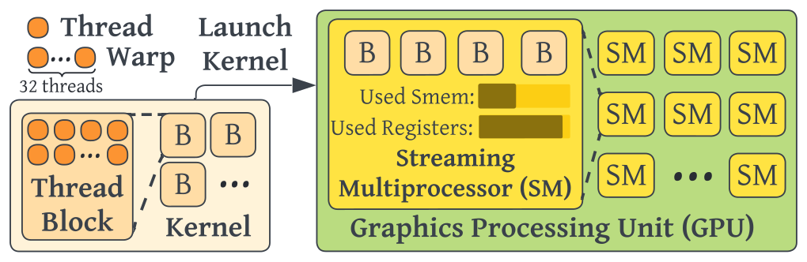

*图 1（原文 Figure 1，第 2 页）：CUDA 编程模型概览。*

**图中文字翻译与读法**：

- 左上图例：Thread（线程，橙色圆点）；Warp（一组 32 个线程，图中标 32 threads）；下方 Thread Block（线程块）由许多线程组成；多个线程块 B 构成一个 Kernel（内核），Launch Kernel（启动内核）指向右侧的 GPU。
- 右侧 Graphics Processing Unit (GPU)（图形处理器）由许多 Streaming Multiprocessor (SM)（流多处理器）组成；放大的一个 SM 里驻留着 4 个线程块，并用进度条显示 Used Smem（已用共享内存）和 Used Registers（已用寄存器）。
- 读图结论：一次 kernel 启动会把一个由线程块组成的网格分派到各个 SM 上；一个 SM 能同时驻留多少个线程块，取决于共享内存、寄存器堆和 warp 调度单元的容量。

原文的文字要点：

- 所有线程执行同一段代码（kernel 代码）；一个网格通常有几十到几千个线程块，一个线程块有几十到几百个线程；kernel 里用预定义变量 `threadIdx`、`blockIdx` 及后缀 x、y、z 访问线程在块内、块在网格内的三维下标。
- 现代 GPU 有几十到几百个 SM，每个 SM 可同时调度多达上千个线程；线程块内的线程被划分成 warp，每个 warp 是 32 个连续线程、执行相同指令。
- 两种可编程片上存储：**寄存器**（每个线程私有）和**共享内存**（分配给线程块，只有块内线程能访问）。线程块一波一波地分派到 SM 上，每个线程块只会落在一个 SM 上，一个 SM 可以有多个线程块。
- DNN 里的算子都实现为 GPU kernel，按算子依赖顺序依次启动。矩阵乘（线性层或稠密层）是最重要的算子之一，下面把它当作贯穿全文的例子。

### 2.2 一个高效的矩阵乘实现（原文 2.2）

目标：在 NVIDIA GPU 上用 Tensor Core 计算 $C=AB$，三个矩阵都是 $1024\times1024$。

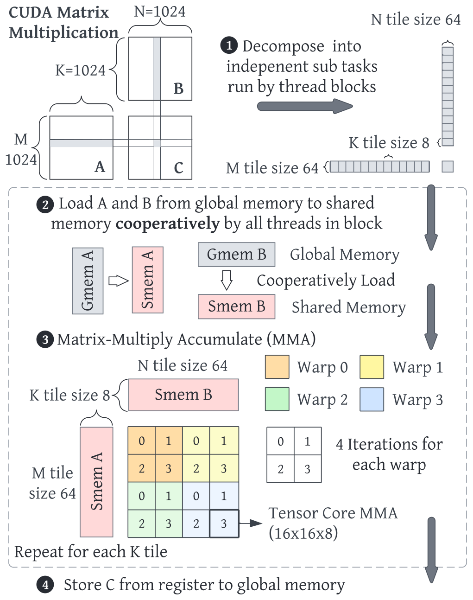

*图 2（原文 Figure 2，第 3 页）：CUDA 平台上的高效矩阵乘流程。*

**图中文字翻译与读法**（图中 ❶–❹ 对应原文的四个步骤）：

- 左上：CUDA Matrix Multiplication（CUDA 矩阵乘），$A$ 为 $M\times K$、$B$ 为 $K\times N$、$C$ 为 $M\times N$，$M=N=K=1024$；浅灰条表示 $C$ 的一个小块依赖 $A$ 的一行条带和 $B$ 的一列条带。
- ❶ Decompose into independent sub tasks run by thread blocks（分解成由线程块运行的独立子任务）：沿 $M$ 和 $N$ 分块，图中 M tile size 64、N tile size 64、K tile size 8。子任务数为 $\frac{M}{\text{M tile size}}\times\frac{N}{\text{N tile size}}=16\times16=256$（本文代入计算），每个子任务是一个 $64\times64\times K$ 的矩阵乘，分给一个线程块。
- ❷ Load A and B from global memory to shared memory cooperatively by all threads in block（块内所有线程协作地把 A、B 从全局内存搬进共享内存）：图中 Gmem A、Gmem B（全局内存）经 Cooperatively Load 变成 Smem A、Smem B（共享内存）。线程块内再把 $K$ 维切成 $K/8=128$ 个 K tile，对每个 K tile 执行 ❷–❸。
- ❸ Matrix-Multiply Accumulate (MMA)（矩阵乘累加）：4 个 warp（Warp 0–3，四种底色）把 $64\times64$ 的块分成 $4\times4=16$ 个 $16\times16$ 的小块；每个小块是一次 Tensor Core MMA，形状 $16\times16\times8$，即 $C_{16\times16}=A_{16\times8}B_{8\times16}+C_{16\times16}$。每个 warp 负责一个 $2\times2$ 的小块组，按图中右侧小方格的 0、1、2、3 顺序做 4 次 MMA（4 Iterations for each warp）。Repeat for each K tile（对每个 K tile 重复）。
- ❹ Store C from register to global memory（把 C 从寄存器写回全局内存）。

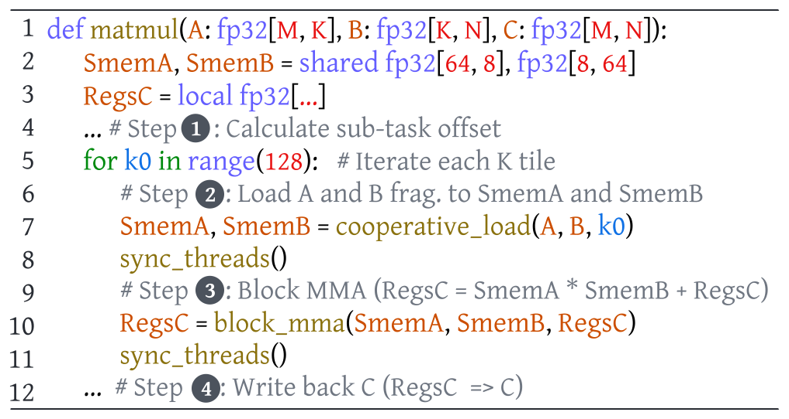

*图 3（原文 Figure 3，第 3 页）：矩阵乘的伪代码。*

逐行读法：

- L1 声明 `matmul(A: fp32[M, K], B: fp32[K, N], C: fp32[M, N])`；L2 在共享内存里开两块缓冲 `SmemA`（$64\times8$）和 `SmemB`（$8\times64$）；L3 `RegsC` 是每个线程私有的累加寄存器；
- L4（步骤 ❶）计算本线程块负责的子任务偏移；L5 `for k0 in range(128)` 遍历 128 个 K tile；
- L7（步骤 ❷）`cooperative_load` 把 A、B 的当前 K tile 协作搬进共享内存，L8 `sync_threads()` 同步，保证搬完再往下走；
- L10（步骤 ❸）`block_mma` 用共享内存里的 A、B 块累加到 `RegsC`，L11 再同步，保证大家算完才会被下一轮覆盖共享内存；
- L12（步骤 ❹）把 `RegsC` 写回 $C$。

实现这个 kernel 有两种办法：直接手写 CUDA C（如 cuDNN、cuBLAS、CUTLASS 等库），或使用声明式的循环调度原语，下一节介绍后者。

### 2.3 声明式的循环调度（loop-oriented scheduling，原文 2.3）

Halide 提出把“计算定义”和“调度”解耦，TVM 等当前最先进的深度学习编译器沿用这一范式。开发者只给出算子的数学定义（输出张量的每个元素怎样算出），调度器则决定怎么执行。

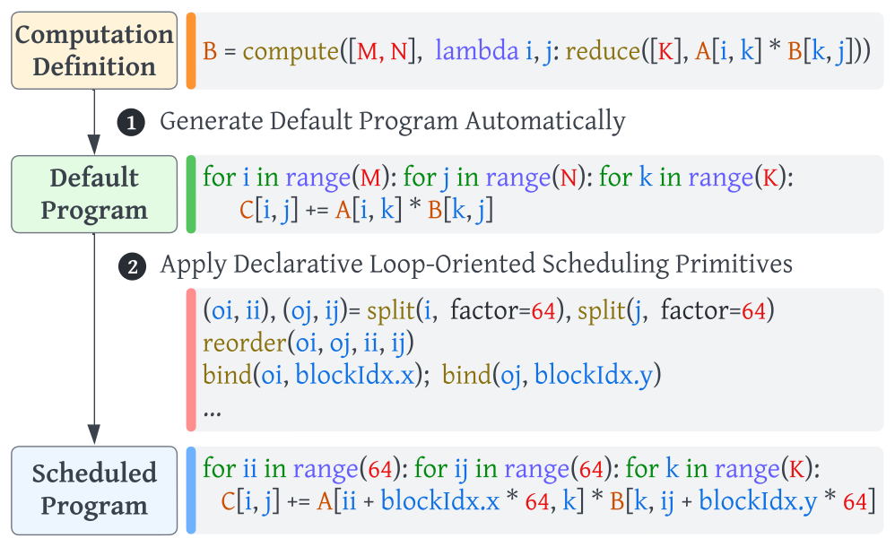

*图 4（原文 Figure 4，第 4 页）：循环调度的工作流程。*

**图中文字翻译与读法**：

- Computation Definition（计算定义）：`B = compute([M, N], lambda i, j: reduce([K], A[i, k] * B[k, j]))`，即输出 $(i,j)$ 元素是对 $k$ 的求和归约（原图符号如此，这里的 `B` 指输出）；
- ❶ Generate Default Program Automatically（自动生成默认程序）：把 `compute`、`reduce` 翻译成三层嵌套循环 `for i / for j / for k: C[i, j] += A[i, k] * B[k, j]`；
- ❷ Apply Declarative Loop-Oriented Scheduling Primitives（施加声明式的循环调度原语）：`split(i, factor=64)`、`split(j, factor=64)` 把 i、j 各拆成外内两层 (oi, ii)、(oj, ij)；`reorder(oi, oj, ii, ij)` 重排循环；`bind(oi, blockIdx.x)`、`bind(oj, blockIdx.y)` 把外层循环绑到线程块下标；省略号表示后面还有很多原语；
- Scheduled Program（调度后程序）：`for ii in range(64): for ij in range(64): for k in range(K): C[i, j] += A[ii + blockIdx.x * 64, k] * B[k, ij + blockIdx.y * 64]`。

**表 1：TVM 的循环调度原语**（fuse、split、reorder、bind 四个原语把原程序变换成调度后程序）：

| 调度原语 | 原程序 | 调度后程序 |
|---|---|---|
| `fuse(i, j)` | `for i in range(128): for j in range(4): body(i, j)` | `for ij in range(512): body(ij / 4, ij % 4)` |
| `split(i, 128)` | `for i in range(512): body(i)` | `for oi in range(4): for ii in range(128): body(oi * 128 + ii)` |
| `reorder(i, j)` | `for i in range(128): for j in range(4): body(i, j)` | `for j in range(4): for i in range(128): body(i, j)` |
| `bind(i, threadIdx.x)` | `for i in range(128): body(i)` | `body(threadIdx.x)` |

（原文表 1，第 4 页，逐格与 PDF 核对；循环体在表中均写作 `body`。原文脚注说明：改变循环位置的原语在表中省略。）读法：fuse 把两层循环合并成一层，split 把一层拆成两层，reorder 交换循环次序，bind 把一层循环绑到硬件轴（如 `threadIdx.x`），即让这层循环的每次迭代由一个线程执行。

原文接着说明使用这套范式的几种方式：为每个“工作负载”（带具体输入、在某个硬件上的算子）手写一份调度，工程量巨大；于是引入**可调参数**（tile 大小、循环次序）把手写调度变成**调度模板**，由 AutoTVM 这样的调优框架为各种输入形状和硬件搜索；为进一步省去写模板的时间，又有**自动调度**方法（如 Ansor、Halide 的 AutoScheduler）通过对计算定义套用预定义规则自动生成调度。原文举例说 TVM 要用 **80 多个原语**才能调度出一个矩阵乘（图 4 只列了开头几个）。

## 三、动机：循环调度的三个问题（原文第 3 节）

### 3.1 对关键优化的支持有限：以 double buffering 为例（原文 3.1）

图 3 的实现不是最优的：同一个线程块里的所有线程，在步骤 ❷（受访存带宽限制）和步骤 ❸（受计算单元限制）上很可能被同一类硬件资源卡住，另一类资源闲着。原因是图 3 中的数据加载（L7）和计算（L10）用的是同一块缓冲，只能靠同步（L8）满足数据依赖。

**double buffering**（双缓冲）是 cuBLAS、CUTLASS 等库已采用、而 TVM 不支持的优化，用两块缓冲让加载与计算重叠：

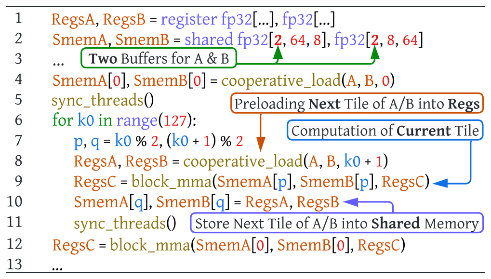

*图 5（原文 Figure 5，第 4 页）：double buffering 优化的伪代码。*

**图中文字翻译与读法**：

- L1–L2：声明寄存器 `RegsA`、`RegsB`，以及共享内存里**两份**缓冲 `SmemA`（$2\times64\times8$）、`SmemB`（$2\times8\times64$）（图中批注 “Two Buffers for A & B”，两块缓冲）；
- L4–L5：先把第 0 个 K tile 搬进缓冲 0 并同步；
- L6 起主循环，`k0 in range(127)`，L7 用 `p, q = k0 % 2, (k0 + 1) % 2` 在两块缓冲间交替：`p` 是本轮用来计算的缓冲，`q` 是下一块要存入的缓冲；
- L8 “Preloading Next Tile of A/B into Regs”（把下一块 A/B 预取进寄存器）：用 `cooperative_load(A, B, k0 + 1)` 发起下一个 K tile 的全局内存读取；
- L9 “Computation of Current Tile”（计算当前块）：`block_mma(SmemA[p], SmemB[p], RegsC)`；
- L10 “Store Next Tile of A/B into Shared Memory”（把下一块 A/B 存入共享内存）：写入缓冲 `q`；L11 同步；
- L12：循环外再算最后一个 tile。

**读图结论**：先把下一个 tile 读进**寄存器**（L8），算完当前 tile（L9）之后才存进共享内存（L10）。L9 的计算与 L8 在途中的全局内存加载可以借助线程级并行同时进行，所以访存单元和计算单元能同时被利用。

读码提示（本文核对）：L12 读的是缓冲 0，但按 `p`、`q` 的交替规则，最后一个 tile（第 127 块）在 `k0 = 126` 那轮被写入缓冲 $(126+1)\bmod 2=1$，所以 L12 的 `SmemA[0]`、`SmemB[0]` 应为缓冲 1，疑为原文伪代码笔误。

原文给出的核心论点是：**声明式的循环调度原语无法表达 double buffering**。因为没有任何一个原语能在细粒度上操纵循环体（原文脚注 3：TVM 曾尝试增加名为 `double_buffer` 的原语，但它没有把全局内存加载和共享内存存储分开，只能得到次优性能）。双缓冲只是一个例子，还有几类被库广泛使用、却难以用声明式循环调度表达的优化：线程块 swizzle、直接使用 Tensor Core 的 MMA PTX 指令（而不是 WMMA 指令，原文脚注 4）、多级异步预取。要实现这些，需要一种表达力更强的写 tensor program 并调度其计算的方法。

### 3.2 融合需要专门的调度模板（原文 3.2）

编译器相对内核库的重要优势是能优化任意负载，尤其是多个算子融合的负载，例如 CNN 里的 Conv2d-BN-ReLU、Transformer 里的 Reshape-Matmul-Transpose。

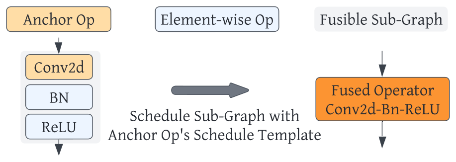

*图 6（原文 Figure 6，第 5 页）：TVM 子图融合的工作流程。*

**图中文字翻译与读法**：图例有 Anchor Op（锚点算子，橙色）、Element-wise Op（逐元素算子，蓝色）、Fusible Sub-Graph（可融合子图，灰色）。左边的可融合子图由 Conv2d（锚点）、BN、ReLU 组成；经过 “Schedule Sub-Graph with Anchor Op's Schedule Template”（用锚点算子的调度模板调度整个子图），得到右边的 Fused Operator Conv2d-Bn-ReLU（融合算子）。

TVM 把算子划分成若干子图，每个子图只能含**一个**锚点算子（通常是最耗算力的，如卷积或矩阵乘），它带有精心设计的调度模板；然后用锚点算子的模板去调度整个子图。这意味着模板必须支持所有可能的融合场景，大大增加了写模板的复杂度。自动调度器（如 Ansor）能通过预定义规则从计算定义自动生成调度模板，但很难扩展新规则：新规则必须与所有已有规则兼容，并且要足够通用以支持所有算子。所以在不增加专用调度模板复杂度的前提下支持融合，仍然困难。

### 3.3 调优时间长：以输入为中心的调度空间（原文 3.3）

现有调度器（AutoTVM、Ansor、Halide 自动调度器）的调优时间通常是几小时到几天，原因是调度空间效率低。它们的调度空间主要由循环的 tiling 因子构成，且为了限制空间规模、避免条件分支，只覆盖**完美切分**（只用循环长度 $n$ 的因子切分），例如长度为 10 的循环，可选的 tile 因子只有 1、2、5、10。因此空间依赖于目标负载的输入形状，原文称之为 **input-centric schedule space**（以输入为中心的调度空间）。这带来两个挑战：

1. 调度空间的大小随输入尺寸因子的个数**指数增长**。

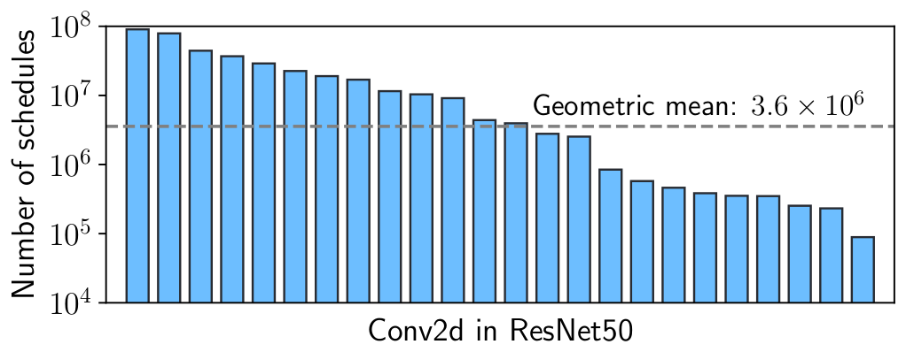

*图 7（原文 Figure 7，第 5 页）：AutoTVM 为 ResNet-50 中各个卷积采用的调度空间大小。*

**图中文字翻译与读法**：纵轴 Number of schedules（调度个数，对数刻度，$10^4$ 到 $10^8$），横轴 Conv2d in ResNet50（ResNet50 中的各个卷积，从大到小排列，从图上数得共 24 根柱）；水平虚线标注 Geometric mean: $3.6\times10^6$（几何平均 $3.6\times10^6$）。从图上读出，最大的约 $9\times10^7$，最小的约 $9\times10^4$。读图结论：单个卷积层最多有近 $10^8$ 个调度要搜索，几何平均也有数百万。

2. 调度空间**可能不包含性能最优的调度**，因为非完美切分没被考虑。极端例子：当 $M=N=K=2039$ 时，Ansor 和 AutoTVM 都找不到合法调度，因为 2039 是质数。

针对第一个挑战，当前的调度器（AutoTVM、Ansor）用代价模型预测调度性能，并用遗传进化搜索提高效率，但调优单个算子仍需约半小时，调优一个 Inception V3 模型要 8 到 15 小时（原文引言还写到 AutoTVM 在一块现代 GPU 上调优 Inception V3 要 15 小时）。过长的调优时间使它们无法与图级优化、神经架构搜索等上层应用协同优化，因为后者需要在很短时间内拿到 kernel 延迟来指导搜索。

## 四、核心思想（原文第 4 节）

### 4.1 task-mapping 编程范式（原文 4.1）

作者观察到，循环调度原语的目的无非是两类：（1）把计算分配给并行处理单元（线程或 warp）；（2）规定分配给每个处理单元的计算按什么顺序执行。

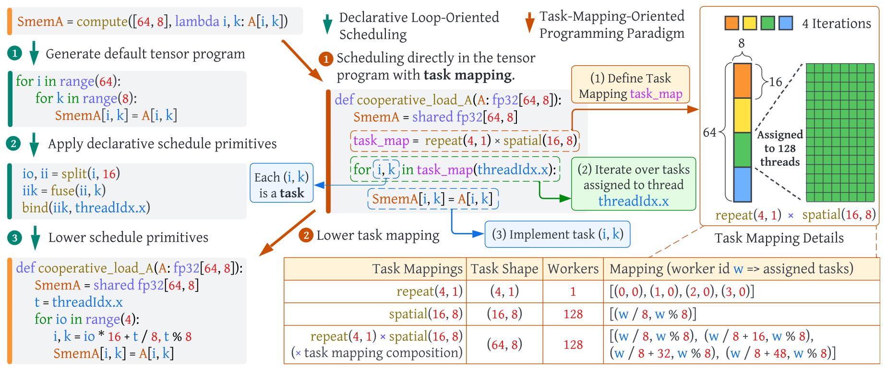

*图 8（原文 Figure 8，第 6 页）：分别用声明式循环调度和 task-mapping 范式调度“协作加载”。原文图题：声明式循环调度中，开发者对自动生成的程序施加一系列声明式调度原语，把 tensor program 变换成更高效的程序；task-mapping 范式则允许开发者把调度直接嵌入 tensor program，因而比循环调度支持更大范围的优化。*

**图中文字翻译与读法**（任务：把矩阵 $A$ 的 $64\times8$ 片段搬进共享内存，忽略块偏移，只看 A）：

- 顶部：`SmemA = compute([64, 8], lambda i, k: A[i, k])`，即共享内存 $64\times8$ 的计算定义。
- **左列：Declarative Loop-Oriented Scheduling（声明式循环调度）**：❶ Generate default tensor program（生成默认程序）`for i in range(64): for k in range(8): SmemA[i, k] = A[i, k]`；❷ Apply declarative schedule primitives（施加调度原语）`io, ii = split(i, 16)`、`iik = fuse(ii, k)`、`bind(iik, threadIdx.x)`；❸ Lower schedule primitives（下降原语）得到 `t = threadIdx.x; for io in range(4): i, k = io * 16 + t / 8, t % 8; SmemA[i, k] = A[i, k]`。三个原语（split、fuse、bind）把 512 个元素的搬运分给 128 个线程，每个线程按顺序搬 4 个。
- **右列：Task-Mapping-Oriented Programming Paradigm（面向 task mapping 的编程范式）**：❶ Scheduling directly in the tensor program with task mapping（直接在 tensor program 里用 task mapping 调度）：

```python
def cooperative_load_A(A: fp32[64, 8]):
    SmemA = shared fp32[64, 8]
    task_map = repeat(4, 1) * spatial(16, 8)   # (1) 定义 task mapping
    for i, k in task_map(threadIdx.x):         # (2) 遍历分给本线程的任务
        SmemA[i, k] = A[i, k]                  # (3) 实现任务 (i, k)
```

  ❷ Lower task mapping（下降 task mapping）后得到与左列相同的代码。批注 “Each (i, k) is a task”：每个 $(i,k)$ 是一个任务。
- **右上方 Task Mapping Details**：$64\times8$ 的任务网格被分成 4 次迭代（4 Iterations，四种颜色），每次迭代由 128 个线程（Assigned to 128 threads）各做一个元素；表示为 `repeat(4, 1) × spatial(16, 8)`。
- **底部表格**（任务映射、任务形状、worker 个数、映射 worker 号 w ⇒ 分得的任务）：

| Task Mappings | Task Shape | Workers | Mapping（worker id w ⇒ 分到的任务） |
|---|---|---:|---|
| `repeat(4, 1)` | (4, 1) | 1 | `[(0,0), (1,0), (2,0), (3,0)]` |
| `spatial(16, 8)` | (16, 8) | 128 | `[(w / 8, w % 8)]` |
| `repeat(4, 1) × spatial(16, 8)`（task mapping 组合） | (64, 8) | 128 | `[(w / 8, w % 8), (w / 8 + 16, w % 8), (w / 8 + 32, w % 8), (w / 8 + 48, w % 8)]` |

**读图结论**：

- 在 task-mapping 范式里，调度分三步：（1）定义 task mapping；（2）用线程号调用 task mapping，遍历分给该线程的每个任务；（3）用任务下标 `(i, k)` 实现任务本身。任务的**分配**与单个任务的**实现**因此解耦，大大简化了 tensor program 的开发。
- 与声明式调度相比，它**直接在 tensor program 里调度**，因此允许更细粒度的优化；它还允许开发者在某些维度上退回到传统循环，用来实现双缓冲这类优化。
- 因为 task mapping 是这三步的核心部件，作者把这种构造 tensor program 的新方法称为 **task-mapping 编程范式**。图 8 的 task mapping 是由两个基本 task mapping（`repeat(4, 1)` 与 `spatial(16, 8)`）经组合得到的，形式化定义见第五节。

### 4.2 后调度融合（原文 4.2）

算子融合能大幅减少显存读写、加速端到端执行，所以除了调度单个算子，还要调度融合后的子图。Hidet 把融合子图的调度拆成两步：

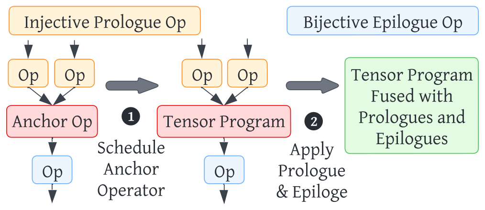

*图 9（原文 Figure 9，第 7 页）：后调度融合的两个步骤。*

**图中文字翻译与读法**：图例有 Injective Prologue Op（单射的前导算子，橙色）和 Bijective Epilogue Op（双射的收尾算子，蓝色）。左图：计算图里有位于锚点之前的若干前导算子（Op）、红色的 Anchor Op（锚点算子）和位于其后的收尾算子；步骤 ❶ Schedule Anchor Operator（只调度锚点算子）得到中间图里的 Tensor Program；步骤 ❷ Apply Prologue & Epilogue（把前导与收尾算子应用上去）得到右边绿色的 Tensor Program Fused with Prologues and Epilogues（融合了前导与收尾算子的 tensor program）。

- 步骤 ❶：像 TVM 一样选出锚点算子，但**只单独调度锚点算子**；
- 步骤 ❷：自动把周围的算子融合进锚点算子已调度好的 tensor program。

这样锚点算子的调度只需考虑它自己的实现，不必考虑整个子图，相比 AutoTVM 大大降低了为子图设计调度模板的工程量。因为融合发生在调度**之后**，所以叫 post-scheduling fusion。

融合资格由算子特征判定：

- 没有归约计算的算子称为 **injective**（单射），有资格做 **prologue**（前导）算子；
- 若一个算子是单射的，并且输入张量的每个元素只贡献给输出张量的一个元素，则称为 **bijective**（双射），有资格做 **epilogue**（收尾）算子；
- 所有逐元素算子（如加法、ReLU）和变换算子（如 reshape、transpose）都是双射的，既可以做前导，也可以做收尾。

### 4.3 以硬件为中心的调度空间（原文 4.3）

现有调度器采用 3.3 节的 input-centric 调度空间：从循环长度的因子中选切分因子，空间不可扩展，也覆盖不到那些不是循环长度因子的 tile 大小所能带来的最优性能。另一种做法是按**硬件**设计调度空间：用**谓词加载**（predicated loading，即在加载前检查访问下标是否在界内以保护加载）把调度空间与输入尺寸解耦，这是内核库（cuDNN、cuBLAS、CUTLASS）广泛采用的做法，原文称之为 **hardware-centric schedule space**。

在 task-mapping 范式下，Hidet 可以提供一个小而高效的 hardware-centric 空间。tile 因子取决于硬件资源（如 $64\times64$、$128\times64$、$16\times32$ 等），因此这类空间比 input-centric 空间小几个数量级。例如 Hidet 为矩阵乘采用的调度空间**少于 200 个调度**，平均比 AutoTVM 的典型调度空间小 $10^5$ 倍；只需逐个枚举，一分钟内即可完成。

## 五、Hidet 的系统设计（原文第 5 节）

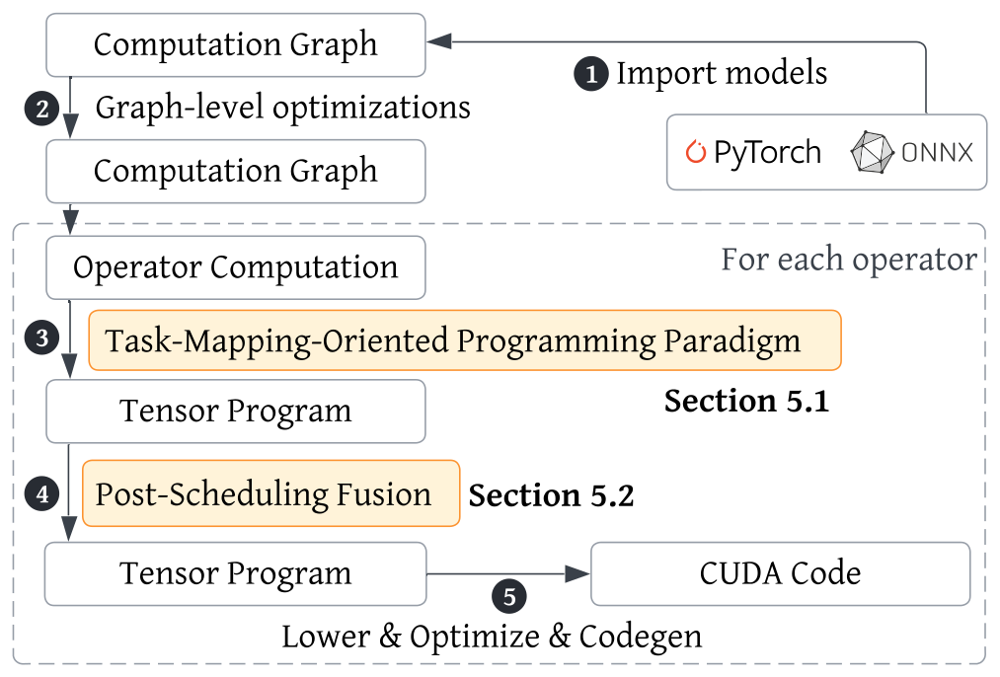

*图 10（原文 Figure 10，第 7 页）：Hidet 的整体设计。*

**图中文字翻译与读法**：

- ❶ Import models（导入模型）：从 PyTorch 或 ONNX 格式的模型文件导入，得到 Computation Graph（计算图）；
- ❷ Graph-level optimizations（图级优化）：常量折叠、划分可融合子图等；
- 对子图中的每个 operator（For each operator）：取 Operator Computation（算子的计算定义）；❸ 用 Task-Mapping-Oriented Programming Paradigm（面向 task mapping 的编程范式，图中标注 Section 5.1，即原文 5.1 节，对应本文 5.1–5.2 节）调度成 Tensor Program，并在 hardware-centric 调度空间里调优；❹ Post-Scheduling Fusion（后调度融合，图中标注 Section 5.2，即原文 5.2 节，对应本文 5.3 节）把锚点算子已调度的程序与周围算子自动融合，得到新的 Tensor Program；❺ Lower & Optimize & Codegen（下降、优化、代码生成）：融合后的 tensor program 用 Hidet 的中间表示（IR）优化并下降，代码生成器把下降后的 IR 转成 CUDA Code（CUDA 代码）。

Hidet 用到两层 IR：图级 IR 表示模型的计算图，张量级 IR 表示带调度的 tensor program（原文 6.1）。

### 5.1 task mapping 的形式化定义（原文 5.1.1 与 5.1.2）

一个关键难题是：对有并行处理单元的硬件，怎样把相互独立的（子）任务分配给这些单元。以图 8 的协作加载为例：把形状 $64\times8$ 的 A 片段从全局内存搬到共享内存，共 512 个任务，分给线程块里的 128 个线程，每个线程分到 4 个加载任务。这里任务被分配给并行处理单元（称为 **worker**），分给每个 worker 的任务按特定顺序执行。

**定义**。含 $n$ 个 worker 的 worker 集合 $\mathbf{W}_n$ 与任务域 $\mathbf{T}$ 为：

$$
\mathbf{W}_n=\{0,1,\dots,n-1\},\qquad
\mathbf{T}=\{(t_0,t_1,\dots,t_{m-1})\mid 0\le t_i<d_i,\ t_i\in\mathbb{Z}\},
$$

其中 $m$ 是任务的维数，$\mathbf{d}=(d_0,d_1,\dots,d_{m-1})$ 是**任务形状**（task shape）。**task mapping** $f$ 是一个函数，把每个 worker 映射到任务域里的一个**任务列表**：

$$
f(w)=\big[t^{(0)},t^{(1)},\dots,t^{(q-1)}\big],\qquad w\in\mathbf{W},\ t^{(i)}\in\mathbf{T}.
$$

也就是说，task mapping 既决定“哪些任务归 $w$”（任务分配），又用列表的顺序决定“按什么次序做”（任务执行次序）。两个最有用的基本 task mapping：

- `repeat(d1, ..., dm)`：把 $(d_1,\dots,d_m)$ 的任务网格全部交给**一个** worker；
- `spatial(d1, ..., dm)`：把任务网格分给**同样多**的 worker，每个 worker 只做**一个**任务。

此外开发者还可以通过指定任务形状、worker 个数和映射函数来自定义 task mapping；虽然图中例子都是二维的，task mapping 可以有任意多个任务维度。

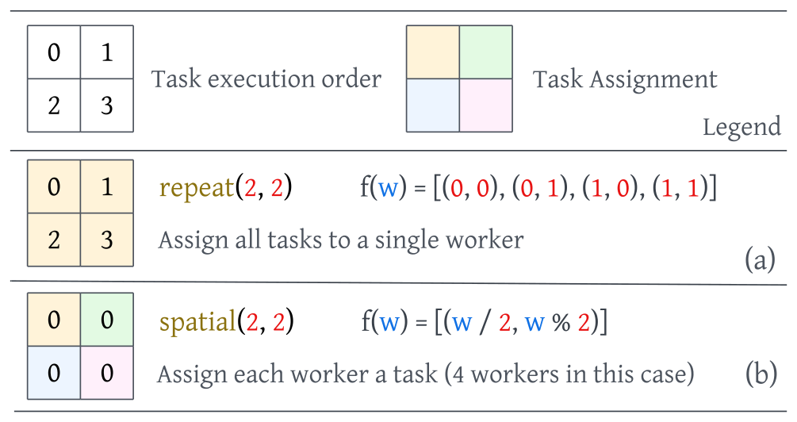

*图 11（原文 Figure 11，第 8 页）：两种基本 task mapping `repeat(2, 2)` 与 `spatial(2, 2)` 的例子。原文说明：格内数字表示分给同一 worker 的任务的执行次序，颜色表示任务分给了哪个 worker。*

**图中文字翻译与读法**：

- 上方图例：左边 $2\times2$ 方格的数字是 Task execution order（任务执行次序，0 到 3），右边四种底色是 Task Assignment（任务分配，每种颜色对应一个 worker）。
- (a) `repeat(2, 2)`，$f(w)=[(0,0),(0,1),(1,0),(1,1)]$：把所有任务（4 个）分给单个 worker（Assign all tasks to a single worker），所有格子同色，次序按行主序 0、1、2、3；
- (b) `spatial(2, 2)`，$f(w)=[(w/2,\,w\%2)]$：给每个 worker 一个任务（这里 4 个 worker，Assign each worker a task），四个格子四种颜色，每格次序都是 0。

**task mapping 的组合**。分层结构在协作加载的例子里很自然：$64\times8=512$ 个任务可以划成 4 组，每组 $16\times8=128$ 个任务，每组由 128 个线程执行。把每组当作一个“宏任务”、把 128 个线程整体当作一个“宏 worker”，宏任务到宏 worker 的映射就是把 4 个任务都分给一个 worker，即 `repeat(4, 1)`。这说明：一个 task mapping 里的所有任务可以整体看作另一个 task mapping 里的单个任务，所有 worker 可以整体看作单个 worker，从而组合出新的 task mapping。形式化为：设 $f_1,f_2$ 是任务维数相同的两个 task mapping，worker 个数分别为 $n_1,n_2$，任务形状分别为 $\mathbf{d}_1,\mathbf{d}_2$。它们的**组合** $f_3=f_1\circ f_2$ 有 $n_1n_2$ 个 worker，任务形状为 $\mathbf{d}_3=\mathbf{d}_1\odot\mathbf{d}_2$（$\odot$ 表示逐元素相乘），映射函数为

$$
f_3(w)=\Big[\,t_1\odot\mathbf{d}_2+t_2\ \Big|\ t_1\in f_1\big(\lfloor w/n_2\rfloor\big),\ t_2\in f_2\big(w\bmod n_2\big)\Big].
$$

即外层 $f_1$ 的任务决定“宏任务”位置，内层 $f_2$ 的任务决定宏任务内部的位置；遍历次序是外层任务在外、内层任务在内。组合满足**结合律** $(f_1\circ f_2)\circ f_3=f_1\circ(f_2\circ f_3)$，但**不满足交换律**。代入验证图 8：$f_1=$`repeat(4, 1)`（1 个 worker，任务 $(0,0),(1,0),(2,0),(3,0)$），$f_2=$`spatial(16, 8)`（128 个 worker，$f_2(w)=[(w/8,w\%8)]$），则 $n_3=128$，$\mathbf{d}_3=(4,1)\odot(16,8)=(64,8)$，$f_3(w)=[(w/8,w\%8),(w/8+16,w\%8),(w/8+32,w\%8),(w/8+48,w\%8)]$，与图 8 的表格一致。

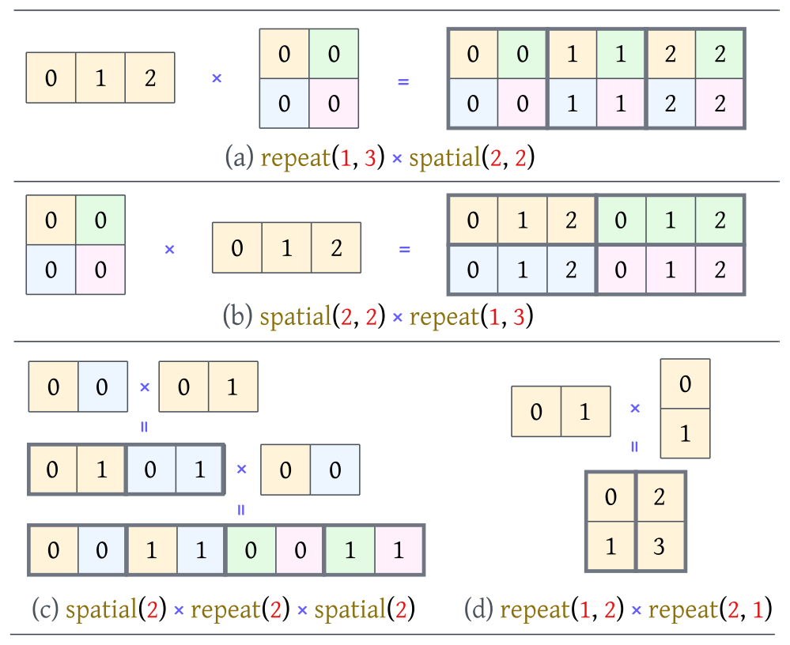

*图 12（原文 Figure 12，第 8 页）：task mapping 组合的例子。原文说明：(a) 与 (b) 表明组合不满足交换律；(c) 是组合三个 task mapping 的例子，因为组合满足结合律，组合的先后顺序无关紧要；(d) 是按列主序分配任务的例子。*

**图中文字翻译与读法**（每个子图“左 × 右 = 结果”，结果格中的数字是执行次序，颜色是 worker）：

- (a) `repeat(1, 3) × spatial(2, 2)`：结果是 $2\times6$ 的任务网格。每个 worker 的三个任务在同一行里隔着取：第一行是 0 0 1 1 2 2，颜色交替（橙、绿、橙、绿、橙、绿），即橙色 worker 依次做第 0、2、4 列。
- (b) `spatial(2, 2) × repeat(1, 3)`：同样是 $2\times6$，但每个 worker 的三个任务连在一起：第一行是 0 1 2（橙）、0 1 2（绿），即橙色 worker 做第 0、1、2 列。可见 (a)(b) 次序不同，组合不满足交换律。
- (c) `spatial(2) × repeat(2) × spatial(2)`：三个一维 task mapping 逐层组合，最终得到 $1\times8$ 的任务条，用到 4 个 worker；先算前两个、再与第三个组合，与先算后两个结果相同（结合律）。
- (d) `repeat(1, 2) × repeat(2, 1)`：单个 worker，结果的次序是 0、1、2、3 按列主序排布（左列 0、1，右列 2、3）。外层的 `repeat(1, 2)` 先遍历列，内层的 `repeat(2, 1)` 遍历行。

原文还给出一个组合例子：`spatial(4, 2) * repeat(2, 2) * spatial(4, 8) * repeat(4, 4)` 用于使用 CUDA Core 的矩阵乘。四项依次对应：块内 warp 的排布（$4\times2$）、每个 warp 重复的次数（$2\times2$）、warp 内线程的排布（$4\times8$）、每个线程负责的 C 元素个数（$4\times4$）。（本文代入计算：任务形状为 $(4\cdot2\cdot4\cdot4,\ 2\cdot2\cdot8\cdot4)=(128,128)$，worker 数 $8\times32=256$ 个线程，每线程 $2\cdot2\cdot4\cdot4=64$ 个元素。）

**task 与 worker 是抽象概念**，可以用来描述不同层级的任务与 worker：除了单个线程，worker 也可以表示一个 warp、一个线程块，或其他加速器上的处理单元。

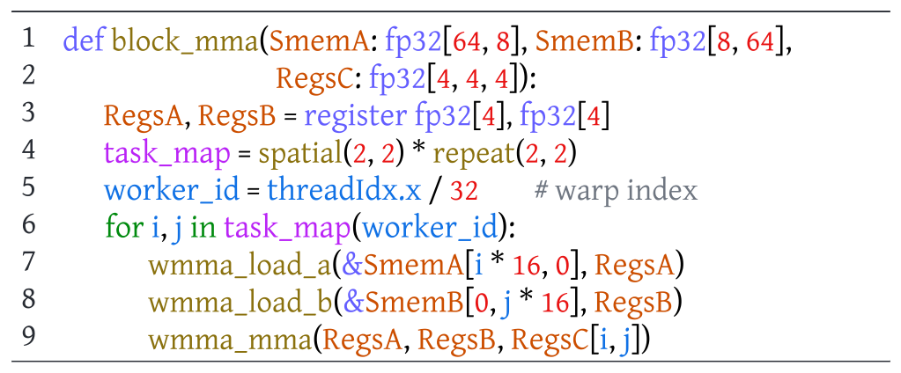

*图 13（原文 Figure 13，第 8 页）：用 task mapping 调度 warp 级任务（实现 `block_mma`）。*

**图中文字翻译与读法**：

- L1–L2：`block_mma(SmemA: fp32[64, 8], SmemB: fp32[8, 64], RegsC: fp32[4, 4, 4])`，即 2.2 节步骤 ❸ 里的块级 MMA；L3：每个线程私有的寄存器 `RegsA`、`RegsB`；
- L4：`task_map = spatial(2, 2) * repeat(2, 2)`；L5：`worker_id = threadIdx.x / 32`，worker 是 **warp**（warp 号）；
- L6–L9：`for i, j in task_map(worker_id)`：对分到的每个 $16\times16$ 小块 $(i,j)$，`wmma_load_a(&SmemA[i * 16, 0], RegsA)` 取 A 的 $16\times8$ 片段，`wmma_load_b(&SmemB[0, j * 16], RegsB)` 取 B 的 $8\times16$ 片段，`wmma_mma(RegsA, RegsB, RegsC[i, j])` 做一次 Tensor Core MMA。

**读图结论**：这里把 $4\times4$ 的任务网格分给 4 个 warp，每个 warp 做 4 个 warp 级 MMA 任务，对应图 2 步骤 ❸ 的分配。本文代入组合公式：`spatial(2, 2) * repeat(2, 2)` 的任务形状是 $(4,4)$，warp $w$ 得到 $(2\lfloor w/2\rfloor+a,\ 2(w\bmod2)+b)$（$a,b\in\{0,1\}$，行主序），即 warp 0 取左上 $2\times2$、warp 1 取右上、warp 2 取左下、warp 3 取右下，正好是图 2 中四种颜色的划分。原文脚注 6：`wmma_load_a`、`wmma_load_b` 把数据从共享内存搬到寄存器，`wmma_mma` 用给定寄存器做 MMA；`RegsC` 有特殊布局，会把 $(i,j)$ 映射到 $(i\%2,\,j\%2)$；为简单起见，原文没有介绍 Hidet 的数据布局（layout）。

task mapping 及其组合让开发者摆脱了为同一目的手写复杂循环与下标计算，这就是 task-mapping 编程范式。

### 5.2 两种调度机制（原文 5.1.3）

基于该范式，Hidet 实现了两种调度机制：

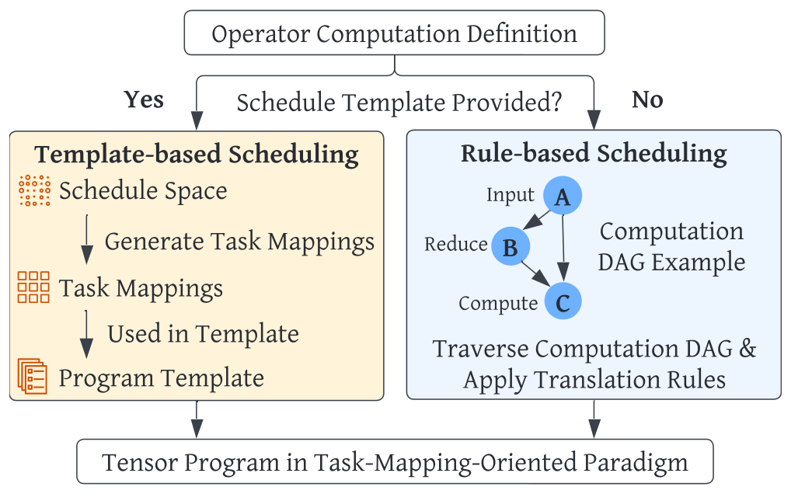

*图 14（原文 Figure 14，第 9 页）：Hidet 的两种调度机制。*

**图中文字翻译与读法**：从 Operator Computation Definition（算子计算定义）出发，判断 “Schedule Template Provided?”（是否提供了调度模板）：Yes → Template-based Scheduling（基于模板的调度）：Schedule Space（调度空间）→ Generate Task Mappings（生成 task mapping）→ Task Mappings → Used in Template（用于模板）→ Program Template（程序模板）；No → Rule-based Scheduling（基于规则的调度）：遍历计算 DAG（图中例子：Input A、Reduce B、Compute C）并应用转换规则（Traverse Computation DAG & Apply Translation Rules）。两条路径最终都得到 Tensor Program in Task-Mapping-Oriented Paradigm（task-mapping 范式的 tensor program）。

- **基于规则的调度（rule-based scheduling）**：受 Ansor 和 Halide 自动调度器启发，直接从单个算子的计算定义生成 tensor program，不需要额外的工程投入。它遍历以有向无环图（DAG）表示的计算定义，并把 DAG 的每个节点按预定义规则翻译成最终程序的一部分。Hidet 对大多数算子使用它，尤其是没有归约的算子（reshape、transpose、slice 和所有逐元素算术算子）。
- **基于模板的调度（template-based scheduling）**：受 AutoTVM 启发，用于需要极致优化的算子（如矩阵乘），因为规则调度可能为这类关键算子生成不够高效的程序。调度模板是用**带参数的 task mapping** 写成的 tensor program，并配有一个调度空间，即这些参数的可选取值集合；模板可以用空间里的任意一组取值实例化。以图 5、图 13 的矩阵乘为例，可以用不同数量的 warp、让每个 warp 重复不同次数，这些不同选择构成矩阵乘的调度空间。调度时，Hidet 先枚举调度空间里的选择，用它为程序模板创建 task mapping，把模板实例化成 tensor program 并测量性能，最后采用性能最好的调度，这个过程称为**调优（tuning）**。

给 Hidet 加新算子不需要很高的工程投入：大多数算子由规则调度自动完成；卷积、矩阵乘这类计算密集算子通常需要基于模板的调度，写一个新模板的复杂度与写一个 AutoTVM 模板相当。

### 5.3 后调度融合的实现与例子（原文 5.2）

Hidet 把子图调度解耦成两个阶段：（1）调度锚点算子；（2）把已调度的 tensor program 与周围算子融合。调优时，以**融合后** tensor program 的性能作为要最大化的目标，所以这种解耦不会损害最终性能（原文的说法）。具体流程（图 15）：步骤 ❶ 在图级优化阶段，一个优化 pass 把计算图划分成子图；步骤 ❷ 用上一节（本文 5.2）的某种调度机制把选定的锚点算子调度成 tensor program；步骤 ❸ 把其余算子融合进已调度的程序，它们分为两类：每个输入张量的 **prologue 算子**，和每个输出张量的 **epilogue 算子**。前者定义了输入张量每个元素的访问怎样计算，后者定义了输出张量元素怎样进一步计算并存入融合算子的输出。

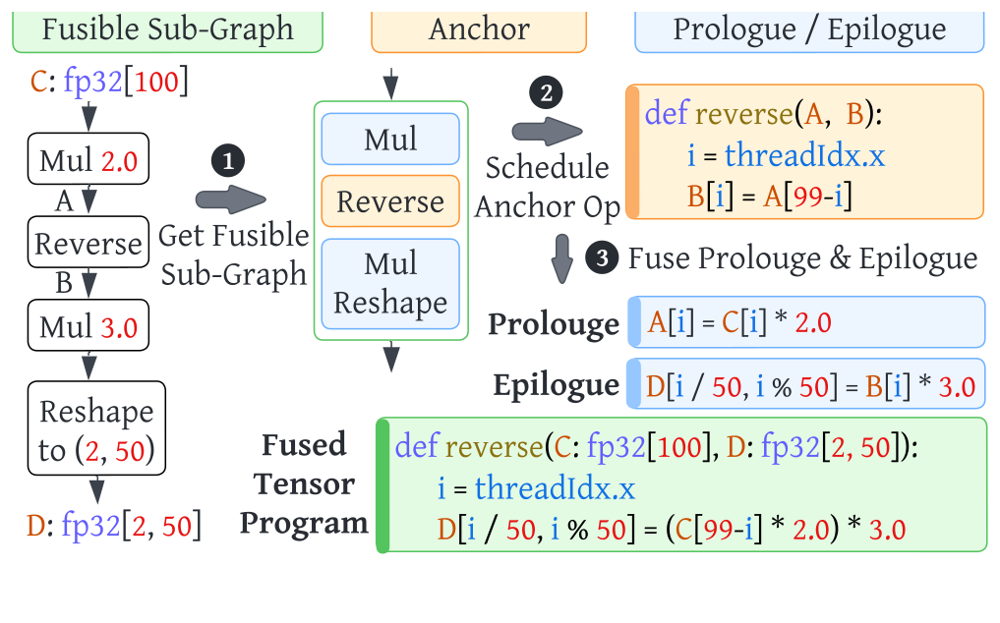

*图 15（原文 Figure 15，第 9 页）：后调度融合的例子。*

**图中文字翻译与读法**：

- 左：Fusible Sub-Graph（可融合子图）：输入 `C: fp32[100]` → `Mul 2.0` → 张量 A → `Reverse`（反转）→ 张量 B → `Mul 3.0` → `Reshape to (2, 50)` → 输出 `D: fp32[2, 50]`；
- ❶ Get Fusible Sub-Graph（取出可融合子图）：中间的 Anchor 框里是 Mul、Reverse（橙色，即锚点）、Mul Reshape；
- ❷ Schedule Anchor Op（调度锚点算子）：`def reverse(A, B): i = threadIdx.x; B[i] = A[99-i]`；
- ❸ Fuse Prologue & Epilogue（融合前导与收尾）：Prologue（前导）`A[i] = C[i] * 2.0`；Epilogue（收尾）`D[i / 50, i % 50] = B[i] * 3.0`；
- 最终得到 Fused Tensor Program（融合后的 tensor program）：

```python
def reverse(C: fp32[100], D: fp32[2, 50]):
    i = threadIdx.x
    D[i / 50, i % 50] = (C[99-i] * 2.0) * 3.0
```

**读图结论**：锚点程序里对 `A[99 - i]` 的访问被替换成 `C[99 - i] * 2.0`；输出张量的第 `i` 个元素进一步乘 3.0，再存到融合输出 `D` 的 `(i / 50, i % 50)` 位置。

后调度融合不仅简化了算子融合，还能**复用已有的高度优化的算子来支持新算子**。例如在 Hidet 里，卷积用 img2col 算法实现为四个算子，其中一个是矩阵乘，另外三个是简单的变换算子；有了后调度融合，就能把另外三个算子融合进矩阵乘，并把矩阵乘的所有优化（如沿 $k$ 维的并行归约）直接复用给卷积。

## 六、评测（原文第 6 节）

### 6.1 实验设置（原文 6.1）

- **实现**：Hidet 从零实现，约 2 万行 Python 与 C++ 代码；用两层 IR（图级 IR 与张量级 IR）；把用 task mapping 写的 tensor program 下降成 CUDA C 代码，并用 CUDA 编译器编译。为覆盖所评测模型里的全部算子，只实现了**两个**高效调度模板：矩阵乘和归约算子（如求和归约）；大多数算子要么由规则调度生成，要么被转换成矩阵乘以复用已有模板（如卷积）。
- **平台**：一台服务器，16 核 24 线程的 Intel i9-12900K CPU（开启超线程），64 GiB 内存，一块 NVIDIA RTX 3090 GPU；Ubuntu 20.04，NVIDIA 驱动 510.73.08，CUDA 11.6。
- **负载**：ResNet50（常用的图像分类 CNN）、Inception-V3（并行使用多种卷积核大小的多路径 CNN）、MobileNet-V2（基于可分离卷积的轻量 CNN）、Bert（常用的基于 Transformer 的 NLP 模型）、GPT-2（面向翻译、问答等序列到序列任务的 NLP 模型）；两个语言模型的序列长度都取 128。模型实现取自 torchvision 与 transformers 包，导出成 ONNX 格式评测。
- **对比对象**：PyTorch 1.11、Onnx Runtime 1.11.1（二者借助 cuDNN、cuBLAS 等高性能内核库）、AutoTVM 与 Ansor（TVM 0.9.dev，commit c07a46327）；AutoTVM 与 Ansor 的调优次数（trials）分别设为 1000 和 800，按各自论文与官方文档的建议。
- 原文没有声明数据类型。

### 6.2 端到端评测（原文 6.2）

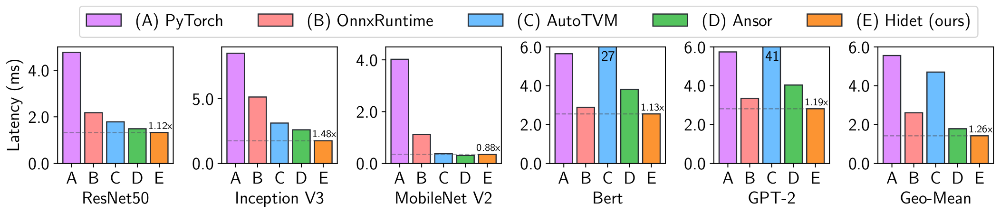

*图 16（原文 Figure 16，第 11 页）：各最先进 DNN 推理框架与编译器同 Hidet 的端到端对比（单个 batch）。*

**图中文字翻译与读法**：

- 图例：(A) PyTorch、(B) OnnxRuntime、(C) AutoTVM、(D) Ansor、(E) Hidet (ours)；纵轴 Latency (ms)（延迟，越小越好）。
- 六个子图：ResNet50、Inception V3、MobileNet V2、Bert、GPT-2、Geo-Mean（几何平均）。每个子图里 A–E 五根柱；虚线是 Hidet 的水平；E 柱上标的 “1.12×” 等是 Hidet 相对该模型**最佳基线**的加速比（本文用柱高验算：ResNet50 的最佳基线是 Ansor，约 $1.49/1.33\approx1.12$）。
- Bert 与 GPT-2 子图里 AutoTVM 的柱超出纵轴，柱内标注 27 和 41（毫秒）。

下表是从该图的矢量数据量出的各柱高度（单位 ms，约值；标“图上标注”的是原文直接写在图上的数字；最后一列为图上标注的 Hidet 加速比）：

| 模型 | PyTorch | ONNX Runtime | AutoTVM | Ansor | Hidet | 图上标注的 Hidet 加速比 |
|---|---:|---:|---:|---:|---:|---:|
| ResNet50 | 4.77 | 2.18 | 1.79 | 1.49 | 1.33 | 1.12× |
| Inception V3 | 8.51 | 5.13 | 3.12 | 2.60 | 1.75 | 1.48× |
| MobileNet V2 | 4.02 | 1.12 | 0.38 | 0.31 | 0.35 | 0.88× |
| Bert | 5.65 | 2.89 | 27（图上标注） | 3.81 | 2.55 | 1.13× |
| GPT-2 | 5.74 | 3.35 | 41（图上标注） | 4.04 | 2.81 | 1.19× |
| Geo-Mean | 5.55 | 2.61 | 4.71 | 1.79 | 1.42 | 1.26× |

**原文结论**：Hidet 在大多数模型上优于所有基线，最高 1.48×，平均 1.22×。原因（原文的解释）：Hidet 能自动融合子图、针对给定输入尺寸调优（对比 PyTorch 与 Onnx Runtime）、并能表达 double buffering 等更多优化（对比 AutoTVM 与 Ansor）。例外是 MobileNetV2 上的 Ansor：Ansor 能为深度可分离卷积（depthwise convolution）找到更好的调度；原文说可以在 Hidet 里实现类似调度，留作未来工作。AutoTVM 在 Bert 与 GPT-2 上表现更差（27 ms 与 41 ms），原因是 AutoTVM 针对这两个模型里负载的调度模板缺少优化。

**读图时的几点**（本文核对）：

- 图上的 1.12×、1.48×、0.88×、1.13×、1.19×、1.26× 都是相对**各模型的最佳基线**：ResNet50、Inception V3、MobileNet V2 的最佳基线是 Ansor，Bert、GPT-2 的最佳基线是 ONNX Runtime。
- Geo-Mean 子图是 5 个模型延迟的几何平均（本文用柱高验算 Hidet 的 1.42 ms：五个模型延迟 1.33、1.75、0.35、2.55、2.81 的几何平均），而 1.26× 是 Ansor 的 1.79 ms 除以 Hidet 的 1.42 ms。
- 摘要与正文写的“平均 1.22×”与图 16 的 Geo-Mean 1.26× 不一致，原文没有说明口径。本文试算：五个模型上相对最佳基线的加速比的算术平均约 1.16，几何平均约 1.14，去掉 MobileNetV2 后的算术平均约 1.23，都不是 1.22，所以 1.22× 的口径需要看作者的 artifact 才能确定。
- 对 PyTorch 与 ONNX Runtime 的优势更大：例如在 Inception V3 上，Hidet 比 ONNX Runtime 快约 $5.13/1.75\approx2.9$ 倍，在 MobileNet V2 上约 $1.12/0.35\approx3.2$ 倍（本文由表中数字相除）；而对 Bert、GPT-2，ONNX Runtime 已经很强，Hidet 只快约 1.13×、1.19×。

#### 调优成本

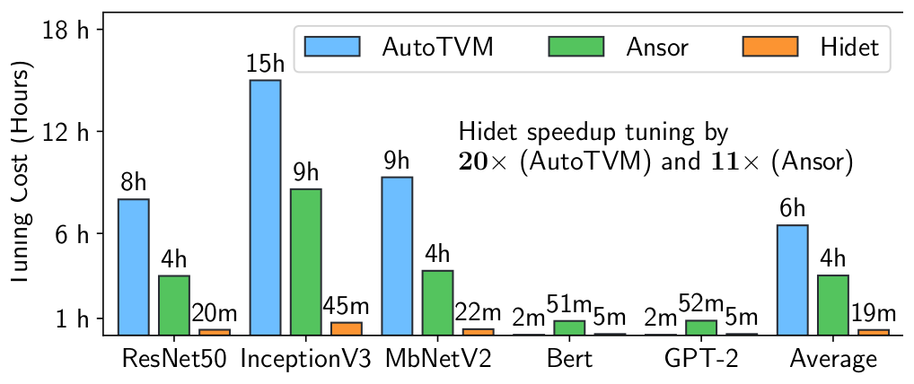

*图 17（原文 Figure 17，第 11 页）：AutoTVM、Ansor 与 Hidet 的调优成本。*

**图中文字翻译与读法**：纵轴 Tuning Cost (Hours)（调优成本，小时），横轴为 ResNet50、InceptionV3、MbNetV2、Bert、GPT-2、Average（平均）；三色柱为 AutoTVM（蓝）、Ansor（绿）、Hidet（橙）；图中文字 “Hidet speedup tuning by 20× (AutoTVM) and 11× (Ansor)”（Hidet 把调优加速了 20 倍（对 AutoTVM）和 11 倍（对 Ansor））。柱上的标注（h 为小时，m 为分钟）逐项转录如下：

| 模型 | AutoTVM | Ansor | Hidet |
|---|---:|---:|---:|
| ResNet50 | 8h | 4h | 20m |
| InceptionV3 | 15h | 9h | 45m |
| MbNetV2 | 9h | 4h | 22m |
| Bert | 2m | 51m | 5m |
| GPT-2 | 2m | 52m | 5m |
| Average（平均） | 6h | 4h | 19m |

（均为原文图上标注。）本文用柱高验算：AutoTVM 平均约 6.5 小时、Ansor 约 3.5 小时（图上舍入为 4h）、Hidet 约 19.4 分钟，对应 $6.5\times60/19.4\approx20$ 倍与 $3.5\times60/19.4\approx11$ 倍，与摘要的 20×、11× 一致。Average 柱是五个模型调优时间的算术平均。

**原文结论**：Hidet 把调优成本比 Ansor 降低 11 倍、比 AutoTVM 降低 20 倍。原因是 Hidet 的调度空间小（例如矩阵乘只有 180 个调度）但有效，只需几分钟就能穷举所有候选；AutoTVM 与 Ansor 的调度空间有 $10^5$ 到 $10^8$ 个候选，即使有代价模型也难以在短时间内找到空间里的最优调度。AutoTVM 在 Bert 与 GPT-2 上只用了 2 分钟，是因为这两个模型的调度空间很小（少于 20 个调度），但这些空间无效，达不到有竞争力的性能（图 16）。

### 6.3 案例研究（原文 6.3）

#### 6.3.1 调度空间对比（图 18）

测试负载：ResNet50 中的一个卷积，batch size 1、输入图像 $28\times28$、输入通道 256、卷积核 3、padding 1、stride 2。因为 AutoTVM 与 Ansor 的调度空间太大，原文分别取它们调优过程里的 1000 个与 800 个调度作为各自空间的样本，与 Hidet 的整个空间（只有 180 个调度）比较。

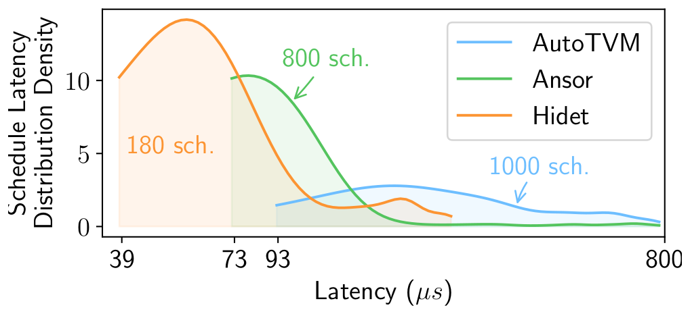

*图 18（原文 Figure 18，第 11 页）：AutoTVM、Ansor、Hidet 调度空间里调度延迟的分布，横轴为对数刻度。*

**图中文字翻译与读法**：横轴 Latency (μs)（延迟，微秒，对数刻度），纵轴 Schedule Latency Distribution Density（调度延迟分布密度）；三条密度曲线：AutoTVM（蓝，1000 sch.）、Ansor（绿，800 sch.）、Hidet（橙，180 sch.）；横轴刻度 39、73、93、800。

**读图结论**：

- Hidet 的曲线整体在最左边，Ansor 居中，AutoTVM 最靠右、拖着很长的尾巴到 800 μs。
- 本文的解读：三条曲线的左端点分别在 39、73、93 μs，即各自样本里最快调度的延迟（Hidet 约 39 μs、Ansor 约 73 μs、AutoTVM 约 93 μs）。
- 原文结论：得益于范式更强的表达力，Hidet 空间里的大多数调度的性能优于 AutoTVM 与 Ansor 空间里的调度（延迟小于 73 μs，即 Ansor 样本中最快的那个）。需要注意，AutoTVM、Ansor 的样本来自它们的调优过程，不是各自巨大空间的均匀采样。

#### 6.3.2 对输入尺寸的敏感性（图 19）

AutoTVM 与 Ansor 因为调度空间以输入为中心，最终调度的质量对输入尺寸敏感，输入尺寸稍有变化，性能就差异很大。为此，原文评测一组连续输入尺寸的矩阵乘。

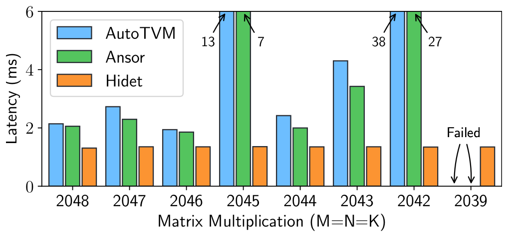

*图 19（原文 Figure 19，第 11 页）：连续输入尺寸矩阵乘上 AutoTVM、Ansor 与 Hidet 的对比。*

**图中文字翻译与读法**：横轴 Matrix Multiplication (M=N=K)（方阵矩阵乘，边长从 2048 逐一减小到 2042，再到 2039），纵轴 Latency (ms)（延迟）；三色柱 AutoTVM、Ansor、Hidet。超出纵轴的柱用箭头和数字标出实际延迟（ms）；2039 处 AutoTVM 与 Ansor 没有柱，标注 “Failed”（失败）。

下表是从图中矢量数据量出的柱高（单位 ms，约值；标“图上标注”的为原文写在图上的数字）：

| 边长 M=N=K | AutoTVM | Ansor | Hidet |
|---|---:|---:|---:|
| 2048 | 2.14 | 2.06 | 1.31 |
| 2047 | 2.73 | 2.30 | 1.35 |
| 2046 | 1.94 | 1.86 | 1.35 |
| 2045 | 13（图上标注） | 7（图上标注） | 1.36 |
| 2044 | 2.43 | 2.00 | 1.35 |
| 2043 | 4.31 | 3.43 | 1.35 |
| 2042 | 38（图上标注） | 27（图上标注） | 1.34 |
| 2039 | 失败 | 失败 | 1.34 |

**读图结论**：AutoTVM 与 Ansor 的性能随尺寸剧烈波动（多数尺寸在 2–4 ms，2045 与 2042 处骤增到 7–38 ms），质数 2039 处两者都找不到合法调度；Hidet 在这些尺寸上始终约 1.3 ms，因为 hardware-centric 空间靠谓词加载处理越界，与输入尺寸解耦。

#### 6.3.3 不同 batch size（图 20）

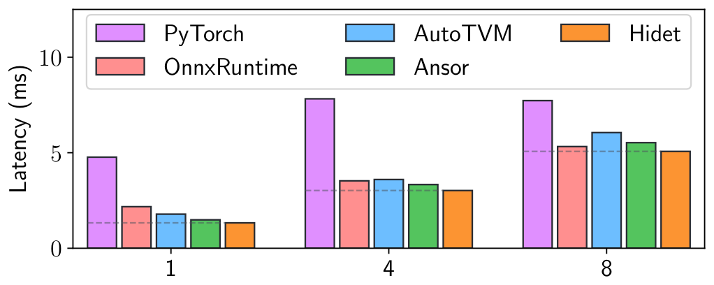

*图 20（原文 Figure 20，第 11 页）：ResNet50 在 batch size 1、4、8 上的对比。*

**图中文字翻译与读法**：横轴是 batch size（1、4、8），纵轴 Latency (ms)；图例 PyTorch、OnnxRuntime、AutoTVM、Ansor、Hidet；虚线是 Hidet 的水平。下表为从矢量数据量出的柱高（ms，约值）：

| batch size | PyTorch | OnnxRuntime | AutoTVM | Ansor | Hidet |
|---:|---:|---:|---:|---:|---:|
| 1 | 4.77 | 2.18 | 1.79 | 1.49 | 1.33 |
| 4 | 7.82 | 3.53 | 3.60 | 3.34 | 3.03 |
| 8 | 7.73 | 5.32 | 6.05 | 5.52 | 5.06 |

**原文结论**：

- batch size 小（1 和 4）时，AutoTVM 和 Ansor 优于 Onnx Runtime，因为它们能找到充分利用 GPU 计算资源的调度（例如有足够多的线程块占满所有 SM），而内核库做不到。（本文核对：按图上柱高，batch size 4 时 AutoTVM 约 3.60 ms，略慢于 Onnx Runtime 的约 3.53 ms，只有 Ansor 稳定地更快。）
- batch size 大（如 8）时，AutoTVM 和 Ansor 仍能找到占满所有 SM 的调度，但无法超过 Onnx Runtime：因为每个线程块的延迟比 Onnx Runtime 的更长，原因是缺少 double buffering 等重要优化。
- Hidet 在两方面都做得好（线程块足够多、且每个线程块高效），所以优于所有基线。

#### 6.3.4 后调度融合评测（图 21）

用后调度融合，可以用高度优化的调度模板实现一个算子，再用已实现的高度优化算子组合出新算子，节省工程量。例如 Hidet 用矩阵乘实现卷积，即 implicit GEMM 卷积（也称 img2col 算法）；借助后调度融合，img2col 所需的额外算子被自动融合进矩阵乘，并复用为矩阵乘实现的优化（如沿 $k$ 维的并行归约）。带并行 $k$ 归约的 implicit GEMM 卷积使 Hidet 生成的 kernel 能占满 GPU 计算资源，并优于现有内核库与 DNN 编译器。

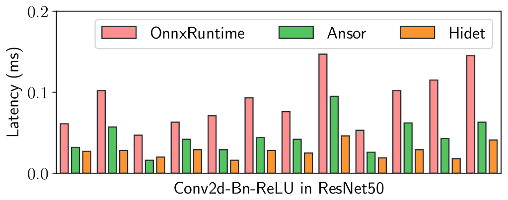

*图 21（原文 Figure 21，第 11 页）：ResNet50 中 Conv2d-Bn-ReLU 子图上 Onnx Runtime、Ansor 与 Hidet 的对比。*

**图中文字翻译与读法**：横轴是 ResNet50 里的 12 个 Conv2d-Bn-ReLU 子图（图上没有标出各个子图的具体形状），纵轴 Latency (ms)（0 到 0.2）；三色柱：OnnxRuntime（红）、Ansor（绿）、Hidet（橙）。下表是从矢量数据量出的柱高（单位 μs，约值，自左向右）：

| 子图序号 | 1 | 2 | 3 | 4 | 5 | 6 | 7 | 8 | 9 | 10 | 11 | 12 |
|---|---:|---:|---:|---:|---:|---:|---:|---:|---:|---:|---:|---:|
| OnnxRuntime | 61 | 102 | 47 | 63 | 71 | 93 | 76 | 147 | 53 | 102 | 115 | 145 |
| Ansor | 32 | 57 | 16 | 42 | 29 | 44 | 42 | 95 | 26 | 62 | 43 | 63 |
| Hidet | 27 | 28 | 20 | 29 | 16 | 28 | 25 | 46 | 19 | 29 | 18 | 41 |

**原文结论**：Hidet 在大多数卷积上优于 Onnx Runtime 和 Ansor，因为卷积也能在归约维（输入通道、卷积核）上并行。本文由表中数字核算：Hidet 比 Onnx Runtime 在 12 个子图上都更快，约 2.2–6.4 倍（几何平均约 3.2 倍）；比 Ansor 在 11 个子图上更快、第 3 个子图上略慢（20 对 16 μs），约 0.8–2.4 倍（几何平均约 1.6 倍）。

#### 6.3.5 与 TensorRT 对比（图 22）

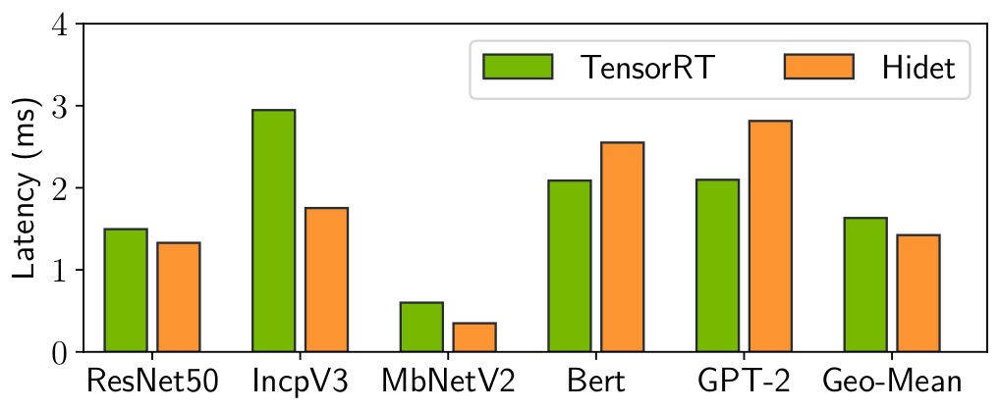

*图 22（原文 Figure 22，第 12 页）：TensorRT 与 Hidet 的对比。*

**图中文字翻译与读法**：纵轴 Latency (ms)，横轴为 ResNet50、IncpV3、MbNetV2、Bert、GPT-2、Geo-Mean；绿色柱 TensorRT（8.4.1.5，来自原文 6.3.5 正文），橙色柱 Hidet。从矢量数据量出的柱高（ms，约值）：

| 模型 | TensorRT | Hidet | TensorRT ÷ Hidet（本文换算） |
|---|---:|---:|---:|
| ResNet50 | 1.50 | 1.33 | 1.13 |
| IncpV3 | 2.95 | 1.75 | 1.68 |
| MbNetV2 | 0.60 | 0.35 | 1.72 |
| Bert | 2.09 | 2.55 | 0.82 |
| GPT-2 | 2.10 | 2.81 | 0.75 |
| Geo-Mean | 1.63 | 1.42 | 1.15 |

**原文结论**：Hidet 在三个 CNN 上优于 TensorRT，因为 Hidet 能针对给定的输入尺寸调优，并能依据数学定义自动融合算子；而在 Bert、GPT-2 这样的 Transformer 上，TensorRT 优于 Hidet。TensorRT 是闭源的，作者通过解读它的优化日志**推测**：TensorRT 会识别 Transformer 里的自注意力层并施加专门的优化（因为这类模型很流行）；相比之下，Hidet 只有两个调度模板来覆盖所评测网络里的全部算子。

## 七、讨论、相关工作与结论（原文第 7–9 节）

**讨论（原文第 8 节）**：

- **优化表达力**：GPU、TPU 等加速器通常有层次化的存储系统和向量或张量计算引擎，二者都要求专门的优化才能达到峰值性能，而这些优化往往很难用一系列循环变换表达；double buffering 就是一个典型。Hidet 不依赖声明式调度，而是在 tensor program 里直接用 task mapping 表达任务分配与次序，大幅增强表达力，同时降低写 tensor program 的复杂度。
- **支持更多硬件**：本文只关注 GPU，但 task mapping 的概念是通用的：worker 可以是单核 CPU 上循环的迭代、多核 CPU 的线程、GPU 的线程、warp 或线程块，也可以是其他加速器的并行处理单元；任务可以是任意带下标的、同构的、可并行的操作。
- **未来工作**：支持 CPU 和其他加速器（如 Amazon Inferentia 与 Trainium），并支持训练。因为 TVM 的调优时间太长，难以直接用于加速训练；Hidet 的 hardware-centric 空间大幅缩短了调优时间，使得基于 Hidet 构建训练系统成为可能。

**相关工作（原文第 7 节）**：

- 许多深度学习编译器采用循环调度原语（TVM、Halide），并在其上建立以输入为中心调度空间的自动调优框架（AutoTVM、Ansor 等）；Hidet 用 task-mapping 范式加 hardware-centric 空间，性能更好、调优更短。
- 深度学习框架（PyTorch、TensorFlow）借助现成内核库（cuDNN、cuBLAS）和手写 kernel；CUTLASS 是带高效 CUDA 矩阵乘 kernel 的 C++ 模板库。
- Tiramisu 与 AKG 用多面体模型调度 tensor program；Roller 自底向上构造 tensor program，并让 tile 大小与硬件规格对齐；AI-Template 用源码级模板构造 tensor program，支持更细粒度的优化，但牺牲了程序变换的灵活性。
- TVM 社区也注意到声明式循环调度表达力有限的问题：TensorIR（与 Hidet 同期的工作）允许开发者直接写 tensor program，而不是对自动生成的程序施加一串声明式原语。
- 其他：XLA（线性代数专用编译器）；FreeTensor、CoRa（不规则或 ragged 张量程序）；AStitch、Apollo（融合访存密集 kernel 以降低显存消耗）；Fireiron（面向 GPU、关注数据搬运的调度语言）；Triton（把 tile 当作基本数据类型、线程块当作主要并行处理单元来写 tensor program）；Nimble、DISC、Cortex、DietCode（动态模型的编译）；Rammer、IOS（并行执行网络里相互独立的算子）；TASO、TENSAT、PET 等（图级重写规则）；Checkmate、Echo、DTR 等（降低显存占用）。作者认为后面这几类与 Hidet 正交，可以与之结合。

**结论（原文第 9 节）**：当前基于循环调度的 DNN 编译器无法表达需要细粒度操纵 tensor program 的重要优化；Hidet 提出 task-mapping 编程范式，在不牺牲内核库那样的优化表达力的前提下简化 tensor program 的编写与调度；评测显示相对 ONNX Runtime 等推理框架和 TVM（AutoTVM、Ansor）最高 1.48×（平均 1.22×），调优成本相对 Ansor 降低 11×。

## 八、局限、证据边界与常见误读

**局限与证据边界**：

1. **评测范围窄**：一块消费级 GPU（RTX 3090）、5 个模型、基本是 batch size 1（只有 ResNet50 做了 batch size 1/4/8），语言模型序列长度固定为 128；只评了推理，没有训练。原文未声明数据类型，也没有 H100、A100 等其他硬件的结果。
2. **优势并非处处成立**：MobileNet-V2 上 Ansor 更快（Hidet 为 0.88×）；对 TensorRT，Bert 与 GPT-2 上 Hidet 更慢（约慢 1.2–1.3 倍，本文由图 22 数据换算）；Hidet 只有两个调优模板（矩阵乘、归约），深度可分离卷积等未做专门优化。
3. **增益来源没有被拆开**：原文把加速归因于自动融合、针对输入尺寸调优、更多优化（如 double buffering）三项，但没有做关闭其中某一项的消融，所以无法知道每项的单独贡献。
4. **后调度融合的代价没有讨论**：原文认为调优时以融合后的性能为目标，所以解耦不会损害最终性能；但锚点算子的调度模板是在不知道前后算子的情况下设计的，融合后可能增加寄存器压力或访存开销，原文没有对此做分析。
5. **基线口径**：AutoTVM、Ansor 的调优次数分别是 1000 与 800；调优时间的对比依赖这个设置。图 18 里 AutoTVM、Ansor 的调度样本来自它们的调优轨迹，不是均匀采样。
6. **表达力的另一面**：task mapping 把调度写进程序，也把合法性责任（越界、竞争、同步与内存层次）交给了开发者和编译器的检查；论文没有展开这方面的验证机制，开发效率的优势也是定性主张，没有定量的工程量对比。
7. **原文内部的小不一致**：平均加速 1.22× 对图 16 的 Geo-Mean 1.26×（口径未说明）；图 5 伪代码最后一行的缓冲号疑为笔误；正文称 TensorRT 版本为 8.4.1.5，而 artifact 附录的软件依赖里写的是 nvidia-tensorrt 8.2.5.1；artifact 附录 A.3.4 的模型清单里把 GPT-2 写成了 “GPT-3”，而同一附录的清单与正文都是 GPT-2。

**常见误读**：

- “Hidet 只是另一个模板库”：它改变的是调度的**表达方式**（在程序里直接写 task mapping），而不是再加一些模板；矩阵乘模板的空间里的参数本身就是 task mapping 的参数。
- “Hidet 全面胜过 TensorRT 与 Ansor”：不是，见上文。
- “task mapping 等于循环”：`spatial` 描述的是并行分配（同一时刻不同 worker 做不同任务），`repeat` 才是串行迭代；两者组合的次序不可交换（图 12）。
- “调优时间一律快 20 倍”：20× 是相对 AutoTVM（1000 次试验）、11× 是相对 Ansor（800 次试验），都是这五个模型平均调优时间之比，不是所有场景的保证；Bert 与 GPT-2 上 AutoTVM 只用 2 分钟，比 Hidet 的 5 分钟还短，但性能很差（图 16 里 27 ms 与 41 ms）。

## 九、复现检查清单

原文附录 A（artifact）给出的复现信息：

- **硬件**：Intel Core i9-12900K、NVIDIA RTX 3090、64 GiB 内存；要得到论文里的精确数字，需要同样的 CPU 和 GPU；仅要功能性运行，只需要支持 CUDA 11.6 及以上的现代 NVIDIA GPU。
- **软件**：NVIDIA 驱动 510.73.08、CUDA Toolkit 11.6、cuDNN 8.4、PyTorch 1.11、torchvision 0.12、transformers 4.19.2、onnxruntime-gpu 1.11.1、nvidia-tensorrt 8.2.5.1、Apache TVM 0.9.dev（commit c07a46327）；编译器 nvcc；系统 Linux Ubuntu 20.04 及以上。
- **模型**：ResNet50、InceptionV3、MobileNetV2、Bert、GPT-2（卷积网络来自 torchvision，Transformer 来自 transformers，会自动下载）。
- **资源**：约 2 GiB 磁盘，准备工作流约 2 小时，完成全部实验约 60 小时，其中约 50 小时用于基线 AutoTVM 与 Ansor 的模型调优。
- **实验工作流**：`hidet/artifacts` 下有 6 个编号 0–5 的子目录，分别对应 6.2、6.3.1、6.3.2、6.3.3、6.3.4、6.3.5 六组实验，每个目录里有可直接运行的 `main.py`；输出的指标是端到端推理延迟与自动调优时间。示例输出：batch size 1 的 ResNet50 在 Hidet 上平均 1.329 ms（标准差 0.000 ms），与图 16 的约 1.33 ms 一致。

自己复现或扩展时还应注意：

- 用小形状枚举 worker 到 task 的映射，检查每个任务恰好被覆盖一次、没有冲突；
- barrier 与共享内存生命周期需要显式验证（双缓冲里每一处同步都不能省）；
- 分别测融合前后 kernel 个数、HBM 流量、寄存器与 occupancy，确认融合没有引入额外重复计算或寄存器压力；
- 固定 CUDA、编译器版本和调优预算，并记录首次编译（含调优）与缓存命中后稳态延迟的差别，两者不能混为一谈；
- 单算子加速不等于端到端同倍加速。

## 十、与相关论文的关系

- 调度语言之路：[TVM](../tvm_compiler/论文中文解读.md)（声明式调度的起点）→ [Ansor](../ansor/论文中文解读.md)（自动调度）→ [TensorIR](../tensorir/论文中文解读.md)（TVM 社区对表达力不足的回应，与 Hidet 同期）；
- 硬件对齐的 tile：[Roller](../roller/论文中文解读.md)（自底向上、tile 与硬件规格对齐）、[Triton](../triton_compiler/论文中文解读.md)（tile 作为基本数据类型、线程块为并行单元）；
- 后续对照：[TileLang](../tilelang/论文中文解读.md)（tile 级数据流与调度分离）、[CuTe 的 layout 代数](../cute_layout_algebra/论文中文解读.md)（把线程与数据的映射代数化，可与 task mapping 对照：二者都是在描述“谁处理哪一块数据、按什么顺序”）；
- 更大的图景见 [AI 编译器与运行时演进索引](../AI编译器与运行时演进索引.md)。

## 原文证据导航

- [原论文 PDF](paper.pdf)（官方出版页面：[DOI](https://doi.org/10.1145/3575693.3575702)；预印本 [arXiv:2210.09603](https://arxiv.org/abs/2210.09603)）
- [原文提取文本](paper.txt)
- [论文概要](论文概要.md)
