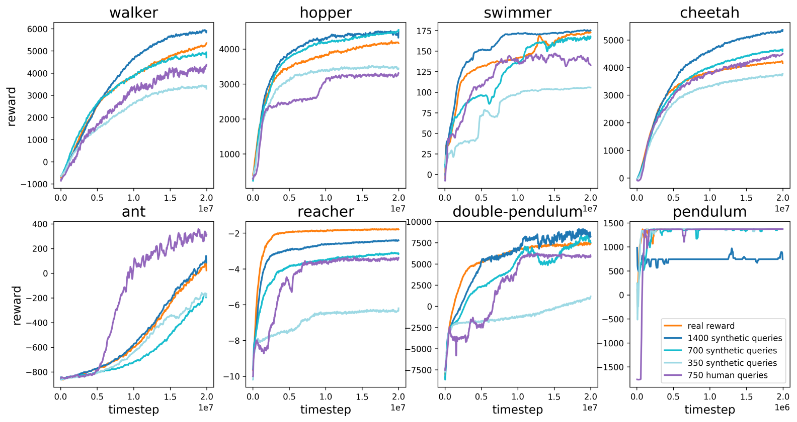
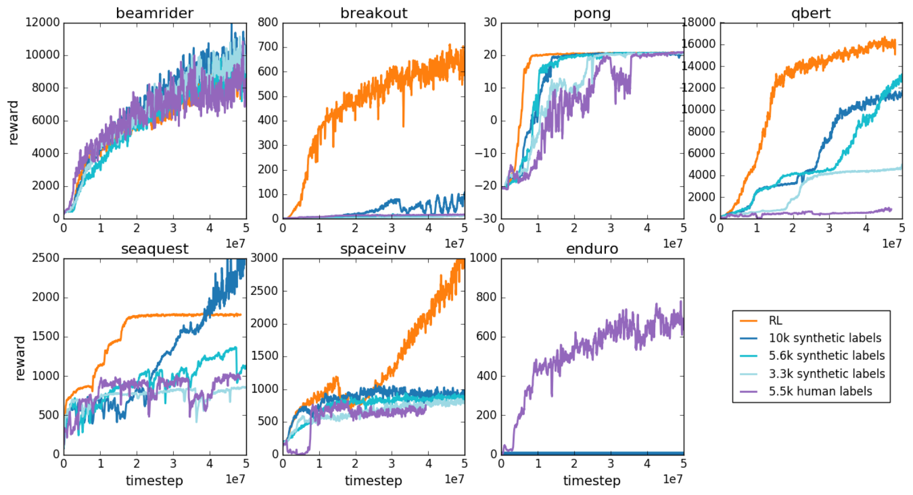
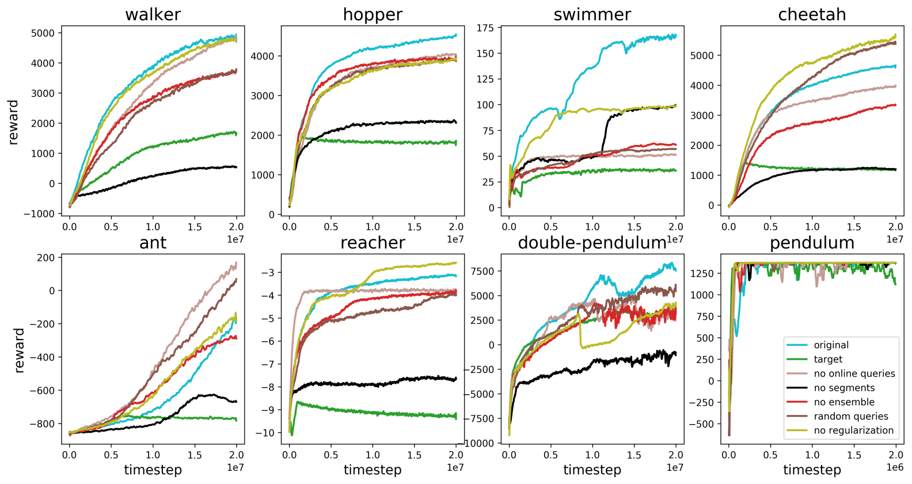
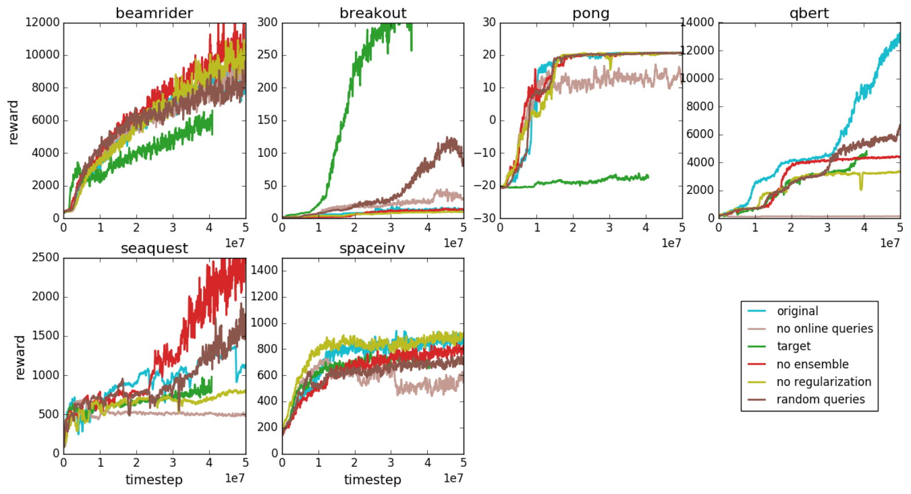

# 论文中文解读：《Deep Reinforcement Learning from Human Preferences》

> **基本信息**：Paul F. Christiano（OpenAI）、Jan Leike（DeepMind）、Tom B. Brown（Google Brain，工作完成于 OpenAI 期间）、Miljan Martic（DeepMind）、Shane Legg（DeepMind）、Dario Amodei（OpenAI），第 31 届神经信息处理系统大会（NIPS 2017，Long Beach）；[论文官方页面](https://proceedings.neurips.cc/paper/2017/hash/d5e2c0adad503c91f91df240d0cd4e49-Abstract.html)。
>
> **本文的读法**：图 1–4 取自论文原图。本地 PDF 只有 9 页，在第 9 页的致谢处中断，**不含参考文献，也不含附录 A（实验细节：模型结构、环境改动、RL 算法参数）和附录 B（给标注者的指示）**，凡是依赖附录才能核对的内容本文都不写。这篇论文没有数值表，本文的表是我据正文和图整理的，会注明。文中“第 N 页”指 PDF 页码。凡是从图上读出的数值都写“约”，并标明是读图近似；凡是我的推导或判断，会标“我的推导”或“我的观察”。

## 一、一句话结论

很多任务的目标人类“看得懂”却“写不成奖励函数”。论文的做法是：让人类反复比较智能体行为的**两个很短的轨迹片段**（1–2 秒的视频）并选出更好的一个，用这些比较拟合一个奖励模型 $\hat r$，再用普通深度强化学习去最大化 $\hat r$；三件事异步进行。结果：在 8 个 MuJoCo 机器人任务上用约 700 次人类比较就能接近真实奖励下的 RL；在 7 个 Atari 游戏上用 5,500 次人类比较能取得实质学习（但更难追平真实奖励）；还能用不到一小时的人时训练出“连续后空翻”“单腿前进”这类难以手写奖励的新行为；人类反馈只覆盖智能体不到 1% 的环境交互。消融显示，只在训练开头收集一次偏好（静态奖励模型）会让策略钻奖励模型的空子，这是后来 RLHF 的核心闭环思想。

## 二、背景与动机

### 2.1 为什么要用人类偏好

近年深度强化学习（RL）的成功主要出现在奖励函数定义明确的领域。但许多任务的目标复杂、含糊或难以指定，例如训练机器人擦桌子或炒鸡蛋，很难构造一个合适的、以机器人传感器为输入的奖励函数。若只设计一个近似奖励，常常得到“优化了这个奖励、却并不满足我们偏好”的行为。这也是人们担心 RL 系统目标与人类价值错位的原因。

已有的替代做法与不足：

- **示范**：有示范就可以用逆强化学习或模仿学习复制行为，但这不适用于人类难以演示的行为（如控制自由度很多、形态与人完全不同的机器人）；
- **直接把人类反馈当奖励**：这对需要成百上千小时经验的 RL 系统来说代价高得不可行，需要把所需反馈量降低几个数量级。

论文的办法：让人类比较智能体可能的轨迹，用这些数据学习奖励函数，再用 RL 优化学到的奖励函数。论文称这个基本思路此前已有人探索，但这里要面对把它扩展到现代深度 RL 的挑战，并展示迄今从人类反馈学到的最复杂的行为。

### 2.2 相关工作（论文 1.1 节）

- 有大量关于从人类评分或排序中学习 RL 的工作，也有从偏好而不是绝对奖励值学习的工作；
- 论文的算法与 Akrour 等人（2012，2014）的基本思路相同，但环境和行为复杂得多，因此必须使用不同的 RL 算法、奖励模型和训练策略。一个显著区别：Akrour 等人对**整条轨迹**而不是短片段征求偏好，所以每个数据点要多花大约一个数量级的人时；
- 偏好获取的方式与 Wilson 等人（2012）很接近，但后者假设奖励函数是到某个未知（线性）“目标”策略的距离，而且从未用真实人类反馈检验；
- TAMER 也从人类反馈学习奖励函数，但学的是评分而不是比较，人要边看智能体行动边反馈，并用于期望策略能快几个数量级学到的场景；
- 论文自称相对所有先前工作的关键贡献是：把人类反馈扩展到深度强化学习，并学习复杂得多的行为。

## 三、方法

### 3.1 设定与目标

智能体与环境在一连串时间步上交互：每个时刻 $t$ 收到观测 $o_t\in\mathcal O$，再发出动作 $a_t\in\mathcal A$。传统 RL 里环境还会给出奖励 $r_t$；这里**不假设环境给奖励**，而假设有一位人类监督者，能对**轨迹片段**表达偏好。轨迹片段是长度为 $k$ 的观测与动作序列：

$$
\sigma=\big((o_0,a_0),(o_1,a_1),\dots,(o_{k-1},a_{k-1})\big)\in(\mathcal O\times\mathcal A)^k.
$$

用 $\sigma^1\succ\sigma^2$ 表示人类更喜欢片段 $\sigma^1$ 胜过 $\sigma^2$。非正式地说，智能体的目标是产生人类偏好的轨迹，同时尽量少地向人类提问。

论文用两种方式评估算法行为：

- **定量评估**：若偏好是由某个奖励函数 $r$ “生成”的，即当 $\sum_t r(o^1_t,a^1_t)>\sum_t r(o^2_t,a^2_t)$ 时 $\sigma^1\succ\sigma^2$，那么智能体就应该按 $r$ 获得高总奖励。所以如果知道 $r$，就可以定量评估智能体，理想情况是达到接近直接用 RL 优化 $r$ 的水平；
- **定性评估**：有时没有可用于定量评估的奖励函数（这正是该方法真正有用的情形）。此时只能从用自然语言表达的目标出发，让人类按目标满足程度评价智能体行为，再展示智能体试图完成该目标的视频。

注意：论文的片段比较与 Wilson 等人的轨迹偏好查询很像，区别是这里**不假设能把系统重置到任意状态**，所以两个片段一般从不同状态开始（脚注 5：两个片段几乎从不从同一状态开始）。这使人类比较的解释变复杂，但论文表明算法能克服这一困难，即使标注者完全不懂算法。

### 3.2 三个异步过程

方法在每个时刻维护一个策略 $\pi:\mathcal O\to\mathcal A$ 和一个奖励函数估计 $\hat r:\mathcal O\times\mathcal A\to\mathbb R$，两者都由深度神经网络参数化，由三个过程更新：

1. **策略优化**：策略 $\pi$ 与环境交互，产生一组轨迹 $\{\tau^1,\dots,\tau^i\}$，用传统强化学习算法更新 $\pi$ 的参数，目标是最大化预测奖励之和，其中 $r_t=\hat r(o_t,a_t)$；
2. **偏好获取**：从过程 (1) 产生的轨迹里选出若干对片段 $(\sigma^1,\sigma^2)$，送给人类比较；
3. **奖励拟合**：用监督学习优化映射 $\hat r$ 的参数，使其拟合到目前为止收集到的人类比较。

这三个过程**异步**运行：轨迹从 (1) 流向 (2)，人类比较从 (2) 流向 (3)，$\hat r$ 的参数从 (3) 流回 (1)。

脚注 2：这里假设奖励是观测和动作的函数；在 Atari 实验里，则假设奖励是**前 4 个观测**的函数。在一般的部分可观测环境里，也可以考虑依赖整个观测序列的奖励函数，用循环神经网络建模。

### 3.3 优化策略

用 $\hat r$ 算出奖励之后，剩下的就是一个传统 RL 问题，可用任何适合该领域的 RL 算法求解。一个微妙之处是奖励函数 $\hat r$ 可能**非平稳**（训练中不断变化），所以倾向选择对奖励函数变化鲁棒的方法，这促使论文聚焦于策略梯度方法。论文在 Atari 上用 advantage actor-critic（A2C），在模拟机器人任务上用 trust region policy optimization（TRPO），两种情形都用已知对传统 RL 任务有效的参数设置。**唯一调整的超参数是 TRPO 的熵奖励**，因为 TRPO 依靠信任域来保证足够的探索，奖励函数变化时可能导致探索不足。

对 $\hat r$ 产生的奖励做归一化，使其均值为零、标准差恒定。这是典型的预处理步骤，在这里特别合适，因为奖励的位置（平移）在学习问题里是不确定的：比较只依赖奖励之差。

### 3.4 偏好获取

人类监督者看到两个轨迹片段的可视化，形式是短视频，**所有实验里的片段都是 1 到 2 秒长**。人类指出他们更喜欢哪一个，或两者同样好，或无法比较。判断记录在数据库 $\mathcal D$ 里，其中每条是三元组 $(\sigma^1,\sigma^2,\mu)$，$\mu$ 是 $\{1,2\}$ 上的分布，表示用户偏好哪个片段：若人类选了其中一个，则 $\mu$ 把全部概率放在该选择上；若标为同样好，$\mu$ 是均匀分布；若标为无法比较，则该比较不进入数据库。

### 3.5 拟合奖励函数（Bradley–Terry 模型）

把奖励函数估计 $\hat r$ 看作解释人类判断的隐变量：假设人类偏好片段 $\sigma^i$ 的概率**按指数地依赖**该片段上隐含奖励的累计值（论文式 (1)）：

$$
\hat P\big[\sigma^1\succ\sigma^2\big]=\frac{\exp\sum_t\hat r\big(o^1_t,a^1_t\big)}{\exp\sum_t\hat r\big(o^1_t,a^1_t\big)+\exp\sum_t\hat r\big(o^2_t,a^2_t\big)}.
$$

选择 $\hat r$ 来最小化这些预测与实际人类标签之间的交叉熵损失：

$$
\operatorname{loss}(\hat r)=-\sum_{(\sigma^1,\sigma^2,\mu)\in\mathcal D}\Big(\mu(1)\log\hat P\big[\sigma^1\succ\sigma^2\big]+\mu(2)\log\hat P\big[\sigma^2\succ\sigma^1\big]\Big).
$$

符号：$\mu(1),\mu(2)$ 是人类标签分布（选 $\sigma^1$ 则 $\mu=(1,0)$，同样好则 $\mu=(0.5,0.5)$）；$\hat P[\sigma^1\succ\sigma^2]$ 是模型预测人类选 $\sigma^1$ 的概率。这遵循估计分数函数的 Bradley–Terry 模型，是 Luce–Shephard 选择规则在轨迹片段偏好上的特例。脚注 4：式 (1) 没有用折扣，可以理解为把人类建模成对“事情发生在片段中的什么时候”无所谓；显式折扣或推断人类的折扣函数也是合理选择。

读法：由 $\hat P=\sigma(R_1-R_2)$（其中 $R_i=\sum_t\hat r$，$\sigma$ 为 sigmoid 函数，我的化简）可见，模型只依赖两个片段累计奖励的**差**，所以对奖励整体平移不敏感，这也是 3.3 节为什么要把预测奖励归一化的原因。

论文实际算法在这个基本做法上有几处早期实验发现有帮助的修改（在 3.3 节消融里分析）：

1. **奖励模型是集成（ensemble）**：训练一组预测器，每个预测器在从 $\mathcal D$ 有放回抽样得到的 $\lvert\mathcal D\rvert$ 个三元组上训练；估计 $\hat r$ 定义为对每个预测器各自归一化后再取平均；
2. **验证集与正则化**：对每个预测器留出 $1/e$ 比例的数据作为验证集（有放回抽样时恰好约有 $1/e$ 的数据没被抽到，我的说明）；用 $\ell_2$ 正则并调整正则系数，使验证损失保持在训练损失的 1.1 到 1.5 倍之间；在一些领域也用 dropout 正则；
3. **人类有 10% 的概率随机作答**：不直接用式 (1) 的 softmax，而是假设人类有 10% 的概率均匀随机回答。概念上，这是因为人类标注者有一个恒定的出错概率，当奖励差变得极端时它也不会衰减到 0。等价写法（我的推导）：预测概率变成 $0.9\hat P+0.05$，因此预测概率不会被推到 0 或 1，损失对极端奖励差不会趋于无穷。

### 3.6 选择查询

怎样决定问哪些偏好？论文基于对奖励函数估计器不确定性的近似：从最新的智能体–环境交互里采样大量长度为 $k$ 的轨迹片段对，用集成里的每个奖励预测器预测每一对里哪个片段会被偏好，然后选择**预测在集成成员之间方差最大**的那些片段对。论文明确说这是一种粗糙的近似，第 3 节的消融显示在某些任务上它实际上会损害性能。理想情况应该基于查询的期望信息价值，但留给未来工作。

## 四、实验

### 4.1 设置

算法用 TensorFlow 实现，通过 OpenAI Gym 接入 MuJoCo 和 Arcade Learning Environment。

**无真实奖励的 RL 任务**（3.1 节）：先在一批深度 RL 基准任务上，不观测真实奖励，智能体仅靠询问人类“两段轨迹哪段更好”来了解任务目标。目标是用尽可能少的查询在合理时间内解决任务。反馈由合同工（contractors）提供：他们先拿到对每个任务的 1–2 句话描述，再对每个任务比较几百到几千对轨迹片段。每个片段 1 到 2 秒，合同工回答一次平均查询用 3–5 秒，所以使用真人反馈的实验需要 30 分钟到 5 小时的人时（引言处则写“十五分钟到五小时”，两处不一致，本文以 3.1 节为准）。我的推算：$700\times(3\text{–}5)$ 秒约 35 至 58 分钟；$5500\times(3\text{–}5)$ 秒约 4.6 至 7.6 小时，高于“5 小时”，说明多数查询的平均用时应接近 3 秒（论文没有给出每个任务的实际工时）。

**比较基线**：（1）合成预言机（synthetic oracle），其偏好由真实奖励按 3.1 节的方式自动生成；（2）用真实奖励的 RL 训练。论文的目的不是超过它们，而是在不能访问奖励信息、只靠更稀缺的反馈的情况下，做到几乎一样好。但真实人类反馈确实有可能优于 RL（下面确有此例），因为人类反馈可能提供形状更好的奖励（shaping）。脚注 6：Atari 稀疏奖励游戏里，两个片段都零奖励、预言机输出“无差别”是比较常见的，但因为比较的是片段而非单个状态，这类平局从未占数据的绝大多数，而且只要不太多，平局仍给奖励预测器提供大量信息。

### 4.2 模拟机器人（MuJoCo，图 1）

8 个 MuJoCo 模拟机器人任务：walker、hopper、swimmer、cheetah、ant、reacher、double-pendulum，以及一个简单的 cartpole 任务 pendulum（用来对照，因为它的复杂度代表以往工作研究的任务）。作者对任务做了小改动，避免在环境本身里编码任务信息（细节在附录 A，本地 PDF 未收录）。这些任务的奖励函数是距离、位置和速度的二次函数，多数是线性的。

*图 1（原文 Figure 1，第 6 页）：MuJoCo 模拟机器人任务上的结果，按任务的真实奖励衡量。比较三种：用真实人类反馈的本文方法（紫色）、用预言机提供的合成反馈的本文方法（蓝色系）、用真实奖励函数的强化学习（橙色）。所有曲线是 5 次运行的平均，唯独真实人类反馈是单次运行；每个点是连续五个 batch 的平均奖励。Reacher 和 Cheetah 的反馈因时间原因由作者之一提供，其余任务的反馈由不熟悉环境和算法的合同工提供。Hopper 上不规则的进展是因为一位合同工偏离了通常的标注节奏。*

**图中文字翻译与读法**：

- 八个子图依次是 walker、hopper、swimmer、cheetah（上排）和 ant、reacher、double-pendulum、pendulum（下排）；横轴 timestep（时间步，除 pendulum 为 0–2e6 外都是 0–2e7），纵轴 reward（真实奖励）。
- 图例（右下角，pendulum 子图里）：real reward（真实奖励，橙）；1400 synthetic queries、700 synthetic queries、350 synthetic queries（合成查询数，蓝色由深到浅）；750 human queries（真人查询，紫）。
- 注意图例写的是 **750** 个真人查询，而正文写的是 **700** 个（“training our agent with 700 queries to a human rater”），两处不一致，应以哪个为准论文没有说明（我的观察）。
- 从图上读出的 2e7 步（pendulum 为 2e6 步）末端的近似数值（不是论文给出的数字，仅供大致比较）：

| 任务 | 真实奖励 RL | 1400 合成 | 700 合成 | 350 合成 | 真人（图例 750） |
|---|---:|---:|---:|---:|---:|
| walker | 约 5300 | 约 5900 | 约 4900 | 约 3400 | 约 4300 |
| hopper | 约 4200 | 约 4450 | 约 4500 | 约 3450 | 约 3300 |
| swimmer | 约 173 | 约 175 | 约 167 | 约 106 | 约 135 |
| cheetah | 约 4200 | 约 5350 | 约 4650 | 约 3750 | 约 4500 |
| ant | 约 +75 | 约 +100 | 约 -190 | 约 -160 | 约 +310 |
| reacher | 约 -1.8 | 约 -2.4 | 约 -3.1 | 约 -6.3 | 约 -3.4 |
| double-pendulum | 约 7400 | 约 8300 | 约 8000 | 约 1100 | 约 5900 |
| pendulum | 约 1370 | 约 750（一次运行卡在较低平台） | 约 1370 | 约 1370 | 约 1370 |

（表为我读图整理，不是论文的表。）

**读图结论**：

- 论文：用 700 个标签，几乎能在所有这些任务上追平强化学习。用学到的奖励函数训练往往不太稳定、方差更高，但平均性能相当；
- 令人惊讶的是，到 1400 个标签时，算法的表现甚至略优于直接给它真实奖励；论文推测可能是学到的奖励函数形状更好（奖励学习过程会给通常后续跟着高奖励的所有行为都分配正奖励），也可能来自奖励相对尺度的细微变化或熵正则的使用；
- 真实人类反馈通常只比合成反馈稍差；视任务而定，人类反馈的效率从真实标签的一半到与之相当不等；
- Ant 任务上，人类反馈显著优于合成反馈：显然是因为作者让人类偏好“站得直”的轨迹，这被证明是有用的奖励 shaping（RL 奖励函数里也有类似鼓励保持直立的奖励，但手工设计的简单奖励没有这么有用）。这说明人类反馈不只是带噪声的真实奖励，它可以定义不同的目标；
- 证据边界：合成条件是 5 次运行平均，真人条件是单次运行，且 Reacher 和 Cheetah 的反馈来自作者；紫线与蓝、橙线的差异不能用于精确估计人类标注噪声。

### 4.3 Atari（图 2）

第二组任务是 Arcade Learning Environment 中的七个 Atari 游戏，与 [DQN](../deep_q_network/论文中文解读.md) 早期版本（Mnih 等 2013）里的游戏相同。训练用 5,500 次人类查询，与合成查询和真实奖励 RL 比较。

*图 2（原文 Figure 2，第 7 页）：Atari 游戏上的结果，按任务真实奖励衡量。比较三种：用真实人类反馈的本文方法（紫色）、用预言机合成反馈的本文方法（蓝色系）、用真实奖励函数的强化学习（橙色）。所有曲线是 3 次运行的平均，唯独真实人类反馈是单次运行；每个点是约 15 万个连续帧上的平均奖励。*

**图中文字翻译与读法**：

- 七个子图依次是 beamrider、breakout、pong、qbert（上排）和 seaquest、spaceinv（Space Invaders）、enduro（下排）；横轴 timestep（0 到 5e7），纵轴 reward。
- 图例（右下）：RL（真实奖励，橙）；10k synthetic labels、5.6k synthetic labels、3.3k synthetic labels（合成标签数，蓝色由深到浅）；5.5k human labels（真人标签，紫）。
- 注意：正文这一节写“与 350、700 或 1400 个合成查询比较”，而图例写的是 10k、5.6k、3.3k，且正文后面写“只有 3,300 个这样的标签”，所以图例的数字更可信；正文那句应是沿用 MuJoCo 那一段的笔误（我的判断）。
- 从图上读出的 5e7 步末端的近似数值（不是论文给出的数字）：

| 游戏 | 真实奖励 RL | 10k 合成 | 5.6k 合成 | 3.3k 合成 | 真人 5.5k |
|---|---:|---:|---:|---:|---:|
| beamrider | 约 8000–9000（各线重叠，噪声大） | 约 9500 | 约 10000 | 约 10000 | 约 8500 |
| breakout | 约 650 | 约 90 | 约 15 | 约 15 | 约 20 |
| pong | 约 21 | 约 21 | 约 21 | 约 21 | 约 21 |
| qbert | 约 16000 | 约 11500 | 约 13000 | 约 4700 | 约 900 |
| seaquest | 约 1780（早早进入平台） | 约 2500（仍在上升） | 约 1100 | 约 850 | 约 1000 |
| spaceinv | 约 3000（后期快速上升） | 约 900 | 约 850 | 约 800 | 约 700（曲线约 3.8e7 步结束） |
| enduro | 图中看不到橙线（按正文 A3C 在此游戏上很难学，应接近 0，我的推断） | 约 0（贴着横轴的深蓝线） | - | - | 约 700 |

（表为我读图整理，不是论文的表。）

**读图结论**（论文的说法）：

- 在这些有挑战的环境里，方法更难追平 RL，但在大多数游戏上仍表现出实质学习，在一些游戏上追平甚至超过 RL；
- BeamRider 和 Pong：即使只有 3,300 个标签，合成标签也追平或接近 RL。Seaquest 和 Q*bert：合成反馈最终接近 RL 水平，但学得更慢；Space Invaders 和 Breakout：合成反馈始终追不上 RL，但智能体仍有显著进步，常能通过 Space Invaders 的第一关，在 Breakout 上达到 20 分，标签足够多时达到 50 分；
- 多数游戏上，真人反馈与同样标签数的合成反馈相近或略差，经常与少 40% 标签的合成反馈相当；
- 我的读图补充：Q*bert 上 10k 合成标签约为 RL 的七成（约 11500 对 16000），3.3k 合成标签只有约 4700，所以“接近 RL 水平”需要较多标签；Seaquest 上 10k 合成标签在训练末期超过了 RL（约 2500 对 1780，RL 曲线早早进入平台）；
- Q*bert 上，真人反馈的方法学不会通过第一关，可能因为 Q*bert 的短片段令人困惑、难以评价；
- Enduro 对 A3C 很难（随机探索很难成功超车），合成标签也相应难学；但人类标注者倾向于奖励任何朝着超车的进展，等于做了奖励 shaping，因此真人反馈在这个游戏上优于 A3C（结果与 DQN 取得的相当）。注意：论文方法部分说 Atari 上用 A2C，这里写的是 A3C，两处用词不一致（我的观察）。

### 4.4 新行为（3.2 节）

传统 RL 任务的实验帮助理解方法是否有效，但人类交互的最终目的是解决没有奖励函数的任务。用与前面相同的参数，论文展示算法能学习新的复杂行为：

| 行为 | 人类查询数 | 其他 |
|---|---:|---|
| Hopper 机器人连续后空翻（一致地做后空翻、站稳落地并重复） | 900 | 不到 1 小时 |
| Half-Cheetah 机器人单腿站立向前移动 | 800 | 不到 1 小时 |
| 在 Enduro 里与其他车辆并行 | 约 1,300 | 400 万帧环境交互；智能体能在一大段 episode 内几乎精确地与其他移动的车保持并排，但会被背景变化弄糊涂 |

（表据原文 3.2 节整理。）这些行为的视频在论文给出的网址上，训练用的是**作者提供的反馈**。这些行为无法用真实奖励定量比较，主要证据是视频和作者自己的定性判断；反馈由作者提供而非普通合同工，可能包含更一致的目标理解。它们是“方法能表达难以手写的目标”的存在性证明，不证明广泛人群偏好的一致性或现实机器人的安全性。此外，原文写后空翻“见 Figure 4”，但本地 PDF 的 Figure 4 是 Atari 消融图，没有后空翻的帧图（论文的交叉引用与本地 PDF 对不上，我的观察）。

### 4.5 消融实验（3.3 节，图 3、图 4）

为更好理解算法表现，论文考察六种修改：

| 编号 | 修改 | 图中名称 |
|---|---|---|
| 1 | 均匀随机选查询，而不是优先选集成分歧大的 | random queries |
| 2 | 只训练一个预测器而不是集成（此时查询也随机选，因为没有集成可用来估计分歧） | no ensemble |
| 3 | 只用训练开头收集的查询，而不是在整个训练过程中收集 | no online queries |
| 4 | 去掉 $\ell_2$ 正则，只用 dropout | no regularization |
| 5 | 仅在机器人任务上，把轨迹片段长度取为 1 | no segments |
| 6 | 不用比较拟合 $\hat r$，而用一个提供片段上真实总奖励的预言机，并用均方误差拟合这些总奖励 | target |

（表据原文 3.3 节整理。）

*图 3（原文 Figure 3，第 8 页）：去掉各种组件后算法在 MuJoCo 任务上的表现。所有图都是 5 次运行的平均，每个设置使用 700 个合成标签。*

**图中文字翻译与读法**：八个子图同图 1（walker、hopper、swimmer、cheetah、ant、reacher、double-pendulum、pendulum）；图例（pendulum 子图里）：original（原始，青）、target（绿）、no online queries（浅褐）、no segments（黑）、no ensemble（红）、random queries（棕）、no regularization（橄榄黄）。

从图上读出的近似情况（不是论文给出的数字）：

- **no segments**（片段长度为 1，黑）几乎在所有任务上最差：walker 约 550（original 约 4900），hopper 约 2300（约 4500），cheetah 约 1200（约 4650），reacher 约 -7.7（约 -3.1），double-pendulum 约 -800（约 8000）；
- **target**（回归绝对奖励，绿）在 walker（约 1700）、hopper（约 1800）、swimmer（约 36，original 约 167）、cheetah（约 1200）、ant（约 -780，original 约 -190）、reacher（约 -9.3）上明显更差；
- **no ensemble**（红）在 walker（约 3700）、cheetah（约 3350）、swimmer（约 60）上比 original 低；
- **no online queries** 和 **random queries** 在 MuJoCo 上并不总是更差：在 ant 上它们反而更高（no online queries 约 +170，random queries 约 +70，original 约 -190）；这与论文所说“主动选择查询在某些任务上会损害性能”一致；
- **no regularization**（橄榄黄）在 cheetah（约 5600）和 reacher（约 -2.6）上反而高于 original，但在 double-pendulum 上出现大幅回落。

*图 4（原文 Figure 4，第 9 页）：去掉各种组件后算法在 Atari 任务上的表现。所有曲线是 3 次运行的平均，使用 5,500 个合成标签（少数例外见附录 A.2，本地 PDF 未收录）。*

**图中文字翻译与读法**：六个子图依次是 beamrider、breakout、pong、qbert（上排）和 seaquest、spaceinv（下排）；图例同图 3 但没有 no segments（Atari 不做这一项）。从图上读出的近似情况：

- **no online queries（浅褐）**：Pong 上停在约 10–15，达不到其他设置的约 21；Q*bert 上几乎没有进展（约 100–200，original 约 13000）；Seaquest 上约 500 的平台（original 约 1100）；Space Invaders 上后期略有回落；
- **target（绿）**：Pong 上几乎学不起来（约 -17）；BeamRider 上较低（约 5900）；但在 Breakout 上却远好于其他设置（到约 3.5e7 步就升到约 300，original 约 10）；
- **no ensemble（红）**：Seaquest 上最高（约 2400，original 约 1100）；
- **random queries（棕）**：Breakout 上约 100（original 约 10）、Seaquest 约 1700 都高于 original，Q*bert 上约 6000 低于 original。

**读图结论（论文的说法加我的读图补充）**：

- 离线训练奖励预测器可能导致奇怪的、按真实奖励衡量不理想的行为。例如 Pong 上离线训练有时使智能体只避免丢分、却不得分，造成极长的对拉（视频见论文链接）。这说明人类反馈一般需要与 RL **交织进行**，而不是静态提供。从图 4 看，no online queries 在 Pong、Q*bert、Seaquest 上都是最差之一；
- 主动选择查询（“random queries”对比 original）和集成在不同任务上的方向不一致（Seaquest、Breakout 上 random 或 no ensemble 反而更好），这支持论文所说的“这是粗糙近似，在某些任务上会损害性能”；
- 注意消融用的是合成标签，不是真人标签。

### 4.6 为什么用比较而不是绝对分数，以及片段长度

论文用比较而不是绝对分数的主要动机，是发现让人类给出一致的**比较**比一致的**绝对分数**容易得多，尤其在连续控制任务和 3.2 节的定性任务上；但仍有必要了解用比较如何影响性能：

- 连续控制任务上，预测比较（original）比预测分数（target，用均方误差拟合真实总奖励）效果好得多。这很可能是因为奖励的尺度差异很大，使回归问题复杂化，而只需预测比较时，问题被显著平滑；
- Atari 任务上，奖励被裁剪，实际上只预测符号，避开了这些困难（这对连续控制任务不是合适的解决方案，因为奖励的大小对学习很重要）。在这些任务里，比较和目标回归的性能差别很大，但两者都没有一致地胜过对方（图 4 里 target 在 Breakout 上最好、在 Pong 上最差）；
- **单帧与片段**：用单帧而不是片段时性能差异很大（只在连续控制任务上做了测试，因为 Atari 的奖励模型依赖连续多帧，脚注 7）。要用单帧得到同样的结果，需要收集多得多的比较。总体而言，让人类比较更长的片段，对每个**片段**帮助更大，对每个**帧**帮助更小；在早期实验里，把片段缩短到 1–2 秒以下并没有显著减少每个片段所需的人类标注时间，所以按人类时间算效率更低；在 Atari 环境里还发现比较更长的片段往往更容易，因为它们提供比单帧更多的上下文。

## 五、讨论与结论

智能体–环境交互往往比人类交互便宜得多。论文表明，通过用监督学习学一个独立的奖励模型，可以把交互复杂度降低大约 **3 个数量级**。论文称这是第一个证据，表明这些技术可以经济地扩展到最先进的强化学习系统，这是把深度 RL 实际应用于复杂真实世界任务的一步。长远来看，希望让从人类偏好学习任务不比从程序化奖励信号学习更难，保证强大的 RL 系统能为复杂的人类价值而不是低复杂度目标服务。

## 六、局限、证据边界与常见误读

论文自己指出的：选查询用的是粗糙近似，消融表明在某些任务上会损害性能；理想情况应基于期望信息价值，但留给未来工作。

证据边界：

- 学到的是“标注者在所见片段上的偏好预测器”，不是完整的人类价值函数；
- **可见性**：隐藏状态、未来风险或规则违规未必出现在 1–2 秒的片段里；
- **可加性**：假设片段价值是逐步奖励之和（式 (1)），总偏好未必能分解成这种形式；单一标量的 Bradley–Terry 模型也无法表示所有非传递偏好；
- **同质性**：单个奖励模型把不同人的价值混在一起，会压平真实分歧；
- **分布偏移与优化压力**：策略会进入训练数据之外，并利用奖励模型的误差；RL 越强越可能找到奖励模型的对抗性区域。图 4 的 no online queries（Pong 里“只避免丢分、不得分”的怪异行为）就是早期的奖励钻空子证据；
- **统计证据**：真人实验大多是单次运行，不能充分衡量标注噪声和复现性；合成预言机偏好来自真实奖励，不代表真实人类噪声；新行为主要靠视频和作者自己的反馈；
- 论文内部有几处不一致（见各节标注）：真人查询数 700 与图例 750，Atari 合成标签数的正文与图例，人时“十五分钟”与“30 分钟”，Enduro 的 A3C 与 A2C，后空翻“见 Figure 4”。使用这些数字时应说明取自哪里；
- 摘要说反馈覆盖不到 1% 的智能体交互，这是因为环境可以继续产生大量没有人类标签的轨迹，奖励模型对每一步都给预测。这不是凭空把监督减少三个数量级，而是用一个强归纳假设来换取标注量，即“人类偏好可由逐步可加的奖励网络近似，并能从已查询片段泛化到策略之后访问的状态”（我的解读）；一旦假设失败，优化会放大误差。

## 七、复现检查清单

- 三个异步过程的更新频率、每轮收集的查询数量和查询调度（论文把这些放在附录 A，本地 PDF 未收录，需对照附录）；
- 奖励模型：集成的规模、每个成员的自助采样与归一化、$1/e$ 的验证集、$\ell_2$ 正则系数的调节规则（验证损失为训练损失的 1.1–1.5 倍）、dropout；
- Atari 的奖励模型输入为前 4 个观测；MuJoCo 的细节见附录；
- 10% 随机作答的修正；
- 预测奖励归一化到零均值和固定标准差；
- 策略端：Atari 用 A2C，MuJoCo 用 TRPO，唯一调的超参数是 TRPO 的熵奖励；
- 片段长度 1–2 秒，比较选项包括“左好、右好、同样好、无法比较”，“无法比较”不入库；
- 评测：合成预言机、真实奖励 RL 基线、真人反馈三者的运行次数不同（合成 5 次或 3 次，真人单次），报告时要说明；
- 区分基准任务（可定量）和新行为（定性）。

## 八、与本仓库其他论文的关系

- 它给出了现代 RLHF 的基本闭环：**偏好数据 → 奖励模型 → 强化学习 → 新数据与新偏好**。本文在 Atari 和机器人上用 A2C、TRPO，不是 [PPO](../proximal_policy_optimization/论文中文解读.md)，把它称为“基于 PPO 的 RLHF 论文”是年代错置；
- [InstructGPT](../openai_instructgpt/论文中文解读.md) 把这一闭环搬到语言模型上：偏好是对同一提示的多个回答的排序，奖励模型之上用 PPO，并加 KL 惩罚；语言模型版本还加入 reference-policy KL、token 级信用分配、SFT 初始化、拒答与安全数据、长度偏差控制等；
- [DPO](../dpo/论文中文解读.md) 则用偏好数据直接优化策略，绕开显式奖励模型和在线强化学习循环；
- 它最直接留下的遗产是闭环思想：不能只训练一次奖励模型就长期优化，而要用最新策略的样本持续发现和修补偏差；同时它也是 reward hacking 与分布外监督问题的早期实验证据。

## 原文证据导航

- [原论文 PDF](paper.pdf)
- [原文提取文本](paper.txt)
- [论文概要](论文概要.md)
