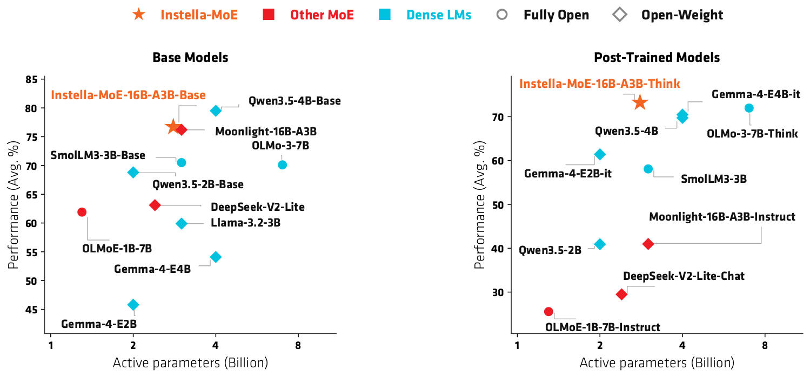
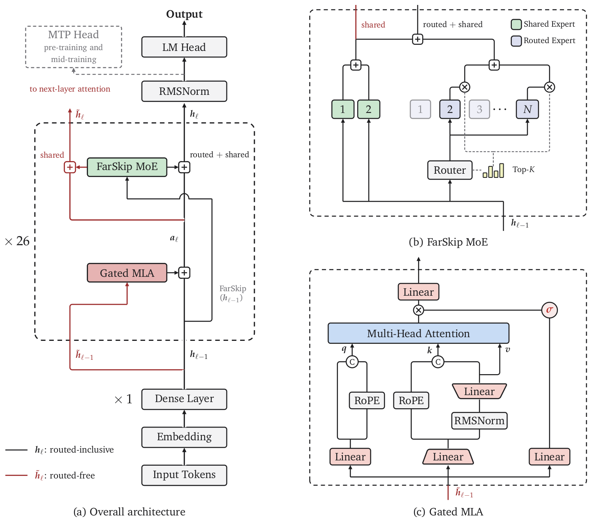
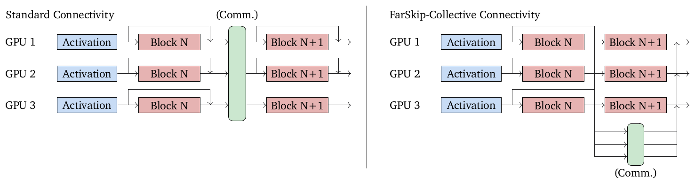
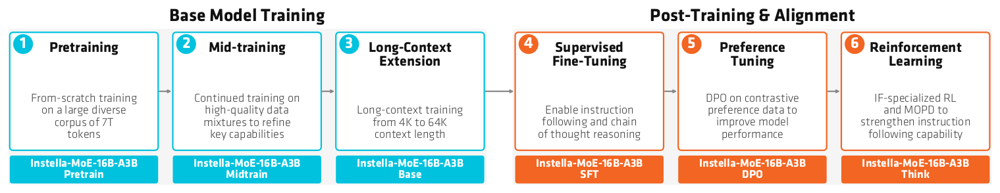
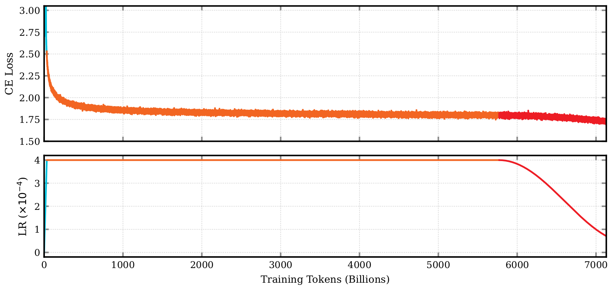
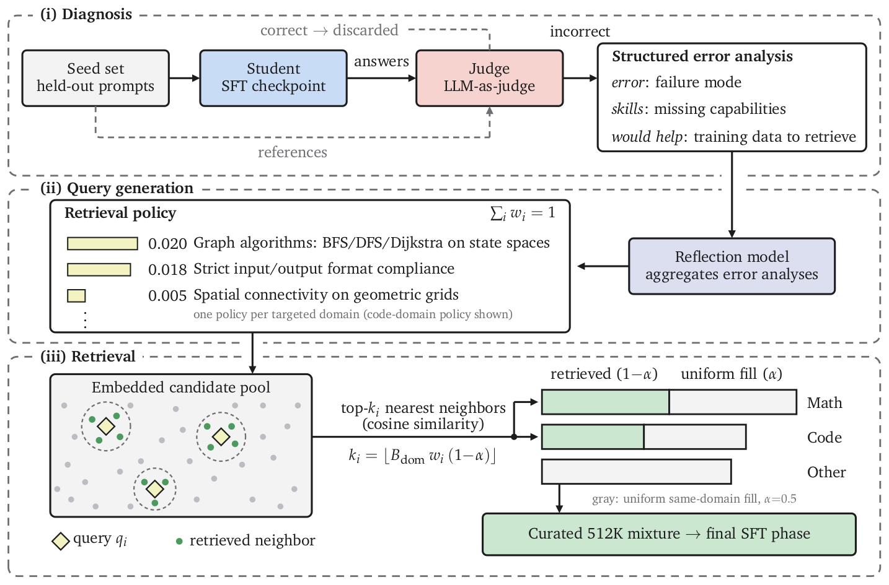
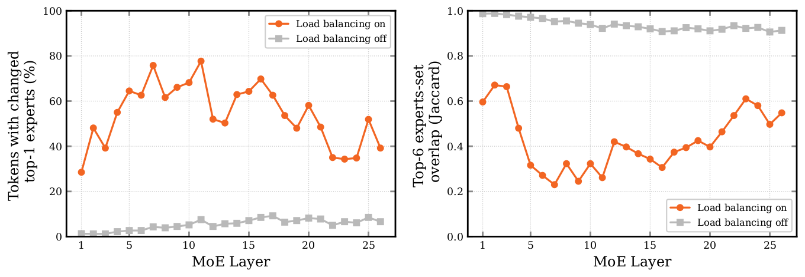
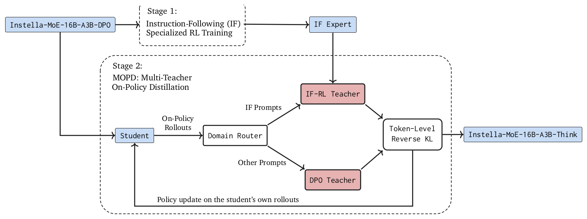
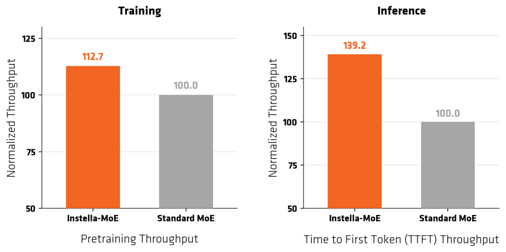

# 论文中文解读：《Instella-MoE Technical Report》

> **基本信息**：AMD 团队（首页带 AMD 标志；项目负责人 Jiang Liu，核心贡献者含 Sudhanshu Ranjan、Prakamya Mishra、Yonatan Dukler、Gowtham Ramesh、Zicheng Liu，末位作者 Emad Barsoum，完整名单见原文第 1 页），arXiv:2609.00791v1，2026 年 9 月 1 日；论文原文 [官方页面](https://arxiv.org/abs/2609.00791)，代码仓库 github.com/AMD-AGI/Instella-MoE（附录 A 给出）。
>
> **本文的读法**：图为从论文 PDF 中按图裁出的原图，表为逐格核对后的中文转录（模型名、数据集名、数字与原文一致，表头与行名翻译为中文）。每张图后有中文图题、图中文字翻译和读图结论，因此不必再翻英文版。从图上读出的数值都写“约”；论文没有给出、由本文根据论文已有数字自行推算的内容，都明确标注“自行估算”或“自行计算”，不能当作论文结论引用。

## 一、一句话结论

Instella-MoE-16B-A3B 是一个“全开放”（fully open）的 MoE 语言模型：总参数 16B、每个 token 激活 2.8B，在 AMD Instinct MI300X 与 MI325X GPU 上从零训练，数据全部取自公开数据集，并发布从预训练到强化学习每个阶段的权重、训练配置、数据来源、训练代码与评测协议。

- **架构**：27 层，第 1 层为稠密 FFN，其余 26 层为 MoE（64 个路由专家选 6 个，外加 2 个共享专家）。相对常见的稀疏 MoE 有两处改动：**Gated MLA**（在 MLA 注意力的输出上加一个 sigmoid 门）与 **FarSkip-Collective**（改变层间连接，使专家并行的 all-to-all 通信能与计算重叠）。
- **训练管线**：7.1T token 预训练 → 约 100B token 中期训练（三个数据混合变体，再做模型汤）→ 4K 到 64K 的两阶段长上下文扩展，得到 Base；然后 SFT（含反馈驱动的数据筛选）→ DPO（关闭负载均衡以抑制路由漂移）→ 指令遵循强化学习（IF-RL）与多教师 on-policy 蒸馏（MOPD），得到 Think 模型。
- **结果**：Base 在 13 个预训练基准上平均 76.7，是对比中的全开放模型里最高的（OLMo-3-7B 为 70.1，SmolLM3-3B 为 70.5），次于开放权重的 Qwen3.5-4B-Base（79.5），略高于 Moonlight-16B-A3B（76.2）。Think 模型在 12 个后训练基准上平均 73.2，高于 OLMo-3-7B-Think（72.0）、Gemma-4-E4B（70.5）和 Qwen3.5-4B（69.7）。FarSkip 使预训练吞吐提高 12.7%，专家并行推理的首 token 吞吐提高 39.2%。
- **边界**：所有对比均为作者自行评测；架构消融只有 200B token 规模的单次运行；预训练各数据源的占比论文没有给出；长上下文能力在 Stage 2 之后有所回退。

*图 1（原文 Figure 1，第 1 页）：性能对激活参数量。左，基础模型；右，后训练模型。*

**图中文字翻译与读法**：

- **图例**：星形为 Instella-MoE；红色方块为其他 MoE 模型；青色方块为稠密模型（Dense LMs）；圆形表示全开放（Fully Open）模型；菱形表示仅开放权重（Open-Weight）的模型。
- **左图 Base Models（基础模型）**：横轴 Active parameters (Billion)（激活参数量，十亿，对数刻度 1、2、4、8），纵轴 Performance (Avg. %)（平均性能）。Instella-MoE-16B-A3B-Base 位于约 2.8B 处、平均约 76.7；右上方的 Qwen3.5-4B-Base 约 79.5（4B）；紧邻的 Moonlight-16B-A3B 约 76.2；其余如 SmolLM3-3B-Base（70.5）、OLMo-3-7B（70.1，约 7B）、Qwen3.5-2B-Base（68.8）、OLMoE-1B-7B（61.9）、DeepSeek-V2-Lite（63.1）、Llama-3.2-3B（59.9）、Gemma-4-E4B（54.1）、Gemma-4-E2B（45.8）。
- **右图 Post-Trained Models（后训练模型）**：Instella-MoE-16B-A3B-Think 约 73.2，位于最上方；OLMo-3-7B-Think 约 72.0（约 7B）、Gemma-4-E4B-it 约 70.5 与 Qwen3.5-4B 约 69.7（均约 4B）；其后是 Gemma-4-E2B-it（61.4）、SmolLM3-3B（58.1）、Moonlight-16B-A3B-Instruct（41.0）、Qwen3.5-2B（40.9）、DeepSeek-V2-Lite-Chat（29.5）、OLMoE-1B-7B-Instruct（25.6）。
- **说明**：上面各点的具体数值取自表 10 和表 12，不是从图上读出的；两图的横轴都是激活参数量，所以 Instella-MoE 的优势应理解为“同样的每 token 计算量下更强”，不是“同样的总参数量下更强”。

## 二、背景与动机

**全开放与仅开放权重**。原文引言（第 1 节）认为，当前的前沿进展主要由闭源模型引领（原文列举了 GPT-5.6、Claude Fable 5、Gemini 3.1 Pro、Muse Spark 等），权重、架构、训练数据、方法与评测协议都不透明，阻碍科学理解、可复现性和公平获取。主要实验室近来发布了许多开放权重模型（原文列举 GLM-5.3、Qwen3.8-Max、Kimi K3、Gemma 4、DeepSeek-V4、Llama 4、Mistral Large 3 等），但它们大多只开放权重：预训练语料、预处理流程与完整训练配方要么不披露，要么只有部分文档。于是研究者无法完全复现结果、审计数据污染，也无法研究架构与数据选择在规模上如何相互作用。这些模型名称均取自原文。

**MoE 与全开放 MoE 的稀缺**。稀疏激活的 MoE 已成为改善“成本—性能”权衡的核心策略：每个 token 只激活一小部分参数，模型能获得远大的稠密模型的表示容量，而每 token 计算量接近较小的稠密基线。然而同时做到竞争力强且训练过程完全透明的全开放 MoE 仍然少见：OLMoE（总参数 6.9B、激活 1.3B）建立了重要基线，Marco-MoE 则通过稠密检查点 upcycling 把全开放稀疏训练扩展到多语言。

**本文的目标与贡献**。在 AMD 硬件上从零训练一个有竞争力的全开放 MoE，并公开完整流程。论文自称四点贡献：

1. Instella-MoE：16B 总参数、2.8B 激活参数、在 AMD Instinct GPU 上从零训练，带有 Gated MLA 与 FarSkip-Collective；
2. 完整的多阶段训练管线：预训练、中期训练、长上下文扩展、带反馈驱动数据筛选的 SFT、DPO，以及 IF-RL 加 MOPD；
3. 全开放模型中的最强表现：Base 平均 76.7，Think 平均 73.2，与同等激活参数规模的全开放和开放权重基线相当或更好；
4. 完全透明与可复现：逐阶段发布权重、训练配方、数据混合、训练代码与评测协议。

## 三、模型架构

### 3.1 总览与规格

Instella-MoE-16B-A3B 是纯文本的 decoder-only Transformer，共 27 层，其中 26 层是稀疏 MoE 层，第 1 层保留为稠密 FFN。MoE 层遵循 DeepSeek-V3 的细粒度“共享 + 路由”专家设计：每个 token 被分发到 64 个路由专家中的前 6 个，同时经过 2 个共享专家。预训练和中期训练时另外加一个 1 层的多 token 预测（Multi-Token Prediction，MTP）头作为辅助训练目标。

**表 1：Instella-MoE-16B-A3B 的架构超参数**。

| 类别 | 参数 | 取值 |
|---|---|---|
| 主干 | 总参数 / 激活参数 | 16B / 2.8B |
| 主干 | 解码器层数 | 27（1 层稠密 + 26 层 MoE） |
| 主干 | hidden size | 2,048 |
| 主干 | 分词器 / 词表大小 | DeepSeek-V3 / 128,896 |
| 主干 | 上下文长度（基础 / 扩展） | 4,096 / 65,536 |
| 注意力 | 注意力类型 | Gated MLA |
| 注意力 | 注意力头数 | 16 |
| 注意力 | KV 潜向量秩（KV latent rank） | 512 |
| 注意力 | QK 维度（内容 / RoPE） | 96 / 32 |
| 注意力 | value 头维度 | 128 |
| MoE | 路由专家数 N / 每 token 激活数 K | 64 / 6 |
| MoE | 共享专家数 | 2 |
| MoE | 路由专家 FFN 宽度 | 1,408 |
| MoE | 融合后的共享专家 FFN 宽度 | 2,816 |
| MoE | 路由 top-K 缩放系数 | 2.5 |
| MoE | 连接方式 | FarSkip-Collective |
| 其他 | 归一化 | RMSNorm |
| 其他 | 激活函数 | SwiGLU |
| 其他 | 位置编码 | RoPE |
| 其他 | 辅助目标 | MTP（1 层；预训练与中期训练） |

（原文表 1，第 6 页。）

### 3.2 读图 2：整体结构、FarSkip MoE 与 Gated MLA

*图 2（原文 Figure 2，第 5 页）：(a) 整体架构；(b) FarSkip MoE 块；(c) 简化的 Gated MLA 块。*

**图中文字翻译与读法**：

- **(a) Overall architecture（整体架构）**：自下而上为 Input Tokens（输入 token）、Embedding、1 层 Dense Layer（稠密层），再堆叠 26 次（“× 26”虚线框）的 Gated MLA 加 FarSkip MoE，最后是 RMSNorm、LM Head 和 Output。左上灰色虚线框 MTP Head 只在预训练和中期训练时接在最后的隐状态上。图例：黑线 $h_\ell$ 表示 routed-inclusive（包含路由专家输出）的残差流，红线 $\tilde h_\ell$ 表示 routed-free（不含路由专家输出）的残差流；标注“FarSkip ($h_{\ell-1}$)”的弧线表示 MoE 的输入取自上一层的完整输出 $h_{\ell-1}$，而不是等本层注意力算完。图注强调：FarSkip-Collective 让 Dispatch 与 Combine 两次 all-to-all 集合通信可以与注意力和共享专家的计算重叠。
- **(b) FarSkip MoE（FarSkip MoE 块）**：输入 $h_{\ell-1}$ 同时送给两个共享专家（绿色，Shared Expert）和路由器（Router）；Router 为每个 token 选出 Top-K 个路由专家（浅紫色，Routed Expert，图中示意为 1…N 中的若干个，灰色表示未被选中），选中的专家输出乘上路由权重（⊗）求和。块同时返回两个结果：只含共享专家的 shared（红线），以及“路由 + 共享”的 routed + shared（黑线）。
- **(c) Gated MLA（简化的 Gated MLA 块）**：输入 $\tilde h_{\ell-1}$（红线）同时进入三条线性分支：左支经 Linear 产生 q，并对其中一部分做 RoPE 后与其余部分拼接（C）；中支经 Linear（下投影到 512 维的 KV 潜向量）、RMSNorm、Linear（上投影）得到 k 的内容部分和 v，另有一路 RoPE 分支与之拼接得到 k；右支经 Linear 与 σ（Sigmoid）得到门。q、k、v 送入 Multi-Head Attention（多头注意力），其输出与门逐元素相乘（⊗），再经最后的 Linear（输出投影）。
- **读图结论**：红线与黑线的区别是 FarSkip 的关键——注意力吃的是“不含上一层路由专家输出”的残差流，MoE 吃的是“不含本层注意力输出”的残差流，这样两者的输入都不必等对方的通信完成。具体的公式见第 3.4 节。

### 3.3 MoE 层、负载均衡与 MTP

**MoE 层**（原文第 2.1.1 节）。除第 1 层外的 26 个 MoE 层，每层把每个 token 分发给 N=64 个路由专家中的前 K=6 个（每个专家的中间维度 1,408），同时经过两个共享专家（实现为一个融合的 FFN，中间维度 2,816，即两个 1,408）。被选中的路由专家的路由权重乘以 2.5，沿用 DeepSeek-V3。

**负载均衡**。主要机制沿用 DeepSeek-V3 的基于偏置的无损耗均衡：每个专家有一个偏置，加到用于 top-K 选择的路由得分上，但不加到混合权重上；偏置在训练步之间朝目标负载更新，速率为 $1\times10^{-3}$。这样能调整 top-K 的分配而不引入辅助目标的梯度。另外还使用序列级辅助负载均衡损失作为次要的正则项，系数为 $1\times10^{-4}$。DPO 阶段冻结偏置更新、把辅助损失系数设为 0，以限制路由漂移（第九节）。

**多 token 预测（MTP）**。沿用已有工作，在预训练和中期训练阶段加一个 MTP 模块：除了标准的下一个 token 目标外，该模块在每个位置多预测一个未来 token，提供更丰富的训练信号。MTP 损失权重在预训练中为 0.3，中期训练降为 0.1；长上下文扩展阶段关闭，推理时不使用。

### 3.4 Gated MLA：给 MLA 的注意力输出加一个门

多头潜在注意力（Multi-head Latent Attention，MLA，DeepSeek-V2 提出）把每个 token 的 key–value 状态压缩成低秩的潜在表示，以减少 KV cache 的占用。标准 MLA 把各头缩放点积注意力的输出拼接后直接经输出投影。**Gated MLA** 保留低秩 KV 分解，但在注意力输出与输出投影之间插入一个由输入决定的门（图 2(c)）。依照 Qiu 等（2025）的最佳配置，使用乘性的、sigmoid 激活的逐元素门。设 $\mathbf{x}_t\in\mathbb{R}^{d}$ 为经 RMSNorm 的层输入，$\hat{\mathbf{o}}_t\in\mathbb{R}^{Hd_v}$ 为 $H$ 个头（每头 value 维度 $d_v$）缩放点积注意力输出的拼接，Gated MLA 的输出为：

$$
\mathbf{y}_t=\mathbf{W}_o\big[\mathrm{Sigmoid}(\mathbf{W}_g\mathbf{x}_t)\odot\hat{\mathbf{o}}_t\big],\qquad(1)
$$

其中 $\mathbf{W}_g\in\mathbb{R}^{Hd_v\times d}$ 是门的投影，$\mathbf{W}_o$ 是注意力输出投影，$\odot$ 为逐元素乘。门使每个 token 可以调节每个头内部的每个 value 通道。代入表 1：$H=16$、$d_v=128$，门有 $16\times128=2048$ 个通道，$\mathbf{W}_g$ 为 $2048\times2048$。论文在受控的 200B token 消融中报告，Gated MLA 把平均分从 49.86 提高到 50.33（表 13，见第十二节），主要收益在 MMLU 和代码生成。

两点注意：（1）门由当前 token 的输入算出、作用在当前注意力输出上，不需要缓存，所以不影响 MLA 的 KV cache 占用（这是本文的推理，论文未明说）；（2）门不改变 MLA 的低秩压缩，压缩 KV 的仍是 MLA 本身。按 MLA 的标准做法（假设与 DeepSeek-V2 相同：缓存 512 维潜向量加 32 维解耦 RoPE 键），每层每 token 缓存 544 个元素，而同样 16 头、QK 128 维、V 128 维的标准多头注意力需要缓存 $16\times(128+128)=4096$ 个元素，约为后者的 13%（自行估算，论文没有给出）。

### 3.5 FarSkip-Collective：让 all-to-all 通信“躲进”计算里

**要解决的问题**。专家并行（EP）对稀疏 MoE 的部署至关重要，但它带来通信开销。MoE 层的实现分四个阶段：路由器计算专家路由图；**Dispatch**（派发）用路由图通过 all-to-all 把相关 token 发到对应 GPU；各 GPU 计算它们所得 token 的专家激活；**Combine**（汇合）再用一次 all-to-all 把专家输出映射回原来的 GPU 位置。标准实现里，Dispatch 依赖上一层的输出，Combine 要等专家计算完，因此两次 all-to-all 都无法与计算重叠。

**核心思想**。设网络经过 $k$ 个子块（子块即注意力或 MLP/MoE，各自含归一化）后的输出激活为 $h_k$，第 $i$ 个子块为 $f_i$。标准 Transformer 为（式 2）：

$$
h_k=f_1(h_0)+f_2(h_1)+\cdots+f_k(h_{k-1}).\qquad(2)
$$

大模型里，产生 $f_i$ 可能包含阻塞式通信，使 $h_k$ 在 GPU 间通信完成之前不能作为 $f_{k+1}$ 的输入，计算资源因此空闲。FarSkip 的想法是：改用一个当前已可用的激活 $\hat h_k$ 作为 $f_{k+1}$ 的输入，在通信集合操作还在生成 $h_k$ 的同时就去算下一层；等 $h_k$ 就绪，再把它累加进来（式 3）：

$$
h_{k+1}=h_k+f_{k+1}(\hat h_k)=f_1(h_0)+f_2(\hat h_1)+\cdots+f_{k+1}(\hat h_k).\qquad(3)
$$

与式 (2) 一样，所有算出的激活最终都出现在最终隐状态里；区别是各子块的输入变成了“部分的”或“过时的”激活 $\hat h_k$，相当于在完整激活的求和里省掉了一些加项。

**FarSkip-Collective 的具体设计**：要让 Dispatch、Combine 和注意力块的通信都能被重叠，同时让 $\hat h_k$ 相对 $h_k$ 省掉的加项尽量少。

- **MoE 的输入**：为让 Dispatch 能与注意力计算重叠，派发的输入不能依赖注意力输出，所以令 $\text{moe-in}_k:=\hat h_k(\mathrm{moe})=h_{k-1}$，即用上一层的完整输出（含路由专家），不含本层注意力的输出。这使 Dispatch 和路由在上一层 Combine 产出 token 之后就能立刻开始，传播至多延迟一层。
- **注意力的输入**：只有路由专家的输出在专家计算之后需要通信，所以它们是注意力输入中唯一被省掉的项：$\text{attn-in}_k:=\hat h_k(\mathrm{attn})=h_{k-2}+\text{attn-out}_{k-1}+\text{shared-exp-out}_{k-1}$（此处下标按层计，是原文公式的写法；含义是“上一层的输出去掉路由专家的贡献”，与图 2 中的红线 $\tilde h$ 对应）。这使路由专家的 Combine 能与共享专家的计算以及注意力计算的前半部分重叠。
- **注意力内部的通信**：被路由专家的计算所掩盖。

合起来，在不做流水线的前提下，FarSkip-Collective 把 Dispatch 和 Combine 的可重叠窗口扩展到整层的时长，只有路由器和路由专家本身的计算除外。

*图 9（原文 Figure 9，第 26 页）：FarSkip-Collective 修改子块之间的连接，避免等待通信集合操作；计算用已有的激活继续，这些激活是部分的（例如 Block N 的输出）或过时的（例如 Activation）。*

**图中文字翻译与读法**：

- **左半 Standard Connectivity（标准连接）**：三张 GPU（GPU 1 到 GPU 3）各自从 Activation（激活）进入 Block N，Block N 的输出必须经过绿色的 (Comm.)（通信）这一道集合操作之后，才能进入 Block N+1。通信在主路径上，后面的块只能等。
- **右半 FarSkip-Collective Connectivity（FarSkip-Collective 连接）**：Block N 的输出直接送入 Block N+1，不等通信；通信（右下方绿色 (Comm.)）与 Block N+1 的计算并行进行，通信结果之后再汇入残差路径（图中向上的箭头）。
- **读图结论**：FarSkip 把“通信放在主路径上”变成“通信放在旁路上”，代价是子块输入变成了部分或过时的激活，计算语义与标准 Transformer 不再逐字等价，所以需要从头训练并用实验验证精度。

**精度验证**。作者做了大规模架构消融：把 Instella-MoE 加 FarSkip 训练 200B 个预训练 token，与不加 FarSkip 的 Instella-MoE 固定所有训练设置和种子相比。表 13 中，加 FarSkip 的变体平均 50.38，对比不加 FarSkip 的标准连接 50.33，表现相当。实现细节在附录 A，见第十二节。

### 3.6 自行估算：16B 与 2.8B 怎么来

下面用表 1 的数字做一次粗略核对（自行估算，假设：SwiGLU 使用 3 个矩阵，输入 embedding 与输出头不共享，Q 投影不做低秩压缩，忽略 MTP 头与第 1 层稠密 FFN，后者的宽度论文没有给出）：

- 每个路由专家 $3\times2048\times1408\approx8.65$M，64 个路由专家每层约 553.6M，26 层共约 14.39B；每层共享专家约 17.3M，路由器约 0.13M。路由专家因此占总参数的九成以上。
- 注意力（MLA 加门）每层约 15.5M，27 层约 0.42B；embedding 与输出头各约 264M。合计约 15.8B，加上第 1 层稠密 FFN 与 MTP 头后与 16B 基本吻合。
- 激活参数：每层 6 个路由专家加共享专家约 69.3M，26 层约 1.80B；加上注意力 0.42B、embedding 与输出头 0.53B，约 2.75B，加上第 1 层稠密 FFN 与 MTP 头后与 2.8B 基本吻合。每个 token 激活的 FFN 等效宽度为 $(6+2)\times1408=11{,}264$。

总参数里约九成是路由专家，而每个 token 只用到其中 6/64，这正是“16B 总参数、2.8B 激活”的来源，也是需要专家并行和 all-to-all 通信、从而需要 FarSkip 的原因。

## 四、训练管线总览与基础设施（原文第 2.2、2.3 节）

### 4.1 六个阶段与六个检查点

*图 3（原文 Figure 3，第 8 页）：训练管线。基础模型训练包括预训练、中期训练和长上下文扩展；后训练与对齐包括 SFT、偏好调优（DPO）和强化学习。*

**图中文字翻译与读法**：

- **Base Model Training（基础模型训练）**：（1）Pretraining（预训练）：在约 7T token 的大规模多样语料上从零训练，产出 Instella-MoE-16B-A3B Pretrain；（2）Mid-training（中期训练）：在高质量数据混合上继续训练，精炼关键能力，产出 Midtrain；（3）Long-Context Extension（长上下文扩展）：把上下文长度从 4K 训到 64K，产出 Base。
- **Post-Training & Alignment（后训练与对齐）**：（4）Supervised Fine-Tuning（监督微调）：赋予指令遵循与思维链推理能力，产出 SFT；（5）Preference Tuning（偏好调优）：用对比偏好数据做 DPO 以提升模型表现，产出 DPO；（6）Reinforcement Learning（强化学习）：IF 专项 RL 与 MOPD，加强指令遵循，产出 Think。
- **读图结论**：每个阶段都有一个对应的公开检查点，后一阶段从前一阶段的检查点出发（表 2）。

**表 2：发布的 Instella-MoE 检查点**。

| 检查点 | 阶段 | 说明 |
|---|---|---|
| Instella-MoE-16B-A3B-Pretrain | 预训练 | 7.1T token 预训练后的、从零训练的 MoE 检查点 |
| Instella-MoE-16B-A3B-Midtrain | 中期训练 | 通过模型汤得到的、STEM 与推理能力增强的检查点 |
| Instella-MoE-16B-A3B-Base | 长上下文 | 64K 长上下文扩展后的最终基础模型 |
| Instella-MoE-16B-A3B-SFT | SFT | 带思维链能力的指令微调检查点 |
| Instella-MoE-16B-A3B-DPO | DPO | 经 delta learning 偏好调优的检查点 |
| Instella-MoE-16B-A3B-Think | RL | 经 IF-RL 与 MOPD 得到的最终 Think 检查点 |

（原文表 2，第 8 页。）

### 4.2 训练基础设施

- **到 DPO 为止的所有阶段**：在开源的 Primus 框架（AMD AI Brain，2025）上运行，使用其 Megatron-LM 后端，基于 ROCm，在 AMD Instinct MI300X 与 MI325X GPU 上训练。使用专家并行（EP=8，即 64 个路由专家分到 8 张卡，每卡 8 个，自行换算）、张量并行、FlashAttention 与 bfloat16 混合精度，并把梯度与参数通信同计算重叠。预训练与中期训练额外使用 FarSkip-Collective 的实现来重叠专家并行的 all-to-all 集合通信（附录 A，见第十二节）。
- **强化学习**：用 Miles（RadixArk，2025；基于 slime 生态的、PyTorch 原生的大规模 RL 后训练栈）。Miles 把 Megatron-LM 的 learner 与一组 SGLang rollout 引擎配对，用 Ray 做多节点编排，同时支持异步 off-policy 与同步 on-policy 两种 rollout 循环；两个 RL 阶段分别使用这两种模式。实验中 Primus 作为策略训练的后端，SGLang 作为 rollout 后端。

### 4.3 各阶段超参数与数据（表 3、表 4）

**表 3：各阶段的训练超参数**。所有阶段使用专家并行（EP=8）、bfloat16 混合精度以及 Primus 与 Miles 训练栈（另有说明除外）。原文表中没有注明全局 batch 的单位，按各阶段含义理解（预训练到 SFT 为序列数，DPO 为偏好对数，RL 为 rollout 条数）。

| 阶段 | token 数 / 数据量 | 序列长度 | 全局 batch | 峰值学习率 | 学习率调度 | 关键设置 |
|---|---|---:|---:|---|---|---|
| 预训练 | 7.1T | 4,096 | 4,096 | $4\times10^{-4}$ | WSD | MTP、EOD 掩码、FarSkip |
| 中期训练 | ∼100B | 4,096 | 1,024 | $2\times10^{-4}$ | 线性 | 3 个混合变体 + 模型汤 |
| 长上下文 Stage 1 | ∼194B | 65,536 | 128 | $2\times10^{-4}$ | 线性 | YaRN（$\theta=8$M）、文档掩码 |
| 长上下文 Stage 2 | ∼20B | 65,536 | 128 | $1\times10^{-4}$ | 线性 | 面向 STEM 的数据混合 |
| SFT | ∼2.9M 条 | 32,768 | 128 | $1\times10^{-4}$ | 线性 | 2 个 epoch、序列打包、反馈驱动数据筛选 |
| DPO | 150K 对 | 16,384 | 256 | $8\times10^{-8}$ | 线性 | $\beta=5.0$、0.75 个 epoch |
| IF-RL | 29.8K 个 prompt | 16,384（rollout） | 512 | $1\times10^{-6}$ | 常数 | GRPO + DAPO + R3，1,400 步 |
| MOPD | on-policy | 16,384（rollout） | 512 | $1\times10^{-6}$ | 常数 | 按领域路由的教师 |

（原文表 3，第 9 页。）

**表 4：各阶段的训练数据**。预训练与中期训练的语料都取自公开记录的开放数据集。

| 阶段 | 主要数据来源 | 许可 |
|---|---|---|
| 预训练 | Nemotron-CC-v2；Nemotron-Pretraining-SFT-v1；Nemotron-CC-Math-v1；MegaMath；FineMath；RefineCode；Nemotron-Pretraining-Code-v1；TxT360 | 视来源而定 |
| 中期训练 | Dolma 3 Dolmino 100B（网页、代码、数学、科学、指令、推理） | ODC-BY-1.0 |
| 长上下文 | Dolma 3 Longmino 100B（Stage 1）；Dolma 3 Dolmino 100B 混合与完整池中的数学/代码/推理子集；Instella-GSM8K-synthetic（Stage 2） | 视来源而定 |
| SFT | Dolci-Think-SFT-7B；Nemotron-Cascade-2（数学、科学）；Nemotron-SFT-Competitive-Programming-v2 | 视来源而定 |
| DPO | Dolci-Think-DPO-7B 偏好对 | 视来源而定 |
| RL | Dolci-Think-RL-7B（IF RLVR Mixture） | 视来源而定 |

（原文表 4，第 9 页。）读法：表 4 只列了数据集名称与许可，没有列出各来源在预训练中的占比；论文说的“数据混合已公开”，从论文本身只能核实到来源清单。

## 五、预训练（原文第 2.4 节）

**设置**：从零开始在 7.1T token 上训练，上下文长度 4,096，全局 batch size 4,096（按序列计，每步约 1678 万 token，据此预训练约 42.3 万步，自行换算）。优化器 AdamW，$\beta_1=0.9$、$\beta_2=0.95$，权重衰减 0.1；学习率调度为 WSD（warmup–stable–decay：先升温、长时间保持峰值、最后衰减），峰值 $4\times10^{-4}$，最小值 $4\times10^{-5}$，2,000 步 warmup。MTP 目标在这一阶段开启，所有语料用 DeepSeek-V3 分词器分词。

**数据**（表 4、附录 C）：强调覆盖网页、数学、代码和科学的高质量开放语料。网页用 Nemotron-CC-v2；数学用 Nemotron-CC-Math-v1、MegaMath、FineMath；代码用 RefineCode 与 Nemotron-Pretraining-Code-v1；精选的预训练 SFT 风格数据用 Nemotron-Pretraining-SFT-v1；其他领域用 TxT360 的子集（arxiv、dm_maths、europarl、freelaw、hackernews、pg19、phil_papers、pubmed、s2orc、stackexchange、ubuntu_irc、uspto、wikipedia）。各来源的采样比例论文没有给出。

*图 4（原文 Figure 4，第 10 页）：Instella-MoE-16B-A3B 在 7.1T token 上的预训练动态。上，训练交叉熵（CE）损失；下，峰值为 $4\times10^{-4}$ 的 WSD 学习率调度。*

**图中文字翻译与读法**：

- **上图 CE Loss（交叉熵损失）**：横轴 Training Tokens (Billions)（训练 token 数，十亿），0 到约 7,100；纵轴 CE Loss 1.50 到 3.00。损失在最初的几十 B token 内从 3 以上陡降到约 2.5，再在约 0.5T token 处降到约 1.9，之后缓慢下降到约 1.8；学习率开始衰减之后，损失再次明显下降，到训练结束约 1.7（与正文“约 1.7”一致）。
- **下图 LR (×10⁻⁴)（学习率，单位 $10^{-4}$）**：先在最初约 3.4×10¹⁰ token（2,000 步 warmup，自行换算）内升到 4，保持在 4 直到约 5.8T token，此后沿平滑曲线衰减，曲线终点处约 0.7（图上读数；正文给出的最小学习率是 0.4，图中没有画到这个值，原文没有解释）。曲线上的颜色区分阶段（青色升温、橙色稳定、红色衰减，图注没有说明，这是按曲线形状的理解）。
- **读图结论**：这是典型的 WSD 曲线：大部分训练在恒定的高学习率下完成，最后约两成 token 做衰减，损失的最后一段下降主要发生在衰减阶段。

## 六、中期训练与模型汤（原文第 2.5 节）

**做法**：预训练之后，在 Dolma 3 Dolmino 100B（Olmo 等，2025）上做中期训练，以增强数学、代码、STEM 与推理能力。训练三个变体（v1、v2、v3），它们共享同一个 Dolma 3 Dolmino 100B 基础混合，只在少数 STEM/推理子集上不同：v1 使用原始 Dolmino 100B 混合；v2 把 STEM-Heavy Crawl 子集换成 Dolma 3 Dolmino 池中的完整版本；v3 在此基础上，再把 MegaMatt、General Reasoning Mix、Math Meta-Reasoning、Code Meta-Reasoning 换成完整池版本，把混合从约 100B 扩到约 104B token。每个变体的峰值学习率 $2\times10^{-4}$、全局 batch size 1,024、线性衰减，MTP 目标仍然开启。三个变体的检查点用等权重**模型汤**（model souping，即对多个检查点的参数取平均）合并，得到 Instella-MoE-16B-A3B-Midtrain。

**表 22：三个中期训练变体的数据混合差异**。只列出在三个变体之间不同的 STEM/推理子集（token 数）；其余 Dolma 3 Dolmino 100B 子集不变。“完整池”一列给出各子集在完整 Dolmino 池中的大小，供参考。

| 类型 | 来源 | v1 | v2 | v3 | 完整池 |
|---|---|---:|---:|---:|---:|
| 数学（合成） | MegaMatt | 1.73B | 1.73B | 3.88B | 3.88B |
| 网页 | STEM-Heavy Crawl | 4.99B | 5.21B | 5.21B | 5.21B |
| 思考（合成） | General Reasoning Mix | 1.87B | 1.87B | 2.48B | 2.48B |
| 思考（合成） | Math Meta-Reasoning | 381M | 381M | 1.05B | 1.05B |
| 思考（合成） | Code Meta-Reasoning | 459M | 459M | 1.27B | 1.27B |
| 其他 | 所有其他子集 | 不变 | 不变 | 不变 | - |
| 合计 | 混合总量 | 99.95B | 100.17B | 104.41B | - |

（原文表 22，第 32 页。）

**表 5：中期训练的模型汤**。比较三个中期训练变体和它们的等权重模型汤（以及预训练检查点作参照）。指标越高越好；HE+ 为 HumanEval+；Average 为 12 项的平均（不含 MATH，因此不能和表 10 的 13 项平均直接比较）。

| 模型 | ARC-E | ARC-C | BoolQ | SciQ | PIQA | HSwag | WG | OBQA | MMLU | GSM8K | HE+ | MBPP+ | 平均 |
|---|---:|---:|---:|---:|---:|---:|---:|---:|---:|---:|---:|---:|---:|
| Instella-MoE-16B-A3B-Pretrain | 93.96 | 83.47 | 86.30 | 93.21 | 79.45 | 82.38 | 85.91 | 80.00 | 68.71 | 70.92 | 55.95 | 53.15 | 77.78 |
| Instella-MoE-16B-A3B-Midtrain-v1 | 93.84 | 84.90 | 84.90 | 93.71 | 82.00 | 82.09 | 87.09 | 83.60 | 68.95 | 77.82 | 56.86 | 55.00 | 79.23 |
| Instella-MoE-16B-A3B-Midtrain-v2 | 94.88 | 85.60 | 84.80 | 94.22 | 83.93 | 81.50 | 86.41 | 83.80 | 69.31 | 71.21 | 59.30 | 54.30 | 79.11 |
| Instella-MoE-16B-A3B-Midtrain-v3 | 94.63 | 85.83 | 86.00 | 94.45 | 85.19 | 81.26 | 85.85 | 84.40 | 69.69 | 75.93 | 58.54 | 54.95 | 79.73 |
| Instella-MoE-16B-A3B-Midtrain（模型汤） | 95.11 | 87.26 | 86.50 | 94.55 | 86.03 | 82.27 | 87.42 | 86.20 | 70.90 | 77.05 | 59.91 | 57.60 | 80.90 |

（原文表 5，第 10 页。）读法：

- 中期训练使平均分从 77.78 升到 79.1–79.7，三个变体里 v3（用了最多完整池子集）最高（79.73）；等权重汤达到 80.90，比最好的单个变体高约 1.2 分，与论文“汤优于每个单独变体”的说法一致（按平均分）。
- 逐列看，汤在 12 列里的 10 列最高；例外是 HSwag（汤 82.27，预训练 82.38）和 GSM8K（汤 77.05，v1 77.82）。
- 相比预训练检查点，提升最大的是 PIQA（+6.6）、OBQA（+6.2）、GSM8K（+6.1）、MBPP+（+4.5）、HE+（+4.0）、ARC-C（+3.8），符合“增强数学、代码、STEM”的目的（差值为自行计算）。
- 论文没有做汤的权重或方法的对比（例如不等权重、不汤直接选 v3），所以“汤”这一选择的增益只有这张表的证据。

## 七、长上下文扩展（原文第 2.6 节）

### 7.1 总体配方

中期训练之后，在 AMD Instinct MI325X 上通过继续预训练把上下文从 4K 扩展到 64K，分两个阶段：Stage 1 用多样的长上下文数据让模型适应完整的 64K 长度；Stage 2 重新调整训练混合，恢复在 Stage 1 中退化的数学、代码与推理能力。Stage 2 结束时的检查点就是 Instella-MoE-16B-A3B-Base；后续后训练从它出发，继承扩展后的上下文窗口。

**位置编码与掩码**：把 RoPE 基频提高到 $\theta=8\times10^{6}$，并使用 YaRN 缩放（Peng 等，2024）以在 64K 下保持注意力稳定。从这一阶段起关闭 MTP 头，以降低长序列下的激活显存。论文称消融表明：保留 $\theta=10{,}000$ 且不用 YaRN，长度利用显著变差，所以两个扩展阶段都使用 YaRN（原文没有给出这个消融的数据）。训练样本把多个文档打包进固定的 64K 序列；为避免虚假的跨文档依赖，使用**文档掩码**：注意力在文档边界处被阻断，位置索引在每个新文档处重新从 0 开始。

**表 6：长上下文扩展的超参数**。两个阶段都使用 64K 序列长度、文档边界掩码和 YaRN RoPE（$\theta=8\times10^{6}$）。

| 项目 | Stage 1 | Stage 2 |
|---|---|---|
| 初始化 | 中期训练（汤合并后的检查点） | Stage 1 检查点 |
| 训练数据 | Dolma 3 Longmino 100B | 37.32B 的 STEM 混合 |
| 序列长度 | 64K | 64K |
| 全局 batch size | 128 | 128 |
| 训练步数 | 23,071 | 2,400 |
| 峰值学习率 | $2\times10^{-4}$ | $1\times10^{-4}$ |
| 学习率调度 | 线性衰减，200 步 warmup | 线性衰减 |
| MTP 头 | 关闭 | 关闭 |
| 专家并行 | 8 路 | 8 路 |

（原文表 6，第 11 页。）读法：23,071 步 × 128 × 65,536 ≈ 1.94×10¹¹，2,400 步 × 128 × 65,536 ≈ 2.0×10¹⁰，与表 3 的 ∼194B 和 ∼20B 一致（自行验算）。

### 7.2 Stage 1：长文档适应

Stage 1 从汤合并后的中期训练检查点出发，使用 Dolma 3 Longmino 100B（Olmo 等，2025）：由 OCR 得到的科学 PDF、长网页、合成的长上下文聚合任务，以及用来限制通用技能灾难性遗忘的、中期训练质量的子集。训练约 194B token，序列长度 64K，峰值学习率 $2\times10^{-4}$、线性衰减到零。得到的 Long-Stage1 检查点能有效使用长输入：在 8K 到 64K 的扫描中 HELMET 得分为 44.7、44.9、44.4、41.0，RULER 平均 83.9，超过 OLMo-3-7B（表 11）。但短上下文的 STEM 能力退化：GSM8K 从中期训练后的 77.1 降到 62.8，HumanEval+ 从 59.9 降到 55.0（表 10 与表 5）。恢复这一能力就是 Stage 2 的目的。名为“Longmino 100B”的数据集被用了约 194B token，两者的关系（是否多遍）原文没有说明。

### 7.3 Stage 2：STEM 恢复

Stage 2 从 Stage 1 检查点出发，再训练约 20B token，峰值学习率 $1\times10^{-4}$、线性衰减。这些 token 采样自一个精选的 37.32B token 的 STEM 混合（表 7），来源为 Dolma 3 Dolmino（Olmo 等，2025）和 Instella-GSM8K-synthetic（Liu 等，2025a），包括教学数学、竞赛数学、合成数学推理、代码语料、代码推理轨迹和简短的思维链改写；打包成 64K 序列，与 Stage 1 一样使用文档边界掩码。

**表 7：Stage 2 的 STEM 混合（37.32B token）**。子集取自 Dolma 3 Dolmino 100B、完整的 Dolma 3 Dolmino 池或 Instella-GSM8K-synthetic；“来源”一列取自原文表 23。

| 领域 | 数据 | 来源（表 23） | token 数 |
|---|---|---|---:|
| 数学 | 教学数学（Dolmino） | 100B 混合 | 10.7B |
| 数学 | 竞赛数学 | 100B 混合 | 5.62B |
| 数学 | 合成数学（MegaMatt） | 完整池 | 3.88B |
| 数学 | 简短数学推理（Mind） | 100B 混合 | 898M |
| 数学 | 简短数学推理（PoT） | 100B 混合 | 241M |
| 数学 | GSM8K 风格合成数据 | Instella-GSM8K | 329M |
| 代码 | 教学与竞赛代码 | 100B 混合 | 10.0B |
| 推理 | 通用推理轨迹 | 完整池 | 2.48B |
| 推理 | 改写的完整思维链 | 100B 混合 | 850M |
| 推理 | 数学元推理 | 完整池 | 1.05B |
| 推理 | 代码元推理 | 完整池 | 1.27B |
| 合计 | | | 37.32B |

（原文表 7，第 11 页；表 23，第 33 页。）读法：数学与代码各占约 21.7B 与 10.0B（数学六项相加约 21.67B，自行相加），其余约 5.65B 为推理轨迹；从 37.32B 中采样约 20B 使用，即约 0.54 遍（自行换算）。

**四种 Stage 2 混合**。作者评估了四种在 STEM 上采样程度不同的 Stage 2 混合，原文只在正文里给出这几个数字（没有单独的表，各混合的具体配比也没有给出）：

| Stage 2 混合 | GSM8K | HumanEval+ | 说明（原文） |
|---|---:|---:|---|
| General recovery | 64.5 | 未给出 | 保持宽泛分布，GSM8K 只略有改善，代码收益有限 |
| Math recovery | 80.5 | 57.6 | 提高数学占比，GSM8K 恢复，但代码未完全恢复 |
| STEM-intensive | 81.0 | 64.5 | 进一步提高数学与代码占比，长上下文扫描性能有所代价 |
| STEM-balanced（采用） | 81.5 | 65.7 | STEM 恢复最好，代价是相对 Stage 1 的小幅长上下文退化 |

采用 STEM-balanced 得到 Base：HELMET 平均从 43.7 降到 41.5，RULER 平均从 83.9 降到 79.4（表 11）。

### 7.4 训练细节

在 16B 参数的 MoE 上做 64K 训练，显存与通信压力都大：64 个路由专家用专家并行分到 8 张 GPU，序列维度用上下文并行切分，使每个设备只持有 64K 激活的一个切片，并使用完整的激活重计算与 bfloat16 混合精度，才能使每步的 micro-batch 大小为 1。与前面的 4K 上下文阶段不同，64K 训练不做前向与反向通信的重叠；为在新序列长度上继续训练，优化器状态被重新初始化。

## 八、监督微调与反馈驱动的数据筛选（原文第 2.7 节与附录 B）

### 8.1 Phase 1：核心混合

SFT 模型从长上下文 Base 初始化，分两个阶段训练。Phase 1 的混合由通用的 Dolci-Think-SFT-7B 数据集（Olmo 等，2025；约 2.27M 条记录）加三个定向技能切片组成：来自 Nemotron-Cascade-2 的 300K 条数学样本、来自 Nemotron-SFT-Competitive-Programming-v2 的约 161K 条 Python 竞赛编程样本、来自 Nemotron-Cascade-2 的约 197K 条科学样本。

**表 24：SFT Phase 1 的数据混合**。记录数与各来源贡献的能力。数学记录是从 Nemotron-Cascade-2 中做蓄水池采样并去掉推理前缀；经过 32K token 过滤后留下的竞赛编程记录全部保留；科学记录从 Nemotron-Cascade-2 中采样。

| 领域 | 来源 | 记录数 | 贡献 |
|---|---|---:|---|
| 通用 | Dolci-Think-SFT-7B | ∼2.27M | 通用的指令遵循基础 |
| 数学 | Nemotron-Cascade-2（数学） | 300K | 数学；蓄水池采样并去掉推理前缀 |
| 代码 | Nemotron-SFT-Competitive-Programming-v2（Python） | ∼161K | 编程；通过 32K token 过滤的全部记录 |
| 科学 | Nemotron-Cascade-2（科学） | ∼197K | 科学推理与问答 |

（原文表 24，第 33 页。）四项相加约 2.93M，与表 3 的“∼2.9M 条”一致（自行相加）。

**数据处理与训练**：所有来源转换成统一的 `{"messages": [...]}` 格式，去掉 system 消息，保留 assistant 的推理轨迹；用 DeepSeek-V3 的 chat 模板分词后，丢弃长于 32,768 token 的对话。训练使用 32K 上下文的序列打包，峰值学习率 $1\times10^{-4}$，训练两个 epoch。

### 8.2 Phase 2：反馈驱动的数据筛选

当核心混合带来的增益饱和后，在 512K 条样本上做最后一个阶段；这些样本是由错误驱动的流程选出的，而不是均匀采样。把数据池分成三个领域：数学、代码和其他，并把固定的选择预算按基础混合中的比例分给它们。对数学与代码这两个“被定向”的领域，用三步流水线选数据（图 5）。

*图 5（原文 Figure 5，第 12 页）：反馈驱动的数据筛选。(i) 学生模型回答留出的种子集问题，评判模型对照参考答案打分；答对的回答被丢弃，每个错误被转成结构化的错误分析，写明失败模式、缺失的技能以及能弥补差距的训练数据。(ii) 一个更大的反思模型把某个领域的错误分析汇总成检索策略：一组权重之和为 1 的查询。(iii) 每个查询在共享的嵌入空间里通过最近邻搜索，从各领域预算 $B_{\mathrm{dom}}$ 中检索它分到的 $k_i$ 条样本；每个被定向领域预算中剩下的 $\alpha$ 份额，以及非定向的 other 领域的全部预算，用同领域均匀采样补齐。总预算 $B=512$K 按基础混合中的比例分给各领域，对应图中长度不同的条形。*

**图中文字翻译与读法**：

- **(i) Diagnosis（诊断）**：Seed set held-out prompts（留出的种子 prompt）→ Student SFT checkpoint（学生：SFT 检查点）→ answers（回答）→ Judge LLM-as-judge（评判：用 LLM 做裁判，同时拿到 references 参考答案）；correct → discarded（答对的丢弃），incorrect（答错的）→ Structured error analysis（结构化错误分析）：error（失败模式）、skills（缺失的能力）、would help（该检索哪类训练数据）。
- **(ii) Query generation（查询生成）**：Reflection model aggregates error analyses（反思模型汇总错误分析）→ Retrieval policy（检索策略，权重之和为 1），图中以代码领域为例，每条查询前的数字是权重：0.020 Graph algorithms: BFS/DFS/Dijkstra on state spaces（状态空间上的 BFS/DFS/Dijkstra 图算法），0.018 Strict input/output format compliance（严格的输入输出格式遵守），0.005 Spatial connectivity on geometric grids（几何网格上的空间连通性）……每个被定向的领域一个策略。
- **(iii) Retrieval（检索）**：Embedded candidate pool（已嵌入的候选池，图中黄色菱形为查询 $q_i$，绿点为被检索到的近邻）；top-$k_i$ nearest neighbors（余弦相似度），$k_i=\lfloor B_{\mathrm{dom}}w_i(1-\alpha)\rfloor$；右侧三条横条分别是 Math、Code、Other 三个领域的预算，绿色为检索所得（$1-\alpha$），灰色为同领域均匀补齐（$\alpha$，图中 $\alpha=0.5$），Other 领域全为灰色；最终汇成 Curated 512K mixture → final SFT phase（精选的 512K 混合，用于最后的 SFT 阶段）。
- **读图结论**：这是一个“用模型自己的错误反向指导选数据”的闭环：错误 → 文字描述“需要什么样的数据” → 向量检索把这类数据从大池子里捞出来。

**流程要点**：

1. **诊断**：在留出的种子集上运行学生，用 LLM 作裁判对照参考答案打分；对每个错误回答，裁判模型再给出结构化错误分析，其中含对“什么样的训练数据能解决这个错误”的描述。
2. **查询生成**：一个更大的反思模型把这些错误分析聚合成一组加权的检索查询，权重归一化为和等于 1。
3. **检索**：把选择预算按权重分给各查询，每个查询按嵌入相似度从池中取回对应数量的最近邻。

与相同预算下的均匀采样相比，这使评测集的平均性能提高 1.5 分，在指令遵循、竞赛数学和代码生成上收益最大（表 8）。论文提到并行的工作 STAT（He 等，2025）同样通过教师诊断的错误来针对学生的弱点，但它依赖预定义的技能分类来驱动选择；本文方法里教师给出自由形式的错误反馈，再转成对大候选池的检索查询。

**表 8：最后阶段的 SFT 数据选择**。两次运行都在同一个 Phase 1 模型上，用取自同一候选池的 512K 条样本做退火训练，区别只在样本的选择方式。指标越高越好，HE+ 为 HumanEval+，LCB 为 LiveCodeBench；粗体为原文标出的该列最佳。

| 选择方式 | AGIEval | AIME24 | AIME25 | BBH | HE+ | GPQA | IFEval | LCB | MBPP+ | MATH | MMLU | 平均 |
|---|---:|---:|---:|---:|---:|---:|---:|---:|---:|---:|---:|---:|
| 均匀采样 | 79.86 | **78.02** | 67.71 | 74.04 | 85.45 | 58.00 | 76.71 | 45.53 | 61.59 | **94.77** | 79.70 | 72.85 |
| 反馈驱动筛选 | **81.33** | 77.50 | **71.35** | **74.34** | **86.77** | **59.38** | **81.51** | **48.74** | **61.64** | 94.67 | **80.82** | **74.37** |

（原文表 8，第 13 页。）读法：11 项平均从 72.85 升到 74.37（+1.5）；最大的增益在 IFEval（+4.8）、AIME25（+3.6）和 LCB（+3.2）；AIME24（−0.5）和 MATH（−0.1）略有下降。这是同一个设置下的单次对比，论文没有给出多种子的波动。

### 8.3 附录 B：错误分析与提示词细节

- **数据划分**：筛选涉及四个互不相交的集合：（1）留出的种子集（诊断与查询生成用）：数学用截至 2022 年的 AIME 题目，代码用取自 Nemotron 池的题目，均配有参考答案；（2）单独保留的打分集（只用于评测筛选的效果，从不进入选择）；（3）供检索的完整指令微调训练池；（4）最终的 512K 精选混合。池中与种子集或打分集重叠的内容被移除，使诊断题和评测题不会被再次选中；嵌入前丢弃长于 32K token 的样本。最终的 512K 混合在每个领域的样本数与基础混合相同。
- **两级分配**：先把总预算 $B$ 按基础混合的比例分给各领域，得到 $B_{\mathrm{dom}}$；在被定向的领域内，权重为 $w_i$ 的查询按余弦相似度取回 $\lfloor B_{\mathrm{dom}}w_i(1-\alpha)\rfloor$ 个最近邻，由于权重之和为 1，取回的样本约占领域预算的 $(1-\alpha)$，其余用同领域随机样本补齐，这个随机成分保证覆盖面、避免混合塌缩到被检索的近邻上。取 $\alpha=0.5$；非定向的 other 领域没有策略，预算全部用该领域内的随机采样填充。
- **错误分析的例子（表 15，数学）**：题目是“从正 $n$ 边形的顶点中随机取三个不同顶点，构成钝角三角形的概率为 $\frac{93}{125}$，求所有可能的 $n$ 之和（参考答案 503）”。裁判给出的结构化分析要点：领域为数学中的组合与几何；复杂度为多步（要区分锐角、直角、钝角三角形，推出 $n$ 为奇数和偶数时钝角三角形个数的通式，再解有理方程并验证）；错误是方法不对、推理不完整（只盯住 $n=6$ 的特例而没有推广，数错数、误用角公式，没有求出 $n$）；缺失的技能包括从特例推广到通式、圆心角与圆周角的关系、钝角对应最大弧、半圆上三角形的计数等；建议的训练数据是“逐步推导正多边形中各类三角形概率通式、区分奇偶、讲清圆周角与弧关系并给出解方程”的题目。
- **错误分析的例子（表 16，代码）**：题目是“一只狗从 $x=0$ 以单位速度向右跑，经过 $x=1,\dots,n$ 处的 $n$ 个碗，第 $i$ 个碗在时刻 $t_i$ 才可食用；到达烫的碗时可以等到 $t_i$（并推迟之后所有的碗）或跳过；在 $T$ 秒内最多能吃几个碗”。裁判指出：错误是错误的贪心假设，没有建模“战略性跳过”；缺失的技能包括认识到最优解可能要跳过看似有利的选项，以及“对答案二分 + 用堆维护 $t_j-j$ 的关键值”这类技巧。
- **表 17：采样的检索查询**。每个定向领域的策略里随机抽 5 条查询，按权重排序。下面是中文概括（权重取自原表）：

| 领域 | 权重 | 查询（概括） |
|---|---:|---|
| 数学 | 0.017 | 带面积相等约束、固定边对齐或相交条件的多边形坐标几何题，需用鞋带公式、向量点积与联立方程 |
| 数学 | 0.009 | 圆内接正多边形、单位根、旋转对称、向量和的模的复数几何题，需用三角恒等式与代数变换 |
| 数学 | 0.009 | 质因数分解与约数计数，包括奇偶约数分离与无序分解计数 |
| 数学 | 0.007 | 数位约束问题：9 的补数法、具有特定数位性质的数的计数、避免数字 0、数位分配的最优化 |
| 数学 | 0.005 | 带上下界与数位和、模约束的线性方程的正整数解计数（丢番图方程） |
| 代码 | 0.020 | BFS 最短路、DFS 连通性与分量分析、Dijkstra 加权最短路；状态空间含有理数、网格移动、树结构；强调 visited 集合、队列管理与路径重建 |
| 代码 | 0.018 | 严格的输入输出格式遵守：精确的输入处理（保留空白、避免过早 strip）、输出字符串模板、JSON 结构校验、特定消息格式 |
| 代码 | 0.005 | 在几何网格上定义的空间图连通性问题，邻接取决于曼哈顿距离、同行同列或视线 |
| 代码 | 0.003 | Prolog 与逻辑编程：谓词链、变换流水线、复合项处理、不用直接递归的约束逻辑编程 |
| 代码 | 0.003 | 用 Streamlit 等框架开发 Web 应用：API 集成、HTTP 请求、JSON 响应解析、交互式 UI，含数据持久化、跨会话状态管理与响应式布局 |

（原文表 17，第 29 页。）

- **四份提示词（表 18 到表 21）**：原文逐字给出，这里概括。**评判提示词**（表 18）：把评判者设定为“严格的答案核验者”，输入题目、参考解答和学生解答，判断学生是否得到正确的最终答案或输出，并按任务类型给标准（数学/科学：等价的最终答案算对；代码：输出要功能等价，忽略空白与变量名；指令遵循：学生必须满足所述要求；开放题：以参考为指引，接受合理的等价），只输出一行 JSON：`{"correct": true}` 或 `{"correct": false, "reason": "…"}`。**错误分析提示词（通用，表 19）**：要求评判模型分析学生为什么答错，输出一个 JSON，字段为 domain、sub_domain、concept、reasoning_complexity、error_type、skills_lacking、what_would_help（写成适合在大池子里检索相似样本的描述）和 summary（2 到 4 句），要求每个字段都用自然语言详细描述。**错误分析提示词（代码，表 20）**：同样的字段，但面向编程任务（含脚本、自动化、API 使用、数据处理、文件操作、Web 开发、系统管理）。**反思（策略）提示词**（表 21）：要求反思模型根据错误分析给出“(prompt, weight) 对”的列表，每个 prompt 描述要从大池中按嵌入相似度检索的训练数据，权重表示该查询占训练预算的比例；要求权重之和不超过 1.0，剩余部分用随机数据填充；每个 prompt 应覆盖多个相关错误而不是单个题目，目标约 25 条，用主题、技能和复杂度来描述数据，避免“写出正确代码”之类空泛的元技能。注意提示词里写的是“权重之和不超过 1.0、余下随机填充”，而正文写的是“权重归一化为和等于 1”，两处说法略有出入。

论文没有说明评判模型、反思模型和嵌入模型具体是哪些模型。

## 九、直接偏好优化与路由漂移（原文第 2.8 节）

**数据与配置**：从精选的 SFT 检查点出发，用 Dolci-Think-DPO-7B 偏好数据集（Olmo 等，2025）做 DPO。该数据集建立在 **delta learning**（差值学习，Geng 等，2025）的想法上：偏好调优的驱动力是 chosen 与 rejected 回复之间的质量差距，而不是任何一方的绝对质量。所以每个偏好对把一条 Qwen3-32B 的思考轨迹与一条弱得多的 Qwen3-0.6B 轨迹作对比，即使继续模仿 chosen 轨迹已经提供不了有用的训练信号，这样的偏好对仍然有信息。配置见表 3：150K 个偏好对，序列长度 16,384，全局 batch 256，峰值学习率 $8\times10^{-8}$，线性调度，$\beta=5.0$，训练 0.75 个 epoch。

**遇到的问题**：直接照搬配方跑 DPO 时，训练能收敛，但得到的模型在下游基准上的准确率反而低于 SFT 检查点；同样的配方用在稠密模型上则没有这个现象。论文还注意到，DPO 阶段的学习率比预训练和 SFT 低得多，而 MoE 的辅助负载均衡损失与路由偏置更新，是按那些高学习率阶段设定的。据此，作者在 DPO 期间同时关闭这两个负载均衡机制（冻结偏置更新、辅助损失系数设为 0）。

*图 6（原文 Figure 6，第 13 页）：DPO 期间的专家路由漂移。两次其余完全相同、只在是否保持负载均衡开启上有区别的 DPO 运行，在 26 个 MoE 层上与 SFT 模型作对比。左，top-1 专家与 SFT 不同的 token 比例；右，被派发的 top-6 专家集合与 SFT 的 Jaccard 重叠。*

**图中文字翻译与读法**：

- **横轴 MoE Layer（MoE 层）**：第 1 到第 26 个 MoE 层；**图例**：Load balancing on（负载均衡开启，橙色圆点线）、Load balancing off（负载均衡关闭，灰色方块线）。
- **左图 Tokens with changed top-1 experts (%)（top-1 专家发生变化的 token 比例）**：开启时各层约 28% 到 78%（第 11 层最高，约 78%），关闭时只有约 1% 到 9%。
- **右图 Top-6 experts-set overlap (Jaccard)（top-6 专家集合的 Jaccard 重叠）**：开启时约 0.6（第 1 到 3 层）起，在第 7 层降到约 0.23，其余层约 0.3 到 0.6；关闭时从第 1 层约 0.99 缓慢降到第 26 层约 0.91。
- **正文给出的平均数**：开启负载均衡时，top-1 专家与 SFT 不同的 token 平均占 54%，top-6 集合重叠 0.42；关闭时分别为 5% 和 0.94。
- **读图结论**：只要负载均衡机制还开着，DPO 之后路由就会明显偏离 SFT 阶段学到的路由；关闭后路由基本保持不变。

这里的机理，原文只给了上面的观察和推断：偏置更新速率是一个固定的 $1\times10^{-3}$，不随优化器学习率缩小；当学习率只有 $8\times10^{-8}$ 时，路由器权重几乎不动，偏置却照常移动，相对强度就变得很大（这是本文对“按高学习率设定”的一种解读）。论文没有给出“直接 DPO 精度低于 SFT”的具体数字表，证据只有图 6 的路由漂移，以及调整后 SFT 到 DPO 的平均分从 71.58 升到 72.67（表 12）。

## 十、强化学习：IF-RL 与多教师 on-policy 蒸馏（原文第 2.9 节）

**总体配方**：因为 DPO 模型在数学与通用推理上已经很强，RL 的目标被限定在指令遵循（IF）上，再用一个 on-policy 蒸馏阶段把这些收益并入 DPO 模型而不损坏它的其他能力。两阶段如图 7：Stage 1 是带可验证奖励的 IF 专项 RL（RLVR），产出一个“IF 专家”；Stage 2 是多教师 on-policy 蒸馏（MOPD），从这个专家和 DPO 模型把知识蒸馏给学生，DPO 模型充当“自锚点”。

*图 7（原文 Figure 7，第 14 页）：Stage 1 做 IF 专项 RL 得到 IF 专家；Stage 2 做 MOPD：领域路由器把学生的 IF rollout 送给 IF-RL 教师，把其余 rollout 送给冻结的 DPO 教师，学生在自己的 on-policy rollout 上用 token 级反向 KL 目标更新。*

**图中文字翻译与读法**：

- **Stage 1: Instruction-Following (IF) Specialized RL Training（指令遵循专项 RL 训练）**：从 Instella-MoE-16B-A3B-DPO 出发，得到 IF Expert（IF 专家）。
- **Stage 2: MOPD: Multi-Teacher On-Policy Distillation（多教师 on-policy 蒸馏）**：Student（学生，初始化自 DPO 模型）产生 On-Policy Rollouts（on-policy 展开）→ Domain Router（领域路由器）：IF Prompts（IF 类 prompt）的 rollout 送给 IF-RL Teacher（IF-RL 教师，即 Stage 1 的 IF 专家），Other Prompts（其他 prompt）的 rollout 送给 DPO Teacher（DPO 教师）→ 两路汇入 Token-Level Reverse KL（token 级反向 KL）→ “Policy update on the student’s own rollouts”（在学生自己的 rollout 上更新策略）→ 得到 Instella-MoE-16B-A3B-Think。
- **读图结论**：整个 RL 只显式优化“指令遵循”这一种能力；其余能力靠冻结的 DPO 教师把学生拉在原处。

### 10.1 RL 基础设施

两个阶段都采用基于 Miles 的解耦“actor–learner”设计：rollout 由一组 SGLang 推理引擎产生，策略在 Megatron-LM 中优化；每个优化步之后，更新后的权重回传给 rollout 引擎。IF-RL 阶段完全异步运行，使生成与梯度计算重叠，处于单步 off-policy 状态；MOPD 阶段同步、on-policy 训练，因为教师打分使每次更新依赖当前的学生。每次运行用 3 个节点共 24 张 GPU：8 张给 learner（专家并行 EP=8，带分布式优化器），16 张给两个并行的 SGLang rollout 引擎（各自 TP=8、EP=8，使用数据并行的注意力）。rollout 引擎生成的回复最长 16K token。

**MoE 特有的训练/推理一致性**：SGLang 的 rollout 与 Megatron 的训练前向可能把同一个 token 路由到不同的专家，所以训练时算出的对数概率 $\log\pi_{\mathrm{train}}$ 不一定与采样时的概率一致。作者在两个层面处理：第一，开启 **Rollout Routing Replay（R3）**（Ma 等，2025），把采样时做出的专家分配决策记录下来，在训练前向中重放，使 $\log\pi_{\mathrm{train}}$ 沿着产生该 token 的那条专家路径求值；第二，用 token 级的**截断重要性采样（TIS）**（Yao 等，2025）修正推理引擎与训练引擎之间残余的数值失配，每个 token 的比率被截断在有界范围内（表 9）。

### 10.2 IF 专项 RL（Stage 1）

**设置**：对 DPO 模型训练 1,400 个 rollout 步，数据是 Dolci-Think-RL-7B 的 IF-RLVR 子集（Olmo 等，2025），其 prompt 带有可验证的指令遵循约束，风格类似 IFEval 与 IFBench。每步采样 64 个 prompt × 8 条回复 = 512 条 rollout（全局 batch 512），温度 1.0，回复最长 16,384 token。另外使用 **partial rollouts**（Zhou 等，2025b）：在一个步内没有解码完的长尾样本被回收到下一步继续，其过时的（off-policy）token 在损失中被屏蔽；这在如此长的回复长度下显著提高吞吐。优化器为 Adam（$\beta_1=0.9$、$\beta_2=0.999$），常数学习率 $1\times10^{-6}$，权重衰减 0，梯度裁剪 1.0；每 50 步监测 IFEval 与 IFBench（评测温度 0.6、top-p 0.95）。结果是得到一个指令遵循行为明显强于 DPO 模型的 IF 专家。

**目标函数**：核心目标是组相对策略优化（GRPO，Shao 等，2024），再加上取自 DAPO 与 Dr. GRPO 的、如今已成标准的改进。对一个 prompt $x$，从 rollout 策略中采样一组 $G$ 条回复 $\{y_i\}_{i=1}^{G}$，优化：

$$
\mathcal{J}(\theta)=\frac{1}{\sum_{i=1}^{G}\lvert y_i\rvert}\sum_{i=1}^{G}\sum_{t=1}^{\lvert y_i\rvert}w_{i,t}\,\min\Big(r_{i,t}A_{i,t},\ \mathrm{clip}\big(r_{i,t},1-\varepsilon_{\mathrm{low}},1+\varepsilon_{\mathrm{high}}\big)A_{i,t}\Big),
$$

其中 $r_{i,t}=\dfrac{\pi_\theta(y_{i,t}\mid x,y_{i,<t})}{\pi_{\theta_{\mathrm{old}}}(y_{i,t}\mid x,y_{i,<t})}$ 是策略比率，$w_{i,t}$ 是截断的重要性采样权重，用来修正 rollout 策略与 learner 策略之间的失配；优势按组相对方式只做均值中心化：$A_{i,t}=R(x,y_i)-\mathrm{mean}\big(\{R(x,y_j)\}_{j=1}^{G}\big)$，$R$ 是下文所述的验证器奖励。相对原始 GRPO 的具体修改，作者全部采用：

- **零梯度信号过滤**：一组里 $G$ 条回复奖励完全相同时，优势为零、不产生梯度，直接丢弃这样的组（Yu 等，2025）。
- **主动采样**：为在过滤之后仍保持恒定、信息充分的 batch，每步过采样 prompt（128 个），持续采样直到凑满奖励方差非零的组；借助异步 rollout 池，learner 从不需要等待。
- **token 级损失**：损失按 batch 内 token 总数归一化，而不是按序列归一化，消除对长推理轨迹的长度偏置。
- **不加 KL 惩罚**：完全去掉对参考模型的 KL 项（及参考模型），允许策略移动更大而不破坏训练稳定。
- **Clip-higher**：把 PPO 的上下裁剪边界解耦，取 $\varepsilon_{\mathrm{low}}=0.2$、$\varepsilon_{\mathrm{high}}=0.272$，以保留探索性低概率 token 的概率质量。
- **不做标准差归一化**：优势只做均值中心化、不除以组内奖励的标准差，消除“很容易或很难的 prompt 优势被放大”的难度偏置。
- **TIS 与 R3**：用于训练/推理一致性（见上）。

**基于验证器的奖励设计**：奖励缩放到 $[0,10]$，由确定性的验证器产生，而不是学习得到的奖励模型，以避免长推理轨迹上的奖励作弊。指令遵循的回复由一串约束检查函数打分。沿用 Pyatkin 等（2025）的 IF-RLVR 配方（OLMo 3 也采用），给**部分分**：得分为满足的约束所占的比例，而不是全对才有分，这丰富了训练信号，并缓解了多约束 prompt 上的信用分配。这套 IF 约束验证器驱动 Stage 1 的训练，也用于评测（IFEval 与 IFBench）；但评测时采用严格标准，只有一个 prompt 的所有约束都满足才给分。MOPD 用教师的对数概率信号取代标量奖励，因此训练时不使用这些验证器。在给任何可验证的分数之前，先过一道“思考格式门”：只有回复里含有格式良好的推理块（`<think> … </think>`）才能获得奖励；随后推理轨迹被剥离，只给最终答案段落打分，防止格式错误或没有推理的输出拿到分。

### 10.3 多教师 on-policy 蒸馏 MOPD（Stage 2）

**动机**：IF 专项 RL 得到的 IF 专家擅长指令遵循，但在数学与推理基准上退步（表 14）。作者用 MOPD（Ma 等，2026）把 IF 专家的指令遵循能力并入 DPO 模型，同时保住 DPO 模型的其他能力。

**做法**：在学生自己的 on-policy rollout 上做蒸馏，prompt 取自 Dolci-Think-RL-7B 的带领域标签的混合（IF 与通用各占一半；每步 128 个 prompt × 4 条样本 = 512 条回复；回复最长 16K token），把每条 rollout 路由给一个冻结的教师。每个教师通过独立的 SGLang 端点提供服务；prompt 的领域决定由哪个教师给学生采样出的 token 打分：指令遵循 prompt 由 IF-RL 教师打分，其余 prompt（数学、代码、通用等）由冻结的 DPO 模型自己打分。学生从 DPO 模型初始化，所以在非 IF 领域，教师就是学生自己的初始化，这使优势在训练早期近似为零，起到“自锚定”的正则作用，保住数学和通用能力，而 IF 领域的信号驱动学习。具体的 on-policy 蒸馏目标把逐 token 的优势定义为教师与学生的对数概率之差：

$$
A_t=\log\pi_{\mathrm{teacher}}(y_t\mid y_{<t},x)-\log\pi_{\mathrm{student}}(y_t\mid y_{<t},x).\qquad(4)
$$

这个差在学生 on-policy 分布下的期望，对应于学生与按领域路由的教师之间的 token 级**反向 KL** 目标。教师的对数概率通过给学生采样出的 token 打分得到（不让教师自己生成），领域路由器对每个样本从 $\{\pi_{\text{IF-RL}},\pi_{\text{DPO}}\}$ 里选一个作为 $\pi_{\mathrm{teacher}}$。该目标在同一套 GRPO/重要性采样的机制里优化（重要性比率截断到 $[0.5,2.0]$，没有 KL 项，没有熵奖励）。

**表 9：两个 Think RL 阶段的强化学习超参数**。

| 项目 | Stage 1：IF-RL | Stage 2：MOPD |
|---|---|---|
| 目标 | GRPO（可验证的 IF 奖励） | on-policy 蒸馏（反向 KL） |
| 初始化 | DPO 检查点 | DPO 检查点 |
| 数据 | Dolci-Think-RL 的 IF-RLVR 子集 | Dolci-Think-RL 的 IF/通用混合（50% IF） |
| prompt × 样本数 | 64 × 8 | 128 × 4 |
| 全局 batch size | 512 | 512 |
| 最大回复长度 | 16,384 | 16,384 |
| 采样 | $T=1.0$（top-p 取默认） | $T=1.0$，top-$p=1.0$ |
| 学习率 | $1\times10^{-6}$（常数） | $1\times10^{-6}$（常数，30 步 warmup） |
| Adam $(\beta_1,\beta_2)$ | (0.9, 0.999) | (0.9, 0.95) |
| 裁剪 $(\varepsilon_{\mathrm{low}},\varepsilon_{\mathrm{high}})$ | (0.2, 0.272) | — |
| 重要性裁剪（TIS） | [0.5, 1.5] | [0.5, 2.0] |
| KL / 熵 | 0 / 0 | 0 / 0 |
| MoE 路由 | R3 重放 | R3 重放 |
| rollout 模式 | 异步，partial rollouts | 同步，on-policy |

（原文表 9，第 16 页。）论文没有给出 MOPD 训练了多少步。

## 十一、实验结果（原文第 3.1、3.2 节）

### 11.1 基础模型（表 10）

**评测设置**：ARC-Challenge（ARC-C）、ARC-Easy（ARC-E）、BoolQ、HellaSwag（HSwag）、PIQA、SciQ、WinoGrande（WG）、OpenBookQA（OBQA）、MMLU、GSM8K、HumanEval+（HE+）、MBPP+ 与 Minerva MATH（共 13 项）。除非另有说明，遵循 Hugging Face 模型卡中的评测协议，基础模型用 OLMES 风格的设置。

**表 10：基础模型在标准预训练基准上的表现**。指标越高越好；Long-Stage1 是长上下文 Stage 1 之后、STEM 恢复之前的中间检查点；粗体为原文标出的该列最佳（原文还给次佳加了下划线，这里没有保留）。

| 模型 | ARC-E | ARC-C | BoolQ | SciQ | PIQA | HSwag | WG | OBQA | MMLU | GSM8K | HE+ | MBPP+ | MATH | 平均 |
|---|---:|---:|---:|---:|---:|---:|---:|---:|---:|---:|---:|---:|---:|---:|
| **开放权重模型** | | | | | | | | | | | | | | |
| Llama-3.2-3B | 85.3 | 71.2 | 74.2 | 87.1 | 74.1 | 77.0 | 83.0 | 67.0 | 57.5 | 30.2 | 31.0 | 32.4 | 8.7 | 59.9 |
| Gemma-4-E2B | 53.2 | 41.7 | 78.9 | 39.6 | 53.4 | 47.5 | 61.2 | 74.8 | 59.2 | 24.0 | 22.0 | 31.0 | 9.4 | 45.8 |
| Gemma-4-E4B | 48.8 | 37.9 | 87.2 | 43.5 | 50.2 | 52.9 | 63.4 | 85.2 | 70.9 | 56.4 | 44.5 | 42.5 | 20.6 | 54.1 |
| Qwen3.5-2B-Base | 93.7 | 84.4 | 85.8 | 91.9 | 76.7 | 68.4 | 78.3 | 77.4 | 65.5 | 67.2 | 34.9 | 37.8 | 32.5 | 68.8 |
| Qwen3.5-4B-Base | **97.5** | **93.1** | **89.8** | **95.4** | **87.1** | 77.1 | 84.6 | **89.4** | **77.3** | 84.4 | 55.8 | **53.0** | **48.3** | **79.5** |
| DeepSeek-V2-Lite | 87.6 | 74.8 | 81.7 | 88.3 | 71.4 | 80.8 | 84.8 | 72.4 | 58.8 | 38.9 | 32.5 | 32.4 | 15.6 | 63.1 |
| Moonlight-16B-A3B | 95.3 | 85.4 | 85.9 | 94.2 | 81.8 | **82.5** | 85.6 | 82.2 | 71.3 | **85.6** | 52.1 | 45.7 | 43.0 | 76.2 |
| **全开放模型** | | | | | | | | | | | | | | |
| OLMoE-1B-7B | 84.4 | 69.2 | 83.9 | 87.0 | 73.5 | 79.9 | 84.1 | 79.0 | 62.5 | 51.0 | 14.5 | 20.4 | 15.2 | 61.9 |
| SmolLM3-3B-Base | 90.9 | 79.8 | 83.8 | 90.1 | 73.9 | 77.8 | 84.4 | 77.4 | 62.6 | 69.7 | 37.8 | 49.2 | 39.6 | 70.5 |
| OLMo-3-7B | 93.6 | 84.8 | 63.9 | 92.8 | 80.2 | 77.7 | 85.7 | 69.6 | 56.4 | 74.6 | 48.0 | 43.8 | 40.2 | 70.1 |
| Instella-MoE-16B-A3B-Long-Stage1 | 93.6 | 83.9 | 84.1 | 93.3 | 82.7 | 80.1 | 86.0 | 82.2 | 68.9 | 62.8 | 55.0 | 52.7 | 39.1 | 74.2 |
| Instella-MoE-16B-A3B-Base | 93.6 | 83.8 | 84.7 | 93.6 | 83.8 | 79.2 | **86.5** | 81.2 | 67.8 | 81.5 | **65.7** | 52.5 | 43.0 | 76.7 |

（原文表 10，第 16 页。）

**读法**：

- **全开放模型里最强**：平均 76.7，高于 SmolLM3-3B-Base（70.5）、OLMo-3-7B（70.1）和 OLMoE-1B-7B（61.9）；论文强调它只激活 2.8B 参数，却超过激活参数多一倍以上的稠密全开放模型 OLMo-3-7B。
- **与开放权重模型相比**：平均超过 Moonlight-16B-A3B（76.2）0.5 分，只落后于激活参数更多的 Qwen3.5-4B-Base（79.5）。在 WinoGrande（86.5）和 HumanEval+（65.7）上是全表最高。
- **没有领先的地方**：MATH 43.0（Qwen3.5-4B-Base 为 48.3）、GSM8K 81.5（Moonlight 85.6、Qwen3.5-4B-Base 84.4）、MMLU 67.8（Qwen3.5-4B-Base 77.3、Moonlight 71.3、Gemma-4-E4B 70.9）、HellaSwag 79.2（Moonlight 82.5）、BoolQ 84.7（Qwen3.5-4B-Base 89.8）。
- **长上下文扩展的代价**：Long-Stage1 到 Base 的 Stage 2 恢复了 GSM8K（62.8 到 81.5）和 HumanEval+（55.0 到 65.7）。另外，把表 5 的中期训练检查点与这里的 Base 放在一起看，在两表共有的 12 项上平均从 80.90 降到 79.49（自行计算，假设两表评测设置相同）：ARC-C（−3.5）、HellaSwag（−3.1）、MMLU（−3.1）、OBQA（−5.0）、MBPP+（−5.1）等都低于中期训练后的水平，只有 GSM8K（+4.5）和 HumanEval+（+5.8）更高。论文只讨论了 GSM8K 与 HumanEval+ 的恢复，没有讨论其余基准的这种回退。
- **对比模型的异常值**：表中 Gemma-4-E2B 与 Gemma-4-E4B 在 ARC-E、SciQ、PIQA 上的分数（例如 SciQ 39.6、43.5）远低于同规模的其他模型，名称里也没有 Base 后缀，原文没有解释原因，可能与评测设置有关，引用这些数字时应谨慎。

### 11.2 长上下文评测（表 11）

在 HELMET（Yen 等，2025）与 RULER（Hsieh 等，2024）上评测，上下文长度到 64K token。HELMET 包括检索增强生成（Natural Questions、TriviaQA、HotpotQA）、大海捞针式回忆、长文档问答（InfiniteBench、NarrativeQA）。

**表 11：HELMET 与 RULER 上的长上下文评测**（上下文长度到 64K）。数值越高越好；粗体为原文标出的该列最佳。

| 模型 | HELMET 8K | 16K | 32K | 64K | 平均 | RULER 8K | 16K | 32K | 64K | 平均 |
|---|---:|---:|---:|---:|---:|---:|---:|---:|---:|---:|
| **开放权重模型** | | | | | | | | | | |
| Llama-3.2-3B | 42.5 | 42.6 | 38.4 | 35.0 | 39.6 | 0.0 | 0.0 | 0.0 | 0.0 | 0.0 |
| Gemma-4-E2B | 44.7 | 42.7 | 41.2 | 40.6 | 42.3 | 87.4 | 85.0 | 82.0 | 78.0 | 83.1 |
| Gemma-4-E4B | 45.0 | 43.7 | 42.9 | 43.6 | 43.8 | **91.3** | **92.2** | 89.6 | 84.7 | **89.4** |
| Qwen3.5-2B-Base | 45.6 | 44.5 | 44.5 | 42.5 | 44.3 | 90.9 | 87.7 | 83.0 | 83.0 | 86.1 |
| Qwen3.5-4B-Base | **52.2** | **50.9** | **48.7** | **48.8** | **50.2** | 88.1 | 90.4 | **90.8** | **87.1** | 89.1 |
| DeepSeek-V2-Lite | 37.9 | 35.7 | 28.3 | 27.5 | 32.4 | 76.8 | 72.0 | 58.7 | 51.1 | 64.6 |
| Moonlight-16B-A3B | 44.4 | 1.0 | 1.0 | 1.5 | 12.0 | 89.5 | 0.0 | 0.1 | 0.0 | 22.4 |
| **全开放模型** | | | | | | | | | | |
| OLMoE-1B-7B | 0.4 | 1.6 | 3.0 | 3.2 | 2.1 | 0.2 | 0.0 | 0.0 | 0.0 | 0.1 |
| SmolLM3-3B-Base | 40.9 | 39.2 | 36.3 | 34.2 | 37.6 | 84.8 | 82.1 | 76.4 | 71.0 | 78.6 |
| OLMo-3-7B | 47.1 | 45.0 | 41.8 | 38.4 | 43.1 | 90.6 | 84.2 | 78.1 | 67.8 | 80.2 |
| Instella-MoE-16B-A3B-Long-Stage1 | 44.7 | 44.9 | 44.4 | 41.0 | 43.7 | 89.3 | 86.2 | 83.6 | 76.4 | 83.9 |
| Instella-MoE-16B-A3B-Base | 44.7 | 43.1 | 41.9 | 36.2 | 41.5 | 86.2 | 82.8 | 77.9 | 70.8 | 79.4 |

（原文表 11，第 17 页。）

**读法**：

- Base 的 HELMET 平均 41.5、RULER 平均 79.4。RULER 上与 OLMo-3-7B（80.2）相当、略高于 SmolLM3-3B（78.6）；论文据此认为“Longmino 加定向数据”的两阶段配方能迁移到检索式长上下文任务。HELMET 上 Base 低于 OLMo-3-7B（43.1）、Gemma-4-E4B（43.8）、Qwen3.5-2B-Base（44.3）和 Qwen3.5-4B-Base（50.2）。
- Stage 1 检查点两个套件都更高（HELMET 43.7、RULER 83.9），说明 Stage 2 的 STEM 混合用一部分长上下文余量换取了短上下文能力。退步在最长的 64K 处最明显：HELMET 从 41.0 降到 36.2，RULER 从 76.4 降到 70.8。论文认为对通用基础模型这是合适的权衡。
- 表中 Llama-3.2-3B 的 RULER 全部是 0.0，Moonlight-16B-A3B 在 8K 之后、OLMoE-1B-7B 从 8K 起几乎全部崩溃，原文没有解释；这更像是模型原生上下文窗口不足或评测设置不兼容，而不是能力上的真实对比（本文推测）。

### 11.3 后训练模型（表 12）

**评测**：AGIEval、AIME24/25、BBH、GPQA、HumanEval+ 与 MBPP+、IFEval、LiveCodeBench（LCB）、MATH、MMLU 以及 AlpacaEval 2（共 12 项）。

**表 12：后训练检查点在标准基准上的结果**。HE+ 为 HumanEval+，LCB 为 LiveCodeBench；指标越高越好；粗体为原文标出的该列最佳（原文还给次佳加了下划线，这里没有保留）。

| 模型 | AGIEval | AIME24 | AIME25 | BBH | HE+ | GPQA | IFEval | LCB | MBPP+ | MATH | MMLU | AlpacaEval 2 | 平均 |
|---|---:|---:|---:|---:|---:|---:|---:|---:|---:|---:|---:|---:|---:|
| **开放权重模型** | | | | | | | | | | | | | |
| Gemma-4-E2B (think) | 74.99 | 48.33 | 32.08 | 72.80 | 62.32 | 46.21 | 86.88 | 46.74 | 63.10 | 86.65 | 76.49 | 40.28 | 61.41 |
| Gemma-4-E4B (think) | 83.53 | 60.31 | 42.92 | 76.79 | 89.63 | 50.22 | 87.80 | **57.58** | **65.82** | 92.52 | 83.59 | 54.90 | 70.47 |
| Qwen3.5-2B | 74.25 | 6.87 | 11.46 | 70.47 | 48.35 | 50.22 | 37.52 | 8.19 | 30.21 | 48.09 | 76.10 | 29.35 | 40.92 |
| Qwen3.5-4B | **90.20** | 58.44 | 51.88 | **77.21** | 85.30 | **69.64** | 64.51 | 40.22 | 60.13 | 85.67 | **87.09** | **66.49** | 69.73 |
| DeepSeek-V2-Lite-Chat | 54.29 | 0.21 | 0.31 | 39.86 | 44.76 | 28.12 | 46.77 | 6.15 | 41.48 | 24.35 | 58.53 | 8.90 | 29.48 |
| Moonlight-16B-A3B-Instruct | 64.66 | 5.62 | 3.23 | 53.77 | 66.77 | 33.26 | 46.21 | 14.52 | 49.07 | 63.13 | 70.06 | 21.39 | 40.97 |
| **全开放模型** | | | | | | | | | | | | | |
| OLMoE-1B-7B-Instruct | 44.06 | 0.83 | 0.00 | 33.27 | 20.98 | 26.56 | 67.10 | 2.89 | 34.58 | 19.05 | 47.56 | 9.70 | 25.55 |
| SmolLM3-3B | 68.40 | 47.81 | 38.75 | 65.70 | 78.84 | 39.51 | 70.43 | 29.78 | 60.05 | 90.19 | 74.18 | 33.39 | 58.09 |
| OLMo-3-7B-Think-SFT | 78.26 | 75.21 | 64.27 | 74.80 | 88.17 | 44.42 | 81.89 | 42.99 | 63.47 | 94.67 | 76.91 | 46.66 | 69.31 |
| OLMo-3-7B-Think-DPO | 81.62 | 75.31 | 66.46 | 72.09 | **90.00** | 44.87 | 77.26 | 45.93 | 64.47 | **95.48** | 79.09 | 45.19 | 69.81 |
| OLMo-3-7B-Think | 81.50 | 75.00 | 69.17 | 69.67 | 89.88 | 45.54 | **90.39** | 51.94 | 64.84 | 95.24 | 79.07 | 51.39 | 71.97 |
| Instella-MoE-16B-A3B-SFT | 81.33 | **77.50** | 71.35 | 74.34 | 86.77 | 59.38 | 81.51 | 48.74 | 61.64 | 94.67 | 80.82 | 40.92 | 71.58 |
| Instella-MoE-16B-A3B-DPO | 81.51 | 77.40 | 73.23 | 74.77 | 86.52 | 62.72 | 77.08 | 53.39 | 61.98 | 94.92 | 81.74 | 46.80 | 72.67 |
| Instella-MoE-16B-A3B-Think | 82.50 | 76.90 | **73.40** | 74.80 | 87.90 | 61.20 | 83.70 | 54.30 | 62.00 | 94.80 | 81.30 | 45.81 | **73.22** |

（原文表 12，第 18 页。）

**读法**：

- **平均分最高但不是处处最高**：Think 的平均 73.22 是全表最高，也高于 OLMo-3-7B-Think（71.97；7B 稠密，激活参数更多）、Gemma-4-E4B（70.47）、Qwen3.5-4B（69.73）；但在 12 个单项里，它只拿到 AIME25（73.40）一项最佳。落后之处包括：IFEval 83.70（OLMo-3-7B-Think 90.39、Gemma-4-E4B 87.80）、GPQA 61.20（Qwen3.5-4B 69.64）、AGIEval 82.50（Qwen3.5-4B 90.20）、MMLU 81.30（Qwen3.5-4B 87.09）、AlpacaEval 2 45.81（Qwen3.5-4B 66.49）。强项是竞赛数学：AIME24 76.90、AIME25 73.40 都高于 OLMo-3-7B-Think（75.00、69.17）。
- **阶段演进**：SFT → DPO → Think 的平均分 71.58 → 72.67 → 73.22。DPO 让 AlpacaEval 2（40.92 到 46.80）、GPQA（59.38 到 62.72）、LCB（48.74 到 53.39）上升，但 IFEval 下降（81.51 到 77.08）；IF-RL 加 MOPD 把 IFEval 拉回 83.70，高于 SFT。
- **对比口径**：这些对比模型的评测由作者自行完成；原文只在 Gemma-4 后标注了“(think)”，其他模型是否开启思考模式没有说明（例如 Qwen3.5-2B 的 IFEval 只有 37.52，AIME24 只有 6.87，数值异常低）。表中的 Avg 包含 AlpacaEval 2，因此与第十二节表 14 的 11 项平均（不含 AlpacaEval 2）不是同一个口径。

## 十二、消融与效率（原文第 3.3、3.4 节与附录 A）

### 12.1 架构消融（表 13）

为评估 Gated MLA 的输出门和 FarSkip-Collective 连接的贡献，作者在 200B token 预算、Nemotron-CC 数据集上做受控的架构消融，以“标准专家并行连接的原始 MLA（Vanilla）”为基线，用 LM-Eval-Harness 评测。

**表 13：架构消融**。在 200B token（Nemotron-CC，48K 步）之后测得。Vanilla 为原始 MLA 加标准的专家并行连接。原文标注：所有结果均来自单次运行。下表把原文的行列转置：每行一个基准，三列为三个模型；粗体为原文标出的该行最佳。

| 基准 | Vanilla (MLA) | Gated MLA | Gated MLA + FarSkip |
|---|---:|---:|---:|
| ARC-C | 43.34 | 43.94 | **44.62** |
| ARC-E | **70.79** | 70.33 | 69.91 |
| BoolQ | 64.50 | 65.72 | **68.04** |
| HSwag | **69.98** | 69.23 | 69.47 |
| MMLU | 39.02 | **43.28** | 41.86 |
| OBQA | 39.40 | **41.00** | 40.60 |
| PIQA | 78.45 | 78.24 | **79.00** |
| SciQ | **92.40** | 90.50 | 90.90 |
| WG | **63.77** | 62.35 | 62.19 |
| BBH | **38.26** | 35.37 | 35.54 |
| GSM8K | **32.22** | 30.93 | 31.39 |
| MATH | **24.54** | 23.26 | 22.34 |
| GPQA | 23.44 | 25.22 | **26.79** |
| HE+ | 21.95 | **26.83** | 23.78 |
| MBPP+ | 45.77 | 48.68 | **49.21** |
| 平均 | 49.86 | 50.33 | **50.38** |

（原文表 13，第 18 页。）

**读法**：

- 平均分 49.86 → 50.33（+0.47）→ 50.38（+0.05）。论文的结论：Gated MLA 带来精度提升，加上 FarSkip 后平均精度与 Gated MLA 相近，同时获得通信重叠带来的效率收益。
- Gated MLA 相对 Vanilla 的最明显增益在代码（HumanEval+ +4.9、MBPP+ +2.9）、MMLU（+4.3）和 GPQA（+1.8）。
- 但逐项看，Vanilla 在 15 项里有 7 项最高（ARC-E、HSwag、SciQ、WG、BBH、GSM8K、MATH），Gated MLA 相对 Vanilla 在 ARC-E、HSwag、PIQA、SciQ、WG、BBH、GSM8K、MATH 上更低；FarSkip 相对 Gated MLA 的平均差只有 +0.05，在没有种子波动数据的情况下无法判断其显著性。所以更稳妥的读法是：Gated MLA 的平均增益很小且各项方向不一致，FarSkip 在这个规模上“没有明显掉点”，两者都只有 200B token、单种子的证据。

### 12.2 强化学习消融（表 14）

**表 14：RL 消融结果**。IF-RL 改善指令遵循但在数学与推理基准上退步；MOPD 恢复了大部分指令遵循收益，同时在其他方面保持 DPO 水平。HE+ 与 LCB 分别为 HumanEval+ 与 LiveCodeBench；指标越高越好；粗体为原文标出的该列最佳。这里的“平均”为 11 项平均（不含 AlpacaEval 2）。

| 阶段 | AGIEval | AIME24 | AIME25 | BBH | HE+ | GPQA | IFEval | LCB | MBPP+ | MATH | MMLU | 平均 |
|---|---:|---:|---:|---:|---:|---:|---:|---:|---:|---:|---:|---:|
| DPO | 81.5 | **77.4** | 73.2 | 74.8 | 86.5 | **62.7** | 77.1 | 53.4 | 62.0 | **94.9** | **81.7** | 75.0 |
| IF-RL | 81.3 | 74.3 | 65.2 | **75.0** | 85.5 | 60.9 | **84.1** | 51.5 | **63.2** | 92.1 | 81.3 | 74.0 |
| MOPD | **82.5** | 76.9 | **73.4** | 74.8 | **87.9** | 61.2 | 83.7 | **54.3** | 62.0 | 94.8 | 81.3 | **75.7** |

（原文表 14，第 19 页。）

**读法**：

- **IF-RL 单独**：IFEval 从 77.1 升到 84.1（+7.0），但 AIME24（77.4 到 74.3）、AIME25（73.2 到 65.2，−8.0）、GPQA（62.7 到 60.9）、MATH（94.9 到 92.1）下降，11 项平均从 75.0 降到 74.0。
- **MOPD**：IFEval 83.7，保留了 IF 专家 IFEval 增益的大部分（−0.4），数学、代码、MMLU、AGIEval 基本维持 DPO 水平（AIME25 73.4，甚至略高于 DPO 的 73.2；GPQA 61.2，比 DPO 低 1.5），11 项平均 75.7，是三者中最高。论文据此认为：按领域路由的 on-policy 蒸馏，是给 MoE 模型加入定向 RL 能力而又不在其他领域造成灾难性遗忘的有效策略。
- **证据边界**：这是单次运行的消融；AIME24/25 各只有 30 道题（公开常识，不是论文给出的），小数点后的差异很容易是随机波动，论文没有给出多种子或多次采样的波动。

### 12.3 训练与推理效率（图 8、附录 A）

*图 8（原文 Figure 8，第 19 页）：训练与推理吞吐。左，预训练吞吐，相对标准的 MoE 专家并行训练基线归一化（提升 12.7%）；右，专家并行下的推理首 token 时间（TTFT）吞吐（提升 39.2%）。*

**图中文字翻译与读法**：

- **左图 Training（训练）— Pretraining Throughput（预训练吞吐）**：纵轴 Normalized Throughput（归一化吞吐，刻度 50 到 125）；Standard MoE（标准 MoE，灰色柱）为 100.0，Instella-MoE（橙色柱）为 112.7。
- **右图 Inference（推理）— Time to First Token (TTFT) Throughput（首 token 时间吞吐）**：纵轴刻度 50 到 150；Standard MoE 为 100.0，Instella-MoE 为 139.2。
- **读图结论**：FarSkip-Collective 的通信重叠使预训练吞吐比标准专家并行基线高 12.7%，推理 TTFT 吞吐高 39.2%。两图的纵轴都不是从 0 开始，柱子的视觉差距被放大；图里只有相对比值，没有绝对的 token/秒、GPU 数或 MFU。

**附录 A：重叠的实现**。FarSkip-Collective 通过把过时的和部分的激活传给 MoE 层与注意力层来重叠通信与计算（图 9），减少通信“气泡”并保持精度。为了在训练中显式实现通信重叠，作者开发了一个自定义的模型实现，以模块化方式在硬件上强制重叠，**同时避免自定义 kernel 以保证可移植性**。

- **GPU 上的重叠**：保证计算在通信同时运行的整个过程中持续进行，这依赖通信与计算 kernel 在运行时共享 CU（计算单元）。标准做法是利用 `torch.distributed` 中 `async_op=True` 的异步启动行为（入队后立即返回），再配合 `.wait()` 屏障来安全访问被通信的张量。前向传播用这种做法，显式排列模型算子的顺序以最大化重叠。
- **反向传播**：使用 `torch.autograd` 时无法显式控制算子顺序与 `.wait()` 调用。为此采用 Dukler 等（2026）的方案（见其附录 C）：实现无竞争的异步反向通信算子，并结合“序列号重新排序”（Sequence Number API）。与标准连接的变体相比，预训练取得 12.7% 的训练加速。
- **推理**：实现通信重叠的专家并行生成，同时支持张量并行注意力和数据并行注意力，以适配 Instella-MoE 基于 Gated MLA 的注意力。除重叠外，通过聚合通信，可以把张量求和后一并通信，进一步减少总通信量。在 8 张 MI325X GPU 上用 SGLang 服务 Instella-MoE，TTFT 吞吐提高 39.2%。具体的重叠实现代码已随 github.com/AMD-AGI/Instella-MoE 发布。

## 十三、局限、证据边界与常见误读

### 13.1 论文没有给出或证据较弱的地方

- **预训练数据比例**：表 4 与附录 C 只给了数据集名称和许可，没有各来源在 7.1T token 里的占比；“数据混合已公开”只能核实到来源清单。
- **消融规模小、无种子波动**：表 13 的架构消融只有 200B token、Nemotron-CC、单次运行，平均差异 0.47 与 0.05，逐项方向不一；FarSkip 与 Gated MLA 在最终 7.1T 规模上没有对照实验。
- **效率只有相对比值**：图 8 只给归一化吞吐，没有绝对吞吐、GPU 数量、MFU，也没有说明“标准 MoE 基线”的具体实现。
- **DPO 的关键论断缺数据**：“直接 DPO 低于 SFT”“稠密模型没有这个现象”没有表格；路由漂移的归因（学习率与负载均衡机制的不匹配）是推断，不是做过隔离实验的结论。
- **一些消融只有文字**：YaRN 对比 $\theta=10{,}000$ 不用 YaRN、四种 Stage 2 混合的配比、模型汤与其他合并方式的对比、MTP 的作用，论文都没有给出完整数据。
- **自行评测与口径**：所有对比模型的分数来自作者自己的评测，开放权重模型是否开启思考模式、Gemma-4 在基础模型表里的版本、Llama-3.2-3B 的 RULER 全零等问题原文没有交代；“最强全开放”只相对于文中选取的全开放基线（OLMo-3-7B、SmolLM3-3B、OLMoE-1B-7B）。两张后训练表的“平均”口径不同（12 项含 AlpacaEval 2 与 11 项不含）。
- **去污染**：附录 B 说明从候选池中移除了与种子集、打分集重叠的内容；论文没有专门说明对 AIME24/25 等最终评测基准的去污染。
- **未命名的组件**：反馈驱动筛选里的评判模型、反思模型、嵌入模型，以及 MOPD 的训练步数，原文都没有给出。
- **原文自身的小出入**：反思提示词要求权重之和“不超过 1”，正文写“归一化为 1”；图 4 的学习率曲线终点约 $0.7\times10^{-4}$，与正文最小学习率 $4\times10^{-5}$ 不一致；Stage 2 的 HELMET/RULER 回退被称为“modest”（HELMET 平均 −2.2，RULER 平均 −4.5；64K 处 −4.8 与 −5.6，均为自行计算）。

### 13.2 常见误读

- **“2.8B 激活”不等于“2.8B 模型”**：16B 参数仍需全部放进显存，专家并行还要付 all-to-all 通信；这正是 FarSkip 要解决的问题。
- **“fully open”不等于“所有训练细节都能复现”**：许可是“视来源而定”，预训练比例缺失，部分组件没有命名。
- **FarSkip 不是无损改写**：它改变了各子块的输入（部分的、过时的激活），计算上与标准 Transformer 不等价，所以必须从头训练并经实验验证；论文的精度证据是 200B token 的单次消融。
- **FarSkip 与“跨层残差缓解信息损失”无关**：它是为通信重叠设计的连接方式；把它理解为“缓解深层或稀疏路由信息损失的远距残差路径”是常见的误解。
- **Gated MLA 的门不是“控制不同路径贡献”**：它是作用在注意力输出各通道上的 sigmoid 逐元素门，压缩 KV 的是 MLA 本身。
- **Think 模型不是“推理 RL”的产物**：RL 只显式优化指令遵循（IF-RLVR）；数学与推理能力主要来自 SFT 与 DPO 数据（Dolci-Think 等的教师轨迹），MOPD 的作用是把 IF 收益并入而不损坏它们。
- **“73.2”是 12 项平均**：含 AlpacaEval 2（一个 LLM 裁判的对话评测），而不是 11 个客观基准的平均。
- **“多教师”不是更大的教师**：MOPD 的两个教师分别是同规模的 IF 专家和冻结的 DPO 模型（即学生自己的初始化）。

## 十四、复现检查与相关论文

### 14.1 复现检查清单

- **架构**：按表 1 搭建，同时确认论文没有给出的细节：第 1 层稠密 FFN 的宽度、Q 投影是否做低秩压缩、容量/丢 token 策略、MTP 头的结构。
- **负载均衡**：偏置式无损耗均衡（更新速率 $1\times10^{-3}$）加序列级辅助损失（系数 $1\times10^{-4}$）；DPO 阶段必须同时冻结偏置和关闭辅助损失，并监控路由漂移（top-1 变化比例、top-6 Jaccard）。
- **FarSkip**：输入定义为 $\text{moe-in}_k=h_{k-1}$ 与 $\text{attn-in}_k=h_{k-2}+\text{attn-out}_{k-1}+\text{shared-exp-out}_{k-1}$；训练前向用异步通信加 `.wait()`，反向用无竞争的异步通信与序列号重排；对照标准连接检查精度和吞吐。
- **数据与阶段**：按表 3、表 4、表 6、表 22–24 逐阶段复现；预训练的数据占比需要查代码仓库，论文里没有。
- **长上下文**：$\theta=8\times10^{6}$ 加 YaRN、文档掩码、Stage 2 的 STEM 恢复；用 HELMET 与 RULER 跟踪，并同时监控 GSM8K 与 HumanEval+ 的回退。
- **RL**：R3（路由重放）、TIS（截断范围见表 9）、partial rollouts、思考格式门与部分分奖励；MOPD 的领域路由与教师打分。
- **评测**：基础模型用 OLMES 风格设置；消融用 LM-Eval-Harness；严格模式的 IFEval/IFBench。

### 14.2 与相关论文的关系

- **MLA 与 DeepSeek-V3 的 MoE**：[DeepSeek-V2 中文解读](../deepseek_v2/论文中文解读.md)（MLA）、[DeepSeek-V3 中文解读](../deepseek_v3/论文中文解读.md)（共享加路由专家、无辅助损失的偏置均衡、MTP）、[DeepSeekMoE 中文解读](../deepseek_moe/论文中文解读.md)（细粒度专家）。
- **其他大型 MoE**：[Kimi K2](../kimi_k2/论文中文解读.md)、[Qwen3](../qwen_3/论文中文解读.md)、[MiniMax-01](../minimax_01/论文中文解读.md)；MoE 的基础脉络见 [稀疏门控 MoE](../sparsely_gated_moe/论文中文解读.md) 与 [Switch Transformers](../switch_transformers/论文中文解读.md)；MoE 的 GPU 实现见 [MegaBlocks](../megablocks/论文中文解读.md)。
- **后训练**：[DPO](../dpo/论文中文解读.md)、[PPO](../proximal_policy_optimization/论文中文解读.md)、[DeepSeek-R1](../deepseek_r1/论文中文解读.md)（GRPO）；蒸馏相关见 [知识蒸馏](../knowledge_distillation/论文中文解读.md) 与 [策略蒸馏](../policy_distillation/论文中文解读.md)。
- **硬件与并行**：同样把模型设计与硬件、通信并行放在一起讨论的论文有 [GSPMD](../gspmd/论文中文解读.md)、[Alpa](../alpa/论文中文解读.md)、[CloudMatrix384](../ascend_cloudmatrix384/论文中文解读.md)；本文的特点是用连接方式的改动而不是自定义 kernel 来换取通信重叠。

由于论文刚发布，更适合当作 2026 年“全开放 MoE + 非 NVIDIA 全栈”的一个最新节点，而不是已确立的行业标准；其规模与生态影响还不能与 Llama、Qwen、DeepSeek 等成熟系列相比。

## 原文证据导航

- [原论文 PDF](paper.pdf)
- [原文提取文本](paper.txt)
- [论文概要](论文概要.md)
