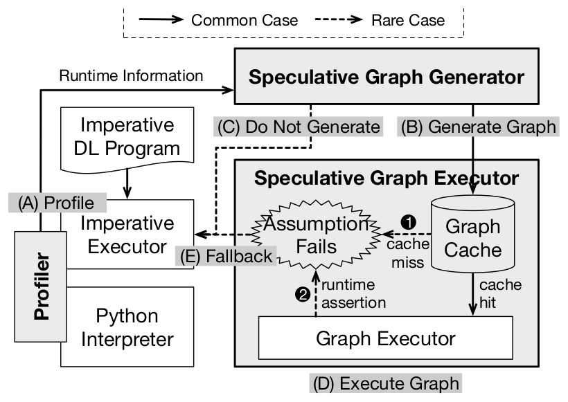
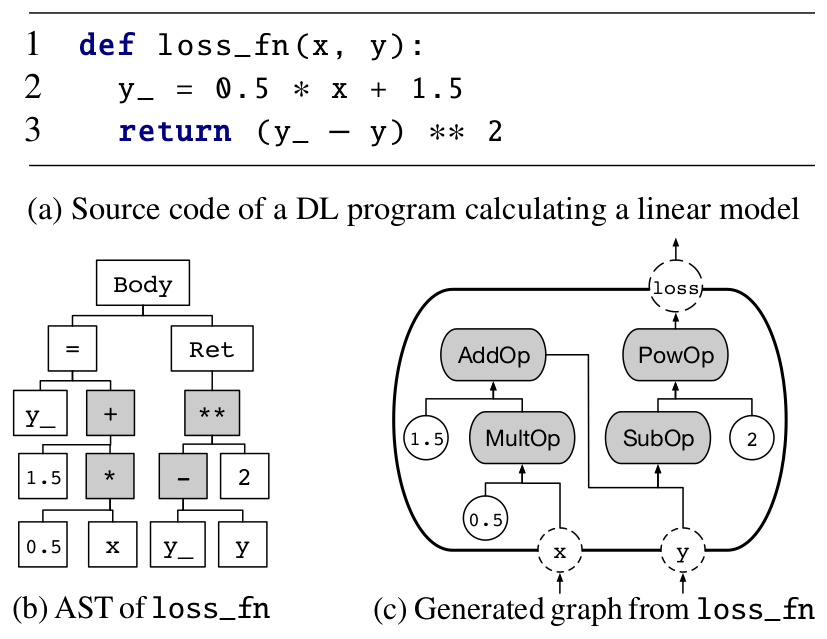
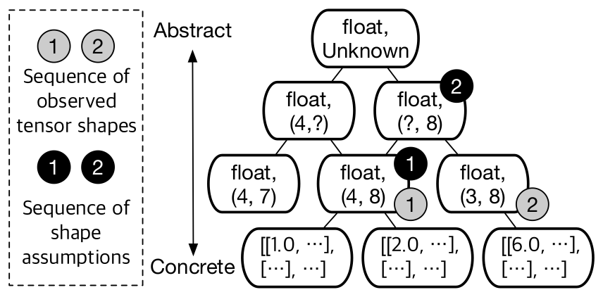
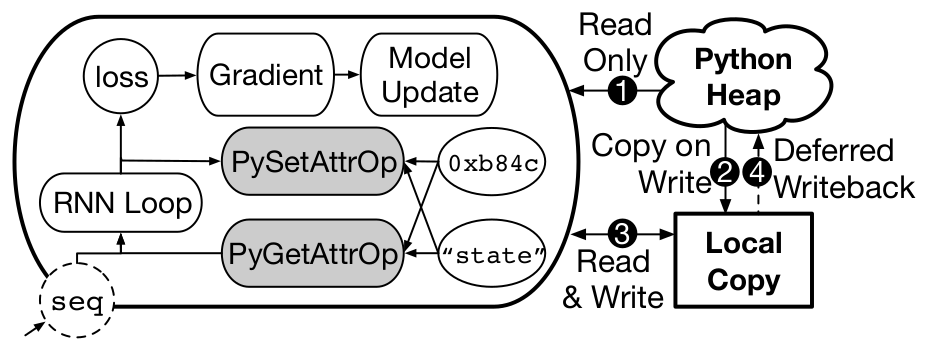
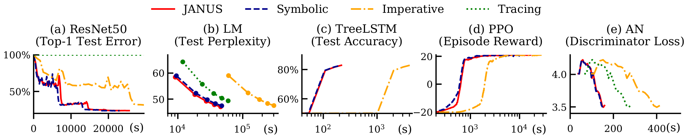
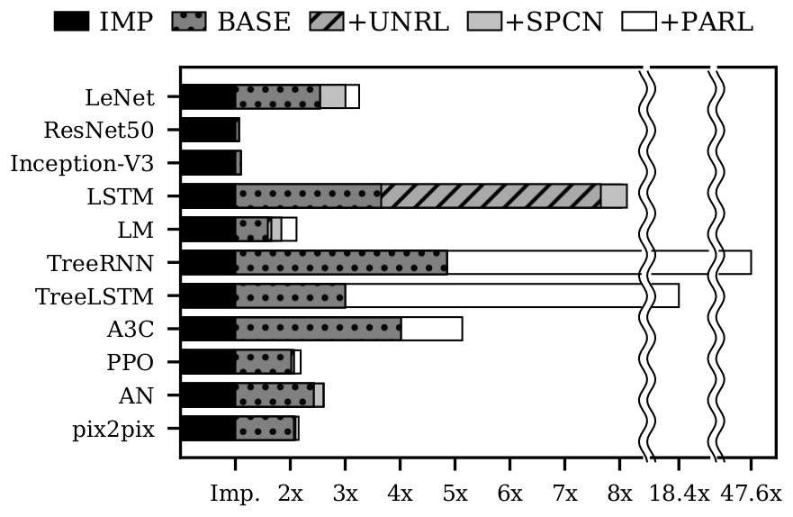
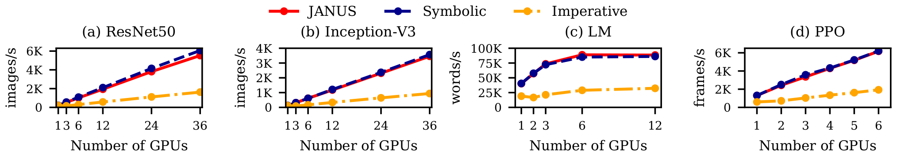

# 论文中文解读：《JANUS: Fast and Flexible Deep Learning via Symbolic Graph Execution of Imperative Programs》

> **基本信息**：Eunji Jeong、Sungwoo Cho、Gyeong-In Yu、Joo Seong Jeong、Dong-Jin Shin、Byung-Gon Chun（通讯作者）（首尔国立大学），第 16 届 USENIX 网络系统设计与实现研讨会 NSDI 2019（2019 年 2 月 26–28 日，波士顿）；论文原文 [官方页面](https://www.usenix.org/conference/nsdi19/presentation/jeong)。
>
> **本文的读法**：原文有 8 个图（Figure 1 是代码清单，Figure 2–8 是系统图、示意图和实验曲线）、4 张表（Table 1–4）。图为从 PDF 裁出的原图并配中文说明；代码清单转录成代码块并解释；表 1–3 逐格转录，附录的表 4（共 113 个 CPython opcode 的映射）只摘类别与数量。凡不是出自论文的内容（笔者的复算、对照、推断）都会标注“笔者补充”。性能图表一律写明硬件、基线、模型和指标。

## 一、一句话结论

JANUS 让用户继续写 TensorFlow Eager、PyTorch 风格的**命令式** Python 深度学习程序，而在背后把程序**推测式地**转成符号数据流图来执行。做法是“推测—验证—回退”：先用命令式方式把程序跑几轮并做 profile（分支走向、循环次数、变量类型、张量形状、全局状态访问等），据此对程序做假设（例如“这个 `if` 总走同一侧”“这个循环总是 $N$ 次”“这个张量的形状总是 `(4, 8)`”），按假设生成**特化**的图（展开循环、内联函数、固定形状、常量化），并在图里插入 `AssertOp` 在运行时验证假设；假设失败就回退到命令式执行，重新 profile 并生成更宽松的图；对全局状态的修改被推迟到所有假设都验证通过之后才一次性写回（all-or-nothing），因此中途回退不会留下半截副作用。

论文在 TensorFlow 1.8.0 上实现 JANUS，评测 11 个模型（CNN、RNN、TreeNN、深度强化学习、GAN 各 2–3 个）：相对 TensorFlow Eager，单机吞吐最高 47.6 倍（TreeRNN），五个收敛实验里训练最高快 18.7 倍；与手写的符号图 TensorFlow 相比，吞吐在 $-4.0\%$（更慢）到 $+6.5\%$（更快）之间；基于追踪的 TensorFlow defun 在 5 个收敛实验中有 4 个不能正确收敛或根本不能转换。

## 二、背景与动机

### 2.1 两类框架各有所长

论文把深度学习框架按执行模型分成两类。

**符号图执行**（TensorFlow、Caffe2、MXNet）把神经网络表述为符号数据流图：顶点表示神经网络的状态和运算，边表示顶点之间的数据流；运算在依赖满足时执行，和大多数数据流系统一样。图表示使框架能够识别哪些运算可以并行，并能应用公共子表达式消除、常量折叠等编译优化，生成优化过的图；也便于把运算放到合适的设备或机器上，在加速器上处理图或跨多机部署。**代价**是构图与执行分离使用户体验变复杂：用户在定义网络时并没有真正执行任何数值计算，而是在构造一张之后通过另外的函数才会被执行的图。

**命令式执行**（PyTorch、TensorFlow Eager、MXNet Imperative）采用逐个运算立即执行的模型，没有单独的构图阶段。它源自 NumPy、Scikit-learn 这类 Python 科学计算库，便于快速试验新模型，尤其是结构复杂的模型，因为可以直接用 Python 原生控制流语句来构建。**代价**是跳过数据流图的构造，就失去了符号图执行模型下的许多优化机会，对某些模型造成显著的性能差距。

论文的判断是：这两类框架的特点让人觉得“高性能与好易用性不可兼得”，用户只好学会几个框架并按任务来回切换。JANUS 想让命令式程序**透明地**获得符号图的性能：用户界面不变，背后执行符号图版本。

### 2.2 要转换什么：图 1 与三个 Python 动态特性

把命令式 Python 程序转成数据流图的难点在于：数据流图由一组受限的运算构成，没有 Python 的动态语义；语句的执行次数和顺序、表达式的类型、全局程序状态这些特征只有在程序真正执行之后才能确定。论文把这些特征统称为 Python 的**动态特性**，而深度学习数据流图通常被期望在计算开始之前就定义好（静态的），以便做激进的图优化，并通过查看整张图来高效调度运算。

图 1（原文 Figure 1，第 3 页）是一段用命令式风格写的 RNN 训练程序，论文用它说明哪些语义难以被正确地放进数据流图：

```python
class RNNModel(object):
  def __call__(self, sequence):
    state = self.state
    outputs = []
    for item in sequence:
      state = rnn_cell(state, item)
      outputs += [state]
    self.state = state
    return compute_loss(outputs)

for sequence in sequences:
  optimize(lambda: model(sequence))
```

*图 1（原文 Figure 1，第 3 页）：以命令式方式实现 RNN 训练过程的 Python 程序。对序列中的每个元素调用 `rnn_cell` 函数，产生下一次 `rnn_cell` 调用所需的状态；处理完整个序列后，模型通过替换 `self.state` 属性保存最终状态，供处理下一个序列使用。*

**逐行解释**（原文行号 1–12）：

- 第 2–3 行：`__call__` 先读取对象属性 `self.state` 作为初始状态，这是对**全局状态**的读取；
- 第 4 行：`outputs = []` 建一个 Python 列表；
- 第 5–7 行：`for item in sequence` 对序列逐元素循环，每次调用 `rnn_cell(state, item)` 得到新状态并追加到 `outputs`——循环次数由输入序列的长度决定，是**动态控制流**；
- 第 8 行：`self.state = state` 把最终状态写回对象属性，传给下一个序列，这是对全局状态的**写入**；
- 第 9 行：用 `outputs` 计算损失；
- 第 11–12 行：训练循环，对每个序列调用 `optimize(lambda: model(sequence))`；论文没有展开 `optimize`，按上下文（第 3 节说 JANUS 抽取“需要自动微分的主要神经网络计算部分”）它应是对这个 lambda 里的神经网络计算做自动微分并更新参数（笔者理解）。

论文总结了三个有代表性的动态特性：

1. **动态控制流（Dynamic control flow，DCF）**：条件分支和循环语句会因中间值不同而走不同的执行路径（例如图 1 第 5–7 行的循环）。这类控制流语句在 Python 中被大量使用，必须在数据流图里被正确表示。
2. **动态类型（Dynamic types，DT）**：Python 是动态类型语言，表达式的类型只有在执行时才能确定。图 1 的程序没有任何类型标注（如 `int`、`float`），因此很难静态地决定目标数据流图运算的类型。此外，Python 的各种非数值类型（列表、字典、任意类的实例）更难被转成数据流图的元素，因为图的顶点通常输出的是数值数组。
3. **不纯函数（Impure functions，IF）**：Python 的另一个便利是可以在函数里方便地访问和修改全局状态。图 1 的 `__call__` 在第 3 行和第 8 行读写对象属性，以把一个序列的最终状态传给下一个序列。被修改的全局状态会让之后的函数调用行为不同，所以这类对全局状态的读写在生成数据流图时必须被正确处理。（脚注：纯函数是返回值只由参数决定、没有副作用的函数；对象属性相当于 C++ 里的“类成员”，只不过存在字典里，没有固定的数据布局。）

**正确性之外还有性能问题。** 最先进的符号图框架需要关于动态类型和控制流的额外信息才能优化图执行。但一个朴素的“一次性转换器”（one-shot converter）在程序执行之前无法从命令式程序里提取这些信息，也就无法提供这些提示。例如，若图 1 第 2 行的输入 `sequence` 预期总是固定长度，那么这条信息就可以在生成数据流图时用来展开第 5 行的循环；而朴素的转换器不实际执行程序去检查循环长度，就不清楚怎么做到这一点。

### 2.3 相关工作与表 1

论文指出，把 Python 深度学习程序翻译成数据流图的已有工作，要么不能捕获 Python 的重要动态语义，要么因为构图时信息不足而性能较慢。表 1 概括了最新的框架及其执行模型，以及它们的图转换在覆盖面和效率上的状态。

**表 1：各深度学习框架在“命令式程序转符号图”时的正确性特性支持情况与基于运行时信息的优化能力。** 列含义：Imp. pgm = 是否支持命令式编程模型；Sym. exec = 是否有符号图执行；DCF、DT、IF 依次为动态控制流、动态类型、不纯函数三项的**正确性**支持；Optimization w/ runtime info = 能否利用只有运行时才有的信息优化生成的图（“○ (unsafe)”表示能优化但在某些框架里优化可能不正确、不保持 Python 的原语义）；Language = 宿主语言。符号约定为笔者按常规读法：○ 支持，△ 部分支持，× 不支持，– 不适用；表题只明确解释了“○ (unsafe)”。

| 框架 | Imp. pgm | Sym. exec | DCF | DT | IF | Optimization w/ runtime info | Language |
|---|:-:|:-:|:-:|:-:|:-:|:-:|---|
| 符号式：TensorFlow (TF)、Caffe2、MXNet | × | ○ | – | – | – | – | Python |
| 命令式：PyTorch (PTH)、TF Eager、DyNet | ○ | × | – | – | – | – | Python |
| 追踪式（Tracing）：TF defun、PTH JIT trace、MXNet Gluon | ○ | ○ | × | △ | × | ○ (unsafe) | Python |
| JAX | ○ | ○ | ○ | △ | × | ○ (unsafe) | Python 子集 |
| Swift for TensorFlow (S4TF) | ○ | ○ | ○ | – | ○ | × | Swift |
| TF AutoGraph | ○ | ○ | △ | △ | △ | ○ (unsafe) | Python 子集 |
| PTH JIT script | ○ | ○ | ○ | △ | △ | × | Python 子集 |
| JANUS | ○ | ○ | ○ | ○ | ○ | ○ | Python |

（原文表 1，第 4 页。前两行“Symbolic”“Imperative”是两类基线；其余为“从命令式到符号式”的转换方案。）

各类方案的局限（原文第 2.2 节）：

- **追踪式**（PyTorch 的 `torch.jit.trace`、MXNet Gluon、TensorFlow Eager 的 `defun`）：把命令式程序执行一次，把这一条执行轨迹直接转成数据流图。这样可以利用特定轨迹里收集的充分信息生成优化的图，但**无法正确捕获 Python 解释器的动态语义**：对动态变化的执行路径、非张量或非输入表达式的动态类型、不纯函数，会得到错误的计算结果；而且目前对错误转换的控制流不给用户任何反馈，使问题更糟。
- **选择动态性更弱的宿主语言**：JAX 限制 Python 语法，只支持转换纯的、静态组合的函数；S4TF 用 Swift，失去了对 Python 这一深度学习事实标准语言的支持，并引入大多数研究者不熟悉的新编程模型。由于这些方案在程序真正执行之前就转换，它们会错过利用只有执行时才能得到的信息进一步优化图的机会，例如：如果已知循环次数固定，那么总是把 Python 循环转成控制流运算就不是最优的。
- **同期工作**：AutoGraph（启用于 TensorFlow defun）要么需要用户显式提供必要信息，要么在某些情况下生成不正确或次优的图；例如用户必须显式指定 Python 列表的类型，这就禁止了动态类型或异构元素；对动态控制流语句，谓词是非张量的语句总是被展开（容易出错），谓词是张量类型的语句总是被转成控制流运算（可能次优）。PyTorch JIT 的“scripting”模式要求用户使用 TorchScript，这是不允许变量有动态类型的 Python 子集；也无法再基于运行时信息做图优化。

### 2.4 论文的解法：推测式图生成与执行

动态语言的优化器和编译器给出了一个有用技术：**推测式优化（speculative optimization）**。托管语言运行时成功利用了动态程序在执行中很少改变的固有静态性，把它们转成静态的底层表示并保持正确性。例如 JavaScript 的即时（JIT）编译器把动态的 JavaScript 程序转成高效的机器码，这种转换是推测式的：假设程序在重复执行中保持某些静态固定的结构；一旦假设被打破，程序回退到解释器，并以不同的假设尝试重新编译。

JANUS 把这个思想用到命令式深度学习程序转符号数据流图：如果以保守的方式生成数据流图，正确处理各种动态特性会带来一些不可避免的开销；为了克服它，JANUS 基于运行时 profile 信息对程序行为做假设，并生成**为这些假设量身定做**的符号图。由于特化，这种推测构造的图比保守的图性能好得多；如果假设不成立，JANUS 基于不同的假设构建新的数据流图。深度学习程序由优化过程的许多次迭代构成，所以推测式做法很合适：解释器很可能反复执行程序的特定代码块。

**与托管语言 JIT 的区别**：JANUS 的目标不是优化宿主语言本身的执行。运行命令式深度学习程序时，语言运行时的执行时间通常远短于卷积、矩阵乘这类数学运算的执行时间；但这些数学运算通常用 C++ 之类的另一种底层语言实现，现有的托管语言 JIT 只会把它们当作独立的函数调用来执行，无法同时看到多个数学运算并做编译优化或并行执行。JANUS 则**理解这些数学运算的函数调用**，把它们转成合适的目标图运算，由符号图执行器优化并高效执行。

## 三、系统设计（论文第 3 节）

JANUS 接收一个命令式深度学习程序，要么直接按原样执行，要么生成该程序的符号图版本并执行这张图。输入程序假定用现有命令式框架（如 TensorFlow Eager）的 API 与编程模型来写。给定程序，JANUS 抽取其中需要自动微分的**主要神经网络计算部分**，开始推测式的图生成与执行过程；从用户的角度，整个图转换与执行是透明的，不需要任何交互。

### 3.1 图 2：组件与执行模型



*图 2（原文 Figure 2，第 6 页）：JANUS 的执行模型示意，展示一个深度学习程序如何被几个组件处理。*

**图中文字翻译与读法**：

- 图例：实线箭头 Common Case（常见情形），虚线箭头 Rare Case（罕见情形）。
- **Profiler（分析器）**：图左侧竖条，观察命令式程序的执行并收集信息，用来做现实的假设；“(A) Profile” 表示 profile 这一步；“Runtime Information（运行时信息）”箭头把收集到的信息交给上方的 Speculative Graph Generator。
- **Imperative DL Program**（命令式深度学习程序）经 **Imperative Executor**（命令式执行器）和 **Python Interpreter**（Python 解释器）先被命令式地执行。
- **Speculative Graph Generator（推测式图生成器）**：从程序生成数据流图，并把优化后的图交给 Speculative Graph Executor；“(B) Generate Graph” 是常见情形下的生成图；“(C) Do Not Generate” 是罕见情形（程序含有不被转换的特性，不生成图，直接走命令式）。
- **Speculative Graph Executor（推测式图执行器）**：真正运行生成的图并处理假设失败。内部有 **Graph Cache（图缓存）**、**Graph Executor（图执行器）** 和“Assumption Fails（假设失败）”。“cache hit（缓存命中）”时图交给图执行器执行（“(D) Execute Graph”）。
- **两处假设失败**：① “cache miss（缓存未命中）”：在从图缓存取图时就能验证的假设（如输入参数的类型）失败；② “runtime assertion（运行时断言）”：只能在图执行中验证的假设失败（由 `AssertOp` 触发）。两者都进入“Assumption Fails”，随后“(E) Fallback（回退）”到命令式执行器。
- **读图结论**：常见路径是“profile → 生成图 → 缓存 → 命中 → 执行图”；罕见路径是“假设失败或不可转换 → 回退命令式”；整个过程用户不可见。

### 3.2 快路径：profile、生成、执行

**运行时 profile**。JANUS 收到程序后，先以命令式方式执行，同时 Profiler 收集做合理假设所需的运行时信息（图 2 的 (A)）：包括条件分支上的控制流决策、迭代循环的循环次数、变量类型信息、非局部变量、对象属性等。

**符号图生成**。收集到足够信息后，Speculative Graph Generator 基于运行时信息，带着假设尝试把程序转成符号数据流图（图 2 的 (B)）。为避免草率概括，JANUS 要等执行器 profile 了一定次数的迭代才开始生成图（脚注：对论文的实验负载，3 次迭代就足以得出较好的程序上下文假设）。具体步骤：

1. 遍历深度学习程序的**抽象语法树（AST）**，为每个 AST 节点生成对应的图元素，同时生成能在运行时验证上下文假设的断言运算；
2. 由于 JANUS 面向深度学习程序，必要时会自动插入**自动微分**和**模型参数更新**的运算；
3. 生成的图再由后处理器（post-processor）进一步优化，这些优化对原来的命令式程序是不适用的；
4. 最后，优化后的图和生成它所用的假设一起存入**图缓存**。

**图执行**。如果有一张程序上下文假设正确的图可用，Speculative Graph Executor 就执行这张符号图（图 2 的 (D)）；只要未来调用时运行时上下文假设仍然成立，同一张图可以被反复使用。

### 3.3 慢路径：罕见情形下的精确处理

**假设失败**。处理好假设对保证转换后图的正确性很重要：若一个假设被证明是错的，关联的图就不能用于当前运行，因为它可能产生错误结果。JANUS 此时回退到命令式执行器（图 2 的 (E)），并**恢复运行时 profile**，以便为后续执行做出更宽松的假设。

- 能在**图执行之前**验证的假设（如输入参数的类型假设），在**从图缓存取图时**检查（图 2 的 ①）；若假设错误，JANUS 把它当作缓存未命中，回退到命令式执行。
- 只能在**图执行过程中**验证的假设（图 2 的 ②）：此时简单地中止当前执行并回退到命令式执行器可能出错，因为全局状态可能已经在本次执行中被改变。JANUS 的解决办法是**推迟状态更新运算，直到所有假设都验证完毕**（见 4.4 节）。这样，即使计算过程中发现某个假设错了，也还没有任何状态更新运算被触发，没有状态被改变，系统就可以安全地停下当前执行。换句话说，**状态是以全有或全无（all-or-nothing）的方式更新的**。

**`AssertOp`**。为验证一个假设，一个运行时断言被编码进符号图，成为名为 `AssertOp` 的运算；条件不满足时 `AssertOp` 中止图执行，并报告哪个假设被打破，这一信息被用来放弃依赖那些反复被打破的假设的进一步优化。

**命令式执行的程序**。有了图灵完备的图表示，理论上任何 Python 程序都可以表示成符号图；但推测式图生成器并不把每个 Python 特性都转成符号图运算（图 2 的 (C)）。例如，为了保证状态更新的全有或全无，**含有不可见状态修改的程序**不会被转成符号图（笔者的理解：例如藏在 JANUS 不了解的外部函数里的修改；原文没有举例）；协程、生成器等复杂 Python 特性也不转换，因为它们没有清晰的图表示。本文 4.5 节（原文第 4.3 节）讨论设计选择和当前 Python 覆盖面的局限。即使如此，JANUS 用户仍可在命令式执行器上自由使用 Python 的所有特性。

## 四、符号图生成（论文第 4 节）

本节详细说明 JANUS 如何把命令式深度学习程序转成符号数据流图：先讲没有动态特性的基础程序（4.1），再讲动态控制流、动态类型、不纯函数的转换（4.2–4.4），最后讨论 Python 覆盖面的局限（4.5）。（本文的小节编号与原文不同，对应关系为：本文 4.2、4.3、4.4、4.5 分别是原文的 4.2.1、4.2.2、4.2.3、4.3。）核心思想是：JANUS 利用运行时信息把动态程序**简化**，当作只含静态特征的程序，进而容易转成静态图。为简便，论文用 TensorFlow 的各种运算来描述设计，但声明设计不必与 TensorFlow 绑定，可用于其他深度学习框架。

### 4.1 图生成基础（图 3）

先看一个没有动态控制流、没有任意 Python 对象的纯函数：用线性模型计算损失。



*图 3（原文 Figure 3，第 7 页）：一个接收若干外部输入的简单线性模型的 Python 源码、AST 和符号图。程序的静态特征在 AST 中表示为节点，进而转成符号图的顶点。*

**图中文字翻译与读法**：

- **(a) 源码**：`def loss_fn(x, y): y_ = 0.5 * x + 1.5; return (y_ - y) ** 2`，即 $\text{loss}=(0.5x+1.5-y)^2$；
- **(b) `loss_fn` 的 AST**：根是 `Body`，左子树是赋值 `=`（`y_` 等于 `+` 节点，`+` 的两个孩子是 `1.5` 和 `*` 节点，`*` 的孩子是 `0.5` 和 `x`），右子树是 `Ret`（返回），其孩子是 `**`（孩子是 `-` 节点和 `2`，`-` 的孩子是 `y_` 和 `y`）。灰色填充的是会变成图运算的运算符节点（`+`、`*`、`**`、`-`）；
- **(c) 生成的图**：虚线圆圈 `x`、`y` 是图的输入，虚线圆圈 `loss` 是输出；常量 `0.5`、`1.5`、`2` 是圆圈；灰色圆角矩形是运算：`MultOp`（`0.5` 乘 `x`）→ `AddOp`（加 `1.5`）→ `SubOp`（减 `y`）→ `PowOp`（平方，指数 `2`）→ `loss`。

**转换规则**：

- **输入参数**（`x`、`y`）被转成图的输入对象，执行图时需要外部输入；在 TensorFlow 里对应 `PlaceholderOp`（脚注：它是一种特殊运算，若在图执行之前没有被提供外部输入就会报错；TensorFlow 要求用户给它喂一个字典 `{ph1: v1, ph2: v2, ...}`）。运行时它们被实际参数值填充。`return` 语句的返回值被标记为图的**计算目标**，以便执行图后取回该值；
- **Python 字面量**（`0.5`、`1.5`、`2`）被转成输出常量值的运算（TensorFlow 里是 `ConstantOp`）；
- **数学运算符**的转换是找到对应的数学图运算并**一一替换**：对 `+`、`**` 这类标准 Python 运算符，JANUS 在图中放置相应的原语计算运算，如 TensorFlow 的 `AddOp`、`PowOp`；
- **局部变量的赋值与取值**被转成两个运算之间的一条连线（与 Pydron 的做法相同）：图 3(a) 中变量 `y_` 的赋值与使用，对应图 3(c) 里 `AddOp` 到 `SubOp` 的连线。

### 4.2 动态控制流

JANUS 关注的动态控制流语句有三类：**条件分支、循环结构、函数调用**（与 Pydron 类似），论文认为这三者足以表达 Python 中大多数复杂的动态控制流，而且它们都能用近年工作提出的特殊控制流图运算表示。

**基本转换规则**：

- **条件分支**（`if` 语句）由 `switch` 与 `merge` 原语组合得到。这两个原语源自经典数据流架构，分别起解复用器与复用器的作用，选择单条路径传递其输入或输出；TensorFlow 里对应 `SwitchOp` 和 `MergeOp`，JANUS 用它们在图中“种入”条件分支；
- **循环**（`while`、`for`）由 `switch` 和 `merge` 与保存迭代帧的**循环上下文原语**一起处理；TensorFlow 提供了 `EnterOp`、`ExitOp`、`NextIterationOp` 用来创建迭代帧并在迭代之间传值；
- **函数调用**：为被调用函数生成单独的图，并在调用位置插入一个指向该图的**函数调用运算**。近期工作提出了这个运算的 TensorFlow 实现 `InvokeOp`，它可以表示递归函数的调用并支持自动微分。

**推测式图生成：展开与内联**。如果 JANUS 在 profile 期间发现某个控制流语句只走过某一条特定路径，它就假定这个控制流决策实际上是固定的：把控制流运算替换为一个断言运算，来再次检查这个控制流决策的假设，然后**就像把控制流语句展开了一样**继续生成图。这使 JANUS 能去掉控制流运算的开销，并在图的更大范围内应用公共子表达式消除、常量折叠等优化；若断言失败，JANUS 回退到命令式执行。具体来说：

- **条件分支**：若程序在 profile 期间只走了分支的某一侧，JANUS 在最终的图中只生成这一侧（不含 `switch`、`merge`），并加一个能检测“跳到另一侧”的断言运算；
- **迭代语句**：若发现循环的迭代次数是固定的，JANUS 就按这个固定次数**展开循环**，并加断言运算检查迭代次数确实正确；
- **函数调用**：若某个位置的函数调用预期总是同一个被调函数，JANUS 就把被调函数体**内联**进调用者，除非该调用被判定为递归调用；
- **已知实现的被调函数**：框架提供的函数（如 `matmul()`、`conv2d()`）或 Python 内建函数（如 `print()`、`len()`），JANUS 基于对其行为的先验知识，添加行为相同的对应图运算。第 4.5 节有这类调用的细节与局限。

### 4.3 动态类型

**基本转换规则**。图的运算要求操作数有固定类型，所以 JANUS 在把程序转成符号图之前必须知道程序里所有表达式的类型。这对 Python 程序很有挑战，因为不实际执行就无法确定任意 Python 表达式的类型。好在由别的表达式的类型可以推断一些表达式的类型，例如 `c = a + b` 中，若 `a`、`b` 是整数，`c` 显然也是整数。

JANUS 的基本规则：把数值型的 Python 值（标量、数值列表、NumPy 数组）转成对应的张量；把**非数值**的值（包括任意类的实例）转成**整数类型的标量张量**，里面存的是指向对应 Python 值的指针。然后再推断由这些规则覆盖的表达式派生出的其他表达式的类型。

**推测式图生成：特化（specialization）**。对无法从其他表达式推断类型的表达式，需要另外的办法：例如函数的输入参数、Python 对象的属性访问 `obj.attr` 在没有外部线索时无法确定类型；递归函数调用的返回类型因为循环依赖也难推断。为对这类表达式的类型做出合理的假设，Profiler 在命令式执行期间观察这些表达式的类型。有了这些上下文假设，JANUS 能完成对剩余表达式的类型推断，并据此构造特化的数据流图。

此外 JANUS 还对表达式做进一步假设以做更激进的优化：

- 对数值表达式，在构图之前可以尝试**特化张量的形状**；
- 如果一个 Python 表达式在 profile 期间总是求值为同一个值，JANUS 就把它转成数据流图里的**常量节点**；
- 形状或值被静态确定后，图可以进一步优化，甚至可以被编译成高效的机器码（原文引用 XLA）。

图 4 给出一个张量可能具有的形状与值的层次示例：



*图 4（原文 Figure 4，第 9 页）：示例张量的类型、形状与值的特化层次。*

**图中文字翻译与读法**：

- 层次从上到下由 **Abstract（抽象）** 到 **Concrete（具体）**：最上面是 `float, Unknown`（只知道是 float，形状未知）；第二层是部分已知形状 `float, (4,?)` 与 `float, (?,8)`（`?` 表示该维度未知）；第三层是具体形状 `(4, 7)`、`(4, 8)`、`(3, 8)`；最底层是具体的数值，如 `[[1.0, …], […], …]`、`[[2.0, …], …]`、`[[6.0, …], …]`。
- 左侧图例：灰色圆圈 ①②（Sequence of observed tensor shapes）表示**依次观察到的形状**，黑色圆圈 ①②（Sequence of shape assumptions）表示**依次做出的形状假设**。图中：第 ① 次观察到 `(4, 8)`，第 ① 个假设就是 `(4, 8)`；第 ② 次观察到 `(3, 8)`（对应下一轮迭代处理不同大小的 mini-batch），原假设失败，JANUS 把假设放宽成 `(?, 8)`，即第 ② 个假设，它同时适合 `(4, 8)` 与 `(3, 8)`。
- **读图结论**：profile 前几轮，JANUS 发现张量的值每次不同，但形状都相同（如 `(4, 8)`），于是据此生成假设形状为 `(4, 8)` 的图；假设失败时尝试放宽，而不必为将来可能出现的 `(2, 8)`、`(6, 8)` 再重复生成图。越往下的假设越具体、能做的优化越多，但也越容易失效；越往上越宽松、适用面越广。

### 4.4 不纯函数

**朴素转换规则**。Python 函数访问全局变量来计算返回值，并带有副作用、在执行期间修改其外围 Python 上下文，是很常见的；同样，深度学习程序读写全局变量、非局部变量和堆对象这类全局状态也很常见。JANUS 尊重这一特性，在符号图执行的同时处理全局状态的访问。

一个简单办法是用 TensorFlow 的 `PyFuncOp`，它可以把任意 Python 函数作为图运算执行：创建读取并更新某个全局状态的函数，插入图里合适的位置。但这个方法有明显的局限：

- 由于**全局解释器锁（GIL）**，同一时刻只能执行一个 Python 函数，当多个运算应该并行执行时整体性能可能下降；
- 它让 JANUS 的**回退机制**变复杂：如果在回退发生之前全局状态已经被修改了，那么回退时不能让命令式执行器从函数入口重新开始，而必须从函数中间开始才正确，这要求把状态更新运算映射回相应的 Python 字节码。

**优化的图生成：延迟状态更新（deferred state update）**。为了更简单也更快，JANUS **不在图执行过程中就地修改全局状态**，而是为全局状态创建**本地副本**，在符号图执行期间只修改本地副本。图 5 是图 1 的程序对应的符号数据流图版本，它包含了访问并修改全局状态的对象属性表达式（`self.state`）：



*图 5（原文 Figure 5，第 9 页）：由图 1 生成的符号数据流图与全局状态。*

**图中文字翻译与读法**：

- 左侧大圆角框是符号数据流图：输入 `seq`（序列，虚线圆圈）进入 **RNN Loop（RNN 循环）**；**PyGetAttrOp** 读取属性，**PySetAttrOp** 写入属性，两者都有两个输入：对象指针（图中是 `0xb84c`）和属性名（`"state"`）；RNN 循环的输出连到损失 `loss`，再到 `Gradient`（梯度）和 `Model Update`（模型更新）。
- 右侧是 **Python Heap（Python 堆）** 与 **Local Copy（本地副本）**，四个编号步骤：
  1. **Read Only（只读）**：`PyGetAttrOp` 可以访问 Python 堆读取状态——除非已存在对应的本地副本；
  2. **Copy on Write（写时复制）**：`PySetAttrOp` 要更新属性时，把新值插入**本地副本**，而不是直接更新 Python 堆；
  3. **Read & Write（读写）**：之后对该属性的读写都被重定向到本地副本；
  4. **Deferred Writeback（延迟写回）**：图执行器完成这一次运行之后，本地副本被**写回** Python 堆。
- 补充说明：JANUS 在必要时会在 `PyGetAttrOp` 与 `PySetAttrOp` 之间插入适当的依赖，以防止数据冒险；全局变量或非局部变量也可视为对象属性——全局变量是全局对象的属性，非局部变量是函数闭包对象的属性；下标表达式 `obj[subscr]` 类似地用等价的自定义运算 `PyGetSubscrOp` 和 `PySetSubscrOp` 实现。
- **好处**：不直接修改 Python 堆，JANUS 总能绕过 Python GIL 去并行执行更多的读写运算；并且由于“全有或全无”的状态更新机制，回退机制得以简化（见 3.3 节）。

### 4.5 仅命令式的特性与 Python 覆盖面（第 4.3 节与附录 A）

尽管能支持广泛的命令式深度学习程序，当前 JANUS 的图生成器**不转换** Python 的某些特定特性；含这些特性的程序只在命令式执行器上执行。

**设计带来的覆盖局限**：

- 与前述设计原则保持一致：为了让全局状态本地副本的实现保持简单，带有自定义访问器函数（如 `__setattr__`）的 Python 对象不被支持；另外，为了推断调用表达式的类型（4.3 节），**一个函数应该总是返回同一类型的值**。
- **外部函数调用**：JANUS 必须理解外部函数（框架提供的函数或用 Python 以外语言写的外来函数）的行为，才能把它们转成对应的图运算。JANUS 的图生成器依据一份单独的**白名单**转换外部函数；框架提供的大多数函数（如 `matmul`、`conv2d`）以及许多常用的 Python 内建函数（如 `print`、`len`）都在白名单里，论文计划覆盖更多标准库函数。JANUS 对这类外部函数格外谨慎：首先，既然其前提是外部函数的实现从不改变，JANUS **禁止修改白名单里的函数**；其次，若外部函数含有状态修改（如 TensorFlow 的 `assign()`），对应图运算的执行也被推迟到其他所有假设都验证完毕之后，原则与 4.4 节的延迟状态更新相同。

**实现带来的覆盖局限**：JANUS 目前不覆盖少数没有清晰图表示的 Python 特性：协程（coroutine）、生成器（generator）、行内类定义和行内 `import` 语句，计划留作未来工作。

**附录 A：CPython opcode 的覆盖映射（表 4 摘要）**。论文把 CPython 3.5.2 解释器的**全部 113 个 opcode**映射到描述其图生成规则的章节：映射到 4.3 节的 opcode 只能在命令式执行器上执行，其余都可在图执行器上执行。下表摘要原文表 4（只给类别、数量与对应章节，未逐个列出 opcode 名；括号中的 opcode 名只是举例）：

| opcode 类别（示例） | 数量 | 对应章节 | 能否进符号图 |
|---|---:|---|---|
| 栈操作（`POP_TOP`、`ROT_TWO`、`DUP_TOP`、`NOP`…） | 7 | 无需转换 | 是 |
| 常量（`LOAD_CONST`） | 1 | 4.1 | 是 |
| 数学运算符（`UNARY_*`、`BINARY_*`、`INPLACE_*`、`COMPARE_OP`） | 31 | 4.1 | 是 |
| 局部变量（`LOAD_FAST`、`STORE_FAST`、`UNPACK_SEQUENCE`…） | 5 | 4.1 | 是 |
| 动态控制流（`JUMP_*`、`POP_JUMP_*`、`GET_ITER`、`FOR_ITER`、`SETUP_LOOP`…） | 12 | 4.2（动态控制流） | 是 |
| 函数调用（`CALL_FUNCTION*`、`RETURN_VALUE`、`MAKE_FUNCTION`） | 6 | 4.2（动态控制流）、4.5（外部函数） | 是（受白名单限制） |
| 任意对象（`LOAD_ATTR`、`STORE_ATTR`、`DELETE_ATTR`） | 3 | 4.3、4.4 | 是 |
| 列表、集合、映射（`BUILD_LIST`、`BUILD_MAP`、`BINARY_SUBSCR`、`STORE_SUBSCR`…） | 16 | 4.3、4.4 | 是 |
| 非局部变量（`LOAD_GLOBAL`、`LOAD_DEREF`、`STORE_GLOBAL`、`MAKE_CLOSURE`…） | 11 | 4.4 | 是 |
| 异常处理（`SETUP_EXCEPT`、`SETUP_FINALLY`、`RAISE_VARARGS`…） | 5 | 附录 A | 是（见下） |
| `with`（`SETUP_WITH`、`WITH_CLEANUP_*`） | 3 | 附录 A | 是（见下） |
| `yield`（`YIELD_FROM`、`YIELD_VALUE`、`GET_YIELD_FROM_ITER`） | 3 | 4.5（实现局限） | 否 |
| 行内 `import`（`IMPORT_FROM`、`IMPORT_NAME`、`IMPORT_STAR`） | 3 | 4.5（实现局限） | 否 |
| 行内类定义（`LOAD_BUILD_CLASS`、`LOAD_CLASSDEREF`） | 2 | 4.5（实现局限） | 否 |
| 协程（`GET_AITER`、`GET_ANEXT`、`GET_AWAITABLE`、`BEFORE_ASYNC_WITH`、`SETUP_ASYNC_WITH`） | 5 | 4.5（实现局限） | 否 |
| 合计 | 113 | | |

（原文表 4，第 16 页，笔者按类别摘要；各行数量之和为 113。表中“4.2（动态控制流）”对应原文第 4.2.1 节，“4.3、4.4”对应原文第 4.2.2、4.2.3 节，“4.5（外部函数）”对应原文第 4.3.1 节，“4.5（实现局限）”对应原文第 4.3.2 节。）

**附录 A 的补充说明**：

- **异常**：Python 的 `raise` 语句可以表示为数据流图里的 `AssertOp`。当这个异常对应的 `AssertOp` 中止图执行时，就发生回退，真正的 Python 风格的异常在命令式执行器上被安全地抛出。基于同一原则，对 `try-except-finally` 语句，只有 `try-finally` 部分被转成图元素，`except` 部分**不转换**，因为符号图永远不会捕获异常。避免在符号图内处理异常，可以让用户不必去调试符号图执行轨迹（它们比命令式执行轨迹更复杂）；
- **上下文管理器**：由于异常处理总是发生在命令式执行器上，`with` 语句可以被转成对相应上下文管理器对象的 `__enter__` 和 `__exit__` 的简单函数调用。

## 五、实现（论文第 5 节）

JANUS 实现在 **TensorFlow 1.8.0** 和 **CPython 3.5.2** 之上，复用现有的 TensorFlow 图执行器和 TensorFlow Eager 命令式执行器作为组件。对现有系统的修改：

- **TensorFlow**：（1）为了在不需要额外用户干预的情况下透明地把神经网络计算从 Python 程序的其余部分分离出来，**修改 TensorFlow Eager 的自动微分功能，使其触发 JANUS 的图转换**；（2）为了在 eager 模式与图模式之间共享模型参数，略微修改 TensorFlow Eager 的参数存储机制；（3）添加若干自定义运算，包括前文的 `InvokeOp` 和 `PyAttrOp`。
- **CPython**：被修改成具有**字节码级别的插桩**功能，用于非侵入式 profile。若不修改解释器，用于 profile 的插桩只能存在于 Python 源码层面，会显著影响命令式执行的性能与可调试性。
- **数据并行**：与 Horovod（把 MPI 集合通信，如 AllReduce、AllGather，封装成符号图里的一个运算的 TensorFlow 分布式训练模块）集成。把命令式程序转成数据流图后，JANUS 插入合适的通信运算以求得多个 worker 产生的梯度的平均值；由于生成的数据流图同时包含通信和计算运算，两者的执行可以并行，从而获得更高吞吐。

## 六、实验（论文第 6 节）

### 6.1 实验设置

- **基线框架**：用 TensorFlow（符号图执行，下文称 Symbolic / Sym.）和 TensorFlow Eager（命令式执行，下文称 Imperative / Imp.）分别代表两类框架；借助 JANUS 的透明图转换，同一个深度学习程序既能在 TensorFlow Eager 上跑，也能在 JANUS 上跑。此外，为说明 JANUS 图转换的正确性，还与实现了基于追踪的图转换机制的 TensorFlow defun（Tracing）比较。选择基于 TensorFlow 的框架是为了避免因实现不同带来的性能差异。
- **应用**：5 类网络共 11 个模型：3 个卷积网络（CNN：LeNet、ResNet50、Inception-v3）、2 个循环网络（RNN：LSTM、LM）、2 个递归网络（TreeNN：TreeRNN、TreeLSTM）、2 个深度强化学习模型（DRL：A3C、PPO）、2 个生成对抗网络（GAN：AN、pix2pix）。这些模型都用命令式风格实现，并使用 Python 的多种动态特性（表 2）。
- **硬件与软件**：同构 GPU 集群，6 台机器，用 Mellanox ConnectX-4 网卡通过 100 Gbps InfiniBand 连接；每台机器配 2 颗 18 核 Intel Xeon E5-2695 @ 2.10 GHz 和 6 张 NVIDIA TITAN Xp GPU；Ubuntu 16.04、Horovod 0.12.1、CUDA 9.0、cuDNN 7、OpenMPI v3.0.0、NCCL v2.1。
- **各模型的运行规模**：LeNet、LSTM、AN、pix2pix 在**单 GPU** 上评测（模型和数据集太小，无法摊销并行执行的通信开销）；TreeRNN、TreeLSTM、A3C 在单机的 **CPU** 上评测（模型和数据集太小，无法摊销 CPU 与 GPU 之间的通信）；其余模型用**多 GPU** 评测：ResNet50 和 Inception-v3 最多用 36 张 GPU，LM 最多用 12 张（LM 参数量巨大，达 8.3 亿，网络带宽使其吞吐在超过 2 台机器后用 MPI 集合通信就饱和了，因此 LM 的收敛实验用 6 张 GPU）；PPO 的收敛实验用单机 4 张 GPU（原论文使用的并行 actor 只有 8 个）。

**表 2：评测所用的类别、模型、数据集、批大小（BS）以及各应用所用的动态特性。** DCF、DT、IF 列中，○ 表示该应用使用了对应的动态特性，× 表示没有使用。

| 类别 | 模型 | 数据集 | BS | DCF | DT | IF |
|---|---|---|---:|:-:|:-:|:-:|
| CNN | LeNet | MNIST | 50 | × | ○ | × |
| CNN | ResNet50 | ImageNet | 64 | ○ | ○ | × |
| CNN | Inception-v3 | ImageNet | 64 | ○ | ○ | × |
| RNN | LSTM | PTB | 20 | ○ | ○ | ○ |
| RNN | LM | 1B | 256 | ○ | ○ | ○ |
| TreeNN | TreeRNN | SST | 25 | ○ | ○ | ○ |
| TreeNN | TreeLSTM | SST | 25 | ○ | ○ | ○ |
| DRL | A3C | CartPole | 20 | ○ | ○ | ○ |
| DRL | PPO | Pong | 256 | × | ○ | ○ |
| GAN | AN | MNIST | 128 | × | ○ | ○ |
| GAN | pix2pix | Facades | 1 | × | ○ | ○ |

（原文表 2，第 11 页；“1B”指 One Billion Word 语言建模基准，PTB 指 Penn Treebank，SST 指 Stanford Sentiment Treebank，均为笔者按通行含义补充的展开；原文没有展开“AN”的全称，它引用的是 Goodfellow 等人提出 GAN 的那篇论文。）

**各类模型用到的动态特性**（原文第 6.1 节）：

- 大型 CNN（ResNet50、Inception-v3）有处理批归一化的条件语句，使它们在训练与评估时表现不同；
- RNN 含 Python `for` 循环，并含全局状态修改语句来保留模型内部的隐状态；
- TreeNN 同时需要三类动态特性：递归函数调用、区分递归基例与归纳情形的条件语句；还有**类型未定的值**（递归函数的返回类型直到函数返回某些值才知道）；以及为获取当前子树信息而对 Python 对象的访问。（脚注：TreeNN 在 TensorFlow 上的实现遵循基于 `InvokeOp` 的递归实现，JANUS 把命令式 Python 程序转成类似的基于递归的图。）
- DRL 模型用 Python `for` 循环处理长度任意的 episode 状态序列，并用全局状态修改语句保存中间计算结果以监控训练进度（脚注：框架只处理模型训练和策略评估，环境模拟由外部库处理）；GAN 模型也出于同样原因使用全局状态修改语句；
- 所有模型都使用 Python 函数调用，包括 Keras 这类高层深度学习 API 的 Python 类方法；
- 当数据集长度不能被批大小整除时，喂给各神经网络的训练数据在不同迭代里**形状不同**。

### 6.2 模型收敛（图 6）

**设置**：图 6 展示神经网络在不同底层框架上的收敛：ResNet50 + ImageNet、LM + 1B、TreeLSTM + SST、PPO + Pong-v4、AN + Facades，四个框架（JANUS、TensorFlow、TensorFlow Eager、TensorFlow defun）。多 GPU 配置：LM 用 6 张 GPU，PPO 用单机 4 张 GPU；TreeLSTM 用 CPU，AN 用单 GPU（见 6.1）；原文没有明确写出 ResNet50 收敛实验所用 GPU 数（吞吐实验最多用到 36 张）。



*图 6（原文 Figure 6，第 12 页）：（a）ResNet50 的测试误差，（b）LM 的验证困惑度，（c）TreeLSTM 的测试准确率，（d）PPO 的回合奖励，（e）AN 的判别器损失，在 JANUS、TensorFlow（Symbolic）、TensorFlow Eager（Imperative）和 TensorFlow defun（Tracing）上随经过的时间（秒）变化。（b）中每个标记代表一个训练 epoch，说明在 TensorFlow defun 上每个 epoch 的收敛更慢。*

**图中文字翻译与读法**：

- 图例：红色实线 JANUS，蓝色虚线 Symbolic（TensorFlow 符号图），橙色点划线 Imperative（TensorFlow Eager），绿色点线 Tracing（TensorFlow defun）。横轴都是经过的时间（秒）：（a）线性刻度 0–约 28000 s，（b）对数刻度 $10^4$–$10^5$ 以上，（c）对数刻度 $10^2$–$10^3$ 以上，（d）对数刻度 $10^3$–$10^4$ 以上，（e）线性刻度 0–400 s。纵轴依次为：（a）Top-1 测试误差（从 100% 往下，越低越好），（b）测试困惑度（越低越好；子图标题写 Test Perplexity，图注写 validation perplexity），（c）测试准确率（越高越好），（d）回合奖励（越高越好），（e）判别器损失（图中从约 4 降到 3.5）。
- **JANUS 与 Symbolic 两条线几乎重合**，说明 JANUS 的收敛行为与手写符号图一致；**Imperative（TensorFlow Eager）收敛慢得多**，因为训练吞吐远低于 TensorFlow 和 JANUS；例如（c）中 JANUS 约在 $10^2$ 秒量级达到 80% 左右，Imperative 约在 $2\times10^3$ 秒量级才达到（图上读出的近似值）。
- **Tracing（TensorFlow defun）**：（a）一直停在 100% 误差；（b）每个 epoch 的收敛比 JANUS 慢（绿色点比红蓝点更高）；（c）（d）图中**没有它的曲线**；（e）有曲线但比 JANUS 慢（原文正文未逐条解释这条曲线）。

**正文给出的数字**：

- JANUS、TensorFlow、TensorFlow Eager 在所有评测模型上都成功使网络**按文献报告正确收敛**：ResNet50 训练 90 个 epoch 后 top-1 误差 23.7%；LM 训练 5 个 epoch 后困惑度 47.5；TreeLSTM 训练 4 个 epoch 后二分类准确率 82.0%；PPO 在 4000 万帧游戏画面后平均最终得分 20.7；AN 训练 30 个 epoch 后判别器损失 3.52（脚注：训练损失用 TensorFlow Eager 的官方实现测得）。
- JANUS 能使模型的收敛**最高比 TensorFlow Eager 快 18.7 倍**，同时执行的是同一个命令式程序；JANUS 与 TensorFlow 的性能差距在 4.0% 以内。

**TensorFlow defun 失败的原因**（原文第 6.2 节）：

- **ResNet50**：模型里有区分批归一化层在训练与评估时行为的条件语句；如果用户在训练前通过操作模型对象的属性来评估初始准确率，defun 会把第一次执行轨迹转成图运算，**悄无声息地**导致不准确的结果；
- **LM**：由于基于追踪的转换机制，defun 没能捕获跨序列的状态传递，所以收敛不正常；
- **TreeLSTM**：defun 不支持递归函数调用，根本无法转成符号图；
- **PPO**：defun 不支持全局状态更新语句，所以得不到它的收敛指标。

**证据边界**：论文把“18.7 倍”在引言里说成吞吐，在 6.2 节里说成收敛速度，而表 3 里单机吞吐的最大值是 47.6 倍（TreeRNN）；比较合理的读法是：**18.7 倍是图 6 里五个收敛实验的最大加速（对应 TreeLSTM，表 3 中它的吞吐比是 18.4 倍）**，47.6 倍是表 3 全部 11 个模型里的最大吞吐加速。引用时要说明范围。另外，原文没有说明收敛曲线的计时是否包含 profile 轮和图生成的时间。

### 6.3 训练吞吐：单机（表 3）

**设置**：表 3 是在单机上用 JANUS、TensorFlow Eager、TensorFlow 训练全部模型的吞吐。指标是每秒处理的数量：CNN 与 GAN 为图像数/秒，RNN 为词数/秒，TreeNN 为句子数/秒，DRL 为帧数/秒；越大越好。表题写“单机单 GPU”，但按 6.1 节，**TreeRNN、TreeLSTM、A3C 实际在单机 CPU 上评测**（两颗 18 核 Xeon E5-2695），其余在单张 TITAN Xp 上评测。

**表 3：全部模型在单机上的训练吞吐。** (A) Imp. = TensorFlow Eager（命令式）；(B) JANUS；(C) Sym. = TensorFlow（符号图）；(B)/(A) 为 JANUS 相对命令式的加速比；(B)/(C) − 1 为 JANUS 相对符号图的差值。

| 模型 | (A) Imp. | (B) JANUS | (C) Sym. | (B)/(A) | (B)/(C) − 1 |
|---|---:|---:|---:|---:|---:|
| LeNet | 7.94k | 25.84k | 26.82k | 3.25x | -3.6% |
| ResNet50 | 188.46 | 200.37 | 207.39 | 1.06x | -3.4% |
| Inception-v3 | 108.36 | 119.32 | 124.33 | 1.10x | -4.0% |
| LSTM | 2.75k | 22.06k | 22.58k | 8.03x | -2.3% |
| LM | 19.02k | 40.18k | 40.45k | 2.11x | -0.7% |
| TreeRNN | 20.76 | 988.72 | 928.66 | 47.6x | +6.5% |
| TreeLSTM | 7.51 | 138.12 | 141.71 | 18.4x | -2.5% |
| A3C | 220.66 | 1132.9 | 1178.6 | 5.13x | -3.9% |
| PPO | 596.80 | 1301.0 | 1306.4 | 2.18x | -0.4% |
| AN | 4.34k | 11.33k | 11.56k | 2.61x | -2.1% |
| pix2pix | 4.04 | 8.69 | 8.88 | 2.15x | -2.1% |

（原文表 3，第 12 页。“k”表示千。）

**读法**：

1. JANUS 相对 TensorFlow Eager（命令式执行）**最高快 47.6 倍**，吞吐与 TensorFlow（符号图执行）接近，最多慢 4.0%；TreeRNN 上 JANUS 甚至略好（+6.5%），因为不需要对输入句子（树结构的 Python 对象）做预处理。
2. **收益在 RNN、TreeNN、DRL、GAN 上大于在 CNN 上**，因为这些网络有许多可并发执行的运算；而 ResNet50、Inception-v3 这类大型 CNN，优化过的 GPU kernel 计算占了大部分计算时间，JANUS、TensorFlow 和 TensorFlow Eager 的差距相对较小（1.06x、1.10x）。
3. 单机上的收益在**细粒度图运算**的模型上更大（LeNet、LSTM、TreeRNN、A3C、AN），而在**粗粒度运算**的模型上较小（ResNet50、Inception-v3、LM、PPO、pix2pix），因为当每个运算的计算时间较短时，绕开 Python 解释器并施加编译优化的收益更大。
4. 笔者核对：表中 (B)/(A) 与 (B)/(C) − 1 两列均可由前三列的数字复算（如 LeNet：25.84/7.94 ≈ 3.25，25.84/26.82 − 1 ≈ −3.7%，与表中 −3.6% 的差别来自未取整的原始数据）。

### 6.4 优化的贡献（图 7）

**设置**：图 7 分析 JANUS 性能提升的来源，优化是**逐级累加**的：IMP（命令式，基准 1x）→ BASE（把命令式程序转成符号图，不做其后的任何优化）→ +UNRL（再加控制流展开）→ +SPCN（再加类型/形状特化）→ +PARL（再加多个运算的并行执行，这是 JANUS 的默认配置）。与表 3 同样的 11 个模型、同样的单机设置。



*图 7（原文 Figure 7，第 13 页）：各项优化对提高训练吞吐的贡献。优化是累加的；+PARL 是 JANUS 的默认配置。*

**图中文字翻译与读法**：

- 横轴是相对命令式（Imp. = 1x）的吞吐倍数，刻度 2x–8x，并用折断线接上 18.4x 和 47.6x（把 TreeLSTM、TreeRNN 的长条截短）；纵轴是 11 个模型。图例：黑色 IMP，点状灰 BASE，斜线 +UNRL，浅灰 +SPCN，白色 +PARL。每根条的总长就是 JANUS 相对命令式的总加速，对应表 3 的 (B)/(A)，如 TreeRNN 47.6x、TreeLSTM 18.4x、LSTM 约 8x、LeNet 约 3.3x、ResNet50 与 Inception-v3 只略高于 1x。
- **BASE（仅转成符号图、不做后续优化）** 相对命令式最高带来 **4.9 倍**提升（从图上看对应 TreeRNN）：它去掉了 Python 解释器和框架代码的开销，当每个图运算相对较小时效果更大。
- **+UNRL（控制流展开）** 与 **+SPCN（类型特化）** 使更激进的编译优化成为可能：在 RNN 上，+UNRL 把 LSTM 和 LM 的性能分别提高 **2.09 倍**和 **1.04 倍**（LSTM 的图中斜线段最长）；CNN、TreeNN 和 DRL 里的控制流因为动态性无法展开；+SPCN 在小神经网络里最高提升吞吐 **18.3%**。
- **+PARL（多个运算并行执行）** 最高把吞吐提高 **9.81 倍**；TreeNN 的收益特别高，因为多个独立的树节点里存在许多可以并行执行的运算（图中 TreeRNN、TreeLSTM 的白色段最长）。
- 论文还测量了**断言验证**的影响，但其影响可以忽略（在误差范围内），因为 `AssertOp` 可以和主神经网络并行执行。

### 6.5 可扩展性（图 8）

**设置**：图 8 展示 ResNet50、Inception-v3、LM、PPO 在 JANUS、TensorFlow、TensorFlow Eager 上随 GPU 数增加的训练吞吐（集群共 36 张 GPU；LM 最多 12 张，PPO 最多 6 张），GPU 为 TITAN Xp，通过 100 Gbps InfiniBand 互联，用 Horovod 做数据并行。论文定义**扩展因子（scale factor）**$=\dfrac{\text{多 GPU 吞吐}}{\text{单 GPU 吞吐}\times\text{GPU 数}}$。



*图 8（原文 Figure 8，第 13 页）：ResNet50、Inception-v3、LM 和 PPO 模型在 JANUS、TensorFlow（Symbolic）、TensorFlow Eager（Imperative）上，随 GPU 数量变化的训练吞吐。*

**图中文字翻译与读法**：

- 四个子图，横轴都是 Number of GPUs（GPU 数）：（a）ResNet50，纵轴 images/s，GPU 数 1、3、6、12、24、36；（b）Inception-V3，纵轴 images/s，GPU 数同上；（c）LM，纵轴 words/s，GPU 数 1、2、3、6、12；（d）PPO，纵轴 frames/s，GPU 数 1–6。红色实线 JANUS，蓝色虚线 Symbolic，橙色点划线 Imperative。
- **读图**：JANUS 与 Symbolic 的曲线几乎重合（（a）ResNet50 在 36 张 GPU 时 JANUS 约 5.5K images/s、Symbolic 约 6K images/s，图上读出的近似值），Imperative 明显更低（约 1.6K images/s）；（c）LM 上 JANUS 与 Symbolic 在 6 张 GPU 之后吞吐基本不再增长（原因见 6.1：模型有 8.3 亿参数，网络带宽成为瓶颈）。
- **正文给出的扩展因子**：JANUS 的扩展因子是 0.77、0.81、0.18，与 TensorFlow 的 0.81、0.80、0.18 相近；TensorFlow Eager 扩展性不好，为 0.24、0.24、0.14，原因是它**无法把计算与通信重叠**。（原文没有逐个标注这三个数对应的模型。笔者用表 3 的单 GPU 吞吐复算：ResNet50 的 JANUS 为 $200.37\times36\times0.77\approx5.55\text{K}$ images/s，Eager 为 $188.46\times36\times0.24\approx1.63\text{K}$ images/s，与图中读数吻合，由此判断三个数依次对应 ResNet50、Inception-v3、LM（36、36、12 张 GPU）；PPO 的扩展因子原文没有给出。）
- 使用合成数据集时，JANUS 与 TensorFlow 的差距变得更小，因为 TensorFlow 的输入处理高度优化；ResNet50 上扩展性的微小差别来自 TensorFlow Eager 的输入流水线优化不足（JANUS 也在用它）。优化 JANUS 的输入处理流水线会进一步缩小与 TensorFlow 的差距，论文留作未来工作。

## 七、局限、证据边界与常见误读

**论文承认的局限**：

1. 为设计（4.5 节）和实现原因，JANUS 只把 Python 程序的一个子集转成高效的符号图，其余仍可命令式执行，从而保证覆盖完整的 Python；协程、生成器、行内类定义、行内 `import`，带自定义访问器（如 `__setattr__`）的对象，函数返回类型不一致，以及含不可见状态修改的程序，都不转换。
2. 外部函数要靠白名单，其实现被假定不改变。
3. 输入处理流水线还有优化空间（6.5 节）。

**证据边界**（笔者归纳）：

- **基线全部基于 TensorFlow 1.x**：TensorFlow、TensorFlow Eager、defun 和 JANUS 都建立在 TensorFlow 1.8.0 上（作者的理由是避免因实现不同带来的性能差异），所以论文没有与 PyTorch、JAX 等直接比较速度；结果不能直接代表现代 `torch.compile`。
- **JANUS 追平而不是超越手写符号图**：除 TreeRNN（+6.5%）外，JANUS 的吞吐都比 TensorFlow 低 0.4%–4.0%。它的价值在于让**命令式程序**达到符号图的速度，而不是让符号图本身更快。
- **“3 次迭代的 profile”是针对这批负载的经验值**（原文脚注），不是语义保证。
- **没有报告关键的运行时代价**：论文没有给出假设失败/回退的频率、图缓存里图的数量、profile 阶段与图生成的耗时、`AssertOp` 在大量断言或极小负载下的开销（只说在这 11 个负载上影响在误差范围内）。多路径、频繁失效的负载下收益可能被削弱，但本文没有实验。
- **负载选择**：11 个模型是作者用命令式风格实现并挑选的，论文没有统计真实代码库里有多大比例的程序能被转换。
- **图 6 的 Tracing 曲线**只在部分子图出现，原因见 6.2 节；表 3 的标题与 6.1 节对 TreeNN 和 A3C 所用硬件的说法不一致，引用时应按 6.1 节写成 CPU。

**常见误读**：

- “JANUS 支持全部 Python”——不是。图生成器只覆盖一个子集；其余程序靠回退到命令式执行器保证**正确性**，但这些部分得不到图优化。（这与现代编译器的 graph break 思想类似：完整 Python 可运行，不代表完整 Python 都被编译。）
- “一次追踪就够了”——不够。追踪式方法把一次执行轨迹固化成图，对动态路径、非张量的动态类型和不纯函数会静默地给出错误结果（图 6 的 ResNet50、LM）；JANUS 则用断言验证假设。
- “断言没有成本”——论文只在这 11 个负载上说影响在误差范围内，且依赖 `AssertOp` 能与主网络并行执行。
- “JANUS 比手写 TensorFlow 图还快”——除 TreeRNN 外，表 3 里 JANUS 都略慢。

## 八、与 TorchDynamo 及相关论文的关系

下表是**笔者的概念对照**，不是论文内容，也不意味着实现等价；Dynamo 的具体机制见 [PyTorch 2](../pytorch_2/论文中文解读.md)。

| JANUS | TorchDynamo / PyTorch 2 的近似对应 |
|---|---|
| 命令式执行若干轮并 profile，再基于 AST 生成图 | Dynamo 解释 Python 字节码并捕获 FX 图，不需要先 profile 若干轮 |
| 对分支、循环次数、类型、形状、常量的推测性假设 | guard（对输入张量属性、Python 值等的检查） |
| 图内的 `AssertOp`（一部分假设在取图时检查，一部分在图执行中检查） | guard 在进入编译区域之前检查，失败则触发重新编译 |
| 图缓存（图 + 假设） | 绑定到代码对象的多版本编译缓存 |
| 假设失败 → 回退命令式 → 重新 profile → 更宽松的图 | guard 失败 → 重新编译（如放宽为动态形状）或 graph break |
| 不支持的特性（生成器、协程等）只能命令式运行 | graph break：不支持的部分回到 eager 运行 |
| 延迟状态更新（本地副本、写回） | 副作用处理 |

- 与 [Dynamic Computation Graphs](../dynamic_computation_graphs/论文中文解读.md) 的互补：那篇处理输入拓扑不同的图的批处理，JANUS 的 TreeNN（TreeRNN、TreeLSTM）实验用的是递归函数调用加 `InvokeOp`，其中 +PARL（并行执行树里互相独立的节点）的收益特别高（图 7）。
- 与 [torch.fx](../torch_fx/论文中文解读.md) 的关系：表 1 的“追踪式”一行（含 `torch.jit.trace`）正是这类方法；torch.fx 的符号追踪属于追踪家族的另一种设计。
- 整体路线见 [PyTorch 动态图与 Graph 编译论文阅读索引](../PyTorch动态图与Graph编译论文阅读索引.md)。

## 九、复现与阅读检查清单

- 能否讲清“推测—验证—回退”循环：profile 几轮 → 生成特化图 + `AssertOp` → 放入图缓存 → 命中则执行 → 失败则回退命令式并放宽假设？
- 能否区分两种验证时机：取图时检查（输入参数类型等，失败算缓存未命中）与图执行中检查（`AssertOp`，需要延迟状态更新来保证 all-or-nothing）？
- 能否解释为什么不直接用 `PyFuncOp` 处理全局状态（GIL、回退时要从函数中间重新开始），以及本地副本 + 延迟写回如何解决？
- 引用速度数字时，是否写明基线（TensorFlow Eager / TensorFlow）、硬件（TITAN Xp；TreeNN 与 A3C 在 CPU 上）、模型与指标（images/s、words/s、sentences/s、frames/s），并区分 47.6 倍（表 3 的最大吞吐加速）和 18.7 倍（五个收敛实验的最大加速）？
- 是否注意到论文没有给出回退频率、图缓存规模和 profile/生成图的耗时？

## 原文证据导航

- [原论文 PDF](paper.pdf)
- [原文提取文本](paper.txt)
- [论文概要](论文概要.md)
